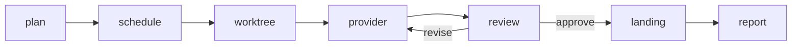

# How a harness run moves

This is the path one `recursion run` takes in the current checkout. The
command reference is [USER-GUIDE.md](USER-GUIDE.md). The product map is
[v3/START-HERE.md](v3/START-HERE.md).

## plan

`plan` and `run --goal` ask a capable provider for a task graph. The object
has one key, `tasks`. Each task has `id`, `description`,
`required_capabilities`, and `depends_on`. Invalid output falls back to one
task per non-empty line. Every description is admitted through the M1A
kernel. The run also admits frozen route fixture `F-M1B-001`. That route id
is not a provider name.

`recursion plan` stops here. It does not start a live CLI.

## schedule

Ready tasks are the ones whose dependencies are `completed` and landed.
`orchestration.concurrency` is how many of those run at once. A failed,
rejected, conflicted, or unreviewed dependency marks later tasks `skipped`.

Each task's candidates are the enabled providers that hold its capabilities.
Higher `routing.weights` go first. Equal weights keep `routing.preference`.
A provider in cooldown is skipped. `routing.retries` and
`routing.backoff_seconds` apply to the same provider. A rate limit, quota
failure, or auth failure records a cooldown and moves on.

## worktree

The run branch is `recursion/run/<run-id>`, cut from `landing.base_ref`
(`--base-ref` overrides it). Each task gets a worktree on
`recursion/task/<run-id>/task-<index>`, cut from the run branch, so a later
task sees work that already landed. The provider's working directory is that
worktree.

## provider

The worker is the first candidate that finishes. `fixture` never starts a
process. `claude`, `codex`, `grok`, `gemini`, `cursor` (`cursor-agent`), and
`opencode` start only with `--allow-live`. The harness does not read or store
API keys. Usage figures are read from the provider's stdout when that stream
carries them. Stderr is not stored.

## review

A different candidate reviews the task, the output, and the diff. The first
non-empty line is `VERDICT approve` or `VERDICT revise`. Approve accepts the
task. Revise sends the notes back to the same worker, up to
`review.max_rounds`. Anything else is treated as revise. A reviewer that
edits the worktree is rejected and the edits are removed. If no reviewer
finishes, `review.accept_unreviewed` decides whether the worker result stands
or the task stays `unreviewed`.

## landing

Accepted edits are committed on the task branch when the provider left a
dirty tree. A commit the provider already made is kept. The task branch is
merged with `--no-ff` into the run branch, not into the checkout you started
from. A conflict aborts that merge and records the paths. Unreviewed branches
are kept and are not merged. Failed branches are deleted unless
`--keep-worktrees` is set.

## report

The state directory receives `<run-id>.report.json` and `<run-id>.report.md`.
The report lists status, duration, usage, the run branch, and each task's
provider, reviews, branch, commit, and diff. The same directory keeps the
run record and `<run-id>.jsonl`. `recursion logs` reads that JSONL. Token-shaped
text is replaced with `[REDACTED]` before those files are written.
