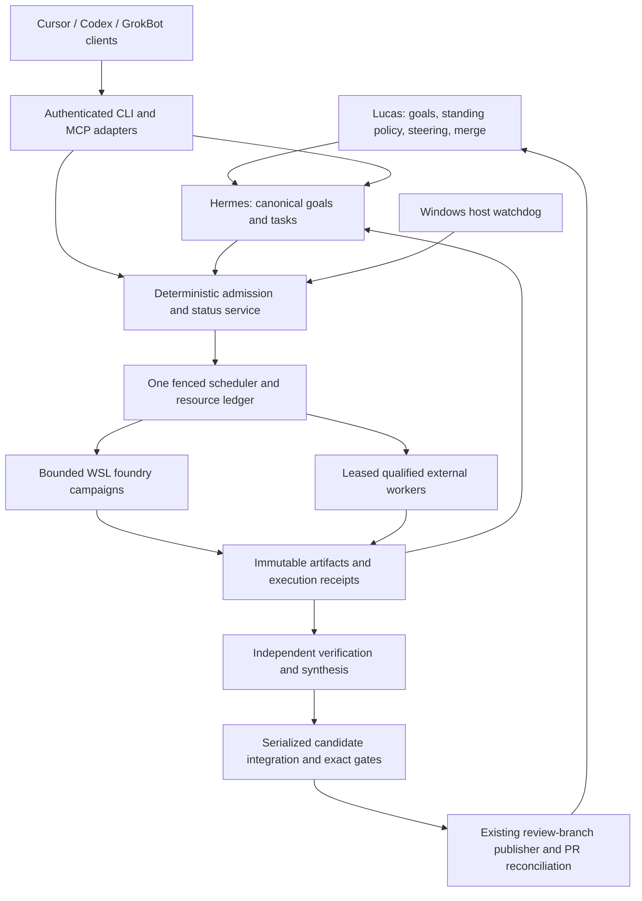

# Continuous WSL construction service

2026-09-13. Proposed specification; no service, route, spend or standing autonomy is enabled.
Parent: [goal-recursion-v2-execution-fabric](../../../state/goals/goal-recursion-v2-execution-fabric.md).
Authoring task: [wsl-autonomy-spec-20260913](../../../state/tasks/wsl-autonomy-spec-20260913.md).
Source baseline: `ba6720c262a1293bd132b5c83504fd6a52e9de72`.

## Objective and authority

Maximize independently verified research, testing and development progress on Recursion v3
per elapsed day, while preserving output quality, depth, accepted requirements and finite
resource budgets. Continuous availability does not require continuous inference. Workers
should have useful work whenever prerequisites and capacity permit; idle monitoring is code.

This is a construction service for building v3, not proof that v3 is implemented. Preserve
[CONTROL_PLANE](../../../CONTROL_PLANE.md): Lucas owns policy, spending and merge decisions;
Hermes remains the executive and canonical task authority; models supply bounded reasoning;
deterministic components enforce admission, execution, evidence and publication. The service
does not independently invent portfolio goals or apply the proposed v3 constitution.

The accepted [v3 requirements](../START-HERE.md) remain the target. Coding benchmark rankings
are candidate-selection evidence, not proof of research, synthesis, reliable tool use or
this repository's gates. SWE-2 is the initial worker candidate because a bounded local route
already exists. No Astra/Fable parity claim or universal model ranking is assumed here.

## Observed baseline and required additions

Read-only host inspection on 2026-09-13 found WSL2 `Ubuntu-24.04`, registered at `D:\WSL`,
in the stopped state. This establishes the configured drive and observed state, not uptime,
SSD performance, Linux service configuration, network reachability or GrokBot authentication.

| Existing source | Reuse | Missing for continuous operation |
|---|---|---|
| [Native tool pipeline](TOOL-PIPELINE.md) | WSL ext4, Bubblewrap, cgroups, brokered tools and isolated commands | Service lifecycle and multi-client admission |
| [Campaign supervision](CAMPAIGN-SUPERVISION.md) | Evidence-bound advisory snapshots | Durable event-triggered supervision and standing-envelope accounting |
| [foundry_supervision.py](../../../tools/construction_swarm/foundry_supervision.py) | Maximum eight-hour campaign; pinned quota windows; STOP checks | New campaigns across window changes, with fresh admission |
| [foundry.py](../../../tools/construction_swarm/foundry.py) | One native campaign lock; immutable plans; attempt collection | Reconciled scheduling between campaigns; leased external contributions |
| [ledger.py](../../../tools/construction_swarm/ledger.py) | Attempt records and conservative unknown settlement | Atomic task/attempt coupling and leader fencing across restarts |
| [September 11 closeout](../construction/swarm-research-20260911-155142/closeout/CONTINUATION.md) | Known controller/accounting and scientific-admission blockers | Independent proof before those scientific workloads execute |
| [September 12 census](NIGHT-RDT-20260912.md) | Rate-limit and malformed-filing evidence | Sustained accepted-output measurements, not just returned-job counts |

The current 200 reserved-slot ceiling is not a safe operating target. Four command slots,
60-second commands, offline scratch environments and the existing aggregate resource bounds
remain the qualified limits until separate profiles pass their gates. Existing worker
tools cannot create native descendants; additional agents must enter central admission.

## Architecture

**CW-01 — One task authority.** Hermes owns logical goal/task revisions. The service owns
execution-attempt, resource-reservation and artifact facts correlated to those tasks. Its
dashboard is a projection, never another writable task registry. A durable outbox couples
execution transitions back to canonical tasks with idempotent receipts. Missing coupling
blocks downstream admission; a successful local attempt cannot silently mark a task done.

**CW-02 — Durable, fenced execution.** Exactly one leader may issue attempt leases, using
a monotonically increasing incarnation/fence token checked at every effect boundary. Commit
intent and reserve capacity before launch; persist launch identity and receipts afterward.
Crash between those steps yields unknown execution, not permission to replay. Immutable
artifact bytes are flushed before atomic manifest publication. Restart reconstructs pending
effects, validates source/policy hashes and checks actual owned processes/cgroups before
admission. Expired leases never prove process death or refund spend. Followers are read-only.

The construction implementation may extend existing ledger mechanisms, but must demonstrate
the above crash behavior. This specification selects no product database or framework and
does not certify the blocked scientific controller by reusing its name or files.

## Host lifetime and access

**CW-03 — Available service, bounded downtime.** A human-provisioned Windows startup/watchdog
component starts the intended per-user distro and maintains a supervised foreground WSL
service connection. Linux service management restarts failed components. Closing Cursor,
Codex or a terminal must not terminate the scheduler. Duplicate host launches elect one
leader. Systemd alone does not keep WSL alive according to [Microsoft's documentation](https://learn.microsoft.com/en-us/windows/wsl/systemd).
Qualification must cover the actual Windows account, sign-out, reboot, lock and sleep policy;
no unattended-start claim follows from a successful interactive shell launch.

Hot clones, scratch worktrees, artifact storage and ledgers live on the Linux filesystem
inside the D: VHDX, under existing `/opt/recursion-foundry` and `/var/lib/recursion-foundry`
roots. Do not move the active database or builds to `/mnt/d` merely because the SSD is D:.
Microsoft recommends Linux filesystem storage for Linux workloads. [Filesystem guidance](https://learn.microsoft.com/en-us/windows/wsl/filesystems)
Control envelopes crossing Windows/WSL are small and immutable; they do not become a second
ledger. Backups need a verified restore outside the same VHDX, not just another directory in it.

With the host awake, healthy and connected, proposed pilot targets are status p95 <=2s,
command acknowledgement <=5s, loss-of-service indication <=30s and restart reconciliation
<=120s for the admitted pilot inventory. A STOP acknowledgement is not cleanup completion;
publish both times, targeting quiescence within 30s for qualified short-command profiles.
If a bound cannot be met, return unavailable/unknown and retain reservations. Sleeping,
powered-off, disconnected or failed hardware cannot be reachable continuously. A remote
health observer may report that outage but gains no second-writer or failover authority.

**CW-04 — Shared client interface.** Provide one versioned construction protocol with a
native CLI and thin MCP adapters. Local Windows clients launch a stdio bridge through
`wsl.exe`; it connects to an authenticated Unix socket in the existing service. Launching
an adapter does not launch a second scheduler or override disabled service state. Native
WSL clients use the same protocol. A remote client uses a separately provisioned encrypted,
authenticated tunnel/transport to that service; no unauthenticated public control port.
Codex and Cursor document stdio MCP support, making this a plausible integration surface;
these exact bridges still require interoperability tests. [Codex MCP](https://learn.chatgpt.com/docs/extend/mcp?surface=cli), [Cursor MCP](https://cursor.com/docs/mcp)

Read responses include service instance/fence, canonical revision, last event cursor,
observation time, freshness, source commit and unavailable fields. A disconnected bridge
may show its last snapshot with `stale=true`; it cannot accept offline mutations or represent
old worker counts as current. Subscribe with cursors; a replay gap requires snapshot refresh.
Client disconnect does not cancel a leased worker. Interactive queries and Stop have a
reserved control queue so saturated builds cannot prevent steering.

**CW-05 — Authenticated collaboration.** Authenticate the caller at the transport, bind
identity server-side, then enforce project, role, capability, expiry and current policy.
A submitted `actor` string, remote desktop access or a model saying “Lucas approved” grants
nothing. Read clients see only their permitted project data. Contributor, verifier,
executive and Owner controls are separate capabilities. GrokBot can be a named client or
operator aid under this same contract; its access to the computer is not authorization to
change policy, secrets, global limits or another worker's checkout.

All mutation requests carry protocol version, idempotency key, expected revision, task/goal
references, source commit and content digests. A repeated key with identical content returns
the original receipt; a different body with that key is rejected. A stale revision returns
conflict. Permission changes invalidate outstanding mutation grants. Revocation and Stop
must be rechecked before provider launch, artifact adoption and publication.

Negotiate bounded request/page sizes and artifact quotas before accepting a client.
Large results use immutable artifact manifests and paged reads rather than unbounded
MCP responses. Path normalization, symlink escape, stale previous-content digests and
cross-project artifact handles must be rejected at the broker, not just in prompts.

| Proposed operation | Who / result |
|---|---|
| `status`, `tasks`, `task`, `events`, `artifact` | Read capability; bounded fresh status or explicitly stale snapshot; artifact access is scoped. |
| `propose_task`, `propose_split`, `submit_note` | Contributor; durable proposal with requirement links and evidence; executive acceptance is separate. |
| `offer_capacity` | Contributor; offered route, host, isolation and budget; no slots or work promised. |
| `claim_task`, `heartbeat`, `checkpoint`, `submit_result` | Qualified contributor; centrally issued fenced lease, bounded artifacts and receipts. |
| `request_parallelism` | Contributor; proposes a target and reason; effective width follows admission, never a config edit. |
| `submit_review` | Independent verifier grant; binds candidate and actual evidence; dissent retained. |
| `cancel_own_attempt` | Leased contributor; cancellation request followed by observed cleanup. |
| `stop`, `pause`, `resume`, `approve_envelope` | Explicit control capability; resume/approval remain Owner actions under current policy. |

These names are proposed protocol operations, not installed commands. Requests return
accepted/rejected/conflict receipts; accepted proposal or cancellation request does not
mean task acceptance, launched work, refunded capacity or completed cancellation.

## Adding Cursor/Codex workers without losing ownership

**CW-06 — Every worker uses central admission.** A Cursor/Codex session may offer its own
agents, but each child needs its own registered identity, exact source/worktree, parent
task, permitted paths/tools, provider/account window, host budget and fenced lease before
launch. The offer reserves nothing until admitted. Work in the WSL sandbox uses the same
cgroup and command pools as SWE-2; remote workers need separately qualified isolation and
their own host capacity records. An uncontained desktop result is an untrusted proposal,
which must be imported and verified in the sandbox before adoption.

Use one attempt worktree per worker. Shared modules have a single integration owner;
disjoint work may proceed concurrently. Two clients racing to claim a task produce one
lease. A lost client or expired lease leaves a hold until reconciliation; late results
retain provenance but cannot advance a newer task incarnation. Synthesis can combine
read-only findings, not overwrite concurrent working files.

**CW-07 — Immutable batches.** Do not inject jobs into an active frozen foundry plan or
bypass its one-campaign lock. The initial service queues new offers/jobs for the next
bounded batch; status, notes and proposals remain available during execution. A future
rolling-admission version may add compatible workers immediately only after separate
multi-client fencing, resource and cleanup tests pass. The interface reports `queued`
versus `running`, estimated admission and the exact blocking dependency. This limitation
must be visible when Cursor asks to add agents mid-campaign.

## Work selection, research depth and quality

**CW-08 — Executable task packets.** Each packet fixes the v3 requirement or unanswered
claim, parent goal, exact baseline, prerequisite receipts, deliverable, non-goals, allowed
paths/tools, acceptance command inventory, reviewer role, budget and checkpoint boundary.
Research adds primary sources, contradictory evidence, a falsifier and a discriminating
experiment. Testing adds a known-answer oracle or mutation that must fail. Development
adds the behavioral before/after condition. No “keep improving Recursion” leaf tasks.

The logical progression is proposed -> admitted -> ready -> leased -> running ->
submitted -> verifying -> verified -> integration -> published-for-review -> merged.
Blocked, failed, cancelled, rejected and unknown are explicit side states. Only a verified
dependency may unblock dependent implementation; downstream work on an unmerged candidate
must pin that candidate and remain labelled provisional. A PR alone is not a merged result.

Among ready tasks, prioritize critical-path prerequisites, confirmed defects and experiments
that can settle a consequential open question; use aging to prevent starvation. Reserve the
research and verification allocations rather than filling every slot with easy code changes.
Blocked tasks retain their exact prerequisite and wake on that event, not repeated inference.

**CW-09 — Preserve depth.** Track one persistent evidence dossier per requirement/claim:
what is known, competing explanations, rejected approaches and why, remaining counterexample,
source freshness, exact experiments and negative results. Each follow-up must name the
unresolved question and expected new evidence. After two consecutive accepted filings add
no new evidence for the same question, suspend that research lane for explicit re-scoping;
this is not a timer that kills a worker doing a long, admitted experiment. A genuine
negative result can settle a question and counts as progress. More restatements do not.

Use a protected research lane alongside development and verification. Split along independent
claims/modules, not arbitrary token-sized shards that destroy context. Let an admitted
deep task use its remaining finite window; checkpoint at real milestones. A stalled-tool
or silent-process observation triggers inspection, not an invented “low productivity” kill.

**CW-10 — Independent acceptance.** Self-reports are hints. Evidence must bind actual tool
calls, command exits, source/candidate hashes, coverage, failures and cleanup. Independent
review sees the exact candidate plus original evidence and dissent; it must reproduce
relevant gates. Prefer a different model family for consequential review and synthesis.
Same-family or missing-verifier work waits unless an already valid policy explicitly
permits it; no majority vote or automatic verifier downgrade converts it into acceptance.

SWE-2 is a worker candidate; Grok/Cursor, Codex and other qualified routes are candidates
for review, synthesis or complex implementation. Assign by measured task performance and
availability within a human-configured route registry. Persist actual provider/model and
account identity. Never obtain “diversity” through undisclosed model substitution. A stronger
model's rewrite is still a new candidate requiring gates.

## Parallelism, monitoring and budgets

**CW-11 — Adaptive capacity.** Proposed pilot: one smoke worker, then five total worker
slots (three implementation/testing, one research, one independently routed verifier).
These are allocations, not five SWE-2 workers plus unlimited extras. Reserve verifier
capacity; unused allocation may be loaned only if it can be reclaimed without losing
the verifier's completion budget. Coordinator inference also consumes measured provider
and host capacity. Local interactive use retains explicit headroom.

After a passing canary, a proposed burst ceiling is eight workers across all contributors.
Increase by one at a time only with ready independent tasks, recent route success, fresh
quota, measured memory/CPU/disk headroom and a review backlog within policy. Admit the
minimum of host, provider/account, task independence, command capacity, verification
capacity and Owner ceiling. Four concurrent commands remains a separate bound. Decline
an offer with the binding reason instead of silently oversubscribing the box.

Example pilot thresholds to ratify: keep >=20% host memory headroom; no rising sustained
swap pressure; reserve >=10 GiB free inside ext4 and >=20 GiB on D: for the VHDX plus
estimated task/artifact growth. Review backlog above two candidates per active verifier
stops new implementation admission and directs available capacity to review. These are
proposed starting thresholds, not measurements of the host or guaranteed sufficient bounds.

**CW-12 — Event-driven supervision.** Deterministic checks watch process/cgroup ownership,
last completed tool receipt, deadlines, outbox delivery, evidence integrity, quota, disk
and reviewer backlog. They run without model calls. Batch meaningful events into bounded
advisor requests: failed gate, provider backoff, conflicting findings, blocked dependency,
stalled tool, integration conflict or sustained non-novel research. Coalesce duplicates;
advice cannot launch descendants, accept results or extend policy. Healthy unchanged
workers need no periodic “are you done?” inference. Missing advisor capacity does not stop
already safe independent work, but prevents actions requiring its judgment.

**CW-13 — Standing envelope and finite campaigns.** A separately approved standing grant
names eligible goals, task classes, routes, hosts, writable domains, per-task/daily/weekly
budgets, aggregate ceilings, review rules, start/expiry, pause/stop behavior and renewal.
The service can continue routine bounded decomposition and new batches within that grant,
without asking Lucas for each task. Goal amendments and broader capabilities still escalate.
The proposed initial grant lasts seven days; expiry ends admission and preserves awareness.
Longer service authorization requires an explicit Owner renewal, not self-renewal by a model.

Each batch remains <=8 hours, ends before its binding quota reset/standing expiry and
preserves the existing >=600-second closeout reserve. New windows create new immutable
plans after fresh account observations, cleanup reconciliation and remaining-grant checks;
they do not extend an old deadline, reuse old reset identities or refund unknown charges.
Short windows that cannot preserve closeout remain idle. Implement quota-window rollover
before claiming continuous development; a restarted session is not that implementation.
Use monotonic elapsed-time deadlines within an incarnation and authenticated/reconciled UTC
expiry across restarts. Clock rollback or uncertain expiry cannot extend a grant; it blocks
new admission until reconciled. Existing in-flight uncertainty remains visible and charged.

Record Codex, Cognition and each other provider's actual account/windows separately.
Multiple clients sharing one subscription share its budget. Do not use Codex remaining
percentage as a SWE-2 quota meter. Count attempts, reviews, synthesis, retries, compaction,
research retrieval and integration in the same workflow cost without double counting.
Unknown counters are unknown; no inferred token totals from percentage observations.

Initial qualification is included-capacity-only. The current foundry explicitly rejects
new metered spend. CheaperInference/OpenRouter/DeepSeek paid operation therefore requires
a separately qualified adapter and Owner-set currency ceiling, not a fallback toggle.
No reset credit redemption, purchase, routing/config change or balance top-up is automatic.
At a route's reserve threshold stop admitting that route; independent admitted work on
other eligible routes may continue when dependency and verification budgets remain valid.

**CW-14 — Bounded recovery.** Use provider-specific backoff with jitter and Retry-After
when available; distinguish explicit rejection before execution from uncertain execution.
At most two new attempts after a known completed failure per logical task in the pilot,
within the original task/standing budget. Unknown attempts cannot be retried until settled
under an approved deterministic recovery rule. Repeated failures open a route circuit and
produce one correlated blocker; neither reboot nor quota reset closes it by itself.
Corrupt ledgers/artifacts or unowned live processes stop the affected admission domain.

**CW-15 — Context continuity.** Checkpoint the exact task/source/requirements, policy and
lease, completed operations, staged diff, original evidence handles, decisions/dissent,
remaining budget and next bounded step. Compaction is a derived view with provenance;
originals remain retrievable and authority is revalidated on rehydration. A provider
session is replaceable acceleration state, not canonical memory. Old instructions,
revoked grants and uncertain effects cannot disappear into a summary. Resume only after
the checkpoint's source and incarnation are reconciled.

## Integration, publication and operator control

**CW-16 — Relevant commits and PRs.** The integrator stages one coherent requirement-sized
candidate, verifies exact path/source scope and reruns gates against the composed result.
Parallel candidates integrate serially; a base change invalidates affected gate/review
receipts. Immutable verified candidate commits retain lineage to task, requirements,
attempts and evidence. Publish only through the existing authorized review-branch path.
PRs state behavior, evidence, limitations and open decisions, with one logical change per
PR; do not create PRs for every worker filing. Publication needs an enabled, registered
publisher, a passed task and independent evidence; the orientation/spec branches alone
do not satisfy that operational provisioning.

Persist publication intent, branch/head and remote reconciliation before retrying a lost
push/PR response. A durable publication key prevents duplicate PR creation. Lucas alone
merges to master. Verified unmerged stacks may support explicitly provisional work, but
cap the pilot at three outstanding integration candidates; when that queue fills, spend
capacity on reviews, tests and distinct research or wait. Sustainable 24/7 activity may
pause when human merge throughput is the constraint.

**CW-17 — Reachable steering and honest status.** `status` shows goal progress, current
sources, active leases, submitted/verified/review-pending counts, blockers with next actors,
route/quota freshness, retained holds, actual spend and quality indicators. It distinguishes
alive, busy, producing evidence, verified and merged. Report one concise daily brief;
other notifications occur on meaningful completion, failure or required action, deduplicated
by task/blocker. Delivery respects the existing outbox and PAUSE rules.

Owner Stop fences new effects immediately and requests bounded cancellation/cleanup of
owned processes. Under PAUSE, preserve local status, heartbeat and durable blocker records;
halt planning, workers, publication and notification delivery as required by CONTROL_PLANE.
Incoming notes may be retained as inert, attributed inbox records while paused; accepting
the note is not accepting a task, applying a revision or calling the planning model.
Do not reinterpret PAUSE as a new “finish this task” mode. A pending cleanup remains visible
as unknown. Resuming requires a fresh Owner action plus policy/source/process reconciliation.

**CW-18 — Demonstrate useful acceleration.** Compare five-slot and eight-slot runs on
matched pinned v3 tasks with the same acceptance depth. Measure accepted requirement/claim
closures, gate failure/rework and escaped defects, reviewer minutes, research novelty,
source quality, p50/p95 elapsed time, full workflow spend and quota, CPU/memory/disk pressure,
and time blocked on gates or humans. A wide wave of syntactically valid filings is not
an improvement metric. Adopt greater concurrency only when verified throughput improves
without a quality regression; retain the narrower setting if measurements are inconclusive.
Preregister the matched tasks, quality rubric, acceptable error bounds and evaluation method
before the comparison. Retain sample sizes and uncertainty; a single lucky eight-worker wave
does not qualify sustained operation. No reduction in acceptance depth is an efficiency gain.

## Implementation sequence and acceptance

The [acceptance matrix](continuous-operation-contract.json) maps every CW requirement to
specific future runtime scenarios and an implementation phase. Its checks are specified,
not executed by this authoring task. Build in this order:

| Phase | Deliverable | Exit condition |
|---|---|---|
| P1 | Protocol, fake workers, task/attempt coupling and fenced ledger | Race, replay, permission and crash fixtures pass without inference. |
| P2 | Read-only CLI/MCP bridge and host lifecycle | Both clients can observe; disconnect/restart/stale-state and host-start tests pass. |
| P3 | Leased contributions, bounded scheduler and scoped mutations | One task cannot be double-claimed; extra agents share capacity; STOP wins races. |
| P4 | Standing envelope, quota rollover and event advice | Expiry, reset, shared-account accounting, no-paid-fallback and unknown-retry tests pass. |
| P5 | Evidence, context, research continuity and independent review | Malformed/self-approved/compaction-loss results cannot advance; deep research survives handoff. |
| P6 | Serialized integration and review publication | Exact composed gates; changed-base invalidation; duplicate-publication recovery; Owner merge boundary. |
| P7 | Human-provisioned one-worker and then five-worker canary | Fresh live isolation, identity, receipt, resource and cleanup evidence on the actual host. |
| P8 | 72-hour soak and controlled eight-worker comparison | Meets host-awake availability targets, no integrity breach, bounded spend, useful output and no quality regression. |

P2's read-only bridge can be built alongside P1; mutation and worker admission wait for P1.
P3-P6 then establish the integrated safety/quality path before live unattended trials.
Each implementation packet must pin its own source, exact allowed paths and executable
commands before launch. Long-build profiles, remote worker containment, paid routes and
rolling admission are separate qualifications; their absence is visible rather than
silently weakening the short-command/default profile.

Before activation Lucas ratifies the standing envelope and numerical pilot limits, enables
the host lifecycle/access credentials and publisher through the existing human-owned
workflow, and approves the measured route set. No unresolved product decision needs to be
invented to finish this specification. The [specification gate](../../../tools/check_wsl_autonomy_spec.py)
checks scope, traceability and links only; it never launches WSL, providers or a scheduler.
