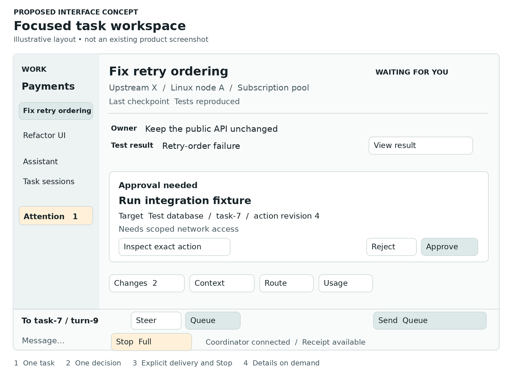
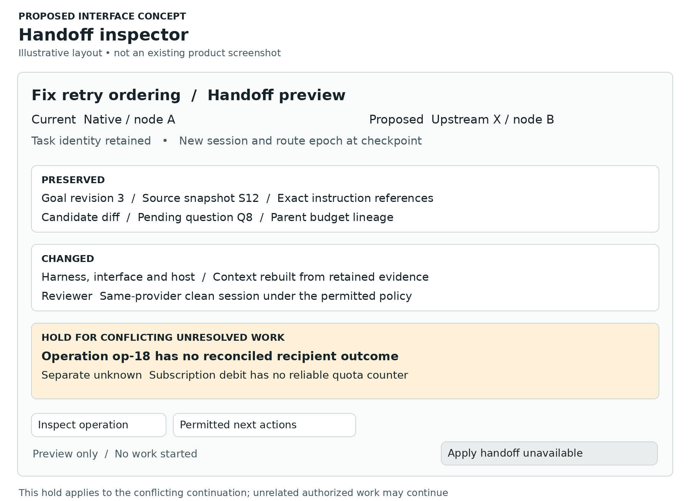

# Recursion interface and product strategy

Research and design recommendations for Lucas

2 October 2026 · Repository basis 3a542c6bbd88351e6f6c5eceffd317bc2450fcad

Build Recursion’s own independently useful native model-and-tool loop and a focused terminal workspace over one durable command and query model. Add qualified upstream orchestration and checkpoint-based combined workflows, with a later GUI that makes review, lineage and recovery easier to inspect. Keep normal work simple: one conversation, clear progress, useful output, explicit Steer or Queue, and a Stop control that stays reachable. Put route, context, usage and configuration details one step away.

A lean optimized base, optional capabilities, versioned profiles and AI-assisted setup are a credible design direction. They are not yet proven optimal. The base should remain useful without optional inference, and an installed-but-disabled component should not start code, watchers, network connections or model work. AI should explain and propose deterministic changes that the same ordinary configuration tools can preview, apply and verify.

The strongest potential advance is productive continuity: a currently authorized task survives a harness change, compaction, a source fork or a lost machine while preserving useful work, meaningful controls and honest accounting. That must beat strong existing systems in verified outcomes and human effort. A multi-agent dashboard, persistence, plugins, worktrees or an attention inbox alone would not establish novelty.

## 1 Decisions and recommendations

The Owner has clarified that this early repository may be rescoped to make the released product right. I recommend a local-first first release: a useful native harness, one qualified upstream profile, checkpoint-based combined continuation, a focused CLI/TUI and a small curated extension set. Section 6 gives the proposed cut, lost workflows and evidence needed to add them back. Two release strategies remain available:

- Lean default with the full accepted first-release capabilities available through supported components and profiles
- A smaller initial usable release, with explicitly revised launch gates and named deferrals

I favor the smaller coherent release over requiring every historical integration and remote workflow at launch. That is a recommendation for review, not an accepted amendment. The existing repository requirements remain an accurate historical baseline and a visible list of proposed deferrals. Keep the GUI later unless usability evidence gives a concrete reason to move it earlier. No repository change is made by this report.

Recommended design priorities:

1. Make the deterministic CLI, TUI and later GUI share command identity, admission, receipts, events and query projections. Views never own agent lifetime
2. Make ordinary conversation and review feel as direct as the strongest native tools. Show the decision or artifact that needs attention, rather than requiring log supervision
3. Preserve richer source features through versioned engine extensions. A common interface must explain loss instead of flattening all routes to a weak shared subset
4. Keep native-only, upstream-only and combined workflows complete. Every planner, compactor, reviewer, setup helper and recovery helper has an explicit route and allowance
5. Measure lean behavior across startup, idle, first use, failure and recovery. Optional packaging alone proves no efficiency gain
6. Build the six demonstrations in Section 7 as evidence-driven prototypes and later qualified runtime trials. These demonstrations span the lean core and later remote/collaboration packs; none has been run by this research

This snapshot has substantial specifications, pure planning substrate and experimental evidence, but no integrated usable v3 runtime, native loop, qualified adapter fabric or operator CLI. All Recursion commands and layouts in this report are proposals, not runnable product instructions. Static source inspection and primary documentation support the comparison; they do not certify a deployed build, user entitlement, billing behavior or integration. [Implementation boundary](https://github.com/NotSkittlz/recursion/blob/3a542c6bbd88351e6f6c5eceffd317bc2450fcad/scripts/tests/v3/planning/static.test.py#L11-L21), [first-release requirements](https://github.com/NotSkittlz/recursion/blob/3a542c6bbd88351e6f6c5eceffd317bc2450fcad/docs/v3/PRODUCT.md#L71-L93)

## 2 Repository baseline and design boundaries

The current repository scope includes a useful native harness, independently useful upstream execution and combined workflows; all ten terminal controls; persistent assistants and visible consultation; configuration, presets and provenance; plugins with native/upstream implementations and local execution; guided setup/import/repair; compaction; and Windows/Linux remote execution and recorded-work recovery. Grok, Cursor, Gemini, Claude, Hermes, OpenCode and ChatGPT are launch-critical compatibility names. The proposed lean cut would explicitly replace that blanket launch gate while retaining all named integrations in the research and roadmap inventory. [Product](https://github.com/NotSkittlz/recursion/blob/3a542c6bbd88351e6f6c5eceffd317bc2450fcad/docs/v3/PRODUCT.md#L65-L93), [Owner directions](https://github.com/NotSkittlz/recursion/blob/3a542c6bbd88351e6f6c5eceffd317bc2450fcad/docs/v3/DECISION-REGISTER.md#L21-L89)

Responsiveness, subscription efficiency and task completion remain the accepted default ranking, subject to correctness, authorization, quality, resource limits and recoverability. Report the complete vector; do not invent a single weighted score. Ordinary persistence, inspection, setup and control should not need continuous inference. Upstream-only means all reasoning roles can execute without a hidden native/API connection. [OR 022 through OR 025](https://github.com/NotSkittlz/recursion/blob/3a542c6bbd88351e6f6c5eceffd317bc2450fcad/docs/v3/DECISION-REGISTER.md#L85-L89)

The Hermes-led repository executive and v1/v2 migration are retired. Hermes Agent remains an upstream integration. Lower-priority documents retain conflicting wording about that executive and operational PAUSE; reconcile those references before implementation. The three future Stop modes below do not silently change operational PAUSE. Frozen M1 schemas also stay frozen: the proposed UI/API projections require explicit bridges, not opportunistic rewrites. [Current governance](https://github.com/NotSkittlz/recursion/blob/3a542c6bbd88351e6f6c5eceffd317bc2450fcad/CONTROL_PLANE.md#L3-L26), [D 017](https://github.com/NotSkittlz/recursion/blob/3a542c6bbd88351e6f6c5eceffd317bc2450fcad/state/DECISIONS.md#L11-L33), [M1A wire profile](https://github.com/NotSkittlz/recursion/blob/3a542c6bbd88351e6f6c5eceffd317bc2450fcad/docs/v3/M1A-WIRE-PROFILE.md#L16-L54)

| Boundary | Current status |
|---|---|
| Terminal first and GUI later | Current direction and continuing recommendation; open to justified rescoping |
| Ten controls and three execution modes | Repository requirements; retain for qualified lean launch workflows, with exact scope explicit |
| Lean and rich configurations | Keep extensible design and honest availability; proposed release deferrals must be named |
| Smaller first release | Explicit recommendation in Section 6; exact omissions await Owner acceptance |
| Command spellings and conceptual screens | Proposed design |
| Language, database, transport, GUI framework and sandbox | Unselected by this report |
| Better quality, efficiency, usability or frontier performance | Hypotheses requiring comparative evidence |

## 3 Recommended CLI TUI and GUI

### Division of responsibility

| Layer | Owns | Must not own or imply |
|---|---|---|
| Headless control/query services | Admission, durable command receipts, object identity, current authority, configuration validation, typed capability negotiation, role bindings, event ordering, recovery and evidence projections | Continuous inference merely to maintain status; authority inferred from a UI tab or source text |
| Scriptable CLI | Deterministic discovery, explicit commands, batch inspection, configuration transactions, stable JSON/JSONL, shell completion, model-free diagnosis and recovery | Scraping chat prose to infer state; a second settings database |
| Interactive TUI | Live conversation, focused work views, keyboard-first steering/queueing, inbox, split/attached views, task switching and compact inspect panels | Owning actor/process lifetime; hidden model invocation on attach; full log repaint on every token |
| Later GUI | Spatial project/session navigation, artifact/diff review, visually clear lineage, context comparison, richer provenance inspection and accessible responsive views | Different command meanings; bypassing the common admission path; a mandatory always-on dashboard |
| Optional transports and observers | Authorized projections and separately scoped control operations | Treating channel membership or message delivery as task authority |

T3 Code’s command/effect-state separation and focused working/attention organization, Pi’s experimental durable primitives, Muse’s session protocol and Goose’s recipe/extension patterns are strong comparison/adoption candidates. They prevent claiming novelty for an attention inbox, persistence, task graph, receipts or configurable workflows alone. Qualification remains version- and maturity-specific; Pi explicitly labels its durable API experimental, and Muse’s concept guide still calls the protocol pre-1.0. [T3 architecture](https://github.com/pingdotgg/t3code/blob/b33eda13998b5b0571daaf266c87f6f31af41f7d/docs/internals/overview.md), [T3 working section](https://github.com/pingdotgg/t3code/blob/b33eda13998b5b0571daaf266c87f6f31af41f7d/docs/user/thread-sidebar.md#working-section), [Pi durable](https://github.com/earendil-works/pi/blob/7fbbd5f4a1d982bb02d63472dde0774fa639f99b/packages/durable/README.md), [Muse protocol](https://meta-models.github.io/muse-code-sdk/next/guides/msp-concepts/), [Goose subrecipes](https://github.com/aaif-goose/goose/blob/8f4cab5fdb54dfb6a6749b997f4ef560625d1f9c/documentation/docs/guides/recipes/subrecipes.md)

The observer interface should stay read-only by default. Control is a separate authenticated capability. A local CLI need not become a publicly listening web service. Neither HTTP, WebSocket nor a specific RPC library is selected here. A versioned command schema and lossless state mapping matter before transport choice. [Interaction ownership](https://github.com/NotSkittlz/recursion/blob/3a542c6bbd88351e6f6c5eceffd317bc2450fcad/docs/v3/foundation-research/platform-round/interaction-contract.md), [observer interface](https://github.com/NotSkittlz/recursion/blob/3a542c6bbd88351e6f6c5eceffd317bc2450fcad/docs/v3/CLI.md#stable-observer-interface)

### The object graph users should be able to understand

These are presentation projections of existing records, not a proposal for parallel writable state.

| User-facing object | Identity and relationships | Main actions | Essential visible facts |
|---|---|---|---|
| Project / workspace | Repository roots, classification, source/worktree bindings, views | Open, inspect, configure, attach views | Exact root and host, branch/source revision, dirty state, applicable configuration |
| Goal / task | Accepted GoalSpec and plan revision, parent task, gates | Draft, accept/amend through existing authority, inspect, direct, stop | Accepted outcome, scope, latest checkpoint, blocker, gate result and next bounded action |
| Assistant / role | Persistent assistant identity, role lease and authorized task membership | Converse, consult, inspect, select eligible route | Who requested/replied/adopted, current goal, session, decision rights and lease |
| Run / attempt / session / turn | Logical run plus execution attempt, upstream session and targeted turn | Attach, steer, queue, interrupt, resume, hand off | Distinct IDs/epochs; a new provider session need not create a new goal |
| Operation / effect | Canonical operation, attempts, recipient and effect class | Inspect, reconcile; retry only when admissible | Intended action, admission, dispatch, recipient observation, outcome/uncertainty |
| Question / approval / queued input | Durable ID, target, expiry and revision | Answer/cancel; approve/reject; edit/remove before delivery | Intended recipient, exact action/arguments where applicable, current validity and delivery point |
| Checkpoint / context epoch | Canonical references, capsule manifest and compaction ownership | Inspect, compare, request supported compact, rehydrate | Exact constraints, evidence retained/omitted, freshness, last settled operation, unresolved effects |
| Artifact / candidate / evidence | Source and output identities, producing operation, verification binding | Review, compare, export within authorization | Exact candidate, tests run/omitted, supported result, lineage and access classification |
| Route | Harness/interface/build + provider/model + pool + credential reference + host/profile | Explain, rehearse, select when authorized | Technical support, account eligibility, available controls, losses, reason for selection |
| Configuration / plugin / node | Effective revision, component artifact, host incarnation | Inspect, preview, apply at allowed boundary, repair/revoke when authorized | Requested versus effective values, provenance, lifecycle, installation/activation/fence receipts |
| Budget / reservation / meter segment | Parent pool and task reservations, units and observation source | Inspect, configure bounds, reconcile | Used, reserved, available or unknown; reset/lineage boundary; unallocated use |

Do not present a model picker as the whole route picker. Do not equate a chat session with a task, an assistant identity with its current model, or an artifact with an accepted result. [Route entities](https://github.com/NotSkittlz/recursion/blob/3a542c6bbd88351e6f6c5eceffd317bc2450fcad/docs/v3/EXECUTION-FABRIC.md#L194-L242), [role closure](https://github.com/NotSkittlz/recursion/blob/3a542c6bbd88351e6f6c5eceffd317bc2450fcad/docs/v3/EXECUTION-FABRIC.md#L92-L169), [context artifacts](https://github.com/NotSkittlz/recursion/blob/3a542c6bbd88351e6f6c5eceffd317bc2450fcad/docs/v3/CONTEXT.md#L65-L214)

### State is a set of facts not one optimistic badge

A compact task label such as Running, Waiting for you, Waiting for capacity, Recovering, Ready for review or Closed is useful. It must be derived from underlying facts and expandable. A task can simultaneously have an interrupted upstream turn, no live owned local processes, one unreachable worker and an unresolved external operation.

For commands, distinguish:

1. **Saved locally**: a disconnected client has retained intent; the coordinator has not accepted it
2. **Accepted**: canonical command receipt exists under the referenced scope/revision
3. **Applied at recipient / delivered**: the relevant recipient has observed the request or installed its fence
4. **Observed outcome**: turn ended, local process scope emptied, boundary reached, or remote receipt arrived
5. **Settled or unresolved effects**: action-specific reconciliation, independent of the previous labels

These are related facets, not a mandatory linear progression. An upstream acknowledgment may precede a final event; an old event may arrive after a new session exists. Preserve source time, canonical order, receipt time and source event/version in details. If there is a replay gap, show a gap/reconstruction marker rather than inventing the missing story.

For messages, **accepted**, **delivered** and **adopted** have different meanings. An active steer reaching the turn does not prove the agent obeyed it. For code, **generated**, **tested**, **reviewed**, **accepted** and **published** differ. For configuration, **compiled**, **validated**, **staged** and **effective** differ. [Terminal control contract](https://github.com/NotSkittlz/recursion/blob/3a542c6bbd88351e6f6c5eceffd317bc2450fcad/docs/v3/TERMINAL-RUNTIME.md#L58-L165), [execution receipts](https://github.com/NotSkittlz/recursion/blob/3a542c6bbd88351e6f6c5eceffd317bc2450fcad/docs/v3/EXECUTION-FABRIC.md#L64-L120), [configuration revisions](https://github.com/NotSkittlz/recursion/blob/3a542c6bbd88351e6f6c5eceffd317bc2450fcad/docs/v3/CLI.md#L9-L90)

### Proposed command organization

Retain the repository's noun-oriented candidate surface. Consolidate overlapping commands only after discoverability tests; do not silently replace accepted concepts.

| Workflow | Proposed command families and useful examples |
|---|---|
| Enter and find work | `recursion`, `workspace open`, `project list`, `task list`, `attach task <id>`, `attach head`, `view events` |
| Understand current state | `status`, `task show <id>`, `events --task <id>`, `queue explain`, `route explain`, `budget show`, `doctor` |
| Talk and control | `message send --target ... --delivery steer\|queue`, `interaction list\|answer\|cancel`, `approval show\|respond`, `stop --target ... --mode aggressive\|full\|lazy`, `resume` |
| Preserve and continue | `checkpoint show`, `context inspect\|compare\|compact\|rehydrate\|doctor`, `fork preview\|create`, `route rehearse`, `handoff preview\|apply` |
| Review work | `artifact list\|show`, `diff`, `evidence show\|verify\|export`, `verification show`, `research claims\|sources\|gaps` |
| Configure the platform | `init`, `configure`, `config get\|explain\|diff\|validate\|apply\|migrate`, `plugin list\|show\|explain`, `provider list\|auth`, `model list`, `node list\|show\|doctor` |
| Maintain and recover | `daemon status\|start\|stop`, `doctor --component ...`, `update preview\|status`, `recovery inspect\|plan`, safe-mode/read-only recovery |

Every name here is a design candidate, not a presently runnable Recursion command. The simpler `stop`, `fork`, `message` and `handoff` names should compile into the same command schema as any task-scoped aliases. Do not create competing semantics for `goal stop`, `arm stop` and an obvious top-level Stop.

### Discoverability and automation contract

- `--help`, examples, command search, shell completion, schema inspection and route/config explanations run without a model. Help shows whether the current route supports the action and links to the nearest relevant explanation.
- Interactive `/` completion and GUI command palette use the same registry. Commands are visibly labeled deterministic control, assistant request or engine extension. Natural-language proposals cannot silently become authority changes.
- Imported commands keep an engine/plugin namespace and supplying version, for example a conceptual `engine:codex/...`. Alias resolution is inspectable. Collision or translation loss is reported before dispatch.
- Offer stable `--output json` for objects and `--output jsonl` for events. Human output and diagnostics must not contaminate machine stdout. No ANSI in redirected output; explicit plain-text/no-color mode; timestamps with zone; machine-readable quantities with units.
- Return typed errors with code, failed precondition, target/revision, whether any effect was attempted, a safe next action and retryability. `unsupported`, `incompatible`, `not-authorized`, `stale`, `unavailable` and `unknown` are different failures.
- Expose an explicit receipt command ID and idempotent retries. Retrying the same request after a lost acknowledgment must not duplicate the action. Reusing an ID with different content must fail.
- Separate process exit from asynchronous task success. A successful submission may return an accepted receipt while the task is still running. An optional `--wait` names the desired condition and deadline; timeout returns a pending/unknown result, not a fabricated failure or success.
- Cursor-based event reads bind stream/daemon epoch and retention state. Gaps force the supported resynchronization path. Scripts never recover by counting terminal lines.
- Preview/dry-run is deterministic and side-effect-free, including no plugin import, installation, credential use or implicit network/model probe. Live diagnostics are explicitly distinguished and separately admitted.
- A noninteractive command missing required authority or information fails with a structured action-required response. It must not hang on an invisible prompt or assume `--yes` can defeat the authority ceiling.

A receipt projection should expose command identity, target task/attempt/turn, canonical acceptance, pending recipient fence, observed local/upstream outcomes and unresolved effects. This is a presentation projection, not a replacement M1 wire object. Admission must bind the actual authority, route/configuration and epoch references supplied by the existing contracts. [CLI schema/transactions](https://github.com/NotSkittlz/recursion/blob/3a542c6bbd88351e6f6c5eceffd317bc2450fcad/docs/v3/CLI.md#L170-L222), [required controls](https://github.com/NotSkittlz/recursion/blob/3a542c6bbd88351e6f6c5eceffd317bc2450fcad/docs/v3/foundation-research/platform-round/interaction-contract.md)

### Default arrangement

The default should show one selected task or assistant conversation. Avoid opening graph, terminal, telemetry and evidence panes simultaneously.

The header is a compact summary; detailed route, authority and accounting are one explicit inspection away. The focused conceptual layout appears in Figure 1. Keep the composer stable while output streams. Scrollback position is not dragged to the bottom when the user is reading; a new-events affordance restores follow mode.

### Multi session and collaboration behavior

A workspace groups projects, task runs and assistant conversations, not just terminal processes. Session tabs have persistent logical labels and precise IDs in details. Split and independent terminal views can show different tasks or the same task at different cursors. Closing a view detaches; work continues. Attaching adds no inference, plugin activation or repository indexing.

Show who has the input/resize lease where the underlying session requires exclusivity. A read-only viewer can request a control lease; focus alone never steals it. Warn about a stale target before delivering a composed message after tab/session changes. Per-view drafts remain separate from canonical accepted messages.

For the accepted questionnaire-assistant/Head workflow, show a concise consultation card: requested by whom, addressed to whom, question/evidence references, reply, and adopted/declined/expired state. Expand into a causally ordered exchange when useful. The user can participate, steer or stop without copying text between conversations. A consultant's suggestion remains a suggestion until the appropriate acceptance event. Graph view is an optional troubleshooting lens with a list equivalent, not the normal way to understand work. [Detachable operation](https://github.com/NotSkittlz/recursion/blob/3a542c6bbd88351e6f6c5eceffd317bc2450fcad/docs/v3/CLI.md#L147-L168), [visible consultation](https://github.com/NotSkittlz/recursion/blob/3a542c6bbd88351e6f6c5eceffd317bc2450fcad/docs/v3/INTERACTION-SURFACES.md#required-visible-assistant-to-head-workflow--2026-09-07)

### Lean and rich modes

**Lean:** focused conversation, current task status, route summary, attention count, Stop, terse artifact/gate result; optional panes and model-backed helpers inactive unless selected. Required controls remain discoverable; unavailable optional components expose their installation/activation prerequisites rather than loading invisibly. Recorded platform capability scope, the newly proposed release cut and what this installation currently has loaded are three separate facts.

**Rich:** multiple views, consultation visibility, task dependencies, context comparison, detailed route/usage inspection and optional helper roles. Each helper has an explicit execution/accounting path. Rich mode is not stronger authority; lean mode is not removal of accepted capabilities.

Store presentation preferences independently from authority and route policies. Switching layout must not activate a compactor, reviewer, model or plugin. Distinguish installed, available, activated for this task and selected by default. [Rich/lean obligation](https://github.com/NotSkittlz/recursion/blob/3a542c6bbd88351e6f6c5eceffd317bc2450fcad/docs/v3/DECISION-REGISTER.md#L21-L89), [plugin activation](https://github.com/NotSkittlz/recursion/blob/3a542c6bbd88351e6f6c5eceffd317bc2450fcad/docs/v3/PLUGINS-AND-EDITIONS.md#L9-L139)

### Information architecture

Keep five primary destinations and a command palette:

1. **Work**: project/task list, assistant conversations, active/recent sessions, saved workspace views
2. **Attention**: questions, approvals, material blockers, review requests and unresolved effects requiring a decision
3. **Artifacts**: exact candidate diffs, outputs, tests and evidence, filtered by current project/task
4. **Environment**: routes/accounts/models, nodes and installed capabilities; details opened on demand
5. **Settings and recovery**: configuration provenance, profiles, propagation, updates, backups, doctor and safe-mode recovery

Work is the home. Attention is an exception list, not every emitted event. A context inspector is a task panel, not a sixth silo. The global graph, raw events and resource telemetry are secondary views under the relevant task/environment.

### Task screen specification

- **Left rail:** project and task navigation, pinned assistant conversations, unobtrusive attention counts. Long-running task names are human-readable, with IDs available for scripts.
- **Header:** task outcome, current activity/blocker, route/host/billing summary, latest meaningful checkpoint, live/stale indicator.
- **Main pane:** conversation plus compact typed event cards. User text, assistant text, tool observations, configuration changes and accepted state transitions look different without relying solely on color.
- **Bottom composer/control strip:** named recipient, current turn target, separately configurable Steer/Queue, persistent selected Stop mode and scope. Inspecting another panel does not make Stop disappear.
- **Right inspector:** tabs for Changes, Context, Route, Usage and Details, with only the relevant tab opened. The collapsed state summarizes significant exceptions.
- **Review mode:** readable unified/split diff, source/candidate identity, artifact preview, exact verification binding, tests omitted and open questions. Review acceptance is separate from merge/publish.

A graphical task tree can expose child ownership for Full Stop or budgets. It must not imply a new executive tier. Semantic hierarchy is task/goal/lease driven, not the nesting of windows.

### Accessibility and responsive behavior

Accessibility is foundational for the terminal and every later GUI increment, not an advanced tier.

- Full keyboard access, named controls, visible non-obscured focus, logical traversal, focus restoration after closing inspectors, customizable nonconflicting shortcuts. Do not globally overload Escape with destructive cancellation.
- A visible Stop label and mode remain available without mouse-only gestures or a timing-sensitive double keypress. Test whether a dedicated configured shortcut is discoverable and safe; do not impose one universal Ctrl-C meaning across composer, selection, shell and task control.
- Status announcements are semantic and rate-limited. Announce important state changes without reading every streamed token or stealing focus. Offer a quiet mode and explicit “read latest status.” W3C's guidance supports status communication without focus changes and warns against overly chatty live regions. [Status messages](https://www.w3.org/WAI/WCAG22/Understanding/status-messages.html)
- Text, icons and labels jointly express state; color alone is insufficient. Support high contrast, reduced motion, zoom and plain text. Streaming rendering must preserve input, Unicode and IME composition; terminal control sequences from untrusted output must not become UI commands.
- For web-based GUI candidates, use WCAG 2.2 AA as a proposed test target, including focus not obscured, reflow and minimum target sizing. Reflow task summaries and controls to a 320 CSS-pixel viewport; provide a readable list/unified-diff alternative where spatial views need two-dimensional layout. Controls meet the 24×24 CSS-pixel minimum or applicable exceptions; larger primary touch controls are a design choice to test. These sources are accessibility guidance, not certification of a nonexistent implementation. [Focus](https://www.w3.org/WAI/WCAG22/Understanding/focus-not-obscured-minimum.html), [reflow](https://www.w3.org/WAI/WCAG22/Understanding/reflow.html), [targets](https://www.w3.org/WAI/WCAG22/Understanding/target-size-minimum.html)
- Start mobile/responsive work with authenticated **read views**: task status, attention summaries, artifact summaries, freshness and last verified coordinator contact. Small-screen control can be added using the same scoped contracts when qualified; do not make remote administration or approval a requirement of the initial mobile view.
- A disconnected mobile/browser client says “last synchronized at ….” Locally saved control intent is not presented as coordinator acceptance. Reading cached information does not require a model, and offline availability is limited by retained local data and authorization.

### Two interface concepts

The following diagrams show proposed interaction layouts, not an existing product screenshot or working application. The sample task, event IDs and state are illustrative. The focused view keeps the decision and useful work visible; the handoff inspector reveals one consequential change without opening a full dashboard.

Figure 1. The header separates route, host and pool. The approval identifies its exact target and revision; an already-authorized action would not create a new approval. Steer, Queue and Full Stop remain explicit. Changes, Context, Route and Usage open on demand. If the coordinator disconnects, locally saved input is labeled as local intent rather than accepted work.

Figure 2. The task identity and evidence remain addressable while a new session and route epoch are proposed. The example holds continuation because an unresolved operation conflicts with that continuation. Unrelated authorized work may continue. Unknown subscription debit is a separate accounting fact; provider-opaque state is not assumed transferable.

### All ten controls visibly distinct

| Existing requirement | CLI/TUI behavior | GUI behavior and shared invariant |
|---|---|---|
| Streaming output | Bounded task/turn-tagged stream; raw/plain/structured views | Timeline cards and optional raw transcript; show gaps and source identity, no invented hidden reasoning |
| Questions | Correlated prompt, durable answer/cancel and expiry | Focused attention card with recipient and context; stale answers cannot address replacement waiters |
| Approvals | Inspect exact action, arguments, revision and scope; reuse valid prior authorization | Inline explanation plus scoped approve/reject; no repeated modal for already authorized routine work |
| Queued messages | Durable list, edit/remove before delivery; show next delivery boundary | Composer Queue selection plus visible queue drawer; accepted is not delivered |
| Active steering | Target current attempt/turn; display actual delivery receipt | Composer Steer selection; unavailability explains supported alternative without silently converting to Queue |
| Interruption | Explicit Aggressive/Full/Lazy, target/scope and admission fence | Persistent Stop button with selected mode; facets show known local outcomes and unresolved remote work |
| Resume | Inspect checkpoint, validate current route/config/grants and unsettled effects | Resume card explains restored work and holds; reattachment alone never resumes effects |
| Forks | Preflight source and reservation split, preserve both versions | Side-by-side lineage/candidate view and source manifest; conversation fork is not filesystem isolation |
| Compaction controls | Inspect/request/tune supported mechanism; prior evidence rehydratable | Before/after context view, retained constraints, changes and omitted evidence; semantic fidelity separately assessed |
| Commands/plugins | Discover namespaced typed commands and implementation/version | Palette and capability panel show supplying component, compatibility and effect requirements; no origin-based authority |

No GUI affordance should claim a control is supported merely because the button can be rendered. Check the exact route/interface/version/configuration and supported extension combination. Where missing, investigate richer supported composition, show the precise loss, suggest an eligible alternative or block the workflow. Do not silently erase a recorded requirement by hiding an unavailable button. A deliberately deferred integration is labeled as outside the proposed release cut, with its lost workflow and decision visible; it is not counted as supported. [Ten-control contract](https://github.com/NotSkittlz/recursion/blob/3a542c6bbd88351e6f6c5eceffd317bc2450fcad/docs/v3/foundation-research/platform-round/interaction-contract.md), [compatibility scope](https://github.com/NotSkittlz/recursion/blob/3a542c6bbd88351e6f6c5eceffd317bc2450fcad/docs/v3/foundation-research/mark2-research/compatibility.json)

### Keep ordinary use light

Most turns should require only writing a message and choosing Steer or Queue when that choice matters. Show short current-scope summaries; expand exact grants and provenance on demand. Reuse valid prior authorization. Generate meaningful proposed changes with defaults already resolved instead of asking users to complete policy forms.

Ask for a decision when the action changes accepted outcomes, authority, privacy, resources or an unresolved ambiguity that belongs to the Owner. Show the precise delta and consequence. A status question should not cancel work. A concise inspection must be deterministic; an optional explanatory assistant is labeled and accounted for.

Stop requests within current authority should not wait behind a routine “Are you sure?” dialog or bulk transcript rendering. The selected scope and behavior must be clear before activation; receipts tell the truth afterward. Destructive cleanup, deletion or expanded target scope remain separate actions. A reliable emergency path requires demonstrated end-to-end control capacity, not just a red button. [CLI working relationship](https://github.com/NotSkittlz/recursion/blob/3a542c6bbd88351e6f6c5eceffd317bc2450fcad/docs/v3/CLI.md#L9-L90), [control reserve](https://github.com/NotSkittlz/recursion/blob/3a542c6bbd88351e6f6c5eceffd317bc2450fcad/docs/v3/TERMINAL-RUNTIME.md#L58-L165)

### Route account model and host inspector

A compact route chip expands to:

- execution mode: native / supported upstream / combined workflow
- harness, interface, exact build and capability profile
- model/provider and inference location, distinct from the execution host
- account alias, authentication method/reference and billing pool/unit, with secrets hidden
- allowed tools, workspace/egress constraints and current authority/configuration revision
- reasoning-role closure: planner, worker, reviewer, compactor, recovery and optional helpers
- documentary support, local qualification and current eligibility as distinct evidence levels
- rejected alternatives and the actual reason this route was selected

A route switch first rehearses the configuration/capability mapping and shows semantic losses, changed host/data exposure, billing and verification consequences. A supported subscription sign-in is not universal entitlement to reuse that subscription from arbitrary software. API economics do not establish subscription debit. No silent metered fallback or copied authentication tokens. [Route separation](https://github.com/NotSkittlz/recursion/blob/3a542c6bbd88351e6f6c5eceffd317bc2450fcad/docs/v3/EXECUTION-FABRIC.md#L194-L242), [role closure](https://github.com/NotSkittlz/recursion/blob/3a542c6bbd88351e6f6c5eceffd317bc2450fcad/docs/v3/EXECUTION-FABRIC.md#L92-L169), [CLI authentication distinctions](https://github.com/NotSkittlz/recursion/blob/3a542c6bbd88351e6f6c5eceffd317bc2450fcad/docs/v3/CLI.md#L107-L144)

### Context and recovery inspector

Show the active context epoch, governor, exact intent/goal/source bindings, settled checkpoint, pending interactions, unresolved effects and evidence availability. Expand to history tiers and dependencies. A before/after comparison distinguishes exact retained controls, transformed notes, rehydratable omissions, unavailable evidence and invalidated facts. Token retention is not semantic fidelity; a lost provider session may still permit rehydration without guaranteeing equivalent continuation.

Cache observations never confer authority. Model-free recovery should inspect canonical evidence, export authorized diagnostics, select a compatible checkpoint and repair configuration even when optional harnesses or frontends are unavailable. Model-backed reconstruction remains an explicit bounded role. [Context contract](https://github.com/NotSkittlz/recursion/blob/3a542c6bbd88351e6f6c5eceffd317bc2450fcad/docs/v3/CONTEXT.md#L65-L214), [adapter-free recovery](https://github.com/NotSkittlz/recursion/blob/3a542c6bbd88351e6f6c5eceffd317bc2450fcad/docs/v3/PRODUCT.md#product-promises)

### The three Stops must say what they control

| Stop mode | Intended scope and boundary | Required visible result |
|---|---|---|
| Aggressive | Forcefully interrupt the selected agent without waiting for its current operation; fence its further dispatch | Local observation plus any uncertain in-flight effects; descendants listed separately |
| Full | Selected agent and its owned subagents, shells, monitors and relaunchers | Each local owned process settled or unresolved; separate remote receipts and restart fences |
| Lazy | Close admission and stop at the next observable operation boundary | Named boundary and deadline, waiting/timeout state and configured escalation |

An upstream interrupt, socket close or killed PID is not external rollback. A shared server may own unrelated sessions, so Full Stop cannot casually kill everything in that process. When containment cannot isolate the requested ownership scope, report that limit. Stop must remain responsive while streams, history and views are slow. This requires end-to-end reserve in ingress, scheduling, storage and recipient control, not only a persistent button. [Stop and process contract](https://github.com/NotSkittlz/recursion/blob/3a542c6bbd88351e6f6c5eceffd317bc2450fcad/docs/v3/TERMINAL-RUNTIME.md#L105-L165)

## 4 Current harness comparison

The historical catalog has 13 entries and 23 original path IDs. All remain in this research inventory; the proposed release cut need not ship every path at launch. The catalog is not current certification. The companion comparison JSON preserves all 23 paths and all 230 control assessments, with primary URLs and local limitations. It also separates new route candidates. The two Codex entries describe one product under different route/authentication labels; they are not two competitors. BYOK is a route category for the proposed native loop, not a finished external harness.

Read each comparison on three axes: the product experience a user can obtain, the operation actually exposed by the named interface, and the still-untested Recursion obligations. “Source-supported,” “partial,” “unsupported” and “unknown” are evidence labels, not scores; the source matrices apply different primitive-versus-full-contract thresholds. No capability-count winner is meaningful. Every Recursion integration remains untested.

### Original catalog coverage

| Catalog entry | Preserved path IDs | Interface identity |
|---|---|---|
| BYOK | native-api | Proposed native loop over a separately qualified provider API or SDK |
| ChatGPT OAuth | chatgpt-codex | Codex App Server with eligible native ChatGPT sign-in |
| Hermes | hermes-tui; hermes-http; hermes-acp | Gateway RPC; HTTP and SSE plus REST; ACP |
| DeepSeek Harness | deepseek-core | Cordis-based TypeScript services and plugins |
| Muse Code | muse-terminal | Interactive terminal route; SDK remains a separate candidate |
| Grok Build | grok-acp; grok-headless | ACP with extensions; structured headless CLI |
| Cursor first party | cursor-sdk-local; cursor-acp-first; cursor-sdk-cloud | Official local SDK; official ACP; managed cloud SDK |
| Cursor third party | cursor-acp-third | Independent ACP adapter over Cursor SDK |
| Claude Code | claude-sdk; claude-cli | Agent SDK; unmodified structured CLI |
| Gemini CLI | gemini-acp; gemini-headless; gemini-core-adaptation | ACP with experimental historical label and current maturity unqualified; structured headless; internal core adaptation |
| Antigravity | anti-local-sdk; anti-managed-api | Python local SDK; managed Interactions API |
| Codex | codex-server | Same App Server product with explicit selected authentication |
| OpenCode | opencode-server; opencode-acp | HTTP and SSE; ACP, with separate generation profiles |

Source: [pinned compatibility catalog](https://github.com/NotSkittlz/recursion/blob/3a542c6bbd88351e6f6c5eceffd317bc2450fcad/docs/v3/foundation-research/mark2-research/compatibility.json). Current evidence is summarized next and retained control by control in the comparison JSON.

### Native BYOK and Codex

The native-api category requires Recursion to implement the model/tool loop and the ten controls. A provider SDK can supply inference streaming, but does not supply the durable user-question, queue, fork, Stop or task-recovery contract. No provider, runtime or implementation is selected here.

Codex is a strong terminal and desktop baseline: active instructions versus next-turn queueing, side conversations, visible subagents, worktrees, remote control and review are established product affordances. A transcript fork is not a filesystem snapshot. [CLI commands](https://learn.chatgpt.com/docs/developer-commands?surface=cli), [subagents](https://learn.chatgpt.com/docs/agent-configuration/subagents), [worktrees](https://learn.chatgpt.com/docs/environments/git-worktrees), [review](https://learn.chatgpt.com/docs/code-review)

Both chatgpt-codex and codex-server map to App Server JSON-RPC. Documented primitives include item streaming, correlated approvals/questions, expected-turn steering, interruption, resume, fork, compaction, review and configuration. Preserve the maturity split: ungated methods are described as stable, while the app-server command and WebSocket transport are still described as experimental and unsupported for production. Some question/dynamic-tool features are experimental and plugin management is under development. Exact binary and profile must be qualified; active steering does not replace a turn's model, working directory or sandbox. [App Server](https://learn.chatgpt.com/docs/app-server)

Recursion must add truthful durable input disposition, source snapshots, current-authority recovery, effect reconciliation and complete accounting. ChatGPT sign-in, API keys and enterprise automation credentials have different billing and administration. Authentication is not proof of entitlement. The removed codex mcp-server must not reappear as a current alternative. [Authentication](https://learn.chatgpt.com/docs/auth), [SDK positioning](https://learn.chatgpt.com/docs/codex-sdk)

### Claude Code

Claude's native agent view supports parallel background work, peek/reply and detach under a supervisor; terminal closure differs from Stop, and host shutdown still stops execution. Current send-now behavior can background independent work and deliver within the same turn, otherwise interrupting. Queue behavior varies by whether tool work or a command is queued. These are important features to preserve rather than call every input “next turn.” [Agent view](https://code.claude.com/docs/en/agent-view), [interactive mode](https://code.claude.com/docs/en/interactive-mode)

claude-sdk must distinguish bidirectional streaming input from single-message input. Streaming supports dynamic input and interruption; single-message mode lacks those live controls. Questions/permissions can use canUseTool and deferred decisions, but prior permission rules can bypass that callback. allowedTools is an approval list, not an exact tool inventory. The removed TypeScript V2 session API is not a current foundation. [Streaming modes](https://code.claude.com/docs/en/agent-sdk/streaming-vs-single-mode), [permissions](https://code.claude.com/docs/en/agent-sdk/permissions), [sessions](https://code.claude.com/docs/en/agent-sdk/sessions)

claude-cli retains stream-json input/output, partial events, hooks and noninteractive permission prompts through a specified MCP tool. It does not expose every terminal dialog. SIGINT ends a turn; SIGTERM can leave an unfinished turn without a result. SessionStore mirrors transcripts and supports cross-host resume under working-directory/key constraints; it does not migrate files, credentials, live processes or external effects. [CLI reference](https://code.claude.com/docs/en/cli-reference), [programmatic use](https://code.claude.com/docs/en/headless), [SessionStore](https://code.claude.com/docs/en/agent-sdk/session-storage)

Recursion should preserve native review and subagents while qualifying checkpoint exclusions, settings loads and restored cost totals. In v2.1.277+, cumulative estimates can persist across normal exit and resume/fork; summing resumed totals double-counts. Main usage excludes subagents while modelUsage includes them; crash zeros do not prove free work. v2.1.281+ send-now behavior is another explicit minimum, not an installed-version claim. Distribution eligibility is separate: legal documentation permits specified unmodified-binary hosting but restricts third-party Claude.ai-login/credential intermediation. A subscription-usage notice does not override those restrictions. [Cost tracking](https://code.claude.com/docs/en/agent-sdk/cost-tracking), [checkpoint limits](https://code.claude.com/docs/en/checkpointing), [legal and compliance](https://code.claude.com/docs/en/legal-and-compliance), [plan usage notice](https://support.claude.com/en/articles/15036540-use-the-claude-agent-sdk-with-your-claude-plan)

### Cursor official and independent paths

Cursor's Agents Window already combines projects, local/cloud/SSH work, worktrees, parallel agents and review. Multimodel best-of-N and asynchronous subagents are product baselines, not frontier claims. [Agents Window](https://cursor.com/docs/agent/agents-window), [worktrees](https://cursor.com/docs/configuration/worktrees)

cursor-sdk-local has durable agent stores, streams, cancellation and local tools with hosted inference. SDK 1.0.31 documents active steering for local TypeScript runs. It has no native interactive approval loop for headless local execution; custom tools run in the host. Restrictions added in 1.0.27 must be supplied again on resume, and some MCP/local options do not persist. cursor-sdk-cloud uses a managed runtime; cloud/detached handles return follow-up disposition rather than local active steering. Billed usage and runtime tokens are separate; absent tokens stay unknown. [SDK](https://cursor.com/docs/sdk/typescript), [version boundaries](https://cursor.com/docs/sdk/changelog)

cursor-acp-first exposes official streaming, load/resume, cancel and permission requests, plus question/plan-approval extensions and task/todo/image notifications. Dashboard team MCP is unsupported here. Native CLI fork/summarize does not prove equivalent ACP methods. The SDK Bridge is another language access seam into the same runtime, not a new independent harness. [Official ACP](https://cursor.com/docs/cli/acp), [SDK Bridge](https://cursor.com/docs/sdk/bridge)

cursor-acp-third is the independent Raphael Lüthy adapter, not the official ACP or Cursor BYOK. The inspected 0.9.1 pin uses SDK 1.0.28 and ACP SDK 1.4.0; current HEAD is unresolved. It adds replay and best-effort forks, but approval can retry the whole turn with auto-review disabled, potentially repeating prior effects. Installation also patches its dependency. Do not transfer official SDK 1.0.31 steering to this pin or label its approval precise per-call continuation. [Pinned package](https://raw.githubusercontent.com/raphaelluethy/cursor-acp/82268e420d3c85d222db1a5ba869ae1f6cc58b62/package.json), [adapter](https://github.com/raphaelluethy/cursor-acp)

### OpenCode across two generations

OpenCode needs two explicit evidence profiles. GitHub lists v1.18.34 as latest, released September 30; official v2 documentation describes a different API, embedded host and plugins, with a migration break. V2 docs calling their API released does not identify a compatible installed binary. Preserve opencode-server and opencode-acp without mixing generations. [Release](https://github.com/anomalyco/opencode/releases/tag/v1.18.34), [v2 migration](https://opencode.ai/v2/docs/migrate-v1/)

V1 server exposes sessions, messages, fork, abort, diffs, summarize, revert, permissions and SSE. Questions have typed ask/reply/reject/list operations, but pending waiters are in memory and cleared at finalization. V1 ACP implements load/list/resume, an unstable-named fork and compact; undo/redo are excluded, and general question forwarding was not established in its inspected event bridge. Neither conversation fork nor abort proves the stronger workspace or effect contract. [V1 server](https://opencode.ai/docs/server/), [question source](https://raw.githubusercontent.com/anomalyco/opencode/v1.18.34/packages/opencode/src/question/index.ts), [ACP source](https://raw.githubusercontent.com/anomalyco/opencode/v1.18.34/packages/opencode/src/acp/agent.ts), [ACP exclusions](https://opencode.ai/docs/acp/)

V2 documents durable prompt admission, ordered inboxes, steer/queue, pending cancellation and projected-history forks. Inbox update changes delivery mode, not documented text editing. Interruption covers execution owned by that OpenCode process. The network event subscription is live-only, without automatic reconnection/replay. V2 ACP starts a private server that stops on stdin closure, unlike the normally shared server. Its stored directory wins on reload/fork. [V2 API](https://opencode.ai/v2/docs/api), [client](https://opencode.ai/v2/docs/build/client/), [ACP lifecycle](https://opencode.ai/v2/docs/cli/acp/)

Recursion should preserve V2's focused steer/queue/side-question UX, rich compaction receipts and retained original history. Provider-opaque compaction state is provider/model/endpoint-bound. Embedded execution is already available through its SDK. Plugin admission hooks do not cover every input path, V1 plugins can install dependencies on startup, and accepted LSP config in V2 does not imply an active LSP feature. These facts motivate explicit lifecycle and effective-capability inspection. [TUI](https://opencode.ai/v2/docs/cli/tui/), [compaction](https://opencode.ai/v2/docs/compaction/), [embedded SDK](https://opencode.ai/v2/docs/build/sdk), [plugins](https://opencode.ai/v2/docs/build/plugins/)

### Gemini CLI

Gemini's product already has user questions, editable queued messages, branching/resume, rewind, experimental worktrees, local/remote subagents and an IDE companion. Experimental steering is off by default, adds a small-model acknowledgment and reaches the next agent turn. Rewind excludes manual and shell-created file changes. Experimental Auto Memory proposes patches/skills in an inbox, a useful baseline for reviewable memory changes. [Ask user](https://geminicli.com/docs/tools/ask-user/), [steering](https://geminicli.com/docs/cli/model-steering/), [rewind](https://geminicli.com/docs/cli/rewind/), [Auto Memory](https://geminicli.com/docs/cli/auto-memory/)

gemini-acp now uses the documented gemini --acp entrypoint with initialize/authenticate/new/load/prompt/cancel, permission-mode changes and an unstable model setter. General questions, durable queue editing and active steering are not established by that method page. gemini-headless supplies JSON or JSONL with tool/events/results and aggregated per-model usage; it is not a demonstrated bidirectional control protocol. gemini-core-adaptation has useful internal async events, AbortSignal, confirmation-bus and compression seams, but is not a stable public embedding SDK. The release reference is v0.61.0; the internal bus evidence uses current main and must not be silently attributed to that tag. [ACP](https://geminicli.com/docs/cli/acp-mode/), [headless](https://geminicli.com/docs/cli/headless/), [tagged core](https://raw.githubusercontent.com/google-gemini/gemini-cli/v0.61.0/packages/core/src/core/client.ts), [release](https://geminicli.com/docs/changelogs/latest/)

Two qualification traps matter: documented workspace-tier policy is non-functional, and headless Plan Mode automatically approves planning transitions and enters YOLO on exit. Effective enforcement must be tested rather than inferred from a mode label. Google login, API-key and Vertex paths have different quota/billing regimes. [Policy engine](https://geminicli.com/docs/reference/policy-engine/), [Plan Mode](https://geminicli.com/docs/cli/plan-mode/), [quotas](https://geminicli.com/docs/resources/quota-and-pricing/)

### Antigravity local and managed

The product has plans, diffs, browser recordings, visual review, CLI conversation forks and remote control. Fork explicitly does not clone the local checkout. The paid Teamwork preview has implementation and adversarial review roles; these are strong whole-product comparison features, not proven SDK methods. [Artifacts](https://antigravity.google/docs/artifacts/), [conversations](https://antigravity.google/docs/cli/conversations/), [Teamwork](https://antigravity.google/docs/teamwork/)

anti-local-sdk is the Python local harness/session runtime. SDK 0.1.18 documents tools, skills, policies, MCP, hooks, persistence, subagents and local-model configurations. ask_question is a general input tool; policy ask_user is approval. ChatResponse.cancel exists, but does not prove all descendants/effects settled. Custom Python tools and standard read-only tools are allowed by default; dynamic subagents inherit toolsets/permissions. CLI 1.2.12 and desktop 2.19.1 are separate version series. [SDK](https://antigravity.google/docs/sdk/overview/), [tools](https://antigravity.google/docs/sdk/tools/), [policies](https://antigravity.google/docs/sdk/policies/), [changelog](https://antigravity.google/docs/changelog/)

anti-managed-api uses the preview antigravity-preview-09-2026 agent over Interactions in Google-hosted Linux. It supplies custom functions, remote MCP, continuation, automatic compaction and background cancellation. Filesystem continuation needs the correct environment as well as conversation identity. Its token budget is best-effort, may overshoot and excludes cached tokens; it is not a hard money cap. Hooks are not universal external-effect mediation, and post-hooks cannot undo completed work. Environments have default unrestricted egress and expire after seven inactive offline days. API billing is separate from product entitlement. [Managed agent](https://ai.google.dev/gemini-api/docs/antigravity-agent), [environments](https://ai.google.dev/gemini-api/docs/agent-environment), [hooks](https://ai.google.dev/gemini-api/docs/agent-hooks)

### Hermes Agent

Hermes now has a first-party desktop application, terminal interfaces, a browser dashboard and ACP IDE integrations. Desktop exposes multi-window/tab sessions, file/artifact previews, live subagents with steer/stop, and Git review scopes including uncommitted changes, branch changes and last-turn changes. Its simple/advanced presentation modes alter visibility rather than removing capability. This is a useful model for Recursion's lean/rich configuration requirement: hiding detail need not alter the underlying running work. [Desktop](https://github.com/NousResearch/hermes-agent/blob/5bba024d8ddd388f56f354c1f789be825e3d8a3c/website/docs/user-guide/desktop.md)

The browser dashboard is separately documented; an embedded PTY is not the same as a native browser command contract. IDE rendering depends on the client, and the ACP bridge renders tool calls/diffs rather than making the IDE the agent owner. [Dashboard](https://github.com/NousResearch/hermes-agent/blob/5bba024d8ddd388f56f354c1f789be825e3d8a3c/website/docs/user-guide/features/web-dashboard.md), [ACP internals](https://github.com/NousResearch/hermes-agent/blob/5bba024d8ddd388f56f354c1f789be825e3d8a3c/website/docs/developer-guide/acp-internals.md)

- `hermes-tui`: Gateway RPC offers session control, commands, questions/approvals, usage, delegation and stream events. Newer server-to-client requests require capability advertisement; unanswered/withdrawn requests are not identical to denials. Multiple clients may observe one live session, but this does not permit independent gateway writers or establish durable prompt admission across owner restart. [Gateway protocol](https://github.com/NousResearch/hermes-agent/blob/5bba024d8ddd388f56f354c1f789be825e3d8a3c/website/docs/developer-guide/programmatic-integration.md)
- `hermes-http`: HTTP runs support approval resolution, steer and stop; REST sessions support history/fork/chat. Responses can persist across restarts, but the response store has documented LRU bounds. A restarted in-flight run is marked interrupted, not silently resumed. [HTTP API](https://github.com/NousResearch/hermes-agent/blob/5bba024d8ddd388f56f354c1f789be825e3d8a3c/website/docs/user-guide/features/api-server.md)
- `hermes-acp`: Create/load/resume/fork/cancel and permission callbacks are documented. Permission bridging specifically describes dangerous terminal prompts; it is not proof of universal effect mediation. Non-text prompt blocks are documented as ignored by this adapter's text extraction. [ACP internals](https://github.com/NousResearch/hermes-agent/blob/5bba024d8ddd388f56f354c1f789be825e3d8a3c/website/docs/developer-guide/acp-internals.md)

A significant exact semantic: HTTP steer acknowledgement means queued guidance, not consumed guidance. Only running runs accept it; if no later tool boundary consumes it, `pending_steer` returns it on terminal state. That is a strong precedent for an owner-visible “accepted but not delivered” disposition. [Gateway protocol](https://github.com/NousResearch/hermes-agent/blob/5bba024d8ddd388f56f354c1f789be825e3d8a3c/website/docs/developer-guide/programmatic-integration.md)

Built-in memory is curated, bounded and injected as a session-start snapshot to preserve prefix caching. Writes persist but do not rewrite an already-running session's frozen memory block; live tool responses can show newer data. Profiles separate homes and state, and documentation warns against multiple independent processes writing one home. [Memory](https://github.com/NousResearch/hermes-agent/blob/5bba024d8ddd388f56f354c1f789be825e3d8a3c/website/docs/user-guide/features/memory.md), [Profiles](https://github.com/NousResearch/hermes-agent/blob/5bba024d8ddd388f56f354c1f789be825e3d8a3c/website/docs/user-guide/profiles.md)

Context compression is already pluggable; the default is lossy. Hermes documents gateway hygiene and agent-level compression, explicit provider/heuristic token anchors and degraded fallback behavior. Recursion cannot simply install a second independent compactor and assume authoritative constraints survive. [Compression](https://github.com/NousResearch/hermes-agent/blob/5bba024d8ddd388f56f354c1f789be825e3d8a3c/website/docs/developer-guide/context-compression-and-caching.md)

The public subagent lifecycle API supports narrowed toolsets and serializable handles; cancellation is cooperative. Terminal results are bounded and hashed. Its documented in-process result retention is one hour, and reconnect after process restart is unavailable. This is a concrete preservation boundary, not a reason to discard Hermes: Recursion can retain the returned artifact and its provenance independently, while treating lost child execution as interrupted/unknown. [Subagent lifecycle](https://github.com/NousResearch/hermes-agent/blob/5bba024d8ddd388f56f354c1f789be825e3d8a3c/website/docs/developer-guide/subagent-lifecycle-api.md)

Hermes Desktop can address multiple local, remote, SSH and Hermes Cloud gateways, with gateway-scoped profiles/sessions and background streaming. This is already a multi-machine operator UI; Recursion's novelty cannot be “connect more than one computer.” [Multiple gateways](https://github.com/NousResearch/hermes-agent/blob/5bba024d8ddd388f56f354c1f789be825e3d8a3c/website/docs/user-guide/multi-connection-desktop.md)

Profiles/configuration and per-session model settings need separate provenance. A cloned profile is not an execution checkpoint or complete history clone. Restore must not mean copying credentials or authorizing a new billing pool. [Profiles](https://github.com/NousResearch/hermes-agent/blob/5bba024d8ddd388f56f354c1f789be825e3d8a3c/website/docs/user-guide/profiles.md), [Configuration](https://github.com/NousResearch/hermes-agent/blob/5bba024d8ddd388f56f354c1f789be825e3d8a3c/website/docs/user-guide/configuration.md)

RPC usage and HTTP actual-runtime attribution exist. HTTP exposes requested versus served provider/model and cache counters; automated source fallback must still be admitted by Recursion. Complete all-helper accounting and subscription remaining allowance are not established merely by these counters. [HTTP API](https://github.com/NousResearch/hermes-agent/blob/5bba024d8ddd388f56f354c1f789be825e3d8a3c/website/docs/user-guide/features/api-server.md)

### Grok Build

Grok's first-party product is a mouse-interactive fullscreen TUI, also usable headlessly and through ACP editor clients. Its **Agent Dashboard is a TUI dashboard**, not evidence of a separately shipped web application. It shows top-level sessions, forks and state; subagents belong under parents. Peek/reply and worktree dispatch reduce navigation cost. Documentation distinguishes a view being closed from session deletion, but overloaded key behavior reinforces the value of explicit Recursion action scope. [Product](https://github.com/xai-org/grok-build/tree/2bdd1d6a6369de0e8c68132ea4539e9abd9e14a8), [Dashboard](https://github.com/xai-org/grok-build/blob/2bdd1d6a6369de0e8c68132ea4539e9abd9e14a8/crates/codegen/xai-grok-pager/docs/user-guide/23-dashboard.md)

Mid-turn input is notably rich: normal follow-ups can queue, a configured steer mode injects at a safe gap, while “send now” can mean cancel-and-send rather than active steering. Queue panes support editing. Bindings vary by terminal host. Recursion should display the operation's meaning next to the action, not normalize these different operations to a generic Send button. [Keyboard behavior](https://github.com/xai-org/grok-build/blob/2bdd1d6a6369de0e8c68132ea4539e9abd9e14a8/crates/codegen/xai-grok-pager/docs/user-guide/03-keyboard-shortcuts.md)

`grok-acp` exposes sessions, streamed content/tool updates, permission requests and x.ai extensions for filesystem, Git, worktrees, terminals, sessions and compaction. A self-hosted WebSocket server retains state across client reconnects; it is distinct from hosted Grok cloud sandboxes. The extension catalog is explicitly non-exhaustive; initialization must establish what the binary actually offers. [ACP guide](https://github.com/xai-org/grok-build/blob/2bdd1d6a6369de0e8c68132ea4539e9abd9e14a8/crates/codegen/xai-grok-pager/docs/user-guide/15-agent-mode.md)

The source implements `x.ai/ask_user_question`; answer outcomes are richer than a boolean. Internal interjection code drains at safe points and preserves stranded text via fallback. Those implementation mechanisms do not alone verify a stable externally callable steering/queue-management API for the selected binary. [Question source](https://github.com/xai-org/grok-build/blob/2bdd1d6a6369de0e8c68132ea4539e9abd9e14a8/crates/codegen/xai-grok-tools/src/implementations/grok_build/ask_user_question/types.rs), [Interjection source](https://github.com/xai-org/grok-build/blob/2bdd1d6a6369de0e8c68132ea4539e9abd9e14a8/crates/codegen/xai-grok-shell/src/session/acp_session_impl/interjection.rs)

`grok-headless` has structured streaming, resume/continue and fork flags. Its output stream is read-only; bidirectional approvals belong to ACP. Tool filtering and permission rules are separate, and always-on MCP meta-tools mean a superficially restrictive tool list needs a separate closure check. [Headless](https://github.com/xai-org/grok-build/blob/2bdd1d6a6369de0e8c68132ea4539e9abd9e14a8/crates/codegen/xai-grok-pager/docs/user-guide/14-headless-mode.md)

Cross-session memory is experimental and off by default; it has global/workspace scopes and Markdown topics/observations. Worktrees of the same repository share workspace memory. This is an explicit behavior to preserve or disclose when Recursion separates branches. [Memory](https://github.com/xai-org/grok-build/blob/2bdd1d6a6369de0e8c68132ea4539e9abd9e14a8/crates/codegen/xai-grok-pager/docs/user-guide/13-memory.md)

Agents, personas, bounded subagents, skills/MCP/plugins and hooks are existing strengths. Hooks are **not a hard security boundary**: timeouts, crashes and malformed output generally fail open, with documented special cases. A Recursion deny must be enforced at its admitted effect boundary, not merely hoped for in a hook. [Subagents](https://github.com/xai-org/grok-build/blob/2bdd1d6a6369de0e8c68132ea4539e9abd9e14a8/crates/codegen/xai-grok-pager/docs/user-guide/16-subagents.md), [Hooks](https://github.com/xai-org/grok-build/blob/2bdd1d6a6369de0e8c68132ea4539e9abd9e14a8/crates/codegen/xai-grok-pager/docs/user-guide/10-hooks.md)

`grok inspect` reports discovered configuration and extensions. Layered config, managed requirements and constrained injected overlays already exist. Treat the documentation's generic precedence table and field-specific enforced pins together; do not assume every environment override defeats every organization ceiling. [Configuration](https://github.com/xai-org/grok-build/blob/2bdd1d6a6369de0e8c68132ea4539e9abd9e14a8/crates/codegen/xai-grok-pager/docs/user-guide/05-configuration.md), [Product overview](https://docs.x.ai/build/overview)

Usage is a particularly useful comparator. Native JSON output distinguishes absent/incomplete costs, while a compatibility stream can zero-fill missing counters. Compaction and side-model calls are excluded from the prompt total documented in headless output. Native versus compatibility formats therefore need different interpretation profiles. External OTEL exports useful timings/token/tool data, but has no cost metric and its privacy gates are separate from product telemetry/ZDR settings. [Headless](https://github.com/xai-org/grok-build/blob/2bdd1d6a6369de0e8c68132ea4539e9abd9e14a8/crates/codegen/xai-grok-pager/docs/user-guide/14-headless-mode.md), [Usage/OTEL](https://github.com/xai-org/grok-build/blob/2bdd1d6a6369de0e8c68132ea4539e9abd9e14a8/crates/codegen/xai-grok-pager/docs/user-guide/24-monitoring-usage.md)

### DeepSeek Harness and Cordis

The official launcher composes named plugin profiles. Web, headless, SDK and ACP are profiles of `dsh`; an Electron-owned desktop profile is separate. A TUI profile appearing in a command example is explicitly conditional on being installed, not proof of a built-in TUI equivalent to Grok. Current Web UI lets users choose workspaces/models, run agent tasks and answer approvals. [CLI launcher](https://github.com/deepseek-ai/deepseek-harness/blob/639ed015397290b3745d163aafe02ffee4aa3f84/apps/cli/README.md), [Web guide](https://github.com/deepseek-ai/deepseek-harness/blob/639ed015397290b3745d163aafe02ffee4aa3f84/docs/user/guide/index.md)

Its TypeScript core is the catalog route. Python SDK, ACP and headless are useful **candidate extra paths** rather than synonyms for `deepseek-core`. The Python SDK docs describe a bundled matching runtime and an explicitly selected Harness home/profile. [Python SDK](https://github.com/deepseek-ai/deepseek-harness/blob/639ed015397290b3745d163aafe02ffee4aa3f84/docs/user/guide/python-sdk.md)

The current core documents separate next-turn and next-step inboxes, stable message identity, durable splice mutations, edit/remove, and inserted/claimed/discarded observations. `steer` reaches the next step; `inject` does not wake an idle driver; cancellation can optionally retain the inbox. A claimed message is not synonymous with a model-visible user message when a step is refused. [Core](https://github.com/deepseek-ai/deepseek-harness/blob/639ed015397290b3745d163aafe02ffee4aa3f84/docs/subsystems/core.md)

User-question services now distinguish timed foreground waiting from a still-answerable pending question. The answer projection and late-answer route preserve correlation, and closing a UI panel is not an answer or approval. Approval services issue exact request identities, record asked/decided audit pairs and fail closed except for allowed-once. A client's approval display resolves arguments through the corresponding tool call rather than duplicating them. [Questions](https://github.com/deepseek-ai/deepseek-harness/blob/639ed015397290b3745d163aafe02ffee4aa3f84/docs/subsystems/user-questions.md), [Approvals](https://github.com/deepseek-ai/deepseek-harness/blob/639ed015397290b3745d163aafe02ffee4aa3f84/docs/subsystems/approval.md)

Persistence specifies fork lineage and crash repair without truncating a valid interrupted-turn prefix. Compaction is an optional service with automatic/manual/region operations, bracketed durable events and explicit partial-failure classes. These features are now source-supported; they remain untested in Recursion. [Persistence](https://github.com/deepseek-ai/deepseek-harness/blob/639ed015397290b3745d163aafe02ffee4aa3f84/docs/subsystems/persistence.md), [Compaction](https://github.com/deepseek-ai/deepseek-harness/blob/639ed015397290b3745d163aafe02ffee4aa3f84/docs/subsystems/compaction.md)

Experimental teams have durable attributed mailboxes and a shared task DAG with compare-and-set revisions. **Write scopes only warn; they are not locks.** Workflow plugins already support model-written orchestration with bounded children and lifecycle records. Recursion can learn from these mechanisms, but should not claim task boards or durable team mailboxes as new inventions. [Teams](https://github.com/deepseek-ai/deepseek-harness/blob/639ed015397290b3745d163aafe02ffee4aa3f84/docs/subsystems/agent-team.md), [Workflows](https://github.com/deepseek-ai/deepseek-harness/blob/639ed015397290b3745d163aafe02ffee4aa3f84/docs/subsystems/workflow.md)

SSH providers keep the Harness/session store on the host while filesystem/process execution occurs remotely. They document digest-verified helpers, separate control/data channels and uncertain results after connection loss, without replaying ambiguous mutations. Web workspace views require separate remote integration; swapping a provider does not automatically make every UI remote-aware. [SSH](https://github.com/deepseek-ai/deepseek-harness/blob/639ed015397290b3745d163aafe02ffee4aa3f84/docs/subsystems/ssh.md)

Web/desktop clients already build multiple projections over host-owned state and replace their baseline on reconnect. Deliverable declarations are durable, but **per-turn changed-file summaries are held by the Host and disappear after Session disposal/restart**. That is a concrete opportunity for Recursion's independent review package: preserve the actual patch, tree/artifact digest and provenance before relying on an ephemeral card. [Web client](https://github.com/deepseek-ai/deepseek-harness/blob/639ed015397290b3745d163aafe02ffee4aa3f84/docs/subsystems/web-client.md), [Deliverables](https://github.com/deepseek-ai/deepseek-harness/blob/639ed015397290b3745d163aafe02ffee4aa3f84/docs/subsystems/deliverables.md)

Settings expose resolved/inherited/override values and optimistic revisions. Remote edits can omit the expected revision and write unconditionally, so a Recursion adapter should require its own revision guard rather than treat the optional field as universal protection. Token measurement distinguishes route-priced/request pressure from heuristics; it is not an invoice or a provider-wide quota. Memory-server examples are default-off optional integrations with provider-owned persistence and setup. [Settings](https://github.com/deepseek-ai/deepseek-harness/blob/639ed015397290b3745d163aafe02ffee4aa3f84/docs/subsystems/settings.md), [Token meter](https://github.com/deepseek-ai/deepseek-harness/blob/639ed015397290b3745d163aafe02ffee4aa3f84/docs/subsystems/token-meter.md), [Memory integration](https://github.com/deepseek-ai/deepseek-harness/blob/639ed015397290b3745d163aafe02ffee4aa3f84/docs/user/guide/mcp-memory.md)

### Muse Code

The current product documentation describes macOS, Linux and Windows. Interactive input explicitly separates active steer, next-turn queue, retract and interrupt. The terminal has clarifying questions, goal continuation, task/subagent views and manual compaction. Interruption affects the current turn; `/stop` is not blanket cancellation of every child. [Overview](https://dev.meta.ai/docs/muse-code), [Interactive](https://dev.meta.ai/docs/muse-code/interactive)

Conversation forks preserve the source. Rewind starts a retained branch and leaves working files unchanged; active source work stays with its original session, and the new branch receives no live task handles. The UI distinguishes exact/review-required/blocked rewind points. This is already an excellent model for Recursion's source-aware fork disclosure, although it is not the required dirty-workspace preservation by itself. [Rewind](https://dev.meta.ai/docs/muse-code/rewind)

Headless `exec` emits JSONL and supports continuing a session. Its exit code reports run completion rather than code correctness. A headless run has no human approval UI; turning off session logging forfeits retained recovery. Keep these limitations in a separate proposed headless route. [Extending](https://dev.meta.ai/docs/muse-code/extending), [Configuration](https://dev.meta.ai/docs/muse-code/configuration)

Muse has parallel children, optional per-child isolated worktrees, background observers and reusable workflows. Workflows include an operator control room with phase/child/token/error information and documented retained recovery using completed-call prefixes. Availability depends on build/rollout. This is direct evidence against calling persistent orchestration or background verification novel. [Workflows](https://dev.meta.ai/docs/muse-code/workflows), [Extending](https://dev.meta.ai/docs/muse-code/extending)

Local session messaging offers steer, queue and notify-only behavior, sender attribution and peer admission. It is currently limited to eligible same-user interactive sessions on one macOS/Linux machine; it is not cross-machine transport and is unavailable on Windows/headless. Peer messages do not convey approval authority. [Session messaging](https://dev.meta.ai/docs/muse-code/session-messaging)

Memory has private-project, shared-project and personal scopes, with an index plus on-demand files and optional observer recall. Configuration offers managed defaults/policy checks. Approvals and sandboxing are separate layers, and declared capabilities vary by OS. These are distinct from Recursion's full configuration lifecycle and all-node proof obligations. [Configuration](https://dev.meta.ai/docs/muse-code/configuration), [Permissions](https://dev.meta.ai/docs/muse-code/permissions)

Propose `muse-msp-sdk` as an additional research row. Official code contains session/turn methods, view subscriptions, targeted steering, unqueue, questions/answers, approval decisions, fork, compaction and usage structures. An approval receipt is presentation; a separate command decides it. Exact turn/requirement IDs defend against stale-target races. Token usage separates session and child usage, so a parent-only sum is incomplete. [Pinned schema](https://github.com/meta-models/muse-code-sdk/blob/bb44be3d36de46d2411bd9eaa4aee99006092546/schema/msp/msp.d.ts)

The SDK supplies a typed state fold and dropped-delivery recovery, but its current compatibility posture is inconsistent across official pages. Retain the source facts, require exact-version/fingerprint negotiation and run route-specific tests later. Neither documentation conformance fixtures nor a published build report establishes Recursion integration. The public anchor even distinguishes tests needing the unavailable host binary and publication state; source availability is not package publication proof. [SDK package](https://github.com/meta-models/muse-code-sdk/blob/bb44be3d36de46d2411bd9eaa4aee99006092546/clients/sdk-ts/README.md), [Publication anchor](https://github.com/meta-models/muse-code-sdk/blob/bb44be3d36de46d2411bd9eaa4aee99006092546/publish-anchor.json), [MSP concepts](https://meta-models.github.io/muse-code-sdk/next/guides/msp-concepts/)

No official first-party standalone Muse graphical app or shipped IDE-client feature set was established in this bounded search. MSP is a documented public basis for custom clients, not proof those clients exist. Model API multimodal demos and third-party wrappers are not Muse Code GUI capabilities.

### Additional route candidates remain separate

These candidates are research deltas, not replacements for the 23 original paths or qualified additions to a chosen release scope:

- OpenAI Sign in with ChatGPT plan usage for eligible open-source/local applications, including restricted Responses requests. The preview requires streaming non-stored requests and client-managed history, omits many fields/tools, and gives hosted/paid offerings a separate eligibility path. It does not authorize extracting Codex credentials. Its App Server path uses stdio plus HTTP/SSE with renewal/restart constraints [Overview](https://developers.openai.com/siwc/token-sharing-open-source), [preview limits](https://developers.openai.com/siwc/token-sharing-open-source/preview-limitations)
- Muse MSP/SDK and headless exec as distinct routes, with exact host/SDK/schema fingerprint and conflicting maturity statements reconciled first
- DeepSeek Python SDK, ACP and headless profiles as distinct automation routes beyond deepseek-core
- OpenCode V2 embedded SDK as a separately pinned candidate, preserving the server/ACP historical identities
- Cursor SDK Bridge as another binding to its existing runtime; Antigravity warm headless streaming as another product interface, without assuming its stream accepts control events

A candidate is promoted only after terms/eligibility, source identity, ten-control mapping, all-role closure and bounded qualification are explicit. A login mechanism, model name or plan badge never proves billing or permission to redistribute a service.

## 5 Strong baselines and a credible frontier claim

The relevant field is stronger than the older catalog alone suggests. Compare against the following systems at their best supported configurations. They are reference baselines, not newly mandated Recursion integrations.

### T3 Code sets the operator interface baseline

At source b33eda13998b5b0571daaf266c87f6f31af41f7d, T3 already has web/desktop/mobile control over six upstream integrations, project and worktree navigation, multimodel submissions and agent inspection. Its beta Working section surfaces threads when they need decisions or finish. Its composer separates Queue and Steer, retains drafts/offline intent and warns that rewind does not undo external actions. The documented t3 CLI is a server/service control entrypoint, not a TUI. [README](https://github.com/pingdotgg/t3code/blob/b33eda13998b5b0571daaf266c87f6f31af41f7d/README.md), [Working section](https://github.com/pingdotgg/t3code/blob/b33eda13998b5b0571daaf266c87f6f31af41f7d/docs/user/thread-sidebar.md), [composer](https://github.com/pingdotgg/t3code/blob/b33eda13998b5b0571daaf266c87f6f31af41f7d/docs/user/composer.md)

Its orchestration separates serialized commands and a pure decider from later effects. Events, projection and receipt commit together; turn completion differs from checkpoint settlement. Reconnection preserves subscription/cache state and does not blindly replay mutations. Environment-owned identity, scoped authentication and no silent local filesystem substitution are already explicit. Usage separates estimated API-equivalent price from actual subscription billing. Recursion must beat this operator behavior, not a caricature of fragile wrappers. [Architecture](https://github.com/pingdotgg/t3code/blob/b33eda13998b5b0571daaf266c87f6f31af41f7d/docs/internals/overview.md), [connection runtime](https://github.com/pingdotgg/t3code/blob/b33eda13998b5b0571daaf266c87f6f31af41f7d/docs/internals/connection-runtime.md), [remote architecture](https://github.com/pingdotgg/t3code/blob/b33eda13998b5b0571daaf266c87f6f31af41f7d/docs/internals/remote.md), [usage](https://github.com/pingdotgg/t3code/blob/b33eda13998b5b0571daaf266c87f6f31af41f7d/docs/user/usage.md)

### Pi supplies lean composition and experimental durable tasks

Pi separates model/provider streaming, agent loop, coding-agent sessions and UI. Its session trees, branches, compaction retaining original entries, extensions and narrow provider imports are serious simplicity baselines. Steering is consumed after a tool round; raw event observation differs from awaited Agent lifecycle barriers. In-process extensions inherit launcher permissions, and Pi explicitly lacks a built-in filesystem/process/network/credential permission system. [Agent contract](https://github.com/earendil-works/pi/blob/7fbbd5f4a1d982bb02d63472dde0774fa639f99b/packages/agent/README.md), [sessions](https://github.com/earendil-works/pi/blob/7fbbd5f4a1d982bb02d63472dde0774fa639f99b/packages/coding-agent/docs/sessions.md), [security scope](https://github.com/earendil-works/pi/blob/7fbbd5f4a1d982bb02d63472dde0774fa639f99b/README.md#permissions--containerization)

The new pi-durable 1.0.0 package remains explicitly experimental. At source 7fbbd5f4a1d982bb02d63472dde0774fa639f99b it already specifies transactional entries/documents/tasks, deduplicated input, durable inboxes, task-owned conversations, background children, cancellation, compaction and costs. The ordinary Pi CLI manifest does not depend on this package, so these are not Pi CLI default guarantees. Storage settles before publication; watches may converge to snapshots rather than preserve every intermediate event. Tool replay requires both recorded and current replay-safe declarations. [Durable package](https://github.com/earendil-works/pi/blob/7fbbd5f4a1d982bb02d63472dde0774fa639f99b/packages/durable/README.md), [specification](https://github.com/earendil-works/pi/blob/7fbbd5f4a1d982bb02d63472dde0774fa639f99b/packages/durable/docs/spec.md), [CLI manifest](https://github.com/earendil-works/pi/blob/7fbbd5f4a1d982bb02d63472dde0774fa639f99b/packages/coding-agent/package.json)

Its documented boundaries include single-process ownership without cross-process locking, backend-specific acknowledged power-loss limits, optional guard selection, non-cooperative close blocking and a compaction/raw-edit concurrency hazard. Compare Pi used with its recommended sequencing and an external sandbox. A replay-safe declaration is not independent evidence of external idempotency. Chord and narrow provider imports already make lean, selected capability loading a concrete competitor. [Durable limits](https://github.com/earendil-works/pi/blob/7fbbd5f4a1d982bb02d63472dde0774fa639f99b/packages/durable/docs/spec.md#11-backends), [bundling](https://github.com/earendil-works/pi/blob/7fbbd5f4a1d982bb02d63472dde0774fa639f99b/packages/ai/README.md#bundling-and-tree-shaking), [Chord](https://github.com/earendil-works/pi/blob/7fbbd5f4a1d982bb02d63472dde0774fa639f99b/packages/chord/README.md)

### OpenHands Goose Aider and mini SWE agent

OpenHands SDK/Agent Server offers persistent local and remote conversations, event identity checks, conversation leases, sequence replay and a byte-bounded socket writer. It also demonstrates parallel resumable subagents and ACPAgent as a native-agent alternative. These establish durable/composition prior art without proving all buffers bounded or every remote effect fenced by its lease. Agent Canvas and automation live in separate repositories, so SDK inspection is not a whole-product GUI judgment. [Repository boundaries](https://github.com/OpenHands/software-agent-sdk/blob/53a4bc5014902ca84bb21fff30eac606ff4905aa/README.md#repository-boundaries), [session socket](https://github.com/OpenHands/software-agent-sdk/blob/53a4bc5014902ca84bb21fff30eac606ff4905aa/openhands-agent-server/openhands/agent_server/session_socket.py), [ACP example](https://github.com/OpenHands/software-agent-sdk/blob/53a4bc5014902ca84bb21fff30eac606ff4905aa/examples/01_standalone_sdk/40_acp_agent_example.py)

Goose combines desktop/CLI, a native loop, MCP extensions, recipes/subagents and external ACP providers. Its Extension Manager already lets the agent discover/enable/disable capabilities, so AI-assisted setup is not novel. ACP-provider docs have specific fork/resume limits; those do not mean all Goose session persistence is absent. [ACP providers](https://github.com/aaif-goose/goose/blob/8f4cab5fdb54dfb6a6749b997f4ef560625d1f9c/documentation/docs/guides/acp-providers.md), [Extension Manager](https://github.com/aaif-goose/goose/blob/8f4cab5fdb54dfb6a6749b997f4ef560625d1f9c/documentation/docs/mcp/extension-manager-mcp.md)

Grok Bot is a separate coordination and UX reference, not Grok Build, the model API or a 24th mandatory integration. Official docs describe named persistent Bots, parallel work and a shared cloud computer with browser, files and logins. Groups of two to six use explicit addressing and visible asynchronous handoffs; guidance recommends one owner per stage to avoid duplicate or noisy work. Separate Bots are explicitly not security boundaries. Recursion should compare its visible consultation workflow against this behavior without treating chat handoff as proven authority transfer. [Overview](https://docs.x.ai/grok-bot/overview), [collaboration](https://docs.x.ai/grok-bot/chat-and-collaboration), [security distinction](https://docs.x.ai/grok-bot/faq)

Aider is a strong Git-first, human-review and lint/test-repair baseline, including Architect/Editor decomposition. Its Python scripting API is not promised stable. mini-SWE-agent is a useful small shell-loop and trajectory control for compatible coding tasks, with pre-query step/cost/time checks that may overshoot. Neither is a substitute for the strongest multi-harness UI baseline; both test whether orchestration earns its complexity on simple work. Historical leaderboard claims are not imported as current results. [Aider Git](https://github.com/Aider-AI/aider/blob/5dc9490bb35f9729ef2c95d00a19ccd30c26339c/aider/website/docs/git.md), [Aider tests](https://github.com/Aider-AI/aider/blob/5dc9490bb35f9729ef2c95d00a19ccd30c26339c/aider/website/docs/usage/lint-test.md), [mini agent](https://github.com/SWE-agent/mini-swe-agent/blob/04d809ceab9df28f9adaed044884180159172930/src/minisweagent/agents/default.py)

### Compound hypotheses worth earning

| Hypothesis | Strongest comparison | Evidence required and decisive falsifier |
|---|---|---|
| Less owner effort across many tasks | T3 Working and Agents; best native review UI | Faster correct triage/review with noninferior outcomes; hiding uncertainty or shifting uncounted work to a person fails |
| Useful continuity across harness and host changes | Pi durable; OpenHands persistence/lease; T3 provider continuation; Goose ACP | Same goal, current grants, artifacts, waiters and all-role costs survive; duplicate effect, stale grant or hidden native role fails |
| Better compaction and recovery | Pi retained trees and safe durable sequencing; OpenHands condensers; lawful full-history restart | Correct downstream use at lower total recovery burden; obsolete constraints, unrecovered evidence presented as recovered, or simpler restart winning reverses the recommendation |
| Lean capabilities with understandable setup | Pi narrow imports and Chord; Goose Extension Manager; T3 setup | Disabled paths remain inert and useful setup takes less effort including first-use cost; surprise code/credential access or authority widening fails |
| Better workflow economics | Strong complete native tools plus Aider/mini for simple strata | Verified closure, quality, latency, quota and human effort under complete accounting; gains disappearing after helpers/retries/review/setup fails |

No inspected path establishes the entire Recursion-specific chain from current intent and grant through task/harness/node identity to effect reconciliation and independent acceptance across all three modes. That is a bounded search finding and design target, not evidence that nobody has built it. Most constituent mechanisms are established. The contribution would be making the combined contract productive, enforceable and inexpensive enough to use.

## 6 Lean base profiles plugins and setup

### Recommended release shape under the rescoping direction

**Recommendation: ship a useful local-first core, one rigorously qualified upstream profile, and a small curated extension set before attempting universal integration and distributed autonomy.** Keep the extensible boundaries and the full vision, but earn a larger support surface through conformance and demonstrated use. This is a proposed cut for Owner review, not an accepted release decision or a repository amendment.

A genuinely useful small product is different from an inert kernel spike or an upstream-only wrapper. Recursion’s own native model-and-tool loop must independently complete a bounded repository workflow, including its declared planning/tool/review/context roles. The selected supported upstream profile must also complete that workflow without a hidden native model helper. A combined workflow should preserve the task through one explicit checkpoint handoff. That handoff transfers admissible control/context/artifact meaning and creates or resumes an eligible target session; it does not claim to migrate opaque provider session state or caches. If those experiences cannot yet be made trustworthy, publish a clearly labeled developer preview instead of claiming a consumer-ready product.

### Selecting the initial upstream profile

Treat the first upstream profile as a selection gate, not a vendor commitment. Prefer a supported structured interface with the required input/question/approval boundaries, productive resume and artifact access, explicit all-role dependencies, lawful intended distribution and eligible account usage. Pin executable, protocol, extensions, configuration and host; qualify delivery and failure behavior before public support. Codex’s deployment warning, OpenCode’s generation split and Muse’s maturity conflict prevent choosing by checklist alone. Prototype a second deliberately different adapter to test whether the boundary generalizes, without making it a launch promise.

### Proposed staged cut

| Stage / package | Recommended included capability | Promise and evidence boundary |
|---|---|---|
| Developer preview | Deterministic control/receipt/query seam; one local OS profile; model-free inspect/configure/recovery; bounded native and one upstream workflow; basic TUI/artifact review | For willing technical testers. Declare exact supported versions and gaps. No broad durability, Full Stop, platform parity or consumer setup claim from fixtures alone |
| First user-ready core | Recursion’s own independently useful native model-and-tool loop; one eligible qualified upstream adapter/profile; explicit checkpoint-based combined continuation; scriptable CLI + focused TUI; readable config/provenance; real local recovery; route/account/host clarity; all-role budgets; exact artifact/gate review | Completes bug-fix and interrupted-refactor workflows on the advertised native platform profiles, with fresh install, crash/reconnect, authority and no-hidden-helper checks. Recommend native Windows and Linux local qualification before claiming support for both |
| Curated optional launch components | A minimal typed plugin contract; one useful local tool/MCP integration; native/upstream implementations where the advertised workflow needs them; a rich review profile; optional AI setup only through an eligible route | Absent/disabled is genuinely inert. Installing or choosing a component does not widen authority. No general promise that any upstream plugin can be converted |
| Subsequent supported packs | Additional harnesses/accounts; remote nodes and cross-OS recorded-work recovery; richer consultation/workflow coordination; advanced update policies; later GUI/responsive views | Each pack carries exact host/route/version scope, costs, conformance and recovery gates. “Available later” is a roadmap statement, not current feature availability |
| Research work | Adaptive compaction/routing, automatic semantic translation, broader autonomy, predictive capacity and advanced collaboration mechanisms | Bounded experiments and falsifiers; no default activation solely because research or a public feature comparison looks promising |

### What the small core must still feel like

For the chosen qualified workflow, retain the ten-control design in Section 3 rather than making the product an opaque fire-and-forget wrapper. Streaming, correlated questions/approvals, separate Steer/Queue, precise interruption, resume, forks, compaction controls and namespaced extension commands directly determine whether the user can drive the work. This is a **recommendation for the smaller cut**, not an assertion that the prior all-route requirement remains immutable.

Keep Aggressive/Full/Lazy selectable wherever their stated scope/boundaries are actually qualified. The first user-ready local profile should prove its advertised owned-scope Full Stop, including local descendants/relaunchers; a preview may disclose an unqualified mode as unavailable. Do not replace Full Stop with a source interrupt and keep the same label. Source-aware fork may be an explicitly activated bundled component, but when offered it preserves both versions and allowance lineage. Start compaction with inspectable retained evidence, deterministic validation and route-supported mechanisms; adaptive semantic optimization is unnecessary for launch.

A persistent task/assistant identity, manual configuration, clear role bindings and reviewable outcomes belong in the useful core. Elaborate multi-assistant rooms, autonomous coordination topologies, a graphical task graph, continuous research, sophisticated routing and agent-generated setup are optional. They must not add hidden startup, idle, inference or attention cost to lean operation.

### Explicit proposed deferrals and their price

**Proposed deferral: The seven-name blanket launch gate and the full 23-path historical matrix.** Users cannot assume their preferred Grok, Cursor, Gemini, Claude, Hermes Agent, OpenCode or ChatGPT route is supported at launch. Some must use the selected native/API route or qualified upstream profile.

Evidence to add it back: Exact interface/account eligibility, all-role closure, controls, artifact/context continuation, accounting and full-workflow benefit for each added route; prioritize real demand and a second contrasting adapter to test extensibility.

Release decision: Choose the initial upstream harness/interface and supported account basis after probes; explicitly mark each other named path deferred. No particular vendor or integration omission is accepted by this memo.

**Proposed deferral: Remote nodes, offline execution and cross-OS recorded-work transfer.** Initial product is local-first; users cannot distribute stages or recover onto another disconnected machine through Recursion.

Evidence to add it back: Actual recipient fencing, authenticated node incarnation, source/artifact transfer, stale return, unknown-effect and cumulative-budget reconciliation on Windows/Linux.

Release decision: Approve local-first launch and the later remote pack. This is a genuine reduction from the former first-release contract, not merely lazy loading.

**Proposed deferral: General multi-assistant consultation/coordination topologies.** Core offers persistent local task conversations and explicit bounded roles; rich cross-assistant rooms and broad autonomous delegation wait.

Evidence to add it back: Demonstrably lower human coordination effort or better accepted outcomes, with bounded loops, attributable decisions and complete helper accounting.

Release decision: Approve a simple launch topology and identify the richer collaboration workflows deferred; retain the broader product vision.

**Proposed deferral: Universal upstream plugin adaptation and a large plugin catalog.** A small curated set works; arbitrary hooks/resources/UI/auth/lifecycle combinations may be unsupported.

Evidence to add it back: Loss-aware semantic conformance, no disabled effects, containment/cleanup, update compatibility and meaningful demand.

Release decision: Approve curated support and publish an exact supported-component list; unsupported conversion never becomes silent fallback.

**Proposed deferral: Six-mode automatic update/recovery policy family.** Start with explicit manual update/notification plus verified compatible rollback or hold; no broad automatic self-update behavior.

Evidence to add it back: Newest-work preservation, durable-state compatibility, update/Stop ordering and per-host recovery evidence for each mode.

Release decision: Explicitly defer individual automatic modes; keep the six historical meanings distinct for future work rather than collapsing them.

**Proposed deferral: Dedicated GUI, mobile controls and rich visualization.** Early users operate the CLI/TUI; nontechnical/spatial artifact workflows are less approachable.

Evidence to add it back: Validated task-completion/accessibility benefit, identical command semantics and bounded rendering/idle costs.

Release decision: Confirm terminal-first launch; GUI concepts in Section 3 remain a later design target, not delivered screens.

**Proposed deferral: Adaptive compaction/routing and continuing autonomous research by default.** Fewer self-optimizing behaviors and automated discoveries; user requests or deterministic triggers initiate bounded work.

Evidence to add it back: Fresh-task benefit over fixed/simple baselines with all correction, maintenance, evaluation and attention costs included.

Release decision: Keep optional and separately budgeted until a measured default is approved.

The integration deferral does **not** require all seven names or 23 paths before first release. It preserves a visible debt list and prevents the opposite error: marketing a generic provider-neutral promise that actually means one opaque vendor path. A second deliberately different adapter is a valuable architecture stress test during development; it need not receive a public support promise before its evidence is ready.

### Developer preview versus user ready release

The developer preview can have narrower platform coverage and explicit control/recovery gaps, provided users see them before execution and the admitted workflow remains within its real bounds. User-ready means the advertised workflow is reproducibly installable, understandable without repository archaeology, recoverable from the stated faults and truthful about Stop, usage, artifacts and unsupported features. It does not mean every planned integration exists. Broad novice/consumer readiness is a further audience claim requiring unassisted setup and recovery evidence; do not infer it from a usable developer TUI.

Before accepting this cut, resolve only the concrete choices it consumes: the first complete workflow/profile, initially qualified upstream route/account basis, launch OS support claims and the named deferrals above. The owner has authorized rescoping research, not yet these exact omissions. No language/store/framework/runtime or numerical benchmark budget is selected. [Historical release baseline](https://github.com/NotSkittlz/recursion/blob/3a542c6bbd88351e6f6c5eceffd317bc2450fcad/docs/v3/ACCEPTANCE.md#L128-L144), [recorded direction](https://github.com/NotSkittlz/recursion/blob/3a542c6bbd88351e6f6c5eceffd317bc2450fcad/docs/v3/DECISION-REGISTER.md#L21-L89)

### Configuration plugins and updates

These are full-product and later-pack design contracts. The proposed launch cut governs which subset is included; automatic update modes and remote-node behavior below are not restored as first-release gates by describing them here.

**Configuration:** show requested value, effective value, source scope/template, merge rule, constraint/reason, application boundary and blocked state. Preferences may override, hard limits intersect, stable-ID sets merge under explicit rules and credentials use explicit authority; a single most-specific-wins rule is insufficient. A preview lists affected sessions. An apply binds the expected old digest and produces per-recipient application receipts.

Both existing propagation options remain: update outstanding sessions, or new sessions only. Active/queued/idle/suspended sessions and descendants have distinct boundaries. An existing session's new turn is not automatically a new session. Revocation fences new effects immediately independent of when ordinary preferences apply; it cannot retroactively change in-flight credentials or undo effects. Show partial/delayed/failed application without equating an ACK with activation. [Configuration revisions](https://github.com/NotSkittlz/recursion/blob/3a542c6bbd88351e6f6c5eceffd317bc2450fcad/docs/v3/CLI.md#L9-L90)

**Plugins:** show manifest-known, dependency-eligible, admitted, loaded, active, draining, disabled, failed or cleanup-unknown as appropriate. Keep availability, installation, activation, defaults and placement separate. Explain tools, resource/prompt/hook/UI/auth/lifecycle losses, not just an “MCP compatible” badge. Local execution does not imply local inference or offline operation. Discovery validates bounded metadata without importing implementation code.

Keep all four accepted incompatibility responses: state incompatibility; recommend compatible combinations; no action; notify and recommend. Even quiet no-action mode keeps an inspectable no-effect receipt. A recommendation never installs, authenticates, changes route or starts a helper on its own. [Plugin behavior](https://github.com/NotSkittlz/recursion/blob/3a542c6bbd88351e6f6c5eceffd317bc2450fcad/docs/v3/PLUGINS-AND-EDITIONS.md#L9-L139)

**Updates:** retain six independently selectable modes: (1) interrupt/save/update/resume, (2) interrupt/update/stop tasks, (3) wait for current tasks to finish, (4) automatic updates off, (5) notify/escalate the decision, (6) stop everything and wait until the update lands. Mode 2 and mode 6 are not synonyms. Define affected hosts/tasks and what “landed” means. Show code rollback, durable-state compatibility, newest-work preservation and resume/hold separately; a process that starts successfully is not proof of restoration. Respect configured authorized automation without adding a confirmation to each automatic action. [Six modes](https://github.com/NotSkittlz/recursion/blob/3a542c6bbd88351e6f6c5eceffd317bc2450fcad/docs/v3/foundation-research/mark2/handoff.md#L74-L98)

### Nodes usage and resource management

**Node tethering:** distinguish user client, coordinator, executor and inference provider. List node identity/incarnation, OS/build, installed capability profile, last authenticated contact, effective fence/configuration, source/artifact synchronization and health. Enrollment and revocation have explicit scope and secure authentication. Pairing is not an authority-wide permission grant. Route qualification must verify the recipient enforcing the promise, not merely a healthy tunnel.

**Disconnected behavior:** show which already admitted local work may finish, which operations must hold and which outcomes are unknown. Retain bounded evidence spools. Reconnect reconciles old facts and checks current authority before new work; it neither silently replays effects nor grants stale workers publishing rights. Cross-OS recovery restores recorded work and artifacts, not a live process image. [Node/execution contract](https://github.com/NotSkittlz/recursion/blob/3a542c6bbd88351e6f6c5eceffd317bc2450fcad/docs/v3/EXECUTION-FABRIC.md#L64-L120)

**Budget/usage:** separate currency, subscription-native allowance/window, token categories, local resource use and human effort. Show known use, reservations, unknown remainder and unallocated account observations. Account for failed attempts, internal descendants/helpers, compaction, review, recovery and retry owners without summing cumulative notifications twice. A reset/fork/resume does not renew the parent budget.

The relative recovery ceiling is the configured fraction of pre-shutdown task use in the same defined unit, cumulative across retries. For the accepted example, 10% additional recovery on a task that used 10 percentage points of the same quota allowance permits one additional percentage point, not ten. If the necessary meter is unavailable, show the resulting bound/blocker rather than inventing a precise allowance. Resource ceilings include CPU/RAM/disk/network, concurrency, queue/review backlog and pools; do not infer product requirements from one owner's hardware. [Accounting closure](https://github.com/NotSkittlz/recursion/blob/3a542c6bbd88351e6f6c5eceffd317bc2450fcad/docs/v3/EXECUTION-FABRIC.md#L92-L169), [OR-032/035](https://github.com/NotSkittlz/recursion/blob/3a542c6bbd88351e6f6c5eceffd317bc2450fcad/docs/v3/DECISION-REGISTER.md#L21-L89)

### AI assisted setup as an optional guide over deterministic configuration

The credible product shape is a lean usable base plus explicit profiles and genuinely optional components. AI can make that easier to configure, but it must not become a prerequisite for first authentication, ordinary configuration or recovery.

Proposed first-run flow:

1. **Deterministic inventory:** identify supported installed harnesses/builds, configuration scopes and locally available capabilities without reading secret values or activating plugins. Explain local execution versus inference location and included subscription versus metered routes. No remote enrollment is required for useful local work.
2. **Choose a starting profile:** concise choices such as lean local, supported subscription workflow, remote work or custom. Describe what is installed, what will run now and what remains inactive. Profiles are versioned templates, not new principals or funds.
3. **Optional “Help me configure this”:** after an eligible authenticated route exists, bind a setup-assistant role and explicit allowance. It can explain tradeoffs and propose a configuration diff from stated needs. An upstream-only user gets an eligible upstream setup session, not a hidden API dependency.
4. **Inspect the proposal:** machine-readable requested/effective configuration, affected scope, component/install requirements, authority/billing/egress changes, validation results and application timing. Questions are limited to genuinely missing choices. The human-readable file is still editable without the assistant.
5. **Apply through the same transaction:** deterministic validation and existing authorization govern; credentials stay in the provider/OS flow. A recommendation cannot install software, create persistent access or select a different account merely because the assistant generated it. Authorized automatic operations need no redundant approval ceremony.
6. **Verify and recover:** show actual application receipts and a compatible rollback/repair path. If the assistant is unavailable or wrong, the user can inspect, validate, apply/undo supported changes and run offline doctor without it. Code rollback and newest durable-state preservation remain separate.

CLI and GUI should expose “show the command/configuration this will produce” for teaching and auditability. Saved profile changes retain provenance and current propagation choices. Measure reduced time to a first valid workflow, configuration error/repair rate, human comprehension and full setup cost against the deterministic wizard alone. AI assistance loses its default claim if it adds confusion, activation surprises or consumption without useful completion gains. [Zero-model setup](https://github.com/NotSkittlz/recursion/blob/3a542c6bbd88351e6f6c5eceffd317bc2450fcad/docs/v3/CLI.md#L258-L291), [configuration transaction](https://github.com/NotSkittlz/recursion/blob/3a542c6bbd88351e6f6c5eceffd317bc2450fcad/docs/v3/CLI.md#L170-L222)

### Separate availability activation packaging and release gates

| Dimension | Question it answers | Example |
|---|---|---|
| Product capability availability | Does a qualified supported implementation exist? | A local plugin path or remote recovery workflow is supported by this product version |
| Installation / packaging | Are its code and dependencies present here? | A lean install has manifests and can explain a missing component without importing it |
| Task activation / defaults | Is it running for this task, and is it selected automatically? | A richer reviewer is available but inactive until the configured workflow requests it |
| Release acceptance | Which end-to-end promises must the shipped version satisfy? | The Owner-authorized rescoping process chooses the release cut explicitly; old obligations remain traceable and proposed deferrals are not silently counted as implemented |

Optimizing one dimension does not automatically optimize another. A small download can activate heavy remote helpers; a large installed package can remain idle; a broad feature catalog can lack a complete qualified workflow. The specific release cut still needs Owner acceptance; rescoping permission is already clear. Do not conceal a deferral inside a lean preset.

### Integration tax is part of the optimization target

For every extension/profile/route combination, budget and measure:

- **Startup and idle cost:** imports, subprocesses, connections, file watchers, timers, disk reads, memory, CPU, subscriptions and model/credential access, including installed-but-disabled paths
- **Active workflow cost:** schema/context bytes, adapter transformations, extra round trips, latency tails, helper/retry/verification consumption and user attention
- **Compatibility/maintenance cost:** version/capability negotiation, support-window size, behavioral conformance fixtures, configuration translation, update/rollback and drift-detection work
- **Failure and recovery cost:** blast radius, cleanup uncertainty, resource leaks, stale grants, retry ownership, cross-platform diagnosis and time to a trustworthy repair
- **Cognitive cost:** number of concepts users must learn, repeated decisions, surprise activation, settings that cannot be explained and discrepancy between CLI/TUI/GUI

No universal plugin architecture is declared fastest or safest. Compare lazy isolated workers, typed trusted contributors and other qualified placements with the same required behavior. Pairwise/three-way configuration coverage can reduce routine combinatorial work, but critical authority/Stop/recovery seams need their specific complete traces. A common schema does not prove semantics compose.

An extension earns default activation only when its measured benefit justifies its total incremental costs within the non-tradeable floors. A capability retained in the selected release can use a better mechanism or explicit activation; a capability deliberately deferred is labeled unavailable rather than disguised as optional-but-present. Background autonomous research, where authorized, should produce a bounded testable finding or proposal with sources and disconfirmers; it must not turn feature speculation into automatic installation, new authority or an unbounded standing executive. [Plugin placement and resource discipline](https://github.com/NotSkittlz/recursion/blob/3a542c6bbd88351e6f6c5eceffd317bc2450fcad/docs/v3/PLUGINS-AND-EDITIONS.md#L9-L139), [configuration complexity](https://github.com/NotSkittlz/recursion/blob/3a542c6bbd88351e6f6c5eceffd317bc2450fcad/docs/v3/CLI.md#L170-L222)

### Optional continuing research workflow

The user’s interest in ongoing autonomous research can become an optional bounded workflow or plugin, rather than an always-running requirement of the lean base. Reuse the existing research goal, claims, sources, gaps and evidence surfaces. The aim is to produce testable decisions, not accumulate summaries.

A research configuration names the question/backlog, allowed sources and privacy boundary, source/version freshness rules, trigger or permitted cadence, explicit models/roles and cumulative allowance, stopping conditions, notification policy and promotion authority. A deterministic watch can detect a relevant source revision; only an admitted semantic task spends model capacity. No unlimited 24/7 inference, hidden keepalive or automatic expansion of the research agenda is implied.

The Work view shows the current bounded question and latest useful finding. The artifact is a concise versioned claim with supporting source, competing explanation, uncertainty, falsifier and next discriminating test. The attention inbox gets only consequential decisions or findings that change a prior conclusion; repeated sources and unchanged findings are deduplicated. A quiet configuration records results without repeatedly interrupting the owner.

A claim might progress through proposed, source-supported, locally mapped, locally observed and independently accepted, with the actual scope and version retained. These are evidence classifications, not grants to run experiments or promote changes. New local validation, live benchmarks, account/host use, spending and default activation follow their own admission. The workflow can recommend a bounded experiment or a configuration change; it cannot self-approve either.

Inspect cost by research question and all helper/review attempts. Compare against manual targeted research and a deterministic release/source watcher: useful decisions per unit of total effort, false novelty, stale/contradictory claims, duplicate notifications and time to a falsifiable next test. Disable idle inference and loading in a lean profile. Keep this optional workflow separate from current repository governance: it is not a revived standing executive that reprioritizes development.

### Packaging and compatibility recommendations

Keep one shared command/query schema and a small deterministic trusted boundary. Profiles compile to explicit effective configuration and eligible role bindings. A plugin can supply tools, a route, a context mechanism, a view or a workflow without becoming a new authority source. Rich and lean profiles share the same truth and safety obligations.

A component manifest should name identity/version/digest, publisher and provenance, compatible schema/runtime/platform ranges, dependencies, capability requirements, side effects and credentials/egress it may need. Discover metadata without importing implementation. Resolve dependency cycles and conflicts before activation. Installation, admission, load, activation, draining and disablement need separate receipts, including cleanup-unknown outcomes.

Use compatibility profiles tied to exact builds and supported combinations. Keep critical Stop, authority, recovery and configuration seams under explicit composed tests; pairwise configuration coverage alone is insufficient. Pin known-good releases, separate preview features, and make a support-window decision rather than supporting every version indefinitely. Validate signatures/digests and component-level licenses/terms where applicable; top-level MIT or Apache labels do not establish rights over bundled assets, provider binaries, subscriptions or trademarks.

Rollback must preserve the newest durable work and distinguish executable rollback from schema/state compatibility. Failed activation should leave an inspectable configuration and a model-free repair route. No choice of process isolation, language, package manager, store or migration engine is made by these recommendations.

## 7 Six annotated demonstration journeys

These are conceptual scripts and later experiment candidates spanning the lean release and longer-term vision. Remote-node scenarios test later packs rather than silently restoring them to the proposed launch gate. Every command is proposed and not yet runnable. The figures are interaction concepts only. Before runtime trials, pin the exact route/build, accounts, platform, source snapshot, permissions, resource envelope and independently authored expected outcome. Each journey must both reject invalid behavior and complete useful authorized work.

### Journey 1 native to upstream to native without pretending the loop is portable

**Scenario.** A task starts with the native loop, reaches a useful checkpoint, and the owner wants an eligible upstream harness for the next bounded implementation stage. Later it returns to native execution for a supported stage.

**CLI/TUI.** `handoff preview task-7 --route upstream-X` shows accepted outcome, source/candidate digest, unresolved effects, all role bindings, capability/configuration translation, changes in billing/host/privacy and verification independence. If valid and authorized, apply at the permitted boundary, attach the new session and keep the same task view. A later reverse handoff repeats validation, rather than copying a prior success.

**GUI.** The task timeline gains a handoff card with old/new route chips and a short “preserved / changed / unavailable” comparison. The conversation stays addressable. A source-native extension remains namespaced. A missing active-steer or compaction boundary cannot disappear behind a generic Continue button.

**Canonical change.** Related attempt/session and route epoch; new admitted effective configuration and role reservations; source/context/goal lineage retained. Ownership is transferred only after required fences/reconciliation, not by changing the visible model name. Existing uncertain effects keep their original identity.

**Truthful unknowns.** Upstream opaque reasoning/cache state may not transfer. Context semantic quality and subscription debit may be unobserved. Reviewer independence may narrow. Unsupported controls block or expose an explicitly allowed transformed workflow; they are not emulated by sending persuasive text.

**Baseline and proof.** Compare direct use of the same engines with their best supported session continuation/import tools and manual artifact handoff, and an integrated competitor that supports the route combination. Demonstrate no lost accepted directive, no authority/egress expansion, no duplicated effect, all-role upstream-only closure with API credentials absent, and no misleading control translation. Measure human reconstruction, route-switch latency and verified downstream outcome. The advantage fails if the direct or integrated baseline preserves these semantics with equal or less effort. Codex already has structured steering and interrupt; these alone are not differentiation. [Codex App Server](https://learn.chatgpt.com/docs/app-server)

### Journey 2 explainable compaction and recovery after the upstream session is gone

**Scenario.** A long refactor has an accepted instruction change, old rejected advice, a pending approval and a large test log. A context transformation occurs; later the provider session is unavailable.

**CLI/TUI.** `context inspect task-7` shows the active epoch and exact control references. `context compare old new` lists what was retained exactly, transformed, left rehydratable or lost. A supported compact request returns candidate/validation status. `recovery inspect` shows a model-free recovery plan and the next admissible action, not just a summary. Explicit hydration retrieves authorized evidence before a continuation.

**GUI.** Context inspector has Controls, Working set and Evidence views. The comparison pins the newest accepted instruction, labels the earlier advice rejected and keeps the pending approval unresolved. A missing artifact appears as unavailable with its consequence, never as a reassuring filled memory bar. “Recover” shows which parts can be restored and which still need a decision or qualified route.

**Canonical change.** At most one admitted successor context epoch for a parent under the governing contract; competing/invalid candidates remain historical evidence. A new session references the accepted epoch and current grants. Approval/queue/uncertain-operation records survive independently from summary text.

**Truthful unknowns.** An interceptable compaction can be validated before transition; observable-only or opaque upstream changes must be labeled accordingly. Structural references passing is not proof that a summary preserves task quality. Provider cache status is separate from evidence validity.

**Baseline and proof.** Compare the same harness's native compaction/session recovery and strongest supported extension, Pi’s documented experimental durable/session mechanisms, Muse’s documented durable protocol where eligible, plus simple reversible observation masking with exact hydration references. Use the exact pins and maturity limitations from the companion reference matrix; these are substantial component baselines, not locally certified guarantees. Seed an instruction revision, stale source result and missing evidence. Count correct next authorized action, unsafe continuation, repeated user explanations, recovery time, downstream defects and total transform/hydration/review cost. Disconfirm the proposed mechanism if simpler retention/restart performs as well or better. Preserve the promised recovery capability for the chosen workflow even if a sophisticated compactor loses. [Context fidelity](https://github.com/NotSkittlz/recursion/blob/3a542c6bbd88351e6f6c5eceffd317bc2450fcad/docs/v3/CONTEXT.md#L65-L214)

### Journey 3 Full Stop with an unreachable node and an unresolved external operation

**Scenario.** A task has a foreground harness, a local test child, a restart monitor and a remote operation for which no trusted settlement receipt has returned. The owner presses Full Stop.

**CLI/TUI.** `stop --target task-7 --mode full` returns acceptance promptly on the control path. `status task-7` reports: further coordinator dispatch fenced; selected turn interrupt acknowledged; owned local process scope empty; relauncher fence installed; node B unreachable; operation op-18 unresolved. Queued inputs show their held/cancelled disposition. The output does not say everything stopped.

**GUI.** The persistent Stop button names Full and the selected task. Immediately after submission it changes to “Stop requested,” followed by independently updated facts. An inline warning says “Remote outcome unknown; no blind retry.” The ownership list can be expanded without obscuring the composer. It separates unrelated sessions on a shared server from the owned task scope.

**Canonical change.** Stop intent, admission fence and targeted scope are durable; separate recipient-installed fence/cancellation/process observations arrive. Ambiguous effects and their reservations remain. A returning stale worker can contribute evidence but cannot resume work or publish under revoked authority.

**Truthful unknowns.** A partitioned worker may retain pre-issued rights until the relevant enforcement boundary withdraws them. An interrupted turn or empty local process tree is not an external rollback. If isolation cannot target just this task, report the scope limitation rather than killing unrelated work.

**Baseline and proof.** Compare native cancellation plus qualified OS/recipient tooling and the strongest integrated stop behavior, including Pi’s documented owner-linked cancellation and Muse’s durable command/replay behavior at their evidenced maturity. Use the companion matrix’s exact versions; a familiar durable inbox or abort control is not a Recursion invention. [Pi durable](https://github.com/earendil-works/pi/blob/7fbbd5f4a1d982bb02d63472dde0774fa639f99b/packages/durable/README.md), [Muse protocol](https://meta-models.github.io/muse-code-sdk/next/guides/msp-concepts/). ACP permits a client to show cancelled tool calls at request time and later updates before final cancellation; Codex interrupt acknowledgement and final interrupted turn are separate observations. Neither source alone supplies Recursion's cross-resource settlement claim. Test stopped/busy renderers, full data queues, lost acknowledgment, escaping/restarted child, stale reconnect and delayed remote success. Measure offered input to accepted command, accepted command to installed fence and known-scope termination independently. Any false “fully stopped” assertion, hidden relaunch or blind duplicate retry falsifies the promise. [ACP cancellation](https://agentclientprotocol.com/protocol/v1/prompt-turn), [terminal contract](https://github.com/NotSkittlz/recursion/blob/3a542c6bbd88351e6f6c5eceffd317bc2450fcad/docs/v3/TERMINAL-RUNTIME.md#L58-L165)

### Journey 4 fork an unfinished dirty source tree and preserve both versions

**Scenario.** The user wants an alternative design while current work includes tracked edits, a generated binary and scoped untracked files. One secret-containing ignored file must remain excluded.

**CLI/TUI.** `fork preview task-7` reports HEAD/index/dirty manifest, capture strategy, intended original/derived paths, exclusions, context/configuration references and budget split. `fork create` follows the configured before-work notice or after-work disclosure/review policy. `fork show` compares lineage and divergence. No automatic stash, cleanup, merge or transcript truncation occurs.

**GUI.** A fork card distinguishes conversation lineage, source snapshot and new writable workspace. “Original” and “Alternative” are both inspectable. The user sees excluded files and any source race; a racing capture is retried or refused, not silently called coherent. After-work disclosure is a real retained review item, not a transient toast.

**Canonical change.** Anchored snapshot and separate artifact/workspace scope, related task/session lineage and independently reserved child share. Derived writes cannot alter the preserved original. Copying context does not copy the full parent allowance or refresh authority.

**Truthful unknowns.** Host snapshot support, symlinks, submodules, ignored/large files and cross-OS artifacts require an explicit manifest contract. A conversation fork alone proves no source preservation. An excluded artifact may prevent continuing a stage; expose that consequence.

**Baseline and proof.** Compare strongest native session forks/worktree workflows and a careful Git-plus-snapshot manual procedure. OpenCode already exposes message-point session forks and diffs, so neither feature alone is novel. Seed concurrent edits, binary/untracked content, duplicate commands and stale grants. Verify original bytes preserved, coherent source/context binding, isolated derived writes, conservation of shared budget and user comprehension of what was copied. Measure time to explore/review both alternatives and recovery from a bad fork, not just branch creation time. [OpenCode server](https://opencode.ai/docs/server/), [source-aware fork contract](https://github.com/NotSkittlz/recursion/blob/3a542c6bbd88351e6f6c5eceffd317bc2450fcad/docs/v3/TERMINAL-RUNTIME.md#L58-L165)

### Journey 5 a worker disconnects the owner detaches and the node reconnects

**Scenario.** Linux node B disconnects during an admitted stage. The user closes the GUI and later inspects from a Windows terminal. A configured compatible destination is available, but the former worker's effect outcome is not yet known.

**CLI/TUI.** `node show B` and `recovery inspect task-7` display last authenticated contact, lease/fence state, last checkpoint, retained artifacts, pending interactions, reservations and unknown operations. The Windows client attaches without launching another model. It may inspect and prepare an admitted recovery plan; ambiguous work is not replayed just because another host is available.

**GUI.** The task stays in Work with “Node unavailable; outcome unresolved,” a checkpoint/artifact summary and remaining safe actions. An optional “Inspect recovery” view explains compatible host choices and current holds. On reconnection the timeline shows evidence reconciled, authority revalidated and either resume admitted, replacement admitted or continued hold.

**Canonical change.** Old node incarnation/evidence remains addressable; trusted late outcomes reconcile original operations. A replacement uses a related attempt and eligible current host/configuration. Source, pending input/approval identities and shared reservations transfer according to the same task contract. Old and new owners cannot both publish.

**Truthful unknowns.** Offline operation is bounded by preexisting rights and enforcement freshness. Missing spool events require gap handling, not invented completion. Cross-OS continuation means recorded work restoration, not moving a live Linux process into Windows. If coordinator/canonical data are unavailable, the client shows cached history and local intent only.

**Baseline and proof.** Compare qualified upstream remote-control/recovery products plus direct native host management. Use genuine endpoint semantics, not merely a dropped socket. Seed stale returning workers, changed grants, duplicate spool events, held questions and incompatible environment manifests. Measure preserved work, correct hold/continuation, human repair time, cumulative recovery cost and latency to a trustworthy status. A pretty reconnect animation with stale authority or lost newest work fails. [Node recovery](https://github.com/NotSkittlz/recursion/blob/3a542c6bbd88351e6f6c5eceffd317bc2450fcad/docs/v3/EXECUTION-FABRIC.md#L64-L120)

### Journey 6 choose an honest subscription quality tradeoff and review the result

**Scenario.** The user wants a responsiveness-first workflow using an eligible subscription-only route, with a more thorough review profile available at additional consumption. One helper has no proven subscription path and the provider does not expose a reliable quota denominator.

**CLI/TUI.** `route explain` lists eligible alternatives and rejects the hidden helper dependency. `budget show` displays measured token categories, subscription allowance “unknown,” reserved work and unknown remainder separately from API currency. `verification show` reports exact tests, omitted checks, reviewer independence and regressions. Selecting a richer profile previews its role bindings and changed ceilings; it does not install a model connection behind the scenes.

**GUI.** The Route/Usage panels compare documented capabilities and real accounting confidence, not a universal cost score. A subscription-only route remains usable through eligible explicit roles, or honestly blocked when closure/bounds cannot be met. The result card separates first-review acceptance, verified closure and downstream corrections. An optional comparison view keeps latency, consumption, quality and human effort separate.

**Canonical change.** Chosen profile compiles into the current admitted revision and role/reservation set. Every helper/retry/reviewer belongs to the same ledger lineage. Configured recovery allowance remains cumulative; a reset or new provider session does not create fresh task budget.

**Truthful unknowns.** Token counts and cached-token ratios cannot be converted into unsupported subscription savings. Same-engine clean-session review is not cross-provider independence. A missing final usage event is not zero usage. An eligible product license or sign-in mechanism does not alone prove account entitlement.

**Baseline and proof.** Compare fixed direct-engine, Recursion native-only, upstream-only and combined deployments, separating matched-engine attribution from whole-product utility. Count all assigned tasks and attempts, failed/blocked work, setup, planning, compaction, reviews, waiting and human repair. At a declared cutoff unresolved tasks remain non-completions. If no tasks close, cost per closure is undefined. Proposed interface value is better decisions with fewer billing/quality misconceptions, not invented savings. A frontier economics claim needs qualified meters and independently checked downstream outcomes, not this conceptual screen. [Role/accounting closure](https://github.com/NotSkittlz/recursion/blob/3a542c6bbd88351e6f6c5eceffd317bc2450fcad/docs/v3/EXECUTION-FABRIC.md#L92-L169), [default ranking](https://github.com/NotSkittlz/recursion/blob/3a542c6bbd88351e6f6c5eceffd317bc2450fcad/docs/v3/DECISION-REGISTER.md#L21-L89)

## 8 Prioritized experiments and implementation handoffs

The next work should close known evidence-to-implementation seams. Reuse the existing R01 through R14 dependency program and LP/FU construction evidence rather than create a competing state machine or restart completed research. This section proposes bounded future work; it authorizes no execution, repository edits, model use, machine access or deployment.

### First establish reliable evidence and shared semantics

1. Reconcile current authority, operational PAUSE versus future Stop, release scope and imported M1 references. Preserve historical evidence and frozen wire bytes. Record each UI field as a projection of an existing fact or a clearly proposed extension. Close when every command, receipt and scenario maps to one authoritative definition; hold on an unresolved contract that changes behavior
2. Extend R01 recorder metrology with UI offered-input, accepted-command, delivered-input, artifact and review events. Preserve the all-assigned task/attempt census, retries, helpers, unknown counters and late corrections. An independent reconstruction must recover totals and dispositions from raw evidence. Any dropped attempt or unknown-to-zero conversion rejects the recorder
3. Extend R02 actionable restoration with literal task histories shown through plain CLI, TUI and GUI concepts. Ask whether the owner can identify the next authorized action or correct hold, exact source and evidence. Compare full typed state, simpler lawful context and summary-only negative controls. A faster answer with the wrong grant or stale artifact fails
4. Extend R03 semantic translation with all 23 original path profiles and the ten controls, while staging implementation by an explicit bounded route subset. Current primitive evidence is a starting point; each source event must map to a supported fact, explicit loss or unresolved state. A constructive native-only, upstream-only and combined witness must pass. A narrow prototype is not release coverage

Prerequisites are a pinned source/candidate, allowed paths, a finite resource envelope and independent expected outcomes. These early packets can use inert literal traces before runtime/store selection. They cannot close physical containment, power-loss durability, source materialization or network-recipient enforcement.

### Then qualify physical and route boundaries

5. Join R06 compaction arbitration and R08 ownership/accounting with the existing shared transition oracle. Race an accepted correction, config revocation, fork, question and returning worker. Preserve one current compaction owner and cumulative reservations. Hold on unobserved recipient fences or ambiguous effects; no synthetic acknowledgment may substitute for the required physical receipt
6. Materialize route-specific control trials after the corresponding FU host/store/broker prerequisites are independently accepted. Pin executable/package, protocol/schema, extensions, tool profile, host OS and account eligibility. Test stale-turn input, late approvals, duplicate commands, dropped streams, disconnected clients, slow output and resume configuration. Require productive positive cases and exact losses
7. Run source-aware fork and recorded-work recovery trials only after snapshot/materialization and host-control evidence exists. Seed dirty tracked/staged/untracked/binary files, excluded secrets, source races, revoked scopes and late returning nodes. Stop on lost original bytes, double publishing, ambiguous replay or budget duplication. A successful transcript resume is insufficient
8. Compare lean default, rich profile and disabled-component scaling against Pi/Chord/Goose and a direct engine. Include zero, ten and one hundred installed-but-disabled manifests as a proposed bounded workload, not a statistical power claim. Measure imports/processes/watchers, credentials/network, startup/idle/first-use cost and repair effort. Reject any disabled execution or hidden inference

Do not choose one route and announce universal platform parity. Every proposed deferral and blocked cell stays visible, with the advertised release scope checked separately from the larger inventory. Resolve route eligibility and source maturity before live credentials or paid work. Live experiments need their own bounded authorization, exact spending/resources and stopping conditions.

### Finally measure useful product advantage

Run the six journeys and an operator-return study against strong source-supported baselines, including T3 Working beta. Separate matched-engine attribution from whole-product deployment utility and release conformance. Include simple Aider/mini-compatible work as a control for excessive orchestration. Compare a deterministic setup wizard with optional AI assistance using the same resulting profile.

Record these outcomes separately:

- Quality: independently verified closure by deadline, first-review acceptance, escaped defects during a defined downstream window, omitted checks and unsupported assigned work
- Human supervision: active minutes, repeated instructions, wrong-target actions, missed decisions, context switches, repair and acceptance time
- Responsiveness: offered input to acceptance, acceptance to recipient fence/delivery, actual termination, view update, first useful response and high-percentile latency under load
- Resources: all-role tokens, actual eligible subscription-native usage where measurable, currency, CPU/RAM/disk/network, concurrency and backlog; include setup, failed attempts, retries, compaction, review and recovery
- Recoverability: retained artifact integrity, correct next action/hold, time to trustworthy status, rehydration/re-explanation, stale-grant and duplicate-effect failures

Freeze practical superiority/noninferiority margins, task families, baseline settings, assessors, cutoff and downstream window before looking at comparative outcomes. Count unique assigned tasks separately from attempts, seeds, checkpoints and assessor workloads. At cutoff unresolved work is a non-completion for that endpoint. Zero closures makes cost per closure undefined; unavailable quota is not zero. Report uncertainty and unsupported demand instead of restricting analysis to a favorable shared subset. Stop a failing hard-floor candidate; a repaired version starts a new candidate binding. Do not stop a comparative study early merely because interim results favor Recursion. [Existing evaluation protocol](https://github.com/NotSkittlz/recursion/blob/3a542c6bbd88351e6f6c5eceffd317bc2450fcad/docs/v3/FRONTIER-HARNESS-EVIDENCE.md#L301-L335)

### Owner decisions that unblock implementation

The consequential near-term decision is whether to accept the proposed local-first cut, revise it, or retain comprehensive first-release availability. Record each accepted or rejected deferral explicitly. After that, each local packet needs its exact candidate, permitted changes, resource/billing envelope, independent verifier and completion criteria. Additional decisions concern support windows, unknown-usage bounds, offline-authority freshness, Stop escalation/default bindings and the scope of any continuing research. None is silently selected by a friendly preset or setup assistant.

A useful implementation order is deterministic shared truth and control; complete local terminal workflows; qualified source adapters and all-role closure; plugin/configuration lifecycle; context/fork/node recovery; and a later GUI over those same contracts. This order manages dependencies; the explicit release decision determines which later capabilities are launch gates and which are deferred. Advanced adaptive routing, context and research mechanisms earn default activation only when they outperform simpler fixed mechanisms under the accepted objective order.

### Local session handoff and next snapshot return contract

Use this packet to compare the current repository with the proposed product cut and reframe the documents before implementing new scope. Start from the pinned commit and read current governance before lower-priority historical material. Classify each recommendation as accepted, rejected, deferred or needing evidence. Preserve the full integration inventory and source caveats even if launch coverage is reduced.

Return the following with the next repository state:

- Exact new commit and source snapshot identity, base commit, changed-file list and any uncommitted modifications or missing history
- Decision record for every proposed release inclusion and deferral, including rationale, lost workflow, release audience and advertised platform/route support
- A crosswalk from old requirement to new disposition, affected documents/contracts and any remaining contradiction; frozen schema changes need a separate explicit migration decision
- Exact implementation candidates, route/binary/schema/configuration/OS pins, allowed execution envelope and component provenance
- Tests actually run, commands and input identities, literal evidence/receipts, independent review and failures; separate source-supported, fixture-observed, live-observed and accepted claims
- Before/after quality, latency, resource, billing/quota and human-effort evidence where measured, including all attempts, unknowns, exclusions and downstream corrections
- Unresolved decisions and blockers, prioritized by which next experiment or implementation packet they prevent

The next research pass should be delta-driven: inspect what changed, validate the new evidence, refresh affected upstream sources, and revisit only conclusions whose premises changed. Preserve rejected proposals and falsifiers so they are not rediscovered as if new. Completion of this packet is the stopping point for the current research; the next supplied repository state is the trigger for a new comparison.

## 9 Evidence dates versions and limits

This report's research cutoff is 2 October 2026 UTC. Mutable documentation was inspected that day; retrieval dates do not establish publication dates or installed behavior. Source commits establish inspected bytes, not shipped binary versions. No target build, test, model call, authenticated session or benchmark was run. All claims of comparative improvement remain hypotheses.

| Source group | Inspected version or source boundary | Important qualification |
|---|---|---|
| Recursion | [3a542c6bbd88](https://github.com/NotSkittlz/recursion/tree/3a542c6bbd88351e6f6c5eceffd317bc2450fcad) | Static product/specification snapshot, not working v3 integration |
| Codex | Current App Server and product documentation | Exact binary unobserved; stable methods versus experimental command/WS distinction |
| Claude | Current docs; cost 2.1.277 and send-now 2.1.281 boundaries; SDK V2 removal documented | Language/input-mode, deployment and entitlement remain route-specific |
| Cursor | SDK additions 1.0.25, 1.0.27, 1.0.31 | Independent adapter 0.9.1 pin depends on SDK 1.0.28; latest HEAD unresolved |
| OpenCode | Latest release v1.18.34 plus separate v2 documentation | V2 binary/artifact pin unresolved; no mixed-generation profile |
| Gemini | v0.61.0 release/core, current docs and main confirmation bus | Mixed source freshness explicit; experimental features remain experimental |
| Antigravity | SDK 0.1.18, CLI 1.2.12, desktop 2.19.1; managed preview September 2026 | Separate version series and products; mutable preview API |
| Hermes | [5bba024d8ddd](https://github.com/NousResearch/hermes-agent/tree/5bba024d8ddd388f56f354c1f789be825e3d8a3c) | Source snapshot dated October 2; no installed-build qualification |
| Grok Build | [2bdd1d6a6369](https://github.com/xai-org/grok-build/tree/2bdd1d6a6369de0e8c68132ea4539e9abd9e14a8) | September 29 public snapshot; SOURCE_REV differs from public repository SHA |
| DeepSeek Harness | [639ed0153972](https://github.com/deepseek-ai/deepseek-harness/tree/639ed015397290b3745d163aafe02ffee4aa3f84); 0.2.0-rc.2 | Developer preview; package/source version, not runtime observation |
| Muse SDK | [bb44be3d36de](https://github.com/meta-models/muse-code-sdk/tree/bb44be3d36de46d2411bd9eaa4aee99006092546); publication anchor host 1.4.2 | Root preview and protocol maturity statements conflict; exact fingerprint gate |
| T3 Code | [b33eda13998b](https://github.com/pingdotgg/t3code/tree/b33eda13998b5b0571daaf266c87f6f31af41f7d) | October 2 source; Working section beta |
| Pi | [7fbbd5f4a1d9](https://github.com/earendil-works/pi/tree/7fbbd5f4a1d982bb02d63472dde0774fa639f99b) | Durable 1.0.0 explicitly experimental and not default coding-agent dependency |
| OpenHands SDK | [53a4bc501490](https://github.com/OpenHands/software-agent-sdk/tree/53a4bc5014902ca84bb21fff30eac606ff4905aa) | SDK/server boundaries distinct from other OpenHands products |
| Goose | [8f4cab5fdb54](https://github.com/aaif-goose/goose/tree/8f4cab5fdb54dfb6a6749b997f4ef560625d1f9c) | Source workspace 1.53.0; not installed or independently release-verified |
| Aider | [5dc9490bb35f](https://github.com/Aider-AI/aider/tree/5dc9490bb35f9729ef2c95d00a19ccd30c26339c) | Same main SHA as prior register at retrieval; no broad maintenance conclusion |
| Grok Bot | Official overview and collaboration updated September 21; FAQ September 29 | Product and coordination reference, not an added integration |
| mini SWE agent | [04d809ceab9d](https://github.com/SWE-agent/mini-swe-agent/tree/04d809ceab9df28f9adaed044884180159172930) | Distinct from an inconsistent SHA in the older reference matrix |

Commit labels are abbreviated in this table; their links retain the complete immutable source identity.

The comparison JSON is a navigable evidence appendix with all 23 original paths, ten controls, exact sources and limitations; candidates are separate. Its labels must not be ranked. Revalidate a profile when a binary, schema, plugin contract, default, authentication condition or intended distribution changes. Recheck strong baselines before a public novelty or performance claim.

Selected inaccessible pages and unresolved exact versions are represented as unknown, never as product absence. The Muse GUI search did not establish a first-party standalone graphical application; that bounded finding does not prove none exists. Component-level licensing, provider terms, account eligibility and billing require validation for the actual proposed deployment.

The practical recommendation is to implement the smallest coherent platform boundary that preserves the advertised release behaviors and the extensible native-plus-upstream vision, offer a lean default with inspectable optional capabilities, and use the proposed experiments to decide what deserves to become a default. Keep the release-scope decision explicit and let comparative evidence determine the eventual advantage.
