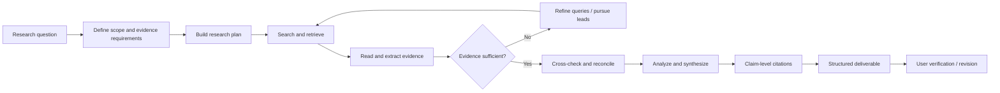
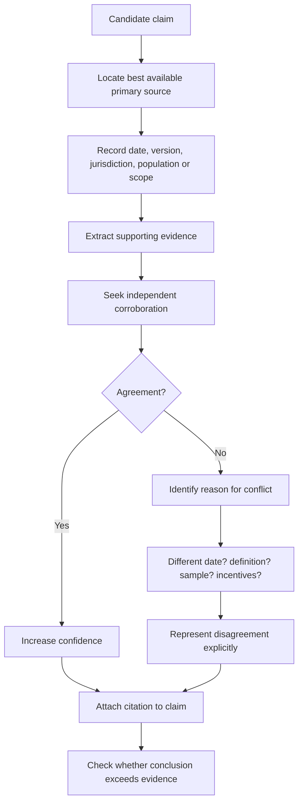

# Deep Research in ChatGPT: Capabilities, Methods, Outputs, Costs, and Best Practices

## Executive summary

Deep research is designed for questions where the difficult part is not retrieving one fact but **finding, evaluating, reconciling, and synthesizing evidence across many sources**. OpenAI describes it as a multi-step research capability for complex questions: the user specifies an outcome and context, the system develops a research plan, searches available sources, adjusts its investigation as evidence emerges, and returns a structured report with citations or source links. As of September 2026, it can work with the public web, uploaded files, user-specified sites, and—where the account and workspace permit—supported connected apps and authenticated data services. Users can review or alter the research plan, monitor progress, interrupt the research to redirect it, and constrain which sources are available. citeturn0search0turn1search2

Its strongest use cases are **market and competitive research, evidence reviews, technical investigations, due diligence, policy research, and complex planning** where a credible answer depends on comparing multiple sources rather than producing a rapid conversational response. OpenAI explicitly recommends ordinary search or standard chat when an urgent or simple factual answer is sufficient. citeturn0search0turn1search13

The most important qualification is that "deep" does **not** mean "automatically authoritative." OpenAI acknowledges that deep research can hallucinate facts, make incorrect inferences, have difficulty distinguishing authoritative material from rumor, and miscalibrate its confidence. Consequently, high-quality use should impose a deliberate evidence hierarchy: primary and official material first; original research and datasets next; reputable independent reporting for context and contested facts; secondary summaries mainly for discovery. Important conclusions should be triangulated rather than accepted because the model found a citation. citeturn1search0turn1search1

The platform guarantees citation/source-link support in completed deep-research results, and current Chat documentation describes a full-screen report view with a table of contents, sources-used section, and research activity history. Reports can be downloaded in Markdown, Word, and PDF; depending on the task and supported capabilities, users may also request editable reports, presentations, or spreadsheets. citeturn0search0turn1search10

OpenAI's original published operating range was approximately **5–30 minutes per deep-research task**, although that is a historical product-level range rather than a service-level guarantee. A useful planning heuristic is therefore about 5–10 minutes for narrowly bounded work, 10–20 minutes for ordinary multi-source analysis, and 20–30 minutes or toward the upper end for broad investigations. Research that requires several separate passes, human source checking, or downstream document production should be treated as a larger workflow rather than assumed to finish within a particular number of minutes. citeturn0search1

Finally, deep research consumes materially more computation than ordinary answering. OpenAI has described it as compute-intensive, and current enterprise pricing exposes that cost explicitly through either credits or token-based rates, depending on the commercial arrangement. Source access is a separate constraint: the model cannot magically cross a publisher paywall or access a proprietary database merely because it is conducting deep research; it can use authenticated sources only when an eligible app/service is supported, enabled, authorized, and accessible to the user's account. citeturn1search1turn2search0turn2search3turn1search2

## Purpose and capabilities

### What deep research is for

The conceptual difference between ordinary search and deep research is the **research loop**.

A conventional search interaction is usually:

> query → retrieve a few results → summarize.

A deep-research interaction is closer to:



This iterative behavior is consistent with OpenAI's description of a system that conducts multi-step internet research, can pivot in reaction to what it encounters, and lets the user refine the research while it is running. citeturn0search1turn0search0

The practical capabilities fall into several layers.

**Information gathering.** By default in Chat, deep research can use the public web and files uploaded by the user. Users can constrain it to specified websites or instruct it to prioritize particular domains while still searching more broadly. Eligible connected apps can add sources such as document stores or authenticated industry services, subject to account, region, workspace, role, provider, and permission controls. citeturn1search2

**Multi-source analysis.** Deep research is built for problems requiring several pieces of evidence to be compared or combined, rather than simply copied from a source. OpenAI describes it as searching, interpreting, and analyzing large amounts of text, images, PDFs, and other information before synthesizing a report. citeturn0search1turn1search0

**Working with supplied context.** Files and spreadsheets can be provided to contextualize the investigation. The important distinction is that an uploaded source changes what evidence is available; it does not make its contents true. Uploaded material should still be treated according to provenance and evidence quality. citeturn0search0turn1search0

**Source control.** Current deep research supports restricting web research to trusted sites or prioritizing selected sites. This is especially valuable for fields in which search-engine prominence and evidentiary quality diverge—for example medicine, law, standards, engineering specifications, financial filings, or scientific literature. citeturn0search0turn0search1

**Interactive steering.** Research need not be a one-shot prompt. Current documentation says the user can inspect the proposed plan, follow progress, interrupt execution, change its focus, and adjust source access. citeturn0search0

**Document production.** A completed task can produce a structured cited report; OpenAI's current documentation also permits requesting editable reports, presentations, or spreadsheets when supported by the task and available capabilities. citeturn0search0turn1search18

### Where it adds the most value

Deep research is most appropriate when the answer has one or more of these characteristics:

| Research property | Why deep research helps |
|---|---|
| Evidence is dispersed across many sources | It can iteratively gather and synthesize material rather than depend on one search result. citeturn0search1 |
| Sources disagree | The research can surface competing claims and compare their evidence rather than forcing premature consensus. OpenAI's own warning about authority assessment makes explicit comparison important. citeturn1search1 |
| The question requires several analytical steps | The product is explicitly intended for multi-step, in-depth questions. citeturn0search0 |
| The user has private or specialized source material | Uploaded files and authorized connected sources can be incorporated where permissions allow. citeturn1search2 |
| Traceability matters | Completed deep-research outputs include citations or source links intended to let the reader verify the answer. citeturn0search0 |
| The deliverable matters as much as the answer | The output can be structured as a substantial report and, when supported, requested as a document, presentation, or spreadsheet. citeturn0search0 |

It is usually excessive for a single lookup, simple arithmetic, rewriting, casual brainstorming, or a question where latency matters more than exhaustive source reconciliation. OpenAI itself directs users toward search or standard chat for urgent answers. citeturn0search0

## Research workflow and methodology

A robust deep-research task should be treated less like "ask a very long question" and more like commissioning a compact research project.

### Scoping before searching

The first step is to convert the user's objective into an **answerable research specification**:

- decision or question to be answered;
- target audience;
- geographic and temporal boundaries;
- definitions of ambiguous terms;
- source requirements and exclusions;
- required depth;
- desired comparisons;
- acceptable uncertainty;
- output format.

OpenAI recommends describing the question, audience, constraints, desired output, relevant files, and connected sources, and current Chat deep research can generate a proposed plan for review before proceeding. citeturn0search0

A strong scope prevents a frequent failure mode: impressive breadth with poor decision relevance.

### Evidence hierarchy

OpenAI does not guarantee that deep research automatically applies a perfect source-quality ranking—in fact, OpenAI explicitly says the system can have difficulty distinguishing authoritative material from rumor. Therefore, the following should be understood as a **recommended research policy**, not an undocumented platform guarantee. citeturn1search1

For most serious work, a sensible default hierarchy is:

**Primary and authoritative sources.** Government agencies, statutes and regulations, standards bodies, securities filings, court materials, official corporate documentation, technical specifications, original institutional statistics, and official product documentation should carry the greatest weight for claims they are competent to establish.

**Original scholarly work.** Peer-reviewed papers, conference proceedings, preprints where appropriate, clinical-trial registrations, working papers, and authors' original datasets are generally preferable to articles describing them.

**Original datasets.** When the research question is quantitative, the underlying dataset is usually preferable to a prose article quoting one statistic. The analysis should record units, definitions, collection period, revision status, missingness, and methodology.

**Reputable independent reporting.** High-quality news organizations are particularly valuable for recent events, interviews, investigations, chronology, and disputes where no single official source provides a complete view.

**Secondary synthesis.** Reviews, textbooks, analyst reports, trade publications, and expert commentary can be extremely useful for understanding the field and finding primary evidence, but consequential claims should be traced back to the strongest accessible evidence when practical.

**Low-authority discovery sources.** Search snippets, aggregators, anonymous posts, marketing pages, unsourced lists, social media, and AI-generated summaries can identify leads but should rarely be the terminal evidence for an important conclusion.

Because deep research now lets users restrict or prioritize web domains, this hierarchy can often be operationalized directly in the request. citeturn0search0turn0search1

### Collection, extraction, and verification

A rigorous workflow separates *finding evidence* from *believing it*.



For quantitative work, verification should additionally include denominator checks, unit conversion, base-year consistency, inflation/currency treatment, reproducible arithmetic, duplicate detection, and careful separation between reported data and calculated results. These are methodological safeguards rather than a claim that the system performs every check automatically.

For current information, publication date alone is not enough. A researcher should distinguish:

**event date → measurement/reference date → publication date → retrieval date.**

For example, a report published in September can still contain June data. Treating "published recently" as "measuring the present" is a common analytical error.

### Handling contradictions and uncertainty

A strong report should not average contradictory evidence into artificial certainty. It should explain whether disagreement arises from:

- different populations or definitions;
- different time periods;
- revised versus preliminary data;
- methodological differences;
- conflicting incentives or institutional positions;
- genuine unresolved uncertainty.

OpenAI specifically identifies confidence calibration as an area in which deep research can err, making explicit uncertainty instructions valuable. citeturn1search1

For decision-grade research, a useful evidence vocabulary is:

> **Established:** directly supported by strong evidence.  
> **Probable:** several sources support the inference, but direct proof is incomplete.  
> **Contested:** credible sources materially disagree.  
> **Unknown:** available evidence does not justify a conclusion.

That is safer than translating every unknown into a numerical probability.

## Sources, citations, and attribution

### How citations work

OpenAI states that all completed deep-research outputs contain citations or source links so readers can inspect the underlying evidence. In Chat, the completed research view includes a sources-used area as well as an activity history. citeturn0search0turn1search10

A good citation should answer two different questions:

1. **Where did this assertion come from?**
2. **Does that source actually establish the assertion being made?**

The second is more important. A citation can be syntactically valid but substantively wrong—for example, a linked article might discuss an industry without supporting the exact market-size figure attached to it. OpenAI's own web-search guidance cautions that citations can be incomplete, outdated, or incorrect and advises checking whether the cited source actually supports the answer and whether its date and authority are appropriate. citeturn0search8

For serious deliverables, citations should therefore be attached as close as practical to the claim they support rather than appearing as a generic bibliography after several paragraphs.

### A useful claim-evidence discipline

For each consequential claim, the research process should be able to reconstruct:

| Field | Example |
|---|---|
| Claim | "Regulation X applies beginning in 2027." |
| Evidence type | Official regulatory text |
| Source owner | Issuing regulator |
| Source version/date | Final rule, current revision |
| Supporting passage/data | Exact relevant provision |
| Corroboration | Agency implementation guidance |
| Classification | Source-documented |
| Confidence | High |
| Caveat | Subject to stated exemptions |
| Expiry trigger | Amendment, court decision, or new guidance |

This is particularly valuable for legal, policy, technical-specification, and financial research where a correct statement can become obsolete.

### Paywalls and inaccessible evidence

Deep research should not be described as possessing universal database access. The public web and uploaded files are default source classes, while authenticated external sources depend on supported connections, plan, geography, workspace configuration, permissions, and the provider account's own access rights. Connecting an app does not override the underlying provider's permissions. citeturn1search2

Consequently, a paywalled article can produce several states:

> fully accessible → usable as evidence;  
> abstract/snippet accessible → useful only for what is actually visible;  
> inaccessible → potentially a lead, not verified evidence;  
> accessible through an authorized supported service → usable subject to that service's access and permissions.

The honest answer to inaccessible evidence is **"not verified from the full source,"** not reconstruction from a search snippet.

## Deliverables, timelines, and resource cost

### Deliverable formats

Current OpenAI documentation explicitly supports structured cited research reports and downloads in **Markdown, Word, and PDF**. It also says users can request an editable report, presentation, or spreadsheet when the task and available capabilities support that output. citeturn0search0turn1search10

Charts, tables, diagrams, and images can form part of a broader analytical workflow, but they should be distinguished by epistemic function: a table organizes evidence; a chart reveals quantitative structure; an image supplies visual evidence or context; a process diagram explains relationships. Mermaid is useful as a textual diagram specification when the interface rendering it supports Mermaid, but OpenAI's cited Deep Research documentation does not promise Mermaid as a dedicated export format.

| Deliverable | Typical research scale | Approximate research turnaround* | Ideal use case |
|---|---:|---:|---|
| Focused research memo | Small | ~5–10 min | A bounded question with a handful of critical sources |
| Evidence / comparison table | Small–medium | ~5–15 min | Vendor comparison, policy comparison, specifications, structured literature screening |
| Analytical report | Medium | ~10–20 min | Market analysis, strategic issue, technical investigation |
| Literature review | Medium–large | ~15–30 min | Mapping a research field, methods, findings, disagreements, and gaps |
| Competitive landscape | Medium–large | ~15–30 min | Multi-company positioning, products, pricing, strategy, financial and market evidence |
| Dataset-backed analysis with charts | Medium–large | ~15–30 min | Trends, scenario comparison, quantitative decision support |
| Presentation or spreadsheet artifact | Medium–large | Research time plus artifact work | Executive communication or reusable analysis |
| Broad due-diligence dossier | Large | Upper end of published range; potentially iterative | High-source-count, cross-domain investigation requiring contradictions and caveats to be reconciled |

\*These are **planning heuristics, not OpenAI service guarantees**. OpenAI's original product announcement said deep research could take roughly 5–30 minutes. Current documentation instead emphasizes that deep research is slower than ordinary search and should not be chosen when time is critical. citeturn0search1turn0search0

An illustrative planning chart:

```mermaid
gantt
    title Illustrative Deep-Research Task Scale
    dateFormat  mm
    axisFormat  %M min

    section Small
    Scope and retrieve      :a1, 00, 3m
    Verify and synthesize   :a2, after a1, 5m

    section Medium
    Scope and discovery     :b1, 00, 5m
    Evidence collection     :b2, after b1, 7m
    Verification            :b3, after b2, 4m
    Synthesis               :b4, after b3, 4m

    section Large
    Discovery               :c1, 00, 6m
    Broad collection        :c2, after c1, 10m
    Reconciliation          :c3, after c2, 7m
    Final synthesis         :c4, after c3, 7m
```



The chart represents workload distribution rather than an SLA; real tasks can allocate time very differently.

### Compute and usage cost

Research depth has an actual computational cost. OpenAI has described deep research as compute-intensive, with longer investigations requiring more inference compute. citeturn1search1

As of September 30, 2026, commercial metering varies by plan and contract. For Business/Enterprise/Edu environments using credit-based pricing, OpenAI's current rate card lists a deep-research task at approximately **50 credits**. Separate Enterprise token-based arrangements expose model-specific token rates; the current rate card lists deep-research model charges rather than treating every investigation as a flat-priced task. These commercial terms can change and should therefore be checked at the time of budgeting. citeturn2search3turn2search0

This creates several practical resource drivers:

**Breadth.** More candidate sources require more retrieval and comparison.

**Depth.** Reading primary documents rather than summaries increases context and reasoning requirements.

**Large uploaded corpora.** More input material increases processing.

**Long outputs.** A detailed report, exhaustive citations, or a large comparison matrix consumes additional output capacity.

**Repeated verification.** Triangulation is more expensive than accepting the first plausible result, but substantially improves trustworthiness.

**Artifact generation.** A spreadsheet, presentation, chart set, or formatted document can require additional processing beyond the underlying evidence review. OpenAI notes that output availability depends on the task and supported capabilities. citeturn0search0

**External data access.** Commercial databases, paywalled publications, and proprietary datasets may require licenses independent of whatever ChatGPT plan or research allowance the user has. Deep research only gets the permissions that the connected account/provider makes available; it does not supersede them. citeturn1search2

## Limitations, bias, ethics, and privacy

### Reliability limitations

The principal analytical danger is mistaking *research-shaped output* for *validated research*.

OpenAI explicitly documents several limitations: deep research may hallucinate facts, draw incorrect inferences, struggle to distinguish authoritative sources from rumor, misstate its degree of certainty, and produce citation or formatting errors. citeturn1search1

This means four distinctions should remain visible:

**Evidence versus inference.** A source may contain facts A and B while the report infers C. C should not be presented as though the source explicitly said it.

**Absence of evidence versus evidence of absence.** Failing to locate a product, lawsuit, paper, risk, or market entrant does not prove it does not exist.

**Consensus versus truth.** Ten secondary articles repeating one original error do not represent ten independent confirmations.

**Citation count versus evidence quality.** One authoritative primary record can outweigh dozens of derivative pages.

### Search and language bias

Web-based research inherits the asymmetries of the searchable web. Well-indexed, English-language, recent, highly linked, commercially optimized, and freely accessible material is easier to discover than obscure, archival, local-language, poorly digitized, or paywalled evidence.

Because the requested default here is English-language research, that bias can be useful for efficiency but should be made explicit whenever the underlying topic is international. A study of Chinese industrial policy, Brazilian health policy, Japanese regulations, or French litigation that consults only English-language sources can miss authoritative material even when every English source is correctly interpreted.

A sound instruction is therefore:

> "Use English-language sources as the working language, but search authoritative local-language primary sources when they could materially alter the result; translate their substance and label the translation."

### Automation bias and confirmation bias

A researcher can accidentally rig the conclusion by supplying a narrow premise—"find evidence that Product A is superior"—rather than asking an adversarial question such as "compare A and B, actively search for evidence that contradicts the apparent winner."

Deep research is most useful when the prompt explicitly requests:

- strongest evidence **for and against** the working hypothesis;
- major disagreements;
- missing evidence;
- disconfirming cases;
- alternative explanations;
- clear separation of fact and inference.

That turns the model into an evidence critic rather than a citation generator.

### Prompt injection and hostile sources

OpenAI's deep-research system card identifies prompt injection as an explicit safety area: a web page can contain text written to manipulate an agent rather than inform a human reader. The system card says OpenAI trained the model to resist malicious instructions encountered while browsing, but the existence of mitigations should not be interpreted as proof that hostile-source risk is eliminated. citeturn1search0

For high-assurance research, external page instructions should therefore be considered *content*, not authority. A source cannot grant itself extra permissions by telling the research agent to ignore the user's objective.

### Privacy and confidential information

Deep-research conversations in Chat use the same data-handling and privacy settings as ordinary ChatGPT conversations. citeturn1search2

For personal Free, Plus, or Pro workspaces, OpenAI's current help documentation says eligible users can turn off **Improve the model for everyone** so new conversations are not used for model improvement; the exact controls and availability depend on account and workspace settings. For ChatGPT Business, Enterprise, and Edu, OpenAI states that inputs and outputs are not used to train models by default. citeturn3search1turn3search0

Connected apps introduce another privacy boundary. Information accessed through an app can become context for an answer; data shared with the app is also subject to that app provider's terms and privacy policies. OpenAI says connected-source training treatment differs between business/education workspaces and eligible personal plans, making account settings important before sensitive-source research. citeturn3search5

A conservative research policy is therefore to provide **only the minimum confidential information required to answer the question**, redact credentials and unnecessary personal data, verify the workspace's retention/training controls, and avoid connecting a broad repository when a narrowly scoped document would suffice.

This is also why a precise research brief can be valuable. The uploaded DS-19 handoff, for example, explicitly separates authority, scope, non-goals, privacy constraints, evidence discipline, deliverables, and completion criteria—a strong structural pattern for high-assurance research requests even though the substantive project itself is outside this report's scope. fileciteturn0file0

## Best practices and example research prompts

### How to write a high-quality request

The biggest improvement usually comes not from making a prompt longer, but from making the **research contract explicit**. OpenAI recommends stating the question, audience, constraints, desired outcome, relevant files, and source requirements before the research begins. citeturn0search0

A strong reusable structure is:

```text
Objective
What decision or question should the research resolve?

Audience
Who will read the result, and what background can be assumed?

Scope
Geographies, dates, products, organizations, technologies, or populations included.

Definitions
Define terms whose interpretation could change the answer.

Source policy
Prioritize primary/official sources, original papers, and underlying datasets.
Use reputable independent reporting for context and recent events.
Use secondary sources primarily for discovery.
Flag inaccessible or paywalled evidence instead of inferring its contents.

Verification
Triangulate consequential claims.
Actively search for contradictions and disconfirming evidence.
Distinguish reported facts, calculations, and analyst inference.
State uncertainty rather than filling gaps.

Freshness
State the "as of" date.
For changing facts, prefer the newest authoritative source and distinguish
event date from publication date.

Deliverable
Specify report length, executive summary, tables/charts, citation style,
comparison framework, recommendations, and appendices.

Decision standard
Explain what evidence would change the recommendation.

Exclusions
State what is explicitly out of scope.
```

For consequential decisions, one extra sentence is particularly valuable:

> **"Do not optimize for reaching a conclusion; optimize for determining whether the available evidence justifies one."**

### Example: market analysis

```text
@Deep Research

Produce a decision-grade analysis of the U.S. commercial heat-pump market
as of September 2026 for an investment committee.

Scope:
- Market size and growth, 2021–2026, plus credible forecasts through 2030.
- Segment by building type and major product category where source data permits.
- Identify demand drivers, regulatory incentives, supply constraints,
  distribution structure, major competitors, and material risks.

Source policy:
- Prioritize DOE/EIA/EPA and other government data, corporate filings,
  original manufacturer disclosures, standards bodies, and underlying datasets.
- Use reputable financial and trade reporting for recent developments.
- Trace market-size claims to their original methodology where possible.
- Do not silently combine estimates based on incompatible definitions.

Verification:
- Triangulate major quantitative claims from at least two independent sources
  where practical.
- Show disagreements between market estimates rather than averaging them.
- Label reported data, calculated values, and analyst inference separately.

Output:
- Executive summary.
- Market-size table.
- Growth-driver/risk matrix.
- Competitor landscape.
- Three scenarios through 2030.
- Key uncertainties.
- Claim-level citations and a source appendix.
```

### Example: literature review

```text
@Deep Research

Conduct a structured literature review of retrieval-augmented generation
evaluation methods published from 2022 through September 2026.

Research questions:
- What dimensions of RAG quality are being evaluated?
- Which benchmarks and metrics have evidence of validity?
- Where do automatic metrics disagree with human evaluation?
- What methodological weaknesses recur?
- Which important questions remain unresolved?

Sources:
- Prioritize original peer-reviewed papers and official conference proceedings.
- Include significant preprints when no peer-reviewed version exists and label them.
- Use survey papers for discovery but verify central claims against original studies.

Method:
- Record paper date, study design, dataset, model setting, evaluation metrics,
  sample size where applicable, and major limitations.
- Separate empirical findings from authors' speculation.
- Identify conflicting findings and likely reasons for disagreement.

Deliverable:
- Executive synthesis.
- Evidence table by paper.
- Taxonomy of evaluation methods.
- Areas of consensus and disagreement.
- Research gaps.
- Bibliography with source links.
```

### Example: technical feasibility

```text
@Deep Research

Assess the technical feasibility of building a cross-platform desktop service
that must maintain long-running subprocesses while user interfaces attach
and detach without terminating the subprocess.

Platforms:
- Current supported Windows.
- Current mainstream Linux distributions.

Research:
- Process ownership and containment primitives.
- Pseudoterminal behavior.
- Crash recovery.
- IPC options.
- Resource limits.
- Service supervision.
- Filesystem durability.
- Security boundaries.

Evidence policy:
- Prefer Microsoft documentation, Linux/POSIX specifications, kernel documentation,
  standards, and original project documentation.
- Do not treat Stack Overflow, blogs, or vendor marketing as authoritative where
  primary documentation exists.
- Separate documented guarantees from observed behavior and inference.
- State "unknown" where documentation does not establish a guarantee.

Output:
- Feasibility verdict.
- Windows/Linux comparison matrix.
- Architecture-neutral constraints.
- Failure-mode table.
- Critical experiments required before implementation.
- Competing approaches for each major design choice.
- Explicit falsifiers for the recommendation.
- Do not select an implementation language unless evidence genuinely makes that
  conclusion necessary.
```

### Example: competitive analysis

```text
@Deep Research

Compare Company A, Company B, Company C, and Company D in the enterprise
AI platform market as of September 2026.

Analyze:
- Product scope.
- Target customer.
- Pricing model.
- Distribution.
- Partnerships.
- Reported customer traction.
- Revenue or segment financials where disclosed.
- Technical differentiation.
- Security/compliance posture.
- Strategic strengths and weaknesses.

Source hierarchy:
1. Regulatory filings and audited financial reports.
2. Official product and pricing documentation.
3. Earnings-call transcripts and investor materials.
4. Original benchmark or technical documentation.
5. Reputable independent reporting.
6. Analyst commentary only as secondary interpretation.

Rules:
- Do not equate announced partnerships with deployed customers.
- Do not equate benchmark claims across incompatible test conditions.
- Mark undisclosed metrics as undisclosed, not zero.
- Identify marketing claims that lack independent evidence.

Deliverable:
- One-page executive summary.
- Comparable feature/pricing matrix.
- Positioning map.
- Evidence-backed SWOT for each company.
- Likely competitive moves over the next 12–24 months, clearly labeled as inference.
- Recommendation plus the strongest argument against it.
```

### Example: travel planning

```text
@Deep Research

Design a seven-day trip to Japan for two adults traveling from San Francisco
in late November 2026.

Preferences:
- Tokyo plus one additional region.
- Food, neighborhoods, design/architecture, and light hiking.
- Moderate rather than luxury budget.
- Minimize hotel changes.
- Avoid an itinerary that depends on extremely tight connections.

Research current:
- Entry requirements.
- Seasonal weather.
- Transport schedules/passes.
- Major construction or attraction closures.
- Reservation requirements.
- Local holidays/events.
- Realistic hotel pricing by neighborhood.

Source policy:
- Prioritize Japanese government/tourism authorities, railway operators,
  airlines, attraction operators, and official reservation sites for changing facts.
- Use reputable travel publications for qualitative context.
- Distinguish current prices from estimates.

Output:
- Recommended route and rationale.
- Day-by-day itinerary.
- Transport plan.
- Hotel-area comparison.
- Estimated budget with assumptions.
- Booking deadlines and items requiring re-checking near departure.
- Rain/bad-weather alternatives.
- Citations for all time-sensitive claims.
```

The common pattern across all five prompts is deliberate: **define the decision, constrain the universe, establish an evidence hierarchy, specify how contradictions are handled, and design the output before research starts**. That matters because deep research's major advantage is not that it makes uncertainty disappear; it is that it can devote far more structured search and synthesis effort to making the evidence, uncertainty, and provenance visible. OpenAI's own documentation frames the product accordingly: use search for speed, and deep research when the task requires depth, multiple sources, and a documented answer that can be checked afterward. citeturn0search0turn1search13