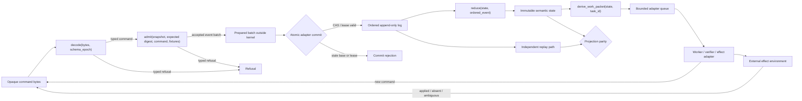
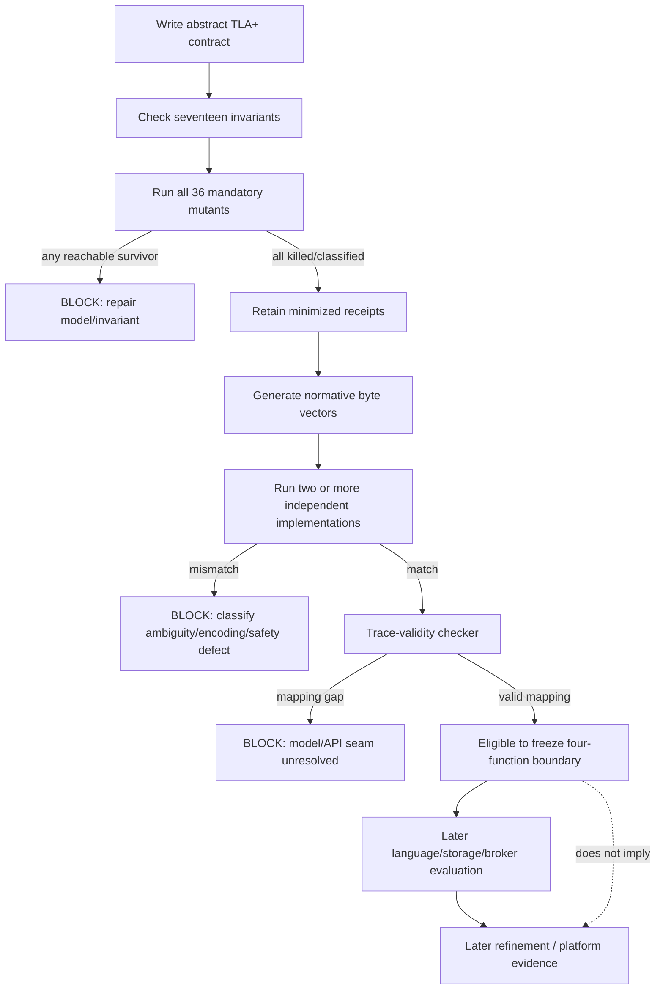

# DS-22 Formal Model and Conformance Vectors: Research Report

## Executive summary

The uploaded DS-22 handoff can plausibly be interpreted in three ways: as a request to compare formal methods, as a request to design a finite pre-code model, or as a request to specify cross-language conformance evidence. Because the handoff explicitly makes all three blocking prerequisites to freezing the four-function kernel boundary, this report treats the intended query as the **combined design of the formal model, mutation corpus, and language-neutral conformance regime**, without selecting an implementation language, storage engine, broker, or renderer. The handoff's prior calibration numbers—444,834 reachable states, 2,644,215 transitions, 22 rejected guard mutants, and the 32,500-component fairness families—are treated as locally reported calibration evidence, not independently reproduced results. fileciteturn0file0

The principal recommendation is **hand-written TLA+ with TLC as the primary finite falsification model**, rather than PlusCal as the normative source. TLC is an explicit-state checker for executable TLA+ specifications and handles both safety and liveness; TLA directly supports temporal properties, state predicates, refinement mappings, and weak/strong fairness. citeturn5search2turn5search3turn0search5 Alloy 6.2.0 should be used, if desired, as a deliberately independent **secondary structural cross-check** for the authority lattice, bounded trace constraints, and selected guard mutants: Alloy searches finite scopes and represents temporal instances as lasso traces, but bounded non-discovery is not a proof beyond the chosen scope. citeturn0search15turn10search0 SPIN is a credible competing method and has particularly natural operational concurrency and LTL support, but its Promela/process idiom is a less direct match for a kernel intentionally defined as four pure functions over immutable values. SPIN's own semantics also make fairness a process/execution concern, whereas DS-22 needs fairness assumptions attached narrowly to named abstract actions. citeturn1search3turn1search6 Lean or Rocq would be stronger choices once the question becomes an unbounded refinement proof, but they are not the best first instrument for automatically finding small race witnesses: both provide inductive definitions and kernel-checked proofs rather than TLC-style exhaustive finite-state counterexample exploration. citeturn2search0turn7search2

The proposed first **integrated** finite model has one aggregate, one task, one effect, one timer, one verifier, two workers, two goal epochs, two plan revisions, three lease epochs, two attempts, two pause epochs, queues of capacity two, and a maximum committed event log of twenty events. Three lease epochs are intentional: two epochs suffice to expose a stale-writer/lease-transfer race, but three expose the stronger A→B→A identity-reuse/ABA-style case in which worker identity alone looks current while its old lease epoch is stale. The twenty-event limit is a conservative exploration cap, **not a proven minimum**; proving the exact smallest integrated bound requires running the model, which this research session did not do.

The model should keep cryptography abstract. A digest in the finite model should behave as an injective symbolic identity of a canonical value; it should not attempt to model SHA-256 bit operations. That assumption must be stated explicitly because it hides hash collisions. Concrete conformance vectors should then exercise the actual bytes, using SHA-256 as specified by FIPS 180-4 and a restricted deterministic-CBOR encoding based on RFC 8949. RFC 8949 expressly supports protocol-defined deterministic encodings and requires preferred shortest encodings under its core deterministic rules. citeturn3search0turn3search3

The model should have **seventeen named invariants**, corresponding exactly to the handoff's required list. Most can be unary safety predicates over an instrumented state. `ReplayDeterminism` and `ProjectionParity` are the exceptions: treating them as ordinary predicates only works after adding visible, independent replay/projection monitor state. That instrumentation must be explicit; otherwise the model risks “proving” a reducer against itself.

A proposed mandatory mutation corpus contains **36 instantiated mutants** across deletion, weakening, reordering, and field-hiding classes. No mutant should count as covered merely because the baseline model passes. Each reachable, non-equivalent mandatory mutant must produce a minimized counterexample receipt. The acceptance metric is therefore not simply “number of checks green”; it is **36/36 mandatory mutant instances classified, with every reachable non-equivalent instance killed** and every equivalent/unreachable classification justified separately.

The proposed conformance-vector format is a small framed binary record containing deterministic CBOR, with exact raw command bytes preserved as byte strings. It is a **test artifact format, not a production command-wire format**. That distinction avoids accidentally freezing an implementation protocol beyond the four closed kernel functions. The format fixes numeric field identifiers, excludes floating point and CBOR tags, disallows indefinite lengths and duplicate keys, and gives normative expected typed results/refusals. RFC 8949's deterministic-encoding machinery is specifically designed for protocols that require byte-for-byte reproducibility. citeturn3search3turn8view0

The core freeze recommendation is therefore conditional:

> **Do not freeze the privileged kernel API beyond the four closed functions until the TLA+ model exists, all mandatory reachable mutants have retained counterexamples, the byte-level vector corpus exists, and at least two independently written implementations reproduce every normative vector bit-for-bit.**

That still would **not** establish correctness of the unbounded system, code refinement, broker behavior, operating-system containment, or external-effect truth. Lamport's own descriptions of refinement-oriented work distinguish finite model checking from stronger refinement proof: TLC is used to catch finite/modeling errors, while separate refinement arguments establish implementation relationships. citeturn5search0turn5search10

## Scope, assumptions, evidence, and methodology

The scope is the DS-22 lane in the uploaded handoff: a provider-neutral, deterministic kernel with exactly four privileged pure functions—`decode`, `admit`, `reduce`, and `derive_work_packet`—and no filesystem, network, process, credential, terminal, plugin, or wall-clock access. The research does **not** reopen the already accepted architectural decisions recorded in the handoff, and it does not select a construction language, database, broker, or renderer. fileciteturn0file0

Three interpretations of the otherwise unspecified user query were plausible:

| Interpretation | Plausibility | Treatment here |
|---|---:|---|
| Compare TLA+, Alloy, SPIN, and theorem provers | High | Covered, but not treated as sufficient by itself |
| Specify the smallest useful finite state machine and mutants | Very high | Primary focus |
| Freeze a language-neutral kernel test ABI/vector format | Very high | Co-primary focus |

The second and third are inseparable in this design. A model with no externalized vectors can diverge from independent implementations; vectors with no explicit transition model can merely fossilize a bug. The selected research hypothesis is therefore: **the API should freeze only when the abstract safety semantics and independently executable observational semantics meet at a common trace/vector boundary.**

The source methodology was deliberately primary-source-heavy. TLA/TLC semantics and refinement claims are based on Lamport's TLA materials and the official TLA+ project; Alloy claims use the Alloy language specification and official release material; SPIN claims use the SPIN reference; Lean and Rocq claims use their official documentation; deterministic serialization uses the RFC Editor's RFC 8949; hashing uses NIST's FIPS 180-4; and property-based testing methodology is grounded in the original QuickCheck work from Claessen and Hughes. citeturn5search2turn10search3turn0search15turn1search3turn2search0turn7search2turn3search3turn3search0turn4search2

The empirical methodology proposed for DS-22 is four-layered:

1. **Exhaustive finite falsification:** enumerate all reachable states at explicit bounds and retain traces for invariant failures.
2. **Mutation adequacy:** deliberately damage each safety guard and require the expected invariant to fail.
3. **Independent replay/differential checking:** use a second semantics path that shares neither transition implementation nor registry tables with the first.
4. **Concrete byte conformance:** make language-independent call/result vectors authoritative at the four-function boundary.

No model checker was run and no code was written during this research session. Therefore this report classifies model details as **proposed/inferred**, not as verified results.

The main evidence claims and their status are:

| Claim | Source/version or date | Classification | Confidence | Expiry trigger |
|---|---|---|---:|---|
| DS-22 requires the listed seventeen invariants and the four closed kernel functions | Uploaded DS-22, updated 2026-09-29 | Locally observed requirement | High | Owner changes the handoff/constitution |
| Prior calibrations reached 444,834 states and 2,644,215 transitions and rejected 22 mutants | Uploaded DS-22 | Locally reported; not independently reproduced | Medium | Calibration artifacts are inspected or rerun |
| TLC is an explicit-state checker for executable TLA+ specs and handles safety/liveness | TLA+ tools documentation | Source-documented | High | Material TLC semantics change |
| TLA can express system/specification and implementation/refinement relationships in the same logic | Lamport, *Temporal Logic of Actions* materials | Source-documented | High | Fundamental language semantics change | citeturn5search2
| Alloy searches finite scopes and produces lasso traces for temporal instances | Alloy language specification | Source-documented | High | Alloy temporal semantics change | citeturn0search15
| SPIN/Promela directly models asynchronous processes and LTL; weak fairness can suppress starvation of continuously enabled processes | SPIN reference | Source-documented | High | SPIN semantics change | citeturn1search3turn1search6
| Lean and Rocq can directly define inductive transition relations and prove properties by induction/kernel checking | Lean 4.33.0 docs; Rocq 9.2 docs | Source-documented | High | Major prover semantics change | citeturn2search0turn7search2
| Deterministic CBOR is suitable as the basis of a byte-identical vector format | RFC 8949, 2020 | Inferred from standard | High | Vector format changes |
| SHA-256 is a standardized deterministic message-digest function | FIPS 180-4, 2015 | Source-documented | High | Digest algorithm is replaced | citeturn3search0
| TLA+/TLC is the best first method for DS-22 | This report | Inferred recommendation | Medium-high | TLA model cannot kill mandatory mutants or cannot reach agreed bounds |
| The proposed 36-mutant corpus is sufficient for freeze gating | This report | Proposed, unverified | Medium | A new safety seam or surviving non-equivalent mutant is found |
| Passing the finite model does not establish code refinement or external-effect truth | DS-22 plus standard refinement distinction | Source-supported constraint | High | Never expires absent a stronger proof artifact | citeturn5search0

The version pin deserves special care. As of this research date, the official TLA+ release page labels **v1.7.4** as the latest stable release, while **v1.8.0 “Clarke”** is a pre-release channel; the v1.7.4 release specifically fixed an unsound multi-worker liveness-checking issue. citeturn9view0turn10search1 A reproducible DS-22 execution should therefore record the exact TLC artifact digest in addition to the human version string; using a rolling prerelease without pinning bytes would weaken reproducibility. Alloy's latest listed release is 6.2.0, with binary assets dated January 9, 2025. citeturn10search0 SPIN's official site still identifies 6.5.1, dated July 2020, as its current release. citeturn10search4

## Formal-method selection and decisive falsifier

TLA+ is the strongest fit to the immediate problem because DS-22 is fundamentally about a **state-transition contract plus carefully scoped temporal fairness**, rather than primarily about static relational structure or theorem proving. TLA represents systems as state machines in temporal logic; TLC can enumerate finite executions and generate error traces; TLA directly exposes weak and strong fairness at action granularity. citeturn5search2turn5search3turn0search5

Alloy is a serious competing method rather than a straw man. Modern Alloy includes mutable state and temporal traces; its analyzer searches finite scopes and returns concrete instances/counterexamples, making it particularly attractive for authority-lattice relations, uniqueness constraints, and short trace shapes. citeturn0search15turn10search0 Its central limitation for this lane is not expressibility—most DS-22 conditions can be represented—but fit: DS-22's operational admission, lease, queue, PAUSE, retry, and liveness story maps more directly to TLA actions and fairness conditions.

SPIN is likewise fully capable of safety and liveness verification and has mature explicit operational semantics for concurrent processes. Its `never` claims can describe finite or infinite bad behaviors, and Promela includes guarded nondeterministic execution. citeturn1search0turn1search3 The mismatch is architectural: using process state, program counters, and channels as the primary formal vocabulary risks making the model resemble an execution-loop implementation that OR-018 explicitly leaves replaceable, rather than the pure four-function contract.

Lean/Rocq is the strongest competitor only after the question changes from “find a small counterexample before code” to “prove the transition relation/refinement for all finite or inductively reachable executions.” Lean compiles recursive definitions and inductive proofs into terms checked by its kernel; Rocq similarly reduces user proof activity to proof terms checked by a small kernel. citeturn2search3turn7search2 That is valuable future evidence, but it puts a higher proof-engineering burden ahead of the specific DS-22 goal of rapid race falsification.

The resulting comparison is:

| Criterion | TLA+/TLC | Alloy 6 | SPIN/Promela | Lean/Rocq |
|---|---|---|---|---|
| Direct `Init /\ [][Next]_vars` transition-system fit | **Excellent** | Good | Good, operational | Excellent but proof-heavy |
| Automatic finite counterexamples | **Excellent** | **Excellent** | **Excellent** | Limited without added search machinery |
| Named weak/strong fairness on abstract actions | **Excellent** | Possible through temporal modeling; exact ergonomic parity: **unknown** | Good, but process-centric | Expressible/provable manually |
| Authority/product-lattice relations | Excellent | **Excellent** | Moderate | Excellent |
| Pure-function API abstraction | **Excellent** | Good | Moderate | **Excellent** |
| Built-in fit for queues/process interleavings | Good | Good | **Excellent** | Manual |
| Unbounded inductive proof | TLAPS possible, but not the first experiment | No bounded search proves unbounded case | No ordinary finite run proves it | **Excellent** |
| Mutation-driven counterexample workflow | **Excellent** | Excellent | Excellent | Possible, less automatic |
| Refinement to later implementation | Strong refinement language | Relational correspondence possible | Model extraction/refinement possible but implementation-shaped | **Strongest proof route** |
| Primary recommendation | **Yes** | Secondary cross-check | Competing fallback | Later refinement layer |

Alloy's own specification explicitly warns that failure to find an instance within a bounded search is not a general proof outside the bound, while found instances are valid witnesses. citeturn0search15 That warning is exactly consistent with DS-22's required evidence discipline.

**Recommendation:** write the normative finite model in hand-written TLA+, with PlusCal used only for isolated explanatory algorithms if it reduces human error. This avoids allowing PlusCal's control-flow encoding to dictate the kernel abstraction. Lamport's own tutorial illustrates that some subtle fairness requirements are easier to state directly in TLA+ than through PlusCal process annotations. citeturn0search6

**Named competitor:** Alloy 6.2.0.

**Decisive falsifier for the TLA+ recommendation:** reject TLA+/TLC as the primary DS-22 instrument if a mandatory reachable mutant has a concrete witness under the agreed abstract semantics, an independent Alloy/SPIN encoding finds that witness at equivalent bounds, but the pinned TLC/TLA model cannot expose the corresponding invariant violation after model errors and reachability have been ruled out. A second decisive falsifier is inability to reach the mandatory three-lease-epoch/PAUSE/effect integrated bound without deleting a safety-relevant dimension that the secondary model can retain.

That falsifier does **not** mean that a single TLC performance problem proves TLA inadequate; it requires a demonstrable loss of safety-discriminating power relative to a competing formalization.

## Exact finite transition system and invariant contract

The central modeling decision is to separate **kernel semantic state**, **adapter/storage state**, and **environment truth**. This is necessary to avoid smuggling forbidden I/O or an external oracle into the kernel.



The four boxes corresponding to the privileged API remain pure. Queueing, committing, effect execution, recovery, and external observation are explicitly outside them.

**Proposed finite domains**

| Dimension | First integrated bound | Why present |
|---|---:|---|
| Aggregate | 1 | Cross-aggregate behavior is not required to falsify the listed invariants |
| Task | 1 | Enough for lease, cancel, retry, verifier, effect, packet and amendment fences |
| Worker principals | 2 | Strictly necessary for overlapping-holder and stale-worker races |
| Executive principals | 1 | Enough for one aggregate writer authority |
| Verifier principals | 1 | Enough if distinct from worker identities |
| Effects | 1 | Enough for ambiguous-effect and blind-replay witnesses |
| Timer | 1 | Enough for lease expiry/logical-time calibration |
| Goal epochs | 2 | Necessary for stale-goal/amendment traces |
| Plan revisions | 2 | Necessary for stale-plan/packet traces |
| Lease epochs | 3 | Necessary for A→B→A identity-reuse witness |
| Attempts | 2 | Necessary for retry/replay novelty |
| Pause epochs | 2 | Before/after PAUSE |
| Effect outcomes | 3 | `applied`, `not_applied`, `unknown` |
| Per-queue capacity | 2 | Enough to expose full-vs-overfull off-by-one |
| Event log | ≤20 | Conservative integrated exploration cap, not proven minimum |
| Logical time | `0..2` in first TLC config | Allows expiry ordering; no wraparound |

A separate **minimal lease-race micro-model** is smaller: one task, two workers, two lease epochs, one goal epoch, one plan revision, and no effect/verifier dimension. Two workers are cardinality-minimal because an overlapping-holder witness cannot exist with one holder identity; two lease epochs are minimal for “current versus stale” if lease validity is epoch-based. Three epochs become necessary only for the stronger worker-A → worker-B → worker-A case.

Logical time should be `Nat` in the abstract specification, with TLC assigning a finite `0..TMax` model value. There must be no modulo wraparound in the first model. This finite abstraction does not cover arithmetic overflow in a concrete implementation; boundary vectors must test that seam separately.

Digest-valued objects should be represented by a mathematical `DigestOf(value)` abstraction that is injective over the finite modeled domain. That is intentionally stronger than real hashing and therefore becomes an explicit model assumption. The concrete suite subsequently uses SHA-256 bytes to test serialization and digest agreement. FIPS 180-4 standardizes SHA-256 as part of the SHA-2 family. citeturn3search0turn3search6

**State variables**

The proposed exact abstract state is:

| Variable | Abstract type and role |
|---|---|
| `goalEpoch` | current goal epoch |
| `goalDigest` | accepted GoalSpec digest |
| `planRev` | current plan revision |
| `planDag` | bounded relation over task identities |
| `task` | task state record: lifecycle, producing worker, result digest |
| `packetDigest` | immutable current packet digest or `None` |
| `commandSeen` | partial map `CommandId -> (commandDigest, outcomeDigest)` |
| `eventLog` | bounded sequence of committed events |
| `writeLease` | aggregate writer holder, epoch, expiry/status |
| `workLease` | task worker holder, epoch, expiry/status |
| `verifyLease` | verifier holder, epoch, expiry/status |
| `prepared` | per-principal optional `(baseDigest, leaseEpoch, commandId, batch)` outside kernel |
| `pauseEpoch` | monotone logical PAUSE epoch |
| `pauseMode` | `none/checkpoint/interrupt/drain/emergency` |
| `attempt` | current retry attempt |
| `effect` | intent/op-id/status/attempt/outcome/reconciliation record |
| `verifierDecision` | `none/pass/fail` plus bound result digest |
| `publication` | `none/staged/published` |
| `logicalTime` | model logical time |
| `workQ`, `verifyQ`, `effectQ`, `stopQ` | bounded adapter queues |
| `replayProjectionA` | independently reconstructed semantic projection |
| `replayProjectionB` | second decoder/registry projection |
| `recoveryStatus` | `clean/refused` |
| `pendingStop` | per-cursor logical Stop monitor |
| `hiddenChoice` | finite hidden-choice calibration state |

The model does not need provider-response, network-recovery, filesystem, renderer, or broker-transport variables. Those actions can be omitted without losing any of the named safety counterexamples. External-effect uncertainty needs only the three-valued observation `applied/not_applied/unknown`; actual external truth remains unknowable to the kernel.

The abstract `Init` sets epoch/revision counters to their initial values, initializes an accepted synthetic GoalSpec and plan, empties all queues/log/prepared batches, installs no active worker/verifier lease, sets the effect to `none`, sets `pauseMode = none`, and computes both replay projections from the same genesis state.

The proposed transition relation is:

```text
Next ==
    PrepareCommand
 \/ CommitPreparedBatch
 \/ RejectStalePreparedBatch
 \/ EnqueueDerivedPacket
 \/ WorkerConsumesPacket
 \/ VerifierConsumesResult
 \/ DispatchDeclaredEffect
 \/ ObserveExternalOutcome
 \/ ReconcileAmbiguousEffect
 \/ ApplyPendingStop
 \/ AdvanceLogicalTime
 \/ CrashProjection
 \/ RecoverByReplay
 \/ HiddenChoiceStep
```

`PrepareCommand` nondeterministically chooses a typed command from this closed abstract command family:

```text
AcceptGoal
AmendPlan
AdmitTask
GrantLease
RenewLease
ReleaseLease
AdvanceTaskState
DeclareEffectIntent
RetryTask
CancelTask
Pause
VerifierDecision
Publish
```

It snapshots the immutable semantic state and calls the abstract `admit`. Successful admission stores a batch in `prepared[principal]`; it does **not** change kernel state or the log. This is what makes two independently prepared stale batches reachable.

`CommitPreparedBatch` is guarded by all of:

```text
prepared[a].baseDigest = DigestOf(kernelState)
prepared[a].writer      = writeLease.holder
prepared[a].leaseEpoch  = writeLease.epoch
logicalTime             < writeLease.expiry      -- when expiry enabled
```

and performs the append and reduction atomically:

```text
eventLog'   = eventLog \o prepared[a].batch
kernelState'= Fold(reduce, kernelState, prepared[a].batch)
prepared[a]'= None
```

The atomicity mutant replaces this one transition with exposed prefix/suffix commits.

`DispatchDeclaredEffect` is the only transition that represents an external-effect attempt. It requires a previously committed intent, a live current worker lease, a packet bound to current goal/plan epochs, no prohibited PAUSE state, and an effect status that permits dispatch. It cannot inspect whether the outside world actually applied an operation.

`ObserveExternalOutcome` is an environment action that nondeterministically returns `applied`, `not_applied`, or `unknown`. No fairness is assumed for it.

`ReconcileAmbiguousEffect` is similarly environmental. No property is allowed to assume it eventually occurs.

The required invariants can then be stated as follows:

| Invariant | Predicate sketch | Unary state predicate? |
|---|---|---|
| `TypeOK` | Every variable is in its declared finite domain; queue/log lengths respect model bounds | Yes |
| `ChainIntegrity` | Every event's predecessor digest matches the previous committed event; no two committed non-identical batches share one parent state digest | Yes |
| `AtomicAppend` | Events sharing a transaction id form one complete contiguous batch; no stable state exposes a strict committed prefix | Yes |
| `CommandIdempotence` | A `CommandId` maps to at most one command digest/outcome; at most one committed transaction exists for it | Yes |
| `AuthorityScope` | For every descendant, `owner` equal and `paths`, `capabilities`, `privacy-authorized data`, `routes` are subsets of parent's; child budget ≤ parent budget | Yes |
| `LeaseFence` | At most one live holder per lease scope/current epoch; every lease-required event references current holder and epoch | Yes |
| `AmendmentFence` | Every executable packet/lease/effect intent is bound to the current goal epoch and plan revision | Yes |
| `PauseSafety` | No prohibited start/dispatch appears after the committed PAUSE cut; only mode-permitted internal completion events may occur | Yes |
| `RetrySafety` | Attempts are monotone and novel; retry requires an explicitly retryable predecessor state; attempt count bounded | Yes |
| `CancelNoResurrection` | Once canceled, the same task identity never returns to executable/running/verifying/publishable state | Yes |
| `EffectSafety` | Every dispatch has a declared intent, current authority/lease, matching op-id/attempt and no prior terminal-applied result | Yes |
| `VerifierSafety` | Pass/publication is bound to exact result/packet digest and an independently authorized verifier, not the producing worker | Yes |
| `ReplayDeterminism` | `ReplayA(eventLog) = ReplayB(eventLog)` for complete valid logs | **Requires visible independent replay monitor** |
| `ReplayFailClosed` | Unknown schema/event, digest discontinuity or malformed event yields `recoveryStatus = refused`, never runnable partial state | Yes |
| `ProjectionParity` | Live semantic projection equals independently replayed projection at every quiescent commit boundary | **Requires second projection** |
| `FlowBound` | Every modeled queue length ≤ configured cap; enqueue from full state is impossible/refused | Yes |
| `NoBlindEffectReplay` | No second dispatch crosses an `unknown/ambiguous` result unless explicit reconciliation says absent or a fixture explicitly supplies a repeat-safe external idempotency contract | Yes |

The capability lattice should be a product order, not one opaque Boolean:

\[
child \sqsubseteq parent
\]

iff owner identities are equal; each authority-bearing set is a subset; privacy exposure does not increase; and each scalar budget is ≤ its parent value. This makes each missing lattice dimension individually mutable and falsifiable.

The four PAUSE modes should be modeled but **not treated as four operative policies**. Given the handoff's statement that the constitution requires immediate halt, `interrupt`/`emergency` semantics should define the operative safety envelope: no new worker start and no new external dispatch after the PAUSE event. `checkpoint` may permit only explicitly declared internal checkpoint materialization, not external side effects. `drain` may observe/record completion of effects dispatched before PAUSE but must not dispatch a new one. `checkpoint` and `drain` should therefore exist primarily as adverse-policy calibration states until an Owner decision says otherwise. fileciteturn0file0

The finite abstraction can still retag an infinite bug as safe. The important hidden dimensions are integer wraparound, unbounded queue growth, arbitrarily long stale-message delay, arbitrarily many lease transfers, hash collisions, infinitely repeating hidden choices, and unbounded task/DAG topology. A clean finite run says nothing about those dimensions unless a separate induction/refinement argument is supplied.

## Mutation corpus, hidden choice, and fairness

A safety model that only passes its own invariants is weak evidence. The more informative question is whether deliberately broken guards are *killed by the invariant that is supposed to require them*. The proposed corpus has **36 instantiated mutants**. This is deliberately larger than the locally reported prior corpus of 22 because DS-22 explicitly requires weakening, reordering, and hiding in addition to deletion. fileciteturn0file0

| Mutant family | Instances | Transformation | Expected detector |
|---|---:|---|---|
| `COMMIT_BASE_DELETE` | 1 | Remove `baseDigest = currentDigest` | `ChainIntegrity` / `ProjectionParity` |
| `WRITER_FENCE_DELETE` | 1 | Remove aggregate writer-holder test | `LeaseFence` |
| `COMMIT_CHECK_REORDER` | 1 | Append before validating base/lease | `AtomicAppend` / `LeaseFence` |
| `ATOMIC_SPLIT` | 1 | Expose batch prefix and suffix as two transitions | `AtomicAppend` |
| `PREV_DIGEST_DELETE` | 1 | Ignore previous-event digest | `ChainIntegrity` |
| `COMMAND_SEEN_DELETE` | 1 | Remove command-id lookup | `CommandIdempotence` |
| `COMMAND_COLLISION_WEAKEN` | 1 | Treat same id/different command digest as ordinary duplicate | `CommandIdempotence` |
| `COMMAND_SEEN_REORDER` | 1 | Record command id only after externally visible commit point | `CommandIdempotence` |
| `LEASE_HOLDER_DELETE` | 1 | Ignore holder identity | `LeaseFence` |
| `LEASE_EPOCH_DELETE` | 1 | Ignore lease epoch | `LeaseFence` |
| `LEASE_EPOCH_WEAKEN` | 1 | Accept stale epoch under `<=`-style relation | `LeaseFence` |
| `LEASE_CHECK_REORDER` | 1 | Perform task/effect transition before lease validation | `LeaseFence` / `EffectSafety` |
| `AUTH_DIM_DELETE[field]` | **6** | Delete one of owner/path/capability/privacy/route/budget comparisons | `AuthorityScope` |
| `AMEND_GOAL_DELETE` | 1 | Ignore goal epoch on packet/action | `AmendmentFence` |
| `AMEND_PLAN_DELETE` | 1 | Ignore plan revision | `AmendmentFence` |
| `AMEND_PACKET_WEAKEN` | 1 | Permit stale packet because task id is unchanged | `AmendmentFence` |
| `PAUSE_DISPATCH_DELETE` | 1 | Ignore PAUSE on external dispatch | `PauseSafety` |
| `PAUSE_START_DELETE` | 1 | Ignore PAUSE on new worker start | `PauseSafety` |
| `PAUSE_REORDER` | 1 | Dispatch/start before applying already-admitted PAUSE | `PauseSafety` |
| `RETRY_NOVELTY_DELETE` | 1 | Reuse attempt identity | `RetrySafety` |
| `RETRY_AMBIGUOUS_WEAKEN` | 1 | Allow retry from ambiguous external outcome | `NoBlindEffectReplay` |
| `RETRY_ENQUEUE_REORDER` | 1 | Enqueue retry before attempt increment/validation | `RetrySafety` |
| `CANCEL_RESURRECT` | 1 | Permit stale worker success after cancel | `CancelNoResurrection` |
| `EFFECT_INTENT_DELETE` | 1 | Dispatch without prior declared intent | `EffectSafety` |
| `EFFECT_RECEIPT_BIND_DELETE` | 1 | Accept receipt not bound to exact op-id/attempt | `EffectSafety` |
| `VERIFIER_SELF_ALLOW` | 1 | Allow producer to serve as independent verifier | `VerifierSafety` |
| `VERIFIER_DIGEST_DELETE` | 1 | Decision not bound to exact result digest | `VerifierSafety` |
| `REPLAY_UNKNOWN_SKIP` | 1 | Skip unknown event instead of refusing recovery | `ReplayFailClosed` |
| `REPLAY_FIELD_HIDE` | 1 | Hide schema/epoch discriminant from one decoder registry | `ReplayDeterminism` |
| `FLOW_OFF_BY_ONE` | 1 | Allow enqueue when queue is already at capacity | `FlowBound` |
| `FLOW_QUEUE_HIDE` | 1 | Exclude one physical/logical queue from total bound | `FlowBound` |
| **Total** | **36** |  |  |

The mutation gate should report four quantities separately: total mandatory instances, killed instances, justified equivalent instances, and justified unreachable instances. **Unrun or unexplained surviving mutants remain failures.** A convenient score is:

\[
MutationAdequacy =
\frac{Killed}
{Mandatory - ProvenEquivalent - ProvenUnreachable}
\]

but the freeze rule should be stricter than a percentage: all mandatory reachable non-equivalent mutants must be killed.

Every killed mutant should retain this counterexample receipt:

```text
receipt_version
model_id
model_revision_digest
tool_name
tool_version
tool_artifact_digest
configuration_digest
mutant_id
mutant_kind          // deletion | weakening | reordering | hiding
bounds
fairness_assumptions
search_mode
seed                  // null for deterministic exhaustive search if inapplicable
violated_invariant
initial_state
full_action_trace
full_state_trace
final_state
expected_violation
observed_violation
minimal               // true only after successful trace shrinking
source_vector_id       // when promoted into conformance corpus
trace_sha256
```

The full trace, not just TLC's final error message, is required because the trace becomes the bridge to implementation conformance.

Property-based test generation should complement, not replace, those literal mutant witnesses. QuickCheck's original formulation centers on executable properties plus automatically generated test data and user-defined generators, which maps naturally to authority-lattice values, epochs, bounded state-machine traces, and serialized fixtures. citeturn4search2 Useful generated properties are: deterministic encode/re-encode, round-trip semantic values, monotonically increasing epochs, generated child authorities that never widen their parents, duplicate command idempotence, replay of generated traces, and differential execution of the same state-machine command stream.

**Fairness must remain narrower than safety.** Safety invariants require no fairness assumption. Fairness is needed only for explicit liveness calibration such as “pending logical Stop eventually applies.”

TLA distinguishes weak from strong fairness: weak fairness rules out indefinitely ignoring an action that remains continuously enabled, whereas strong fairness also rules out indefinitely ignoring an action enabled infinitely often but not continuously. citeturn0search5 The DS-22 model should exploit that distinction instead of applying blanket fairness.

| Action/environment | Main-model assumption | Reason |
|---|---|---|
| `ApplyPendingStop(cursor)` | `WF` only when `pendingStop` makes it continuously enabled | Named internal progress assumption |
| Pure internal reducer/commit after all guards hold | No fairness for safety; narrowly `WF` only in a liveness-specific spec if needed | Avoid contaminating safety |
| Owner action | **No fairness** | Owner may never act |
| Provider response | **No fairness** | Provider may never answer |
| Network recovery | **No fairness** | Recovery may never occur |
| External reconciliation | **No fairness** | Outside truth may remain ambiguous forever |
| Logical-time advance | **No unconditional fairness** | Kernel has no wall clock |
| Hidden choice | No fairness by default | Must expose starvation counterexample |

The negative liveness calibration is important. Without fairness, retain a lasso in which `pendingStop = TRUE`, `ApplyPendingStop` remains enabled, but another hidden/internal step cycles forever. Under `WF(ApplyPendingStop)`, that lasso must disappear. If the model can establish Stop only under **strong** fairness because hidden choice repeatedly disables and re-enables it, treat that as a mapping warning: redesign the abstract transition so a pending Stop remains continuously enabled, rather than silently upgrading the fairness assumption. TLA's tutorial examples demonstrate exactly why weak and strong fairness differ on intermittent enabledness. citeturn0search5turn0search6

The locally reported FRI-003 32,500-component families should therefore be treated as a later regression/calibration scale target, not as the first-model bound. A single cursor with a two-valued hidden choice is sufficient to test the logical distinction between “continuously enabled Stop” and starvation. fileciteturn0file0

## Byte-level conformance vectors and differential testing

The vector format should be normative and bit-exact while remaining **strictly a test interchange format**. It must not silently become the production command protocol.

RFC 8949 is a good base because it explicitly permits protocols to mandate deterministic CBOR and defines core deterministic requirements including preferred shortest encodings. It also requires protocols to decide how duplicate map keys are handled; DS-22 should simply prohibit them. citeturn3search3turn8view0 Using integer map keys and banning floating point further removes cross-language ambiguity.

**Proposed file framing**

```text
offset  size   meaning
0       4      ASCII "RCV1" = 52 43 56 31
4       2      format major, unsigned big-endian = 0x0001
6       2      format minor, unsigned big-endian = 0x0000
8       4      deterministic-CBOR payload length, uint32 big-endian
12      N      deterministic-CBOR payload
12+N    32     SHA-256(bytes[0 .. 11+N])
```

The trailing SHA-256 is an integrity/reproducibility checksum, not a claim that the vector format itself supplies authentication. SHA-256 is specified by NIST FIPS 180-4. citeturn3search0

The payload must follow this DS-22 profile of RFC 8949:

- only unsigned/signed integers, byte strings, ASCII text where explicitly permitted, arrays, maps, booleans, and `null`;
- no floating-point values;
- no CBOR tags;
- no indefinite-length objects;
- preferred shortest integer/length encodings;
- no duplicate map keys;
- maps use unsigned integer field keys;
- unknown required field keys cause refusal, not silent dropping.

These restrictions are consistent with RFC 8949's deterministic-encoding framework and avoid the floating-point and Unicode-normalization issues that make more general canonicalization harder. citeturn3search3

The unified payload map is:

| Integer key | Field | Type |
|---:|---|---|
| `0` | `vector_revision` | unsigned integer |
| `1` | `case_id` | 16-byte byte string |
| `2` | `api_function` | enum: `0 decode`, `1 admit`, `2 reduce`, `3 derive_work_packet` |
| `3` | `command_bytes` | byte string or `null` |
| `4` | `schema_epoch` | unsigned integer or `null` |
| `5` | `immutable_state_fixture` | canonical semantic map or `null` |
| `6` | `expected_state_digest` | 32-byte string or `null` |
| `7` | `authority_policy_fixture` | map or `null` |
| `8` | `ordered_event` | map or `null` |
| `9` | `admitted_task_id` | byte string or `null` |
| `10` | `expected_typed_command` | semantic map or `null` |
| `11` | `expected_event_batch` | array or `null` |
| `12` | `expected_refusal` | refusal map or `null` |
| `13` | `expected_reduced_state` | semantic map or `null` |
| `14` | `expected_packet` | semantic map or `null` |

Exactly one result path is populated for each case. `command_bytes` are copied literally; the vector codec never parses and reserializes them. That preserves the ability to test malformed, unknown-schema, or byte-sensitive `decode` inputs without prematurely specifying what the production command encoding must be.

Canonical semantic digests should be domain-separated:

```text
state_digest  =
    SHA-256("recursion-state-v1"  || 00 || deterministic_cbor(state_without_digest))

event_digest  =
    SHA-256("recursion-event-v1"  || 00 || deterministic_cbor(event_without_digest))

packet_digest =
    SHA-256("recursion-packet-v1" || 00 || deterministic_cbor(packet_without_digest))

command_digest =
    SHA-256("recursion-command-v1"|| 00 || raw_command_bytes)
```

This is a proposed convention, not an existing Owner decision.

**Refusals must be values, not strings.** Human-readable diagnostic text may vary by implementation and must be non-normative. The normative refusal record is `(code, structured_detail)`.

| Code | Stable refusal | Trigger |
|---:|---|---|
| `0` | `MALFORMED` | Input bytes cannot satisfy declared schema |
| `1` | `UNKNOWN_SCHEMA` | Unsupported schema epoch/type |
| `2` | `STALE_STATE_DIGEST` | Expected digest does not equal input-state digest |
| `3` | `STALE_GOAL_EPOCH` | Command/packet bound to prior goal |
| `4` | `STALE_PLAN_REVISION` | Bound to prior plan revision |
| `5` | `STALE_LEASE_EPOCH` | Lease epoch is not current |
| `6` | `AUTHORITY_WIDENING` | Descendant exceeds parent lattice |
| `7` | `UNAUTHORIZED` | Required capability/owner/route absent |
| `8` | `DUPLICATE_COMMAND` | Same command id and same command digest already resolved |
| `9` | `COMMAND_ID_COLLISION` | Same id but different command digest |
| `10` | `PAUSED` | Operation prohibited by current PAUSE fence |
| `11` | `INVALID_TRANSITION` | Lifecycle/state transition is not admissible |
| `12` | `FLOW_BOUND` | Required queue/resource bound would be exceeded |
| `13` | `EFFECT_AMBIGUOUS` | Blind replay blocked pending reconciliation |
| `14` | `VERIFIER_CONFLICT` | Verification is not independent or digest-bound |
| `15` | `BUDGET_EXCEEDED` | Command exceeds inherited budget |
| `16` | `UNKNOWN_EVENT` | Replay sees unsupported event/schema |
| `17` | `CHAIN_MISMATCH` | Event chain/digest continuity failure |

There is one important Owner-owned semantic choice inside this taxonomy: whether an exact duplicate accepted command returns `DUPLICATE_COMMAND`, or deterministically returns the previously accepted event batch as an idempotent replay response. Both can satisfy the safety requirement that no *new* batch is created. The conformance corpus must not freeze one until that decision is explicit.

The test corpus should contain four classes:

| Vector class | Purpose |
|---|---|
| Golden positive | One exact successful vector for each command/event/API family |
| Golden refusal | At least one vector for every refusal code and boundary |
| Mutant-derived | Every retained minimal model counterexample translated into an API-level regression vector |
| Generated/shrunk | Property-based failures converted into permanent golden vectors |

The minimum differential-testing rule is **two independently implemented stacks**, with no shared serializer, decoder registry, reducer implementation, or generated source for the normative semantics. Three implementations are better for diagnosis, and CPython, Rust, and Go are reasonable examples of mutually independent test harnesses, but DS-22 must not interpret that example as selecting a construction language.

For each vector:

```text
implementation A bytes/result
        ==
implementation B bytes/result
        ==
normative vector bytes/result
```

is required for success.

A mismatch is classified in this order:

| Observation | Classification |
|---|---|
| Semantics agree, serialized bytes differ | Encoding divergence |
| Decode/refusal enum differs | Schema/refusal divergence |
| All independent implementations reject a golden vector in the same new way | Likely specification/vector ambiguity; block and review |
| One implementation diverges, others plus trace checker agree | Implementation defect candidate |
| Implementations agree with each other but violate named invariant | Shared specification error or bad golden corpus; safety failure |
| Model trace cannot be mapped to API call/result steps | Model-to-API seam failure; API freeze blocked |

The property-based layer should generate canonical values and traces, then shrink semantic traces before serializing the retained case. Each shrunk case records the model revision and vector revision from which it arose. This follows the core QuickCheck idea of executable properties plus generated inputs, while giving DS-22 a permanent byte-level regression artifact rather than relying indefinitely on randomness. citeturn4search2

The crucial independent-replay rule is that the second decoder/registry must not call the first implementation or share its transition tables. A useful arrangement is:

```text
Live path:
  decode_A -> admit_A -> commit -> reduce_A -> projection_A

Replay path:
  bytes/events -> decode_registry_B -> reduce_B -> projection_B
```

Only a small canonical projection mapper may be shared, and even that mapper should itself have literal vectors. Otherwise `ProjectionParity` can become circular.

## Evidence gap, limitations, recommendation, and Owner questions

The largest risk in DS-22 is not choosing the “wrong” model checker. It is reporting the right model checker at the wrong epistemic level.

A successful TLC exploration means that **no violating state was found inside the modeled state space under the exact constants, abstraction, transition relation, fairness assumptions, and checker version used**. It does not establish that omitted dimensions are irrelevant, that the state space is unboundedly safe, or that a future implementation refines the abstraction. Alloy makes the same boundedness issue explicit for its own finite scopes. citeturn0search15

TLA's refinement practice is instructive here. Lamport's published refinement examples use TLC checking as one layer and separate refinement mappings/proofs as another; finite checking provides confidence and catches specification errors, while refinement is an additional claim requiring additional evidence. citeturn5search0 That distinction should become normative DS-22 reporting language.

| Seam | What a passing finite model establishes | What it does **not** establish | Required later evidence |
|---|---|---|---|
| Unbounded state space | Chosen finite instances satisfy properties | Arbitrarily many tasks, retries, epochs, events or queues are safe | Induction/proof, cutoff theorem, or justified abstraction |
| Digest abstraction | Safety under collision-free symbolic identity | SHA-256 implementation/serialization is correct; collisions impossible | Byte vectors + digest implementation tests |
| Kernel implementation | Abstract function semantics are internally coherent | Concrete code implements them | Differential vectors + trace-validity checker; ideally refinement |
| Storage adapter | Atomic append assumptions are modeled | Chosen database really supplies them under crash/concurrency | Storage-specific refinement/fault tests |
| Broker | Abstract queue behavior respects bounds | Broker delivery, duplication or ordering matches abstraction | Broker adapter model/tests |
| OS containment | Nothing | Process/filesystem/credential isolation | Platform security evidence |
| External effect | Ambiguity is handled safely in abstract state | Whether an outside system actually applied an operation | Idempotency/reconciliation contract and runtime evidence |
| Fairness/liveness | Property under named fairness | Provider, user or network eventually acts | No unconditional claim permitted |
| Projection parity | Two abstract decoders agree | Production decoder cannot share the same bug | Independent implementation/testing |
| Model checker | Model passes on pinned checker | Checker itself is infallible | Tool pin, optional second-tool cross-check |

The model should therefore emit claims in deliberately narrow form. For example:

> “At bounds `{Workers=2, GoalEpochs=2, PlanRevs=2, LeaseEpochs=3, Attempts=2, Log≤20}`, under the collision-free digest abstraction and only the named `WF(ApplyPendingStop)` liveness assumption, pinned TLC version X explored an empty frontier and found no violation of invariants Y.”

It should **not** say “the Recursion kernel is correct.”

A further tool-specific limitation reinforces this discipline: formal verification tools themselves have bugs. The current official TLA+ release history records fixes for cases where TLC could miss liveness violations under multi-worker checking, and the project has continued to fix checker-level correctness issues. citeturn10search1turn6search9 This does not disqualify TLC; it is a reason to pin the tool artifact, preserve counterexamples, cross-check critical small models, and never convert “tool says pass” into implementation correctness.

The recommended evidence sequence is:



The smallest artifact that should bridge the abstract model to later code is a **trace-validity checker plus the differential vector suite**. The checker consumes an implementation-observable sequence of four-function invocations/results and determines whether each mapped abstract step satisfies the transition relation. A formal refinement map in Lean/Rocq/TLAPS would be stronger and desirable for high-assurance implementations, but demanding it before even selecting a language is not necessary to obtain the pre-code falsification value DS-22 seeks.

The actionable recommendation is therefore:

**Adopt TLA+/TLC as the primary E-FHAR2-101 finite falsifier, pinning an immutable checker artifact; keep Alloy as the named independent competing method for selected structural and small-trace cross-checks. Do not freeze anything beyond the four-function boundary until the integrated model, seventeen invariant checks, 36-mutant corpus, minimized counterexample receipts, deterministic binary vector format, and at least two independent bit-identical implementations all exist.**

The recommendation's decisive falsifier remains concrete: a mandatory reachable safety witness that an independent encoding can expose but the TLA/TLC model cannot, after equivalent bounds and semantics are verified, invalidates TLA/TLC as the primary lane method.

At present, DS-22 remains **research-complete only at the design level, not completion-gate complete**. No model has been executed here, no mutant has been killed here, and no conformance implementation has reproduced the proposed vectors. Those absences are blocking evidence, not zero failures.

The open Owner decisions should remain separate from research conclusions:

| Owner question | Why it matters before freeze |
|---|---|
| Should an exact repeated command return `DUPLICATE_COMMAND`, or replay its original accepted batch/result? | Both can be idempotent, but implementations cannot be bit-identical until one is normative |
| Is immediate PAUSE formally the only operative policy, with `checkpoint` and `drain` retained only as adversarial/calibration modes? | Prevents a research model from silently amending the constitution |
| Does “independent verifier” require a distinct principal identity from the producing worker, or only a distinct verifier lease/role? | Changes `VerifierSafety` and vector outcomes |
| Is the proposed deterministic-CBOR/SHA-256 vector encoding acceptable as a test artifact? | It must not become an accidental production-wire decision |
| Is three-lease-epoch A→B→A coverage mandatory in the first integrated run, or may it be a mandatory expansion immediately after the two-epoch minimal model? | Controls state-space cost while preserving the ABA witness |
| Which abstract authority dimensions are Owner-normative beyond owner/path/capability/privacy/route/budget? | Every normative lattice dimension needs its own mutation witness |
| What immutable artifact identity is required for a formal-model run—tool binary SHA-256, container digest, or both? | Needed for reproducibility given evolving checker releases |
| Is a trace-validity checker sufficient model-to-code evidence before language comparison, or is a machine-checked refinement map required first? | Determines the exact E-FHAR2-102 entry gate |

The unresolved construction language, storage engine, broker transport, and renderer should remain unresolved. Nothing in this analysis provides evidence for choosing any of them, and a passing finite model would not change that.