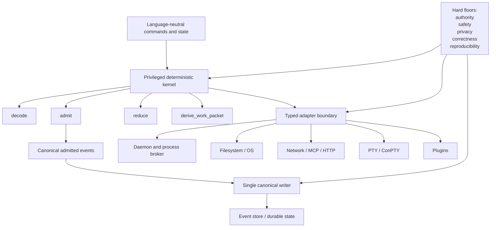
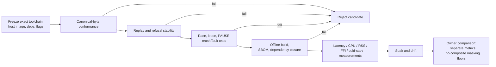

# DS-18 Deep Research Report: Implementation Language and Runtime Selection for Recursion v3

## Executive summary

This report treats the uploaded **DS-18 — Implementation language and runtime selection** handoff as the operative research brief. It preserves its central constraint: **the implementation language, event store, terminal renderer, and plugin runtime remain Owner-owned and unselected; this research must not choose a product default**. It also accepts the already-ratified architecture of a small native deterministic kernel exposing `decode`, `admit`, `reduce`, and `derive_work_packet`, with all external effects behind typed adapters. fileciteturn0file0

The most important finding is that the language decision should be decomposed into two questions that are related but not identical. For the **privileged pure kernel and canonical event writer**, deterministic bytes, race freedom, stable refusals, reproducible replay, dependency closure, and failure semantics dominate; general-purpose asynchronous throughput is secondary because DS-18 already requires one canonical writer and pure kernel functions. For the **daemon, process broker, and adapters**, cancellation, scheduler behavior, OS integration, FFI, memory management, and long-running tail latency become substantially more important. That distinction follows from the architecture in the handoff rather than from any language vendor claim. fileciteturn0file0

The evidence does **not** justify selecting a language today. In particular, there are no Recursion-matched measurements yet for p99/p999 latency, RSS drift, FFI cost, artifact size, cold start, dependency closure size, or 24/7 behavior. Those cells therefore remain `unknown`, not implicitly zero or “probably fast.” This is exactly the reason `EXP-FHAR-10` should remain the selection gate. fileciteturn0file0

The evidence does, however, justify a sharper experimental funnel:

| Decision status | Research conclusion |
|---|---|
| Product-default language | **No selection.** Evidence is insufficient and DS-18 reserves the choice to the Owner. |
| Required matched experiment | Keep the planned **CPython / Rust / Go** comparison as the primary experiment because it is already the defined `EXP-FHAR-10` triad. fileciteturn0file0 |
| Current pins for that experiment | **CPython 3.13.15**, with GIL and 3.13 free-threaded builds treated as distinct arms; **Rust 1.98.1**; **Go 1.27.1**. Python 3.13.15 was released August 5, 2026; Rust 1.98.1 on September 3 after fixing a 1.98.0 vtable miscompilation; Go 1.27.1 on September 1 after Go 1.27.0 shipped August 19. citeturn16search2turn16search6turn16search5 |
| Python free-threading | CPython 3.13's free-threaded build remains **experimental**. Python 3.14 made free-threading officially supported, so 3.14.7 is useful as an optional maturity-control arm, but it should not silently replace the frozen 3.13 experiment. citeturn16search2turn0search6turn16search7 |
| Determinism | No candidate may rely on ordinary map/dictionary traversal, default JSON serialization, ambient hashing, RNG, wall clock, or exception text. RFC 8785 canonicalization plus duplicate-key detection and typed refusals must be implemented explicitly and validated with byte-for-byte golden vectors. citeturn1search1turn1search0turn1search4turn1search9 |
| Concurrency | No reviewed runtime provides, by itself, the `PauseSafety` guarantee DS-18 needs. Go cancellation is cooperative, Python tasks can suppress cancellation, Tokio blocking tasks cannot necessarily be aborted after starting, and Java structured-concurrency cancellation depends on subtasks responding to interruption. Pause safety therefore has to be an **admission/effect-fencing invariant**, not a hope that runtime cancellation kills everything. citeturn14search0turn13search1turn11search5turn18search0 |
| Memory/tail latency | Rust/Zig avoiding a tracing GC does not prove bounded RSS; Go's concurrent GC has real scheduling, assist, and brief stop-the-world costs; CPython has its allocator/arena and cyclic-GC behavior; JVM collectors have different latency/throughput trade-offs. **Recursion p99/p999 and RSS remain unknown for all candidates** until measured on the 2-vCPU/4-GiB profile. citeturn14search4turn3search3 |
| Packaging | Rust and Go have strong first-party offline/vendoring mechanisms; Python now has a standardized lock-file format but the actual cross-platform wheel/sdist closure remains dependency-specific. None of those facts proves bit-reproducible Recursion artifacts; that must be tested. citeturn10search0turn9search0turn10search2 |
| WASM | WASI 0.3 is now a materially stronger component/plugin substrate, with native async and the Component Model, but that is better evidence for evaluating `E-FHAR2-105` isolation than evidence for putting the privileged kernel inside a Wasm runtime. Per-boundary cost remains unknown. citeturn7search0turn7search2 |

The resulting research recommendation is therefore **not “choose Rust,” “choose Go,” or “stay with Python.”** It is: freeze the exact primary experiment pins; run conformance hard floors before any performance comparison; reject any candidate that cannot produce byte-identical replay or preserve authority/lease/pause/effect invariants; then compare only floor-passers using separate latency, memory, FFI, packaging, supply-chain, and operational measurements rather than a weighted composite score. That is the strongest conclusion the present evidence supports. fileciteturn0file0

## Scope and decision framing

The likely user intent is **Owner decision support for a difficult-to-reverse foundational technology choice**, rather than generic “which language is best?” research. DS-18 makes that explicit: the language/runtime selected here will shape later canonical-state, plugin/route, node-fabric, optimization, and soak milestones, while the architecture itself—native deterministic kernel with typed adapters—is already decided. fileciteturn0file0

Three specific research questions capture the decision more cleanly than a single language ranking:

| Research question | Why it is decision-relevant | Success criterion |
|---|---|---|
| **Which candidates can demonstrably satisfy the language-independent hard floors?** | A fast runtime that changes replay bytes, races the canonical writer, admits effects after PAUSE, or cannot reproduce the release closure is disqualified. | Byte-identical vectors/replay, stable typed refusals, race-free canonical admission, lease/pause/effect fault tests, offline reproducible dependency closure. |
| **Among hard-floor passers, what are the actual resource and operational trade-offs on coordinator-small?** | Runtime GC, allocator behavior, FFI, OS seams, packaging, and scheduler behavior matter after correctness is proven. | Per-operation latency distributions, CPU/event, allocation/event, RSS level and slope, handles/threads, cold start, FFI cost, artifact/install size, dependency closure. |
| **Does any hybrid topology earn its additional ABI and packaging complexity?** | Python↔Rust, Go↔C, embedded Python, and WASM boundaries may combine strengths but also create extra failure, versioning, supply-chain, and deployment surfaces. | A hybrid must demonstrate a concrete floor or resource advantage that cannot be obtained with a simpler single-runtime topology. |

The key architectural relationship can be represented as follows:

The diagram matters because it exposes a common evaluation error: **scheduler sophistication should not be used as a proxy for kernel correctness**. `reduce`, for example, should be deterministic given its ordered event, regardless of whether the surrounding daemon uses goroutines, Tokio tasks, Python tasks, JVM virtual threads, or OS processes. Conversely, a pure-function benchmark alone says too little about the process broker and adapter layer. This separation is an inference from the specified interface and invariants in DS-18. fileciteturn0file0

The evidence freeze for this report is **September 30, 2026**. Exact binary/compiler pins must still be captured in the experiment manifests on the frozen Windows and Linux hosts; a webpage saying a release exists is not equivalent to proving that exact artifact was used or is acceptable for Recursion.

## Current candidate state and source-pinned evidence

The current upstream landscape has moved enough that version pinning matters. Python 3.13.15 is the current 3.13 maintenance release, while 3.12 and 3.11 are security-only lines; 3.14.7 is the current feature-series maintenance release. Python 3.13 exposes free-threading only experimentally, whereas 3.14 moved it into supported phase II. citeturn16search2turn16search7turn0search6

Rust stable is 1.98.1 as of the evidence freeze. Importantly, 1.98.1 is not merely a routine patch: it fixed a vtable-generation miscompilation in 1.98.0 that could produce undefined behavior. That is useful evidence for DS-18's requirement to pin the **exact** compiler release and preserve build provenance rather than treating “Rust stable” as a timeless property. citeturn16search6

Go 1.27 was released August 19, 2026, and 1.27.1 on September 1 includes fixes in cgo, compiler/runtime, `encoding/json`, `net/http`, and other packages. The appropriate experimental pin at this freeze is therefore 1.27.1 rather than a generic “Go 1.27.” citeturn16search1turn16search5

Zig's latest stable line is 0.16.0, released in April 2026. The official download service provides signed Windows and Linux toolchain archives, but the sizes of those toolchain archives are **not** evidence of Recursion application artifact size. citeturn16search3turn16search4

Kotlin's current stable release is 2.4.20 from September 7, 2026. Java SE/JDK 27 documentation is live, including its structured-concurrency APIs, but this research did not independently pin a specific JDK 27 vendor build and digest; that binary pin therefore remains `unverified` rather than being inferred from the existence of Java SE 27 documentation. citeturn17search1turn17search4turn18search0

Bun reports 1.4.2 as its current September 2026 release. Its release notes are also a reminder that rapid runtime development is a relevant operational variable: 1.4.2 fixed an `AsyncLocalStorage` leak plus rare JIT and musl-GC crashes. That does not make Bun unsuitable, but it means “JavaScript runtime” is not a stable enough pin; exact build and long-soak behavior matter. citeturn17search3

Deno 2.9 was released June 25, 2026 and its documentation places the 2.9 line in its LTS schedule. This research did not obtain a sufficiently authoritative exact current 2.9 patch number, so the exact Deno binary should remain `unverified` until the experiment freeze rather than guessed. citeturn17search0turn17search13

For WebAssembly, the meaningful pin is not “WebAssembly” alone. WASI 0.3 is a current stable component-model generation with native async, and the 0.3 series has already received point updates; the specific host runtime, such as a Wasmtime build, must independently be pinned because its compiler/runtime behavior is part of the trusted computing base. citeturn7search0turn7search1turn7search2

The following source-pinned claim table distinguishes documentation, inference, and unresolved evidence.

| Consequential claim | Version/date scope | Evidence | Classification | Confidence | Expiry trigger |
|---|---|---|---|---|---|
| Recursion requires a pure four-function kernel, one canonical writer, hard-floor-first evaluation, and no language selection by this lane. | DS-18, updated 2026-09-29 | Uploaded handoff. fileciteturn0file0 | **Source-documented** | Very high | Owner changes governing decision record or handoff |
| CPython 3.13.15 is the current 3.13 maintenance pin; 3.13 free-threading remains experimental. | 3.13.15, 2026-08-05 | Python release page. citeturn16search2 | **Source-documented** | High | New 3.13 point release or support-policy change |
| Python 3.14 has moved free-threading to supported phase II; this does not retroactively make 3.13's build non-experimental. | Python 3.14 / PEP 779 | PEP and active-release material. citeturn0search6turn16search7 | **Source-documented** | High | PEP/status amendment |
| Rust 1.98.1 is the appropriate current stable pin and fixes a 1.98.0 miscompilation with possible UB. | 1.98.1, 2026-09-03 | Rust Release Team. citeturn16search6 | **Source-documented** | Very high | New stable release |
| Go's current line is 1.27, with 1.27.1 released September 1. | 1.27.1, 2026-09-01 | Go release history. citeturn16search5 | **Source-documented** | Very high | New 1.27 patch / Go 1.28 |
| JCS requires deterministic property sorting, finite IEEE-754-compatible numbers, rejection of NaN/Infinity, unique property names, and no Unicode normalization transformation. | RFC 8785 | IETF RFC 8785. citeturn1search1 | **Source-documented** | Very high | Replacement/amendment of canonical format |
| Default hash/map iteration cannot be allowed to determine canonical output in Python, Rust, or Go. | Current documented semantics | Python hash randomization, Rust randomized `HashMap`, Go unspecified map order. citeturn1search4turn1search9turn1search0 | **Source-documented** | Very high | Language semantic change |
| Rust's `Send`/`Sync` model gives compile-time protection in safe code, but `unsafe` and FFI remain escape hatches. | Rust current semantics | Rustonomicon. citeturn2search1 | **Source-documented** | High | Language/model change |
| Go race freedom requires synchronization; race-free programs receive strong sequential-consistency semantics, while races remain program errors. | Go memory model | Official Go memory model. citeturn2search0 | **Source-documented** | Very high | Memory-model revision |
| Free-threaded CPython container internal locking is not sufficient as Recursion's canonical-writer synchronization contract. | CPython free-threaded builds | Python docs instruct users to use explicit synchronization rather than relying on internal container locks. citeturn2search4turn2search2 | **Inferred from documented semantics** | High | CPython provides stronger public synchronization guarantee |
| No reviewed cancellation API proves PauseSafety by itself. | Python 3.13, Go current, Tokio current, JDK 27 | Cancellation is cooperative or can wait indefinitely on non-cooperating/blocking work. citeturn13search1turn14search0turn11search5turn18search0 | **Inferred from documented semantics** | Very high | A runtime provides and Recursion uses a stronger effect-termination primitive |
| Go GC provides tunable CPU/memory trade-offs but not a hard Recursion p99/p999 guarantee. | Current Go standard toolchain | Go GC guide documents STW transitions, assist/scheduling costs, and soft memory-limit behavior. citeturn14search4 | **Source-documented + inferred applicability** | Very high | Runtime/GC design change |
| Exact Recursion p99/p999, RSS, cold-start and FFI costs are unknown for every candidate. | Pre-EXP-FHAR-10 | No matched experiment has been executed in this research; DS-18 requires it. fileciteturn0file0 | **Unverified / unknown** | Very high | EXP-FHAR-10 measurements |
| Exact dependency/license/CVE closure for SQLite, JCS, crypto, PTY, MCP and HTTP is not yet known because those concrete libraries are not selected. | 2026-09-30 | DS-18 leaves technologies unselected. fileciteturn0file0 | **Unverified / unknown** | Dependency candidates are pinned |
| WASI 0.3 materially strengthens the case for evaluating Wasm as a plugin boundary, but does not establish it as the privileged-kernel runtime. | WASI 0.3.x, 2026 | WASI component/async support plus Recursion's plugin isolation contract. citeturn7search0turn7search2 fileciteturn0file0 | **Inferred** | Plugin experiment or new WASI generation |

No claim above should be read as certification, CVE-freedom, or support approval for Recursion. In particular, “current stable” means upstream release status at the evidence freeze, not that the binary has passed Recursion's frozen-host acceptance tests.

## Hard-floor technical analysis

The comparison below uses a deliberately strict vocabulary. **Modelled** means a conclusion derived from documented language/runtime semantics under an explicitly stated Recursion implementation model; it is not a benchmark result. **Unknown** means the required Recursion-specific evidence does not exist yet. There are intentionally no “measured” Recursion cells because this research did not execute `EXP-FHAR-10`. That preserves the handoff's rule that blank evidence must not silently become zero. fileciteturn0file0

The common model assumed in every “Modelled” cell is: explicit RFC 8785 canonicalization; duplicate detection before lossy map construction; explicit typed refusal codes rather than exception strings; one canonical writer protected by a deliberate synchronization primitive; no ambient clock/RNG in the kernel; bounded queues; frozen dependencies; and OS effects only through adapters.

| Candidate / pin | Deterministic kernel | Race / cancellation posture | Memory and tail latency | FFI / OS seams | Offline / release closure | Present research disposition |
|---|---|---|---|---|---|---|
| **CPython 3.11.16 / 3.12.14** | **Modelled:** capable if JCS and types are explicit; Python hash randomization forbids hash-derived ordering. citeturn1search4 | **Modelled:** GIL does not replace a Recursion writer lock or effect fence; async cancellation is cooperative. citeturn13search1 | **Unknown:** CPython allocator/arena and cyclic-GC behavior need soak measurements. `pymalloc` uses arenas for small objects. citeturn3search3 | **Modelled:** excellent C-extension reach, but each native dependency expands ABI/package surface. | **Modelled:** standard lock-file work has improved; exact multi-platform wheel/sdist closure remains dependency-specific. citeturn10search2 | **Modelled:** useful historical/control arms, but both lines are security-only rather than current feature development. citeturn16search7 |
| **CPython 3.13.15, GIL build** | **Modelled:** same canonicalization requirements; ordinary `dict` convenience does not remove need for canonical sort and duplicate checks. | **Modelled:** explicit writer lock required; `Task.cancel()` can be delayed or suppressed by user code. citeturn13search1 | **Unknown:** workload-specific RSS/p99/p999. | **Modelled:** broad native ecosystem; extension ABI and wheel closure must be pinned. | **Modelled:** feasible but more packaging inputs than a self-contained native executable are likely; actual closure size unknown. | **Modelled:** primary `EXP-FHAR-10` Python arm because it matches the requested generation. fileciteturn0file0 |
| **CPython 3.13.15 free-threaded** | **Modelled:** no determinism advantage over GIL build. | **Modelled:** 3.13 mode is experimental; container internal locks are not a public substitute for application synchronization; native extensions require free-threading compatibility review. citeturn16search2turn2search4turn0search19 | **Unknown:** Recursion RSS and tail effects; upstream free-threading overhead numbers are not Recursion measurements. | **Modelled:** more complicated native-extension compatibility/ABI story than GIL-only 3.13; PyO3 requires a free-threading-aware audit. citeturn12search0 | **Unknown:** exact Windows/Linux compatible wheel closure for selected dependencies. | **Modelled:** should be a **separate experimental arm**, not conflated with ordinary CPython. |
| **Rust 1.98.1** | **Modelled:** strong fit for explicit typed state; canonical bytes still depend on the chosen serializer and ordered representation, not “Rust” itself. Randomly seeded `HashMap` must not drive output. citeturn1search9 | **Modelled:** `Send`/`Sync` help reject unsafe sharing in safe code; `unsafe` and FFI remain explicit escape hatches. Blocking Tokio work cannot always be aborted after start. citeturn2search1turn11search5 | **Unknown:** no tracing GC removes one latency source but does **not** prove bounded RSS, allocator behavior, or leak freedom. | **Modelled:** direct native OS/SQLite integration is viable but FFI requires `unsafe` containment. Exact per-call cost unknown. | **Modelled:** Cargo supports vendoring plus locked/offline/frozen operation. Bit-reproducible final artifacts still require testing. citeturn10search0 | **Modelled:** primary `EXP-FHAR-10` arm; no selection until conformance and matched resource results exist. |
| **Go 1.27.1** | **Modelled:** viable with explicit canonicalizer; ordinary Go map iteration is unsuitable for output ordering. citeturn1search0 | **Modelled:** strong race tooling and DRF semantics; cancellation via `context` signals work to stop but does not force arbitrary foreign/blocking operations to terminate. citeturn2search0turn2search7turn14search0 | **Unknown:** GC introduces a measurable resource/latency trade-off; official docs identify brief STW transitions, assists and scheduling costs but no hard application-tail bound. citeturn14search4 | **Modelled:** native Go is simple; cgo adds pointer/pinning, callback and cross-compilation constraints. citeturn11search0 | **Modelled:** module vendoring and no-network builds are first-party workflows. citeturn9search0 | **Modelled:** primary `EXP-FHAR-10` arm. |
| **C/C++ — exact compiler unverified** | **Modelled:** fully capable of JCS, but all canonicalization and validation obligations are manual/library-dependent. | **Modelled:** data races and memory errors create a larger correctness proof burden than memory-safe safe-language subsets; sanitizers improve detection but are not proof of absence. | **Unknown:** potentially low runtime overhead, but allocator fragmentation, leaks and UB-induced faults need workload/soak evidence. | **Modelled:** strongest direct OS/ABI access of the candidate families. | **Unknown:** exact compiler, standard library, package manager, dependency closure and cross-platform build system are not selected. | **Modelled:** useful as FFI/hotspot or lower-bound control; full-kernel candidacy requires an especially strong safety case. |
| **Zig 0.16.0** | **Modelled:** explicit control can support canonical output; exact JCS library remains unverified. | **Modelled:** manual allocator/lifetime choices keep substantial correctness responsibility in implementation. | **Unknown:** absence of hidden allocation in the language design does not establish Recursion RSS/tail behavior. Zig advertises explicit allocation semantics. citeturn16search18 | **Modelled:** strong C interoperability and cross-compilation are architectural advantages. citeturn16search18 | **Modelled:** signed official toolchains exist for Windows/Linux; exact app closure/reproducibility unknown. citeturn16search4 | **Modelled:** credible secondary native candidate; ecosystem/library closure is presently less evidenced than the primary triad. |
| **Java 27 / Kotlin 2.4.20 — exact JDK binary unverified** | **Modelled:** typed state and deterministic serialization are feasible, but serializer/configuration must be fixed explicitly. | **Modelled:** JVM concurrency facilities are mature, but JDK 27 `StructuredTaskScope` remains preview and uninterruptible subtasks may delay scope close indefinitely. citeturn18search0 | **Unknown:** JVM collector choice changes the trade space; vendor collector targets are not Recursion measurements. | **Modelled:** JNI/JNA/Panama-style seams need explicit choice; exact PTY/ConPTY and SQLite path unverified here. | **Unknown:** trimmed runtime, installer and offline dependency closure have not been measured. | **Modelled:** viable secondary comparison when JVM operational cost is worth testing; preview structured concurrency should not be a hard-floor dependency. |
| **TypeScript on Bun 1.4.2 / Deno 2.9.x** | **Modelled:** IEEE-754 `Number` aligns with JCS's number domain, but ordinary JS object/`JSON.stringify` behavior is not by itself the complete JCS contract; explicit canonical sorting and duplicate-aware parsing remain required. citeturn1search1 | **Modelled:** event-loop/worker semantics can implement a single writer, but runtime cancellation still needs effect fencing. | **Unknown:** JIT and GC tail/RSS on the coordinator workload; Bun 1.4.2 itself fixed recent JIT/GC failures and a memory leak. citeturn17search3 | **Unknown:** exact native PTY, SQLite and OS-control dependencies require a concrete package/runtime inventory. Deno supports Node/npm compatibility and executable compilation. citeturn17search6 | **Modelled/Unknown:** Deno supports compiled executables and Windows code-signing facilities, but Recursion artifact size, closure and reproducibility are unknown. citeturn17search6 | **Modelled:** useful secondary runtime study, especially for higher-level adapters; current evidence does not establish privileged-kernel advantage. |
| **Wasm + WASI 0.3.x — host runtime unverified** | **Modelled:** guest code can be deterministic if the host imports and canonical byte rules are tightly bounded; runtime/compiler pin is essential. | **Modelled:** capability-oriented host interfaces can narrow plugin authority, but cancellation/effect semantics must still be designed at the host boundary. | **Unknown:** runtime/JIT/AOT footprint and boundary tail cost. | **Modelled:** every host capability is an explicit interface, useful for isolation; OS-specific privileged functions still live in the host. | **Unknown:** exact Wasmtime/other engine, precompiled component, runtime dependencies and reproducibility closure. | **Modelled:** particularly aligned with the **plugin isolation experiment**, not proven superior as the privileged kernel runtime. citeturn7search0turn7search2 |

### Determinism is a protocol property, not a language reputation

RFC 8785 is unforgiving in ways that make convenient default serializers risky. JCS requires unique object property names, deterministic property sorting, finite IEEE-754-compatible numeric serialization, `-0` canonicalizing to `0`, and rejection of NaN/Infinity. It deliberately does **not** normalize Unicode strings; values must be preserved as represented rather than opportunistically NFC/NFD-normalized. citeturn1search1

That creates several required implementation rules independent of language.

First, duplicate-key rejection must occur **before** a parser silently collapses an object into a map. A parser that produces `{"x":2}` from `{"x":1,"x":2}` has already destroyed evidence necessary to issue the correct typed refusal. This is an inference directly from JCS's uniqueness requirement. citeturn1search1

Second, canonical output must sort according to the JCS rules; “our map is insertion ordered” is not sufficient. Python randomizes string/bytes hashes between processes, Rust's standard `HashMap` uses randomized seeding, and the Go specification explicitly does not specify map iteration order. All three therefore require a canonical ordered serialization phase independent of native container traversal. citeturn1search4turn1search9turn1search0

Third, numeric domain validation belongs at decode/admission boundaries. Python's arbitrary-precision integer convenience, JVM integer types, Rust integer types, Go integers and JavaScript `BigInt` are all capable of representing values outside the JCS/I-JSON interoperable number assumptions. The language-neutral schema must decide what values are admissible before serialization rather than allowing each implementation's native numeric range to define protocol semantics. This is an inference from the RFC's interoperability constraints. citeturn1search1

Fourth, refusal identity must be protocol-owned. An acceptable refusal should resemble `{code, schema_epoch, field/path, stable_detail_enum}` rather than relying on the text of `ValueError`, a Rust crate's display string, a Go `error.Error()` message, a Java exception message, or a JavaScript `SyntaxError`. Exception wording is implementation detail and can drift across point releases. This recommendation is inferred from DS-18's requirement for reproducible refusals and its release/version discipline. fileciteturn0file0

### Single-writer safety reduces, but does not erase, concurrency differences

Rust provides the strongest reviewed **language-level** constraints on shared memory among the primary triad: safe types crossing thread boundaries are governed by `Send` and `Sync`; unsound `unsafe impl` or unsafe/FFI code can still violate those assumptions. citeturn2search1

Go instead provides a memory model in which unsynchronized conflicting accesses constitute data races; correctly synchronized race-free programs obtain strong sequential-consistency behavior, and the standard toolchain supplies a race detector. This makes an explicit single-writer goroutine plus bounded channels plausible, but a channel architecture still needs a test proving no second write path or unbounded backlog exists. citeturn2search0turn2search7

With ordinary CPython, the GIL often prevents simultaneous execution of Python bytecode, but that is not the same contract as “exactly one canonical writer.” With free-threaded CPython, built-in containers acquire internal locks, yet Python's own documentation warns that applications should use explicit synchronization rather than treating those internal locks as a guaranteed concurrency API. Some C API operations also require additional critical-section discipline. citeturn2search4turn2search2turn2search3

Accordingly, the Recursion implementation should have an explicit canonical-writer primitive in **every** language. The experiment should intentionally race two admitted commands against the same expected digest and prove that exactly one valid sequence results—or that both are serialized in a deterministic admissible order—without duplicate sequence numbers, widened authority, stale lease acceptance, or state-digest confusion. That test is more useful than arguing abstractly about GILs, goroutines, or borrow checking. fileciteturn0file0

### Cancellation cannot carry the PAUSE invariant

This is one of the strongest cross-runtime findings.

Go's `context.Context` propagates deadlines and cancellation signals, but code has to observe those signals and stop; cancellation is not an OS-level guarantee that arbitrary work has ceased. The API even warns that failing to invoke returned cancel functions can retain resources. citeturn14search0

Python's `Task.cancel()` arranges for `CancelledError` to be raised at a scheduling opportunity, but the coroutine can perform cleanup, delay the point, or suppress the cancellation; Python explicitly says `Task.cancel()` does not guarantee that a task will in fact end. `TaskGroup` improves structured lifetime management but remains based on these cooperative semantics. citeturn13search1

Tokio has a sharper blocking edge: once a `spawn_blocking` task has started, aborting its handle generally cannot cancel the underlying blocking task; runtime shutdown may wait for such tasks. citeturn11search5turn11search7

JDK 27's preview `StructuredTaskScope` gives strong lexical task-lifetime structure, but its own documentation says cancellation interrupts subtasks and that code which does not respond to interruption—for example, an uninterruptible blocking operation—may delay scope closure indefinitely. citeturn18search0

The conclusion is architectural: **`PauseSafety` must be guaranteed at admission and effect-commit boundaries.** When the PAUSE/admission epoch changes, old work must lose authority to commit a new effect even if a thread, goroutine, task, process, C function or OS I/O request continues running temporarily. Runtime cancellation remains valuable for resource reclamation, but it cannot be the proof of “no post-PAUSE effect.” This inference applies equally to Rust, Go, Python, Java and hybrid designs. fileciteturn0file0

### Memory management needs workload evidence

Go's own GC guide describes a concurrent collector with a tunable CPU/memory trade-off, brief stop-the-world phase transitions, background marking, mutator assists, root scanning and a **soft**, rather than absolute, runtime memory limit. Under an unrealistically low memory limit the runtime deliberately allows memory to exceed the target rather than spend unlimited CPU thrashing. That is sensible engineering, but it means a generic “low-pause Go GC” claim cannot substitute for coordinator-small tail measurements. citeturn14search4

CPython uses specialized small-object allocation and larger allocator arenas—on common 64-bit platforms, `pymalloc` manages small allocations from arenas—so object churn, fragmentation, extension allocations and cyclic GC all need to be observed over long-running replay/admission workloads rather than predicted from reference counting alone. citeturn3search3

Conversely, a non-GC language does not automatically win the memory floor. Rust can retain `Arc` cycles, intentionally leaked resources, caches, queues, arenas, native-library state and allocator pages; C/C++ and Zig can leak or fragment memory too. The absence of tracing-GC pauses is a useful mechanism-level difference, but **RSS slope and tail latency remain empirical properties**. This is an inference from the memory models, not a measured Recursion result.

The correct denominator is therefore not “language X uses less RAM.” It is, for example, `MiB RSS at steady state`, `MiB/hour RSS slope`, `allocated bytes/admitted event`, `CPU-ms/10,000 events`, `p99 admit latency/op`, and `p999 reduce latency/event` under the identical state/event corpus.

### FFI and platform seams are likely to be a discriminator

Windows requires real platform control for the broker. Microsoft documents pseudoconsoles as the ConPTY-style character-mode hosting mechanism; the pseudoconsole exchanges UTF-8 plus virtual-terminal sequences and has explicit lifecycle and asynchronous interaction requirements. Windows Job Objects, meanwhile, can manage a process tree as a unit, enforce limits, collect accounting data, and terminate associated processes. citeturn15search1turn15search7turn15search0

This means a language's ability to call OS APIs is not merely a convenience. The broker must correctly own handles, process-tree containment, cancellation/termination, pipes, UTF-8/UTF-16 conversion, and recovery. The correct experiment should therefore count **how much privileged FFI/unsafe/native wrapper code is required** for each implementation, not merely whether a library exists.

Go's cgo is the clearest documented example of an interoperability tax: its C boundary has rules around passing/pinning Go pointers, callbacks and cross-compilation, and cgo-dependent cross-compilation requires an appropriate C cross-compiler. Some optimizations can reduce call overhead but place more correctness responsibility on the programmer. citeturn11search0

Rust makes native FFI straightforward but explicitly moves those operations into `unsafe` territory; the relevant metric is therefore **unsafe lines and reviewed boundary surface**, not “Rust is memory safe” as an unconditional slogan. citeturn2search1

Python has a mature C extension model, but free-threading adds another compatibility dimension: extensions must declare/support the free-threaded model appropriately, and PyO3's documentation calls out synchronization and version-specific free-threading concerns. Python subinterpreters have also improved—modern interpreters can have their own GIL—but native extension state and isolation compatibility still have to be audited. citeturn0search19turn12search0turn12search1

No credible per-call numeric FFI estimate can be supplied without executing the exact bindings; those costs therefore remain `unknown`.

## Experiment methodology and evidence matrix

`EXP-FHAR-10` should be treated as a **conformance experiment followed by a resource experiment**, not as a language shoot-out where throughput can compensate for a correctness failure. That ordering directly implements DS-18's “hard floors first” rule. fileciteturn0file0

**Freeze protocol.** Each run manifest should capture OS image digest, CPU exposure, 4-GiB memory envelope, compiler/interpreter/runtime artifact digest, exact build flags, linker, allocator where configurable, dependency-lock digest, environment variables, locale/timezone, and any GC/runtime tunables. The binary and its SBOM should be identified through the `ReleaseId` fields already required by `E-FHAR2-108`. SPDX 3.0.1 supports explicit SBOM relationship/profile information suitable for building that artifact evidence. citeturn9search1 fileciteturn0file0

**Primary arms.** The matched mandatory set should be:

| Arm | Freeze recommendation | Why |
|---|---|---|
| CPython regular | **3.13.15 GIL build** | Preserves the requested CPython generation and provides the ordinary-runtime baseline. citeturn16search2 |
| CPython free-threaded | **3.13.15 free-threaded**, separate result set | Prevents experimental free-threading behavior from being averaged into conventional Python. citeturn16search2 |
| Rust | **1.98.1** | Current corrected stable pin at freeze. citeturn16search6 |
| Go | **1.27.1** | Current patch in the 1.27 line at freeze. citeturn16search5 |
| Optional Python maturity control | **3.14.7 regular/free-threaded**, only as a sensitivity arm | Shows whether 3.14's supported free-threading materially changes a 3.13 result without silently changing the original experiment. citeturn16search7turn0search6 |

The secondary families—Zig, JVM/Kotlin, C/C++, Bun/Deno and Wasm—should first receive a **conformance/prototype probe**, not automatically a full duplicate of every primary performance run. They should be promoted to full comparison when they either clear the hard floors and reveal a plausible unique advantage, or when an Owner question specifically requires them. This is a research-efficiency recommendation, not a product selection.

### Canonical-byte suite

The exact same language-neutral input corpus should contain, at minimum:

| Vector family | Required cases | Failure signal |
|---|---|---|
| Object ordering | reordered ASCII keys; nested objects; non-ASCII keys; empty objects | Any byte difference across language/process/host |
| Duplicate keys | duplicate at root and nested levels | Parser silently accepts/collapses instead of typed refusal |
| Numbers | zero, `-0`, integer boundaries, subnormal/small values, shortest-round-trip cases, exponent formatting | Different canonical bytes or numeric domain |
| Non-finite numbers | NaN, +Inf, -Inf through every available input route | Acceptance rather than stable refusal |
| Unicode | multibyte UTF-8, combining forms, precomposed/decomposed values, escaped/control characters | Normalization or platform-dependent transformation |
| Malformed encoding | invalid UTF-8 and schema-invalid byte streams | Crash, permissive replacement, or unstable refusal |
| Schema epochs | current, older admissible, unknown/future | Version-dependent exception text rather than protocol refusal |

JCS itself defines the canonical serialization behavior, so a candidate passes only when its **output bytes and typed refusals** agree with the golden corpus—not when its local round-trip equality test passes. citeturn1search1

### Replay and fault suite

The workload already specified by DS-18—one GoalSpec, 10 plan revisions, 1,000 tasks, 3,000 edges and 10,000 events, followed by a 100,000-event scale check—should be replayed under multiple process restarts and environmental perturbations. fileciteturn0file0

The required result is a canonical digest tuple such as:

`(final_state_digest, ordered_event_digest, projection_digest, refusal_digest)`

Every run on the same schema/protocol build must produce the same tuple. The test should deliberately vary factors that must be semantically irrelevant: process identity, randomized hash seed where applicable, host locale, timezone, worker interleavings, and restart points. Wall-clock and nondeterministic RNG attempts inside the kernel should fail through test doubles/static checks rather than become hidden inputs.

Fault injection should target every durable boundary that could create `NoBlindEffectReplay` violations: before admission persistence, after event persistence but before projection, before dispatch, after an external effect completes but before its receipt is durable, and during restart/replay. The acceptance test is not “system comes back”; it is “no effect is executed twice without an idempotent protocol justification, and state is reconstructed only from valid ordered events.” Those invariants come directly from the handoff. fileciteturn0file0

### Race and cancellation suite

Each candidate should face the same adversarial tests: two concurrent writes with one expected digest; stale lease versus renewed lease; PAUSE racing admission; PAUSE racing adapter dispatch; cancellation while waiting on an OS process; cancellation while a blocking foreign call is executing; worker crash immediately before/after receipt persistence; and a deliberately non-cooperating task.

Tooling should be additive rather than treated as proof. Rust can run sanitizers/Miri-compatible portions where suitable; Go should run `-race`; C/C++ candidates should run thread/address/undefined-behavior sanitizers where supported; Python should be tested under both GIL and free-threaded builds. Go's race detector and Rust's safe-type rules are useful evidence but do not themselves establish application-level LeaseFence or PauseSafety. citeturn2search7turn2search1

### Resource and latency measurements

Only candidates that pass hard floors should proceed to the performance table. Every reported metric needs an explicit denominator.

| Metric | Required reporting unit | Current value |
|---|---|---|
| `decode` latency | µs/op at p50, p95, p99, p999 | **Unknown** |
| `admit` latency | µs/op at p50, p95, p99, p999 | **Unknown** |
| `reduce` latency | µs/event at p50, p95, p99, p999 | **Unknown** |
| `derive_work_packet` | µs/task at p50, p95, p99, p999 | **Unknown** |
| Full replay | wall time / 10,000 events and /100,000 events | **Unknown** |
| CPU | CPU-ms / 10,000 events; CPU-ms/admitted task | **Unknown** |
| Allocation | bytes allocated/event and allocations/event where observable | **Unknown** |
| Steady memory | MiB RSS after defined warm state | **Unknown** |
| Memory drift | MiB RSS/hour during soak; high-water mark | **Unknown** |
| Managed-runtime GC | pause/event distribution, GC CPU %, collection count | **Unknown** |
| Runtime concurrency | threads/process, goroutines/tasks as applicable; peak count | **Unknown** |
| OS resource leakage | handles on Windows; fds on Linux; slope/hour | **Unknown** |
| Cold start | process-start to core-only replay-ready | **Unknown** |
| Core artifact | signed artifact MiB | **Unknown** |
| Installation closure | MiB including required runtime/dependencies | **Unknown** |
| Dependency surface | direct count; transitive count; native dependencies | **Unknown** |
| FFI SQLite | µs/call and µs/transaction for identical synthetic operation | **Unknown** |
| FFI PTY/ConPTY | µs session setup/teardown; handles/session | **Unknown** |
| Crypto boundary | µs/op for fixed message/key operation | **Unknown** |
| Offline rebuild | success/failure plus resulting artifact digest | **Unknown** |

This is deliberately not a weighted score. A candidate that is 30% faster but violates replay determinism does not get “almost enough points” to compensate; it is rejected. Likewise, an extra 20 MiB of RSS must remain visible as an extra 20 MiB rather than disappearing into a composite normalized index. This follows the optimization rule in DS-18. fileciteturn0file0

For statistical analysis, runs should be **paired on the same frozen host allocation** and candidate order randomized or alternated to limit thermal/background drift. Results should report the distribution across independent runs and confidence intervals on pairwise differences. Tail statistics, particularly p999, should be bootstrapped at the independent-run level rather than treating thousands of adjacent events from one process as independent observations. No adoption threshold should be retroactively selected after seeing which language wins.

### Packaging and reproducibility tests

Rust's Cargo has first-party support for `cargo vendor`, `--locked`, `--offline`, and `--frozen`, providing a strong mechanism for a network-free dependency closure. citeturn10search0

Go similarly supports module checksums and vendoring, with vendor mode allowing builds without fetching modules from the network. citeturn9search0

Python now has a standardized `pylock.toml` format intended to describe reproducible installation locks, but whether a Recursion dependency set has all required Windows/Linux wheels—or must build sdists/native modules—is a property of the eventual dependency closure, not of the specification itself. citeturn10search2

Therefore every candidate should have to perform the same release drill:

1. Start from a clean frozen host with network disabled.
2. Reconstruct the dependency closure solely from the declared vendored/cache/install bundle.
3. Build the core twice from independent clean workspaces.
4. Produce the `core_artifact_digest`, dependency-lock digest, build-provenance digest, SPDX 3.0.1 SBOM digest and edition-manifest digest required by `ReleaseId`.
5. Explain any artifact-digest difference down to a known, controlled source such as signing metadata; unexplained nondeterminism is a reproducibility failure. citeturn9search1 fileciteturn0file0

Code signing should be tested as a post-build/release operation rather than conflated with reproducible unsigned content. Windows process and terminal support also needs platform-native acceptance: ConPTY uses defined handles/pipes and UTF-8/VT data, while Job Objects provide process-tree accounting and termination semantics that the broker has to preserve regardless of language. citeturn15search0turn15search1

### Hybrid topology comparison

A hybrid must be compared against the simpler competing topology, because every extra runtime boundary creates its own pin, ABI, package and failure surface.

| Topology | Evidence-based advantage | Added cost / failure mode | Required falsifier |
|---|---|---|---|
| **One native process/runtime per role** | **Modelled:** simplest versioning and crash boundary; each role can be independently contained. | **Unknown:** IPC cost and aggregate RSS. | Reject if measured IPC/resource cost materially outweighs isolation without reducing fault surface. |
| **Python kernel + Rust hotspots through PyO3** | **Modelled:** could retain Python development ergonomics while moving narrow expensive/native operations to Rust. | **Modelled:** GIL/free-threaded attachment rules, native wheels, Rust/Python ABI and dual dependency closure; PyO3 has explicit free-threading considerations. citeturn12search0 | Reject unless a measured hotspot benefit exceeds the complexity relative to pure Python **and** a pure native candidate. |
| **Rust kernel embedding Python** | **Modelled:** keeps privileged state machine native while permitting Python at less-privileged layers. | **Modelled:** interpreter lifecycle, extension/subinterpreter compatibility, packaging and cross-language error semantics. citeturn12search1turn12search11 | Reject if Python can instead live out-of-process with acceptable IPC, avoiding interpreter code in the daemon's trusted address space. |
| **Go + cgo** | **Modelled:** native Go daemon with access to mature C libraries. | **Modelled:** cgo pointer/pinning/callback rules and more complicated cross-compilation/static closure. citeturn11search0 | Reject cgo dependency where a pure-Go or isolated helper has equivalent functionality without unacceptable cost. |
| **WASM-sandboxed plugin tier** | **Modelled:** capability-shaped interfaces align naturally with `T0–T4` admission and capability intersection; WASI 0.3 strengthens async/component interoperability. citeturn7search0turn7search2 | **Unknown:** component call cost, host complexity, ecosystem coverage for required plugins. | Reject if capability enforcement cannot express the Recursion contract or boundary cost/resource use is operationally unacceptable. |
| **Single static/native binary** | **Modelled:** attractive deployment/rollback identity and potentially small dependency closure. | **Unknown:** feasibility once SQLite, crypto, PTY, signing and OS-specific dependencies are pinned; static linkage may alter licensing/platform behavior. | Reject “single binary” as a requirement if satisfying it materially increases unsafe code, harms supported OS behavior, or prevents dependency/security updates. |

The zero-cost-disabled rule in `E-FHAR2-105` deserves a dedicated test: with every optional plugin disabled, the release should prove that no plugin implementation module/runtime is loaded and no plugin-specific worker/thread is created. A plugin system that merely “does nothing after loading everything” does not satisfy the stated contract. fileciteturn0file0

## Risks, uncertainties, recommendation, and Owner questions

The biggest risk at this stage is **prematurely converting mechanism-level advantages into product-level conclusions**.

Rust's type system genuinely provides valuable thread-safety constraints, but that does not prove its Windows broker is simpler, its JCS implementation is correct, or its total Recursion RSS is lowest. citeturn2search1

Go genuinely provides strong race tooling, simple deployment characteristics in many pure-Go programs, and well-documented GC tuning, but that does not prove its GC meets an unmeasured admission-tail requirement or that cgo-dependent Windows/Linux seams are cheaper than Rust FFI. citeturn2search7turn14search4turn11search0

Python genuinely has a broad native ecosystem and a productive runtime, but free-threaded 3.13 is explicitly experimental, native-extension compatibility is relevant, and neither the GIL nor internal container locks is the canonical-writer invariant Recursion requires. citeturn16search2turn2search4

JVM structured concurrency is unusually close conceptually to bounded task lifetimes, but in JDK 27 it is still preview and does not force non-interruptible work to stop. citeturn18search0

WASI's component model is promising for capability isolation, but adding an entire Wasm host to the privileged core merely to obtain sandboxing would enlarge the trusted runtime unless an experiment proves that benefit is necessary. citeturn7search0turn7search2

Bun and Deno demonstrate that the modern JavaScript/TypeScript runtime space is capable and deployable, but the present evidence is weaker for deterministic privileged-core operation and long-running coordinator tail behavior than it is for higher-level services; Bun's current release fixing memory/JIT/GC defects underscores the need for exact pins and soak tests rather than a generic runtime label. citeturn17search3turn17search0

A second risk is **CVE-count comparison without exposure normalization**. Raw historical CVE totals are a poor ranking metric when ecosystems differ radically in install base, reporting practices, bundled components, and package counts. DS-18 ultimately needs an exact security inventory for the libraries Recursion actually ships: SQLite binding, JCS implementation, crypto/signing, PTY/ConPTY, MCP, HTTP, and any native helper. Since those libraries remain unselected, an honest per-candidate CVE total is currently `unknown`. The later gate should freeze each dependency graph, enumerate direct and transitive packages plus native libraries, map advisories to the exact versions, classify whether vulnerable code is reachable in the core, and record remediation/upgrade cost. fileciteturn0file0

The MCP dependency deserves the same version discipline. MCP has continued evolving; the project's 2026 release material describes the July 28, 2026 specification as a new stable foundation after the November 2025 generation. Any selected SDK should therefore be evaluated against a **specific MCP protocol version**, not “supports MCP” as a timeless checkbox. citeturn14search6turn14search2

### Research recommendation

The recommendation is to preserve an explicit **no-selection result now** and make `EXP-FHAR-10` the decision-producing artifact.

The primary experiment should freeze **Rust 1.98.1**, **Go 1.27.1**, and **CPython 3.13.15**, with ordinary and free-threaded CPython treated separately. An optional Python 3.14.7 sensitivity arm is justified because free-threading became officially supported in 3.14, but adding it should be an explicit experiment amendment rather than quietly changing the 3.13 baseline. citeturn16search6turn16search5turn16search2turn0search6

This recommendation's named competing options are therefore **Rust versus Go versus CPython**, not “Rust versus no alternative.” Its decisive falsifiers are:

| Candidate remains viable only if… | Decisive falsifier |
|---|---|
| Any candidate | A canonical input produces non-identical admitted event/refusal bytes across valid reruns or Windows/Linux. |
| Any candidate | Replay yields a different state/projection digest or permits blind re-execution of an effect. |
| Any candidate | Concurrent admission can violate canonical sequence, idempotence, lease fencing, authority narrowing or expected-state semantics. |
| Any candidate | A PAUSE/admission-epoch race permits stale work to commit a newly unauthorized effect. |
| Any candidate | Core-only release cannot be reconstructed offline from its declared lock/vendor closure or cannot account for its SBOM/provenance inputs. |
| Rust | Required safe abstractions still force a sufficiently large `unsafe`/FFI surface that Go or another floor-passing competitor achieves materially simpler verifiable platform integration. |
| Go | GC/RSS/tail behavior on coordinator-small or required cgo seams materially violate Owner-accepted operating envelopes relative to another floor-passer. |
| CPython | GIL/free-threaded behavior, extension closure, RSS/tail latency or packaging makes the core materially less robust than a native competitor without a compensating operational advantage. |
| Hybrid | It fails to show a measured benefit that a simpler single-runtime or process-isolated topology cannot obtain. |
| WASM plugin layer | The Component Model cannot express the required capability/denial lifecycle, or measured boundary/runtime cost defeats the isolation benefit. |

What this recommendation **does not prove** is equally important. It does not prove Rust will win; it does not prove Go's GC is too expensive; it does not prove Python is too slow; it does not prove Zig lacks the necessary ecosystem; it does not prove a JVM is too large; it does not prove JavaScript runtimes are nondeterministic; and it does not prove Wasm should or should not host plugins. Those are experiment outcomes, not consequences of language reputation.

The Owner questions that remain genuinely decision-bearing are:

| Owner question | Why it cannot be silently assumed |
|---|---|
| Is a single implementation language across kernel, daemon and broker a goal, or may a second runtime be accepted when independently justified? | This changes the complexity penalty assigned to Python↔Rust, Go↔C and Wasm boundaries. |
| Is CPython 3.13 specifically required as the long-term Python candidate, or may 3.14.7 be promoted after a sensitivity comparison? | 3.13 free-threading is experimental whereas 3.14 moved it into supported phase II. citeturn16search2turn0search6 |
| What minimum supported Windows versions must the broker target? | ConPTY APIs and later lifecycle helpers have version-dependent availability; the OS target constrains native wrappers. citeturn15search7turn15search2 |
| Must the core be a single executable, or is a signed self-contained install closure acceptable? | “Single binary” materially changes Python/JVM/hybrid packaging evaluation and static-link choices. |
| Is a preview runtime API ever acceptable inside the privileged base? | JDK 27 structured concurrency is still preview; a policy answer determines whether it can be relied upon or only experimented with. citeturn18search0 |
| Is Wasm's first evaluation specifically a plugin-isolation lane rather than a kernel lane? | That avoids conflating `E-FHAR2-105` sandboxing evidence with kernel-language evidence. |
| What evidence threshold converts a resource difference into a practical decision? | DS-18 correctly rejects a composite score, but the Owner still needs a predeclared rule for when, for example, extra RSS or latency matters enough to choose one floor-passer over another. fileciteturn0file0 |
| What is the acceptable dependency-security policy? | Exact library closure is currently unknown; upgrade cadence, severity tolerance and native dependency rules should be fixed before ecosystem comparisons can become acceptance evidence. |

The most defensible adoption rule is therefore:

**Pass every hard floor first. Among passers, select only when one option shows a practically meaningful, reproducible advantage on explicitly named resource/operational dimensions without creating a compensating packaging, FFI, support, or supply-chain regression. Otherwise retain no-selection and gather the missing evidence.** This preserves the governing DS-18 rule that speed cannot hide an authority, safety, privacy, correctness or reproducibility failure. fileciteturn0file0

## Top references

| Reference | Why it is load-bearing |
|---|---|
| **DS-18 — Implementation language and runtime selection** fileciteturn0file0 | Defines the architecture, authority, workload, candidates, hard floors, experiment and explicit no-selection requirement. |
| **RFC 8785 — JSON Canonicalization Scheme** citeturn1search1 | Normative source for canonical property ordering, numeric serialization, duplicate-property requirements, NaN/Infinity handling, `-0`, and Unicode treatment. |
| **Python 3.13.15 release and Python free-threading status** citeturn16search2turn0search6 | Pins the requested Python generation and distinguishes experimental 3.13 free-threading from 3.14's supported phase. |
| **Rust 1.98.1 release** citeturn16search6 | Current exact Rust pin at freeze and direct evidence that exact compiler patch provenance matters because 1.98.1 fixes a 1.98.0 miscompilation. |
| **Rust `Send` and `Sync` semantics** citeturn2search1 | Primary source for Rust's safe cross-thread sharing model and its `unsafe` escape hatches. |
| **Go 1.27 release history and Go memory model** citeturn16search5turn2search0 | Pins Go 1.27.1 and provides the normative race/synchronization model. |
| **Go garbage-collector guide** citeturn14search4 | Primary source for Go's memory/CPU tuning model, STW transitions, assists and soft memory-limit behavior. |
| **Cargo vendoring/offline build documentation and Go module vendoring** citeturn10search0turn9search0 | Primary evidence for the two leading native candidates' offline dependency-closure mechanisms. |
| **SPDX 3.0.1 specification** citeturn9search1 | Normative supply-chain source for the SBOM evidence required by the proposed `ReleaseId`. |
| **WASI 0.3 / Component Model release documentation** citeturn7search0turn7search2 | Primary current evidence for evaluating Wasm as a capability-oriented plugin/runtime boundary rather than relying on older WASI assumptions. |