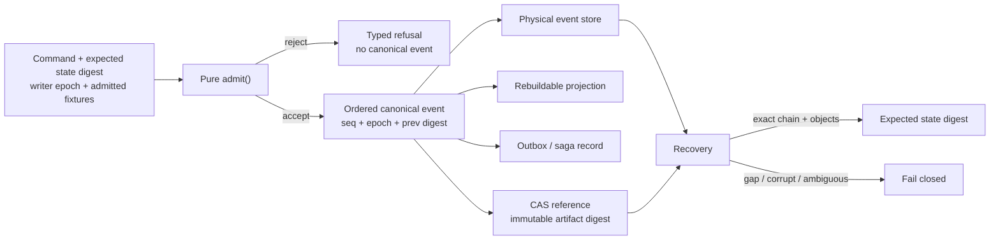
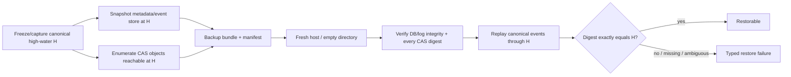

# DS-21 Research Report: Canonical State Store and Persistence Faults

## Executive summary

This report evaluates the physical persistence layer for Recursion v3’s canonical event/projection boundary without selecting a product default. The governing contract requires one fenced canonical writer per aggregate, monotonically increasing event sequence, content-addressed immutable artifacts, deterministic replay, duplicate-command idempotence, stale-writer rejection, rebuildable projections, and recovery that either reproduces the exact expected digest or returns a typed gap/corrupt/ambiguous refusal. Storage serialization is explicitly **not** the authority mechanism, and the comparison must count database/log bytes and content-addressed artifact bytes together. fileciteturn0file0

The evidence supports four principal conclusions.

**First, the decision should remain between two Milestone-2 finalists: a segmented append-only JSON Text Sequence/JSONL log plus CAS, and SQLite WAL plus the identical CAS.** SQLite is the stronger *implementation challenger* because it already supplies transactions, checksummed page/WAL machinery, single-writer serialization, concurrent WAL readers, online backup primitives, integrity checking, and mature Windows/Linux VFS implementations. But none of those features satisfies Recursion’s authorization or writer-epoch requirement: SQLite serializes writers; it does not determine which process is the *authorized* writer. WAL also does not support ordinary network filesystems because its normal coordination depends on shared memory, and long-lived readers can prevent checkpoints from completing and cause WAL growth. citeturn10search0turn10search18

**Second, the strongest defensible SQLite durability profile for an acknowledged canonical event is WAL with `synchronous=FULL`; `NORMAL` is a different durability promise, not a cheaper equivalent.** SQLite documents that in WAL mode `FULL` adds a WAL synchronization after each transaction and provides durability across power loss, whereas `NORMAL` preserves database consistency but can lose recently committed transactions after a system/power failure; `OFF` gives up that safety and can permit corruption after an operating-system crash or power failure. Checkpoint policy is a separate dimension: passive checkpoints do not wait, while FULL/RESTART/TRUNCATE checkpoints can acquire the writer lock and invoke the busy handler. citeturn1search0turn10search2

**Third, the March 2026 SQLite WAL-reset incident should materially affect the acceptance gate without being treated as evidence about any deployed Recursion binary.** SQLite’s own documentation records a rare WAL-reset corruption race affecting versions from the introduction of WAL through 3.51.2; it was fixed in 3.51.3 on March 13, 2026, with named backports. The current stable SQLite line found for this report is 3.53.4, released July 24, 2026. This establishes a mandatory version/compile-option pin and a regression fixture, not certification of 3.53.4 for Recursion. citeturn0search0turn0search4turn0search2

**Fourth, none of the embedded-KV alternatives presently displaces both finalists on the evidence available.** LMDB 1.0.1 is architecturally attractive—MVCC, serialized writes, low operational machinery—but introduces fixed/map-size management and memory-mapped-file concerns and still requires Recursion’s own frame/epoch/integrity contract. RocksDB 11.8.1 is mature and highly capable, but LSM compaction, write stalls, WAL/SST lifecycle, and larger configuration surface add mechanisms that do not obviously benefit a small coordinator metadata store. sled 0.34.7 upstream still explicitly calls itself beta, advises SQLite when reliability is the primary constraint, and warns that its on-disk format will require manual migration before 1.0. redb has advanced rapidly to 4.3.0 as of September 15, 2026, but its latest line has only just introduced **experimental** multi-process read/write support, after several 2026 releases containing significant correctness/data-loss fixes; it therefore deserves a challenger test, not an assumption of equivalence. citeturn5search0turn16search3turn14search0turn17search0turn15search0turn19search1turn20view0

For genuinely multi-node canonical authority, PostgreSQL is the qualitatively different candidate. PostgreSQL 18.6 is the current stable release found here; PostgreSQL 19 Beta 4 was released September 24, 2026 and is explicitly not a production release. PostgreSQL supplies server-side concurrency control, WAL, unique constraints, replication and backup machinery, but it also changes the operational boundary from an embedded store to a network service. It still cannot decide Recursion’s writer epoch or make an external side effect exactly-once. citeturn8search6turn8search5turn9search0turn9search10

The recommended outcome is therefore **no store selection yet**. Run the canonical crash/replay benchmark against **SQLite 3.53.4 WAL + CAS and segmented JSON Text Sequence + identical CAS first**, under strong durability profiles, and retain LMDB 1.0.1 and redb 4.3.0 as secondary challengers. RocksDB should be admitted only if scale measurements show a need for LSM behavior; PostgreSQL should be evaluated when multi-node authority is a real v3 requirement rather than anticipated future optionality. sled does not currently clear a conservative maturity floor. Every recommendation below includes a competing option and a falsifier.

## Scope, evidence model, and candidate pins

The uploaded DS-21 handoff is treated as the operative local specification, not as evidence that any candidate has been deployed, benchmarked, certified, or configured. No database was created or modified for this report, no private repository was read, and no live fault injection was performed. Consequently, **there are no “locally observed” performance or fault-behavior results in this report**. Published behavior is classified as **source-documented**; architectural consequences are **inferred**; unanswered platform/workload questions are **unverified**. fileciteturn0file0

The logical boundary under study is:

This separation is decisive. A SQLite mutex, LMDB writer transaction, RocksDB write thread, redb write transaction, PostgreSQL row/index lock, or file lock may serialize access, but Recursion’s **authority** remains the admitted writer epoch plus canonical event sequence/digest. That conclusion follows from the DS-21 invariants rather than from a feature claim by any database vendor. fileciteturn0file0

The current research pins are as follows. “Current” here means current as verified for this report on September 30, 2026; it must be revalidated before an implementation experiment because releases are an expiry trigger.

| Candidate | Research pin | Current evidence status | Relevance to DS-21 |
|---|---|---|---|
| JSON Text Sequence + CAS | RFC 7464, February 2015; OS file APIs separately pinned | Stable standard | Required baseline. RFC defines framing but deliberately does **not** provide Recursion sequence, CRC, cryptographic chaining, fencing, or transaction grouping; those remain application contract. citeturn11search0 |
| SQLite WAL + CAS | SQLite **3.53.4**, July 24, 2026 | Current stable release found | Primary embedded relational challenger; WAL-reset fix postdates 3.51.2. citeturn0search2turn0search0 |
| LMDB + CAS | LMDB **1.0.1**, August 6, 2026 | Current maintenance release found | Strong embedded MVCC/single-writer challenger; recent release included Windows-related fixes. citeturn5search0 |
| RocksDB + CAS | RocksDB **11.8.1**, release notes dated July 28, 2026 | Latest release surfaced upstream | Mature LSM candidate; deliberate WAL, flush, compaction and stall machinery. citeturn14search0turn17search4 |
| sled + CAS | sled **0.34.7** | Latest stable crate surfaced; upstream calls project beta | Current upstream README explicitly says reliability-first users should use SQLite and warns of pre-1.0 manual format migration. citeturn15search0turn15search3 |
| redb + CAS | redb **4.3.0**, September 15, 2026 package publication; changelog dated September 14 | Current package documentation | Stable file format and ACID claims; 4.3 adds experimental multi-process R/W. Rapid recent correctness churn raises revalidation burden. citeturn19search1turn19search7turn19search4 |
| PostgreSQL + CAS | PostgreSQL **18.6**, August 13, 2026 | Current stable major/patch found | Multi-node/server alternative, not an embedded drop-in. PostgreSQL 19 remains beta as of September 24. citeturn8search6turn8search5 |
| Hybrid segmented log + derived index + CAS | Custom design pinned to RFC/OS primitives, not an upstream product | Model only | Keeps canonical log visibly append-only while adding replaceable indexes/checkpoints; implementation burden remains entirely Recursion-owned. citeturn11search0turn21search3 |

A useful distinction is that JSON Text Sequences tolerate an incomplete or malformed element and permit parsers to continue with later elements; the RFC does not attempt to provide a cryptographic chain or an authoritative end-of-sequence marker. That is beneficial for transport recovery but **insufficient for canonical history** unless DS-21’s explicit sequence, length, CRC, transaction group, payload digest and previous-digest checks are applied on top. citeturn11search0

The claim register below captures the most consequential evidence.

| Claim | Version/date/source | Classification | Confidence | Expiry/revalidation trigger |
|---|---|---:|---:|---|
| Recursion must recover exact digest or refuse; storage is not authority | DS-21, updated 2026-09-29 | Source-documented: local specification | High | Owner amendment to canonical-state contract |
| SQLite 3.53.4 is the current stable pin found | 2026-07-24 chronology | Source-documented | High | Any SQLite release/pin change |
| WAL-reset corruption issue covered versions through 3.51.2 and was fixed in 3.51.3/named backports | SQLite WAL/release docs, 2026-03 | Source-documented | High | Upstream correction or new related WAL bug |
| SQLite WAL `FULL` and `NORMAL` imply different power-failure durability | Current SQLite PRAGMA docs | Source-documented | High | SQLite semantics/VFS change |
| Linux `fsync(file)` does not itself make the directory entry durable | Linux man-pages 6.19 | Source-documented | High | Different OS/filesystem |
| LMDB default/full-sync and `NOSYNC`/`NOMETASYNC` differ in acknowledged-loss behavior | LMDB/OpenLDAP docs | Source-documented | High | LMDB release or flags changed |
| RocksDB default `sync=false` WAL writes are not machine-crash safe; `sync=true` synchronizes WAL before return | RocksDB upstream docs | Source-documented | High | RocksDB pin/config change |
| sled upstream still characterizes 0.34.7 as beta/unstable | Current upstream README | Source-documented | High | New stable release or README policy change |
| redb 4.3.0 is current and multi-process read/write is experimental | 4.3.0 docs/changelog, 2026-09 | Source-documented | High | redb release/features change |
| PostgreSQL 18.6 is stable while 19 Beta 4 is pre-release | 2026-08/09 upstream releases | Source-documented | High | PostgreSQL 19 GA |
| A database writer lock cannot substitute for the Recursion writer epoch | DS-21 + locking semantics | Inferred | High | Authority model changes |
| Cross-project private CAS dedup can leak content equality/membership information | DS-21 + deduplication security literature | Inferred | High | Privacy model or addressing scheme changes |

The last privacy inference is supported by established message-locked/convergent-encryption research: content-derived storage/encryption enables deduplication but predictable content becomes subject to guessing and equality leakage. citeturn22search13

## Durability, concurrency, and recovery findings

The most important mistake to avoid is treating “transaction committed” as one universal durability state. Every candidate has at least two layers: **logical atomicity** and **persistence through a machine/power failure**. DS-21 additionally has a third layer: **canonical authority**. Those properties must be tested separately. fileciteturn0file0

The strong profiles that should enter the acceptance matrix are:

| Candidate | Strong test profile | Weaker mode that must be tested separately | What an acknowledgement means under documented semantics |
|---|---|---|---|
| SQLite WAL | `journal_mode=WAL`; `synchronous=FULL`; pinned checkpoint policy | `NORMAL`, `OFF` | In WAL, FULL adds a WAL sync per transaction; NORMAL keeps consistency but can lose recent committed transactions after power loss; OFF gives materially weaker guarantees. citeturn1search0 |
| JSON Sequence | Complete frame write; file `fdatasync`/`fsync`; on creating/renaming a durable segment or manifest, sync the containing directory before publishing/acknowledging it | OS-cache-only append; multi-event group sync | This is a **proposed DS-21 profile**, inferred from OS primitives. Linux explicitly requires directory `fsync` in addition to file `fsync` to guarantee the containing directory entry has reached storage. citeturn21search3turn21search10 |
| LMDB | Default synchronous transaction commit; no `MDB_NOSYNC`, `MDB_NOMETASYNC`, or `MDB_MAPASYNC` weakening | `NOMETASYNC`, `NOSYNC`, writable-map asynchronous mode | OpenLDAP documents that `NOMETASYNC` may lose the latest committed transaction on OS crash and that `NOSYNC` skips commit fsync. citeturn16search0turn16search14 |
| RocksDB | WAL enabled; `WriteOptions.sync=true` | Default `sync=false`; `disableWAL=true` | `sync=true` fsyncs the WAL before return. Default non-sync writes can be lost on machine crash; disabling WAL can lose writes even on a process crash. citeturn17search3turn17search5 |
| redb | `Durability::Immediate`; default crash recovery/integrity path | `Durability::None` | 4.3 docs state Immediate commits are persistent when commit returns; None is not persisted until a later Immediate commit. citeturn18search4turn18search14 |
| sled | Explicit `flush()` after an accepted durability unit | Background periodic synchronization alone | Current docs say `flush()` blocks until operations are stable on disk; sled otherwise attempts background synchronization several times per second. citeturn15search0turn15search3 |
| PostgreSQL | `fsync=on`; `synchronous_commit=on` for local durability; `full_page_writes=on` | `synchronous_commit=off`; `fsync=off` is not an acceptable canonical profile | PostgreSQL documents that `synchronous_commit=off` can lose recent commits while preserving consistency; disabling `fsync` can lead to unrecoverable corruption. citeturn9search0 |

For SQLite specifically, checkpointing cannot be folded into “commit cost.” WAL mode allows readers and a writer to proceed concurrently, but there is still only one writer at a time. By default SQLite initiates an automatic checkpoint around 1,000 WAL pages. A checkpoint must stop when it reaches a page still needed by a reader; a long-lived reader can therefore prevent complete checkpointing and let the WAL continue growing. citeturn10search0 This makes **maximum reader age, WAL size and checkpoint time** first-class test outputs, not incidental diagnostics.

The proposed SQLite experiment should therefore run at least two checkpoint profiles: the normal automatic threshold and a controlled/manual profile that makes checkpoint work visible rather than allowing it to contaminate append latency unpredictably. `wal_checkpoint(PASSIVE)` does not wait for readers/writers to clear; FULL/RESTART/TRUNCATE can wait for a writer lock and use the busy handler. citeturn10search2 The benchmark must report foreground transaction p50/p95/p99 separately from checkpoint p50/p95/p99 and total stall/busy time.

`SQLITE_BUSY` is also an availability result, not evidence of a stale writer. Without a busy callback SQLite can return `SQLITE_BUSY` immediately; busy timeouts/handlers can retry lock acquisition, and newer builds have optional blocking-lock timeout support depending on compile options. citeturn10search3turn10search19 Recursion should therefore use bounded retries on the **same idempotency key**, then return a typed transient refusal. It must never translate “I obtained SQLite’s writer lock” into “my writer epoch is authorized.”

SQLite `mmap_size` likewise does not strengthen writer authority. SQLite documents memory mapping as a read optimization over a read-only portion of the database file; it does not materially improve writes. citeturn1search13 For DS-21, an mmap-backed reader must still carry/read the canonical high-water sequence and epoch and must be treated as stale when those no longer match. External truncation or modification of a mapped database is outside the supported storage contract and should be fault-injected rather than inferred safe.

The 2026 WAL-reset incident deserves a dedicated regression gate. Upstream says the rare race involves WAL mode and multiple connections in separate threads or processes attempting write/checkpoint activity at the relevant interleaving; the bug existed through 3.51.2 and was fixed in 3.51.3, with special testing added. citeturn0search0turn0search4 **What this report does not establish** is a generic rule that arbitrary stale `-wal`/`-shm` combinations are safe on every older or newer build. That precise stale-sidecar question remains **unverified** and should become a fixture: save, truncate, replace, and mismap sidecars around checkpoint/reset boundaries on 3.51.2 versus the pinned candidate, then require exact canonical digest or refusal. Passing ordinary SQLite recovery is not enough.

Cross-filesystem claims need equal discipline. SQLite’s official WAL documentation says WAL normally cannot operate over a network filesystem because all participating processes need shared memory, and SQLite’s corruption guidance warns that unreliable NFS locking can defeat its locking model. citeturn10search0turn10search18 On Linux, `rename()` atomically changes pathname visibility on the local filesystem, but durability still requires the relevant sync sequence; NFS also has failure/retry semantics under which a reported rename failure does not prove the rename did not occur. citeturn21search10turn21search3 Consequently, **all v3 durability claims should be scoped to explicitly tested local filesystems unless the Owner separately admits SMB/NFS as a deployment target.**

Windows must have its own power-failure lane. Microsoft documents `FlushFileBuffers` as the mechanism for flushing file buffers to the device; `FlushViewOfFile` alone does not flush all metadata and does not itself ensure underlying hardware cache persistence, so Microsoft recommends combining it with `FlushFileBuffers` when physical persistence is required. citeturn13search1turn13search8 `ReplaceFileW`/`MoveFileEx` have Windows-specific semantics rather than being a textual substitute for POSIX `rename` plus directory `fsync`; power-cut results from Linux therefore cannot be promoted to Windows without testing. citeturn12search8turn13search7

## Store comparison and modeled performance

No Recursion workload benchmark has been executed here, so **all numerical throughput, latency, RSS and total-byte results are unknown**. This is intentional: DS-21 explicitly forbids inventing a numeric performance or size budget. The matrix below therefore uses only two permissible statuses: **M = explicitly modeled from documented semantics/design** and **U = unknown until the named benchmark/fault test**. There are no measured cells.

| Criterion | JSON Seq + CAS | SQLite WAL + CAS | LMDB + CAS | RocksDB + CAS | sled + CAS | redb + CAS | PostgreSQL + CAS |
|---|---|---|---|---|---|---|---|
| One serialized writer | **M:** must be supplied by Recursion lock/epoch | **M:** DB serializes physical writers; Recursion still fences authority. citeturn10search0 | **M:** serialized write transaction model | **M:** internal write path/grouping; not Recursion epoch. citeturn17search3 | **M:** embedded concurrent design; upstream directs multi-process workloads elsewhere. citeturn15search0 | **M:** concurrent readers/writer; multiprocess R/W experimental in 4.3. citeturn19search7 | **M:** server transactions/locks; application must enforce epoch |
| Monotonic aggregate sequence | **M:** native frame field + admission check | **M:** unique/transactional metadata can enforce | **M:** key/value transactional check | **M:** transactional batch/schema can enforce | **M:** application key/transaction logic | **M:** transactional table logic | **M:** unique constraint/transaction logic |
| Exact digest-chain replay | **M:** natural canonical representation | **M:** application event rows must preserve canonical bytes/order | **M:** application-defined | **M:** application-defined | **M:** application-defined | **M:** application-defined | **M:** application-defined |
| Crash recovery ambiguity protection | **M:** DS-21 CRC/length/hash/sequence must reject bad tail | **M:** engine recovery + DS-21 chain; **U** under injected faults until tested | **M:** engine transaction recovery + DS-21 chain; **U** under injected faults | **M/U:** WAL/SST recovery documented; exact DS-21 recovery not measured | **U:** beta status prevents assuming canonical-grade recovery | **M/U:** crash recovery/checksums documented; exact workload unmeasured. citeturn18search2turn18search14 | **M/U:** WAL recovery documented; exact DS-21 integration unmeasured |
| Four-reader concurrency | **M:** readers can scan immutable/published segments | **M:** WAL readers can coexist with writer. citeturn10search0 | **M:** MVCC reader/writer architecture | **M:** designed for concurrent access | **M:** highly concurrent single-process design | **M:** MVCC concurrent readers/writer. citeturn19search4 | **M:** MVCC/server concurrency |
| Long-reader growth effect | **M:** old immutable segments retained until GC/checkpoint policy | **M:** can delay checkpoint and grow WAL. citeturn10search0 | **M:** old pages cannot be reused while relevant readers remain; exact impact **U** | **M:** SST/compaction lifecycle; exact impact **U** | **U** | **U** | **M:** MVCC cleanup/retention effects; exact DS-21 workload **U** |
| Space/write amplification | **M:** low canonical append amplification; checkpoints/index/CAS add bytes | **U:** must count DB + WAL + SHM + indexes + CAS | **U:** map/page reuse workload-dependent | **M:** LSM introduces WAL, flush and compaction amplification; amount **U**. citeturn17search12turn17search9 | **M:** upstream warns it can use too much space; amount **U**. citeturn15search0 | **U:** copy-on-write B-tree behavior workload-specific | **U:** WAL/index/table/CAS total workload-specific |
| Background maintenance stalls | **M:** only what Recursion implements | **M:** checkpoints can block/wait depending mode | **M:** comparatively small background machinery | **M:** explicit write stalls when flush/compaction cannot keep up. citeturn17search0 | **M/U:** log cleanup/rewrite machinery, exact stalls unknown | **U** | **M/U:** checkpoints/autovacuum/WAL maintenance; exact workload unknown |
| Network filesystem/shared-host R/W | **U:** must design and test locking separately | **M:** ordinary WAL network FS unsupported. citeturn10search0 | **U:** no safety claim accepted here | **U:** no shared-file multi-host claim accepted | **M:** upstream recommends LMDB for multi-process rare-write workloads. citeturn15search0 | **M:** stable multi-process R/W cannot be claimed; 4.3 mode experimental. citeturn19search7 | **M:** network clients are native model; storage volume semantics remain server concern |
| Operational complexity | **M:** simple files, but Recursion owns rotation/checkpoint/locking/recovery | **M:** low embedded ops burden but WAL/checkpoint/version/VFS policy required | **M:** low daemon burden; map-size/mmap lifecycle required | **M:** materially larger tuning surface—memtables, WAL, SST, compaction, caches | **M:** simple API but beta/format churn is operational risk | **M:** simple embedded API, rapidly evolving implementation | **M:** highest of set: separate server, lifecycle, credentials, replication/backup |
| Current maturity floor | **M:** standard primitives, but correctness is Recursion-owned | **M:** mature, subject to pin/fault gate | **M:** mature upstream | **M:** mature upstream | **M:** fails conservative floor today due upstream beta warning | **M/U:** stable claim, but recent correctness churn warrants stronger gate | **M:** mature server DB |

The LSM-specific tradeoff is particularly important. RocksDB’s own documentation describes flushes and multi-threaded compactions as fundamental to its architecture and explicitly implements write slowdowns/stops when pending memtables, L0 files, or compaction bytes exceed thresholds. citeturn17search0turn17search12 This is not a defect; it is an intentional design for sustained, high-volume KV workloads. But it means RocksDB carries a larger number of mechanisms that can dominate p99 latency. Unless `PERF-001` shows SQLite/JSON append cannot meet the coordinator workload, that complexity has no demonstrated benefit yet.

RocksDB’s durability modes also illustrate why third-party benchmark numbers must not be imported into DS-21. Its default `WriteOptions.sync=false` does not fsync each write, while `sync=true` does, and RocksDB supports grouping several writers behind one WAL synchronization. citeturn17search3 Performance figures collected under default async WAL semantics would therefore not be comparable to SQLite `FULL` or an fsynced JSON log.

The same exclusion applies to redb’s project benchmark. redb publishes results comparing itself with LMDB, RocksDB, SQLite and others on a Ryzen 9950X3D/Samsung 9100 PRO, but that workload, durability mix, schema, CAS behavior and four-observer pattern are not `E-FHAR2-102`/`PERF-001`. It is useful evidence that the implementation is performance-oriented, not a decision datum for Recursion. citeturn18search8

The explicit performance/size estimate register should therefore be carried into the experiment as follows:

| Required metric | Denominator | Pre-benchmark estimate | Measurement rule |
|---|---:|---:|---|
| Accepted append throughput | events/second at 10k, 100k, 1M events | **Unknown** | Wall time from first admitted command to last durability acknowledgement; exclude setup |
| Append latency | milliseconds/event, p50/p95/p99 | **Unknown** | Admission-to-durable-ack; record checkpoint overlap separately |
| Group-commit latency | milliseconds/transaction group and events/group | **Unknown** | Report group size and wait policy; never compare to per-event fsync without denominator |
| Busy/stall time | milliseconds per 1M events | **Unknown** | Sum lock/busy/compaction/checkpoint delays; also report count |
| Reader effect | latency per observer, four observers | **Unknown** | Same reader queries and high-water cadence for every candidate |
| Replay | seconds per 1M canonical events | **Unknown** | Fresh process/cache conditions stated; verify final digest |
| Recovery | seconds per 1M-event store and per injected fault | **Unknown** | Time to exact digest **or** typed refusal |
| Resident memory | peak/RSS MiB per 1M events + four readers | **Unknown** | Same OS/cache measurement methodology |
| Canonical metadata bytes | bytes/event and total bytes/1M events | **Unknown** | Include primary DB/log/segments, WAL/SHM, manifests, indexes/checkpoints |
| CAS bytes | physical bytes/object, bytes/event referenced, total | **Unknown** | Same artifact corpus for every candidate; no cross-project dedup |
| Total live-store bytes | metadata + sidecars + CAS, bytes/1M events | **Unknown** | Required headline size metric; moving bytes out of the DB is not a win |
| Recovery scratch/free-space requirement | bytes per recovery/checkpoint/compaction | **Unknown** | Include temporary files and headroom required to complete operation |

There are, however, useful **barrier models** that do not invent performance. A per-command fsynced JSON append has approximately one file durability barrier per acknowledged event, absent metadata changes. Grouping `B` commands into one durability unit amortizes that to roughly `1/B` barriers per event, but only if none of the `B` commands is reported durable before the shared barrier succeeds. SQLite WAL `FULL` similarly adds synchronization at transaction commit, while group transactions can amortize the barrier across events. RocksDB explicitly implements group commit. citeturn1search0turn17search3 The Owner must therefore define whether the promised durability unit is **command**, **transaction group**, or **time-bounded batch** before performance results can be interpreted.

## Fault matrix and verification plan

The correct acceptance oracle is not “the database opens.” It is:

> **After every injected failure, recovery either reconstructs the one canonical event prefix whose digest matches the expected state, or returns a typed gap/corrupt/ambiguous refusal. It must never guess a winner.**

That is a DS-21 requirement and is intentionally stronger than the recovery guarantees described by any individual database. fileciteturn0file0

The following matrix is a **modeled test oracle, not a measurement**. Codes are: **R** = recover to the last unambiguously durable canonical prefix; **F** = fail the attempted write with no new canonical event; **T** = typed refusal because exact history cannot be proven; **B** = bounded wait/retry/backpressure; **U** = outcome cannot be accepted without candidate-specific fault testing. Combined codes mean the test may legitimately end in either disposition depending on the exact durability boundary, but never in silent divergent history.

| Injected stage/fault | JSON Seq + CAS | SQLite WAL + CAS | LMDB + CAS | RocksDB + CAS | sled + CAS | redb + CAS | PostgreSQL + CAS |
|---|---|---|---|---|---|---|---|
| Crash before prepare/admission | **M:R** no event | **M:R** | **M:R** | **M:R** | **M:R** | **M:R** | **M:R** |
| Crash after prepare but before canonical append/transaction commit | **M:R**; prepared work is not event history | **M:R** transaction absent/rolled back | **M:R** | **M:R** | **U→R required** | **M:R** | **M:R** |
| Crash during frame/WAL/page write | **M:R/T** via length+CRC+chain | **U→R/T required**; engine recovery plus DS-21 checks | **U→R/T required** | **U→R/T required** | **U→R/T required** | **M/U→R/T** checksummed recovery | **U→R/T required** |
| Append/commit issued but before durability flush | **M:R/T**; unflushed tail may disappear | `FULL`: **U→R/T** at exact crash point; `NORMAL`: recent commit may disappear after power loss. citeturn1search0 | **M/U:R/T** according to sync flags | `sync=false`: **M:R/T**; `sync=true`: inject around fsync. citeturn17search3 | **U** until explicit flush fault test | `None`: **M:R** allowed; `Immediate`: **U→R/T** | `synchronous_commit=off`: **M:R** of recent tx allowed; on: **U→R/T** |
| Durability barrier returns, then immediate power loss | **U:** must survive strong JSON profile or candidate fails | **U:** FULL must preserve exact event or SQLite candidate fails | **U:** default-sync profile must preserve or fail | **U:** `sync=true` must preserve or fail | **U:** `flush()` must preserve or fail | **U:** Immediate must preserve or fail | **U:** fsync/on profile must preserve or fail |
| Event durable, projection not committed | **M:R:** replay event into projection | **M:R** projection rebuild | **M:R** | **M:R** | **M:R required** | **M:R** | **M:R** |
| Projection updated, outbox not yet durably recorded | **M:T/R:** forbidden if projection/outbox treated as authority; rebuild from event | **M:** event+outbox should share transaction where possible; otherwise reconcile | Same principle | Same principle | Same principle | Same principle | Same principle |
| Outbox durable, external effect result unknown due crash | **M:** re-execute/reconcile using idempotency key; never infer effect from storage alone | Same | Same | Same | Same | Same | Same |
| Truncated/partial canonical frame | **M:T**, never skip silently | **M:T** if DS-21 row/frame validation fails | **M:T** | **M:T** | **M:T required** | **M:T** | **M:T** |
| Bit flip / CRC mismatch / previous-digest mismatch | **M:T** | **M:T** regardless of `integrity_check` result | **M:T** | **M:T** | **M:T required** | **M:T** | **M:T** |
| Missing CAS object | **M:T: missing-artifact** | Same | Same | Same | Same | Same | Same |
| CAS object at expected locator has wrong digest | **M:T: corrupt-artifact** | Same | Same | Same | Same | Same | Same |
| Disk full / delayed ENOSPC | **U→F/T required**; short tail must not become event | **U→F/T required** | **U→F/T required**; map-full is separate condition | **U→F/T required**; also test compaction headroom | **U→F/T required** | **U→F/T required** | **U→F/T required** |
| Long reader | **M:** no writer-authority change; retention may grow | **M:B/continue**; checkpoint may stall/WAL grow. citeturn10search0 | **M/U:** writer continues; page reuse/growth measured | **M/U:** compaction/read amplification measured | **U** | **U** | **M/U** |
| Slow/dead client during command submission | **M:** decision keyed by command ID; retry returns prior outcome | Same | Same | Same | Same | Same | Same |
| Duplicate command after successful commit | **M:** return persisted prior outcome; no event | Same | Same | Same | Same | Same | Same |
| Stale writer epoch | **M:F** before event append | **M:F** in `admit`; DB lock acquisition does not override epoch | Same | Same | Same | Same | Same |
| Stale reader epoch/high-water | **M:T/stale-reader** or force refresh | Same | Same | Same | Same | Same | Same |
| Unknown protocol/schema epoch | **M:T** before decode/reduce | Same | Same | Same | Same | Same | Same |
| Crash during segment/manifest replace | **U→one old or new manifest, never ambiguous** | N/A to ordinary event commit; applies to external checkpoint artifacts | **U** | **U** for metadata/checkpoint operations | **U** | **U** | **U** |
| Migration interrupted | **M:** old canonical events remain; projection rebuild/refusal | **U:** schema transaction/rollback path plus event replay | **U** | **U** | **U** | **U** | **U** |
| Restore from backup missing artifact generation | **M:T** | **M:T** | **M:T** | **M:T** | **M:T** | **M:T** | **M:T** |

The disk-full lane must include failures during both `write` and sync. Linux explicitly allows `fsync()` to report `ENOSPC` when allocation failure was deferred by a filesystem such as NFS or another delayed-allocation design. citeturn21search3 Therefore “all `write()` calls succeeded” is not sufficient to acknowledge the canonical event; the strong profile must also observe success from the required durability barrier.

For JSON segments, publication through rename must be tested at several barriers: after creating/writing the temporary segment or manifest; after file sync; after rename but before directory sync; after directory sync. Linux provides atomic pathname replacement via `rename()`, but `fsync(file)` does not automatically persist the directory entry. citeturn21search10turn21search3 The expected result after each crash is either the old complete manifest or the new complete manifest; if recovery sees a state in which it cannot prove which canonical high-water is authoritative, it must return `ambiguous`, not choose the larger file.

For Windows, equivalent tests should use the actual selected VFS/file primitives and power-failure harness. `FlushFileBuffers` and Windows replacement APIs have different contracts from Linux `fsync`/`rename`, so Linux evidence is not transferable. citeturn13search1turn12search8

The WAL-reset regression fixture should be unusually specific: run the known-vulnerable SQLite 3.51.2 only as a **negative control**, not as a candidate; run 3.51.3 and the current 3.53.4 pin as fixed-line controls; use at least two independent connections; overlap write and checkpoint/reset activity; kill processes around the reset boundary; preserve and perturb `-wal`/`-shm` sidecars; and require the DS-21 digest oracle to distinguish exact recovery from corruption/ambiguity. The official version history establishes the version boundary but does **not** prove the application’s exact VFS/filesystem/workload is safe. citeturn0search0turn0search4

Fuzzing and deterministic fault injection should be separated. **Fuzz targets** are the pure `decode` path and recovery parser: arbitrary truncation, frame splitting, malformed lengths, CRC mutation, previous-digest mutation, duplicate/reordered sequences, writer-epoch changes, transaction-group mutations, unknown schema/protocol versions, wrong CAS digest/reference, and valid-but-adversarial JSON. This is well aligned with RFC 7464’s recognition that sequence elements can be incomplete or malformed. citeturn11search0 **Deterministic fault injection** should cover process kills, machine/VM power cuts, short writes, EIO/ENOSPC, failed sync, checkpoint interleavings, file replacement barriers, lock holder death, long readers, and migration interruption. Concurrency/model tests should cover duplicate command submission, stale writer epochs and outbox/external-effect uncertainty.

Projection parity must not be used as the replay oracle. Two event histories can render the same eventual projection while differing in event order, duplicate events, writer epoch or crash boundary. The separating test is to compare **canonical ordered-event identity**—sequence, previous digest, event digest and transaction grouping—then run `reduce()` from the accepted canonical prefix and compare the final expected state digest. Equal rendered state is a useful secondary assertion; it does not prove replay parity. That is an inference directly from DS-21’s event-chain and projection rules. fileciteturn0file0

## Privacy, backup, schema, and multi-node implications

A canonical-state store is only one half of the durability unit because large immutable payloads live in CAS. A backup that captures database metadata but not the matching reachable CAS generation is not a successful backup under DS-21. Conversely, an artifact backup without the event roots that prove reachability is not sufficient to reconstruct canonical state. fileciteturn0file0

For SQLite, the preferred comparison should include its online Backup API and `VACUUM INTO`, but they solve different problems. SQLite’s Backup API creates a consistent snapshot of a live source database; `VACUUM INTO` creates a new compacted database copy and may require substantial additional free space. citeturn10search9turn10search12 A raw copy of `db` while WAL activity continues should not be presumed equivalent to either mechanism. The DS-21 backup protocol should first define a canonical event high-water and CAS reachability root, capture the database at that boundary, and capture every referenced artifact. Whatever eventual transport is selected—restic, Borg, filesystem snapshot, object-store replication—is downstream of that consistency boundary and must not become the authority deciding which generations belong together.

RocksDB offers a purpose-built checkpoint operation that produces a consistent point-in-time database snapshot, hard-linking SST files on the same filesystem where possible and copying the manifest/CURRENT and required logs. citeturn17search1 PostgreSQL’s `pg_basebackup` provides online base backups together with the WAL information required for restoration, while `pg_verifybackup` verifies the backup manifest but explicitly is not a substitute for an actual restore test. citeturn9search1turn9search2 Those mechanisms make the engines easier to back up internally; they still do not include an external Recursion CAS unless the application coordinates it.

The backup acceptance test should therefore be candidate-neutral:

Schema evolution should preserve the same ordering of authority: **events first, projections second**. SQLite’s `PRAGMA user_version` is merely an application-controlled integer in the database header; it is useful as a schema marker but is not a migration system or rollback guarantee. citeturn20view2 The recommended expansion/contract pattern is to teach readers about both old and new event/schema epochs, migrate or rebuild the projection, verify the resulting canonical digest/high-water, and only then remove old projection code when rollback policy allows. A failed projection migration must leave canonical events untouched.

redb’s own history illustrates why migration rules need explicit pins: redb 3.0 removed support for an older file format and documented an upgrade path through 2.6; its schema guidance recommends creating a new table and moving data when schema types change. redb 4.0 then fixed a critical accessor-lifetime bug capable of data loss, while 4.1 contained numerous corruption/correctness fixes. citeturn20view0 This is not evidence that redb 4.3 is currently corrupt; it is evidence that a canonical deployment would need stricter version qualification and upgrade testing than “the file format is stable.”

RocksDB also has explicit on-disk compatibility boundaries. Version 11 removed support for reading/writing very old block-based table format versions and documented an upgrade route requiring compaction under an intermediate RocksDB generation. citeturn14search0 sled presents the strongest current migration warning: upstream states that the pre-1.0 disk format will change in ways requiring manual migrations. citeturn15search0 These facts argue against allowing any storage engine’s physical schema to become the sole recoverable representation of Recursion history.

Exactly-once semantics should likewise be defined at the decision boundary rather than promised for arbitrary external effects. The canonical transaction can contain the event, persisted command/idempotency outcome and outbox intent atomically when the chosen store supports that grouping. The external action then occurs after commit. If the process dies after the external service accepts the action but before Recursion records the result, the store cannot distinguish “effect happened” from “effect did not happen.” The only robust contract is to retry/reconcile using an idempotency key or queryable external identifier and return the previously persisted command outcome on duplicates. That conclusion is an inference from the unavoidable crash gap and is already consistent with DS-21’s prepare/execute/reconcile model. fileciteturn0file0

For encryption, the database-encryption product should remain unselected. SQLCipher is a viable SQLite-specific option and its current release line is active: SQLCipher 4.19.0 was released September 8, 2026, while 4.18.0 explicitly moved its SQLite baseline to 3.53.4. Its `rekey` operation re-encrypts every database page under a new database key. citeturn21search7turn21search11turn21search5 Importantly, older SQLCipher 4.13.0 was based on SQLite 3.51.2 and SQLCipher 4.14.0 explicitly updated to 3.51.3 because of the upstream WAL-reset corruption issue; that is a concrete example of why the encryption wrapper’s SQLite baseline must be pinned along with the wrapper version. citeturn21search0turn21search8

Full-database encryption alone does not meet DS-21’s scoped deletion requirement. A more compatible privacy model separates **logical content identity**, **physical encrypted object identity**, and **key scope**. A plaintext content digest can remain the logical identity inside trusted/encrypted metadata, while private CAS locators should be scoped to a project/trust domain rather than globally queryable. Each deletion scope should have independent data-encryption key material wrapped by a key-encryption key; routine KEK rotation can replace wrapping metadata without changing logical content identity, while a DEK rotation may require re-encrypting physical objects without altering the canonical plaintext digest. This is an architectural inference informed by NIST’s treatment of key storage, replacement, recovery and destruction as lifecycle operations. citeturn22search0turn22search10

That structure matters because global private-content deduplication conflicts with strong deletion isolation. Message-locked/convergent encryption research shows that deriving encryption behavior from content to enable deduplication exposes predictable content to guessing/brute-force attacks. citeturn22search13 Accordingly, DS-21’s rule against private cross-project dedup should remain a hard floor: destroying project A’s key must not leave A’s claimed deletion dependent on a shared project-B key or a globally shared encrypted copy.

Deletion should remain a proof state rather than a boolean. A defensible tombstone needs the deleted logical roots, key-scope disposition, live-CAS reachability result, backup generations containing copies, and the date each backup generation becomes ineligible for restore. NIST’s current final SP 800-57 Rev. 5 remains the stable key-management recommendation; Rev. 6 is still an initial public draft, so its newer material should not silently replace the final standard. citeturn22search11turn22search3

PostgreSQL should be treated as the answer to a different deployment question: **does v3 require canonical authority to survive the loss of a coordinator host without local recovery?** With `fsync=on`, PostgreSQL protects local recovery; with synchronous replication it can additionally wait for selected standbys at configurable stages. citeturn9search0turn9search10 That can provide a multi-node storage authority, but the Recursion epoch/fencing rule still belongs above PostgreSQL. A unique `(aggregate_id, sequence)` constraint can reject duplicate sequence numbers; it cannot know whether the process presenting sequence `n+1` is the Owner-authorized epoch unless that condition is encoded in the transaction.

## Recommendation, Owner decisions, and prioritized sources

The evidence supports a **gated evaluation recommendation, not a default-store decision**.

The primary experimental pair should remain **SQLite 3.53.4 WAL + CAS versus segmented JSON Text Sequence + the identical CAS**. SQLite’s strong benchmark profile should use WAL with `synchronous=FULL`, an explicitly recorded checkpoint policy, bounded busy handling, the canonical writer epoch/idempotency checks above the DB transaction, and no claim of network-filesystem support. The JSON competitor should write the identical canonical event semantics, sync every promised durability unit, sync directory metadata when publishing new segments/manifests, and use the same artifacts. SQLite’s documented WAL concurrency, backup and integrity mechanisms make it a compelling challenger; the transparent JSON log is the appropriate control because it minimizes hidden mutable state and makes the canonical byte stream independently inspectable. citeturn1search0turn10search0turn21search3turn11search0

**SQLite’s decisive falsifier** is any strong-profile fault in which an acknowledged event is silently absent or divergent after power loss, any accepted history with the wrong canonical digest, inability to bound WAL/checkpoint behavior under the four-reader workload, or total resource use outside the eventual Owner-set floor. The 3.51.2 WAL-reset negative control must distinguish vulnerable and fixed lines. Passing `PRAGMA integrity_check` alone does not prove the DS-21 chain or CAS is complete.

**JSON Sequence’s decisive falsifier** is any crash/short-write/rename sequence in which recovery cannot unambiguously determine the last durable frame and instead needs heuristics; failure to provide robust cross-process writer fencing on both Windows and Linux; or p99/fsync/resource cost materially exceeding SQLite after both are given the same durability acknowledgment semantics. RFC 7464 parsing flexibility is not permission to skip a corrupt canonical frame. citeturn11search0

**LMDB 1.0.1** should remain a secondary challenger. Its competing option is SQLite WAL. Its decisive falsifier is unacceptable map-size/mmap operational behavior, disk-full/map-full recovery complexity, or failure to match SQLite/JSON on typed corruption recovery and Windows/Linux fault tests. Weakening it with `NOSYNC` or `NOMETASYNC` to win throughput would change the durability contract and is not an apples-to-apples win. citeturn16search0turn16search3

**redb 4.3.0** is worth monitoring and optionally testing because its immediate-durability and checksummed copy-on-write design map well to the problem. Its competing option is LMDB. Its decisive falsifier is any failure of crash/power recovery or process exclusion, and its experimental multi-process read/write mode should not satisfy a hard production requirement without independent qualification. The very recent 4.3 feature and the density of correctness fixes in 4.0–4.1 justify a higher revalidation burden, not a categorical rejection. citeturn19search7turn20view0

**RocksDB 11.8.1** should be conditionally admitted only when measurements demonstrate a need for an LSM engine. Its competing option is SQLite. Its decisive falsifier is p99 write/checkpoint/compaction behavior, write amplification, total storage bytes or operational tuning burden that exceeds the simpler store without a corresponding required throughput advantage. RocksDB itself documents write stalls when flush/compaction falls behind; that behavior has to appear in the comparison rather than being averaged out. citeturn17search0turn14search0

**sled 0.34.7** should not enter the canonical-store finalist set under a conservative reliability/maturity floor today. The upstream project itself says reliability-first users should use SQLite, calls sled beta/unstable, and warns of manual pre-1.0 format migration. citeturn15search0 Its competing option is redb for a Rust-native embedded experiment. The condition that would reopen sled is an upstream stable-format/reliability milestone plus successful DS-21 fault qualification; benchmark speed alone should not override the current documented maturity warning.

**PostgreSQL 18.6** should be the multi-node comparator rather than a single-host embedded finalist. Its competing option is a local embedded store plus explicit host recovery. The trigger for evaluating it seriously is an Owner requirement for canonical availability across host loss or multi-host writers; its decisive falsifier is failure to meet resource/operational/latency floors while preserving the same epoch and exact-replay rules. PostgreSQL 19 Beta 4 must not be used as a production pin merely because it is newer; it is a beta release. citeturn8search6turn8search5

The most important Owner decisions still missing are not technology names. They are the **durability promise and deployment envelope**. Before `EXP-FHAR-11` results can select anything, the Owner needs to fix: whether a success response means per-command power-loss durability or permits group commit; the maximum accepted durability batching delay; target local filesystems on Windows and Linux; whether SMB/NFS is explicitly forbidden; whether multi-node canonical availability is a v3 requirement or future capability; maximum permitted p99 append latency, replay/recovery time, WAL/log growth, RSS and bytes per 1M events; backup RPO/RTO and backup-expiry window; privacy/deletion key scope; and the maximum age of a read observer before it must refresh. Those are currently unknown in DS-21, and inventing them would turn a storage comparison into an unstated product decision. fileciteturn0file0

The acceptance rule should be applied in this order:

1. **Hard correctness floors:** exact replay digest; stale-writer exclusion; duplicate-command outcome reuse; no silent tail repair; no missing/wrong CAS acceptance; power-loss durability matching the promised profile; successful clean-host restore.
2. **Privacy and operability floors:** scoped deletion/key isolation, no private cross-domain dedup, Windows/Linux qualification, bounded disk-full behavior, upgrade/rollback proof.
3. **Only then resource ranking:** p50/p95/p99 append, busy/stall/checkpoint time, four-reader impact, 1M-event replay/recovery, peak RSS, metadata bytes, CAS bytes and total bytes.

This ordering prevents a faster store from winning by silently offering weaker durability or moving bytes outside the counted database.

**Prioritized annotated sources**

1. **DS-21 canonical-state research handoff.** The controlling source for the Recursion-specific invariants, candidate set, no-selection boundary, experimental workloads, privacy rules and completion gate. It outranks generic database best practice when defining what Recursion must prove. fileciteturn0file0

2. **SQLite WAL documentation and current release history.** Primary source for one-writer/many-reader WAL semantics, checkpoints, network-filesystem limitation, the 2026 WAL-reset bug and its fixed release line. This is the most important upstream source for the leading embedded challenger. citeturn0search0turn0search2turn10search0

3. **SQLite `PRAGMA synchronous` and checkpoint documentation.** Primary source for the exact difference between FULL/NORMAL/OFF and checkpoint lock behavior; it determines whether two benchmark runs are making the same durability promise. citeturn1search0turn10search2

4. **Linux `fsync(2)` and `rename(2)` manual pages.** Primary operating-system interface evidence for the strong append-log model: file synchronization, directory synchronization and atomic pathname replacement are separate properties. Linux results must not be claimed for Windows or NFS. citeturn21search3turn21search10

5. **Microsoft file-flush documentation.** Primary Windows source establishing that mapped-view flush and file-buffer flush have distinct roles; necessary for an independent Windows durability matrix. citeturn13search1turn13search8

6. **RFC 7464, JSON Text Sequences.** Primary standard for the JSON-sequence baseline. It is particularly valuable because its tolerant malformed/truncated-element model makes clear which integrity/ordering guarantees Recursion itself must add. citeturn11search0

7. **LMDB/OpenLDAP current release and synchronization guidance.** Primary upstream evidence for the current 1.0.1 pin and for the durability consequences of `NOSYNC`, `NOMETASYNC`, writable-map and async-map modes. citeturn5search0turn16search0

8. **RocksDB upstream release, WAL-performance and write-stall documentation.** Primary evidence for 11.8.1, synchronous versus asynchronous WAL semantics, group commit and compaction-induced write stalls. These sources explain both RocksDB’s performance potential and its additional tail-latency mechanisms. citeturn14search0turn17search3turn17search0

9. **sled and redb upstream/package documentation.** sled’s explicit beta/reliability warning is unusually decisive evidence against promotion today; redb’s 4.3.0 documentation and changelog show a much stronger current posture while also documenting experimental multiprocess access and recent correctness evolution. citeturn15search0turn19search1turn19search7turn20view0

10. **PostgreSQL WAL, backup and replication documentation.** Primary reference for the qualitatively different multi-node option: local durability settings, base backup/verification and synchronous replication. PostgreSQL remains an application-independent storage authority only for its own transactions; Recursion fencing remains above it. citeturn9search0turn9search1turn9search2turn9search10

11. **NIST SP 800-57 and deduplicated-encryption literature.** NIST supplies the durable key-lifecycle vocabulary—storage, replacement, recovery and destruction—while DupLESS provides peer-reviewed evidence that content-derived/deduplicated encryption has predictable-content leakage risks. Together they support DS-21’s insistence on scoped keys and no private cross-trust-domain global deduplication. citeturn22search11turn22search13

The resulting decision state is deliberately **open**: SQLite WAL + CAS has enough documented advantages to justify being tested head-to-head with the JSON-sequence + CAS baseline, but neither earns canonical-store status until the same frame semantics, CAS corpus, power-failure acknowledgment contract, Windows/Linux matrix, 1M-event/four-reader workload, backup restore, privacy proof and exact-digest recovery oracle have all been run. That preserves the DS-21 requirement that a storage engine may implement canonical persistence without ever silently becoming Recursion’s second authority system. fileciteturn0file0