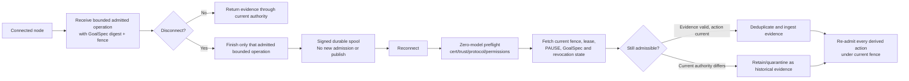

# DS-20 — Linux Service Topology and Enterprise Scaling for Recursion v3

## Executive summary

The original prompt leaves the research topic unspecified. The uploaded handoff is therefore the only concrete research brief available, and this report scopes the work to **DS-20: Linux service topology and enterprise scaling for Recursion v3**. The handoff asks how to preserve a single canonical authority while making Linux service ownership, backups, multi-node execution, enterprise security controls, containers, observability, recovery, and capacity scaling operationally sound. It explicitly prohibits selecting or deploying a language, store, consensus library, container runtime, backup product, observability stack, or cloud. fileciteturn0file0

The central finding is that **“one daemon per authority domain/OS account” should be understood as one logical canonical-writer service boundary, not one independently authoritative process per functional role**. Helper processes can exist for projection, backup, telemetry, or process brokering, but they should not independently acquire canonical-write authority. This follows directly from the project requirement for a serialized canonical admission path and exactly one fenced writer; it is also consistent with systemd's ownership model, in which `StateDirectory=` and related directives are tied to a unit's configured user/group and can recursively correct ownership when the top-level ownership differs. Giving differently owned services the same managed state tree therefore creates an avoidable ownership hazard. fileciteturn0file0 citeturn18view0

The strongest direction for the recorded `esc-0013` backup/actuator conflict is **not to make backup another participant in the writer mutex at all**. A root backup process and an unprivileged actuator sharing a writable lock namespace create exactly the trust and ownership ambiguity reported in the handoff. A shared group and `2770` directory can make DAC access mechanically possible, but it expands the set of principals with write capability. A safer architecture is for the authority daemon or storage boundary to expose a read-only, consistency-defined snapshot/export that a separately constrained backup identity copies. Running the backup non-root becomes practical once it no longer needs arbitrary access to live canonical state. This is a research recommendation, **not a resolution of `esc-0013`**. fileciteturn0file0 Systemd supports explicit service identities, supplementary groups, lifecycle-managed directories, and separate read-only service credentials; `tmpfiles.d` can create paths with explicit modes and ownership. citeturn17search0turn18view1turn18view2

For multi-node operation, **a lease or distributed lock is insufficient as the final safety mechanism**. A writer incarnation needs a monotonically ordered fencing epoch or token, and every canonical transition—or the final side-effect sink for a transition—must reject stale epochs. The etcd documentation makes the underlying point explicitly: losing a lease does not instantly stop an old client from acting on an external resource, so external-resource mutual exclusion requires fencing/version validation in addition to the lock. Under an etcd/Raft-style partition, the majority side can continue while the minority loses write availability; quorum loss stops writes rather than allowing two authoritative partitions. citeturn4search0turn4search3

That leads to a clear disconnected-node rule: **a sleeping or partitioned node never assumes its old lease is still authoritative**. It may complete only the already-admitted bounded local operation specified by DS-20, may durably spool signed evidence, and may not originate a new admission or externally publish an authoritative transition. Reconnection first revalidates enrollment, certificate/trust state, protocol compatibility, current fencing epoch, GoalSpec, lease state, and `PAUSE`. Evidence can then be deduplicated and retained as historical evidence even where it no longer authorizes a transition; every derived action must pass current admission again. fileciteturn0file0

**Consensus should not be introduced merely because there are multiple workers.** With one canonical writer and remote workers exchanging admitted work and evidence, signed outboxes/spools and deterministic re-admission can support multi-node execution without distributed consensus over every operation. Consensus—or another externally linearizable fencing service—becomes necessary when the Owner requires automatic writer failover or a replicated authority plane that must continue accepting canonical writes after loss of a coordinator. An unnecessary consensus layer adds quorum, reconfiguration, recovery, and operational failure modes; etcd's own documentation treats membership reconfiguration and forced recovery as safety-sensitive operations. citeturn4search10

The **2-vCPU/4-GiB “coordinator-small” profile is a target, not a demonstrated capacity point**. No host measurements were supplied, and DS-20 expressly forbids inventing a resource ceiling. The serialized writer scales only by making its per-admission service time smaller or by reducing work inside the serial section; more cores can help projections, observers, hashing, transport, compression, and other parallel boundary work but cannot parallelize a deliberately serialized authority path. The actual break point must be established by a synthetic, zero-model benchmark that independently sweeps admission rate, event size, projection fan-out, artifact bandwidth, fsync behavior, disconnection/spool pressure, and enterprise security overhead. fileciteturn0file0

Enterprise deployment is feasible in principle across systemd-based Linux environments, but **“runs on a FIPS-enabled or MAC-enforcing OS” is not equivalent to certification**. RHEL 10 documents FIPS-mode requirements that differ from ordinary crypto-policy selection, while NIST validation is tied to specific cryptographic modules and operating environments. SELinux and AppArmor both provide auditable denial paths; denials should therefore become explicit startup/readiness/preflight failures rather than silent degradation. Ubuntu documents FIPS enablement through its supported mechanisms, but exact Recursion compliance remains `requires-certification`, not established by this research. citeturn5search0turn5search2turn5search8turn5search16turn6search0

Finally, **Kubernetes does not replace Recursion's authority protocol**. StatefulSets can provide persistent identity/storage lifecycle, and `ReadWriteOncePod` can constrain a CSI-backed volume to one Pod, but storage attachment exclusivity does not fence stale external side effects. Kubernetes also self-heals by replacing workloads, so any replacement writer must start non-authoritative and reacquire a fresh Recursion fencing epoch before readiness. A custom Operator is justified only if Kubernetes itself must automate Recursion-specific transitions such as fenced writer activation, update-mode sequencing, snapshot/restore, or capability quarantine; otherwise it adds a second state machine without proving additional safety. citeturn19search0turn19search12turn11search2

| Decision area | Research conclusion | Evidence status |
|---|---|---|
| Linux daemon topology | One logical canonical-writer service per authority boundary; helpers are non-authoritative | Strong project + systemd evidence |
| `esc-0013` | Prefer removing backup from the writer-lock trust domain; shared `2770` remains a fallback option, not the preferred architecture | Inferred recommendation; no escalation resolution |
| Multi-node authority | Fence writer incarnations; disconnected nodes spool evidence but cannot publish authority | Strong distributed-systems rationale |
| Consensus | Avoid for worker fan-out; require a linearizable coordination mechanism only for automatic replicated-writer failover/membership | Strong |
| Coordinator-small | 2 vCPU/4 GiB is an unvalidated test target, not a capacity commitment | Unverified until benchmarked |
| Enterprise MAC/FIPS | Technically feasible, but distro/profile-specific and no certification claim follows | Strong feasibility, certification unknown |
| Kubernetes | StatefulSet is a plausible packaging primitive; neither PV attachment nor self-healing is an authority fence | Strong |
| Observability | Local journal as lowest-common-denominator evidence; OTel/Prometheus are optional projection/export choices | Moderate; no stack selected |
| Backup | Require a consistency-defined snapshot/export boundary independent of backup product | Strong architectural recommendation |

## Research scope, context, and evidence

### Research question and boundaries

The primary research question is:

> **How should Recursion v3 be provisioned and scaled on Linux so that its one-writer authority invariant survives multi-user service ownership, multi-node execution, enterprise controls, failures, backup/restore, and orchestration—without prematurely selecting implementation technologies?**

This decomposes into four linked questions. First, what Linux process/user/directory topology preserves one canonical writer while allowing operational helpers? Second, what fencing and reconnect protocol makes partitions, stale laptops, revocation, duplicate delivery, and automated failover safe? Third, what enterprise constraints—MAC, FIPS, proxies, PKI, air-gap, telemetry, backups, containers—change the deployment contract? Fourth, what must be measured before the 2-vCPU/4-GiB coordinator target or any SLO can be treated as real capacity? These are the concerns enumerated by DS-20. fileciteturn0file0

This report does **not** select a store, programming language, consensus implementation, container runtime, backup tool, observability product, or cloud; it creates decision criteria. It also does not modify the open escalation, perform deployment, make a procurement claim, or assert FIPS/OS/container certification. Those exclusions are substantive: several conclusions below deliberately remain `unknown` where a product choice or measurement is a prerequisite. fileciteturn0file0

### Background that constrains the answer

DS-20 fixes several architectural premises: Recursion v3 has a deterministic privileged kernel, a serialized canonical-admission path, one fenced writer per aggregate, disposable read-only projections, a process broker that owns process identity and recovery, and an authenticated node fabric in a later milestone. A disconnected node can finish only its last valid bounded operation and spool signed evidence for revalidation. The implementation language, storage profile, consensus mechanism, container runtime, backup tool, and observability stack remain Owner decisions. fileciteturn0file0

Linux's standard filesystem/service conventions align well with that split. The Filesystem Hierarchy Standard treats `/etc` as host configuration, `/run` as transient runtime state, `/var/lib` as variable application state, `/var/log` as logs, and `/usr` as static/shareable content. Current systemd service semantics map `RuntimeDirectory=`, `StateDirectory=`, `CacheDirectory=`, `LogsDirectory=`, and `ConfigurationDirectory=` respectively into `/run`, `/var/lib`, `/var/cache`, `/var/log`, and `/etc` for system units, while user units map to XDG locations. citeturn0search0turn18view0

That distinction is important for a root-owned system installation: **XDG user paths should not become an accidental substitute for system-state separation** merely because an application can run under a user. Code, configuration, mutable authority state, runtime locks/sockets, logs, and credentials should remain separate classes with different ownership and write permissions. Systemd provides a distinct credential channel whose per-unit directory is read-only to the service and, where supported, backed by non-swappable memory; its documentation also warns against passing secrets through environment variables because they can cross security boundaries. citeturn18view1

### Claim register

The table applies DS-20's requested evidence discipline. “Source-documented” means an explicit project or upstream source states the claim; “inferred” means the recommendation follows from those sources but is not itself guaranteed by them; “unverified” identifies a fact that still requires host/product measurement.

| Consequential claim | Source/version or date | Classification | Confidence | Expiry or falsification trigger |
|---|---|---|---|---|
| Recursion targets one daemon per authority domain/OS account, one serialized canonical path, and one fenced writer | DS-20, updated Sep. 29, 2026 | Source-documented project constraint | High | Owner changes architecture/constitution |
| `esc-0013` involves a root-first `0700` lock directory excluding a non-root participant | DS-20 | Source-documented local report, not independently reproduced | Medium-high | Direct host evidence contradicts the handoff or deployment roles change |
| systemd system-unit runtime/state/log/config roots are `/run`, `/var/lib`, `/var/log`, `/etc` | Debian trixie `systemd.exec`; functionality documented since systemd v211/v234 | Source-documented | High | Target distro/systemd lacks or changes directives citeturn18view0 |
| Reusing one `StateDirectory=` across differently owned units is hazardous because systemd can recursively repair ownership when top ownership differs | Debian trixie `systemd.exec` | Source-documented | High | Unit does not use the directive or distro behavior differs citeturn18view0 |
| `sysusers.d` supports declarative local system users/groups; `tmpfiles.d` supports explicit mode/owner/group | Debian trixie/systemd 257-era docs | Source-documented | High | Packaging does not use systemd facilities citeturn17search0turn17search3 |
| A lease/lock alone does not protect an external resource from a stale client; fencing is needed | etcd documentation | Source-documented | High | All effects are proven to occur atomically inside the same linearizable store transaction citeturn4search3 |
| An etcd/Raft partition does not permit both sides to remain writable; majority side can progress and minority cannot | etcd v3.7 failure-mode docs | Source-documented | High | A different coordination system is selected with different semantics citeturn4search0 |
| `ReadWriteOncePod` constrains a Kubernetes PVC to one Pod; ordinary access-mode declarations are not general write-protection mechanisms | Kubernetes v1.29+ feature/current docs | Source-documented | High | Non-CSI or materially changed storage semantics citeturn19search0turn19search6 |
| Kubernetes workload replacement does not imply application-level authority recovery | Kubernetes self-healing docs + Recursion authority rules | Inferred | High | A formally verified integration proves replacement and fence acquisition atomic citeturn19search12 |
| Live file-copy backup is not automatically application-consistent | Borg official documentation explicitly says consistency must be arranged externally | Source-documented for Borg; inferred generally | High | Chosen store/tool supplies documented atomic online snapshot semantics citeturn20search5 |
| Coordinator-small is a 2-vCPU/4-GiB target | DS-20 | Source-documented project target | High as a target; no capacity confidence | Performance benchmark |
| “Preflight completes in seconds” | DS-20 desired property | Unverified | Low until measured | Fleet/host benchmark establishes distribution |
| Recursion is FIPS-compliant merely because it runs on a FIPS-enabled distro | No supporting evidence; NIST validation is module/configuration-specific | **Unverified / must not claim** | High confidence that certification remains separate | Formal certification/validated module evidence citeturn5search8 |

No topology or capacity value in this report is “measured”: DS-20 provided no machine telemetry, benchmark output, or repository inspection, and its research boundary excludes implementation/deployment. Every operational mode below is consequently labelled **Modelled** or **Unknown**, not measured. fileciteturn0file0

## Linux daemon topology and ownership

### Canonical daemon shape

The cleanest interpretation of the ratified topology is **one service instance for each authority boundary**, with all canonical mutations entering that instance through one admission path. An instantiated service such as `<product>@<authority>.service` is one possible systemd packaging expression, not a selected unit name or implementation. A separate projection, terminal broker, telemetry exporter, or backup process is acceptable only when its capabilities exclude canonical mutation.

“One unit per role” is therefore the weaker default. If admission, scheduler, backup, actuator, and observer processes all independently believe that they may lock or update one state tree, process decomposition has merely moved the authority problem into the filesystem. The recorded lock conflict is an example of that failure mode. fileciteturn0file0

Systemd adds an operational reason to keep one state owner: a service using `StateDirectory=` receives a directory owned by its configured `User=`/`Group=`, and systemd can recursively change ownership when the managed directory's ownership does not match. Two differently owned units should therefore **not declare the same canonical state directory as their managed writable state**. citeturn18view0

For packaged system identities, `sysusers.d` can create non-human system users/groups and group memberships. It directly manages local `/etc/passwd` and `/etc/group` style identities rather than arbitrary LDAP/NIS identity databases; `tmpfiles.d` likewise warns that users/groups needed in early boot should already be resolvable. That makes a local, non-login service identity the most predictable packaging model, while centrally managed UID/GID requirements remain an enterprise integration question rather than something the daemon should silently depend on. citeturn17search0turn17search3

### Topology and ownership matrix

The names and paths below are deliberately symbolic. They show the **shape** needed to preserve authority and least privilege, not a product-default unit file.

| Component | Service identity | Runtime | Persistent state | Logs | Configuration / credentials | Canonical writer? | Status |
|---|---|---|---|---|---|---|---|
| Authority daemon | `<authority-user>:<authority-group>`; non-login system identity | `/run/<product>/<authority>`, model `0700`; socket/lock owned only by authority | `/var/lib/<product>/<authority>`, model `0700` | journald baseline; file tree only if required, model `0750` | root-owned `/etc/<product>` config; secrets delivered separately through service credential mechanism | **Yes, exactly one logical writer** | **Modelled** from project invariant + systemd directory semantics citeturn18view0turn18view1 |
| Read-only projection/helper | Separate identity only where OS isolation is valuable; otherwise internal component | Private runtime directory, model `0700` | Disposable projection only; must not share writer-managed `StateDirectory=` | Local journal | No authority credential unless specifically required | No | **Modelled** |
| Terminal/process broker | Bounded broker identity/capability | Its own runtime namespace and process metadata | Recovery metadata as defined by broker contract; exact path **unknown** | Local journal | Broker-specific credentials **unknown** | No canonical state write except via admitted boundary | **Modelled/Unknown** from DS-20 fileciteturn0file0 |
| Remote-node service | `<node-user>:<node-group>` | Node-local runtime, model `0700` | Signed spool + local bounded-operation state, model `0700` | Local journal | Node cert/key through constrained credential channel | **No** canonical authority | **Modelled** |
| Backup copier | Prefer `<backup-user>` without canonical-state write rights | No shared writer runtime | Reads only consistency-defined snapshot/export | Local journal | Repository credential separate from canonical state | No | **Modelled** |
| Backup export/snapshot view | Created by authority/storage boundary | None | Read-only export; model group traversal/read `2750` directory with non-writable backup membership where ordinary files are used | N/A | No live service credentials included | No | **Modelled; mechanism unknown until store chosen** |
| Static executable/code | root-owned package tree under FHS-compatible static location | N/A | Must not be daemon-writable | N/A | N/A | N/A | **Modelled; exact `/usr` vs `/opt` packaging choice unresolved** citeturn0search0 |

The model uses `0700` for canonical runtime/state as the conservative starting point because only the authority writer needs direct write access. That is **not a mandated mode**. If a proven helper requires direct filesystem reading, a narrower group/ACL or a separate export is preferable to simply widening the entire canonical tree. `tmpfiles.d` supports explicit owner/group/mode and ACL management where service-managed directories are insufficient. citeturn17search0

Credentials should not silently collapse into `/var/lib/<product>` or the artifact store. Current systemd supports `LoadCredential=`/`LoadCredentialEncrypted=` and exposes credentials in a unit-specific, read-only directory accessible to the service identity and superuser; systemd explicitly recommends this approach over secret-bearing environment variables. This does not require Recursion to make systemd credentials its cross-platform secret-store abstraction, but it demonstrates that Linux installations can preserve the conceptual split. citeturn18view1

### The `esc-0013` alternatives

The reported conflict exists because a root-created `0700` lock hierarchy and a non-root actuator have incompatible ordinary ownership expectations. The key question is not simply “which mode opens the directory?” but **which principals are being granted writer-adjacent authority**. fileciteturn0file0

| Option | How it works | Trust/security cost | Operational cost | What it does **not** prove |
|---|---|---|---|---|
| Shared group, model `2770` | Lock/runtime directory owned by authority user + shared group; participating service receives supplementary group | Every group member gains write capability in that namespace; membership becomes security-sensitive | Simple on one host; packaging must maintain membership/modes | Does not fence a stale process or solve multi-host split brain |
| Authority-owned `0700` lock; root backup follows protocol | Only authority owns writer namespace; root backup is required not to create/replace lock objects | Root remains capable of bypassing ordinary DAC, so safety partly relies on strict backup behavior | Minimal new DAC machinery | Does not stop a buggy/root-compromised backup from violating protocol |
| Run backup non-root with narrowly readable export | Backup cannot mutate live authority state; export group/ACL grants read/traverse only | Small additional read principal; substantially less privilege | Requires snapshot/export path and separate backup identity | Does not itself define snapshot consistency |
| Authority/storage snapshot then independent copier | Canonical writer or storage subsystem defines a frozen point; copier never participates in writer lock | Best separation of backup from admission authority | Requires a store-neutral snapshot/manifest contract and restore verification | Does not prove chosen backend can create the snapshot within the desired RPO/RTO |

**Research conclusion:** the last two patterns best preserve the authority model. A backup should normally be a **consumer of a stable snapshot/export**, not a second writer-lock participant. This conclusion competes directly with the shared-group solution; its decisive falsifier would be evidence that the selected storage design cannot expose a consistency-defined read-only point without unacceptable interruption or RPO/RTO cost. Until a store is selected and tested, the mechanism remains `unknown`, and the Owner retains `esc-0013`. fileciteturn0file0

This approach also avoids making backup-product semantics part of authority. Borg explicitly warns that merely reading active files does not ensure internal or cross-file consistency and recommends quiescing or snapshotting where consistency matters. OpenZFS documents snapshots as atomic point-in-time dataset views; that property is attractive as an example, but it does **not** select ZFS, nor does a filesystem snapshot alone prove application-level consistency across independently managed datasets or external effects. citeturn20search5turn8search0

The same principle is store-neutral for the DS-20 candidates: whether metadata ultimately lives in an append log, SQLite/WAL, or something else, backup should bind a canonical position to the artifact set it references. Immutable content-addressed artifacts can often be copied asynchronously, but the snapshot manifest must identify exactly which digests belong to the restored authority point. That is an architectural inference; the exact mechanism cannot be finalized before the store decision. fileciteturn0file0

## Scaling, coordination, and failure semantics

### What scales vertically and what does not

The serialized canonical admission path has an unavoidable serial component. Let:

\[
\lambda_a = \text{admissions per second},\qquad S_w=\text{mean seconds of serialized writer work per admission}
\]

Then the dimensionless serialized utilization model is:

\[
\rho_w = \lambda_a S_w
\]

A sustained workload cannot be stable once the serial stage is asked to perform more than one second of serial work per wall-clock second; in practice an Owner-selected latency/headroom target must trigger well before saturation. This is a **model**, not a benchmark or SLO.

Additional CPU can still help any work that is not inside that critical section: decoding before serialization where safe, projections, observer computations, signature/hash checks, network I/O handling, artifact processing, telemetry, compression, and background compaction can potentially execute concurrently. How much they actually parallelize is implementation-dependent and therefore `unknown`. The 2-vCPU/4-GiB coordinator-small profile becomes “too small” not at a predetermined identity count, but when measured queueing, serial utilization, CPU, memory, I/O latency, or recovery behavior violates an Owner-approved SLO. fileciteturn0file0

Horizontal scaling should therefore scale **workers, read-only projections, and nodes before it scales canonical writers**. Multiple execution nodes under one authority do not require each node to become a writer. Horizontal writer scaling is a different architectural step: it introduces replicated linearization/failover and therefore fencing/consensus questions.

### Same-authority multi-node is not hosted multi-tenancy

The distinction in DS-20 is security-significant. fileciteturn0file0

| Property | One authority across multiple nodes | Hosted multi-tenant service |
|---|---|---|
| Canonical authority | One authority/writer plane | Multiple mutually distrusting authority planes |
| Node credentials | Per-node identities subordinate to one authority | Credentials must be tenant-separated |
| Storage | One authority's state and evidence namespace | Hard tenant partitioning is required |
| Trust roots | Authority/operator separation within one ownership domain | Tenant roots, operator access, and cross-tenant trust become separate problems |
| Egress policy | Site/authority policy | Potentially tenant-specific policy and data residency |
| Privacy | Protect membership and task data from unnecessary export | Must additionally prevent one tenant learning another's existence/data |
| Failure blast radius | A node capability is quarantined without redefining tenant boundaries | Compromise/isolation failure can become cross-tenant incident |
| Design conclusion | Fits DS-20 node fabric | **Not proven safe by the single-authority design** |

It would therefore be incorrect to treat “works across five machines” as evidence that the same daemon/storage configuration is suitable for five unrelated customers. Hosted tenancy needs an additional isolation threat model and potentially OS-account, key, process, storage, network, billing, deletion, and residency boundaries that DS-20 deliberately does not establish.

### Fencing design

The minimum safe abstraction is a **monotonically ordered writer incarnation**. One viable protocol model is:

`(authority_id, aggregate_id, fence_epoch, admission_seq, operation_id, payload_digest)`

A newly activated canonical writer obtains an epoch strictly later than the prior writer. Every canonical mutation checks the current epoch. Every externally authoritative action either passes through the currently fenced daemon or carries a token that the effect sink validates against the latest accepted epoch. A stale writer may still be alive, but it cannot successfully authorize a newer transition once its epoch is obsolete.

The distinction between **lease** and **fence** is essential. A lease says the coordinator currently believes a holder is entitled to act. Fencing makes the target refuse obsolete holders even when one is paused, partitioned, or unaware that its lease expired. Etcd's distributed-lock documentation explicitly warns that a lease may be revoked while the client is still executing against an external resource and points to revision/version checks as the required safety technique. citeturn4search3

If an external provider cannot consume a Recursion fence token, the architectural workaround is not to let arbitrary disconnected workers call it anyway. The final provider-facing transition must remain behind a currently fenced authority boundary. This does not make the external provider transactional; it limits which Recursion principal may originate the effect.

### Consensus options and their failure surfaces

| Coordination shape | Safety/availability behavior | Cost | Appropriate when | Decisive weakness |
|---|---|---|---|---|
| **Single durable writer + outbox/spool** | One local linearization point; workers can scale independently; explicit/manual recovery to a new writer epoch | Lowest operational complexity | Default case where coordinator loss may temporarily stop new canonical writes | No automatic write failover |
| **External Raft/etcd-style service** | Majority partition can continue; minority cannot write; linearizable coordination available | Quorum service, monitoring, backup, reconfiguration, network dependency | Automatic writer failover or strongly coordinated membership is required | Quorum loss removes write availability; external effects still need fencing citeturn4search0turn4search3 |
| **Embedded consensus library** | Can supply equivalent replicated-log semantics if implemented correctly | Recursion now owns consensus persistence, snapshots, upgrade/reconfiguration integration and testing | Only where embedding is materially justified | Highest product correctness burden; library is intentionally unselected |
| **Single distributed lease/lock without fencing** | May elect one apparent holder | Superficially simple | Not sufficient for authoritative external effects | Stale holder can keep acting after losing lease |

Etcd's documentation also makes configuration changes part of the safety story: membership changes are explicit operations, and unsafe forced removal/recovery can produce divergence. That is a useful warning against adopting consensus merely to appear “enterprise-scalable.” citeturn4search10

**Recommendation:** preserve the no-consensus single-writer design as the baseline until an availability requirement specifically states that the canonical writer must fail over automatically while continuing writes after coordinator loss. The decisive falsifier is that requirement. If it arrives, the Owner should evaluate a linearizable fencing/consensus facility at that point rather than retrofitting safety from an ordinary lock.

### Partition, sleeping laptop, duplicate, revocation, and split-brain matrix

| Fault | Required behavior | Why it is safe | Decisive falsifier/test |
|---|---|---|---|
| Network partition after work admission | Node may finish only the exact already-admitted bounded operation; no new admission/publish; output is signed and spooled | No new authority is created while current state is unknown | Disconnect during work; any new externally authoritative action is a failure |
| Sleeping laptop wakes with old lease | Treat old lease/fence as stale until current authority revalidation; outbound authority remains quarantined | Prevents “paused process resumes into old world” | Suspend past lease expiry, fail over writer, resume old node; any stale transition accepted is failure |
| Duplicate evidence delivery | Stable operation/evidence identity is deduplicated; at-least-once transport is acceptable | Duplicate transport does not become duplicate state transition | Replay same signed envelope repeatedly; canonical result must remain singular |
| Offline revocation | Offline node cannot be expected to know new revocation; its lack of publish authority contains the risk; reconnect checks current cert/revocation/trust state | Converts unreachable revocation from an impossible instant-notification requirement into capability quarantine | Revoke while node disconnected; reconnect must reject new authority before evidence-derived action |
| Split brain | Only tokens from current fencing epoch may mutate canonical state or issue final side effects | Stale side physically/logically rejected rather than relying on stale holder cooperation | Force two candidate writers; old epoch must fail at every authoritative sink |
| `PAUSE` issued while node offline | Current bounded local operation may finish only to evidence spool; no action derived after it may escape without re-admission | `PAUSE` is enforced at reconnect/current authority | Offline completion followed by attempted publish must be blocked |
| Stale GoalSpec/config | Evidence retains original admission/GoalSpec digest; reconnect compares it with current state | Historical evidence can be retained without treating it as present authorization | Change GoalSpec mid-disconnect; old evidence must not directly trigger current action |

This behavior should be encoded explicitly in the protocol rather than inferred from socket state. TCP disconnection, process survival, a lease expiry, and authority revocation are different events.

A reconnect sequence consistent with DS-20 is:

This deliberately separates **evidence acceptance** from **action authorization**. A result produced while disconnected can be authentic and useful without still carrying authority to change the world.

### Enterprise fleet preflight

The handoff's zero-model preflight should be deterministic and capability-scoped. A minimally honest version checks: runtime/configuration hashes; state/runtime/credential ownership and writability; trust-bundle and protocol versions; certificate/key accessibility and validity state; enrolled node identity; current fencing/`PAUSE`/revocation state where connectivity exists; and, for any remote capability being activated, DNS/TCP/TLS service-identity validation. A failure quarantines that capability instead of implying the entire local daemon is corrupt. fileciteturn0file0

TLS itself authenticates peers, but application protocols must define how service identity is verified. The current TLS 1.3 specification is RFC 9846, published in July 2026, and RFC 9525 specifies DNS/IP/service-name identity matching for TLS applications. These are strong reasons to make endpoint identity and trust-bundle state explicit preflight inputs rather than accepting any certificate chaining to an overly broad corporate root. citeturn15search0turn19search1

The “seconds” requirement remains unverified. A cached preflight can plausibly avoid model calls and expensive full conformance suites, but its validity key must include every safety-relevant state that can change beneath the cache. At minimum, certificate expiry/revocation freshness and authority fencing state need bounded freshness rather than an indefinitely reusable hash result.

## Enterprise installation, security, and operations

### Distro, MAC, FIPS, and air-gap feasibility

| Environment | Feasible design | Characteristic failure to surface | Evidence status |
|---|---|---|---|
| RHEL 10 / SELinux | Dedicated service domain/labels; explicit allowed state/runtime/credential paths | AVC denial blocks file/socket/service operation; must become visible in audit/preflight/readiness | RHEL documents SELinux denial/audit behavior. citeturn5search2 |
| Ubuntu / AppArmor | Profile daemon and helpers separately where privilege differs | AppArmor denial appears in audit/system logs; profile must not silently force degraded behavior | Ubuntu documents enforce/complain profiles and logged denials. citeturn6search0turn6search1 |
| Debian/systemd | Core user/directory/lifecycle primitives are available in current trixie systemd documentation | Exact MAC/FIPS posture is site/package-specific | systemd mechanics verified; broader certification **unknown**. citeturn17search0turn17search5 |
| RHEL 10 FIPS mode | Use only crypto backend/configuration actually permitted by the validated environment | Unsupported algorithm or incorrectly initialized FIPS environment causes crypto/TLS failure | RHEL 10 says FIPS setup is an install-time concern and crypto-policy selection alone is not equivalent. citeturn5search0 |
| Ubuntu FIPS | Supported Ubuntu FIPS mechanism/validated package set where required | Unsupported package/library or entitlement/image mismatch | Ubuntu documents FIPS enablement; **no Recursion certification follows**. citeturn5search16 |
| Air-gapped site | Local packages, local trust material, internal enrollment endpoints; core/preflight must not require a model or public network | Expired/revoked trust material, missing package/image mirror, or remote capability unavailable | Architecturally feasible; exact installation procedure **unknown** until packaging selected |
| Formal FIPS/compliance claim | Evidence tied to actual module/version/operating environment and certification scope | “FIPS mode enabled” mistaken for product certification | Requires certification; NIST FIPS 140-3 validation is module-oriented. citeturn5search8 |

A critical implementation requirement follows: **security-control denials must be observable errors**. If SELinux/AppArmor prevents access to a state directory, credential, socket, network endpoint, or executable, the service should not catch the resulting error and continue in a partially authoritative mode. The preflight/status interface should identify the failed capability and the OS denial context without leaking credentials.

The same caution applies to FIPS. RHEL 10's documentation specifically distinguishes system FIPS initialization from merely choosing a crypto policy; algorithms acceptable in ordinary TLS configurations can also be unacceptable under a particular validated FIPS environment. That means the eventual crypto implementation must be testable against site policy, but this research cannot choose the library or assert validation. citeturn5search0turn5search8

### DNS, proxies, TLS inspection, and certificates

Enterprise networking should expose **site configuration without allowing egress infrastructure to redefine authority trust**. The node/operator trust root, ordinary public/provider TLS roots, and any corporate TLS-inspection CA should be separate trust domains in configuration.

HTTP `CONNECT` is explicitly designed to create a blind proxy tunnel through which TLS can remain end-to-end. RFC 9110 also notes that interception intermediaries can create security and interoperability problems. citeturn20search1 TLS 1.3 authenticates the peer represented in the handshake, and RFC 9525 requires an application client to match the expected DNS/IP/service identity. citeturn15search0turn19search1

From those standards, an important **inference** follows: a corporate proxy that terminates TLS and substitutes its own certificate is no longer an invisible tunnel. Strict server-certificate pinning will fail unless the design intentionally trusts that substituted identity, and end-to-end mTLS node identity cannot simply be assumed to survive a TLS-terminating intermediary. Recursion should therefore fail visibly rather than silently importing a corporate egress CA into its node-authority trust root.

A site's configurable network surface should eventually include endpoint/DNS naming, trust bundles, outbound proxy/tunnel behavior, bypass rules for internal mTLS endpoints, certificate sources/rotation, and offline trust-distribution policy. The concrete environment-variable/config schema remains an implementation decision.

### Observability without leaking membership

The three mechanisms in DS-20 solve different problems rather than forming an either/or replacement:

| Mechanism | Strongest role | Enterprise advantage | Limitation/risk |
|---|---|---|---|
| `journald` | Local structured service/event evidence | Available with systemd; can persist or remain volatile and can be queried by unit | Not by itself a fleet metrics/tracing system; retention varies by site/config citeturn7search0turn7search2 |
| Prometheus-style metrics | Numeric health/capacity/SLO signals per target | Direct scrape model, simple `up`/service metrics | Labels can become a privacy/cardinality problem if membership/task identity is exported citeturn7search1 |
| OpenTelemetry | Logs/metrics/traces through local agents or central gateways | Agent/gateway deployment can keep collection local then selectively export | Adds collectors/export paths and therefore another privacy/availability boundary citeturn7search3turn7search6 |

A sound minimum is **local authoritative evidence first, optional exports second**. Required local signals should include admission counts/rejection classes, current writer/fence state, admission queue depth/age, event append/fsync latency, projection lag, signed-spool bytes/oldest age, preflight state, capability quarantine state, certificate-expiry health, backup-snapshot age, restore-test result, and watchdog/recovery transitions.

Exported telemetry should avoid stable user names, GoalSpec text, prompts, artifact contents, provider secrets, or unnecessarily stable node membership identifiers. Aggregate/bucketed metrics can usually describe load and health without exporting private graph topology. That privacy recommendation is an inference from DS-20's privacy boundary and the fact that OTel/Prometheus are explicitly designed to carry telemetry beyond the originating process. fileciteturn0file0

### Backup and restore

The backup decision should be split into two questions: **how Recursion obtains a consistent source point**, and **which tool moves/deduplicates/encrypts that source**. Conflating them lets the backup program accidentally become a consistency protocol.

| Candidate class | What evidence supports | Consistency conclusion | Selection status |
|---|---|---|---|
| Borg | Deduplicating file backup; detects files changing during backup | Borg documentation says it does not create application consistency and recommends external snapshot/quiesce techniques | Not selected. citeturn20search4turn20search5 |
| restic | Repository snapshot/backup workflow and separate credential handling | Current evidence here does **not** establish a live multi-file Recursion-consistency boundary; must consume a consistent source | Not selected. citeturn10search2turn10search5 |
| ZFS snapshot | Filesystem-level atomic point-in-time dataset snapshot | Strong substrate when state lies in the applicable dataset, but application/external-effect consistency still requires explicit contract | Not selected. citeturn8search0 |

A store-neutral backup contract should identify a canonical event/state position, the immutable artifact digests reachable from it, and the metadata needed to validate restoration. Credentials, service private keys, live per-unit credential mounts, caches, transient runtime locks, and ordinary journal noise should be excluded unless a separately documented disaster-recovery reason requires them.

Restore should be **quarantined by default**: restore bytes, verify integrity/manifests, verify event/artifact relationships, run deterministic recovery checks, apply current trust/`PAUSE` state, and allocate/reacquire a current fencing epoch before the restored process can become authoritative. A backup being byte-correct does not prove it should immediately resume publishing.

### Containers and Kubernetes

A container changes packaging and isolation mechanics; it does not change the canonical-writer invariant. The unresolved Podman-vs-Docker/runtime question can therefore remain deferred while the authority contract is specified.

Kubernetes StatefulSets are a plausible fit when the workload needs stable identity and persistent storage, whereas a custom Operator is intended for application-specific operational state machines. citeturn12search1turn11search2 For Recursion, that suggests:

**StatefulSet is sufficient** when Kubernetes only starts/stops the daemon, attaches storage, delivers configuration/credentials, and checks health while Recursion itself owns writer fencing, recovery, and update authorization.

**An Operator becomes justified** when Kubernetes must understand Recursion-specific phases such as “save → revoke writer → update → re-preflight → acquire new fence → resume,” cross-node recovery, snapshot/restore, or enrollment/quarantine. Even then, the Operator should orchestrate the protocol rather than become canonical authority.

Kubernetes storage exclusivity is useful defense in depth. `ReadWriteOncePod`, stable since Kubernetes v1.29, can constrain a CSI PVC to one Pod, while ordinary `ReadWriteOnce` can still permit multiple Pods on the same node and access modes generally are not equivalent to filesystem authorization. citeturn19search0turn19search6 Neither mechanism fences a previously active process from having already issued an external API request, so Recursion-level epochs remain required.

Kubernetes Secrets also require care: official documentation warns that Secrets are stored unencrypted in the API server's backing etcd by default unless encryption at rest is configured, and access to the API/etcd can expose them. A Kubernetes deployment must therefore keep injected secrets out of Recursion's canonical state, artifacts, and logs and must treat cluster-side encryption/RBAC as explicit prerequisites rather than assumptions. citeturn11search1

Finally, Kubernetes self-healing creates new Pods after failures. citeturn19search12 That behavior conflicts with an authority design only if “process is running” is mistaken for “process is writer.” The safe readiness sequence is:

`process starts → local recovery → preflight → current-state reconciliation → fresh fencing acquisition → authoritative readiness`.

A restarted Pod that cannot complete those steps may be healthy enough for diagnostics but must remain non-authoritative.

## Capacity, SLO, and evidence plan

### Dimensionally honest capacity model

The exact “admission equation from the performance plan” referenced by DS-20 is not included in the supplied handoff. It would be improper to reconstruct it from memory or invent constants. The following model is therefore only a measurement framework. fileciteturn0file0

| Quantity | Model | Denominator / interpretation | Current status |
|---|---|---|---|
| Serialized writer utilization | `ρw = λa × Sw` | `λa`: admissions/s; `Sw`: serial seconds/admission | Modelled; `Sw` unknown |
| Total CPU demand | `λa·Ca + λe·Cp + λo·Co + Cbg` | Core-seconds from admission, events/projections, observers, background | All coefficients unknown |
| Raw event-log growth | `86400 × λe × Be` bytes/day | Per event/s and mean canonical bytes/event | Modelled |
| Actual store growth | Raw log + metadata/index/WAL amplification + artifacts | Per event/s and artifact byte/s | Backend-dependent, unknown |
| Queue memory | `Q × Bq` | Queue depth × bytes of live queued state | Unknown until representation chosen |
| Spool growth | `λoffline × Bevidence + Bartifact` | Per disconnected node | Unknown; must measure worst bounded operation |
| Fleet preflight work | `N × (hash + permission + cert + trust + protocol checks)` | Per node/identity; report explicitly per 100 | Individual costs unknown |
| Certificate renewal rate | `N / L` renewals/day at steady state | `L` = selected certificate lifetime in days | Lifetime unselected |
| Backup transfer | Changed state bytes + new reachable CAS bytes | Per backup interval | Store/workload dependent |
| Projection capacity | `λe × Cprojection × fanout` | Per event/s per projection | Unknown until projection set exists |

One useful normalized statistic requires no assumption about the implementation: **1 KiB of canonical log data per event at exactly 1 event/s produces 84.375 MiB/day of raw bytes, or about 2.47 GiB over 30 days, before indexes, WAL/write amplification, replication, snapshots, or artifacts.** At a different event rate or event size, it scales linearly. This is an arithmetic normalization, not a storage budget or estimate of actual Recursion events.

This illustrates why artifact bandwidth must not be hidden inside “events/sec.” One 1-KiB event that references a multi-gigabyte artifact and one 1-KiB event with no artifact have similar canonical-event bandwidth but radically different storage/network footprints.

### Where coordinator-small actually fails

The 2-vCPU/4-GiB target can fail in several independent ways:

A **serial-authority limit** occurs when the writer's service time makes the admission queue grow persistently. Adding CPU helps only if part of that service time is CPU-contended or can be moved outside the serial region.

A **parallel CPU limit** occurs when projections, hashing, observers, transport, telemetry, or compaction consume the available cores even though the writer itself has headroom.

A **memory/queue limit** occurs when bursts, projection caches, in-flight operations, or reconnect spools exceed safe memory; aggressive queueing can turn a throughput problem into OOM/recovery churn.

An **I/O durability limit** occurs when canonical durability latency dominates admission time. The exact behavior depends on the unselected store/filesystem and must therefore be measured rather than generalized.

A **network/PKI limit** can occur at enterprise fleet scale from reconnect storms, certificate rotation, trust updates, or telemetry—not necessarily normal work execution.

The required benchmark should therefore sweep one dimension at a time before combining them. At minimum: admission rate, canonical event size, artifact bytes/sec, projection count/fan-out, connected node count, 100-identity preflight batches, disconnect/reconnect rate, fsync/durability mode, and backup/snapshot activity.

For each sweep the evidence should record admission throughput and p50/p95/p99 latency, serial writer busy time, queue depth/oldest age, CPU by role, RSS/high-water mark, disk bandwidth and durability latency, projection lag, spool growth/reconciliation rate, preflight latency/cache hits, and recovery time. A numerical SLO should be set **after** these distributions exist, consistent with DS-20's prohibition on inventing a ceiling. fileciteturn0file0

### Safe load shedding and watchdog behavior

Under pressure, integrity work must not be “optimized away.” The safe priority is conceptually:

**preserve fencing, signature/authentication checks, canonical durability, revocation/`PAUSE`, and recovery metadata; defer optional analytics/projections/indexing/export; then reject or backpressure new admissions before permitting unverified work.**

This ordering is an architectural inference from the authority model, not a measured scheduler policy.

Systemd's watchdog and restart controls can help detect a wedged daemon, and current systemd documentation supports `WatchdogSec=` plus restart policies for long-running services. citeturn13search0 But automatic process restart is not itself recovery correctness. The replacement must start quarantined and reacquire authority/fencing before writes. Consequently, the watchdog timeout cannot honestly be specified until normal worst-case pauses—durability stalls, compaction, snapshot operations, startup verification—are measured.

The same holds for “bounded downtime.” A restart target should eventually have a measured decomposition such as:

\[
T_\text{recover} =
T_\text{process-start}
+ T_\text{state-verify}
+ T_\text{replay}
+ T_\text{preflight}
+ T_\text{fence-acquire}
\]

Each term should be separately observable. No acceptable numeric value is established here.

## Recommendations, falsifiers, and Owner decisions

### Recommended decision directions

The following are recommendations for the Owner's decision record, **not product selections or deployment authorization**.

| Recommended direction | Competing option | Decisive falsifier | What the recommendation does not prove |
|---|---|---|---|
| **One canonical daemon/service boundary per authority domain/account; role helpers have no independent write authority** | Separate authoritative service per role sharing state/locks | A required privilege/failure boundary can be shown to require separate processes **and** a formal IPC design still preserves exactly one writer without shared-lock ambiguity | Does not choose language, process count, or unit names |
| **One exclusive owner for canonical `StateDirectory`; no differently owned unit declares that same tree as writable managed state** | Shared writable state/group across all services | Selected store formally requires multiple OS principals to write one canonical tree and can enforce equivalent authority itself | Does not determine filesystem/store |
| **Decouple backup from canonical writer mutex via consistency-defined snapshot/export; prefer non-root read-only backup identity where feasible** | Shared `2770` writer/backup lock namespace or root live-state copier | Selected storage cannot expose a sufficiently consistent snapshot/export within required recovery objectives | Does not resolve `esc-0013` or select Borg/restic/ZFS |
| **Use a monotonic fencing epoch on every writer incarnation and authoritative effect path** | Lease/lock ownership alone | All effects are proved to occur within a single atomic linearizable transaction that makes stale external action impossible | Does not select etcd or any consensus library |
| **Keep single-writer/no-consensus authority as baseline; scale workers and projections horizontally** | Replicated Raft authority immediately | Owner requires automatic continued canonical writes after coordinator loss or equivalent replicated authority availability | Does not prove single coordinator meets future HA SLO |
| **Disconnected node can finish only prior bounded work, then signed-spool; every derived action is re-admitted** | Permit offline autonomous publishing until lease's local expiry | A protocol is proved to make revocation, `PAUSE`, stale GoalSpec, and failover safe without current authority contact | Does not guarantee an arbitrary operation is safe to execute offline |
| **Local structured logs/evidence are mandatory; central telemetry is an adapter/export decision** | Make OTel/Prometheus backend mandatory for core operation | Enterprise release SLO requires fleet correlation that cannot be obtained through a portable adapter while retaining local evidence | Does not select journald as the only observability system |
| **Use StatefulSet only as lifecycle/storage packaging; keep fencing in Recursion** | Treat one PVC/Pod as canonical authority lock | Storage/orchestrator provides formally sufficient fencing for every state and external side effect | Does not select Kubernetes as supported/default deployment |
| **Do not build a custom Operator until Recursion-specific orchestration is demonstrably required** | Operator from first Kubernetes release | Required deployment must automate fenced update/recovery/snapshot state transitions generic controllers cannot represent safely | Does not rule out an Operator later |
| **Cache deterministic zero-model preflight against every safety-relevant input and expire it conservatively** | Run full conformance suite at every connection | A safety-relevant trust/revocation/config transition can occur without changing or expiring any cache input | Does not prove “seconds” performance until measured |
| **Treat FIPS, data residency, deletion proof, and certification claims as `requires-certification` until separately evidenced** | Infer compliance from distro/container/cloud labels | Formal validated scope demonstrates the exact deployed stack and operational controls | Does not imply the design is noncompliant |

### Minimum evidence gates before Milestones 2, 7, 8, and 9 commit to deployment shape

Before the Linux service shape hardens, a disposable test host should validate the modelled ownership matrix without deploying production infrastructure: create representative system identities, exercise lifecycle creation/removal of runtime directories, confirm canonical state remains single-owned, induce wrong ownership/modes, and verify failures are explicit. Because `StateDirectory=` can correct ownership recursively, a test must specifically demonstrate that no helper unit points its own state-directory management at the canonical tree. citeturn18view0

Before the authenticated node fabric, a deterministic fault harness should demonstrate the fault matrix: suspend a node through a writer failover; partition it; revoke it offline; toggle `PAUSE`; change GoalSpec/configuration; duplicate every envelope; reorder reconnect evidence; and confirm stale fences cannot authorize either canonical mutation or an external-effect mock. An etcd/Raft candidate, if later evaluated, should be subjected to majority/minority partitions and membership recovery rather than evaluated only in the happy path. citeturn4search0turn4search10

Before adaptive optimization, the coordinator-small benchmark should establish the serial-writer service-time distribution and separately measure projection/observer cost. Optimization should be allowed to reduce optional work first, never to bypass admission, fencing, trust verification, durability, or `PAUSE`.

Before enterprise/private soak, at least one enforcing SELinux installation and one enforcing AppArmor installation should demonstrate that blocked state, credential, socket, executable, and network operations become explicit diagnostic/preflight failures. A FIPS-mode run should be recorded as **compatibility testing only**, unless the exact cryptographic module/environment has separate certification evidence. citeturn5search0turn5search2turn6search0

Restore testing should be treated as part of backup evidence, not an optional postscript: the gate is not “archive command returned success” but “a quarantined restored authority can validate state/artifact linkage, pass current preflight, receive a fresh fence, and resume without duplicate canonical or external effects.”

### Open Owner questions

| Owner question | Why it must remain open now | Evidence that would close it |
|---|---|---|
| Must canonical writes remain available automatically after total loss of the active coordinator? | This decides whether consensus/linearizable failover is actually necessary | Explicit HA objective + fault benchmark |
| Is an authority boundary always mapped one-to-one to an OS account, or can one service identity host several separately fenced authority instances? | Changes user/unit/state namespace topology | Threat model and operational tenancy decision |
| Can backup be defined entirely around a daemon/storage snapshot/export interface? | Determines whether `esc-0013` can leave backup outside writer locking | Store candidate consistency tests |
| What is the required RPO/RTO? | Needed to compare snapshot/copy/quiesce strategies | Owner operational objective |
| Is Kubernetes an official deployment target or merely a compatibility target? | Determines how much lifecycle/operator evidence is justified | Edition/deployment strategy |
| Must node mTLS work through TLS-inspecting corporate proxies? | End-to-end identity and interception are in tension | Explicit enterprise networking policy; proxy lab tests |
| What certificate lifetime/revocation freshness is required? | Controls offline behavior, preflight cache expiry, fleet churn | PKI threat model and measured rotation load |
| Which telemetry is allowed to leave an authority domain? | Needed before selecting/exporting OTel/Prometheus fields | Privacy/data-residency policy |
| What numeric latency/availability/recovery SLOs apply to coordinator-small? | Resource ceilings cannot precede measurement | Benchmark distributions + Owner-approved SLO |
| Is hosted multi-tenancy in v3 scope? | The single-authority node fabric does not establish tenant isolation | Product/edition decision plus independent threat model |
| What constitutes deletion proof for artifacts, backups, and telemetry? | CAS, snapshots, remote backups, and retention policies may preserve bytes independently | Storage/backup selection and compliance definition |
| Which combinations need formal certification rather than engineering evidence? | FIPS/data-residency/auditability claims have legal/program scopes beyond architectural intent | Compliance counsel/certification program evidence |

The most consequential Owner decision is therefore not “etcd or no etcd,” “Borg or restic,” or “systemd or Kubernetes.” It is the **availability and authority contract**: whether one fenced canonical writer may become temporarily unavailable during coordinator failure, or whether automatic write continuation is mandatory. Once that is explicit, the consensus, orchestration, and recovery choices become substantially easier to falsify rather than choose by fashion.

## Sources

The report prioritizes the self-contained project handoff, standards bodies, upstream project documentation, and distribution documentation. Sources were reviewed as current or relevant through September 30, 2026.

**Project scope and architecture:** DS-20 — *Linux service topology and enterprise scaling*, updated September 29, 2026. It establishes the one-writer architecture, `esc-0013`, coordinator-small target, node-fabric behavior, security preflight direction, non-goals, and evidence requirements. fileciteturn0file0

**Linux filesystem and service lifecycle:** Linux Foundation, *Filesystem Hierarchy Standard 3.0*, for separation of static code, configuration, runtime, variable state, and logs. citeturn0search0 Debian trixie `systemd.exec(5)` for service users/groups, `RuntimeDirectory=`, `StateDirectory=`, `LogsDirectory=`, directory modes/ownership, supplementary groups, sandbox paths, and credentials. citeturn17search5turn18view0turn18view1turn18view2 Debian trixie `sysusers.d(5)` and `tmpfiles.d(5)` for declarative local system identities, directory creation, ownership, modes, and ACL-capable path management. citeturn17search0turn17search3 Systemd service documentation for watchdog/restart semantics. citeturn13search0

**Distributed coordination and fencing:** etcd upstream v3.6/v3.7 documentation for Raft failure behavior, majority/minority partition semantics, linearizable revisions/transactions, leases and locks, the requirement for fencing external resources, membership reconfiguration, and recovery. citeturn4search0turn4search1turn4search3turn4search10

**TLS, proxies, and service identity:** IETF RFC 9846, *The Transport Layer Security (TLS) Protocol Version 1.3*, July 2026. citeturn15search0 IETF RFC 9525, *Service Identity in TLS*, November 2023. citeturn19search1 IETF RFC 9110, *HTTP Semantics*, for `CONNECT` tunnels and intermediary behavior. citeturn20search1

**Enterprise Linux security:** Red Hat Enterprise Linux 10 security-hardening/FIPS documentation for FIPS-mode initialization and algorithm constraints. citeturn5search0 Red Hat SELinux documentation for enforcement and AVC/audit visibility. citeturn5search2 Ubuntu security/AppArmor documentation for profile enforcement and denial logging. citeturn6search0turn6search1 Ubuntu FIPS documentation for supported enablement mechanisms. citeturn5search16 NIST FIPS 140-3/CMVP material for the scope of cryptographic-module validation. citeturn5search8

**Observability:** OpenTelemetry upstream Collector architecture and agent-to-gateway documentation for local-agent/central-gateway telemetry designs. citeturn7search3turn7search6 Prometheus upstream documentation for jobs, instances, and scrape health. citeturn7search1 Systemd journald documentation for local/persistent structured logging behavior. citeturn7search0turn7search2

**Backup and snapshots:** Borg upstream documentation for changed-file detection and its explicit warning that live file copying does not establish application consistency. citeturn20search4turn20search5 Restic upstream documentation for snapshot/credential behavior. citeturn10search2turn10search5 OpenZFS upstream snapshot documentation for atomic point-in-time dataset snapshots. citeturn8search0

**Kubernetes:** Kubernetes upstream PersistentVolume documentation for `ReadWriteOnce`, `ReadWriteOncePod`, CSI constraints, and the limits of access-mode enforcement. citeturn19search0turn19search6 Kubernetes workload and self-healing documentation for StatefulSets and workload replacement. citeturn19search2turn19search12 Kubernetes Operator-pattern documentation for application-specific controllers. citeturn11search2 Kubernetes Secret documentation for the default at-rest exposure concern and required protective controls. citeturn11search1