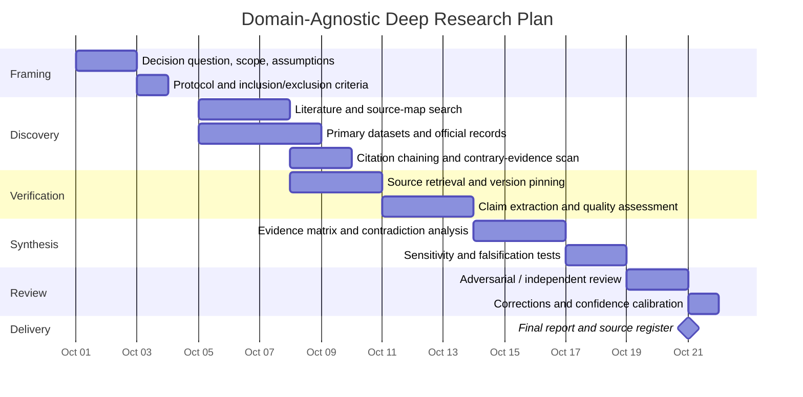

# Domain-Agnostic Deep Research Framework

## Executive summary

Because no substantive research domain or decision question was specified, the defensible output is not a set of domain conclusions but a **research architecture**: a reproducible way to turn an initially underspecified question into a source-pinned, decision-useful report without prematurely narrowing the answer. The attached DS-07 document is therefore **not treated as the active research query**. It explicitly describes itself as “proposed-inert,” says that reading it launches nothing, and requires explicit invocation before its privacy-retention research lane is run. I use it only as an example of how this generic framework would specialize once a domain is explicitly selected. fileciteturn0file0

The strongest general-purpose workflow has five characteristics. First, it separates **question formation, discovery, verification, synthesis, and recommendation** rather than treating web search as research. Second, it prioritizes primary evidence: official datasets, regulator or government publications, original research, standards, filings, and first-party technical documentation. Third, it maintains a claim-level evidence ledger so that conclusions can be traced to sources, dates, versions, assumptions, and uncertainty. Fourth, it uses explicit quality criteria—authority, directness, methodology, independence, recency, completeness, and reproducibility—rather than equating prestige or search rank with reliability. Fifth, it plans for change: important claims get a freshness or expiry trigger, and the final report records what would cause a conclusion to be revisited. These principles are consistent with contemporary systematic-review guidance from Cochrane and PRISMA, evidence-certainty practice such as GRADE, and recent research-data governance policies. citeturn0search2turn0search6turn3search1turn2search8

A practical default is a **three-week research cycle** beginning October 1, 2026: scope and protocol; broad discovery; primary-source retrieval; extraction and quality assessment; synthesis and contradiction testing; external or adversarial review; and final publication with an evidence register. That schedule can compress for a bounded factual question or expand substantially for regulated, scientific, legal, financial, or safety-critical work.

Recent developments strengthen the case for this approach. Cochrane's current Handbook is version 6.5 from 2024; NIH has moved data-management planning upstream and, for applications due on or after May 25, 2026, introduced a simplified data-management-and-sharing-plan format; scholarly metadata is increasingly accessible through structured services such as Crossref, DataCite, OpenAlex, and government APIs; and research infrastructure itself can change unexpectedly, as shown by the Center for Open Science's 2026 announcement that OSF Projects will stop accepting new projects on November 16, 2026 and become read-only after February 19, 2027. citeturn0search0turn4view2turn4view3turn4view4turn0search5turn4view1

The central recommendation is therefore: **design the research around durable evidence objects and explicit provenance, not around a particular search engine, AI model, database interface, or repository.** Tools should accelerate discovery and extraction; authoritative sources must remain the evidentiary substrate. NIST's 2024 Generative AI Profile provides a useful cross-sector framework for treating generative AI as a risk-managed component rather than as an unverified authority. citeturn4view0

## Objectives, scope, and assumptions

### Research objective

The objective of a domain-agnostic deep-research process is to produce a report that answers a decision-relevant question with the **best available evidence**, makes disagreements and uncertainty visible, and preserves enough provenance for another competent researcher to reproduce or challenge the analysis.

Until a concrete domain is supplied, the research question can be represented generically as:

> **Given decision \(D\), population/system \(P\), alternatives \(A\), outcomes \(O\), constraints \(C\), and time horizon \(T\), what does the strongest available evidence imply, how certain is that implication, and what new evidence could change it?**

This extends the logic of structured question formation used in evidence synthesis. Cochrane's current Handbook explicitly separates determining scope and questions, inclusion criteria, searching and selecting studies, data collection, bias assessment, synthesis, and interpretation; CDC's 2024 GRADE guidance similarly emphasizes defining outcomes and assessing the certainty of the body of evidence rather than merely counting sources. citeturn0search6turn3search8

### Default scope

In the absence of further constraints, this report assumes:

| Dimension | Default assumption |
|---|---|
| Research date | Evidence assessed as of September 30, 2026 |
| Literature priority | 2021–2026 where available; older canonical work allowed when still authoritative |
| Geography | Global evidence, with jurisdiction-specific claims identified rather than generalized |
| Language | English-language retrieval first; non-English primary evidence added when material |
| Source priority | Primary/official → peer-reviewed synthesis → independent industry analysis → reputable secondary reporting |
| Access | Publicly accessible material preferred; paywalled evidence may be identified but should not become the only basis for a critical claim |
| Quantitative standard | Effect sizes, uncertainty intervals, base rates, sample size, and model assumptions retained when relevant |
| AI use | Discovery, classification, extraction assistance, and drafting are acceptable; unsupported AI-generated claims are not evidence |
| Decision posture | No domain conclusion without a domain-specific question and evidence base |

PRISMA 2020 remains a useful transparency baseline for documenting identification, selection, appraisal, and synthesis of evidence, while Cochrane's 2024 Handbook provides more detailed methodological guidance. PRISMA was published in 2021 and therefore lies just outside a strict five-year window as of September 30, 2026, but it remains a current reporting standard and is appropriately retained as a methodological foundation rather than as substantive domain evidence. citeturn0search2turn0search9turn3search13

### What is deliberately unspecified

Several constraints materially affect conclusions but were not provided: the intended decision maker; acceptable false-positive versus false-negative risk; geographic or regulatory jurisdiction; budget; access to proprietary databases; tolerance for preprints and working papers; whether causal inference is required; whether unpublished or internal evidence may be used; privacy/security restrictions; and whether the output is intended for publication, litigation, investment, policy, engineering, or internal planning.

These should be logged as **open assumptions**, not silently resolved by the researcher. A good research report distinguishes “evidence says X” from “we assumed X.”

The attached DS-07 file illustrates why this matters. It specifies a highly constrained research lane involving privacy-preserving retention/deletion, explicit research questions, source-pinned claims, deletion proof states, key-granularity trade-offs, negative fixtures, and a strict no-implementation boundary. Those constraints would dramatically change the generic plan, but the file also says the lane is inert until explicitly invoked, so none of those mechanisms are treated here as an authorized research task. fileciteturn0file0

## Methodology and source strategy

### Start with a protocol, not a search box

The first artifact should be a short research protocol recording the question, scope, time horizon, inclusion/exclusion rules, expected source classes, known confounders, and stopping criteria. For empirical research, preregistration or time-stamped study planning is one mechanism for reducing post-hoc flexibility; the Center for Open Science continues to position OSF around study planning and preregistration even as it phases out the broader OSF Projects workspace. citeturn2search5turn4view1

A useful protocol contains four layers:

**Decision layer.** What action will the research inform, and what threshold would change the action?

**Evidence layer.** What counts as evidence? Which study designs, datasets, time periods, jurisdictions, and source types qualify?

**Analysis layer.** What synthesis method is appropriate—narrative comparison, statistical meta-analysis, causal inference, benchmark analysis, legal interpretation, market sizing, technical evaluation, or mixed methods?

**Falsification layer.** What observation would overturn the leading hypothesis or recommendation?

The last point is particularly important. Research that only accumulates supporting evidence becomes confirmation-seeking. A stronger workflow explicitly searches for contradictory studies, failed replications, retractions, alternative mechanisms, negative cases, and boundary conditions.

### Prioritize sources by evidentiary role

The following hierarchy works across many domains, although the order can change for a particular question:

**Primary and official evidence** should generally anchor factual claims: statutes and regulations; government statistical series; official administrative datasets; regulatory filings; standards; original experiments; clinical or trial registries; source code and release artifacts; first-party product documentation; patents; court opinions; and original survey microdata.

**Peer-reviewed synthesis**—systematic reviews, meta-analyses, consensus reports, evidence reviews—helps establish the state of a literature and reveals disagreements, but should not replace inspection of pivotal primary studies when a conclusion turns on them. Cochrane's methodology explicitly addresses searching, study selection, data collection, risk of bias, synthesis, and interpretation as separate operations. citeturn3search13

**Industry research** can be uniquely useful for proprietary markets, adoption data, cost benchmarks, supply chains, and emerging technologies. Its incentives and methodologies, however, need independent checking, especially when the publisher sells consulting, investment, or technology related to the result.

**News and expert commentary** are primarily discovery and contextualization sources. For current events, they can establish chronology or surface documents, but where an underlying filing, judgment, study, transcript, dataset, or agency notice exists, the research record should normally point to that underlying source.

**Community sources**—forums, issue trackers, practitioner discussions, social media—can expose failure modes and emerging phenomena before formal literature exists. They are strong sources for “users report experiencing X” and weak sources for unsupported general claims such as “X occurs in 40% of systems.”

### Use structured discovery infrastructure

No single literature index or dataset catalog is complete. Crossref's REST API exposes publisher-deposited scholarly metadata including funding, licenses, updates, ORCID/ROR identifiers and, where deposited, abstracts. DataCite exposes DOI metadata for research objects and supports provenance tracking; OpenAlex represents works, authors, institutions, sources and related entities as a connected scholarly graph. Each is useful for discovery and deduplication, but the metadata record is not a substitute for inspecting the source itself. citeturn4view3turn4view4turn0search5

Official portals should be searched separately. For example, Data.gov is a catalog pointing to datasets maintained by publishing agencies rather than a host of all underlying data, so the researcher should follow the catalog record to the responsible agency. The SEC's EDGAR APIs expose company submission history and structured XBRL financial-statement information and are updated as filings are disseminated, making them preferable to third-party finance sites for many U.S. public-company facts. citeturn1search0turn1search2

Primary links:

- [PRISMA 2020](https://www.prisma-statement.org/prisma-2020-statement) citeturn0search9
- [Cochrane Handbook, current version](https://www.cochrane.org/authors/handbooks-and-manuals/handbook/current) citeturn0search6
- [NIH Data Management & Sharing Policy](https://grants.nih.gov/policy-and-compliance/policy-topics/sharing-policies/dms/policy-overview) citeturn2search8
- [NIST AI RMF Generative AI Profile](https://www.nist.gov/publications/artificial-intelligence-risk-management-framework-generative-artificial-intelligence) citeturn4view0
- [Crossref REST API](https://www.crossref.org/documentation/retrieve-metadata/rest-api/) citeturn4view3
- [DataCite REST API](https://support.datacite.org/docs/rest-api) citeturn4view4
- [SEC EDGAR APIs](https://www.sec.gov/search-filings/edgar-application-programming-interfaces) citeturn1search2
- [Data.gov](https://data.gov/) citeturn1search7

### Build a claim ledger

Every important conclusion should map to a structured record such as:

| Field | Purpose |
|---|---|
| Claim | Atomic proposition being asserted |
| Source | Exact primary or supporting source |
| Source type | Primary study, regulator, dataset, review, vendor, etc. |
| Publication/version date | Prevents obsolete material from masquerading as current |
| Evidence date | Date the underlying event/data refer to |
| Directness | Direct measurement vs proxy/inference |
| Independence | Whether sources share data, authorship, incentives or upstream reporting |
| Method quality | Sampling, controls, measurement validity, confounding, missingness |
| Uncertainty | CI, credible interval, qualitative confidence, or explicit unknown |
| Contradictory evidence | Best evidence against the claim |
| Confidence | High / moderate / low / unresolved |
| Expiry trigger | New release, new law, new quarter, new study, etc. |

This is an adaptation of the transparency and certainty principles underlying systematic-review and GRADE practice rather than a domain-specific grading system. GRADE's 2024 CDC implementation, for example, evaluates certainty across a body of evidence and explicitly considers study limitations, inconsistency, indirectness, imprecision, and publication bias. citeturn3search3turn3search7

### Separate discovery from verification

Search engines, metadata graphs, citation networks, LLMs, and recommendation systems are **recall tools**. They answer “what might be relevant?” They do not by themselves answer “what is true?”

For every load-bearing claim:

1. Retrieve the original source.
2. Verify that the source actually supports the proposition.
3. Record the date/version and context.
4. Check for later corrections, retractions or superseding guidance.
5. Search deliberately for the strongest contrary evidence.
6. Distinguish observed fact from researcher inference.
7. Avoid “independent confirmation” where two publications merely repeat the same upstream source.

Generative AI can accelerate these stages, but NIST's 2024 cross-sector Generative AI Profile treats GenAI use as a risk-management problem across the AI lifecycle; accordingly, an AI-produced citation, summary, number, or quote should be verified against the underlying source before entering the evidence ledger. citeturn4view0

## Recent developments and key findings

### Evidence synthesis is becoming more explicit and continuously maintainable

PRISMA 2020 expanded and updated reporting guidance for how systematic reviews identify, select, appraise and synthesize studies. Cochrane's current Handbook is version 6.5, updated in 2024, and its structure explicitly includes planning, question formulation, searching, data collection, bias/conflict assessment, synthesis and review updating. Cochrane also warns that reviews that are not updated with newly available evidence can mislead decision makers. citeturn0search2turn0search0turn3search16

**Implication:** a modern deep-research deliverable should not be thought of as permanently “finished.” High-volatility claims should have update triggers, and a report should distinguish stable background findings from facts likely to expire.

### Research-data planning has moved upstream

NIH's Data Management and Sharing Policy took effect in January 2023 and expects covered investigators to plan for scientific-data management and sharing rather than improvising it after publication. NIH guidance emphasizes prospective planning, appropriate repositories, preservation/access timelines, standards, and oversight. For applications due on or after May 25, 2026, NIH introduced a simplified DMS-plan format. citeturn2search8turn2search4turn4view2

**Implication:** the generic research protocol should define data provenance, storage, transformations, licensing and publication boundaries at project start. “Where did this number come from?” should be answerable months later without reconstructing the entire investigation.

### Scholarly and government data are increasingly machine-accessible

Crossref and DataCite provide structured APIs for scholarly and research-object metadata; OpenAlex exposes a graph of scholarly entities; Data.gov now provides a catalog API for government dataset metadata; and the SEC exposes structured EDGAR submissions and XBRL data. This makes large-scale discovery, deduplication, citation tracing and update monitoring practical, but source semantics still differ and completeness is not guaranteed. citeturn4view3turn4view4turn0search5turn1search5turn1search2

**Implication:** automate retrieval where scale warrants it, but retain source-specific validation. A missing result from one index is not evidence that no source exists.

### Research infrastructure is itself a dependency risk

The Center for Open Science announced in 2026 that new OSF Projects will no longer be creatable starting November 16, 2026 and existing public/private Projects will become read-only after February 19, 2027, while preregistration and related functions continue. COS explicitly recommends using interoperable specialized services rather than relying on one platform for every research-lifecycle function. citeturn4view1

**Implication:** reproducibility requires **portable artifacts**—plain-text protocols, machine-readable bibliographies, open data formats, persistent identifiers and exportable code—not merely a link to a currently convenient SaaS workspace.

### Evidence certainty matters more than source volume

Contemporary GRADE guidance demonstrates an important principle that transfers beyond medicine: confidence should be assessed at the level of the **body of evidence**, accounting for limitations such as bias, inconsistency, indirectness and imprecision. Twenty weak sources do not necessarily outweigh one well-designed, directly relevant primary dataset. citeturn3search1turn3search3

**Implication:** the final report should state both the direction of a finding and confidence in it. “Evidence favors A” and “high-confidence evidence favors A” are materially different claims.

## Recommendations, implications, and data-source comparison

### Recommended operating model

The strongest adaptable model is a **primary-source-first, claim-centric, falsification-aware workflow**.

For each major conclusion, the researcher should preserve an evidentiary chain:

**question → candidate evidence → verified primary sources → extraction → quality assessment → competing explanation → synthesis → recommendation → falsifier/update trigger**

That chain gives reviewers multiple opportunities to find mistakes before a conclusion becomes operational.

I recommend seven practical controls.

**Pre-specify the decision threshold.** Research is most useful when it can answer what would change the decision. A recommendation should state its decisive variables rather than ending in generic language such as “more research is needed.”

**Create an atomic claim ledger.** Decompose a report into verifiable propositions. Avoid attaching one citation to a paragraph containing five unrelated factual claims.

**Use primary-source anchors.** Secondary analysis can interpret, compare or contextualize, but critical facts should trace to their underlying dataset, filing, experiment, statute, standard or official record where possible. Data.gov itself instructs users that it is a metadata catalog and that the publishing agency is the authoritative contact for individual datasets. citeturn1search0

**Triangulate by independence, not count.** Prefer two genuinely independent measurement systems over ten articles repeating the same source.

**Grade uncertainty explicitly.** A useful general scheme is *high confidence*, *moderate confidence*, *low confidence*, and *unresolved*, accompanied by the reason. This is conceptually aligned with evidence-certainty frameworks such as GRADE but should be customized rather than mechanically imported into unrelated domains. citeturn3search10

**Record freshness.** Laws, prices, software versions, product specifications, leadership, market shares and operational metrics may decay quickly. Each such claim should include “as of” information and, ideally, an update trigger.

**Require an adversarial pass.** Before publication, search for the strongest evidence that the recommended conclusion is wrong. Treat contradictions as research outputs, not cleanup problems.

### Comparison of potential data sources

| Data-source class | Examples | Principal strengths | Principal weaknesses | Best role |
|---|---|---|---|---|
| **Official statistics and administrative data** | Census/statistical agencies, Data.gov-linked agency datasets, central banks, health agencies | Often large scale; documented methodology; stable series; primary measurements; strong provenance | Publication lag; revisions; administrative definitions may not match research concepts; political/geographic boundaries | Baseline facts, trends, denominators, policy analysis. Data.gov is a catalog, so underlying agency data should be consulted directly. citeturn1search0turn1search7 |
| **Regulatory and statutory records** | SEC EDGAR, regulator decisions, legislation, court records | Legally consequential; direct; frequently versioned/time-stamped; structured data increasingly available | Filing obligations differ; information may still be self-reported; interpretation may require domain expertise | Corporate facts, compliance, financial disclosures, legal/regulatory state. EDGAR provides public filings and structured APIs. citeturn1search1turn1search2 |
| **Original peer-reviewed studies** | Experiments, observational studies, surveys, technical papers | Detailed methods; primary evidence; often quantified uncertainty | Publication bias; individual studies can be underpowered or non-generalizable; peer review does not eliminate error | Causal/empirical evidence and mechanism testing |
| **Systematic reviews/meta-analyses** | Cochrane-style reviews, domain evidence syntheses | Aggregate evidence; expose heterogeneity; systematic search/appraisal | Quality cannot exceed inputs; may lag recent studies; can become outdated | Establish state of evidence and disagreements. Cochrane specifically emphasizes updating because new evidence can alter conclusions. citeturn3search16 |
| **Scholarly metadata graphs** | Crossref, DataCite, OpenAlex | Fast discovery; DOI/entity linking; citation and provenance metadata; programmatic access | Metadata completeness varies; records are not the underlying studies; duplicate/version handling is nontrivial | Discovery, deduplication, citation graphing and update monitoring. citeturn4view3turn4view4turn0search5 |
| **Research-data repositories** | Discipline repositories, generalist repositories | Reanalysis possible; supports reproducibility; may expose data not visible in papers | Documentation quality varies; privacy/access restrictions; survival and platform dependency must be considered | Validation, secondary analysis, robustness testing. NIH recommends established discipline/data-type repositories where available. citeturn2search4turn4view2 |
| **Industry/market reports** | Analyst firms, trade associations, consulting reports | Proprietary surveys; market context; adoption and spending data unavailable elsewhere | Paywalls; opaque sampling/models; commercial incentives; different vendors may define markets differently | Market sizing, commercial context; important numbers should be triangulated |
| **Company first-party material** | Product documentation, release notes, investor presentations, status pages | Authoritative for declared features and official positions; usually current | Marketing incentives; selective disclosure; not independent evidence of performance | Product capabilities, version changes, official roadmap/claims |
| **Preprints and working papers** | Preprint servers, institutional working-paper series | Faster than publication; useful for emerging fields | Not necessarily peer reviewed; conclusions may change; elevated verification burden | Frontier discovery and early evidence, clearly labeled |
| **Open web/community evidence** | Forums, issue trackers, practitioner blogs, public repositories | Excellent for edge cases, implementation failures and emerging behavior | Selection bias; identity uncertainty; anecdotal; unstable | Hypothesis generation, failure-mode discovery and qualitative context |

No source class is universally “best.” The correct comparison is **fitness for the particular claim**. An official company document can be the best source for “which API version is currently supported” while being a weak source for “is this product better than its competitor.” An industry survey can be strong evidence of its surveyed respondents and weak evidence of the entire market.

### Deliverable structure

A mature final deliverable should contain:

1. An executive decision summary stating conclusions, confidence and decisive uncertainties.
2. Scope, assumptions and exclusions.
3. Methods and search protocol.
4. Evidence/claim table.
5. Findings organized around the decision rather than around source summaries.
6. Contradictions and sensitivity analysis.
7. Recommendations with alternatives and falsifiers.
8. Gaps and open questions.
9. Source register with versions/dates and links.
10. Update triggers for volatile findings.

The important shift is from **“bibliography with prose”** to **“auditable argument with evidence.”**

## Gaps, open questions, and adaptation by domain

### Current gaps

The present report cannot responsibly deliver substantive findings about a real-world topic because none was specified. In particular, there is no target outcome, population, jurisdiction, comparator, decision threshold or evidence boundary against which individual studies could be judged relevant.

The largest unanswered questions are therefore methodological inputs:

**What decision is being made?** The same evidence can support different recommendations under different loss functions.

**Who is affected?** Population and deployment context determine external validity.

**What is the geographic/legal scope?** A legal, financial, privacy or health conclusion may invert across jurisdictions.

**What is the relevant time horizon?** A five-year technology investment question needs different evidence from a next-quarter operational decision.

**What counts as success or failure?** Without explicit outcomes, researchers can unconsciously privilege conveniently measured variables.

**How much uncertainty is acceptable?** Safety-critical or legal work typically demands stronger verification than exploratory strategy work.

**Are proprietary or internal sources permitted?** This determines whether public evidence is the whole universe or merely one layer.

These are not reasons to stop research; they are parameters the next domain-specific protocol should fix.

### How the plan changes once a domain is specified

| Domain | Primary-source shift | Methodological shift |
|---|---|---|
| **Biomedical/health** | PubMed-indexed originals, ClinicalTrials.gov and other registries, FDA/EMA/WHO/CDC, trial protocols and datasets | PICO-style scope, systematic review, risk-of-bias appraisal, GRADE-like certainty assessment; Cochrane and CDC guidance become directly applicable. citeturn3search8turn3search13 |
| **Law/regulation** | Statutes, regulations, cases, agency orders, official gazettes | Jurisdiction and effective date become first-class variables; secondary commentary is subordinate to controlling authority |
| **Finance/business** | EDGAR and equivalent filings, central-bank/statistical data, earnings materials, audited reports | Reconcile accounting definitions, period alignment and revisions; separate reported facts from valuation assumptions. EDGAR's public database and APIs are strong U.S. anchors. citeturn1search1turn1search2 |
| **Technology/software** | Standards, official docs, source repositories, release artifacts, benchmarks, security advisories | Version pinning and reproducible testing become essential; current behavior may supersede older literature |
| **Security/privacy** | NIST/ISO and other standards, regulator guidance, protocol specifications, vendor security docs, peer-reviewed security literature | Threat model, attacker capability, proof obligations, negative testing and residual risk dominate |
| **Public policy/social science** | Statistical agencies, administrative records, survey microdata, policy texts, original causal studies | Counterfactual design, identification assumptions, selection bias and heterogeneous effects require explicit analysis |
| **Emerging markets/industry** | Company disclosures, customs/trade data, surveys, procurement, analyst reports | Triangulation is crucial because proprietary definitions and incomplete public data are common |

If the attached DS-07 specification were later **explicitly invoked** as the domain, this generic workflow would narrow substantially. The research protocol would adopt its stated questions around cryptographic erasure, key granularity, recoverable-copy enumeration, backup expiry, tombstones, deduplication isolation, legal holds and deletion proof states; sources would shift toward current security standards, KMS/HSM and cloud-provider documentation, distributed-storage literature and privacy/security research; and the deliverable would require observable predicates and stop conditions before any “verified-complete” deletion claim. None of those mechanisms is researched or authorized here because DS-07 itself states that it remains inert absent explicit invocation. fileciteturn0file0

## Proposed research plan and milestones

### Research schedule

The following is a practical **fifteen-business-day template**, beginning October 1, 2026. It describes a plan a research team could execute; it is not a promise of asynchronous work.

### Milestone logic

**Scope freeze — October 5.** The question has an explicit decision target, target population/system, jurisdiction, time horizon, outcome metrics, inclusion/exclusion criteria and stopping rules. No broad search should silently redefine the question after this point; changes become logged protocol amendments. This parallels the planning-first logic in current evidence-synthesis and data-management practice. citeturn0search6turn2search8

**Discovery saturation — October 9.** Major source families have been searched, citation chains inspected, terminology variants resolved, and at least one deliberate contrary-evidence search run. “Saturation” does not mean every document on the internet has been found; it means additional searches are producing diminishing numbers of materially new evidence categories.

**Evidence ledger complete — October 15.** Every potentially decision-changing claim has a source, date/version, extraction, uncertainty assessment and contradiction field. Unsupported claims are either removed or labeled hypotheses.

**Falsification review complete — October 19.** The leading recommendation has been tested against competing explanations, alternative parameter choices, subgroup effects, missing-data assumptions and the strongest contrary evidence available.

**Publication gate — October 21.** The final report contains no high-impact assertion whose provenance is unknown; rapidly changing claims are dated; inferences are distinguished from observations; limitations are explicit; and citations resolve to sources that support the actual sentence in which they appear.

### Evidence-quality gate

A useful publication rule is:

\[
\text{Publishable claim} =
\text{source support}
\times
\text{source quality}
\times
\text{directness}
\times
\text{freshness}
\times
\text{verification}
\]

This is conceptual rather than a literal statistical formula: a zero-like failure in any critical dimension can invalidate an otherwise impressive evidence bundle. A highly prestigious but obsolete source, a fresh but indirect proxy, or a large dataset with an invalid measurement construct can all produce misleading confidence.

### Stop conditions

Research should stop expanding and move to synthesis when additional searching is no longer likely to alter the decision, **not** merely when a preselected source count has been reached. Conversely, it should not claim closure when a material contradiction remains unresolved, the most important primary source is inaccessible, a key statistic cannot be reproduced, or a rapidly changing fact lacks a sufficiently current source.

For living or high-volatility topics, the endpoint should instead be an **expiry condition**: for example, “refresh after the next regulatory decision,” “refresh after the next quarterly filing,” “refresh when version X is superseded,” or “refresh when a new adequately powered study reports.” Cochrane's updating guidance reflects the broader principle that newly available evidence can materially change a synthesis and therefore its downstream decisions. citeturn3search16

### Recommended final research package

The optimal reusable package consists of four artifacts: the human-readable report; a machine-readable bibliography/source register; a claim/evidence matrix; and, where data analysis was performed, reproducible code plus a data dictionary and provenance record. NIH's current data-management guidance emphasizes prospective planning, repositories, standards, preservation/access and related tools or code, while OECD guidance similarly treats data governance, technical standards, stewardship and sustainable infrastructure as central to responsible research-data practice. citeturn2search0turn2search12turn2search19

The decisive principle is simple: **deep research is not defined by how many pages or searches it contains. It is defined by whether a skeptical reader can trace a consequential conclusion back to appropriate evidence, understand why competing evidence was discounted, see what remains unknown, and identify what future observation would change the answer.**