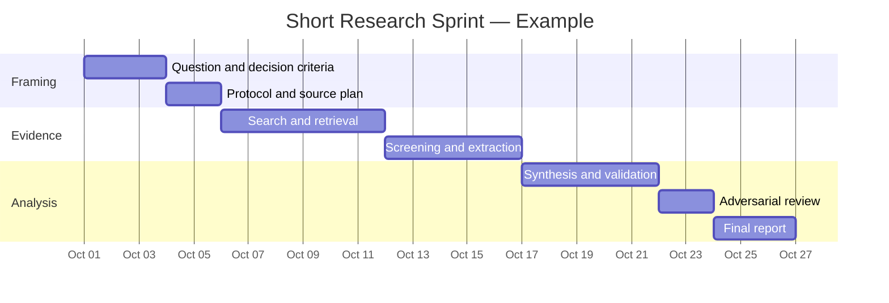
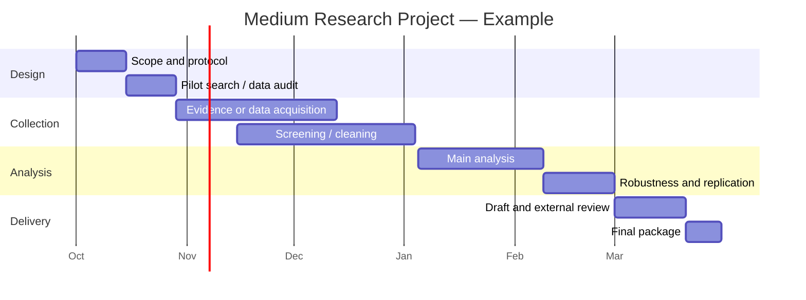
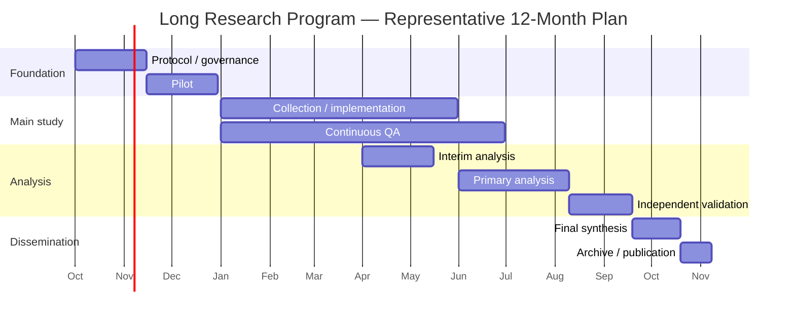
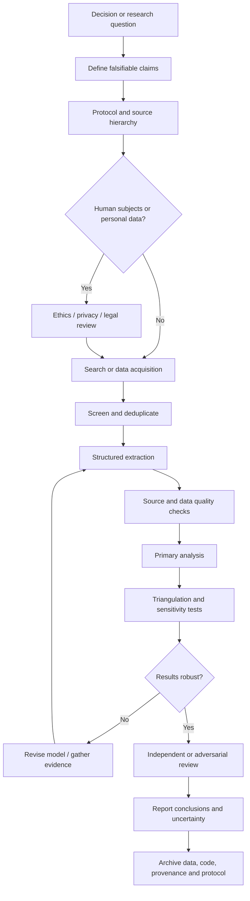

# Deep Research Project Initiation Framework

## Executive summary

Because the research topic, audience, and final deliverable are unspecified, the best starting point is **not** to launch a broad literature search. It is to convert the unknown topic into a decision-oriented research question, score candidate projects on **impact, feasibility, novelty, time, and cost**, and then select a research design proportionate to the decision at stake. For most projects, a staged approach works best: first map the evidence and uncertainty; next collect or validate data; only then invest in expensive experiments, interviews, or machine-learning work.

A practical default is a **2–4 week research sprint** costing roughly **$2,000–$100,000**, depending mainly on staff seniority, purchased data, interviews, and computational requirements. Its purpose is to produce a defensible evidence map, identify uncertainties, and determine whether a larger project is warranted. A **2–6 month project** is appropriate when original data collection, systematic review, statistical modeling, or stakeholder research is needed. A **6–24 month program** becomes justified when the question requires longitudinal evidence, field experiments, substantial engineering, prospective recruitment, or repeated validation.

One unusually research-ready candidate exists in the supplied materials: the uploaded **DS-04 — Plugin trust and supply chain** brief already contains research questions, constraints, non-goals, deliverables, and a completion gate. However, the brief explicitly declares itself *inert until explicitly invoked*, so this report treats it only as a candidate topic rather than executing its research program. fileciteturn0file0

For evidence discovery, use a hierarchy rather than a single search engine: **original studies, official statistics, regulations, standards, and authoritative technical documentation first; bibliographic indexes and aggregators second; preprints and general web search as discovery mechanisms whose claims are independently checked**. PubMed, for example, now contains more than 40 million biomedical citations and integrates MEDLINE/MeSH indexing; IEEE Xplore covers journals, conferences, standards, and technical literature; Crossref exposes open scholarly metadata; Google Scholar searches broadly across scholarly source types; and OpenAlex offers an open scholarly graph useful for citation discovery and bibliometrics. citeturn1search0turn1search2turn1search18turn6search1turn5search8

For evidence synthesis, record the search protocol before intensive screening, retain complete search strings and timestamps, preserve inclusion/exclusion decisions, separate source quality from claim confidence, and run sensitivity or adversarial checks before conclusions are finalized. PRISMA 2020 provides a widely used framework for transparent systematic-review reporting, while the Cochrane Handbook describes detailed methods for searching, selection, extraction, bias assessment, synthesis, and interpretation. citeturn5search0turn5search4

For reproducibility, preserve data provenance, licenses, transformations, code, software versions, random seeds where relevant, and machine-readable metadata. The FAIR principles explicitly emphasize findability, accessibility, interoperability, reusability, provenance, licensing, and persistent identification for research objects, including workflows and algorithms. citeturn4search0

## Assumptions and topic prioritization

### Working assumptions

This framework assumes:

| Dimension | Assumption |
|---|---|
| Topic | Unspecified |
| Audience | Unspecified; could be technical, executive, academic, policy, or mixed |
| Deliverable | Unspecified; default is an evidence-backed analytical report plus reproducibility package |
| Geography | Not fixed |
| Language | English-first |
| Data access | Public or properly licensed data by default |
| Human subjects | Avoided unless the question genuinely requires interviews, surveys, experiments, or identifiable records |
| Budget | Unknown, so three budget levels are modeled |
| Quality threshold | Claims should be traceable to primary or authoritative sources wherever possible |
| Date baseline | September 30, 2026 |

The supplied DS-04 brief is particularly well specified: it defines twelve research questions, requires source-pinned claims and grant/lifecycle matrices, prohibits runtime or installation effects, and preserves local-owner sovereignty. Because it also explicitly says that simply reading the file launches nothing and that the research lane is inert until separately invoked, it should be treated as a **research-ready option, not an automatically authorized project**. fileciteturn0file0

### Candidate research directions

For an unspecified topic, I would prioritize candidate projects using:

\[
\text{Priority}=0.30I+0.25F+0.15N+0.15T+0.15C
\]

where **I** = impact, **F** = feasibility, **N** = novelty, **T** = speed, and **C** = affordability, each scored from 1 to 5 with higher being better. The weights are a planning recommendation rather than a universal rule.

| Candidate project | Impact | Feasibility | Novelty | Speed | Affordability | Weighted score | Best first move |
|---|---:|---:|---:|---:|---:|---:|---|
| Decision-critical evidence synthesis | 4 | 5 | 3 | 5 | 5 | **4.40** | 2–4 week evidence sprint |
| Plugin trust / software supply-chain governance, if explicitly invoked | 5 | 4 | 4 | 4 | 4 | **4.30** | Standards + primary-source comparison |
| Public-data causal or outcome study | 5 | 4 | 4 | 3 | 4 | **4.15** | Data feasibility and identification study |
| AI/ML evaluation or benchmark study | 5 | 3 | 5 | 3 | 3 | **3.90** | Threat model + evaluation protocol |
| Stakeholder/interview study | 4 | 3 | 4 | 3 | 3 | **3.45** | Ethics/privacy check + sampling plan |
| Prospective field experiment or longitudinal study | 5 | 2 | 5 | 1 | 1 | **3.05** | Pilot and power/feasibility study |

The attached plugin-trust topic ranks highly because it already has concrete falsifiable questions and bounded deliverables; it also aligns with active work in provenance, traceability, software security, and AI-agent standards. NIST, for example, finalized a supply-chain traceability meta-framework in September 2026 and has active work on AI-agent standards and AI evaluation, making provenance and trust architecture a timely research area. citeturn0search1turn0search6turn0search11turn0search0

### Selection rule

Choose the project with the highest expected **decision value per unit of effort**, not necessarily the highest intellectual novelty. A useful decision gate is:

> **Will a credible answer change a real decision, policy, design, investment, or scientific belief?**

If not, narrow or replace the question.

A good initial research question has this structure:

> **For [population/system/context], how does [intervention/exposure/mechanism] affect [outcome], compared with [baseline/alternative], over [time horizon], and what evidence would falsify the leading explanation?**

For standards or technology research:

> **What does mechanism X actually guarantee, under which threat model and assumptions, what does it explicitly not guarantee, and which observable test would distinguish X from competing design Y?**

That second formulation is particularly appropriate for the attached DS-04 style of trust/supply-chain research. fileciteturn0file0

## Project templates and budgets

### Comparative project design

| Dimension | Short project | Medium project | Long project |
|---|---|---|---|
| Duration | 2–4 weeks | 2–6 months | 6–24 months |
| Primary objective | Reduce uncertainty quickly | Produce decision-grade evidence | Establish durable or causal evidence |
| Typical questions | What is known? What matters? What should we test next? | What does the evidence/data actually show? | Does the effect persist, generalize, or survive real-world deployment? |
| Core methods | Rapid review, evidence map, official-data analysis, expert consultation | Systematic/scoping review, interviews, quantitative analysis, benchmark evaluation | Prospective study, longitudinal panel, field experiment, multi-site evaluation, engineering testbed |
| Main deliverables | Research brief, source matrix, uncertainties, recommendation | Full report, dataset/code, validation results, executive brief | Publications, datasets, operational framework, longitudinal findings |
| Milestone cadence | Several days | 2–4 weeks | Monthly/quarterly |
| Minimum staffing | Lead researcher + reviewer | Lead + analyst + domain expert + reviewer | PI/lead + research staff + data/engineering + ethics/governance + PM |
| Data | Existing literature/public data | Existing + purchased/collected data | Often prospective or repeatedly collected |
| Risk | Superficiality | Scope creep / data quality | Attrition, cost, governance, changing environment |
| Best use | Decide whether to invest | Resolve a bounded important question | High-stakes claims requiring strong validation |

PRISMA 2020 is appropriate when a project becomes a systematic evidence synthesis, but it is primarily a **reporting guideline**, not a substitute for a review-method handbook; the PRISMA authors explicitly distinguish reporting from conduct. The Cochrane Handbook provides detailed conduct guidance for review planning, searching, selection, extraction, bias assessment, statistics, and interpretation. citeturn5search0turn5search1turn5search4

### Budget model

The following are **illustrative planning ranges in 2026 USD**, not market quotes. They exclude institutional overhead unless explicitly included and assume mainly knowledge-work research rather than wet-lab facilities.

| Project | Low | Medium | High | Typical cost drivers |
|---|---:|---:|---:|---|
| 2–4 weeks | **$2k–$10k** | **$10k–$40k** | **$40k–$100k** | Senior expertise, purchased reports/data, interviews, specialized review |
| 2–6 months | **$20k–$60k** | **$60k–$250k** | **$250k–$750k** | Full-time staff, survey recruitment, commercial datasets, compute, external review |
| 6–24 months | **$75k–$250k** | **$250k–$1.5M** | **$1.5M–$5M+** | Multiple staff, participant recruitment, longitudinal follow-up, engineering/testbeds, multi-site work |

**Low** assumes mostly public evidence/data and one or two researchers.  
**Medium** supports dedicated analysts, domain review, modest original collection, and robust reproducibility.  
**High** supports substantial recruitment, specialized expertise, commercial data, repeated evaluation, or system-building.

A sensible funding rule is to spend the first **5–15% of the plausible total program cost** on question refinement and feasibility before locking in the remainder. This percentage is a planning heuristic, not a research standard.

### Short-project template

**Objective:** determine the state of evidence, locate the decisive uncertainty, and recommend whether deeper research is justified.

**Methods:** protocol definition; 2–5 bibliographic/web databases; primary-source retrieval; source-quality grading; targeted quantitative analysis where structured data already exist; expert review if necessary.

**Deliverables:** 10–30 page report, one-page executive summary, claim/source table, evidence-gap map, reproducibility appendix, and explicit “stop / proceed / redesign” recommendation.

**Milestones:** question freeze → search protocol → evidence map → extraction → analysis → adversarial review → final.

**Staff:** research lead at 0.4–1.0 FTE; research analyst at 0.5–1.0 FTE; domain reviewer approximately 5–20 hours.

**Risks:** overly broad question, confirmation bias, publication bias, inaccessible proprietary evidence, and false confidence from insufficient data. Mitigation: prestate exclusions, record discarded hypotheses, search negative evidence deliberately, and report uncertainty separately from recommendation.



### Medium-project template

**Objective:** answer a bounded research question with systematic synthesis and/or original empirical analysis.

**Methods:** registered protocol; systematic/scoping review; structured data extraction; interviews or surveys where justified; statistical modeling; triangulation; independent replication of critical calculations.

**Deliverables:** decision report or manuscript, curated dataset, analysis code, data dictionary, bias/limitations assessment, presentation deck, and machine-readable bibliography.

**Staff:** principal investigator/research lead; research analyst; domain expert; statistician/data scientist; part-time project manager; independent reviewer. Add privacy/ethics expertise if personal data or participants are involved.

**Risks:** scope creep, recruitment failure, underpowered analysis, dataset revisions, inaccessible full text, and researcher degrees of freedom. Mitigation: preregistration, phase gates, frozen extraction schema, change log, sensitivity analyses, and predefined stop conditions.

OSF supports registrations and preregistration, but organizations beginning long projects in late 2026 should note that the Center for Open Science has announced changes to OSF project/file-management functions beginning in 2027; therefore, do not make the long-term reproducibility plan depend on a single storage platform. citeturn0search13turn0search14



### Long-project template

**Objective:** generate strong original evidence, repeated measurements, or real-world validation that cannot be credibly obtained from existing data alone.

**Methods:** prospective cohort, controlled experiment, natural experiment, repeated benchmark, deployment study, field trial, or multi-site mixed-method program; periodic literature updates; independent validation.

**Deliverables:** interim reports, final report/manuscripts, maintained research dataset, protocol and amendments, audit trail, reusable software/workflows, stakeholder briefs, and archival deposit.

**Staff:** principal investigator; project manager; research scientists; statistician; data engineer; software/ML engineer when applicable; research assistants; ethics/privacy lead; external advisory or replication group.

**Risks:** temporal drift, attrition, personnel turnover, regulatory change, equipment/data-source discontinuation, evolving software dependencies, and unexpected harms. Mitigation: periodic re-baselining, version pinning, independent backups, documented succession, staged consent, stop criteria, and preplanned replication.



## Sources and search strategy

### Source hierarchy

The preferred source order should be:

**Primary authority → original research → high-quality synthesis → scholarly index → broad discovery source → commentary.**

Do not equate discoverability with reliability. Google Scholar, for example, deliberately provides broad cross-disciplinary discovery across papers, theses, books, abstracts, repositories, and other sources; it is therefore excellent for finding material, but individual results still require source-level evaluation. citeturn6search0turn6search15

| Source/database | Best use | Evidence role | Key caution |
|---|---|---|---|
| Government/regulator websites | Laws, official statistics, rules, consultations | **Primary** | Check jurisdiction and effective date |
| Standards bodies / official technical docs | Specifications, guarantees, conformance | **Primary** | Distinguish drafts from final standards |
| Original journal/conference paper | Empirical claims and methods | **Primary research** | Evaluate design and bias |
| PubMed/MEDLINE | Biomedical/life-science discovery | Index + curated metadata | Citation record is not itself evidence |
| IEEE Xplore | Computing, engineering, standards | Literature + standards corpus | Access varies by subscription |
| arXiv | Fast-moving technical research | Preprint discovery | Verify final publication/status |
| Crossref | DOI and scholarly metadata | Metadata/provenance | Metadata quality depends on deposits |
| OpenAlex | Citation graph, bibliometrics, discovery | Secondary index | Entity matching can require validation |
| Google Scholar | Broad recall and citation chasing | Discovery | Less controlled than curated databases |
| Data.gov / agency portals | U.S. public datasets | Primary-data gateway | Data.gov is often a metadata catalog; trace to agency dataset |
| Eurostat | EU official statistics | Primary statistics | Preserve extraction date/version context |
| OECD Data Explorer | Cross-country socioeconomic data | Official statistics | Definitions may differ across indicators |
| World Bank Data Catalog | Development/economic data | Official/institutional data | Check each dataset's license |
| Zenodo | Research data/software/archive | Repository | Deposit quality varies by creator |
| OSF | Registration/study planning | Research record | Storage/workflow changes are planned from 2027 |

PubMed is maintained by NCBI/NLM and includes MEDLINE, PubMed Central citations, and Bookshelf records; MEDLINE records can include MeSH indexing. citeturn1search0 IEEE Xplore provides journals, conference literature, books, and standards across engineering and computing. citeturn1search2turn1search12 Crossref exposes open metadata including identifiers, references, contributors, funding, licenses, and related provenance information. citeturn1search18 OpenAlex is a free, open scholarly catalog connecting works, authors, institutions, grants, and citations. citeturn5search8turn5search12

For public data, Data.gov is the U.S. government's open-data catalog and explicitly notes that many records point to datasets hosted by the publishing agencies rather than being hosted by Data.gov itself. citeturn2search1turn2search3 Eurostat provides official EU datasets, metadata, bulk downloads, APIs, and data-quality information. citeturn6search2turn6search3 The World Bank publishes many datasets under open terms while also warning that some catalog datasets have different restrictions, so the license should be checked record by record. citeturn2search17turn2search18

For research artifacts, Zenodo is operated by CERN, supports datasets, publications, software and other research outputs, assigns DOIs to deposits, and exposes metadata openly. citeturn2search0turn2search7

### Search process

Use five passes.

**Vocabulary pass.** Start with several high-quality seed sources. Extract formal terminology, synonyms, acronyms, obsolete names, controlled-vocabulary terms, product/project names, and important authors or organizations.

**Precision pass.** Search for the narrow claim using exact concepts and primary-source filters.

**Recall pass.** Relax terms, use synonyms, remove outcome constraints, and search citation graphs.

**Adversarial pass.** Search explicitly for contradictions, null results, failures, critiques, retractions, incidents, limitations, and competing mechanisms.

**Freshness pass.** Re-run the most important queries with a date restriction immediately before final delivery.

PRISMA 2020 emphasizes transparent reporting of how studies were identified, selected, and synthesized; Cochrane provides detailed guidance on searching and selection. citeturn5search0turn5search4

### Reusable Boolean templates

**Broad evidence map**

```text
("PRIMARY CONCEPT" OR synonym1 OR synonym2 OR acronym*)
AND
(outcome1 OR outcome2 OR mechanism*)
AND
(study OR evaluation OR experiment OR evidence)
```

**Intervention/comparison**

```text
("POPULATION" OR "SYSTEM")
AND
("INTERVENTION" OR "EXPOSURE")
AND
("OUTCOME")
AND
("COMPARATOR" OR baseline OR control)
```

**Safety/failure search**

```text
("TOPIC")
AND
(failure OR incident OR vulnerability OR harm OR limitation
 OR compromise OR rollback OR bias OR "negative result")
```

**Official web search**

```text
"EXACT CONCEPT" (site:.gov OR site:.gov.uk OR site:europa.eu)
filetype:pdf
```

Use separate searches rather than relying on a giant all-purpose Boolean string when authoritative sources use different vocabulary.

**Original research emphasis**

```text
"TOPIC"
AND
(method OR experiment OR trial OR benchmark OR dataset)
-"press release"
-"opinion"
```

**Systematic-review discovery**

```text
"TOPIC"
AND
("systematic review" OR "meta-analysis" OR "evidence synthesis")
```

### Optional concrete example for the supplied candidate

Without executing the attached DS-04 lane, a suitable **future** discovery query for that subject would be:

```text
("software supply chain" OR "package signing" OR "artifact signing"
 OR provenance OR attestation)
AND
(TUF OR SLSA OR Sigstore OR SBOM OR lockfile* OR WASI)
AND
(trust OR compromise OR revocation OR rollback
 OR "dependency confusion" OR quarantine)
```

A primary-source-focused web variant would be:

```text
("artifact signing" OR provenance OR attestation OR transparency)
(TUF OR SLSA OR Sigstore)
(site:theupdateframework.io
 OR site:slsa.dev
 OR site:sigstore.dev
 OR site:nist.gov)
```

That aligns with the mechanisms identified in the uploaded brief while leaving its substantive research questions unexecuted until explicitly authorized. fileciteturn0file0

## Data collection, validation, and analysis

### Research workflow



### Collection schema

Every collected source or dataset should have a machine-readable record containing at least:

| Field | Purpose |
|---|---|
| Stable identifier | DOI, PMID, dataset ID, report number, URL or equivalent |
| Title / owner | Attribution |
| Publication/release date | Temporal validity |
| Retrieval date | Reproducibility |
| Source type | Study, regulation, dataset, standard, documentation, commentary |
| Version | Critical for standards/data/software |
| Research design | RCT, cohort, case study, benchmark, simulation, etc. |
| Population/sample | Applicability |
| Main claim | What the source actually supports |
| Evidence location | Page/table/figure/section |
| Limitations | Source's stated or reviewer-identified weaknesses |
| Funding/conflicts | Potential bias |
| License | Legal reuse |
| Confidence | Reviewer judgment |
| Superseded by | Version/history tracking |

FAIR specifically calls for persistent identifiers, rich metadata, accessible licensing, provenance, interoperability, and reusable research objects. citeturn4search0

### Validation protocol

Use at least four layers.

**Source validation:** confirm that the document is authentic, current, and the right version. For standards, legislation, government statistics, and product documentation, trace secondary references back to the issuing organization.

**Extraction validation:** for important claims, require a second reviewer or automated-plus-human comparison. Record disagreements rather than silently overwriting them.

**Data validation:** check schemas, missingness, duplicates, impossible values, unit consistency, joins, temporal coverage, and changes in definitions. Government catalogs can point to externally maintained datasets and licenses, so provenance should continue all the way to the publishing agency or dataset owner. citeturn2search2turn2search3

**Inference validation:** distinguish clearly among:

> observation → association → model-based estimate → causal inference → recommendation.

Do not let a persuasive visualization collapse those categories.

Recommended robustness checks include alternate inclusion criteria, alternate model specifications, outlier analyses, placebo/negative-control tests where appropriate, temporal holdouts, subgroup analyses, and independent reproduction of the headline result.

### Analysis methods and tools

| Method | Best for | Strengths | Main weaknesses | Typical tools |
|---|---|---|---|---|
| Thematic/content analysis | Interviews, documents, open text | Rich interpretation; handles context | Reviewer subjectivity; time-intensive | NVivo, ATLAS.ti, Python/R text workflows |
| Evidence synthesis | Many studies on one question | Integrates literature systematically | Garbage-in/garbage-out; heterogeneity | R, Python, review-management tools |
| Descriptive statistics | Baseline patterns and data quality | Transparent, fast | Does not establish causality | R, Python/pandas |
| Regression/GLMs | Associations and controlled comparisons | Interpretable; mature | Specification assumptions | R, statsmodels |
| Causal inference | Treatment/exposure effects | Closer to decision-relevant effects | Identification assumptions can be strong | R/Python causal packages |
| Bayesian analysis | Uncertainty and prior knowledge | Full probability modeling | Prior/model sensitivity; computational complexity | Stan, PyMC, brms |
| Time-series analysis | Trends, forecasts, interventions | Uses temporal structure | Regime changes can break models | statsmodels, R |
| Network analysis | Citations, supply chains, relationships | Reveals structural dependencies | Graph construction can bias results | NetworkX, igraph |
| Supervised ML | Prediction/classification | Flexible nonlinear models | Prediction ≠ causation; leakage risk | scikit-learn |
| Unsupervised ML | Clustering/anomaly discovery | Useful exploratory structure | Results can be unstable/hard to interpret | scikit-learn |
| NLP / embeddings | Large document corpora | Scales screening and clustering | Semantic errors and model drift | Python ML/NLP stack |
| LLM-assisted synthesis | Triage, extraction drafts, coding support | High throughput | Hallucination and provenance risks | Model + mandatory human verification |

Scikit-learn's official documentation covers classification, regression, clustering, preprocessing, model evaluation, and other supervised/unsupervised workflows; as of September 2026 its stable branch is in the 1.9 series. citeturn7search12

For reproducible publishing, Quarto can combine prose, code, calculations, citations, and figures and render them into multiple output formats. citeturn7search7 Jupyter provides interactive computational-document workflows across several programming languages, although a notebook alone is not a reproducibility guarantee unless dependencies, data, and execution order are controlled. citeturn7search13

### When machine learning is justified

Use ML only when the problem genuinely benefits from predictive or pattern-learning capability and there is enough independent data to evaluate generalization. For a small evidence table with fifty papers, transparent human-coded analysis is usually more defensible than a complex classifier.

For AI-system evaluations specifically, NIST's September 2026 ARIA Evaluation Planning Manual recommends a holistic evaluation design combining multiple forms of evidence, including model testing, red teaming, and user testing; NIST's broader AI RMF remains a risk-management framework rather than a substitute for domain-specific empirical validation. citeturn0search0turn0search3

## Reporting, visualization, and reproducibility

### Recommended report structure

A robust final report should use an evidence-to-decision structure:

| Section | Required content |
|---|---|
| Executive summary | Answer, confidence, decision implication, largest uncertainty |
| Question and scope | Population/system, outcome, assumptions, exclusions |
| Methods | Protocol, databases, dates, search strings, selection, analysis |
| Evidence base | Source classes, sample/data coverage, quality |
| Findings | Claims tied directly to evidence |
| Contradictory evidence | Serious counterexamples and alternative interpretations |
| Uncertainty | Statistical and epistemic uncertainty separated |
| Sensitivity analysis | What changes under alternate assumptions |
| Recommendation | Action plus conditions and falsifiers |
| Limitations | What cannot be concluded |
| Reproducibility | Data/code/version/access information |
| Appendices | Search logs, extraction schema, claim table, complete bibliography |

For systematic reviews, align the reporting layer with PRISMA 2020; it includes a 27-item checklist and flow diagrams designed to improve transparent reporting of identification, selection, appraisal, and synthesis. citeturn5search0

### Claim table template

| ID | Claim | Evidence | Source class | Confidence | Counterevidence | Expiry/review date |
|---|---|---|---|---|---|---|
| C-001 | [atomic claim] | [result] | Primary / secondary | High / med / low | [source/findings] | [date/event] |

Atomic claims are preferable to paragraph-level citations because they reveal exactly what evidence supports what conclusion.

### Visualization selection

| Research question | Preferred visualization | Avoid |
|---|---|---|
| Trend over time | Line chart + uncertainty band | 3-D chart |
| Compare categories | Bar/dot plot | Pie chart with many categories |
| Distribution | Histogram/ECDF/box plot | Only showing the mean |
| Effect estimates | Forest plot | Bare p-value table |
| Correlation | Scatterplot + uncertainty | Dual-axis chart without justification |
| Geographic pattern | Map plus normalized rates | Raw-count choropleth when populations differ |
| Evidence quality | Evidence matrix/heatmap | Single opaque “quality score” |
| Workflow | Mermaid flowchart | Narrative-only process description |
| Project schedule | Gantt | Dense prose schedule |
| Dependency/risk structure | Network/graph | Flat checklist when relationships matter |

Every important chart should include unit, population, time range, sample size where relevant, source, transformation notes, and uncertainty when statistically meaningful.

### Reproducibility package

A strong package contains:

```text
README
protocol/
search/
raw-data/        # only when redistribution is lawful
processed-data/
src/
notebooks/
results/
figures/
environment/
licenses/
CHANGELOG
CITATION
```

Pin package versions or preserve an environment lockfile/container specification; record random seeds for stochastic analyses; hash immutable input files where appropriate; and keep raw inputs separate from derived datasets.

The FAIR principles emphasize that reusable research requires not merely data availability but identifiers, metadata, provenance, licensing, interoperability, and community-appropriate standards. citeturn4search0 Zenodo can provide archival DOI-backed deposits for research outputs, while repositories should be chosen according to discipline, privacy, size, licensing, and institutional requirements. citeturn2search0turn2search7

## Ethics, legal, and governance

Research governance should occur **before** data collection, not after an interesting dataset is found.

For U.S. research involving human subjects under relevant HHS jurisdiction, 45 CFR Part 46 and the Common Rule establish protections and oversight requirements; the Belmont Report articulates the foundational principles of respect for persons, beneficence, and justice. citeturn3search0turn3search3 Whether a specific project legally constitutes regulated human-subject research depends on its design, data, jurisdiction, funding, and institutional circumstances, so researchers should obtain the appropriate institutional determination rather than self-declare exemption in ambiguous cases. OHRP itself recommends institutional processes for relevant determinations involving coded private information or specimens. citeturn3search5

For EU personal data, GDPR obligations can apply to research processing, including lawful-basis, safeguards, rights, and risk-management requirements. The European Data Protection Board adopted dedicated scientific-research guidance in April 2026, while the GDPR itself contains research-specific provisions alongside the general data-protection framework. citeturn9search0turn9search1

A practical governance table is:

| Risk | Control |
|---|---|
| Human-participant harm | Ethics/IRB review when applicable; informed-consent process |
| Privacy/re-identification | Data minimization, access controls, pseudonymization/anonymization as appropriate |
| Unlicensed data use | Record license/terms at acquisition |
| Confidential source exposure | Separate public, restricted, and secret datasets |
| Biased sampling | Sampling plan + subgroup coverage audit |
| Researcher confirmation bias | Protocol + adversarial search + independent reviewer |
| Selective reporting | Record null and contradictory results |
| Model leakage | Dataset separation and provenance audit |
| AI hallucination | Require source verification for extracted facts |
| Reproducibility failure | Version pinning, code, metadata, environment capture |
| Untraceable changes | Immutable release snapshots + change log |
| Misleading certainty | Report confidence and unresolved alternatives explicitly |

Data minimization should extend to AI-assisted research: proprietary, confidential, personal, or unpublished information should not be sent to external model providers merely for convenience unless authorization, contractual terms, privacy safeguards, and the research protocol permit it. That recommendation is particularly compatible with the supplied DS-04 brief, which expressly prohibits sending private project materials or infrastructure identifiers into public research channels. fileciteturn0file0

For emerging AI research, distinguish **evaluation evidence from governance labels**. NIST's current AI work explicitly treats evaluation as a combination of measurement and real-world assessment rather than assuming that documentation or a single benchmark establishes trustworthiness. Its September 2026 ARIA manual combines model, red-team, and user evidence, while its draft TEVV-Athlon framework addresses testing, evaluation, verification, and validation across diverse AI systems. citeturn0search0turn0search2

Finally, plan for research artifacts to outlive the project. A repository record should state license, version, provenance, access restrictions, authorship, dependencies, and whether the result has been superseded. Zenodo supports versioned, DOI-addressable research deposits, and FAIR explicitly calls for clear licensing and provenance. citeturn2search7turn4search0

## One-page project launch checklist

| ✓ | Launch requirement | Pass condition |
|---|---|---|
| ☐ | **Decision defined** | A named decision will change depending on the answer |
| ☐ | **Research question frozen** | Population/system, exposure/intervention, outcome and scope are explicit |
| ☐ | **Falsifier defined** | Evidence that would overturn the leading hypothesis is written down |
| ☐ | **Candidate designs compared** | Short, medium and long options have been considered |
| ☐ | **Budget ceiling set** | Low/medium/high budget level selected before scope expansion |
| ☐ | **Primary sources identified** | Relevant agencies, standards bodies, original papers, or dataset owners listed |
| ☐ | **Search protocol written** | Databases, keywords, Boolean strings, dates, and inclusion/exclusion rules recorded |
| ☐ | **Evidence hierarchy set** | Primary/official evidence takes precedence over summaries where available |
| ☐ | **Data feasibility verified** | Access, sample size/coverage, format, cost, license and update history checked |
| ☐ | **Ethics/privacy reviewed** | Human-subject and personal-data status determined before collection |
| ☐ | **Extraction schema fixed** | Every source/data item will be captured consistently |
| ☐ | **Validation owner assigned** | Someone other than the primary analyst challenges key findings |
| ☐ | **Analysis plan chosen** | Qualitative, statistical, causal, ML, or mixed methods justified by the question |
| ☐ | **Robustness tests specified** | Alternate assumptions/models/subsets are identified in advance |
| ☐ | **Reproducibility plan active** | Data provenance, code, versions, environment, licenses and change history captured |
| ☐ | **Milestones established** | Go/no-go gates exist rather than merely a final deadline |
| ☐ | **Reporting template fixed** | Executive summary, methods, evidence, counterevidence, uncertainty and limitations required |
| ☐ | **Archive destination chosen** | Long-term repository and access policy selected |
| ☐ | **Freshness check scheduled** | Critical searches/data will be rerun immediately before publication |
| ☐ | **Stop rule defined** | Conditions for terminating or redesigning the project are explicit |

The default initiation decision should therefore be: **run a short evidence-and-feasibility sprint first, unless the research question already has a strong protocol and the value of original data collection is established.** The sprint should end with one of three explicit outcomes—**stop**, **answer with existing evidence**, or **advance to a medium/long study**—rather than automatically expanding into a larger project. This staged structure preserves rigor while minimizing wasted time and cost.