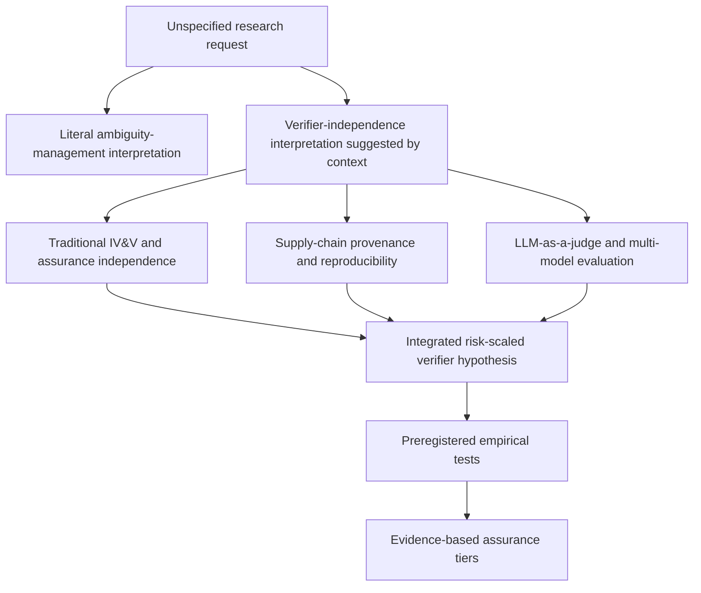
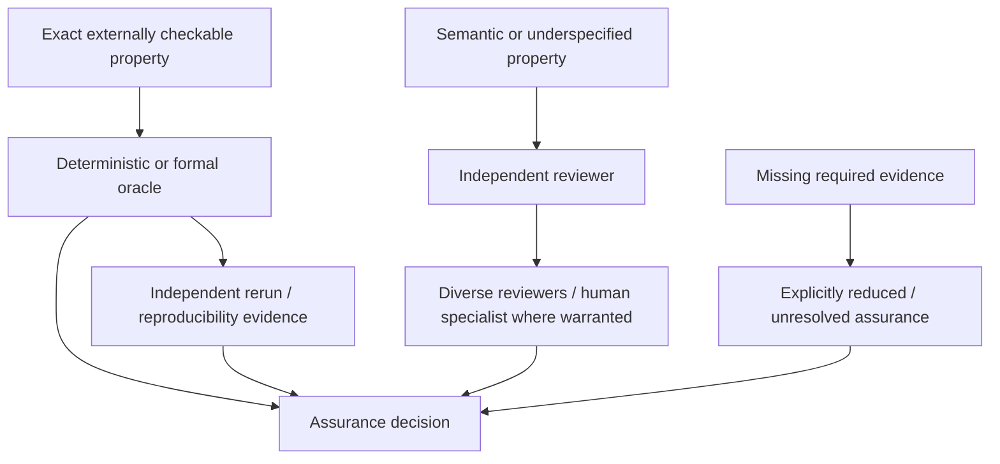
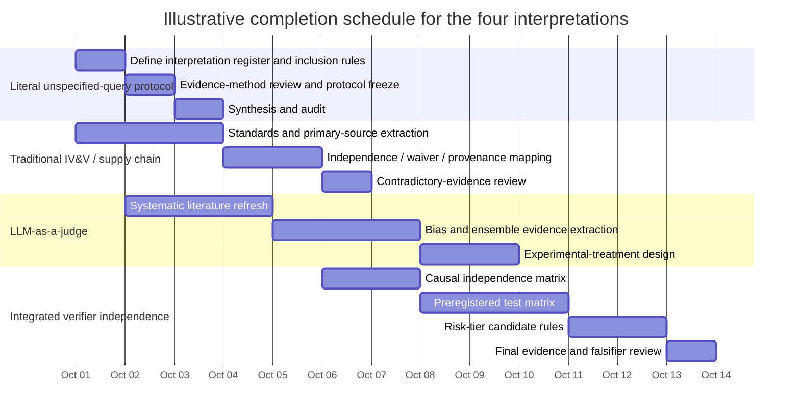

# Deep Research Report on an Unspecified Query: Prioritized Interpretations and Evidence Strategy

## Executive summary

Because no substantive research topic was stated, the defensible approach is **not to invent a random subject and present it as the user's intent**. Instead, this report treats ambiguity itself as part of the research problem, identifies the interpretations supported by the available context, ranks them, and examines each separately.

The strongest contextual clue is the attached **DS-03 — Risk-scaled verifier independence** brief. However, that document explicitly marks itself `proposed-inert` and states that it is not to be invoked merely by reading it; it requires explicit invocation in a new session. I therefore use it only to identify a plausible interpretation, not as authorization to execute its project-specific research lane, inspect private repository materials, change a verification contract, or produce the brief's canonical deliverables. fileciteturn0file0

Four interpretations are therefore worth preserving:

| Priority | Interpretation | Why it is plausible | Bottom-line finding |
|---|---|---|---|
| **P1** | **Literal unspecified-query research** | This is the only scope explicitly stated in the user request. | The correct product is an uncertainty-preserving research protocol, not a fabricated substantive conclusion. Evidence-strength reporting and explicit competing hypotheses are essential. |
| **P2** | **Risk-scaled verifier independence for AI-assisted software assurance** | The attached document makes this the strongest contextual substantive topic, while remaining non-invoked. fileciteturn0file0 | There is strong evidence for separating development from assurance and for protecting verification from shared failure domains; there is **not yet strong public evidence for a precise ordering such as session → model → family → provider → host or for exact risk-tier thresholds**. |
| **P3** | **Traditional software IV&V, reproducibility, and supply-chain independence** | This is the mature assurance literature underlying the P2 concept. | Technical/organizational independence, independently operated builders, provenance, and formal waiver mechanisms have strong standards support. But classic N-version evidence warns that nominally independent implementations can still fail together. citeturn0search0turn3search0turn4search6 |
| **P4** | **LLM-as-a-judge and multi-model evaluator independence** | This is the most direct modern empirical test of whether a model can reliably verify model-generated work. | Self-preference, inconsistency, prompt/artifact sensitivity, persuasion vulnerability, and provenance cues are experimentally documented. Diverse juries can help, but current evidence does **not** justify treating “cross-model,” “cross-family,” or “stronger model” as synonymous with independent or correct verification. citeturn1academia36turn2search0turn6search0turn8search0 |

The most important synthesis is that **independence is multidimensional, not binary**. NASA's mature IV&V framework separates technical, managerial, and financial independence; SLSA distinguishes builder identity, provenance, trust roots, and independently operated build platforms; contemporary LLM research separately exposes self-preference, instability, source/provenance bias, prompt sensitivity, and shared failure modes. These bodies of evidence point in the same direction: adding another verifier only improves assurance to the extent that it actually removes causes of correlated error or compromised evidence. citeturn0search0turn4search0turn4search5turn4search6turn3search0

The evidence is strongest for four practical principles. First, **objective executable checks should not be replaced by an evaluator's opinion when the property is directly testable**; provenance verification systems similarly require concrete policy checks rather than a generic confidence judgment. citeturn4search5 Second, higher-risk work warrants greater separation between implementer and verifier, consistent with NASA's risk-conditioned IV&V requirements. citeturn0search5turn0search7 Third, a reduced verification path should be labeled as reduced assurance rather than silently treated as equivalent; NASA uses formal waivers when required IV&V cannot be supplied, while SLSA communicates discrete verified properties and levels rather than collapsing them into an undifferentiated “secure” status. citeturn0search5turn4search4turn4search6 Fourth, the exact incremental benefit of model-family, provider, host, account, session, and oracle separation should be **measured experimentally rather than assumed**; the classic Knight–Leveson results show why nominally independent versions cannot be presumed statistically independent. citeturn3search0turn3search15

A rigorous decision rule therefore emerges:

> **Use standards to establish minimum separation and evidence-integrity requirements; use controlled experiments to determine which additional AI-verifier independence dimensions actually reduce false-green outcomes. Do not infer full independence from a different model name, provider, or larger parameter count.**

Confidence in that recommendation is **high**. Confidence in any precise universal ordering of individual AI-verifier independence dimensions is presently **low to moderate**, because the necessary factorial experiments are largely missing from the public literature.

## Assumptions and interpretation priority

The report makes six explicit assumptions.

**Assumption A — “Unspecified” is intentional.** The absence of a subject is treated as genuine uncertainty rather than permission to fabricate a domain. This follows good evidence-synthesis practice: PRISMA emphasizes transparent reporting of why a review was done, how evidence was identified and selected, and what was found, while evidence-certainty frameworks distinguish confidence in evidence from confidence in the resulting recommendation. citeturn7search0turn7search1

**Assumption B — Context can suggest interpretations without silently changing authority.** The uploaded DS-03 document is highly informative about a possible intended research subject, but its own invocation rule means it is treated as context rather than an activated project instruction. fileciteturn0file0

**Assumption C — Public evidence is sufficient for scoping but not for freezing project-specific assurance rules.** NASA, NIST, SLSA, IEEE literature, and peer-reviewed AI-evaluation research provide substantial evidence about assurance, independent assessment, correlated failures, provenance, and evaluator bias. None of those sources by itself establishes a universal project-specific mapping between every conceivable verifier-independence dimension and every risk tier. citeturn0search7turn4search4turn3search0turn6search0

**Assumption D — “Independence” means reduction in shared causal failure modes, not merely different labels.** NASA's formal IV&V conception already treats independence as multidimensional, while SLSA's treatment of independent builders focuses on independently operated platforms and their trust bases rather than cosmetic diversity. citeturn0search0turn4search6

**Assumption E — Evidence strength is claim-specific.** A mature NASA requirement can justify high confidence that organizational independence is an accepted high-assurance practice, but it cannot establish that two particular LLM providers have statistically independent reasoning failures. Conversely, LLM-judge experiments can demonstrate evaluator biases without establishing aerospace-grade assurance requirements. citeturn0search7turn1academia36turn6search0

**Assumption F — “Timeline” below is a research-project planning estimate, not a promise of asynchronous work.** The Gantt chart describes how a human or organizational research program could complete the remaining empirical work.

The interpretations relate as follows:

This structure is important because the mature and emerging evidence answer different questions. NASA and SLSA establish that independence, explicit trust boundaries, provenance, and risk-sensitive assurance are real engineering controls; AI-evaluator studies establish that modern model-based judgment contains systematic failure modes. The unresolved research task is the bridge between them: **which concrete forms of AI-verifier separation remove enough correlated error to justify stronger assurance claims?** citeturn0search0turn4search5turn6search0

## Evidence base and research methodology

The evidence search prioritized official standards and agency material, peer-reviewed conference/journal publications, and primary research available through September 30, 2026. The main evidence families were NASA IV&V and software-assurance requirements; NIST software, AI-testing, and conformance resources; SLSA/in-toto provenance and verification specifications; classic IEEE/NASA research on correlated software failures; and ACL/EMNLP/NeurIPS-era work on LLM evaluator bias and reliability. NIST's September 18, 2026 ARIA Evaluation Planning Manual is particularly current and advocates evaluation designs combining model testing, red teaming, and user testing rather than relying on a single measurement channel. citeturn5search2turn5search9

For evidence collection, a good production review would use a PRISMA-like audit trail for queries, screening, exclusions, and synthesis, while adapting—not mechanically importing—GRADE-style certainty language. PRISMA itself is a reporting guideline rather than a methodological-quality scoring instrument, and GRADE originated for evidence about health interventions; here, “High / Moderate / Low” therefore denotes an explicit analytical confidence judgment rather than a formal GRADE determination. citeturn7search0turn7search4turn7search1

For the verifier-independence interpretations, evidence should be evaluated against a causal model:

\[
\text{Value of added verifier separation}
\approx
\text{reduction in correlated false negatives}
-
\text{added cost/latency/error}
\]

The central dependent variable should consequently not be “judge agreement” alone. Two correlated evaluators can agree and still be wrong—the failure mode demonstrated in classical multi-version software work and implicitly echoed in modern LLM-judge research. Knight and Leveson's experiment involved 27 independently developed versions tested on one million cases and found substantially more coincident failures than statistical independence would predict; later fault analysis found equivalent logical mistakes and input regions difficult for multiple implementations. citeturn3search0turn3search15

The preferred modern outcome measures are therefore **false-green rate, escaped-defect rate, true-negative detection of defective artifacts, disagreement conditioned on ground truth, stability under irrelevant transformations, and incremental defects uniquely found by each verifier treatment**. This follows the evidence that raw evaluator scores or aggregate correlations can conceal important weaknesses: 2025 meta-evaluation research found that LLM evaluator correlation deteriorates when comparing systems of similar capability, while other studies show low intra-rater reliability and susceptibility to artifacts. citeturn2search3turn2search0turn6search0

For a future experiment, candidate identity and treatment information should be minimized or blinded wherever they are not logically necessary. NIST's AITE program explicitly uses blind data and a sequestered evaluation environment to reduce train/test contamination and support objective assessment; LLM studies additionally show that provenance cues, auxiliary information, and persuasive text can change evaluator verdicts independently of substantive correctness. citeturn5search14turn8academia25turn8search0turn8search1

A defensible experimental hierarchy would therefore be:

1. establish ground truth using executable or otherwise independently adjudicable cases where possible;
2. blind candidate identity;
3. preregister treatment assignments and primary metrics;
4. vary **one independence dimension at a time**, followed by selected interactions;
5. report disaggregated error rates rather than only a composite assurance score;
6. reproduce high-impact findings on a second task set and, where relevant, a second execution environment.

That design is consistent with NIST's current emphasis on multiple testing modes and sequestered evaluation, with reproducibility practice, and with the lesson from N-version research that nominal independence should not be assumed from process descriptions alone. citeturn5search2turn5search14turn4search12turn3search0

## Findings by interpretation

**Interpretation A — Literal unspecified-query research**

**1. Definition and scope.** This interpretation treats the missing topic itself as the problem: construct a research process that remains useful without pretending to know the subject. Its scope is methodological—problem decomposition, hypothesis preservation, source selection, evidence grading, and transition criteria for narrowing scope. PRISMA's emphasis on transparent objectives, identification, selection, appraisal, and synthesis provides a suitable reporting model, even outside health research, while its authors explicitly note applicability of many elements beyond medical interventions. citeturn7search0turn7search4

**2. Key questions and hypotheses.** The key questions are: What interpretations are actually supported by context? Which can be investigated without smuggling assumptions into conclusions? What evidence would discriminate among them? The working hypothesis is that **maintaining several explicit candidate interpretations produces a more reliable result than silently selecting one**, particularly when the cost of acting on a wrong interpretation is high. That is a methodological inference rather than a domain-specific experimental finding.

**3. Literature and primary sources to consult.** The core materials are PRISMA 2020 for transparent evidence-synthesis reporting, an appropriate certainty-of-evidence framework such as GRADE as inspiration for confidence labeling, and domain-specific methodological authorities after a substantive interpretation has been selected. PRISMA explicitly distinguishes reporting completeness from methodological-quality assessment, which is useful here because a beautifully documented review can still rest on an incorrectly assumed research question. citeturn7search0turn7search1

**4. Methodology.** Enumerate plausible interpretations; attach priors or qualitative priorities based only on available context; formulate falsifiable questions for each; search independently; then compare evidence yield and decision relevance. Do not merge findings across interpretations until compatibility is established. Record assumptions as first-class evidence metadata.

**5. Synthesized finding, confidence, and gap.** **High confidence:** under severe scope ambiguity, the defensible research output is an interpretation map plus conditional findings rather than a single supposedly definitive answer. **Gap:** because no external literature can reveal the user's unstated intent, methodological rigor cannot eliminate the core semantic uncertainty. The uncertainty can only be preserved, not “researched away.”

**6. Recommended action and practical implication.** Keep this interpretation as the control condition for all others. Any substantive conclusion below should be read as “if this is the intended topic.” The practical implication is important: uncertainty about scope should not be allowed to disappear merely because downstream evidence is strong.

**Interpretation B — Risk-scaled verifier independence for AI-assisted software assurance**

**1. Definition and scope.** Here, “verifier independence” means the degree to which the mechanism deciding whether an implementation is acceptable avoids sharing the implementer's causal sources of error, influence, compromised state, or evidence. Possible dimensions include task framing, context, conversational/session state, model instance, model family, provider, execution host, evidence channel, and oracle. The attached DS-03 brief identifies essentially this problem, but because it is explicitly inert, the discussion here remains a public, generic synthesis rather than execution of that project's lane. fileciteturn0file0

**2. Key questions and hypotheses.** The central hypothesis is **risk-scaled independence**: as consequences and irreversibility rise, verification should remove more shared failure modes. A second hypothesis is that these dimensions are not interchangeable: a different session may mitigate conversational anchoring but not model-family bias; a different provider may reduce some infrastructure correlation but not shared benchmark/specification ambiguity; a separate host may reduce execution-state correlation without improving semantic judgment. The evidence strongly supports the general concept of multiple distinct independence dimensions, but not this exact AI-specific causal decomposition. NASA, for example, formally separates technical, managerial, and financial independence rather than speaking of one scalar “independence” property. citeturn0search0turn0search7

**3. Literature and primary sources to consult.** Highest-value sources are NASA-STD-8739.8 and NASA's IV&V guidance for independence and risk scaling; SLSA v1.2 and in-toto for trust boundaries, independently operated builders, provenance and verification; Knight–Leveson for correlated failures; NIST ARIA/AITE for rigorous AI-evaluation designs; and peer-reviewed LLM-judge literature for modern evaluator failure modes. citeturn0search7turn4search4turn0search3turn3search0turn5search2turn5search14turn6search0

**4. Methodology.** A proper study should use a blinded factorial or fractional-factorial design. Seed artifacts with known defects across at least four consequence classes: routine/reversible, meaningful operational impact, security/release-critical, and control-plane/irreversible. Independently manipulate session separation, model separation, family/provider separation, execution-host separation, and oracle type. Candidate artifacts should be stripped of generator identity where identity is not itself under test. The primary endpoint should be defect-detection sensitivity and false-green rate, not judge eloquence or agreement. NIST's use of blind/sequestered evaluation and research showing cue-induced LLM-judge shifts make blinding a substantive control rather than a cosmetic one. citeturn5search14turn8academia25turn8search1

**5. Synthesized finding, confidence, and gap.** **High confidence** that some form of independence is appropriate for high-consequence assurance: mature NASA practice explicitly requires IV&V for selected higher-risk project classes and defines meaningful independence criteria. citeturn0search5turn0search7 **High confidence** that common-mode failure prevents “two checks” from automatically becoming “two independent checks,” based on classic multi-version results. citeturn3search0turn3search15 **Moderate confidence** that evaluator diversity improves AI-review robustness in some settings: jury-based LLM evaluation has improved robustness and alignment in experiments, but did not eliminate artifact sensitivity. citeturn6search0 **Low-to-moderate confidence** in any universal ranking of session, model, family, provider, and host separation, because the literature does not yet contain the needed controlled cross-dimensional evidence.

**6. Recommended action and practical implication.** Adopt a **provisional ordinal assurance model without pretending it is empirically calibrated**: deterministic tests and explicit evidence are baseline controls; independent human/model review adds semantic scrutiny; cross-family/provider/host separation is reserved for cases where shared failure domains materially matter. Before freezing exact thresholds, conduct the blinded matrix above. The competing option—“one universally strongest verifier”—should remain an explicit baseline rather than be dismissed a priori. It fails decisively if a preregistered diverse-verifier condition demonstrates materially lower false-green/escaped-defect rates at comparable or acceptable cost. Conversely, if diversity adds no statistically or practically meaningful detection benefit, the stronger-single-verifier option survives.

**Interpretation C — Traditional IV&V, reproducible builds, and software-supply-chain assurance**

**1. Definition and scope.** This interpretation focuses on established software assurance independent of LLMs. NASA describes IV&V as rigorous analysis and testing providing an independent assessment of critical software processes and products and defines technical, managerial, and financial independence. citeturn0search0turn0search7 Supply-chain assurance addresses a complementary concern: whether the artifact being accepted is actually the artifact produced by the intended source and process. SLSA uses provenance, explicit builder identities, trust roots, isolation, and artifact verification to make those claims inspectable. citeturn4search0turn4search5

**2. Key questions and hypotheses.** The major questions are whether stronger organizational separation improves error detection, whether reproducibility across independent platforms reduces supply-chain risk, and when formal waiver rather than normal acceptance is appropriate. The hypothesis supported most strongly by standards is that **high-assurance verification must separate both judgment and evidence production from the system being assessed where common compromise could defeat both**. NASA addresses independence of assessors; SLSA addresses trusted build platforms and evidence/provenance boundaries. citeturn0search7turn4search5

**3. Literature and primary sources to consult.** NASA-STD-8739.8B and SWE-141 are the main official IV&V sources. NIST SP 800-218 provides the broader secure-software-development framework, while SP 800-218A extends secure-development practices for generative AI and foundation models. SLSA v1.2 and in-toto supply provenance and verification mechanics. Reproducible-build guidance defines reproducibility as independent recreation of bit-for-bit identical artifacts given the specified source, environment, and instructions. citeturn0search8turn0search5turn0search16turn0search15turn4search4turn0search3turn4search12

**4. Methodology.** Treat independence as a threat-model property. Ask first what failure or adversary the assurance mechanism must survive, then ensure that verifier, evidence source, and trust root do not all lie inside that failure domain. Use provenance to bind artifact, inputs, builder, and execution metadata; reproduce selected high-risk artifacts on independently operated platforms; and maintain an explicit policy stating which evidence is mandatory. SLSA's verification guidance requires matching provenance and builder identities against expectations and recommends rejecting unrecognized external parameters; its verified-properties specification requires independently operated platforms before asserting reproduced-build status. citeturn4search5turn4search6

**5. Synthesized finding, confidence, and gap.** **High confidence:** independently operated verification and provenance infrastructures are well-grounded engineering controls. SLSA explicitly reserves its “build reproduced” property for artifacts backed by provenance from at least two independently operated trusted build platforms. citeturn4search6 **High confidence:** “independent implementations” still cannot be assumed to fail independently; the Knight–Leveson experiment directly contradicts that simplistic assumption. citeturn3search0 **High confidence:** unavailable required assurance should be dealt with explicitly rather than silently converted into success; NASA's IV&V guidance says qualifying projects not receiving centrally funded IV&V must independently fund it or obtain a formal waiver through tailoring. citeturn0search5 **Gap:** these standards say little about the incremental value of contemporary AI-model/provider separation.

**6. Recommended action and practical implication.** Carry three mature patterns into AI-assisted verification: **separate assessor authority, explicit trust boundaries, and verifiable evidence provenance**. Do not carry over the erroneous assumption that diversity automatically produces statistically independent failure. For deterministic build/test properties, independently reproduced or independently executed evidence can often provide more meaningful assurance than another free-form reviewer's opinion. Reproducible-build practice uses bitwise artifact comparison for precisely such objective properties. citeturn4search12turn3search0

**Interpretation D — LLM-as-a-judge and multi-model evaluator independence**

**1. Definition and scope.** This interpretation asks when one or more LLMs can credibly evaluate outputs generated by LLMs, including software artifacts, reasoning, safety decisions, or free-form responses. The key independence question is whether separation of generator and judge—especially across models or families—improves reliability enough to count as materially stronger evidence.

**2. Key questions and hypotheses.** Relevant hypotheses are that self-evaluation introduces self-preference; model diversity reduces correlated judge error; stronger judges are necessarily safer judges; hidden candidate identity reduces evaluator bias; and ensembles outperform a single strong evaluator. These hypotheses are empirically distinguishable, and the existing literature already rejects the strongest forms of several of them. citeturn1academia36turn6search0

**3. Literature and primary sources to consult.** Panickssery, Bowman, and Feng found that tested LLM evaluators could recognize and favor their own generations, linking self-recognition with self-preference. citeturn1academia36 Chen and Goldfarb-Tarrant evaluated 11 safety judges, found substantial sensitivity to superficial artifacts, and found model juries improved robustness but did not eliminate the problem. citeturn6search0 Haldar and Hockenmaier documented low intra-rater reliability across repeated judging runs. citeturn2search0 Xu et al. found that standard meta-evaluation can overstate evaluator quality when the candidate systems being compared are close in capability. citeturn2search3 Hwang et al. showed that persuasive wording can inflate judgments of incorrect mathematical solutions and that increasing model size did not substantially eliminate the vulnerability. citeturn8search0

**4. Methodology.** Evaluation should include repeated runs, order swaps, irrelevant-style perturbations, candidate-identity masking, intentionally persuasive or adversarial text, and objective gold-label cases. It should compare same-model, different-instance; same-family, different-model; cross-family; and cross-provider conditions. It should also include a deterministic oracle wherever objective correctness can be computed, because otherwise evaluator disagreement cannot be separated cleanly from underlying ambiguity. Recent work specifically demonstrates position/selection effects, auxiliary-information bias, provenance-cue bias, and persuasion effects, making those perturbations necessary controls. citeturn8search0turn8search1turn8academia25turn8search9

**5. Synthesized finding, confidence, and gap.** **High confidence** that LLM judging contains systematic non-semantic failure modes; this result recurs across peer-reviewed studies covering self-preference, repetition instability, prompt artifacts, persuasion, and multilingual inconsistency. citeturn1academia36turn2search0turn2search2turn8search0 **Moderate confidence** that ensembles or multiple judges can improve some aggregate outcomes, because jury and ensemble approaches have shown benefits, but those benefits are task- and configuration-dependent and do not eliminate shared vulnerabilities. citeturn6search0turn6academia35 **Low confidence** in the claim that “cross-provider” alone is a sufficient proxy for independent cognition: public studies generally vary model families and providers together with many other factors, preventing clean causal attribution. **High confidence** that model size alone is an inadequate independence or reliability metric; multiple studies find biases that larger models do not consistently remove. citeturn6search0turn8search0

A particularly important counterweight comes from fact-centric work: not every task displays the same self-preference effect. A 2025 ACL Findings study across several QA/RAG settings and five model families found factual accuracy could dominate the self-preference effects seen in more subjective evaluation settings. This means verifier-independence policy should be **task-conditioned rather than based on a universal claim that LLM judges are biased in exactly the same way everywhere**. citeturn8search2

**6. Recommended action and practical implication.** Use LLM reviewers as **fallible sensors, not self-authenticating oracles**. For subjective properties, diverse evaluators and calibrated human review may be valuable. For properties with exact executable oracles—tests, type checking, proof checking, signature/provenance validation, reproducible artifact hashes—the objective oracle should retain precedence for the property it actually tests. SLSA's verifier model is illustrative: it specifies concrete signature, builder, and parameter checks rather than substituting a generic intelligence judgment for those checks. citeturn4search5 The practical policy implication is that “a stronger LLM says it is correct” should never by itself upgrade missing deterministic evidence into deterministic verification.

## Comparison, evidence strength, and research timeline

The interpretations differ substantially in maturity and in what can safely be concluded today.

| Interpretation | Best primary / authoritative evidence | Evidence strength | What is established | Critical unresolved gap | Recommended action |
|---|---|---|---|---|---|
| **Literal unspecified-query protocol** | PRISMA 2020; evidence-certainty methodology citeturn7search0turn7search1 | **High** for transparent research process; **none** for unstated intent | Preserve assumptions, search methods, competing interpretations, and uncertainty | No methodological process can recover an unstated subject with certainty | Keep multiple interpretations alive until evidence or explicit scope selects one |
| **Risk-scaled AI verifier independence** | NASA IV&V; SLSA; NIST AI evaluation; LLM-judge experiments citeturn0search7turn4search4turn5search2turn6search0 | **Moderate overall** | Independence and failure-domain separation matter; higher risk justifies stronger assurance | Exact marginal value of session/model/family/provider/host/oracle dimensions | Run a preregistered blinded factorial experiment before setting exact thresholds |
| **Traditional IV&V / supply-chain assurance** | NASA-STD-8739.8B; SWE-141; SLSA 1.2; in-toto; Knight–Leveson citeturn0search7turn0search5turn4search6turn0search3turn3search0 | **High** | Independent assessment, provenance, reproducibility, trust-boundary and formal-waiver patterns are mature | Translation from organizational/software diversity into AI-model diversity | Reuse mature assurance structure but validate AI-specific separation empirically |
| **LLM-as-a-judge independence** | NeurIPS/arXiv self-preference work; ACL/EMNLP judge studies citeturn1academia36turn6search0turn2search0turn8search0 | **High** that biases exist; **moderate** for ensemble benefits; **low** for precise provider/family hierarchy | Judges can be self-preferring, inconsistent, persuadable, artifact-sensitive; ensembles sometimes improve outcomes | Causal decomposition of model, family, provider, session, context and host effects | Benchmark independence dimensions separately against known ground truth |

The current evidence hierarchy can be visualized this way:

The distinction between objective and semantic verification is crucial. A deterministic oracle can be wrong because its specification, test set, implementation, or environment is wrong, so it is not omniscient; nevertheless, an LLM's contrary judgment is not equivalent evidence for a property that the deterministic mechanism directly and validly measures. Conversely, deterministic tests cannot prove semantic requirements they do not encode. This is why heterogeneous evidence channels are preferable to a single hidden scalar “confidence” score.

### Research timeline

The following is an **illustrative twelve-working-day program** for a research team beginning October 1, 2026. It is a planning estimate for completing the remaining investigations, not a statement that work will continue asynchronously from this response.

In effort terms, the literal ambiguity-management interpretation can be completed in roughly **two to three researcher-days** because its deliverable is primarily methodological. A serious traditional IV&V/supply-chain synthesis requires approximately **five to six researcher-days**, largely because definitions and control semantics must be extracted carefully across NASA, NIST, SLSA, and related sources. The LLM-evaluator review merits approximately **seven to eight researcher-days** because the literature is recent, rapidly changing, and often varies several factors simultaneously. The integrated risk-scaled verifier-independence study requires approximately **seven working days after the foundational extraction**, excluding the runtime required for any actual model experiment.

An empirical experiment would require a separate schedule because sample-size determination depends on baseline defect rates and the minimum practically relevant reduction in false-green probability. It would be methodologically unsound to invent an exact sample size before those parameters are specified. The experiment should nevertheless be preregistered before outcomes are inspected, with the treatment matrix, exclusion rules, metrics, and decisive falsifier fixed in advance.

## Recommended next steps and practical implications

The highest-value next step is **not to choose a universal verifier architecture from the literature**. The literature is strong enough to reject several unsafe simplifications, but not strong enough to determine a unique optimum.

First, preserve a **non-substitution rule for evidence**: objective deterministic evidence and semantic review answer different questions. A passing model review cannot manufacture missing provenance, a successful build reproduction, a required test execution, or a cryptographic verification; similarly, a unit-test suite should not be presented as proving requirements it never encoded. SLSA's explicit verification of artifact, signature, builder identity, and external parameters exemplifies this property-specific approach. citeturn4search5

Second, model verifier independence as a **vector of failure-domain separations**, not a binary label or hidden scalar. The evidence supports distinguishing assessor separation, execution-environment separation, evidence provenance, and cognitive/evaluator diversity. NASA's multi-parameter definition of IV&V independence and SLSA's explicit builder/trust-base model both support decomposed rather than purely nominal independence. citeturn0search0turn4search0

Third, use **risk scaling**, but distinguish normative policy from empirical fact. NASA already conditions IV&V requirements on project/risk categories, so there is strong precedent for increased independent assurance at higher stakes. citeturn0search5turn0search7 The empirical question still open for AI-assisted engineering is exactly which additional dimensions—new session, different model, different family, different provider, separate execution host, specialist human, deterministic oracle—buy enough additional defect detection to justify their cost.

Fourth, never infer that nominal diversity guarantees independent failure. The Knight–Leveson result is directly relevant: separately produced implementations failed together more often than expected under statistical independence, and later analysis traced some correlation to shared logical difficulty and hard regions of the input space. citeturn3search0turn3search15 For AI systems, shared training corpora, benchmarks, specifications, prompting conventions, architectures, or task misconceptions could analogously produce common-mode errors; that analogy is plausible but should be tested rather than asserted as equivalence.

Fifth, for AI judges, **blind identity and isolate irrelevant context whenever feasible**. Candidate-source cues, auxiliary information, rhetorical persuasion, and repeated-run instability have all been shown to affect judgments. citeturn8academia25turn8search1turn8search0turn2search0 A verifier that knows which candidate came from itself, which provider produced it, what the implementer argued about it, or which answer is “supposed” to win may therefore not constitute the same evidence as a blind verifier receiving only the requirements, artifact, and admissible evidence.

Sixth, treat evaluator ensembles as **promising but non-magical**. ACL 2025 evidence indicates model juries can improve robustness and human alignment, yet shared artifact sensitivity remains. citeturn6search0 The decisive comparison should therefore be against the best single-verifier baseline on **false-green rate and escaped defects**, not simply majority agreement. A unanimous jury is weak evidence if all jurors respond to the same irrelevant cue.

Seventh, use explicit degraded-assurance states rather than converting unavailable controls into success. NASA's requirement for formal waiver/tailoring where required IV&V cannot otherwise be provided is a useful governance analogue, and SLSA's discrete levels and verified properties similarly preserve which guarantees were actually established. citeturn0search5turn4search4turn4search6 The general engineering implication is that “verification unavailable,” “reduced verification completed,” and “required independent verification completed” should remain semantically distinct states.

Finally, the most informative empirical program is a **blinded independence-ablation matrix**. Hold task and defect set constant; vary verifier context, session, model, family/provider, host, and oracle systematically; measure unique defect discovery, false-green rate, disagreement against ground truth, rerun stability, and cost; then repeat on at least one substantially different task class. NIST's current use of blind/sequestered testing and multi-mode evaluation provides a strong methodological precedent, while contemporary LLM evidence makes clear why contamination, persuasion, provenance cues, and evaluator instability belong in the test design. citeturn5search14turn5search2turn8search0

The **competing option** should remain a single universally strong verifier. The **decisive falsifier** should be preregistered: if, across an adequately powered sample, the strongest single verifier matches the diversified condition on false-green rate, escaped-defect rate, and high-severity detection within a predefined non-inferiority margin, while materially reducing cost or latency, then mandatory additional model/provider separation is not supported for that tested risk class. Conversely, if controlled separation produces a reproducible and practically meaningful reduction in false greens—especially for high-severity defects—then the universal-single-verifier hypothesis is falsified for that scope.

As of September 30, 2026, the most defensible overall conclusion is therefore **not** that “more independent verifiers are always better.” It is that **verification strength should track risk; claims of independence must correspond to real separation of relevant failure domains; objective evidence must not be replaced by subjective model judgment; and the incremental value of AI-specific independence dimensions must be established with blinded, ground-truthed experiments rather than inferred from model/provider labels**. NASA IV&V, SLSA provenance, classic software-diversity research, current NIST evaluation practice, and recent LLM-judge studies jointly support that position, while leaving the exact AI-specific tier boundaries as an empirical gap. citeturn0search7turn4search5turn3search0turn5search14turn6search0