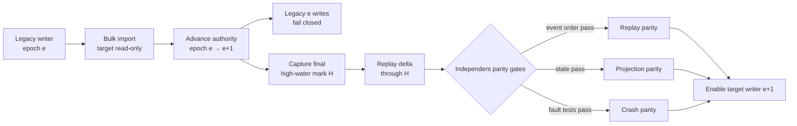
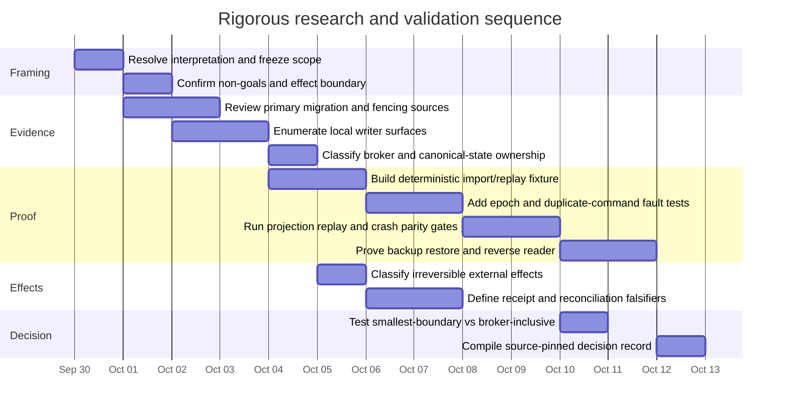

# Research Framing for an Unspecified Query

## Executive summary

**Topic supplied by the user:** unspecified.

There are three plausible interpretations. The strongest is that the research concerns **single-writer migration, replay-safe cutover, and rollback/reconciliation of external effects**, because an attached design brief is devoted to that subject. However, the brief also states that it is inert until explicitly invoked; the present request deliberately calls the topic “unspecified.” I therefore treat the attachment as a **context clue, not operational authorization**: no cutover, repository write, provider call, deployment, configuration change, or other effect is implied by this report. fileciteturn0file0

My prioritization is:

| Priority | Interpretation | Analyst probability | Treatment |
|---|---|---:|---|
| High | Single-writer migration and effect rollback/reconciliation | 0.78 | Deepest evidence review; concrete proof structure and crash matrix |
| Medium | Generic zero-/low-downtime migration architecture | 0.17 | Pattern comparison independent of any private implementation |
| Low | Literal “unspecified topic”: a domain-neutral research protocol | 0.05 | Methodological framework only; no domain findings can honestly be asserted |

For the highest-priority interpretation, the evidence supports a strong architectural conclusion: **a safe cutover is not “copy state, compare outputs, switch traffic.” It requires a single linearized authority transition.** A monotonically advancing writer epoch or equivalent fencing token must be checked by the resource that actually accepts the mutation; leases or routing alone are insufficient because a stale process can outlive its lease or routing assignment. etcd's documentation explicitly warns that lease-based locks by themselves cannot safely protect an external resource unless that resource validates a version/fencing value, while Hazelcast describes the same solution as monotonically ordered fencing tokens that let the resource reject an old holder. citeturn4search0turn4search12

The proposed cutover checkpoint is therefore: **bulk-copy while the legacy writer remains authoritative → atomically advance the writer epoch to fence all old writers → establish the final legacy high-water mark → import/replay the final delta → independently prove event-order, projection, and crash/retry parity → only then enable the new writer under the new epoch.** This is an analytical recommendation, not a claim about the unavailable local implementation. Event Sourcing supports rebuilding state from the ordered event history, but its own literature warns that replay becomes materially harder when events invoke external systems; such gateways must be suppressed or otherwise made replay-aware. citeturn11view0

Three parity notions should **not** be collapsed:

**Projection parity** asks whether both systems render the same current state. **Replay parity** asks whether the same ordered causal history, deduplication decisions, and deterministic reconstruction are preserved. **Crash parity** asks whether failures at each transition produce the same admitted/rejected/committed/ambiguous outcome. Event sourcing makes current state derivable from an event sequence, so two different histories can in principle converge to the same rendered state; consequently, projection equality alone is not evidence of replay equality. This is an inference from the event-sourcing model. citeturn11view0

For irreversible external effects, **rollback is the wrong abstraction after acceptance may have occurred**. The state should instead move forward through reconciliation: identify the provider's authoritative reality, attach the result to the canonical command/effect record, and compensate only when the external system defines a legitimate compensating operation. Microsoft’s Saga guidance explicitly models a pivot or point of no return, after which later operations must drive the workflow to a consistent final state; Stripe’s API illustrates how provider-supported idempotency keys can make a retry safe, but that guarantee is provider- and retention-bound rather than a universal exactly-once primitive. citeturn1search0turn6search0

The main missing information is **repository-local evidence**: actual writer call sites, mutation interfaces, aggregate boundaries, event schemas, command identifiers, broker semantics, snapshot format, current rollback path, effect-provider APIs, and the exact storage/runtime topology are unspecified. No primary-source web research can prove those local properties.

## Interpretation priority

The attachment makes the first interpretation substantially more likely, but its boundaries matter. It calls for design analysis around a synthetic rehearsal aggregate, fencing, replay, crash behavior, reverse migration, and forward-only reconciliation while explicitly excluding a separate numeric reservation-ledger problem and disallowing operational cutover or external effects. Because the file requires explicit invocation, this report keeps those distinctions informational rather than treating them as commands. fileciteturn0file0

The three interpretations can be distinguished by one decisive question:

| Interpretation | Decisive discriminator | What is currently known |
|---|---|---|
| Single-writer migration/effect reconciliation | Was the uploaded design brief intended to supply the otherwise unspecified topic? | Plausible, but not explicitly stated |
| Generic migration architecture | Is the attachment merely an example/context artifact, while the desired topic is migration patterns generally? | Plausible |
| Literal unspecified-topic research | Was “unspecified” intentional, requiring only an ambiguity analysis and research design? | Textually valid |

The research below intentionally used **only generic public search terms** rather than private project identifiers. Primary or first-party sources were favored: official etcd, Apache Kafka, Debezium, Git, GitLab, Kubernetes, AWS, Stripe and Microsoft documentation, plus Martin Fowler's original pattern descriptions. This follows the technical-research requirement to privilege original or official technical sources.

## Single-writer migration and effect reconciliation

**Scope and key questions.** Under this interpretation, the object of research is one bounded aggregate migrating from a legacy writer to a replacement while maintaining exactly one writable authority at any instant. The important questions are: where the authority transition linearizes; how a stale writer is rejected rather than merely discouraged; what historical and rendered-state parity must pass; how duplicate commands behave; what crashes at each transition imply; when reverse migration remains legitimate; and how externally accepted effects are reconciled when literal rollback is impossible.

**Primary sources to search.** The highest-value corpus is: original Event Sourcing and legacy-displacement patterns from Martin Fowler; official etcd and fencing/coordination documentation; Apache Kafka transactional/idempotence documentation as a boundary example for “exactly once”; Debezium’s transactional-outbox documentation; Microsoft’s Saga guidance; official Git and GitLab migration documentation; provider documentation for effect idempotency and externally visible state; and official backup/restore documentation. Fowler’s Asset Capture pattern is particularly relevant because it explicitly proposes migrating subsets of assets and notes that reverse migration can lower risk, while Event Sourcing establishes replay from an ordered history. citeturn2search4turn11view0

**Research method and search terms.** The source review should be paired with local static and dynamic evidence. Public searches include `event sourcing cutover replay`, `monotonic fencing token stale writer`, `transactional outbox`, `saga pivot irreversible transaction`, `expand contract migration`, `shadow traffic comparison`, `idempotency key ambiguous request`, `backup test restore`, and `compare-and-swap ref update`. Locally, the stronger method would be an AST/call-graph inventory of every canonical mutation API, code-generated writer manifest, test-time denial of undeclared mutators, deterministic event-stream hashing, command-deduplication fixtures, and fault injection at every durability boundary. Those local checks remain **unperformed and unverified** because the relevant repository evidence is not available here.

**Concise evidence table**

| Finding | Date / primary source | Confidence |
|---|---|---|
| Event Sourcing stores state changes as an ordered event sequence and permits complete rebuild by replay; it therefore supplies a natural basis for migration parity tests. | Dec. 12, 2005, Fowler Event Sourcing. citeturn11view0 | High |
| Replaying events that issue external updates can duplicate effects unless the external gateway knows replay is occurring; internal replay and external reality therefore need separate treatment. | Dec. 12, 2005, Fowler Event Sourcing. citeturn11view0 | High |
| Migrating a bounded subset of assets rather than rewriting everything at once is a recognized strangler strategy; Fowler also describes reverse migration as a way to reduce risk. | June 29, 2004, Fowler Asset Capture. citeturn2search4 | High |
| A lease alone does not safely fence a stale client from an external resource; the resource needs version/fencing validation. etcd maps its monotonically increasing revision concept to this requirement. | Current etcd documentation, accessed Sept. 30, 2026. citeturn4search0turn4search2 | High |
| A monotonically increasing fencing token allows an external resource to reject an obsolete holder even if that holder resumes after a long pause. | Current Hazelcast FencedLock documentation, accessed Sept. 30, 2026. citeturn4search12 | High |
| The transactional outbox pattern couples business-state persistence to an outbox record so downstream publication does not require an unsafe application-level dual write. | Current Debezium documentation, accessed Sept. 30, 2026. citeturn1search5 | High |
| Saga compensation has a “pivot” or point of no return; after that point, the objective is to reach a consistent final state rather than pretend the committed operation never occurred. | Microsoft Azure Architecture Center, current docs. citeturn1search0 | High |
| Expand/contract deliberately keeps old and new representations compatible during staged migration. That is useful for schemas/readers, but it does **not by itself** establish a single-writer authority boundary. | GitLab current docs; Fowler CI article. citeturn8search0turn8search1 | High for pattern; medium for single-writer implication |
| Shadow testing can duplicate requests to a non-serving implementation while production remains authoritative, making it useful for read/result comparison without creating a second writer. | AWS SageMaker shadow-test documentation. citeturn9search2 | High as pattern analogy |
| Kafka’s exactly-once guarantees depend on transactions/idempotence within its defined processing boundary; its own design documentation cautions that broader “exactly once” claims require careful scope. | Apache Kafka design documentation. citeturn0search0 | High |
| Backup integrity checking is not sufficient proof of recoverability; PostgreSQL explicitly recommends performing test restores even after verification. | PostgreSQL 18 `pg_verifybackup`, Sept. 2026 docs. citeturn10search0 | High |

### Proposed cutover proof

The following is the strongest implementation-independent checkpoint I can derive from those sources. It is a **design inference**, not a verified description of any local system.

| Phase | Required invariant | Machine-checkable gate |
|---|---|---|
| Discover | Every path able to mutate the aggregate is classified. | Generated writer manifest equals all references to privileged mutation interfaces; an undeclared call site fails CI. |
| Bulk import | Legacy remains the only writer; target is read-only. | Target rejects writer capability entirely; imported event prefix has stable count/order/content hashes. |
| Prepare | New code can replay and read but cannot commit canonical mutations or external effects. | Effect gateways disabled; target mutation capability absent. |
| Fence | Authority advances monotonically from epoch `e` to `e+1`; no future `e` write can commit. | Mutation sink atomically checks the supplied epoch against current epoch. |
| Establish high-water mark | Every legacy commit either linearized before the fence and belongs at or below `H`, or is rejected after the fence. | Final canonical sequence/revision `H` captured after fencing. |
| Delta replay | Target imports exactly the legacy tail through `H`, without external side effects. | Event count, identifiers/order and payload hashes equal through `H`. |
| Prove parity | History, rendered state and failure semantics all pass independently. | Three separate gates: replay parity, projection parity, crash/retry parity. |
| Enable | Only the `e+1` target writer may append new canonical state. | Sink rejects epochs `< e+1`, unknown writer IDs, and invalid duplicate commands. |
| Reverse authority | A rollback is another **forward epoch transition**, never a return to epoch `e`. | Increment epoch again; stale target and stale legacy instances both fail closed. |

The critical point is that **the fence must be checked where mutation becomes durable**, not only by a router, scheduler or lease manager. etcd's coordination guidance is unusually direct on this point: a process can continue to believe that a lease is valid after the server has revoked it, so an unrelated external resource must itself participate in version validation. citeturn4search0

A robust duplicate-command rule should be similarly strict: `(aggregate_id, command_id)` is unique; retrying the same identifier with the same canonical payload returns or reconstructs the original result; using the identifier with a different payload is rejected; and no retry can bypass epoch validation. This rule is an architectural proposal. Stripe’s idempotency contract provides a useful first-party analogue: a repeated idempotency key returns the stored result while mismatched parameters are rejected, although Stripe can prune old keys, demonstrating why a migration system cannot blindly assume provider idempotency records are permanent. citeturn6search0

### Writer enumeration and rename resistance

A prose list of writers is insufficient because it silently becomes stale. The stronger design is a **capability-based writer manifest**:

1. Canonical mutation APIs require an explicit writer capability containing a stable `writer_class`, current epoch and command identity.
2. All constructors/factories capable of obtaining that capability are statically enumerable.
3. CI generates the call-site inventory and compares it with an allowlist; a new mutator fails until classified.
4. Runtime admission rejects unregistered writer classes even when they somehow evade static discovery.
5. The durable mutation operation rechecks the epoch, so having once acquired a capability does not let a stale process write later.

The important property is that changing a class or executable name cannot turn an unclassified writer into an authorized one; authorization derives from acquiring the mutation capability, not matching a prose name. This is a recommended verification mechanism, not an externally sourced implementation requirement.

### Parity proof

The three gates should be separately recorded:

| Gate | What equality means | What it does **not** prove |
|---|---|---|
| Projection parity | Canonically normalized rendered state at selected checkpoints is equal. | Same causal history, ordering, dedupe behavior or crash outcomes. |
| Replay parity | Ordered canonical events/commands through `H` and the deterministic rebuilt state agree. | Correct behavior when crashing between durable boundaries. |
| Crash parity | Each injected crash converges to a defined committed, rejected or explicitly ambiguous state without duplicate canonical work. | That two projections necessarily use identical histories unless replay gate also passes. |

This separation follows from the defining event-sourcing property that current application state can be rebuilt from history; it therefore does not follow that equal current states imply equal histories. citeturn11view0

### Crash matrix

| Crash point | Required recovery result | Falsifier |
|---|---|---|
| Before prepare | Legacy remains authoritative under old epoch; target has no write/effect capability. | Target mutation or effect exists. |
| After bulk prepare, before fence | Same as above; partial imports may be discarded/rebuilt. | Imported copy is treated as independent writable truth. |
| Immediately after epoch fence | Legacy writes fail; target is still disabled until final delta/parity passes. Service may pause rather than permit two writers. | Either writer can commit without the current epoch. |
| During canonical target commit | Atomic commit either exists once or does not; retry uses the same command ID. | Duplicate semantic event or conflicting reuse of command ID. |
| During external effect | Result is `known-not-issued`, `known-accepted`, or `unknown`; an unknown is **not** automatically retried unless the effect API makes that retry safe. | Blind retry can duplicate a real-world effect. |
| Effect accepted, receipt not yet persisted | Recovery queries provider reality or reuses a provider idempotency token; it records discovered truth forward. | System labels the effect “rolled back” solely because local receipt is absent. |
| Receipt persisted, projection not updated | Projection is rebuilt from durable canonical event/receipt records; effect is not resubmitted. | Projection repair causes a second external operation. |

The distinction around unknown external outcomes is supported by provider idempotency designs: Stripe expressly recommends reusing an idempotency key after connection failure so a retry does not create a second operation. Without an equivalent provider primitive or authoritative query, that safety cannot be assumed. citeturn6search0

### Rollback proof

There are materially different rollback regimes.

**Before the replacement accepts any new canonical write**, rollback is straightforward: advance to another epoch that reauthorizes the legacy implementation, restore routing, and prove its state still matches `H`. The old epoch must not be resurrected.

**After replacement-only writes exist but before irreversible external effects**, rollback is safe only if a tested reverse reader/export can transfer the entire post-`H` canonical tail—including dedupe state and ordering semantics—into a legacy representation without branching history. Fowler’s Asset Capture explicitly recognizes reverse migration as useful, but that general pattern does not prove a specific reverse reader correct. citeturn2search4

**After an irreversible effect may have been externally accepted**, returning software authority does not undo the world. Any software rollback must carry the effect receipt/reconciliation state forward. Saga guidance's pivot concept is the appropriate model. citeturn1search0

A backup is also not a rollback proof merely because its bytes verify. PostgreSQL’s current backup documentation explicitly distinguishes integrity verification from actually restoring and validating a working database, and etcd's recovery guide similarly describes snapshot integrity and restoration as separate concerns. citeturn10search0turn10search1

### Forward-only effect reconciliation

| Effect class | Forward reconciliation rule | Decisive falsifier |
|---|---|---|
| Provider submission/API mutation | Persist stable operation/idempotency identity before or atomically with the intent where possible; on ambiguity query provider state or retry with the same supported key. | Provider shows two accepted effects for one canonical command. Stripe illustrates safe key-based retry when supported. citeturn6search0 |
| Pushed repository ref | Observe remote ref/object identity; corrective action is a new conditional ref update, not erasure of the fact that the first update occurred. | Remote ref differs from both expected pre-state and recorded accepted result without an explained intervening writer. Git's explicit expected-value `--force-with-lease` is a compare-and-swap analogue. citeturn5search0 |
| Sent message | Treat successful provider send plus returned provider identity as an external fact; any correction is a subsequent message or provider-specific operation, not local rollback. | Provider's authoritative mailbox/delivery state contradicts the recorded receipt. Gmail's send API returns a `Message` on success and supports retrieval by message ID. citeturn7search6turn7search3 |
| Credential/security change | Re-read authoritative identity state and wait for documented propagation when necessary; replacement credentials may be required rather than “restoring” a deleted secret. | Provider still authorizes an allegedly removed credential after the allowed reconciliation period, or a supposedly recoverable deleted secret cannot be recovered. AWS documents eventual propagation and states deleted access keys cannot be recovered. citeturn7search1turn7search2 |
| Deployment | Establish current desired/running revision from the orchestrator and issue a new rollout/rollback operation if needed; separately reconcile anything the deployed application did externally. | Workload template was reverted but downstream external effects are claimed to have thereby disappeared. Kubernetes rollback changes workload revision/template; that does not logically reverse arbitrary actions previously emitted by the workload. citeturn6search2turn6search3 |

**Implication and recommendation.** The preferred boundary is the **smallest aggregate plus a bounded broker refinement**, not an automatically broker-inclusive migration. The decisive test is whether broker state affecting correctness is fully derivable from the aggregate's canonical command/event/receipt history. If the broker merely transports/retries commands and can be stateless or reconstructible, keeping it outside the canonical cutover boundary reduces scope. If it owns non-derivable acceptance ordering, deduplication state, authoritative lease ownership, or effect receipts, it is already part of the state machine and must enter the boundary. This is a design inference requiring local falsification.

The separate numeric recovery/reservation-ledger arithmetic described in the attached brief remains explicitly **out of scope**; nothing above specifies that arithmetic. fileciteturn0file0

## General migration architecture

Under the second interpretation, the question is not project-specific at all: **which established migration patterns combine well when replacing a stateful system without unsafe dual ownership?**

**Scope and questions.** The scope covers strangler migration, expand/contract compatibility, event replay/CDC, outbox, fencing, sagas and shadow comparison. The key question is not “which single pattern wins?” but which concern each pattern solves.

**Sources and methods.** The most useful searches are `strangler asset migration reverse`, `expand contract zero downtime`, `event sourcing replay migration`, `transactional outbox`, `fencing tokens`, `shadow traffic`, and `saga compensation`. The method is a concern-pattern matrix followed by failure-mode analysis; no implementation-specific conclusion should be made without knowing where canonical mutation actually linearizes.

**Evidence table**

| Pattern | Evidence-backed strength | Key limitation | Source / date | Confidence |
|---|---|---|---|---|
| Strangler / asset capture | Incremental displacement at bounded asset/aggregate granularity; can support reverse migration. | Does not itself prevent concurrent old/new writers. | Fowler, June 29, 2004. citeturn2search3turn2search4 | High |
| Expand/contract | Preserves compatibility while old and new software coexist; GitLab formalizes expand → migrate → contract. | A dual-write implementation can create two truths unless authority is separately controlled. | GitLab current docs; Fowler 2024 CI article. citeturn8search0turn8search1 | High |
| Event sourcing/replay | Gives an ordered source from which state can be reconstructed and independently replayed. | External calls and time-dependent inputs complicate deterministic replay. | Fowler, Dec. 12, 2005. citeturn11view0 | High |
| Transactional outbox | Avoids a DB-state/message-publication dual-write gap by representing outbound publication in stored state. | Consumer/effect idempotency still matters. | Debezium current docs. citeturn1search5 | High |
| Fencing token/epoch | Rejects stale holders after authority has moved. | Token only helps if the mutation target validates it. | etcd and Hazelcast current docs. citeturn4search0turn4search12 | High |
| Shadow execution/read comparison | Exercises a replacement on copied requests without letting its answer serve production. | Cannot validate real write/effect behavior safely unless effects are disabled/simulated. | AWS shadow testing docs. citeturn9search2 | High |
| Saga/compensation | Models multi-step failure recovery and explicit points of no return. | Compensation is business logic, not transactional time reversal. | Microsoft current docs. citeturn1search0 | High |

The synthesis is that these patterns are **complementary rather than substitutes**. A strong generic design uses strangler-style bounded migration to reduce blast radius, expand/contract to maintain compatibility, shadow/read replay to build evidence, an outbox when publication must follow durable state, and a real fencing mechanism at the mutation boundary to protect single-writer authority. Saga-style compensation belongs outside the reversible internal-state region, where real-world effects begin. citeturn2search4turn8search0turn1search5turn4search0turn1search0

A crucial anti-pattern follows from the same evidence: **“write both old and new and reconcile later” is not a substitute for a cutover protocol** where both stores can independently accept canonical mutations. Expand/contract sometimes uses temporary dual writes for compatibility, but that only remains safe when one operation is authoritative and the secondary representation is mechanically derived/recoverable; otherwise the migration has created the second writable truth it was meant to avoid. This conclusion is an architectural inference from the cited patterns, not a claim made verbatim by those sources. citeturn8search1turn1search5

**Open questions:** authority location, tolerated write pause, source-of-truth representation, event ordering model, idempotency horizon, cross-aggregate operations, and provider effect semantics are all unspecified. Those facts determine whether an event-log-first, database-first, or broker-inclusive boundary is appropriate.

**Recommended next step for this interpretation:** define the mutation linearization point and authority token *before* designing the copying mechanism. A migration can tolerate a slow copy far more safely than an ambiguous owner.

## Literal unspecified-topic protocol

Under the literal reading, no research domain has been supplied at all. In that case, inventing domain findings would be epistemically unsound.

**Scope and key questions.** The only legitimate scope is research-question resolution: identify the candidate domain, required decision, geographic and temporal scope, units of analysis, evidentiary standard, and what would falsify the expected conclusion. All of those are currently **unspecified**, except that the desired output is analytical, source-driven and in English.

**Authoritative sources to search.** They necessarily depend on the resolved topic. The default hierarchy should be: statutory/regulatory text or official datasets for law/policy; original papers, trial registrations and regulator material for science/medicine; audited filings and official statistics for companies/economics; standards bodies and vendor documentation for technology; and contemporary primary records plus scholarly editions for historical questions. No domain-specific source can yet be privileged.

**Method and search syntax.** A neutral search program would start with `[exact topic] official`, `[topic] primary source`, `[topic] dataset`, `[topic] systematic review`, `[topic] criticism OR limitations`, and date-bounded searches appropriate to the question. Claims would then be triangulated across source types and assigned confidence based on directness, methodological quality, recency, and agreement.

**Evidence table**

| Finding | Date / source | Confidence |
|---|---|---|
| The domain subject of the user's literal query is unspecified. | User request, Sept. 30, 2026. | High |
| Therefore no substantive domain claim can be responsibly presented as a researched finding solely from that wording. | Analytical consequence of missing scope. | High |
| An attached technical brief creates a strong alternative interpretation but does not remove the textual ambiguity, especially because the brief describes itself as requiring explicit invocation. | Attached brief. fileciteturn0file0 | High |

The implication is straightforward: this interpretation yields a **research protocol rather than a domain conclusion**. Its principal open question is the topic itself. The appropriate next step, were this interpretation selected, is to bind the protocol to a concrete research question and then replace this methodological evidence table with domain evidence.

## Cross-cutting synthesis and decision gates

Across the plausible interpretations, the highest-value conclusion is that the attached migration topic is sufficiently specific to support useful public research, but **not sufficiently connected to local implementation evidence to support a claim that a concrete system is safe to cut over**.

For the technical interpretation, the proposed decision rule is:

> **Do not enable the replacement writer merely because copied state looks equal. Enable it only after the old writer is durably fenced, the final pre-fence history is completely imported, the new system passes separate replay/projection/crash gates, and every accepted command is protected by current-epoch plus duplicate-command checks.**

The source literature strongly supports each underlying premise: state may be reconstructed by event replay; stale lease holders require downstream fencing; outboxes solve a specific state/publication atomicity gap; shadow execution is useful specifically because it does not serve its result; and externally committed Saga steps may cross a point of no return. citeturn11view0turn4search0turn1search5turn9search2turn1search0

The preferred competing option is therefore:

**Recommended:** smallest coherent aggregate, with the broker outside the canonical migration boundary unless a decisive fixture proves the broker owns non-derivable correctness state.

**Competing option:** include broker state in the migration boundary from the outset.

The **decisive falsifier** for the recommendation is a test demonstrating that removing/restarting/reconstructing the broker from the aggregate's canonical log changes any of these: command acceptance order, duplicate suppression, ownership/lease decision, externally issued effect, or receipt recovery. If any changes, the broker is semantically stateful for that aggregate and belongs in the boundary. If none changes across deterministic fault tests, making the initial migration broker-inclusive adds scope without demonstrated correctness benefit.

A synthetic fixture also should not be confused with a broad end-to-end rehearsal. A useful fixture can prove the **state contract**—writer fencing, event import, replay, duplicate handling, crash recovery and reverse reading—using deterministic local data with no external effects. It cannot prove the entire operational path when the latter also depends on deployment topology, real brokers, providers, credentials, resource ceilings or external acceptance semantics. This distinction is methodological rather than source-specific.

The unresolved owner-level questions are therefore narrowly defined: what event or record is canonical; where the current writer epoch lives; whether every existing writer can be forced through that gate; whether a post-cutover reverse reader exists; whether broker correctness state is derivable; how much write unavailability is acceptable during the final fence-and-replay window; and which external effect classes offer durable idempotency/query primitives. Those answers are presently unspecified.

## Research timeline

The following is an **illustrative execution schedule**, not a promise of asynchronous work. It shows the dependency order that would make the technical interpretation rigorous: private/local evidence must be inventoried before any cutover proof can be ratified, and external-effect testing comes only after the zero-effect state contract is established.

The ordering is deliberate. Writer enumeration precedes the fence proof because an epoch mechanism that covers only known prose-listed writers is not a proof. Replay and crash parity precede external-effect rehearsal because Fowler's Event Sourcing analysis specifically identifies external interaction as the hard boundary for replay, while Saga guidance makes clear that once a point of no return is crossed, recovery semantics change from reversal to forward completion or compensation. citeturn11view0turn1search0

The final research gate should require four independent artifacts: a machine-generated writer inventory with zero unclassified mutation paths; an import/replay parity report through a fixed high-water mark; a deterministic crash matrix showing no duplicate canonical work; and a tested restore/reverse path. Backup verification alone is explicitly weaker than a working test restore in PostgreSQL's current documentation, reinforcing that the final artifact must demonstrate recovery rather than merely attest that a backup file exists. citeturn10search0