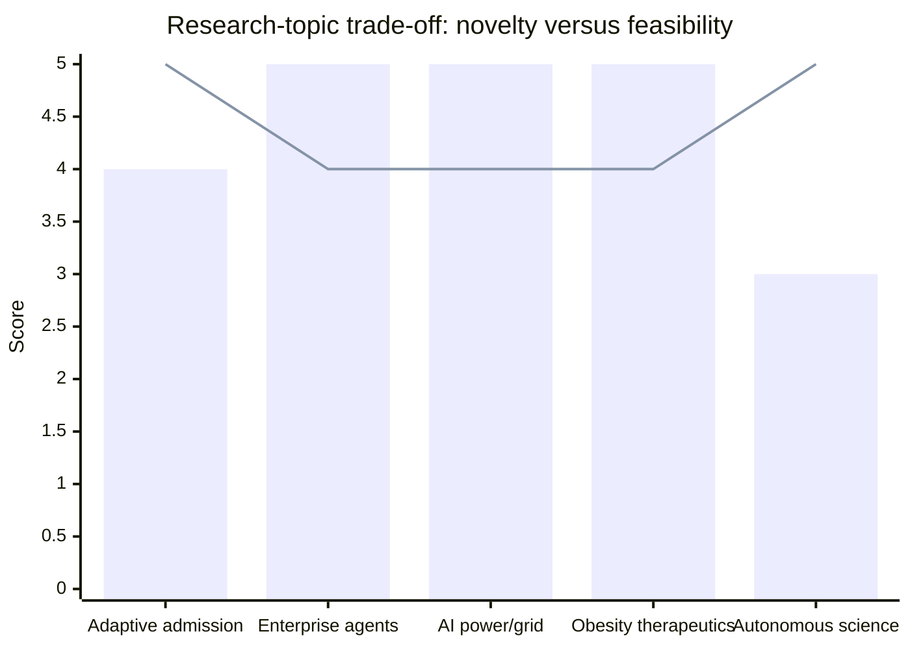
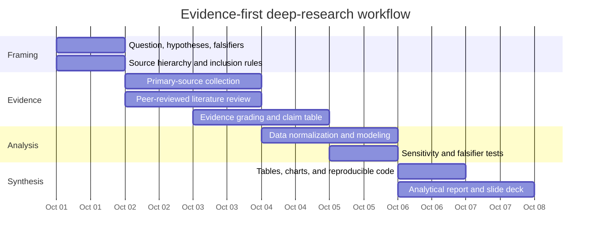

# High-Value Deep-Research Agenda for an Unspecified Query

## Executive summary

Because no research subject was specified, the highest-value response is not to guess a single topic but to identify a small portfolio of research programs that are unusually consequential, evidence-rich, and decision-relevant as of **September 30, 2026**. I screened candidate topics against five criteria: current relevance, novelty, feasibility of rigorous analysis, data availability, and potential decision impact. I also treated the supplied project brief as contextual evidence rather than as an instruction: it describes a proposed, explicitly inert research lane on **capacity admission and review debt for concurrent software-agent work**, and says that merely reading it does not invoke or authorize the lane. That makes the underlying question a strong candidate for the user's latent intent without authorizing any repository action. fileciteturn0file0

Five topics emerge as particularly strong:

**Adaptive capacity admission for AI-driven software engineering** is the best match to the supplied context. The research question is no longer simply “How many coding agents can a machine run?” but “How much parallel work should be admitted when machine capacity and human review capacity are separate, sometimes contradictory constraints?” That distinction is increasingly important because benchmark capability and real-world productivity do not map cleanly onto each other: SWE-bench provides standardized evidence that agents can resolve substantial real-world software tasks, while METR's randomized study of experienced open-source developers using early-2025 AI tools found that participants took **19% longer** with the tools, and DORA's 2025 research characterizes AI as an organizational “amplifier” rather than an unconditional productivity multiplier. citeturn1search6turn1search0turn0search8

**Enterprise AI-agent economics and operating models** is the strongest general business topic. Stanford's 2026 AI Index reports that AI adoption had reached 88% of surveyed organizations while deployment of agents remained in the single digits in nearly every business function. At the same time, controlled studies find real but heterogeneous gains: a 776-person Procter & Gamble experiment found that an individual with AI could match some performance of a two-person team without AI, while another experiment across 66 firms and 7,137 knowledge workers found about two fewer hours per week spent on email among treated users but little change in the overall composition of work. The central research opportunity is therefore to identify **where agentic systems produce durable economic value after verification, rework, integration, and governance costs are counted**. citeturn5search0turn5search2turn5search3

**AI data-center electricity and grid bottlenecks** is the most immediately quantifiable infrastructure topic. Lawrence Berkeley National Laboratory's June 2026 update estimates that U.S. data centers could consume **11.8% of U.S. electricity by 2030**, with a scenario range of 9.5%–15.3%; the IEA projects global data-center consumption around 945 TWh in 2030 in its base case; and the U.S. EIA says data-center development is already contributing materially to U.S. demand growth. The strategically important question is not merely how much electricity AI will consume, but **where interconnection, transmission, firm capacity, water, permitting, and equipment lead times become binding constraints on AI investment**. citeturn2search0turn2search6turn2search9

**The next generation of obesity therapeutics** is an unusually strong science-and-business topic because the market is moving simultaneously on mechanism, route of administration, payer coverage, and clinical efficacy. The FDA approved the oral small-molecule GLP-1 agonist orforglipron on April 1, 2026 and a higher-dose semaglutide injection on March 19, 2026; CMS began its Medicare GLP-1 Bridge on July 1, 2026; and Eli Lilly reported positive Phase 3 results for the investigational triple agonist retatrutide in 2026. Peer-reviewed evidence already supports oral GLP-1 efficacy, while the newest retatrutide Phase 3 results should be treated as sponsor-reported evidence until independently scrutinized and fully published. citeturn7search0turn7search2turn3search5turn7search3turn10search0

**AI-enabled scientific discovery and autonomous laboratories** is the highest-novelty science topic. In 2026, Nature published systems that use multi-agent AI for hypothesis generation and iterative scientific analysis, including a system that proposed and helped validate candidate therapeutics in a lab-in-the-loop workflow. Yet Stanford's 2026 AI Index simultaneously reports a large gap between strong question-answering performance and weak paper-scale replication performance. The high-value question is therefore not whether AI can generate plausible science, but **which parts of the discovery cycle can be accelerated without increasing false discovery, irreproducibility, or unrecognized automation bias**. citeturn9view0turn4search5turn4search4

My ranking is deliberately close: these are all researchable and consequential. The **best contextual fit is adaptive capacity admission**; the **best broad business study is enterprise-agent economics**; the **best infrastructure-investment study is AI power and grids**; the **best science/business market study is obesity therapeutics**; and the **highest-novelty scientific-method study is autonomous discovery**.

## Selection framework and topic comparison

The scores below are analytical judgments, not externally measured quantities. A score of **5** means unusually strong on that criterion for a rigorous research project starting now; **1** would indicate a weak fit. “Data availability” discounts evidence that is proprietary, sponsor-reported, poorly standardized, or difficult to compare across studies.

| Proposed topic | Relevance | Novelty | Feasibility | Data availability | Estimated impact | Composite / 25 | Best suited to |
|---|---:|---:|---:|---:|---:|---:|---|
| Adaptive capacity admission and review debt for AI software engineering | 5 | 5 | 4 | 3 | 5 | **22** | Engineering architecture, agent orchestration, operational policy |
| Enterprise AI-agent economics and operating models | 5 | 4 | 5 | 5 | 5 | **24** | Strategy, investment, workforce, product and operating-model decisions |
| AI data-center power and grid bottlenecks | 5 | 4 | 5 | 5 | 5 | **24** | Infrastructure, energy, AI capex, location and portfolio strategy |
| Next-generation obesity therapeutics | 4 | 4 | 5 | 5 | 5 | **23** | Biopharma strategy, healthcare economics, competitive intelligence |
| AI-enabled scientific discovery and autonomous laboratories | 5 | 5 | 3 | 4 | 5 | **22** | R&D strategy, scientific-method research, biotech/materials investment |

The two “22” scores should not be read as lower importance. They reflect harder measurement problems. For adaptive software admission, private operational traces are much more informative than public benchmarks; for autonomous science, claims of acceleration are easy to generate but much harder to validate against blinded replication or downstream scientific value. Conversely, enterprise economics and grid research benefit from unusually rich combinations of surveys, experiments, public filings, government data, and standardized physical/economic quantities. citeturn5search4turn2search0turn2search4

A useful trade-off is visible between **novelty and immediate empirical tractability**:

*Bars represent feasibility; the line represents novelty. Scores are the analytical ratings in the comparison framework above.*

Across all five studies, the preferred evidence hierarchy should be: **primary official data and documentation first; peer-reviewed research second; high-quality industry or company evidence third; and reputable journalism principally for chronology, controversy, and triangulation**. Sponsor-reported biomedical endpoints, company-reported AI productivity claims, self-reported benchmark results, and announced infrastructure projects should never be given the same evidentiary weight as regulator records, independently reproduced experiments, or observed utilization data. That distinction is particularly important because recent agent benchmarks can depend materially on scaffolding and evaluation setup, and because infrastructure and drug pipelines contain projects that can be changed or cancelled before realization. citeturn1search6turn2search6turn10search0

## Adaptive capacity admission and review debt for AI software engineering

**Executive summary.** The research program would determine how an agentic software-development system should admit additional branches, worktrees, or concurrent tasks when there are at least two fundamentally different scarce resources: **machine capacity** and **human review capacity**. The uploaded brief already frames precisely this distinction and calls for evidence-backed signals rather than an invented constant; it also explicitly rejects the assumption that machine headroom alone protects review capacity. fileciteturn0file0 Public evidence supports the need for that separation. Linux exposes direct CPU, memory, and I/O pressure through Pressure Stall Information, Git exposes formal worktree lifecycle operations, and modern code-review research shows that review effort depends on change size, context, and workflow rather than merely host utilization. Meanwhile, agent capability benchmarks and real-world productivity studies point in different directions, making a capacity controller based solely on benchmark throughput especially risky. citeturn1search13turn1search3turn6search2turn1search0

**Key research questions and hypotheses.** The core questions are: Which host-level and repository-level signals predict actual degradation before failure? Which privacy-preserving measures best represent review debt? Does branch age or unreviewed changed volume predict conflict risk better than raw concurrent-branch count? What happens when machines are idle but reviewers are saturated, or reviewers are available while I/O and memory are constrained? How much hysteresis is required to prevent oscillation? Which worktree states can be pruned safely without relying on content inspection?

The principal hypotheses would be:

1. **Machine pressure and review debt should be modeled as independent constraints**, not collapsed into one weighted utilization score. Linux PSI provides direct stall-time signals for CPU, memory, and I/O, whereas code-review backlog has different causal drivers. citeturn1search13turn6search2  
2. A policy structurally equivalent to `admission = min(machine headroom, pool headroom, task budget, review credit, owner ceiling)` should be more robust than a fixed concurrency number **provided each component is independently observable and missing data fail conservatively rather than being imputed as zero**. This is a hypothesis to test, not a recommended production formula or threshold. fileciteturn0file0  
3. Review debt is likely to be better represented by a vector—such as unreviewed change volume, age distribution, review service rate, conflict incidence, and abandonment rate—than by branch count alone. Empirical work already finds relationships among PR size, complexity, review burden, and latency, while a 2026 preprint on agent-generated PRs reports substantial merge-conflict incidence; that preprint should be treated as hypothesis-generating rather than conclusive evidence. citeturn6search1turn6academia38  
4. An adaptive controller is only superior if it improves throughput or latency **without hiding a growing review backlog**. That falsifier should be part of the experiment from the outset rather than added after observing results.

**Prioritized sources to consult.** First priority should be the **current Git documentation**, specifically Git 2.56.0 worktree lifecycle and pruning semantics, because policy must respect what Git actually guarantees. citeturn1search3 Second should be the **Linux kernel PSI and cgroup documentation**, because these provide directly measurable resource-pressure primitives rather than heuristic CPU-utilization thresholds. citeturn1search13turn1search12 Third should be the project's own non-public operational telemetry and definitions, but analyzed locally and only after any separate project authority requirements are satisfied; the supplied brief itself explicitly keeps that lane inert until invoked. fileciteturn0file0 Fourth should be empirical software-engineering literature on review burden and change impact, including the 2025 ESEM LLM-assisted review study and recent pull-request impact-analysis research. citeturn6search2turn6search4 Fifth should be DORA and METR for the distinction between nominal AI capability and realized organizational/developer performance. citeturn0search8turn1search0 Finally, agent-specific merge-conflict datasets can provide exploratory priors, with explicit downgrading of unreviewed preprints. citeturn6academia38

**Proposed research plan and methods.** Begin with an observability inventory, not a policy. For machine pressure, record units and availability for CPU PSI, memory PSI, I/O PSI, resident memory, swap/reclaim behavior, disk-space growth, inode growth, process/file-handle counts, worktree count, and latency distributions for read-only repository operations. For review pressure, build content-free event traces containing timestamps, changed-byte or changed-line counts, changed-file counts, branch/worktree age, review-start and review-completion times, integration attempts, conflict events, and terminal disposition. Nothing in the analysis requires exporting source text.

The analytical phase should use three complementary methods. First, perform **survival and hazard analysis** for branch abandonment, review delay, and conflict events as functions of age, change volume, concurrency, and machine pressure. Second, fit a **queueing model** in which generation and review are separate service stations; measure whether the arrival rate of reviewable work persistently exceeds measured human service capacity. Third, run **trace replay or simulation** comparing fixed-limit admission against several adaptive candidates under the same workload. Candidate controllers should include conservative minimum-of-constraints, proportional review-credit systems, and simple fixed ceilings as the baseline. No numerical threshold should be promoted as a default before measurement.

Key metrics would include p50/p95/p99 repository-operation latency; CPU/memory/I/O stall time; bytes and inodes consumed per active worktree; open-work age distribution; unreviewed change volume; reviewer service rate; time to first review; time to integration; conflict events per integration attempt; abandoned-work ratio; refusal frequency; queue age; and completed, reviewed work per unit time. The decisive outcome is **reviewed, integrated evidence**, not gross agent output.

**Expected deliverables and formats.** The highest-value deliverables would be a source-pinned claim table; a machine-versus-review signal dictionary with units, sampling semantics, and `unavailable` states; candidate admission equations expressed symbolically rather than with invented defaults; state-machine diagrams; a baseline-versus-adaptive simulation table; queue-age and review-debt charts; a small reproducible notebook or script for trace replay; a refusal-condition test matrix; and a short architecture slide deck explaining why machine headroom cannot substitute for reviewer headroom.

**Estimated research effort.** A rigorous first pass is approximately **30–40 analyst-hours over about five focused working days**: roughly one day for evidence and observability mapping, one to two days for telemetry/model design, one day for simulations and sensitivity analysis, and one day for synthesis and falsifier design. A genuinely empirical result using real local traces would require enough historical observations to cover both calm and stressed operating regimes; calendar duration should be governed by data coverage, not by an arbitrary deadline.

**Risks, assumptions, and next step.** The largest risk is Goodhart's law: once a single proxy such as changed lines, branch age, or review rate becomes a control target, behavior may shift around it. Other risks include nonstationary agent capability, bursty human availability, repository-specific Git costs, misleading preprint evidence, and a controller that improves instantaneous utilization while quietly accumulating old work. The next methodological step is therefore not “choose a concurrency limit,” but **define measurable signals and a fixed-policy baseline, then pre-register the stopping rule by which the adaptive policy would be rejected**.

## Enterprise AI-agent economics and operating models

**Executive summary.** This research would answer a question that enterprise AI investment increasingly makes unavoidable: **What is the causal economic value of an AI agent once human verification, errors, coordination, process redesign, security, and model costs are included?** The topic is especially attractive in 2026 because adoption is broad but autonomous-agent deployment is still relatively immature. Stanford reports AI use by 88% of surveyed organizations while agent deployment remains in the single digits in nearly all business functions. Separately, a March 2026 NBER survey of almost 750 executives reports substantial heterogeneity in adoption and positive but sector-dependent productivity effects, while controlled workplace experiments show that gains can take very different forms—from improved innovation performance to email-time reductions without corresponding shifts in total task composition. citeturn5search0turn5search4turn5search2turn5search3

**Key research questions and hypotheses.** The study should ask: Where do agents automate work, where do they augment it, and where do they merely move work into verification? Does agent autonomy have diminishing or increasing returns relative to a copilot? Which job and workflow properties predict value? Who captures gains—the employee, customer, employer, or model vendor? How much of nominal time saved becomes additional output versus slack, higher quality, or more communication? How does performance differ between novices and experts?

The central hypothesis is that **workflow integration and verification design explain more variation in realized ROI than model-access alone**. That is consistent with evidence that AI's effects vary sharply by task and organizational setting. The P&G experiment found that AI could substitute for some team collaboration in product-development tasks, while the 66-firm study found meaningful reductions in email time but no detectable broad change in task composition from individual-level AI access. citeturn5search2turn5search3 A second hypothesis is that productivity gains will be heterogeneous across worker skill and task type rather than uniformly distributed; both recent experimental literature and executive surveys point in that direction. citeturn5search4turn5search5

**Prioritized sources to consult.** First, use the **Stanford 2026 AI Index economy chapter** as the broad adoption, investment, and labor-market baseline. citeturn5search0 Second, prioritize causal field experiments and peer-reviewed studies: the P&G “Cybernetic Teammate” experiment, published in Organization Science in 2026, and the 66-firm knowledge-work experiment. citeturn5search2turn5search3 Third, use the 2026 NBER corporate-executive survey for firm-level expectations and realized productivity evidence. citeturn5search4 Fourth, use the peer-reviewed Management Science study of generative-AI adoption to establish diffusion speed and reported time savings. citeturn5search10 Fifth, use OECD's 2026 SME study to capture smaller-firm constraints such as skills, maintenance, security, and implementation burden. citeturn5search6 DORA should be included for software-intensive organizations because its evidence emphasizes complementary organizational capabilities rather than tool deployment alone. citeturn0search8

**Proposed research plan and methods.** Construct an evidence matrix in which every study is normalized by task, sample, treatment, model/tool, autonomy level, outcome measure, time horizon, and causal strength. Separate **experimental effects** from survey perceptions and vendor case studies. Then build a unit-economics framework:

\[
\text{Net agent value}
=
\text{labor time saved}
+
\text{incremental output value}
+
\text{quality/revenue uplift}
-
\text{model/tool cost}
-
\text{verification cost}
-
\text{rework and incident cost}
-
\text{integration/governance cost}.
\]

The quantitative analysis should model at least three deployment archetypes: assistive copilot, bounded workflow agent, and high-autonomy agent. Metrics should include human minutes per completed task, cost per accepted output, first-pass quality, rework rate, escalation rate, cycle time, customer outcome, throughput, model cost, incident cost, adoption rate, abandonment rate, and marginal revenue or avoided labor cost where measurable.

Where suitable organization-level data exist, a subsequent empirical study could use staggered rollout, difference-in-differences, matched cohorts, or an A/B experiment. Crucially, the untreated comparison should measure **completed outcome quality**, not just raw activity counts.

**Expected deliverables and formats.** The report should produce a causal-evidence table; a workflow taxonomy; a “copilot versus bounded agent versus autonomous agent” decision matrix; an ROI calculator in spreadsheet or Python form; sensitivity charts showing the break-even relationship among labor cost, verification burden, error rate, and model cost; sector case studies; and a 10–15 slide executive deck. Code snippets would reproduce the scenario model and allow organizations to replace benchmark assumptions with their own labor, error, and model-pricing data.

**Estimated research effort.** Approximately **28–36 analyst-hours over four to five working days** would yield a high-quality evidence synthesis and reusable economic model. A company-specific causal study would be a separate empirical project because the limiting factor would be rollout and outcome data rather than literature-search effort.

**Risks, assumptions, and next step.** The major danger is measuring activity rather than economic value. More emails drafted, more code emitted, or more documents generated are not automatically productivity. Publication bias and vendor-selection bias can also exaggerate positive effects, while older experiments become stale quickly as models improve. The next analytical step should therefore be to define a **small set of comparable outcome-level metrics** and recalculate published gains on a common “cost per accepted, useful outcome” basis.

## AI data-center power demand and grid bottlenecks

**Executive summary.** This research would examine whether electricity infrastructure is becoming a binding constraint on AI scale and, more importantly, **where and under which scenarios**. It is a high-value topic because recent official forecasts have moved materially. Berkeley Lab's June 2026 update estimates U.S. data centers could account for 11.8% of national electricity use by 2030, with a broad 9.5%–15.3% range. The IEA's base case projects global data-center consumption around 945 TWh by 2030, while emphasizing very large uncertainty from AI adoption, hardware/software efficiency, and energy-sector bottlenecks. EIA's September 2026 outlook says data-center development is contributing to growing U.S. commercial and industrial electricity demand. citeturn2search0turn2search2turn2search9 The decision-relevant unit, however, is rarely “national electricity share.” A planned AI campus may care much more about a particular substation, transmission zone, interconnection timeline, gas pipeline, transformer supply chain, cooling configuration, or ability to provide flexible load.

**Key research questions and hypotheses.** The central questions are: Which U.S. and global regions face the largest mismatch between planned compute demand and deliverable power? Are generation, transmission, distribution, transformers, gas supply, or permitting the dominant constraint in each region? How much can workload shifting, storage, behind-the-meter generation, or demand response improve effective capacity? Does improved chip efficiency reduce grid burden, or does cheaper compute induce enough additional consumption to offset efficiency gains? How sensitive are economics to data-center utilization and load factor?

The primary hypothesis is that **AI's energy constraint is more local and temporal than national**: a country can have adequate aggregate generation while a high-growth data-center cluster still lacks timely interconnection capacity. The IEA itself emphasizes geographic concentration and notes that AI-focused data centers can impose very large local loads. citeturn2search12 A second hypothesis is that uncertainty in AI service demand and computational efficiency is large enough that scenario analysis is more useful than a single point forecast; the IEA's 2035 scenarios span roughly 700–1,700 TWh of global data-center demand. citeturn2search2turn2search6

**Prioritized sources to consult.** First, use **Berkeley Lab's 2025 U.S. Data Center Energy Usage Update**, published June 2026, as the principal U.S. bottom-up demand reference. citeturn2search0 Second, use **EIA's Annual Energy Outlook 2026, Short-Term Energy Outlook, and new data-center survey work** for independent U.S. system forecasts and emerging empirical data. citeturn2search14turn2search9turn2search4 Third, use the **IEA Energy and AI** model for global scenarios, supply mix, efficiency assumptions, and uncertainty. citeturn2search5turn2search7 Fourth, collect ISO/RTO and utility interconnection, transmission-planning, capacity-market, and large-load tariff records for regional constraints. Fifth, cross-check hyperscaler annual reports, capital-expenditure disclosures, PPAs, nuclear/geothermal agreements, and sustainability data against actual commissioned capacity rather than announced aspirations.

**Proposed research plan and methods.** Construct a regional database in common units: planned and operating data-center MW, annual TWh, grid connection date, utilization/load factor, generation mix, wholesale price, capacity cost, estimated transmission requirement, cooling approach, water intensity where available, and project status. Separate **operational**, **under construction**, **contracted**, and **announced** capacity to avoid counting speculative projects as real load.

Model low, base, and high compute-demand pathways and independently vary hardware efficiency, model efficiency, utilization, and local project realization. For each region, calculate a “power-availability gap” between prospective load and deliverable firm capacity over time. Then test mitigation strategies such as geographical load shifting, temporal load flexibility, storage, onsite gas, nuclear, geothermal, renewables-plus-storage, and delayed deployment.

Core metrics should include MW of grid connection; TWh per year; interconnection lead time; $/kW of generation and transmission capex where estimable; $/MWh energy cost; PUE; WUE where relevant; carbon intensity; annual utilization; curtailed compute hours; and incremental time-to-service for new AI capacity.

**Expected deliverables and formats.** Deliver a regional data table; 2026–2035 scenario curves; maps of high-risk power markets; waterfall charts decomposing demand growth into conventional servers, AI accelerators, cooling, and other infrastructure; sensitivity charts for utilization and efficiency; an infrastructure-risk scorecard; a Python scenario model; and a board-level slide deck explaining where electricity is likely to affect AI economics rather than treating “power” as a single global commodity.

**Estimated research effort.** Approximately **32–44 analyst-hours over five to six working days** for a high-quality national/global study based on published data. A utility-territory-level investment study would require substantially more data cleaning because large-load queues and interconnection records differ in structure and disclosure quality across jurisdictions.

**Risks, assumptions, and next step.** Forecast dispersion is unusually large. Announced data centers can be cancelled; nominal megawatt capacity is not equivalent to annual consumption; multiple datasets can count the same campus differently; corporate PPAs do not prove hourly physical matching; and rapidly improving accelerator efficiency may alter load intensity. The next step in the research itself should therefore be a **project-status and unit-normalization audit before any forecast comparison**, followed by scenarios rather than a single deterministic projection.

## Next-generation obesity therapeutics and the competitive landscape

**Executive summary.** The obesity-treatment market is shifting from a simple comparison of injectable GLP-1 medicines to a multidimensional competition involving oral agents, higher doses, triple agonists, amylin combinations, cardiovascular and metabolic comorbidity indications, access, manufacturing, adherence, and payer design. As of September 30, 2026, the FDA has approved orforglipron for long-term weight management and a higher-dose semaglutide injection; CMS has started the Medicare GLP-1 Bridge; and Lilly has reported multiple positive Phase 3 retatrutide trials, although retatrutide remains investigational. citeturn7search0turn7search2turn3search5turn7search7 Peer-reviewed Phase 3 evidence for oral orforglipron shows significant weight loss relative to placebo, while earlier peer-reviewed retatrutide Phase 2 evidence showed large dose-dependent weight reductions and gastrointestinal adverse events. citeturn10search0turn10search3 The research opportunity is therefore to identify which products have the strongest **total product profile**, not merely which trial reports the highest weight-loss percentage.

**Key research questions and hypotheses.** Research should ask: How do efficacy, tolerability, convenience, cardiovascular evidence, persistence, contraindications, route of administration, manufacturing requirements, and payer access compare? Do oral GLP-1s expand the treated population or mostly cannibalize injectables? How much does real-world adherence narrow trial-efficacy differences? Which patient segments are likely to require very high efficacy versus convenience and tolerability? How do Medicare and Medicaid access changes alter volumes and pricing power? What happens to market structure if triple agonists or amylin combinations materially exceed current efficacy?

The first hypothesis is that **efficacy alone will become less differentiating as multiple agents reach clinically large weight-loss effects**; competitive advantage will increasingly depend on tolerability, convenience, comorbidity evidence, manufacturing scalability, access, and long-term persistence. The second is that oral medicines could expand uptake because they remove injection barriers, but real-world adherence and payer restrictions may matter at least as much as route of administration. The third is that next-generation multi-pathway agents may segment the market rather than replace all earlier agents, particularly if greater efficacy comes with higher discontinuation or monitoring burden.

**Prioritized sources to consult.** First, use **FDA approval notices and current prescribing information** to establish regulatory status, indications, warnings, dosing, and what is actually approved rather than anticipated. citeturn7search0turn7search2turn7search1 Second, use **peer-reviewed pivotal trials**, including the NEJM Phase 3 orforglipron study, oral semaglutide evidence, tirzepatide long-term evidence, survodutide Phase 3 results, and eventual peer-reviewed retatrutide Phase 3 publications. citeturn10search0turn10search7turn10search6turn10search5 Third, use **CMS program documents** for real coverage mechanics rather than analyst assumptions. citeturn3search5turn3search6 Fourth, use ClinicalTrials.gov and company trial registries to map pipeline stage and primary endpoints. Fifth, use sponsor press releases only for results that have not yet entered peer-reviewed literature, clearly labeling them as company-reported—for example, Lilly's 2026 retatrutide Phase 3 results. citeturn7search3turn7search10 Reputable financial and medical journalism is then useful for competitive context, manufacturing, deal activity, and investor expectations, but not as the primary efficacy source.

**Proposed research plan and methods.** Build a product-level evidence database covering mechanism, route, dosing frequency, phase/regulatory status, randomized population, treatment duration, estimand, placebo or active comparator, mean weight change, proportions crossing weight-loss thresholds, discontinuation, serious adverse events, gastrointestinal adverse events, cardiometabolic endpoints, cardiovascular outcomes, comorbidity indications, and demographic representation. Do **not** compare headline percentages without reconciling population, duration, estimand, background treatment, and trial design.

The commercial layer should add list/net price where reliably known, payer access, Medicare/Medicaid eligibility, manufacturing complexity, cold-chain requirements, pill/injection preference evidence, prescription growth, supply constraints, patent/exclusivity, and expected launch timing. Develop scenarios for a convenience-led market, efficacy-led market, payer-constrained market, and broad-access market.

Metrics should include percentage weight change; treatment discontinuation; absolute cardiovascular risk where trial evidence exists; dose frequency; persistence; covered lives; net cost per treated patient; manufacturing capacity; prescriptions; and, where defensible, cost per clinically meaningful outcome. This would remain a market and evidence analysis, not individualized medical advice.

**Expected deliverables and formats.** Produce a pipeline matrix; trial-comparability table; efficacy-versus-tolerability scatterplots; mechanism map; regulatory timeline; payer/access table; market-share scenarios; sensitivity analysis around discontinuation and coverage; concise drug-profile cards; reproducible analysis code; and a competitive-strategy slide deck.

**Estimated research effort.** Approximately **30–42 analyst-hours over five to six working days** for an evidence-grade pipeline and market synthesis. Continual updating is valuable because trial readouts and regulatory actions can rapidly change the competitive ordering.

**Risks, assumptions, and next step.** The major risks are invalid cross-trial comparison, overreliance on sponsor announcements, confusion between treatment-regimen and efficacy estimands, underweighting discontinuation, and assuming trial efficacy equals population effectiveness. Another risk is regulatory churn: a late-2026 pipeline snapshot can age quickly. The correct next analytical step is therefore a **trial-normalization protocol established before ranking products**, with regulatory status and evidence grade attached to every row.

## AI-enabled scientific discovery and autonomous laboratories

**Executive summary.** This research would examine whether multi-agent AI and self-driving laboratories are beginning to create reproducible scientific knowledge rather than simply accelerating literature review, hypothesis generation, and analysis. The opportunity is real: a 2026 Nature paper described “Robin,” a multi-agent system that combined literature search, hypothesis generation, experimental planning, and analysis in an iterative lab-in-the-loop workflow; the authors reported experimental validation of candidate therapeutic effects and large reductions in estimated cognitive labor. citeturn9view0 A separate 2026 Nature paper introduced a “Co-Scientist” system for structured hypothesis generation, while autonomous-lab research has advanced from the materials-focused A-Lab to pilot-scale systems and self-correcting chemistry agents. citeturn4search5turn4search0turn4search1turn4search10 Yet Stanford's 2026 AI Index reports that frontier models remain weak at full paper-scale replication despite strong performance on narrower scientific benchmarks. citeturn4search4 That tension makes this a particularly valuable research subject.

**Key research questions and hypotheses.** The study should ask: Which parts of scientific work—literature synthesis, hypothesis generation, experiment design, laboratory execution, analysis, interpretation, and replication—can currently be delegated with measurable gains? How frequently do AI-generated “novel” hypotheses survive prior-art checking? What fraction survive experimental validation? Do autonomous systems reduce cost per validated discovery or simply increase the number of low-quality hypotheses tested? How sensitive are results to model choice, prompting, agent architecture, external retrieval, and human intervention? Can independent labs reproduce AI-originated findings?

The principal hypothesis is that **the near-term bottleneck is shifting from idea generation toward validation and replication**. AI can generate and rank hypotheses much faster than laboratories can test them, so scientific value will depend on experimental capacity, evidence triage, and falsification. A second hypothesis is that the largest benefits will initially occur in domains with standardized assays, machine-readable data, automatable instruments, and rapid feedback loops, such as certain areas of materials science, chemistry, molecular biology, and computational research. A third is that apparent speedups based on literature-reading hours will overstate total scientific acceleration unless downstream validation and failed hypotheses are fully costed.

**Prioritized sources to consult.** First, prioritize **peer-reviewed demonstrations with experimental validation**, especially the 2026 Nature Robin paper and Co-Scientist work. citeturn9view0turn4search5 Second, use the **A-Lab Nature paper** as a canonical autonomous-materials case; it reported 36 realized compounds from 57 targets during 17 days of continuous operation and has since received a 2026 correction, which should be examined carefully rather than relying on the original publication alone. citeturn4search0 Third, study newer autonomous-lab architectures such as PNNL's AutoLabs and the 2026 pilot-scale AP-Lab work, with careful assessment of their degree of human intervention and generalizability. citeturn4search10turn4search1 Fourth, use Stanford's 2026 AI Index science chapter to benchmark field-wide progress and the reproducibility gap. citeturn4search4 Fifth, include work on end-to-end automated AI research as a neighboring domain where outputs and evaluation can be reproduced more cheaply than wet-lab science. citeturn4search11

**Proposed research plan and methods.** Create a taxonomy of autonomy with explicit levels: AI-assisted literature synthesis; AI-generated hypotheses; AI-designed experiments; AI-executed experiments; AI analysis; closed-loop autonomous iteration; and independently replicated discovery. Then code every published system against that taxonomy. “Autonomous” should not be accepted as a binary label.

For each system, record scientific domain, model and tooling, retrieval method, robotic hardware, amount and type of human intervention, number of hypotheses considered, number experimentally tested, validation rate, independent replication status, time and cost, error recovery, raw-data availability, code availability, and whether evaluation was blinded. Estimate a funnel:

\[
\text{candidate hypotheses}
\rightarrow
\text{novel after prior-art search}
\rightarrow
\text{experimentally testable}
\rightarrow
\text{positive experiment}
\rightarrow
\text{replicated finding}
\rightarrow
\text{scientifically or commercially useful finding}.
\]

The key metric should be **cost and time per independently validated finding**, not hypotheses per hour. Supporting metrics include human hours, instrument hours, experiments per hypothesis, false-positive rate, failed-experiment recovery rate, reproducibility, prior-art collision rate, model/tool cost, and time from question to validated result.

A particularly valuable method would be retrospective benchmarking: take discoveries for which the chronology of prior literature is known, restrict an AI system to information available before the discovery date, and measure whether it recovers the successful hypothesis without leaking future evidence. That design would be substantially stronger than asking a current model to “rediscover” facts contained in its training corpus.

**Expected deliverables and formats.** Deliver an autonomy taxonomy; evidence-grade table of autonomous-science systems; funnel charts from hypothesis to replication; a benchmark-design specification for leakage-controlled retrospective discovery; cost-per-validated-finding models; a reproducibility checklist; code for evidence normalization and sensitivity analysis; and an R&D strategy slide deck distinguishing “AI generates interesting ideas” from “AI reliably advances science.”

**Estimated research effort.** Approximately **34–48 analyst-hours over five to seven working days** for a cross-domain evidence synthesis. A strong experimental benchmark would be a substantially larger scientific project because independent wet-lab replication, rather than desk research, would dominate both time and cost.

**Risks, assumptions, and next step.** The central risk is mistaking **novel text for novel science**. Training-data leakage, prior-art search failure, flexible definitions of autonomy, selective reporting, failed-experiment omission, and lack of independent replication can all inflate claims. Even apparently successful systems often retain consequential human choices: in the Robin study, for example, humans still executed laboratory experiments and made some assay implementation decisions even though the AI handled major intellectual components of the loop. citeturn9view0 The proper next step is therefore to establish a common autonomy-and-validation rubric and then re-score the literature before comparing headline speedups.

## Cross-topic research program and recommended prioritization

The five subjects can be investigated using a common evidence workflow. The first stage should freeze the research question, competing hypotheses, source hierarchy, and falsifiers. The second should build a source-pinned evidence table before interpreting results. The third should normalize units and study designs; the fourth should perform quantitative analysis and sensitivity testing; and only then should the work move to recommendation and presentation. This ordering matters because every proposed field contains superficially comparable numbers that actually measure different things: agent benchmark scores versus developer productivity, announced megawatts versus realized TWh, trial efficacy versus real-world persistence, or generated hypotheses versus independently replicated discoveries. citeturn1search6turn1search0turn2search0turn10search0turn4search4

An illustrative research-sprint schedule beginning immediately after the current date would look as follows. It represents an analytical work plan, not a claim that all five subjects can be investigated to full depth simultaneously by one analyst in this period.

For **the supplied context**, I would rank the topics in this order:

| Priority | Topic | Why it should lead |
|---|---|---|
| **Highest contextual priority** | Adaptive capacity admission and review debt | It directly matches the latent problem encoded in the supplied but inert project brief; the question is concrete, falsifiable, and can produce an operational decision framework without selecting arbitrary defaults. fileciteturn0file0 |
| **Highest general business priority** | Enterprise AI-agent economics | Organizations have adopted AI rapidly, but causal evidence shows highly heterogeneous returns, leaving a large gap between “AI deployed” and “economic value created.” citeturn5search0turn5search2turn5search4 |
| **Highest infrastructure priority** | AI data-center power and grids | Large capital allocations increasingly depend on physical infrastructure whose build times and geography differ sharply from software scaling, while official 2030 demand estimates remain wide. citeturn2search0turn2search6 |
| **Highest science/business market priority** | Next-generation obesity therapeutics | Multiple mechanisms, oral products, expanding public coverage, and new Phase 3 readouts create an unusually information-rich competitive transition. citeturn7search0turn3search5turn7search7 |
| **Highest scientific-novelty priority** | AI-enabled scientific discovery | Recent peer-reviewed systems demonstrate real lab-linked progress, but the gap between generation and independent replication remains large enough to make rigorous evaluation more valuable than another catalog of impressive demonstrations. citeturn9view0turn4search4 |

The overarching analytical lesson is the same across all five subjects: **the most important variable is usually downstream capacity, not upstream generation**. More coding-agent output is not useful if review capacity is saturated; more enterprise AI activity is not valuable if verification and rework erase the gain; more compute demand cannot be realized without timely power; stronger obesity-trial efficacy does not guarantee access or persistence; and more scientific hypotheses do not constitute discovery without experimental validation and replication. The strongest deep-research program is therefore one that measures the bottleneck between apparent capability and accepted, durable outcomes rather than treating production volume as the objective. citeturn1search0turn5search3turn2search12turn10search0turn4search4