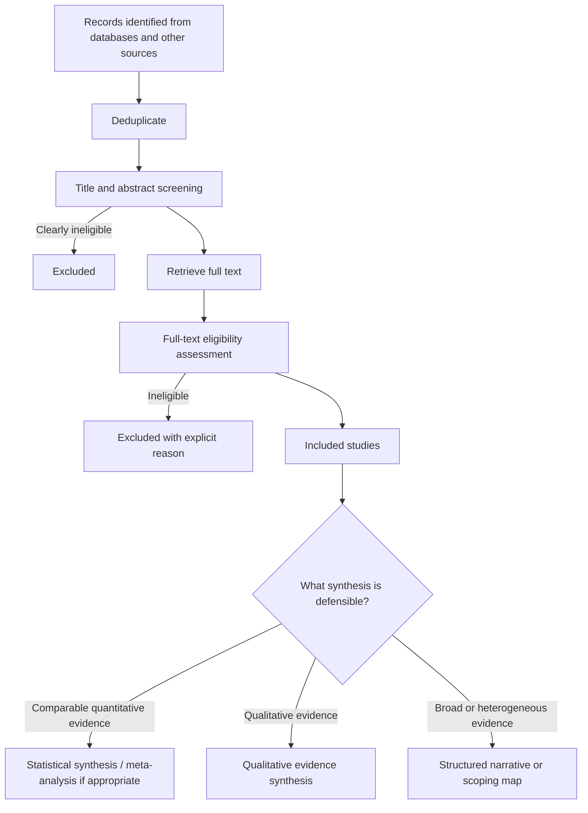
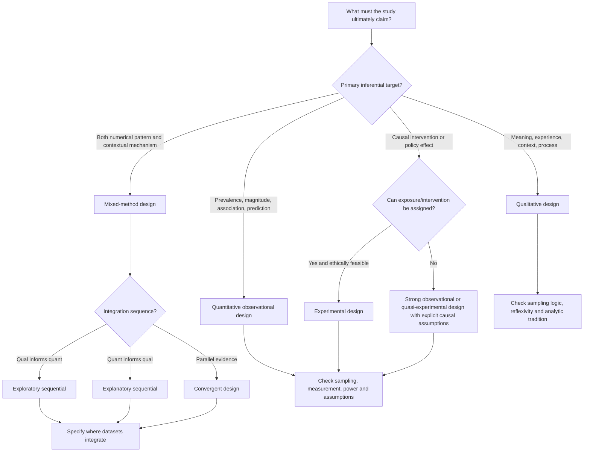
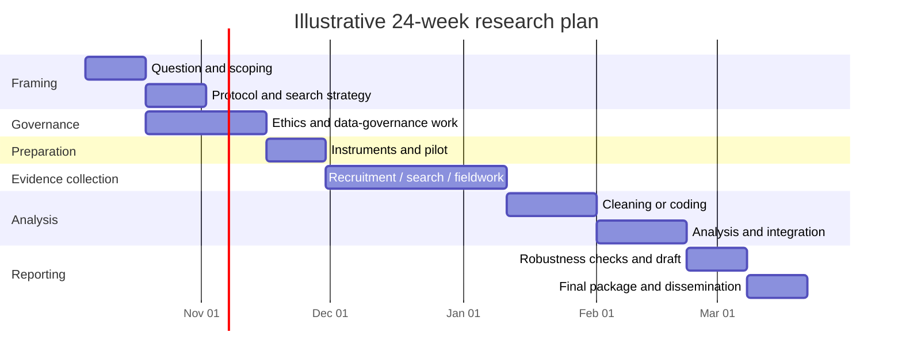

# A Cross-Disciplinary Blueprint for Defining a Research Question and Research Plan

## Executive summary

A rigorous research project is best treated as a **chain of linked decisions**, not as a sequence that begins with choosing a favorite method. The defensible order is: identify the decision or knowledge gap; scope the existing evidence; formulate an answerable question; define eligibility and constructs; choose the design that can answer that question; specify sampling, measurement, and analysis; address ethics and data governance; pilot the procedures; execute; and report transparently. Protocols are valuable because they force major methodological decisions to be made before results are known, while current evidence-synthesis guidance similarly emphasizes defining scope, eligibility, search, and selection methods prospectively. citeturn14search14turn14search7

The most useful generic approach is to combine rather than mechanically choose among question frameworks. **PICO/PICOS** is strongest for questions about interventions, exposures, comparisons, and outcomes; **PCC** is well suited to broad scoping questions; **SPIDER** was developed for qualitative and mixed-method evidence searches; and **FINER** is best regarded as a stress test of whether a proposed question is Feasible, Interesting, Novel, Ethical, and Relevant rather than as a substitute for specifying the question itself. citeturn0search12turn11search0turn10search0

For literature searching, the core principle is **conceptual coverage plus reproducibility**: identify concepts, map synonyms and controlled vocabulary, combine synonyms with `OR`, combine concepts with `AND`, and search more than one source when the question crosses disciplinary or publication boundaries. Importantly, Cochrane cautions that translating every PICO element into a mandatory search block can reduce sensitivity because comparators and outcomes are often inconsistently described or indexed. citeturn14search7turn1search0

Study design should follow the inferential target. Questions about prevalence, association, prediction, or effects generally call for quantitative designs; questions about meaning, experience, context, implementation, or social process often require qualitative methods; mixed methods are justified when answering the question genuinely requires both forms of evidence and an explicit strategy for integrating them. NIH mixed-methods guidance treats integration—not merely collecting two kinds of data—as a defining methodological issue. citeturn3search16turn9search5

Data collection should then be designed backward from the intended inference: define the target population and sampling mechanism; operationalize constructs; select or develop instruments; pilot them; predetermine quality-control rules; and write the analysis plan before inspecting outcome patterns whenever confirmatory inference is intended. Statistical methods must match the outcome scale, design, dependence structure, estimand, and assumptions rather than being selected from a generic “which test?” chart. NIST's statistical handbook illustrates this design-and-assumption-based approach across classical tests and models. citeturn3search1turn3search11turn13search1

Ethics is not a final administrative step. For human-participant research, the Belmont framework centers respect for persons, beneficence, and justice and connects them to consent, risk-benefit assessment, and equitable participant selection; applicable regulatory requirements depend on country, institution, funding, population, and research type. In the United States, the Common Rule governs covered human-subject research across participating federal departments and agencies; in medical research internationally, the current official World Medical Association Declaration of Helsinki is the 2024 revision. citeturn14search2turn14search0turn15search3

The practical minimum before substantial data collection is therefore a small “research package”: a one-page question memo, scoping-search log, protocol and eligibility criteria, sampling and power or qualitative sampling rationale, instrument and pilot record, ethics/data-management determination, prespecified analysis plan, budget, timeline, and deliverables matrix. Preregistration can time-stamp the planned hypotheses and analyses, but it does not compensate for a weak question or unsuitable design. citeturn5search1

**Scope note.** An uploaded brief titled *DS-09 — Interactive terminal and communication views* is present, but it explicitly declares itself “proposed-inert” until specifically invoked and sets its own authorization boundaries. Consistent with the present instruction to treat the research topic as unspecified, it is not being used to define the substantive topic of this report. fileciteturn0file0

The resulting high-level workflow is:


This workflow is deliberately cross-disciplinary. The exact databases, outcome measures, causal assumptions, qualitative traditions, ethics rules, statistical models, and reporting standards should change with the discipline and research objective; the sequence of making those choices explicit is broadly transferable. citeturn9search5turn14search14

## From a broad topic to an answerable research question

The first mistake in many projects is beginning with a noun—“AI,” “climate adaptation,” “employee well-being,” “peer tutoring,” “urban mobility”—and treating it as a research question. A researchable question instead specifies **what is unknown, about whom or what, under which conditions, measured or interpreted in what way, and for what intended inference**. Cochrane similarly distinguishes broad review scope from a structured review question and uses PICO to make intervention-review eligibility explicit. citeturn0search20turn14search14

A robust question-development procedure is:

| Stage | What to do | Concrete output | Failure test |
|---|---|---|---|
| Decision need | State who would use the result and what decision, theory, or uncertainty it informs. | One-sentence “decision statement.” | Would the result matter regardless of the answer? If not, the research purpose may be ceremonial rather than informative. |
| Preliminary scope | Run a deliberately broad search to learn terminology, major theories, measures, existing reviews, and obvious evidence gaps. | One- to two-page evidence map plus seed papers. | Are you claiming novelty before determining what already exists? |
| Question structure | Use PICO/PICOS, PCC, SPIDER, or another discipline-appropriate structure to expose missing elements. | Structured question components. | Can two competent researchers interpret the population, phenomenon/exposure/intervention, comparison, and target outcome differently? |
| Construct definition | Define ambiguous constructs operationally or conceptually. | Construct glossary and candidate measures. | Would “success,” “adoption,” “stress,” “quality,” or another core term admit incompatible measurements? |
| Scope boundaries | Set setting, timeframe, unit of analysis, geography, context, and appropriate study boundaries. | Draft eligibility criteria. | Could the project silently expand whenever a new paper or dataset appears? |
| FINER check | Test feasibility, interest, novelty, ethics, and relevance. | Go/revise/no-go assessment. | Can the project realistically answer the question with available time, access, sample, data, skills, and ethics constraints? |
| Inferential target | Decide whether the goal is description, estimation, association, causal effect, prediction, explanation, interpretation, implementation understanding, or evidence mapping. | Primary objective and, where applicable, estimand/hypothesis. | Does the wording claim more than the eventual design can identify? |
| Lock the plan | Write the protocol, analysis logic, and change-control rule before confirmatory analysis or formal screening proceeds. | Versioned protocol or preregistration. | Could post-result decisions be mistaken for decisions made in advance? |

The rationale for structuring questions and eligibility prospectively is strongly reflected in current Cochrane protocol guidance; FINER and PICO are complementary tools discussed in the methodological literature rather than rival systems. citeturn14search14turn0search14turn0search12

**Framework comparison**

| Framework | Elements | Best fit | Main strength | Main caution |
|---|---|---|---|---|
| **PICO** | Population, Intervention, Comparator, Outcome | Intervention/effectiveness and many exposure questions | Makes the comparison and target outcome explicit. | Not every element should automatically become a mandatory search block; outcome/comparator terminology can be poorly indexed. citeturn0search20turn14search7 |
| **PICOS** | PICO + Study design | Questions where eligible study designs need explicit boundaries | Links question formulation to design eligibility. | Applying the “S” too aggressively in the database query can discard relevant evidence. citeturn0search12turn14search7 |
| **FINER** | Feasible, Interesting, Novel, Ethical, Relevant | Virtually any empirical research question | Tests whether a technically precise question is actually worth and able to be studied. | It does not itself identify population, comparison, or outcome; use it as a quality gate. citeturn0search14turn0search12 |
| **PCC** | Population, Concept, Context | Scoping reviews and broad evidence maps | Accommodates questions broader than intervention effectiveness. | Broadness can become unmanageable unless “Concept” and “Context” are operationalized. JBI specifically recommends PCC for scoping review questions and eligibility. citeturn11search0turn11search1 |
| **SPIDER** | Sample, Phenomenon of Interest, Design, Evaluation, Research type | Qualitative and mixed-method evidence synthesis | Makes qualitative phenomena and study forms more visible than a conventional intervention PICO. | The original developers presented it as an alternative strategy needing further evaluation, not a universal replacement for PICO. citeturn10search0 |

**Cross-disciplinary example.** Suppose the starting topic is “peer tutoring in higher education.”

A quantitative PICO question could be: *Among first-year undergraduate students, does weekly structured peer tutoring, compared with usual academic support, increase end-of-semester course completion?*

A qualitative question might instead be: *How do first-year students experience the barriers and facilitators to participating in structured peer tutoring?*

A PCC-style scoping question could be: *What peer-tutoring approaches have been studied among postsecondary students across online and in-person educational settings?*

These are related topics but not interchangeable studies. The first targets an effect; the second targets experience and process; the third maps an evidence landscape. The choice among them should occur **before** methods are chosen.

A particularly useful final check is to rewrite the question as a claim the eventual study would be allowed to support. “What is associated with X?” is different from “What causes X?”; “How accurately can X be predicted?” is different from either; “How do participants interpret X?” is a different epistemic target again. The design should be judged by whether it can warrant the intended claim, not by how sophisticated its software or statistical technique appears. This is the organizing logic across quantitative, qualitative, and mixed-method research-design texts. citeturn9search5turn9search9

## Scoping the field and performing a defensible literature search

A **scoping search** and a **formal systematic search** serve different purposes. Early scoping is iterative: it discovers vocabulary, seminal works, competing theories, available measures, likely databases, and the rough size of the literature. A formal review search is much more controlled and reproducible. JBI treats scoping reviews as a distinct evidence-synthesis methodology, while PRISMA-ScR provides reporting guidance for scoping reviews and PRISMA 2020/PRISMA-S provide complementary reporting guidance for systematic reviews and their searches. citeturn11search0turn5search0turn0search1turn0search6

**Database selection should follow the field, not habit.** A sensible multidisciplinary project often combines a broad citation database with one or more subject databases and, where relevant, grey-literature sources.

| Source | Especially useful for | Role in a search portfolio |
|---|---|---|
| **PubMed/MEDLINE** | Biomedicine, health, life sciences | Free platform with MEDLINE indexing and MeSH functionality; strong starting point for biomedical questions. PubMed supports Boolean operators, field tags, phrase searching, wildcards, and controlled vocabulary. citeturn1search0 |
| **Scopus** | Broad multidisciplinary research | Wide cross-disciplinary abstract/citation coverage spanning journals, books, conference materials, and other indexed outputs; useful for citation tracking and topics crossing fields. citeturn2search6turn2search8 |
| **Web of Science Core Collection** | Multidisciplinary citation searching | Useful for citation networks and multidisciplinary journal, conference, and book literature. citeturn2search1 |
| **APA PsycInfo** | Psychology, behavioral and social sciences | Important when psychological constructs, behavior, cognition, organizations, or mental health are central. citeturn2search0 |
| **ERIC** | Education | U.S. Department of Education/IES database covering journal and non-journal education research. citeturn2search2 |
| **EconLit** | Economics and adjacent policy research | AEA's subject database for economics literature including journal articles and other scholarly economic outputs. citeturn12search11 |
| **CINAHL** | Nursing and allied health | Particularly valuable for nursing, allied-health practice, care delivery, and related qualitative evidence. citeturn12search1 |
| **IEEE Xplore** | Engineering, electrical/electronic technology, computing | Especially relevant where conference proceedings, standards, and technical engineering literature matter. citeturn1search7 |
| **ProQuest Dissertations & Theses Global** | Theses/dissertations and grey literature | Can identify detailed methods, null findings, emerging topics, and work not yet represented in journal literature. citeturn12search2 |

No generic table can decide the final database set. Legal research may require Westlaw/Lexis or official case-law sources; history may depend heavily on archival catalogues and primary collections; computer science often requires conference databases; clinical topics may require trial registries; public-policy research may depend on government reports and administrative data. Current Cochrane and JBI search guidance emphasizes source selection as a substantive methodological decision and recommends information-specialist involvement for demanding evidence syntheses. citeturn14search5turn5search6

**Build the search conceptually.** Start with a small set of known-relevant “seed” documents and ask what language authors, indexers, and databases use for each concept. For each concept, create a block containing spelling variants, acronyms, older terminology, broader/narrower terms, and controlled-vocabulary headings where available. Within a concept, join alternatives with `OR`; between concept blocks, use `AND`. PubMed documents these Boolean conventions and its use of MeSH controlled vocabulary. citeturn1search0

For example:

```text
(
  "peer tutor*" OR "peer-assisted learning" OR "peer mentoring"
)
AND
(
  universit* OR college* OR "higher education" OR undergraduate*
)
```

If study-design restriction is genuinely necessary:

```text
AND
(
  random* OR trial OR "quasi-experiment*"
)
```

A crucial sensitivity safeguard is **not** to translate the full prose question literally into the search query. Cochrane notes that comparison and outcome concepts are frequently unsuitable as mandatory search components because eligible papers may fail to mention or index them predictably. The search query is therefore often deliberately broader than the final inclusion criteria. citeturn14search7

Use `NOT` sparingly. PubMed explicitly notes that `NOT` excludes records; conceptually, that means an exclusion term can remove a genuinely eligible paper whenever it happens to contain the forbidden term in another context. citeturn1search0

**Predefine inclusion and exclusion criteria.** Before formal screening, specify at minimum:

| Dimension | Inclusion template | Exclusion template |
|---|---|---|
| Population/unit | Define target population, units, relevant characteristics. | Out-of-scope populations or units. |
| Intervention/exposure/concept | Operational definition and acceptable variants. | Similar-looking but conceptually different exposures/interventions. |
| Comparator | Eligible comparison groups when required. | Comparators that cannot answer the target contrast. |
| Outcome/phenomenon | Primary outcomes or phenomena and accepted measurement families. | Measures not representing the intended construct. |
| Study design | Eligible experimental, observational, qualitative, mixed, modelling, or documentary designs. | Designs incapable of addressing the review objective. |
| Setting/context | Geography, institution type, sector, delivery mode, or other context. | Contexts outside the intended domain. |
| Time | Justified publication/data period. | Outside the justified period. |
| Language | Languages the team can validly screen/analyze, with translation plans if possible. | Exclusions that are explicitly documented rather than silently applied. |
| Publication status | Articles, conference papers, reports, preprints, theses, registries, etc., as appropriate. | Publication types excluded for a stated methodological reason. |

For intervention reviews, Cochrane recommends defining eligibility around PICO plus relevant study characteristics; it also cautions against routinely using outcomes themselves as study-eligibility criteria when doing so could bias study inclusion. citeturn0search20

**Record the search exactly.** Preserve database/platform name, date searched, full search string, filters, date/language limits, result count, deduplication method, citation-search procedure, and any grey-literature searches. PRISMA-S was specifically developed to improve reporting of literature searches, while PRISMA 2020 provides the review-level reporting framework. citeturn0search6turn0search1

For a formal evidence review, the selection process should be auditable:



PRISMA 2020 formalizes transparent reporting of identification, screening, exclusion, and inclusion, while PRISMA-ScR adapts reporting expectations for scoping reviews. Neither should be confused with a guarantee that a review was methodologically sound; they are principally reporting frameworks. citeturn0search1turn5search0

A useful stopping rule for preliminary scoping is not “I have read enough.” Stop when additional searches cease materially changing the question vocabulary, candidate frameworks, likely designs, key measures, and major competing explanations. For a formal systematic review, by contrast, the search extent and sources should be driven by the protocol and review methodology rather than by subjective saturation.

## Choosing a study design that can support the intended inference

The method should be chosen by asking **what evidence would have to exist for the proposed conclusion to be credible**. Creswell and Creswell's current research-design text organizes research around qualitative, quantitative, and mixed-method approaches, while NIH's mixed-methods guidance emphasizes that the mixed approach requires deliberate integration of distinct forms of evidence. citeturn9search5turn3search16

| Approach | Typical questions | Common forms | Principal strengths | Principal limitations | Choose when |
|---|---|---|---|---|---|
| **Qualitative** | How is a phenomenon experienced? What meanings, processes, mechanisms, practices, or contextual barriers matter? | Semi-structured interviews, focus groups, observation/ethnography, documents, qualitative case studies | High contextual depth; can uncover mechanisms, categories, language, and unanticipated explanations. | Usually not designed to estimate population prevalence/effect sizes; conclusions depend heavily on sampling logic, researcher reflexivity, data richness, and analytic transparency. COREQ provides a reporting framework for interview/focus-group studies. citeturn4search0turn9search0 | The central phenomenon is poorly understood, context-sensitive, process-oriented, interpretive, or requires participants' perspectives. |
| **Quantitative observational** | How common is something? What variables covary? What predicts an outcome? What happens over time? | Cross-sectional surveys, cohorts, case-control studies, administrative/observational datasets | Supports numerical estimation, modelling, population inference when sampling permits, and temporal analysis in longitudinal designs. | Association does not automatically identify causation; confounding, selection, measurement error, missingness, and model assumptions can materially alter conclusions. STROBE covers major observational-reporting designs but explicitly is not a prescription for study design. citeturn4search6turn9search9 | Intervention assignment is impossible/unethical/unnecessary or the target is description, association, prediction, natural variation, or longitudinal observation. |
| **Quantitative experimental/quasi-experimental** | What is the effect of an intervention or policy under a specified contrast? | Randomized controlled trials, cluster trials, crossover designs; natural experiments, interrupted time series, regression discontinuity and other quasi-experimental forms where justified | Well-executed randomization provides a strong basis for balancing baseline confounders in treatment comparisons; quasi-experimental designs can support causal inference under explicit identifying assumptions. | Experimental control can be costly, infeasible, unethical, noncompliant, or less externally representative; quasi-experimental validity depends on design-specific assumptions. CONSORT 2025 is the current major reporting guideline for randomized trials. citeturn4search1turn9search9 | A causal effect is the target and assignment/manipulation—or a credible natural/quasi-experiment—is possible. |
| **Mixed methods** | What is the size/pattern **and** how or why does it arise? How can qualitative findings inform measurement, intervention design, or interpretation? | Convergent, explanatory-sequential, exploratory-sequential, embedded designs | Combines complementary inference about magnitude/pattern and experience/process; discrepancies between streams can themselves be informative. | More time-, skill-, and coordination-intensive; collecting qualitative and quantitative datasets without integrating them does not realize the methodological value of mixed methods. citeturn3search16turn9search5 | Neither quantitative nor qualitative evidence alone can answer the complete research question and the integration point can be specified in advance. |

A compact design decision rule is:



Mixed methods should therefore not be selected simply because it “covers all bases.” NIH methodological guidance expects the investigator to articulate why both methods are needed, how they relate temporally and conceptually, and where the results will be integrated. citeturn3search16

The same principle applies to individual design families. A cross-sectional survey cannot establish temporal ordering merely because it contains a sophisticated regression model. A randomized experiment does not automatically answer whether an intervention will work in every setting. Interviews can explain a process without estimating how prevalent it is. The methodological question is always **whether the design and data-generating process justify the proposed inference**, not whether one design is universally “higher” than another. citeturn9search5turn9search9

Reporting guidance can be selected once the design is known. As of September 2026, relevant current standards include **CONSORT 2025** for randomized trials, **SPIRIT 2025** for randomized-trial protocols, **STROBE** for major observational designs, **COREQ** for qualitative interviews/focus groups, and **PRISMA 2020** plus extensions for systematic reviews. These guidelines improve reporting completeness but should not be mistaken for substitutes for sound design or domain expertise. citeturn4search1turn4search8turn4search6turn4search0turn0search1

## Collecting data and planning the analysis

A good analysis plan begins before analysis. The study team should be able to trace a straight line from **construct → variable or qualitative evidence → collection instrument/procedure → quality control → analytic operation → intended claim**.

**Sampling comes first.** For quantitative work, distinguish the *target population*, *sampling frame*, *sampling mechanism*, *planned sample size*, and *analysis population*. Probability-based sampling is valuable when the inferential goal is population generalization and an appropriate frame exists; experimental random assignment solves a different problem—it concerns assignment to conditions, not necessarily representative sampling from a population. Prospective sample-size planning should depend on the design, outcome, target effect or precision, error criteria, and anticipated attrition or clustering rather than an arbitrary universal sample size. NIH and methodological sources emphasize design-specific sample-size and power considerations. citeturn7search18turn7search10

Qualitative studies generally require a different rationale: select cases or participants because they are capable of illuminating the phenomenon, relevant contrasts, mechanisms, or contexts, then make the sampling logic explicit. “Saturation” should not be invoked as a magic numerical threshold detached from the analytic tradition, heterogeneity of the sample, scope of the question, and depth of the data. Qualitative-method texts instead emphasize linking sampling, data collection, coding, and interpretation coherently. citeturn9search0

For mixed methods, specify whether qualitative and quantitative samples are **parallel, nested, sequentially linked, or intentionally different**, and preserve identifiers or linkage procedures needed for the planned integration without violating privacy protections. NIH's mixed-methods guidance emphasizes this integration architecture. citeturn3search16

**Instrument development should be treated as measurement research.** A defensible sequence is to define the construct; search for established instruments; evaluate their fit to the target population and context; document permissions/licensing; adapt only with justification; cognitively test unfamiliar survey items; pilot the instrument and administration procedure; and retain version-controlled documentation. CDC's question-design laboratory uses cognitive interviewing and related methods specifically to identify how respondents interpret and answer survey questions, including sources of response error and comparability problems. citeturn7search5turn7search3

Where psychometric measurement matters, assess properties appropriate to the purpose rather than relying on one reliability coefficient. The COSMIN taxonomy, developed for health measurement instruments but useful as a conceptual reference more broadly, distinguishes properties including content validity, structural/construct validity, criterion validity, internal consistency, reliability, measurement error, and responsiveness. Discipline-specific standards should supersede generic psychometric advice where they exist. citeturn7search9

**Statistical method selection should be conditional rather than automatic.**

| Analytic situation | Candidate approach | Questions to resolve first |
|---|---|---|
| Two independent groups, continuous outcome | Two-sample t procedure/Welch-type comparison or regression framework | Is independence plausible? What is the outcome distribution? Are variances materially unequal? Is adjustment required? |
| Several groups, continuous outcome | ANOVA or an appropriate linear-model formulation | Are observations independent? Is the grouping structure sufficient, or are covariates/interactions/repeated observations present? NIST describes one-factor ANOVA as the multi-group extension of the two-sample mean-comparison setting. citeturn3search11 |
| Two independent groups with ordinal/nonparametric comparison target | Mann–Whitney-type method where its estimand and assumptions match the question | Are the observations independent, and what exact distributional/location hypothesis is being tested? citeturn13search1 |
| Several independent groups with nonparametric comparison target | Kruskal–Wallis-type procedure | Is a rank-based omnibus comparison actually the desired target? citeturn13search11 |
| Categorical association/counts | Contingency-table methods or suitable generalized models | Are expected counts and independence compatible with the chosen test? Are there repeated or clustered observations? citeturn3search1 |
| Repeated, nested, longitudinal, survival, spatial, network, or time-series data | Specialized models appropriate to the dependency structure | What dependence, censoring, hierarchy, temporal ordering, or spatial/network structure must the model represent? citeturn3search1 |
| Prediction | Out-of-sample predictive modelling with validation | Is the target prediction rather than explanation? Is leakage prevented? Is performance evaluated on data not used to fit/tune the model? |
| Causal effect from observational data | Design-driven causal analysis, not merely “adjusted regression” | What is the causal estimand? What confounding and selection assumptions identify it? What design or sensitivity analyses make those assumptions credible? |

The last two rows are especially important conceptually: prediction and causal estimation are not interchangeable simply because both may use regression or machine-learning software. The estimand and data-generating assumptions should be set first; model choice follows.

P-values likewise should not become the research objective. NIST's statistical guidance frames significance testing in relation to a chosen significance level; for most substantive studies, effect estimates, uncertainty intervals, raw or modelled contrasts, model diagnostics, and practical meaning are at least as important as a threshold-crossing decision. citeturn3search15turn3search1

**Qualitative analysis** should also be specified prospectively enough to be auditable. Depending on the question and epistemology, appropriate families can include thematic analysis, qualitative content analysis, framework analysis, grounded-theory approaches, narrative analysis, discourse analysis, or case-based comparison. The important requirement is internal coherence: the sampling strategy, interview/observation procedure, coding method, treatment of deviant cases, reflexivity practices, and interpretation should belong to a recognizable analytic logic rather than being assembled opportunistically. COREQ and established qualitative analysis texts provide useful reporting and analytic reference points. citeturn4search0turn9search0

**Mixed-method analysis** requires an explicit integration product. That might be a joint display linking numerical findings with qualitative themes, a qualitative follow-up explaining an unexpected statistical pattern, instrument items generated from qualitative work and subsequently validated quantitatively, or a final inference that compares convergent and divergent evidence. Merely publishing an interview study and a survey from the same project is not, by itself, meaningful methodological integration. citeturn3search16

**Software should follow the method and governance needs.** R is a free environment for statistical computing and graphics; Python's `statsmodels` provides statistical models, hypothesis tests, and data exploration; dedicated qualitative/mixed-method platforms such as MAXQDA provide coding and qualitative-data management functionality. Tool selection should additionally consider reproducibility, team competence, licensing, audit trails, data sensitivity, and whether collaborators can execute or review the workflow. citeturn8search5turn8search13turn8search0

A reproducible quantitative project should preserve raw-data provenance, a data dictionary, deterministic cleaning code where feasible, analysis scripts, package/software versions, and a record of deviations from the protocol. A reproducible qualitative project may not be able to publish identifiable source data, but it can still preserve instrument versions, coding frameworks, analytic memos, decision logs, and appropriately shareable materials. Data sharing always remains subordinate to consent, privacy, contractual, ethical, legal, and community constraints; NIH's current policy explicitly recognizes ethical, legal, and technical reasons for limiting sharing. citeturn15search15

## Ethics, timelines, budgets, and deliverables

Research ethics should be integrated into question formulation because a methodologically interesting study can still be impermissible or unjustified. The Belmont Report's three foundational principles are **respect for persons, beneficence, and justice**, operationalized through concerns such as informed consent, systematic assessment of harms and benefits, and fair participant selection. citeturn14search2turn14search10

In U.S. settings, determine whether the activity is human-subject research covered by the Common Rule or another applicable regulatory regime, and obtain the required institutional determination rather than self-declaring a project “exempt” simply because it seems low risk. The Common Rule addresses IRB review, informed consent, and institutional compliance for covered research, with additional protections applicable in particular circumstances. citeturn14search0turn14search11

For medical research involving human participants, the **2024 Declaration of Helsinki** is the current official WMA version as of September 2026; the WMA states that earlier versions have been superseded except for historical use. citeturn15search3

Research outside biomedicine may instead be governed by university ethics boards, professional codes, national privacy law, tribal or Indigenous governance, educational research rules, data-use agreements, platform terms, or sector-specific requirements. Therefore, “ethics approval required?” should always be treated as a jurisdiction- and institution-specific determination, not answered from a generic methods template.

Data governance should address what will be collected, why it is necessary, where it will be stored, who will have access, how identifiers are handled, how long data will be retained, what can be shared, and what must remain restricted. For NIH-covered work, the underlying Data Management and Sharing Policy remains in force, but a simplified **2026 DMS Plan format became required for relevant applications with due dates on or after May 25, 2026**; NIH explicitly accommodates limitations on sharing arising from ethical, legal, or technical factors. citeturn15search0turn15search4turn15search15

**An illustrative project timeline.** This is a planning template, not an assertion that all studies should take 24 weeks. Ethics review, recruitment, field access, contracts, data acquisition, and complex laboratory or longitudinal studies can extend it dramatically.



The key scheduling insight is to treat **ethics, data access, contracts, instrument validation, and recruitment dependencies as gates**, not as footnotes. Where possible, non-dependent work—literature review, codebook design, synthetic-data pipeline testing, reporting templates—can proceed in parallel without starting regulated data collection prematurely.

**Budget templates.** Sponsor rules differ, so the following is an internal planning structure rather than an allowable-cost rule. NSF, for example, requires proposal costs to be necessary, reasonable, allocable, allowable, and justified, and its formal budget contains categories such as personnel and other direct costs; applicable sponsor instructions always take precedence. citeturn15search14turn15search10

| Cost category | Desk/scoping or systematic review | Qualitative field study | Quantitative survey/experiment | Mixed/multi-site project |
|---|---|---|---|---|
| Personnel | `reviewer hours × loaded rate`; librarian/information specialist | PI + interviewer/fieldworker + analyst hours | PI + survey/programming/data/statistics staff | All relevant roles plus integration/project-management time |
| Participant-related costs | Usually none | `participants × incentive`, if appropriate and approved | `participants × incentive` plus recruitment/panel costs | Sum by study component/site |
| Information/data access | Database/document delivery or specialist searching where not institutionally covered | Archival/site-access fees if applicable | Dataset/API/panel/license charges | Multiple-source/site agreements |
| Instruments | Screening/extraction tools | Recording devices, transcription, translation, qualitative platform | Survey platform, laboratory/experimental materials, measurement licenses | Combination plus cross-mode harmonization |
| Equipment | Usually minimal | Field equipment where needed | Sensors/lab equipment where required | Shared/site-specific equipment |
| Computing/storage | Reference management, review software | Secure audiovisual/text storage | Secure database, compute, backup | Larger integration/compute/storage requirements |
| Travel | Usually minimal | `trips × transport + lodging + per diem` | Site visits or conference dissemination | Site coordination, monitoring, fieldwork |
| Transcription/translation | Rare except included qualitative evidence | `recording hours × transcription/translation rate` | Open-text or multilingual components as needed | Often substantial in qualitative streams |
| Statistical/methodological consultation | Meta-analysis/methodology support if required | Qualitative methods consultation where needed | Statistician, data manager, power/design consultation | Quantitative + qualitative + integration expertise |
| Dissemination | Open-access/publication, stakeholder output | Publication + participant/community reporting | Publication + presentation/dashboard where justified | Multi-format dissemination |
| Indirect/F&A | Sponsor/institution-specific | Sponsor/institution-specific | Sponsor/institution-specific | Sponsor/institution-specific |
| Reserve/risk allowance | Internal planning only if organizational rules permit | Recruitment/field-access risk | Attrition/recruitment or equipment risk | Site, integration, and coordination risk |

Do **not** insert a generic “10% contingency” into a grant budget unless the sponsor permits it. A better planning practice is to maintain an internal risk register and then budget allowable costs according to the funder's current policy. NSF's official guidance, for example, requires each requested budget item to meet applicable allowability and justification requirements. citeturn15search14

A useful budget formula is:

\[
\text{Total planned cost}
=
\text{personnel}
+
\text{participant/recruitment}
+
\text{data/instrument}
+
\text{field/travel}
+
\text{computing}
+
\text{dissemination}
+
\text{allowable indirect costs}.
\]

Instead of budgeting only by accounting category, also map each expense to a **work package**. If a proposed cost does not support a defined activity or deliverable, its necessity should be questioned.

**Deliverables template**

| Deliverable | Minimum content | Acceptance criterion |
|---|---|---|
| Question memo | Knowledge gap, user/stakeholder, structured question, FINER assessment | One unambiguous primary question and explicit secondary questions |
| Scoping memo | Databases, seed literature, vocabulary, prior reviews, gap assessment | Novelty claim supported rather than assumed |
| Protocol | Objectives, eligibility, design, sampling, procedures, primary analysis/synthesis | Versioned before the relevant confirmatory decisions |
| Search log, if applicable | Exact queries, platforms, dates, limits, result counts | Search can be reconstructed |
| Ethics/governance record | Ethics determination, consent where needed, data-access and privacy plan | Required approvals/determinations completed before governed collection |
| Instrument package | Survey/interview guide/measurement protocol, pilot revisions | Version and rationale documented |
| Data dictionary/codebook | Variables, coding rules, missing-value conventions or qualitative coding scheme | Another analyst can interpret the dataset/corpus |
| Analysis plan | Outcomes, estimands/themes, models/coding approach, sensitivity or triangulation plans | Primary vs exploratory analysis distinguishable |
| Quality-control log | Recruitment, protocol deviations, missingness, data/coding issues | Deviations are traceable |
| Final research output | Findings, uncertainty, limitations, implications | Conclusions remain within the design's inferential limits |
| Reproducibility/archive package | Shareable code, metadata, materials, documentation, permitted data | A third party can understand and, where legally possible, reproduce the workflow |

Preregistration can strengthen the distinction between planned and exploratory analysis. OSF registrations create a time-stamped, read-only record of a research plan, with options governing when it becomes public; the practical value is provenance, not bureaucratic formality. citeturn5search1

## Common failure modes, mitigation, and next resources

Most research failures are not caused by selecting the wrong software package. They occur because assumptions and decisions are left implicit until after the evidence is visible.

| Pitfall | Why it threatens validity or usefulness | Mitigation |
|---|---|---|
| **A topic masquerading as a question** | Scope expands indefinitely and methods cannot be matched to an inferential target. | Specify user/decision, framework elements, constructs, boundaries, and intended claim; then apply FINER. citeturn0search14turn14search14 |
| **Claiming novelty before searching** | The project may duplicate an existing review or answer a question already settled more directly. | Perform a broad scoping search before committing major resources. |
| **Over-constrained database query** | Requiring every PICO element—especially outcome/comparator terms—can suppress recall. | Search core concepts sensitively, combine synonyms with OR, validate against known papers, and apply full criteria during screening. citeturn14search7 |
| **Searching only one convenient database** | Different disciplines and publication types are indexed differently. | Choose complementary multidisciplinary, domain-specific, and grey-literature sources according to the question. citeturn14search5turn5search6 |
| **Changing inclusion criteria after seeing studies** | Decisions can become outcome- or preference-driven. | Version a protocol and document justified amendments transparently. citeturn14search14 |
| **Design-question mismatch** | A descriptive study may be presented causally, or an interpretive study treated as prevalence evidence. | Write the exact claim the design must support before selecting methods. citeturn9search5turn9search9 |
| **Sample size chosen by convention** | The study may be too imprecise, underpowered, unnecessarily large, or ethically wasteful. | Base quantitative sample size on the design, estimand, precision/power assumptions, clustering, and attrition; justify qualitative sampling separately. citeturn7search18turn7search10 |
| **Poorly tested instruments** | Measurement error can overwhelm any later analytical sophistication. | Prefer suitable established measures; evaluate validity for the present population/context; cognitively test and pilot new/adapted questions. citeturn7search5turn7search9 |
| **Picking a statistical test after viewing the pattern** | Encourages analytic flexibility and weakens confirmatory interpretation. | Predefine primary outcomes/estimands, models, assumptions, and sensitivity analyses; label later work exploratory. citeturn5search1turn3search15 |
| **“Mixed methods” without integration** | Produces two parallel studies rather than stronger combined inference. | Specify when, where, and how qualitative and quantitative evidence will connect, merge, or explain one another. citeturn3search16 |
| **Treating a reporting checklist as proof of good design** | Complete reporting can describe a weak study perfectly. | Use CONSORT, STROBE, COREQ, PRISMA and similar standards for transparent reporting while separately evaluating design validity. STROBE explicitly does not prescribe the design or conduct of observational research. citeturn4search6turn0search1 |
| **Ethics considered after the protocol is “finished”** | Consent, recruitment, privacy, risk, and fairness requirements may force redesign. | Include ethics and governance in the initial feasibility test and obtain applicable determinations before regulated collection. citeturn14search2turn14search0 |
| **“Open data” promised without checking consent/privacy** | Sharing commitments can conflict with participant rights, law, contracts, or community governance. | Design the management/sharing plan alongside consent and access controls; document justified sharing limits. NIH explicitly recognizes ethical, legal, and technical constraints. citeturn15search15 |
| **Opaque analysis pipeline** | Results become difficult to audit, reproduce, or update. | Preserve raw provenance, versioned transformations, software versions, code, decision logs, and deviations to the extent permitted. |
| **Project plan has tasks but no acceptance criteria** | “Analysis complete” or “review complete” becomes subjective. | Give each deliverable a named owner, input, output, acceptance test, dependency, and due date. |

The most efficient **next-step sequence** for an unspecified new topic is therefore:

1. Write a one-paragraph problem statement identifying the decision maker or scientific uncertainty and why an answer would matter.
2. Spend a bounded initial period on scoping—not exhaustive reviewing—to identify vocabulary, landmark evidence, competing explanations, measurement approaches, and major existing reviews.
3. Draft two or three candidate questions, structure them with PICO/PICOS, PCC, SPIDER, or a discipline-specific framework, and test each with FINER. citeturn0search12turn11search0turn10search0
4. Select one primary inferential target: description, effect, association, prediction, mechanism, experience, implementation, or evidence mapping.
5. Draft eligibility criteria and a one-page design sketch **before** committing to software or data collection.
6. Identify the most credible design capable of supporting the intended conclusion, including its key assumptions and plausible alternative explanations.
7. Draft sampling, instrument, pilot, analysis, ethics, data-governance, timeline, and budget plans together; major infeasibilities discovered in any one should feed back into the research question.
8. Freeze a versioned protocol or preregistration where appropriate, execute a pilot, revise prospectively, then begin the main study with an explicit change-control log. Protocol and registration guidance support preserving the distinction between planned and later decisions. citeturn14search14turn5search1

The recommended **core methodological library** is intentionally small. For general cross-disciplinary study design, Creswell and Creswell's *Research Design*, sixth edition, covers qualitative, quantitative, and mixed approaches; for detailed empirical-design reasoning, *Designing Clinical Research*, fifth edition, is particularly useful in biomedical and population-research contexts; Miles, Huberman, and Saldaña's *Qualitative Data Analysis* is a major practical reference for qualitative analysis. citeturn9search5turn9search9turn9search0

For evidence synthesis, use the current **Cochrane Handbook** and current JBI methodology rather than relying on informal search tutorials; Cochrane's searching chapter was updated in March 2025 and the handbook has a 6.5.1 update, while JBI provides dedicated guidance for scoping reviews and search methodology. citeturn14search7turn14search16turn11search0turn5search6

For reporting, match the guideline to the study: **PRISMA 2020/PRISMA-S/PRISMA-ScR** for relevant evidence syntheses; **CONSORT 2025/SPIRIT 2025** for randomized trials and protocols; **STROBE** for major observational designs; and **COREQ** for interview/focus-group qualitative studies. citeturn0search1turn0search6turn5search0turn4search1turn4search8turn4search6turn4search0

For statistics, the NIST/SEMATECH *e-Handbook of Statistical Methods* is a strong official reference for statistical concepts, assumptions, diagnostics, experimental design, and common procedures rather than simply a list of formulas. citeturn3search1

For human-participant ethics in U.S. contexts, the primary starting points are HHS's **Belmont Report** and **Common Rule** materials; for international medical-research ethics, use the WMA's current **2024 Declaration of Helsinki**. citeturn14search2turn14search0turn15search3

The central methodological rule tying all of these resources together is simple: **design the study backward from the claim you need to justify**. A precise question constrains the search; the search reveals what is known; the inferential target constrains the design; the design constrains sampling and measurement; those choices constrain analysis; ethics constrain what may be done; and the protocol makes those dependencies visible before the results create incentives to reinterpret them. That sequence is more consequential to research quality than choosing any particular database, statistical package, or methodological label. citeturn14search14turn9search5turn3search16