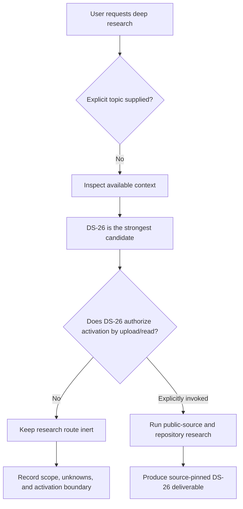

# Research Scope Determination for the Unspecified Query

## Executive summary

No substantive research topic has yet been authorized strongly enough to support the requested literature review, evidence synthesis, datasets, or recommendations without inventing the subject of the research.

The only concrete candidate topic available in the conversation is the uploaded document **“DS-26 — Telemetry accounting and honest status.”** It defines a substantial research program covering provider usage telemetry, counter semantics, cache accounting, exactly-once reconciliation, cost and latency separation, correlation identifiers, honest-status dashboards, adaptive route learning, privacy, and measurement families. However, the document also deliberately marks itself **`proposed-inert`** and states that creating, reading, or listing it does not launch the research; it requires explicit invocation in a new session. fileciteturn0file0

Accordingly, treating the upload itself as authorization to execute DS-26 would contradict the supplied research specification. I therefore have **not** performed external provider research, repository investigation, or produced conclusions that could be mistaken for the requested DS-26 deliverable.

The present report instead establishes the research boundary, identifies DS-26 as the most likely intended topic, records the dimensions that remain unspecified, and defines what evidence would be required once the topic is explicitly activated.

## Scope definition and assumptions

### Most likely intended topic

The strongest candidate is the telemetry-accounting problem described in DS-26. Its stated purpose is to determine how a future system should:

- qualify telemetry evidence providers;
- normalize provider counters;
- distinguish different classes of cost;
- reconcile cumulative and request-level usage without double counting;
- represent missing information as unavailable rather than zero;
- separate inference latency from control/bridge latency;
- provide dashboards that show observable activity without fabricating progress;
- constrain telemetry-driven route learning;
- preserve metadata-minimal privacy; and
- require falsifiers and baselines before telemetry-derived optimizations become defaults. fileciteturn0file0

That is a coherent deep-research subject, but the document explicitly conditions execution on an additional invocation step. fileciteturn0file0

### Assumptions made in this scope report

| Dimension | Present assumption | Status |
|---|---|---|
| Candidate subject | Telemetry accounting and honest-status design | **Likely, not activated** |
| Research mode | Public-source research plus permitted repository reading | Defined by DS-26, but not launched |
| Time sensitivity | Current as of September 30, 2026 | Relevant once research begins |
| Provider scope | OpenAI, Anthropic, Google, Cursor, supported CLI harnesses, `ccusage`, and host-level monitors | Candidate scope from DS-26 |
| Evidence preference | Official documentation, original repositories, primary papers, specifications, then high-quality secondary analysis | Defined |
| Private information | Excluded from public research briefs | Defined |
| Runtime/config changes | Not authorized | Defined |
| Live account/API usage queries | Not authorized | Defined |
| Product/framework selection | Out of scope | Defined |
| Quantitative progress estimates | Forbidden unless independently justified; visible activity is not percent-complete | Defined |
| Missing telemetry | Must remain unknown or unavailable, not silently become zero | Defined |
| Implementation | Not part of the research deliverable | Defined |

### Dimensions still unspecified

Even with DS-26 as the likely subject, several implementation-independent dimensions would normally need to be bound by evidence rather than assumption: exact supported harness versions; exact coordinator and workstation operating-system profiles; precise endpoints/models whose cache rules matter; whether enterprise versus individual subscription products are relevant; the retention period expected of the telemetry layer itself; and the exact repository state against which internal compatibility claims would eventually be checked.

Those do not prevent public research after authorization, because DS-26 already instructs the research to preserve unknown cells rather than invent values. fileciteturn0file0

## Literature-review framework

Because the candidate research route is explicitly inert, no topic-specific web literature review has been launched. The appropriate review, once activated, would have several distinct evidence strata rather than treating all documentation as equally authoritative.

### Provider documentation

The primary evidence layer would consist of official OpenAI, Anthropic, Google, and Cursor documentation concerning usage reporting, billing/administrative APIs, cache accounting, rate limits, subscription semantics, data retention, and any documented distinctions between request usage and organization/account-level counters.

This layer is especially time-sensitive. The DS-26 questions require not merely statements such as “cached tokens are discounted,” but exact semantics: whether cache reads participate in tokens-per-minute calculations, whether cache writes and reads use compatible units, which endpoint the rule applies to, the documentation date, and what event would invalidate the claim. fileciteturn0file0

### Harness and repository evidence

A second layer would inspect the supported command-line harnesses and the `ccusage` project at pinned commits or releases. The objective would be to distinguish:

1. request-level deltas;
2. session-level cumulative totals;
3. model-specific cumulative counters;
4. locally inferred estimates; and
5. convenience summaries that omit helper, retry, classifier, compaction, or background calls.

For `ccusage`, the review would need the canonical repository, pinned version or commit, license text, data model, and the precise implications of that license for an optional or bundled adapter. Those requirements come directly from the candidate specification. fileciteturn0file0

### Operating-system telemetry

Host-accounting research would need primary operating-system documentation for the actual supported profiles. CPU time, resident memory, filesystem I/O, process/thread counts, handles/file descriptors, energy or wakeup counters, and process-tree attribution differ materially across operating systems and sometimes across kernel/API versions. Therefore, a defensible matrix would contain explicit `unavailable` cells rather than assuming that every counter exists everywhere.

### Relevant academic and standards literature

Academic literature would be useful primarily for the *methodological* parts of DS-26: provenance-aware observability, measurement uncertainty, distributed tracing and correlation, missing-data semantics, exactly-once versus at-least-once accounting, privacy-preserving aggregation, adaptive-policy evaluation, counterfactual/offline evaluation, and uncertainty-aware dashboards.

However, academic papers should not override provider-specific usage semantics. A paper can establish a sound reconciliation method; only the provider's current primary documentation can establish what a particular provider counter actually means.

### Planned evidence hierarchy

| Evidence class | Suitable for | Typical authority |
|---|---|---|
| Provider/API official documentation | Usage fields, cache semantics, quota/rate-limit rules, retention | Highest for provider behavior |
| Official API schemas / SDK definitions | Field types and request/response structures | Very high |
| Canonical source repositories | CLI/harness event semantics and implementations | Very high |
| License file at pinned revision | Redistribution/adaptation rights | Controlling for project licensing |
| OS/platform documentation | Host counters and availability | Highest for platform capability |
| Original academic papers | Reconciliation, privacy, evaluation, measurement methodology | High for general methods |
| Industry observability guidance | Operational patterns and failure modes | Supporting |
| Blogs/forums/issues | Edge cases and undocumented behavior | Leads requiring corroboration |

The key methodological principle is that a telemetry fact should inherit neither more precision nor more authority than its underlying source.

## Evidence map and expected analytical outputs

The candidate file asks for a considerably stronger artifact than an ordinary survey. It requires a **source-pinned accounting contract** in which every material claim has provenance, applicability conditions, and a way to expire or falsify it. fileciteturn0file0

### Evidence map

| Research question family | Required evidence | Intended conclusion | Failure-safe state |
|---|---|---|---|
| Provider usage APIs | Current official API/admin documentation | Which account-scoped counters exist, at what granularity and retention | `unavailable` |
| CLI-native telemetry | Pinned harness source/docs | Delta vs cumulative semantics; omitted calls | `unknown` until verified |
| `ccusage` | Canonical repo, pinned release/commit, license | Adapter suitability and legal boundary | Do not integrate |
| Cache accounting | Endpoint-specific provider docs | Cache-read/write normalization and rate-limit semantics | Do not combine incompatible counters |
| Cumulative reconciliation | Source semantics + accounting literature | Reset/fork/crash-safe delta derivation | Preserve unresolved discontinuity |
| Helper/retry accounting | Harness/runtime evidence | Exactly-once parent-segment attribution | Mark incomplete rather than undercount |
| Subscription vs metered usage | Provider billing/product docs | Separate economic/availability classes | Never synthesize a fake conversion |
| Host resources | OS primary docs | Reliable process/resource counters | Explicitly unavailable |
| Human review | Workflow records, not token pricing | Separate review-minute quantity | No monetary conversion without accepted weight |
| Latency | Trace timestamps with defined boundaries | Control/bridge vs inference latency | Unattributed interval |
| Honest status | Observation model + provenance | Activity ≠ progress | Unknown completion |
| Route learning | Offline/shadow evaluation evidence | Bounded adaptive scoring | No promotion |
| Privacy | Data-minimization threat analysis | Minimal safe telemetry schema | Suppress sensitive dimensions |
| Optimization promotion | Baseline + uncertainty + falsifier | Defensible default change | Keep existing default |

### Central accounting invariant

The conceptual core of the candidate project can be expressed as:

\[
\text{reported quantity}
=
(\text{value},\ \text{unit},\ \text{class},\ \text{provenance},\ \text{scope},\ \text{time window})
\]

rather than merely:

\[
\text{reported quantity} = \text{number}.
\]

A bare `0` is therefore not a valid substitute for a failed or absent measurement. The candidate specification explicitly requires classification of evidence as observed, modeled, inferred, or unavailable, and prohibits converting missing values into zero. fileciteturn0file0

Likewise, economically dissimilar quantities should not be collapsed prematurely. A conceptual reporting model would preserve at least:

\[
C =
(C_{\text{metered inference}},
C_{\text{subscription}},
C_{\text{host resources}},
C_{\text{human review}},
C_{\text{inferred}})
\]

until an explicitly accepted valuation function exists. This is aligned with DS-26's requirement to keep human review and host resource cost separate from inference cost unless an accepted weighting rule exists. fileciteturn0file0

### Exactly-once reconciliation problem

One of the highest-risk areas is reconciling cumulative counters. A naïve implementation might compute:

\[
\Delta_t = C_t - C_{t-1}
\]

but that is valid only when both observations belong to the same monotonic counter epoch. Session replacement, provider resets, process restarts, forks, counter rollovers, partial final records, or model changes can make the subtraction invalid.

A source-pinned design therefore needs an identity tuple for the counter epoch and an explicit discontinuity rule. DS-26 already anticipates crashes, resets, forks, and session rotation and requires that none of them either double-charge or erase consumption. fileciteturn0file0

### Honest-status problem

The file makes an important distinction between **activity** and **task completion**. Telemetry may establish facts such as:

> “A request is running,” “tokens were consumed,” “a verifier produced an artifact,” or “the process has emitted output.”

None logically entails:

> “The task is 63% complete.”

Unless a domain-specific denominator exists and has been independently justified, percentage completion would be an inference without a valid measurement model. The requested completion gate therefore explicitly forbids fabricated percent-complete and requires unknown-as-unknown. fileciteturn0file0

## Gaps and open questions

The absence of an activated topic is currently the decisive gap. Beyond that procedural boundary, the candidate specification itself correctly anticipates several substantive unknowns that a deep-research pass would have to preserve rather than paper over.

First, **provider semantics may be endpoint-specific**. A provider can have different token, cache, billing, and rate-limit rules across APIs or model families. A claim made at provider level would therefore need to be narrowed unless official documentation explicitly establishes universality.

Second, **subscriptions and metered APIs are not inherently commensurable**. A subscription limit can represent availability, fair-use policy, rolling-window capacity, message counts, compute credits, or other product-specific constraints. Converting such a limit into an invented dollar/token equivalent would violate the candidate project's cost-separation requirement.

Third, **cumulative telemetry has identity problems as well as arithmetic problems**. The research must determine what uniquely identifies a provider session, model counter, route, process epoch, or checkpoint before deltas can safely be computed.

Fourth, **absence is ambiguous**. A missing counter could mean unsupported, disabled, delayed, redacted, inaccessible, failed to collect, or genuinely zero. These require separate states if operational decisions will depend on them.

Fifth, **privacy risks survive content exclusion**. Even prompt-free metadata can leak project participation, workflow timing, organizational structure, or sensitive activity through rare combinations of identifiers. The candidate requirement that aggregation resist revealing project membership means aggregation thresholds and dimension suppression need threat-model evidence, not merely a “no prompts stored” policy. fileciteturn0file0

Sixth, **adaptive route scoring creates a control loop**. Once telemetry influences routing, measurement errors can alter the system that generates subsequent measurements. DS-26 therefore requires versioned and explainable learning state, reset/export capabilities, and shadow or offline evaluation before operational use. fileciteturn0file0

### Open Owner-level decisions implied by the scope

The following questions are likely to remain policy decisions even after factual research is complete:

| Decision | Why research alone cannot settle it |
|---|---|
| Minimum acceptable qualification age before a provider source expires | Depends on risk tolerance |
| Whether inferred token estimates may appear beside provider-reported usage | Product/UX policy |
| Whether subscription capacity gets any common economic valuation | Requires an accepted valuation convention |
| Retention period for raw telemetry metadata | Privacy/operational trade-off |
| Minimum anonymity threshold for aggregate views | Threat-model and utility trade-off |
| Promotion threshold for route-learning changes | Governance/risk appetite |
| Treatment of partially observed segments | Accounting policy |
| Whether estimated host cost is shown at all without measured power data | Interpretation and UX policy |

Those should not be silently resolved by implementation defaults.

## Recommended next research step and primary-source set

The appropriate next step is **not** to infer activation from the uploaded file. The necessary activation condition is an explicit statement that **DS-26 — Telemetry accounting and honest status** is the research topic to execute. That is consistent with the file's own invocation rule and avoids turning passive project context into authorization. fileciteturn0file0

Once activated, the research should proceed against a source registry rather than an ordinary bibliography. Each source record should contain at least:

| Field | Purpose |
|---|---|
| Claim ID | Stable reference from conclusions to evidence |
| Provider/system | Applicability boundary |
| Endpoint/model/product | Prevent overgeneralization |
| Source title | Human-readable provenance |
| Canonical source type | Docs, API schema, repository, paper, standard |
| Version / commit | Reproducibility |
| Publication/update date | Freshness |
| Retrieval date | Auditability |
| Exact supported claim | Prevent citation laundering |
| Evidence classification | Observed / modeled / inferred / unavailable |
| Confidence basis | Why the source is sufficient |
| Expiry trigger | What change requires requalification |
| Contradictory evidence | Preserve disagreements |
| Qualification outcome | Admitted / provisional / rejected / unavailable |

The initial primary-source corpus should then be built around the official documentation and canonical repositories for the providers and harnesses named by DS-26; operating-system documentation for the actual coordinator and workstation profiles; the canonical `ccusage` repository and license; and original literature on distributed tracing, counter reconciliation, missing-data semantics, privacy-preserving telemetry, and offline evaluation of adaptive policies.

The decisive competing approach should be defined before recommendations are made. A natural baseline is **“best-effort dashboard aggregation”**: ingest whatever counters are available, coerce absent quantities toward zero or omission, sum superficially similar usage fields, and expose activity-derived progress indicators. DS-26's proposed alternative is a **provenance-qualified, typed accounting model** in which incompatible or unavailable quantities remain separate and no progress claim is made without a valid denominator. fileciteturn0file0

A useful decisive falsifier for that alternative would be:

> **If the provenance-qualified model cannot materially reduce incorrect accounting or status conclusions under realistic counter resets, missing measurements, cache semantics, retries, helper calls, and session changes compared with the simpler best-effort baseline—while imposing acceptable operational overhead—then its additional complexity is not justified.**

That falsifier satisfies the candidate project's requirement that telemetry-derived design recommendations be tied to a baseline, uncertainty statement, and a condition under which the proposed approach should *not* be adopted. fileciteturn0file0

Until the topic is explicitly invoked, however, provider-specific claims, contemporary API semantics, repository versions, licenses, datasets, and implementation recommendations should remain **unresearched rather than fabricated**.