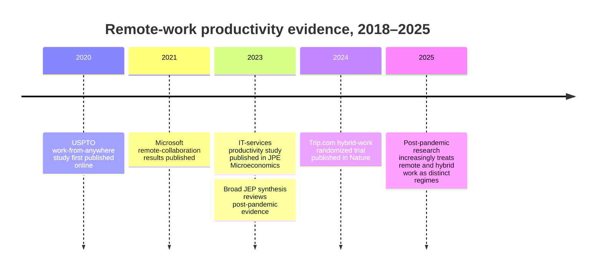

# Adaptable Deep-Research Protocol and Worked Example

## Executive summary

Because the actual research topic represented by `[$deep-research]` is unspecified, this report provides a **topic-neutral research protocol** plus a worked example on **“the impact of remote work on productivity, 2018–2025.”** The approach is designed to make a research product auditable rather than merely comprehensive: define the decision question before searching; preserve search strings and inclusion rules; privilege primary and causal evidence; distinguish findings from interpretation; record contradictory results rather than averaging them away; and attach an explicit confidence judgment to each important conclusion. This is broadly consistent with PRISMA's emphasis on transparent identification, selection, appraisal, and synthesis of evidence, while a GRADE-style approach is useful for keeping “amount of evidence” separate from “certainty in the conclusion.” citeturn5search3turn5search0

The remote-work example illustrates why this discipline matters. Strong studies do **not** support a universal “remote work raises/lowers productivity” conclusion. A natural experiment at the USPTO associated work-from-anywhere flexibility with 4.4% higher output; an abrupt pandemic-era move to home working among more than 10,000 Indian IT professionals produced an estimated 8–19% fall in output per hour; Microsoft data showed firm-wide remote work made collaboration networks more siloed; and a 1,612-person randomized trial at Trip.com found two home days per week reduced attrition by one-third without detectable damage to performance. citeturn1search0turn3search1turn0search2turn0search0 The better synthesis is therefore conditional: **task structure, degree of remoteness, coordination requirements, implementation conditions, and the productivity metric all matter.**

## Scope and search protocol

Start every project with a one-page **scope contract**. Define the primary question, decision to be informed, population/unit of analysis, intervention or exposure, comparator, outcomes, geography, time horizon, and explicit exclusions. Also state what result would change the conclusion. This prevents “scope drift,” in which attractive but peripheral evidence silently changes the question.

A reusable search protocol is:

| Element | Template |
|---|---|
| Core question | “What is the effect of **X** on **Y**, for **Z**, under what conditions?” |
| Dates | Historical baseline + concentrated search of most recent 5 years |
| Primary databases | Web of Science/Scopus, Google Scholar, PubMed where relevant, Crossref/OpenAlex |
| Specialist sources | NBER/SSRN, standards bodies, regulators, statistical agencies, court or legislative databases, company filings |
| Search blocks | `(X synonyms) AND (Y synonyms) AND (population/context)` |
| Evidence expansion | Citation chasing, cited-by search, author search, replication-data search |
| Exclusions | Duplicates; unsupported commentary; irrelevant population; wrong outcome; obsolete superseded versions |

Use **primary/official material first**, then peer-reviewed studies, then reputable industry research for areas not covered by academic or government sources. Reviews should map the literature but should not substitute for inspecting pivotal underlying studies. Record exact search strings, dates searched, database, filters, and hit counts. PRISMA 2020 explicitly provides checklists and flow diagrams for transparent reporting of study identification and selection. citeturn5search3turn5search8

For the remote-work example, an initial query family would be:

`("remote work" OR "work from home" OR "hybrid work" OR "work from anywhere") AND (productivity OR output OR performance)`

Then branch into `randomized`, `natural experiment`, `administrative data`, `collaboration`, `retention`, and occupation-specific terms, limiting the main evidence synthesis to **2018–2025** while allowing older papers only as methodological or historical anchors.

## Credibility, extraction, and conflicting evidence

Do not score sources merely by prestige. Evaluate each claim on five dimensions: **design, measurement, identification, external validity, and reproducibility**. A randomized field experiment with administrative outcomes generally supports a stronger causal claim than a cross-sectional self-report, but even an experiment can have narrow generalizability. Confidence ratings should therefore describe *the particular inference*, not the journal or authors. This mirrors the logic behind evidence-certainty frameworks, which distinguish confidence in an estimated effect from simply counting studies. citeturn5search0turn5search10

Use an extraction sheet such as:

| Field | Record |
|---|---|
| Citation/version | DOI, publication date, working-paper history |
| Population/context | Country, firm/industry, occupation, N |
| Exposure/comparator | Exact treatment or working arrangement |
| Outcome | Objective output, output/hour, review score, self-report, etc. |
| Identification | RCT, natural experiment, panel, cross-section |
| Estimate | Effect size, uncertainty, duration |
| Limitations | Confounding, pandemic shock, selection, measurement |
| Replication | Data/code available? |
| Confidence | High / moderate / low, with reason |

Maintain a separate **conflict table**:

| Claim | Supporting evidence | Contrary evidence | Best explanation | Residual uncertainty |
|---|---|---|---|---|

This prevents heterogeneous findings from being mislabeled as “inconsistent” when they actually concern different treatments—for example, fully remote pandemic work versus planned hybrid work.

## Reproducible workflow and outputs

Keep searches, raw metadata, extraction tables, analysis code, and prose separate and version-controlled. A lightweight workflow is:

```bash
mkdir -p research/{queries,raw,extracted,analysis,figures}
git init

# Example metadata retrieval
curl -G "https://api.crossref.org/works" \
  --data-urlencode 'query.bibliographic=remote work productivity' \
  --data-urlencode 'filter=from-pub-date:2018-01-01,until-pub-date:2025-12-31' \
  -o research/raw/crossref.json

# Preserve protocol changes
git add research
git commit -m "Record initial search protocol and raw metadata"
```

Use scripts or a spreadsheet to deduplicate DOI/title records, then freeze an inclusion table before synthesis. Preserve enough information for another researcher to reconstruct why every pivotal source was included or rejected. Where quantitative studies are comparable, visualize effect estimates with confidence intervals; where they are heterogeneous, a **study-design × outcome matrix** is often more honest than a pooled chart.

Recommended visualizations are a chronological evidence timeline, forest/dot plot for genuinely comparable quantitative effects, sensitivity chart for alternative assumptions, and Mermaid flow/ER diagrams when relationships among actors, systems, events, or evidence objects matter.

## Worked example: remote work and productivity

The selected studies produce a conditional rather than binary conclusion.

| Study | Design and setting | Main result | Evidence strength |
|---|---|---|---|
| Choudhury et al., 2021 | Natural experiment, USPTO examiners | Work-from-anywhere transition increased output **4.4%**, with no increase in rework. citeturn1search0 | Moderate–high |
| Yang et al., 2022 | Natural experiment, **61,182 Microsoft employees** | Firm-wide remote work made collaboration networks more static and siloed, reducing cross-group bridges. citeturn0search2 | Moderate–high for collaboration; indirect for productivity |
| Gibbs et al., 2023 | Administrative/analytics data, >10,000 Indian IT professionals | Hours rose while output changed little; estimated productivity per hour fell **8–19%**, with higher coordination costs. citeturn3search1 | Moderate; pandemic transition is an important confound |
| Bloom, Han & Liang, 2024 | Six-month RCT, **1,612 Trip.com employees** | Two WFH days per week cut attrition by about **one-third**, while equivalence tests found no material performance loss. citeturn0search0 | High within this setting |

The literature therefore suggests that **“remote work” is too coarse an independent variable**. The USPTO evidence concerns additional geographic flexibility among experienced remote workers; the Gibbs study examines an abrupt pandemic-era transition in coordination-intensive professional work; the Microsoft study identifies changes in communication structure; and Trip.com tests deliberately designed hybrid work. citeturn1search0turn3search1turn0search2turn0search0 A 2023 *Journal of Economic Perspectives* synthesis similarly distinguishes fully remote from hybrid arrangements and emphasizes that productivity depends heavily on the form of remote work. citeturn4search0

A useful evidence timeline is:



For an actual report, the next layer would stratify findings by **fully remote vs. hybrid**, occupation/task interdependence, voluntary vs. forced adoption, objective vs. subjective productivity, short- vs. long-run outcomes, and individual vs. organizational performance. The resulting conclusion should be phrased conditionally: *planned hybrid work has comparatively strong evidence of maintaining measured performance while improving retention in at least some knowledge-work settings; evidence on fully remote work is more heterogeneous and exposes coordination costs that can offset individual flexibility gains.* citeturn0search0turn3search1turn0search2

## Assumptions and selected sources

**Assumptions.** The actual target topic is unspecified, so the framework above is intentionally domain-neutral; the illustrative evidence window is January 2018–December 2025, and today's reference date is **September 30, 2026**. A separate uploaded project-specific research brief is present, but it is explicitly inert absent invocation and is therefore not treated as the research target here. fileciteturn0file0

**Selected sources:** Page et al., *PRISMA 2020 Statement*, 2021. citeturn5search3turn5search8 Hultcrantz et al., GRADE Working Group guidance on certainty of evidence, 2017. citeturn5search0 Choudhury, Foroughi & Larson, *Strategic Management Journal*, 2021. citeturn1search0 Yang et al., *Nature Human Behaviour*, 2022. citeturn0search2 Gibbs, Mengel & Siemroth, *Journal of Political Economy Microeconomics*, 2023. citeturn3search1 Barrero, Bloom & Davis, *Journal of Economic Perspectives*, 2023. citeturn4search0 Bloom, Han & Liang, *Nature*, 2024. citeturn0search0