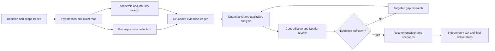
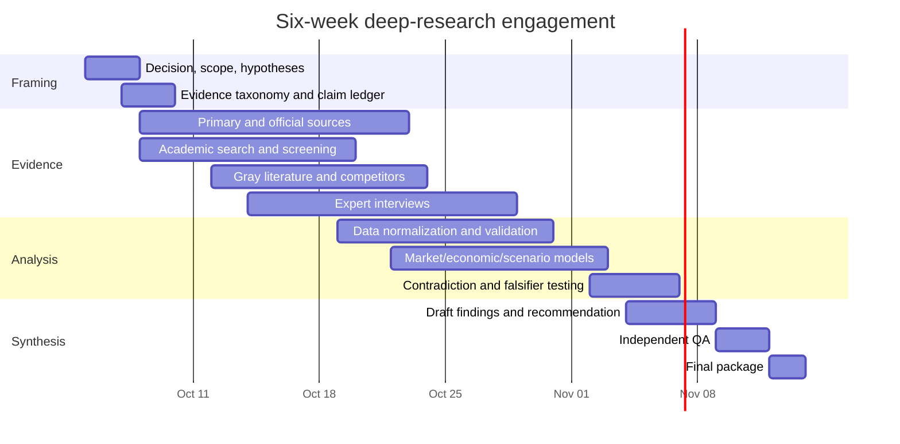
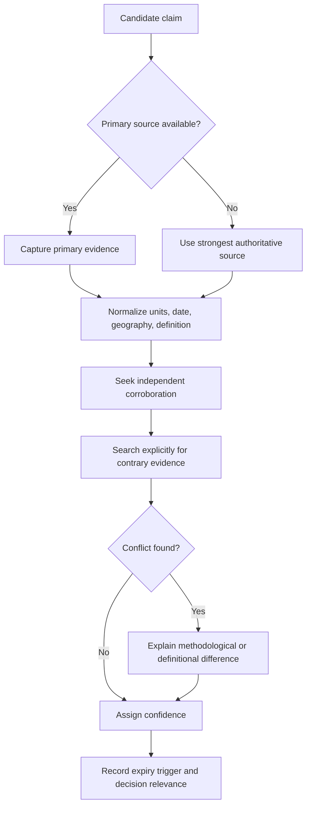

# Deep-Research Engagement Blueprint and Example Deliverable

## Executive summary

With no substantive topic specified, the most useful default is a **decision-oriented deep-research engagement**: start by defining the decision to be made, establish an evidence hierarchy and falsifiable research questions, build a source-pinned claim ledger, triangulate quantitative and qualitative evidence, and finish with a recommendation whose assumptions, uncertainty, and disconfirming evidence are explicit. This is stricter than a conventional literature review because the goal is not merely to summarize what sources say, but to determine **what is sufficiently supported to act on**.

A six-week engagement is the recommended baseline. Four weeks is feasible for a bounded landscape assessment with limited primary research; eight weeks is preferable when the decision involves substantial capital, regulation, technical uncertainty, market sizing, interviews, or proprietary datasets. The uploaded DS-25 research specification provides a useful model for this rigor: it calls for source-pinned claims, explicit classifications and confidence levels, negative trials/falsifiers, separate treatment of distinct outcomes, completion gates, and clear non-goals rather than allowing a broad conclusion to substitute for independently verified subclaims. fileciteturn0file0

The evidence hierarchy should put laws, regulations, administrative datasets, regulatory dockets, company filings, original datasets and original research ahead of commentary. SEC EDGAR, for example, supplies primary public-company filings; Crossref exposes structured scholarly metadata including publication updates and identifiers; PRISMA provides a mature model for transparent search and review reporting even when its full systematic-review protocol is not appropriate to a commercial study. citeturn3search0turn3search1turn0search12

For the sample deliverable below, the hypothetical question is:

> **Should a non-lithium long-duration energy-storage company enter the U.S. utility-scale market, and if so, through which initial customer/use-case segment and commercialization model?**

That example is timely because global clean-energy capital spending is projected by the IEA at about **$2.2 trillion in 2026**, while IRENA reports that the world added **692 GW of renewable capacity in 2025**, taking renewable capacity to 5,149 GW. Those figures establish a large and still-expanding energy-transition context, but they do **not** by themselves prove the commercial attractiveness of any particular storage technology or market segment. citeturn1search2turn0search0

## Scope, objectives, and research options

### Decision framing

The engagement should begin with one sentence of the form:

> **Decision:** “By `[date]`, should `[decision-maker]` do `[action]` in `[market/system]`, given `[constraints]`?”

Every workstream should trace back to that decision. A generic research scope can then be decomposed into five objectives:

1. Establish the **current state** using the newest credible primary and official evidence.
2. Quantify the **size, economics, technical feasibility, regulatory environment, and competitive position** relevant to the decision.
3. Identify what is **known, disputed, inferred, stale, or genuinely unknown**.
4. Test competing hypotheses rather than accumulating only confirming evidence.
5. Produce an auditable recommendation with explicit **decision thresholds and falsifiers**.

The final objective is important. A result such as “the market is growing” is usually not decision-grade. A better claim is: “Entry is recommended only if contracted gross margin exceeds X under Y utilization and customer-acquisition assumptions; otherwise partnership/licensing dominates direct entry.” The numeric thresholds would be derived during the study rather than assumed in advance.

### Alternative engagement models

| Research option | Typical duration | Best suited to | Main strengths | Main trade-off |
|---|---:|---|---|---|
| **Rapid landscape** | 4 weeks | Early strategy, hypothesis generation, screening markets | Fast; broad; low coordination burden | Thin interview coverage; less time for proprietary data and adversarial validation |
| **Decision-grade diligence** | 6 weeks | Market entry, product strategy, investment committee decisions | Balanced primary/secondary work; quantitative modeling; independent QA | Requires tight scope discipline |
| **High-assurance deep dive** | 8 weeks | Large capital commitments, regulated markets, technically uncertain sectors | More interviews, scenarios, source reconciliation, sensitivity analysis and validation | Higher cost; risk of marginal research yielding diminishing returns |

**Recommended default:** six weeks, with an eight-week extension only when predefined uncertainty gates remain unresolved.

Scope should explicitly distinguish **questions from non-goals**. For example, a market-entry study may determine which market and customer segment is most attractive without performing detailed engineering design, legal due diligence, environmental permitting, or a final investment-grade project model. The DS-25 brief illustrates the same discipline by separately declaring research questions, deliverables, non-goals, completion gates and prohibited overclaims. fileciteturn0file0

## Prioritized research plan and timeline

### Workstream sequence

The highest-priority work is not “search the literature”; it is to freeze definitions and decision criteria before evidence collection. Otherwise research tends to drift toward whatever information is easiest to find.



This architecture borrows the transparency principle behind systematic-review standards such as PRISMA—document the search, screening and evidence path—without pretending that a commercial diligence project is itself a clinical systematic review. PRISMA 2020 includes a 27-item reporting checklist and flow diagrams intended to make review procedures transparent and reproducible. citeturn0search12

### Six-week baseline

The dates below assume a start on Monday, October 5, 2026.



### Week-by-week priorities

| Period | Priority | Output / decision gate |
|---|---|---|
| **Week 1** | Define terms, geography, horizon, decision criteria and hypotheses | Scope memo; question tree; evidence schema; initial source map |
| **Week 2** | Establish official fact base; launch academic review and interviews | Baseline dataset; first claim ledger; unresolved-data list |
| **Week 3** | Competitor/customer/regulatory analysis; quantitative normalization | Market map; comparable metrics; preliminary market-sizing model |
| **Week 4** | Economics, scenarios, customer evidence, technical constraints | Unit economics; scenario model; provisional findings |
| **Week 5** | Adversarial validation and gap closure | Contradiction matrix; falsifier assessment; confidence grading |
| **Week 6** | Decision synthesis and QA | Executive report, models, evidence annex, recommendation memo |

A four-week version should cut **breadth**, not evidence standards: narrow the geography, use case or competitor set and reduce interviews. An eight-week version should add customer interviews, paid datasets, deeper scenario modeling, regulatory counsel or technical SME review rather than simply collecting more documents.

## Methodology, data sources, search, and validation

### Evidence hierarchy

A practical hierarchy is:

| Tier | Evidence type | Examples | Default treatment |
|---|---|---|---|
| **A** | Direct primary evidence | Statutes, regulatory orders/dockets, administrative datasets, company filings, patents, raw measurement data, contracts where accessible | Highest weight |
| **B** | Authoritative official synthesis | Statistical agencies, IEA, IRENA, DOE/NREL, central banks, standards bodies | High weight; inspect methodology |
| **C** | Original research | Peer-reviewed empirical papers, working papers with disclosed data/code | High-to-medium depending on design |
| **D** | Industry research | Trade associations, consulting reports, analyst research, proprietary market databases | Useful for triangulation; inspect incentives/method |
| **E** | Commentary | Press, blogs, marketing materials | Leads/context, not sole support for critical claims |

For public companies, SEC filings should normally outrank summaries of those filings because EDGAR provides real-time and historical disclosure documents directly from filers. citeturn3search0 Academic records can be reconciled through DOI and metadata services such as Crossref, whose API includes bibliographic metadata, funding information, licenses, publication updates and persistent identifiers. citeturn3search1

For climate and energy topics, priority official sources include national energy/statistical agencies, utility regulators, RTO/ISO filings, DOE and national laboratories, IEA and IRENA. The IEA, for example, publishes its modeling framework and, in 2026, released documentation for a manufacturing-and-trade model covering solar PV, wind turbines, electric cars, batteries, electrolysers and heat pumps. citeturn1search9 DOE's Pathways to Commercial Liftoff research combines stakeholder engagement with system-level and project-level financial modeling, which makes it especially useful as a commercialization source rather than merely a technology description. citeturn1search5

### Search strategy

Search should be **layered**, not based on a single database.

**Academic layer.** Search Web of Science/Scopus where available, OpenAlex, Crossref and Google Scholar for recall; use backward references and forward citations after finding seminal papers. Crossref is particularly useful for structured DOI-level metadata reconciliation. citeturn3search1

Generic query structure:

```text
("target technology" OR synonym_1 OR synonym_2)
AND
(market OR adoption OR commercialization OR economics OR deployment)
AND
(cost OR performance OR policy OR regulation OR customer OR competition)
```

Climate-tech/LDES example:

```text
("long duration energy storage" OR LDES OR "multi-day storage"
 OR "flow battery" OR "thermal energy storage")
AND
("techno-economic" OR commercialization OR deployment
 OR "levelized cost" OR reliability OR "capacity value")
```

**Official-web layer.**

```text
site:energy.gov "long duration energy storage" commercialization
site:eia.gov battery storage capacity cost
site:ferc.gov storage interconnection order
site:nrel.gov storage "Annual Technology Baseline"
site:sec.gov <competitor name> 10-K
site:*.gov <technology> permit OR rule OR docket
```

**Gray-literature layer.** Search regulatory consultations and dockets, utility IRPs, RTO/ISO planning documents, conference proceedings, preprints, dissertations, technical standards, patent databases, procurement documents and investor disclosures. These sources often reveal deployment constraints or pipeline information months before a peer-reviewed paper can.

The search log should preserve exact query, database, filters, search date, hit count, screening rule and included/excluded records. That gives the project an auditable evidence trail analogous to the transparency sought by systematic-review reporting frameworks. citeturn0search12

### Source-pinned data protocol

Every decision-relevant claim should enter a structured ledger:

| Field | Example |
|---|---|
| Claim ID | MKT-014 |
| Atomic claim | “2025 global renewable additions were 692 GW.” |
| Source | IRENA Renewable Capacity Statistics 2026 |
| Source class | Official intergovernmental |
| Publication date | April 1, 2026 |
| Applicable period | Calendar 2025 |
| Geography | Global |
| Measurement definition | Installed renewable-power capacity additions |
| Value / units | 692 GW |
| Exact locator | Table/page/section or structured-data field |
| Independent corroboration | Yes / No / Not required |
| Confidence | High |
| Caveats | Capacity ≠ generation or revenue |
| Expiry trigger | New annual IRENA release |

IRENA's 2026 release reports 692 GW of renewable additions in 2025, 5,149 GW of total renewable capacity and a 15.5% annual increase; those are distinct measurements and should not be conflated with energy generated, addressable-market revenue or profitability. citeturn0search0

For each critical claim, the protocol should require:

**Definition check → provenance check → unit check → date check → denominator check → independent reproduction → contradiction search → confidence assignment.**

A project-level QA standard can require a second researcher to recheck **all recommendation-driving claims** and a sample of lower-tier claims. Contradictory credible sources should remain visible in the ledger rather than being averaged into an artificial consensus.



A particularly strong practice from the uploaded DS-25 specification is to define a **decisive falsifier** alongside a preferred conclusion: the research should say not only why the recommendation currently wins, but what evidence would reverse it. fileciteturn0file0

## Analysis methods, deliverables, effort, and budget

### Analytical toolkit

The exact toolkit depends on the question, but a market-entry project would normally combine:

**Market sizing.** Reconcile at least one bottom-up approach—customers × deployments × realistic spend—with a top-down market estimate. Show TAM, SAM and a capacity-constrained obtainable market separately.

**Commercial economics.** Model customer value, revenue stack, capital expenditure, operating expenditure, gross margin, financing assumptions, utilization, sales cycle and working capital. Use sensitivities rather than a single deterministic forecast.

**Competitive analysis.** Compare technical performance, price architecture, installed base, customer segment, financing, partnerships, IP exposure and supply-chain position.

**Policy/regulatory analysis.** Map each rule to its concrete economic mechanism: eligibility, cost, timeline, permitting, interconnection, procurement or risk.

**Scenario analysis.** At minimum: base, downside and upside. For highly uncertain inputs, Monte Carlo analysis can show which variables actually dominate the outcome rather than presenting false precision.

**Evidence-weighted synthesis.** Separate facts, analyst calculations, expert judgments and hypotheses in the final document.

For energy commercialization, this mixed approach is consistent with the way DOE Liftoff reports combine system-level analysis, project-level financial analysis and stakeholder evidence. citeturn1search5

### Deliverable package

| Deliverable | Rapid, 4 wk | Standard, 6 wk | High-assurance, 8 wk |
|---|:---:|:---:|:---:|
| Executive decision memo | ✓ | ✓ | ✓ |
| Source-pinned claim ledger | ✓ | ✓ | ✓ |
| Search log / evidence appendix | ✓ | ✓ | ✓ |
| Market and competitor database | Basic | Full | Full + proprietary |
| Bottom-up market model | Basic | ✓ | ✓ |
| Unit-economics / financial model | Limited | ✓ | Advanced |
| Regulatory map | ✓ | ✓ | Counsel/SME-reviewed |
| Expert interviews | 3–5 | 8–15 | 15–30 |
| Customer segmentation | Desk-based | Validated | Deep primary research |
| Scenario/sensitivity analysis | Basic | ✓ | Advanced / probabilistic |
| Contradiction/falsifier matrix | ✓ | ✓ | ✓ + independent challenge |
| Final presentation/workshop | ✓ | ✓ | ✓ |
| Machine-readable evidence pack | Optional | ✓ | ✓ |

Recommended charts include market growth by segment, adoption funnel, cost curves, competitor positioning, scenario waterfalls, sensitivity/tornado charts and a source-confidence heat map. Each chart should link back to the model inputs and claim ledger.

### Resource model and planning budget

These are **illustrative planning envelopes, not vendor quotations**.

| Model | Team profile | Average effort | External costs | Illustrative total |
|---|---|---:|---:|---:|
| **4-week rapid** | Research lead + analyst + fractional SME | ~1.5–2.0 FTE | $5k–$20k | **$45k–$90k** |
| **6-week standard** | Lead + 1–2 analysts + data/modeling + fractional SME/QA | ~2.5–3.5 FTE | $15k–$50k | **$100k–$200k** |
| **8-week high-assurance** | Lead + 2 analysts + data scientist + sector SME + research ops + QA | ~3.5–5.0 FTE | $30k–$100k+ | **$200k–$400k+** |

External costs cover items such as paid market databases, expert networks, transcription, specialist technical review or legal/regulatory analysis. With no budget constraint, additional spending should be tied to **uncertainty reduction**: buy a dataset or expert call only when it could plausibly change the decision.

A balanced six-week staffing pattern would be approximately 0.6 FTE research lead, 1.0–1.5 FTE research analysts, 0.4–0.6 FTE quantitative analyst/data scientist, 0.3–0.5 FTE sector expert and 0.2–0.3 FTE research-operations/QA support.

## Risks, assumptions, and mitigation

| Risk | Why it matters | Mitigation / stop rule |
|---|---|---|
| **Scope creep** | Breadth rises faster than decision value | Freeze decision tree in Week 1; new questions require explicit trade-off |
| **Stale data** | Markets and policy can move during the study | Record “as-of” dates and expiry triggers; re-run critical searches before finalization |
| **Definition mismatch** | Two “market size” numbers may measure different things | Preserve denominator, geography, units, methodology and time period |
| **Source circularity** | Many reports can trace back to one estimate | Identify original provenance and count it as one evidence lineage |
| **Selection bias** | Search can favor the preferred answer | Maintain explicit counter-hypothesis and contrary-evidence searches |
| **Vendor/industry bias** | Commercial reports may overstate adoption | Triangulate against filings, regulators, customers and observed deployments |
| **False precision** | Thin evidence becomes a detailed forecast | Use ranges/scenarios and show sensitivity to dominant variables |
| **Interview bias** | Experts may have incentives or narrow experience | Deliberately sample opposing roles; distinguish attributed evidence from opinion |
| **Regulatory change** | Commercial attractiveness can change abruptly | Separate enacted rules, proposed rules and analyst assumptions; maintain change log |
| **Unknown unknowns** | Missing evidence may be mistaken for evidence of absence | Include an explicit “unknown / insufficient evidence” classification |

A related risk is **proxy substitution**: using an easily measured variable to answer a harder question. Renewable-capacity growth, for example, indicates deployment momentum but does not establish a storage vendor's serviceable market, margins or willingness-to-pay. IRENA reports the former; customer economics must be researched separately. citeturn0search0 Similarly, IEA's projected $2.2 trillion of 2026 clean-energy investment establishes macro capital flows, not the attractiveness of every climate-tech segment. citeturn1search1turn1search2

The governing assumption should therefore be:

> **No recommendation-driving claim is promoted from “hypothesis” to “finding” merely because it appears in multiple secondary reports.**

## Example deliverable: climate-tech market entry

### Hypothetical mandate and report outline

**Question:** Should a non-lithium long-duration energy-storage developer enter the U.S. utility-scale market for deployments beginning in 2027–2030?

A decision-grade report could have this structure:

1. Executive recommendation and decision conditions  
2. Market definition and use-case segmentation  
3. Customer needs and buying criteria  
4. Deployment and demand indicators  
5. Technology economics and customer value  
6. Competitor and substitute analysis  
7. Regulation, interconnection and procurement  
8. Manufacturing and supply-chain requirements  
9. Go-to-market alternatives  
10. Scenario model and key sensitivities  
11. Risks and falsifiers  
12. Evidence ledger and methodology appendix  

Priority primary/official sources would include EIA installation and generator datasets; FERC orders, tariffs and dockets; RTO/ISO planning and interconnection records; state commission dockets and utility integrated-resource plans; DOE and national-lab technical data; SEC filings from public competitors/customers; patents and permitting records. SEC EDGAR provides the direct filings layer, while FERC's interconnection rules provide direct regulatory evidence rather than commentary about those rules. citeturn3search0turn2search15

Authoritative synthesis would then include DOE Liftoff/Storage Innovations, IEA and IRENA. DOE's Storage Innovations program explicitly addresses technologies capable of **10 hours or more** of storage and frames a 2030 cost-reduction target, while DOE's commercialization work treats LDES as an emerging technology requiring further cost reduction, technical development and investment. citeturn2search19turn2search3 EIA's March 2026 storage update supplies observed U.S. battery-storage capacity, applications, ownership, co-location and installation-cost data and explicitly notes that it is a data report rather than a rigorous causal or scenario analysis—a useful methodological limitation to retain in the evidence ledger. citeturn2search21

### Mock executive summary

**Illustrative conclusion — not an investment recommendation:** *Proceed to a focused U.S. market-entry validation phase, but do not launch nationally.*

The macro environment supports continued diligence. Global clean-energy investment is projected by the IEA to reach roughly **$2.2 trillion in 2026**, close to two-thirds of overall energy investment, while IRENA reports record renewable-capacity additions of **692 GW in 2025**. These indicators strengthen the strategic case for flexibility and storage technologies, but they are not direct measures of long-duration-storage revenue. citeturn1search0turn0search0

The more important finding is that LDES remains a **commercialization problem rather than a simple demand-growth story**. DOE has repeatedly treated long-duration storage as a technology area requiring further cost improvement, investment and deployment maturation, and its Storage Innovations framework specifically targets technologies providing ten hours or more of duration. citeturn2search3turn2search19 This implies that a new entrant should prove a narrowly defined customer value proposition before building a broad sales and manufacturing footprint.

**Recommended entry hypothesis:** pursue one or two use cases where long discharge duration creates value that short-duration alternatives cannot economically replicate, establish customer-backed demonstration projects, and use those deployments to validate degradation, availability, installed cost, dispatch economics and bankability before scaling.

This is an **inference from the commercialization evidence**, not a directly reported government recommendation. DOE's own commercialization approach uses system modeling, project-level economics and stakeholder evidence, which is consistent with requiring customer/project proof before treating theoretical system need as commercial demand. citeturn1search5

Direct national expansion should be gated on evidence that at least four conditions hold simultaneously:

- The technology's customer economics remain competitive under realistic financing and utilization assumptions.
- A repeatable procurement/revenue mechanism exists in targeted jurisdictions.
- Interconnection and deployment timelines do not erase the project's economic advantage.
- At least one scalable customer segment shows willingness to contract without depending on permanently exceptional subsidy assumptions.

Generator interconnection must be modeled as a material go-to-market variable rather than an administrative afterthought. FERC's interconnection reforms explicitly address queue backlogs, cluster studies, readiness requirements and treatment of newer nonsynchronous resources such as battery storage, while 2026 Commission activity shows that transmission/interconnection processes remain under active reform. citeturn2search15turn2search13

### Mock findings table

| Illustrative finding | Evidence status | Commercial implication | Confidence |
|---|---|---|---|
| Global capital formation around clean energy remains very large | IEA projects ~$2.2T clean-energy investment in 2026. citeturn1search2 | Supports sector-level opportunity; **does not prove LDES economics** | High |
| Renewable deployment continues to expand rapidly | IRENA reports 692 GW added in 2025 and 5,149 GW total capacity. citeturn0search0 | Expands contexts in which flexibility may have value; requires local grid validation | High |
| LDES remains at an earlier commercialization stage than established storage categories | DOE identifies continued technical progress, cost reduction and investment as necessary for commercialization. citeturn2search3 | Favor targeted pilots/partnerships over immediate national fixed-cost buildout | High |
| Long duration should be treated as a distinct use case, not simply “more battery hours” | DOE Storage Innovations explicitly addresses ≥10-hour storage technologies. citeturn2search19 | Segment customers by duration requirement and service stack | High |
| Observed battery-market growth cannot be used directly as LDES TAM | EIA's storage dataset covers capacity, applications, costs and ownership but disclaims rigorous economic/scenario interpretation. citeturn2search21 | Build bottom-up LDES TAM rather than multiplying general storage forecasts |
| Interconnection conditions can alter project timing and economics | FERC has revised generator-interconnection procedures and requires more detailed treatment of nonsynchronous resources. citeturn2search15 | Region selection must include queue/readiness/transmission screens | High |
| A demonstration-led entry is preferable to a national launch | Analytical inference from commercialization maturity and regulatory complexity. citeturn2search3turn2search15 | Minimize irreversible fixed costs until customer economics are proven | Medium |

### Illustrative decision matrix

| Entry model | Capital exposure | Speed to learning | Control | Bankability burden | Initial view |
|---|---:|---:|---:|---:|---|
| National direct sales + manufacturing | Very high | Medium | High | Very high | **Reject initially** |
| Regional direct-entry beachhead | Medium-high | High | High | High | **Conditional** |
| Utility/developer partnership | Medium | High | Medium | Shared | **Preferred test route** |
| License technology to established integrator | Low | Medium | Low | Lower | **Strong fallback** |
| Remain R&D-only | Low | Low commercial learning | High technical control | Low | **Use if economics fail gates** |

The preferred option is therefore **partner-led regional commercialization**, not because partnership is universally superior, but because it preserves learning while limiting irreversible capital before the project's key economic uncertainties are resolved.

**Decisive falsifier:** the recommendation should be reversed if bottom-up project modeling plus customer evidence shows that the technology cannot generate competitive customer returns at realistic installed cost, utilization, financing, degradation and interconnection assumptions—even under the most attractive identified initial use case. A large macro market or favorable technology narrative would not override that result.

### Example final output set

The completed engagement would deliver a roughly 25–40 page decision report, a five-page executive memo, an editable market/economic model, customer/use-case segmentation, competitor database, regulatory map, scenario and sensitivity charts, interview synthesis, the complete search log, and a machine-readable claim ledger tying every recommendation-driving statement to its source, date, definition, confidence and expiry trigger.

That architecture intentionally separates **evidence, calculation, inference and recommendation**. It follows the same high-assurance principle embodied in the uploaded research brief: distinct outcomes should be measured separately, unknowns should remain explicitly unknown, and a plausible narrative should never substitute for a falsifiable completion criterion. fileciteturn0file0