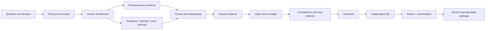
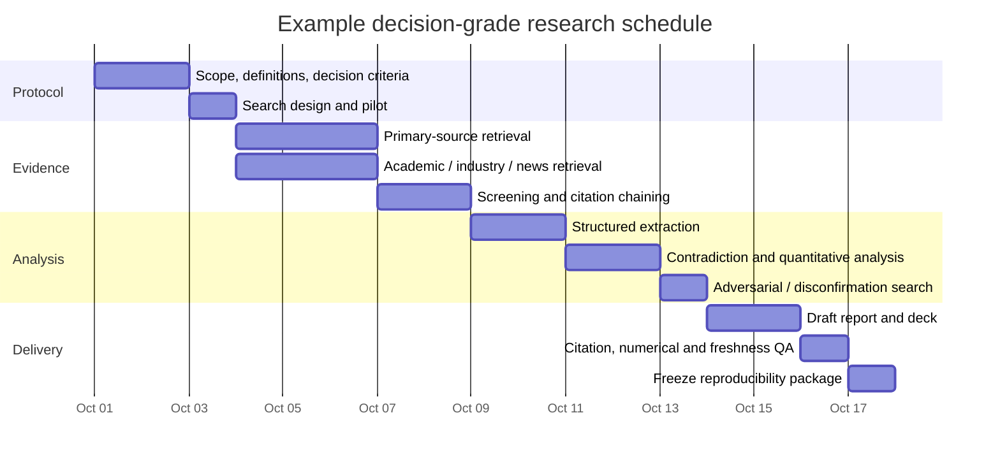

# Reusable Deep-Research Plan and Deliverable Template

## Executive summary

Because `[$deep-research]` does not specify a subject, the most rigorous response is a **topic-agnostic research protocol** that can be instantiated once the research question is known. The recommended design is decision-oriented rather than simply accumulative: define the question and decision criteria first; pre-specify scope and inclusion rules; search multiple source classes systematically; privilege primary evidence; maintain a claim-to-source ledger; explicitly preserve contradictions and uncertainty; and make every consequential conclusion reproducible from the retained evidence.

For evidence-intensive work, this approach borrows useful disciplines from systematic-review practice without requiring every project to become a formal systematic review. PRISMA 2020 provides a reporting checklist and flow-diagram framework, while the current Cochrane Handbook emphasizes a preplanned, reproducible search across multiple sources, citation/reference searching, grey-literature consideration, and peer review of important search strategies. citeturn0search1turn0search2turn1search0

The core hierarchy should be:

**primary/official evidence → original research/data → authoritative synthesis → specialist secondary analysis → reputable news → discovery-only material.**

Search engines and AI-assisted discovery should locate evidence, not substitute for it. Google Scholar itself notes limits on coverage, bulk retrieval, and record-update timing; Crossref exposes publisher-deposited bibliographic metadata programmatically; PubMed, Scopus, and Web of Science provide more structured fielded searching for appropriate subject areas. citeturn2search0turn0search0turn6view0turn7search3turn8search6

A strong research package should produce not merely prose but an auditable evidence set: a research protocol, search log, source library, extraction table, claim table, contradiction register, calculations/code where applicable, final report, and compact presentation. That structure also maps well to unusually strict technical briefs: the attached DS-01, for example, requires source-pinned claims, explicit confidence and expiry, complete matrices, competing options with falsifiers, and privacy/completion gates. It also states that it is inert until explicitly invoked, so it is treated here only as an example of rigorous research specification rather than as the research topic itself. fileciteturn0file0

The entire process can be summarized as:



The crucial design principle is **traceability**: a reader should be able to move from any important sentence in the conclusion backward to the underlying evidence, its date and version, extraction, interpretation, and uncertainty.

## Research design and actionable workflow

The first task is not searching. It is converting the request into a falsifiable question and a written protocol. A practical protocol records the research question, intended decision, population/system or market under study, geography, timeframe, definitions, exclusions, evidence cutoff date, deliverables, and what would change the conclusion. In formal reviews, defining scope and eligibility before study selection is central to avoiding ad hoc evidence selection; the same discipline transfers well to business, technology, policy, and investigative research. citeturn1search3turn1search0

**Recommended workflow**

| Stage | Action | Required artifact | Exit criterion |
|---|---|---|---|
| Frame | Convert the request into answerable subquestions and identify the decision the work must support. | Research brief | Terms and outcome criteria are unambiguous. |
| Protocol | Fix scope, dates, geography, languages, source classes, inclusion/exclusion criteria, and freshness requirements. | `protocol` | Material scope changes now require logging. |
| Map terminology | Build synonyms, acronyms, former names, technical terminology, controlled vocabulary, and exclusions. | Concept map / term table | Each core concept has search variants. |
| Pilot | Run several deliberately broad searches and inspect approximately 20–50 representative results. | Pilot notes | Vocabulary and major source families stabilize. |
| Retrieve | Search primary sources first, then structured databases, then industry/news/grey literature. | Search log + source library | Major evidence channels have been covered. |
| Snowball | Follow references backward and citations forward from seminal/high-value sources. | Added records | New high-value sources become infrequent. |
| Screen | Deduplicate; screen title/abstract or equivalent; record exclusions that could be challenged later. | Screening table | Inclusion rules have been applied consistently. |
| Extract | Capture evidence in structured fields, never only in prose notes. | Evidence table | Every included source has an extraction record. |
| Triangulate | Compare independent sources, source versions, dates, methodologies, and conflicting estimates. | Contradiction register | Disagreements are resolved or explicitly retained. |
| Synthesize | Separate observed fact, source assertion, calculation, inference, forecast, and recommendation. | Claim table + draft | Every material conclusion has evidence attached. |
| Challenge | Search specifically for disconfirming evidence and credible competing explanations. | Red-team memo | Strongest countercase has been addressed. |
| QA | Recheck citations, numbers, recency, source identity, and reproducibility. | QA checklist | No unsupported material claim remains. |
| Publish/archive | Produce report/deck and freeze the evidence package with retrieval dates and versions. | Final package | Another analyst could approximately reproduce it. |

A search should normally favor **recall early and precision later**. Cochrane describes the basic tradeoff: increasing search sensitivity generally reduces precision, so comprehensive reviews intentionally accept more irrelevant records during retrieval and eliminate them during screening. It also recommends checking relevant reviews and reference lists rather than relying on one database. citeturn1search0

For English-priority work, search English first for efficiency but record the restriction explicitly. Where the subject is geographically non-English, the apparent evidence gap is itself consequential, or a key primary source exists only in another language, escalate those items rather than pretending the English corpus is complete. Cochrane specifically warns that language restrictions can introduce language or indexing bias in systematic evidence searches. citeturn1search1

### Recommended evidence record

Every important source should produce a row roughly like this:

| Field | Example content |
|---|---|
| `source_id` | `S042` |
| Full citation | Author / organization, title, date, DOI or stable identifier |
| Source class | Primary data / original study / regulation / filing / secondary analysis / news |
| Research question | `RQ-2` |
| Claim supported | Exact normalized claim |
| Evidence extracted | Paraphrased result plus table/page/section locator |
| Population/scope | What the finding actually covers |
| Method | Experiment, survey, administrative data, filing, interview, etc. |
| Publication date | Date published |
| Evidence period | Dates represented by the underlying data |
| Retrieval date | When researcher obtained it |
| Version | Version/revision/archive identifier |
| Limitations | Known caveats |
| Conflicts/funding | Relevant disclosure |
| Confidence | High / medium / low with rationale |
| Freshness/expiry | Date or event that should trigger revalidation |
| Contradictory sources | IDs of competing evidence |
| Analyst treatment | Accepted / qualified / rejected / unresolved |

This prevents a frequent error: confusing **publication date** with **the date the underlying event or dataset actually describes**.

## Source priorities and databases

Source priority should be determined by the claim rather than by prestige alone. A regulator is generally the best authority for the text of its rule; a company's audited filing is better than a newspaper's paraphrase for what the company disclosed; an original experiment is preferable to a blog summary for its measured result; and an independent investigation may be superior to the subject's own statement when the question is whether that statement is true. This is why the hierarchy is claim-specific rather than absolute.

| Domain | Highest-priority evidence | Discovery / corroboration layer | Typical role |
|---|---|---|---|
| Academic | Original paper, supplementary materials, registered protocol, original dataset/code; systematic review when the question asks for the totality of evidence | PubMed, Scopus, Web of Science, Google Scholar, Semantic Scholar, Crossref | Establish mechanisms, measured effects, scholarly consensus and disputes. |
| Industry | Regulatory filings; official company documentation; audited accounts; standards/specifications; patents; original benchmark methodology | Trade associations, analyst reports, market databases, conference material, expert commentary | Establish company claims, product behavior, markets and technical practice. |
| Government / policy | Statutes, regulations, court opinions, agency decisions, official statistics and administrative datasets | GovInfo, Data.gov, agency portals, FRED/ALFRED, legislative research products | Establish law, policy, official measures and historical revisions. |
| News / events | Original documents and direct recordings first; reputable contemporaneous reporting second | Reuters/AP and equivalent high-standard outlets; specialist trade press; licensed archives such as Factiva/LexisNexis where available | Reconstruct timelines and discover documents/witnesses. |
| Web / grey literature | Official institutional reports, theses, conference papers, standards drafts, repositories | Targeted web search and citation chasing | Fill publication gaps and locate evidence outside journal databases. |

For **academic research**, PubMed's current guide supports field tags, Boolean operators, phrase search, truncation, date filters and other structured search mechanisms. Scopus supports field codes plus Boolean and proximity operators, and Web of Science likewise documents Boolean/proximity searching. Google Scholar is particularly valuable as a broad discovery and citation-chaining layer—it indexes multiple scholarly formats and supports “Cited by,” related-article exploration, date filtering and alerts—but Google states that bulk access is unavailable and that updates to existing records may lag substantially, so it should not be the sole reproducible bibliographic dataset for large reviews. citeturn6view0turn8search5turn8search6turn2search0

Crossref is especially useful for DOI normalization and metadata enrichment. Its REST API exposes member-deposited scholarly metadata including identifiers, funding, licensing and post-publication-update information, and its API can be queried without signup; for reproducible automation, record the API version and retrieval date. citeturn0search0turn0search6turn0search13 Semantic Scholar also exposes an academic graph/API and downloadable research datasets, making it useful as a secondary programmatic discovery graph rather than as a replacement for the original publications. citeturn2search2

For **corporate and industry research**, begin with issuer/regulator primary documents. SEC EDGAR supports real-time company filings and full-text searching, including filtering by company, form and date; its current full-text service documents phrase, Boolean, exclusion, proximity and wildcard searches over electronically submitted filings. citeturn3search1turn8search0 Analyst reports are most useful afterward—as alternative interpretations, market models, expert interviews and estimates that can be compared against primary disclosures.

For **U.S. government research**, GovInfo provides official publications across the three federal branches and includes provenance/preservation infrastructure; the Federal Register is the official daily publication for federal rules, proposed rules and notices. Data.gov acts principally as a metadata catalog pointing to agency-published data rather than hosting every underlying dataset itself. citeturn3search0turn3search4turn3search2turn3search3 FRED aggregates frequently updated macroeconomic and regional series, while ALFRED retains historical vintages, which is particularly valuable when the question depends on what economic data showed **at a past point in time**, rather than what later revisions show today. citeturn4search0turn4search1turn4search12

For **news**, use reporting chiefly for chronology, discovery, attribution and independent corroboration, then trace consequential claims backward to documents or firsthand evidence where possible. Reputable editorial processes still require independent verification: Reuters' current standards, for example, explicitly require facts and claims produced through AI-assisted workflows to be independently checked rather than accepted as generated. citeturn7search6

### Source credibility rubric

A useful scoring system is deliberately simple enough to apply consistently:

| Dimension | Weight | High-score condition |
|---|---:|---|
| Proximity to evidence | 25% | Original data/document/observation rather than repeated reporting |
| Institutional or author competence | 15% | Demonstrable subject authority |
| Method transparency | 20% | Methods, sample and assumptions can be inspected |
| Data/provenance traceability | 15% | Underlying evidence and transformations can be followed |
| Independence/conflicts | 10% | Material incentives disclosed and controlled |
| Recency/version fitness | 10% | Correct version and suitable evidence period |
| Independent corroboration | 5% | Important result reproduced or separately supported |

Use the score to **triage**, not to automate truth. A low-ranked primary source may still be dispositive of what its author officially said, while a beautifully conducted study outside the relevant population may be useless for the actual claim.

For critical findings, classify confidence explicitly:

| Confidence | Recommended interpretation |
|---|---|
| High | Direct evidence from strong primary sources, or multiple independent high-quality sources, with no unresolved material contradiction |
| Medium | Good evidence but meaningful limitations, extrapolation, staleness or disagreement |
| Low | Sparse, indirect, weakly reproducible or materially contested evidence |
| Unverified | A claim worth retaining but not yet pinned to adequate evidence |

## Search strategy and reusable queries

Searches work best when each research question is decomposed into **concept blocks**. Start with:

`Concept A × Concept B × outcome/mechanism × context × timeframe`

For each block, build a term table containing canonical names, synonyms, acronyms, spelling variants, predecessor terms, technical vocabulary, relevant identifiers, and common false-positive terms.

A generic high-recall string is:

```text
("concept A" OR "synonym A1" OR synonymA2*)
AND
("concept B" OR "synonym B1" OR synonymB2*)
AND
(outcome* OR effect* OR mechanism*)
NOT
(known_irrelevant_term OR known_false_positive)
```

Do not mechanically copy one syntax into every database. Field codes, wildcards, phrase handling and operator precedence differ. PubMed, Scopus and Web of Science each document database-specific search rules. citeturn6view0turn8search5turn8search6

| Platform | Reusable pattern | Notes |
|---|---|---|
| PubMed | `("TERM A"[MeSH Terms] OR "term a"[Title/Abstract] OR synonym*[Title/Abstract]) AND ("TERM B"[MeSH Terms] OR "term b"[Title/Abstract])` | Combine controlled vocabulary with title/abstract terms; PubMed supports AND/OR/NOT, field tags, phrases and truncation. citeturn6view0 |
| Scopus | `TITLE-ABS-KEY(("term a" OR synonym*) AND ("term b" OR synonym*))` | Add date/document filters separately; Scopus supports Boolean and proximity operators in advanced search. citeturn8search5turn7search3 |
| Web of Science | `TS=(("term a" OR synonym*) AND ("term b" OR synonym*))` | Use proximity when adjacency matters; Web of Science documents Boolean and proximity search. citeturn8search6 |
| Google Scholar | `"exact term a" "term b"`; then use date, `author:"name"`, **Cited by**, **Related articles** | Better as iterative discovery/citation chaining than as a huge Boolean export source. citeturn2search0 |
| SEC EDGAR | `"material weakness" OR "cybersecurity incident"` plus filer/form/date filters | Exact phrases, OR, NOT/`-`, `NEAR()` and suffix wildcards are supported by current full-text search. citeturn8search0 |
| Government web | `site:agency.gov "exact phrase" filetype:pdf` | Use discovery search to locate the official artifact, then cite the official artifact itself. |
| General web | `("term a" OR synonym) "term b" -noise` | Run separately for primary sites, PDFs, historic terminology and contradictory claims. |
| Known-document retrieval | `"distinctive document title"` or DOI/report number/filing ID | Identifiers usually outperform topical search once known. |

A strong search campaign contains several **different query families**, rather than one enormous Boolean query:

1. **High-recall topical search:** broad synonyms, few exclusions.
2. **Primary-authority search:** restricted to the relevant regulator, standards body, company, repository or research group.
3. **Mechanism search:** targets how or why an effect occurs.
4. **Outcome search:** targets measured consequences.
5. **Adversarial search:** adds terms such as `failure`, `critique`, `replication`, `retraction`, `limitations`, `incident`, `lawsuit`, or domain-specific counterhypotheses.
6. **Citation-chain search:** backward references plus forward citations from the strongest sources.
7. **Freshness search:** rerun core strings with the newest publication/event window immediately before finalization.

Cochrane recommends both searching multiple relevant sources and checking reference lists, and notes that peer review using a structured search checklist can improve important search strategies. citeturn1search0 For a large or high-stakes project, have a second researcher review the search logic before the main retrieval run.

A minimal search log should preserve:

| Field | Example |
|---|---|
| Database/source | PubMed |
| Query exactly as executed | Full search string |
| Date/time | `2026-09-30` |
| Filters | English priority; 2020–present |
| Results returned | 487 |
| Exported | 487 |
| Searcher | Analyst initials |
| Notes | Revised `RQ-2` synonym set after pilot |
| Search version | `v1.3` |

## Data collection, synthesis and tools

The recommended architecture separates **discovery**, **bibliographic management**, **evidence extraction**, **analysis**, and **publication**. This matters because no single application is ideal for all five.

| Function | Recommended tools | Best use | Main caution |
|---|---|---|---|
| Citation management | Zotero | Bibliography, collections, PDFs, notes, tags, citation output | Maintain stable source IDs independently of mutable folder structure. Zotero supports searchable libraries, PDF indexing and exportable annotations. citeturn4search5turn4search6turn6view1 |
| Scholarly metadata | Crossref API | DOI lookup, metadata normalization, funding/licence/update metadata | Metadata completeness varies by what publishers deposit. citeturn0search0turn0search7 |
| Literature graph | Semantic Scholar API | Citation discovery and programmatic academic-graph exploration | Use original paper/publisher record for final evidentiary claims. citeturn2search2 |
| Data cleaning | OpenRefine | Faceting, transformations, clustering, entity reconciliation | Automated reconciliation still requires human judgment for ambiguous matches. citeturn5search0turn5search2 |
| Tabular analysis | Python/pandas or R | Repeatable transformations, statistics and calculations | Preserve raw data separately and fix package/environment versions. |
| Notebook analysis | Jupyter / Quarto / R Markdown | Executable analysis narrative | Restart-and-run from a clean environment before release. |
| PDF/table extraction | `pdfplumber`, PyMuPDF, Camelot/Tabula where appropriate | Structured extraction from machine-readable PDFs | Visually validate complex tables; OCR only when text extraction is impossible. |
| Visualization | Python/Matplotlib, R/ggplot, or organizational BI tools | Reproducible charts and stakeholder dashboards | Keep source data and transformation code with each figure. |
| Versioning | Git plus tagged releases | Track changes to protocol, code and deliverables | Do not commit secrets or restricted source files. GitHub exposes repository tags/releases as explicit version points. citeturn5search10 |
| Economic time series | FRED/ALFRED API | Current and historical-vintage economic data | Use ALFRED when later revisions would distort a historical reconstruction. citeturn4search0turn4search12 |
| Corporate disclosures | SEC EDGAR | Primary U.S. issuer filings and exhibits | Treat disclosure as primary evidence of the filing, not automatically as independent proof of every assertion. citeturn3search1turn8search0 |

OpenRefine is particularly appropriate between collection and analysis because it records data transformations and supports facets, clustering and reconciliation against external authority services. Its own documentation notes that reconciliation can produce ambiguous candidates and calls for human review, which is exactly why entity-resolution decisions should remain visible in the evidence trail. citeturn5search1turn5search2

### Synthesis workflow

Do not move directly from reading into narrative drafting. Build three intermediate layers:

**Evidence layer:** “Source S17 reports X for population P during period T.”

**Claim layer:** “Across sources S17, S22 and S31, the evidence supports claim C4 with medium confidence.”

**Decision layer:** “If C4 is true and assumption A2 holds, option B is preferable.”

This separation prevents an inference from gradually turning into an apparent sourced fact.

A useful claim ledger is:

| Claim ID | Claim | Evidence | Counterevidence | Type | Confidence | Freshness |
|---|---|---|---|---|---|---|
| C-01 | Normalized factual proposition | S01, S07 | S19 | Observed fact | High | Recheck quarterly |
| C-02 | Normalized proposition | S11 | S13, S16 | Inference | Medium | Recheck on new study |
| C-03 | Forecast | Model M1 | Scenario M2 | Forecast | Low–medium | Expires on next release |

Every substantive contradiction should receive one of four treatments: **resolved**, **scope-dependent**, **method-dependent**, or **unresolved**. Never silently average incompatible estimates.

Quantitative synthesis should preserve units, denominators, nominal versus real values, calendar versus fiscal periods, point-in-time versus revised data, and uncertainty intervals. Calculations should be performed from retained source values, not retyped from memory.

## Report, presentation and bibliography templates

The default written deliverable should distinguish evidence from interpretation. PRISMA's structured reporting principles are helpful for evidence reviews, but a decision report usually also needs alternatives, operational implications and recommendation criteria beyond a conventional systematic-review structure. citeturn0search1turn0search2

### Research report template

| Section | Required content |
|---|---|
| Title and research cutoff | Exact topic, version, evidence cutoff date |
| Executive summary | Answer, confidence, decisive evidence, principal uncertainty, recommendation |
| Question and decision context | What is being decided and for whom |
| Scope and definitions | Inclusion/exclusion, geography, dates, terminology |
| Methods | Databases, search strings, screening, extraction and synthesis methods |
| Evidence landscape | Number/types of sources, major gaps and evidence distribution |
| Findings | Findings organized by research question, with direct citations |
| Counterevidence and disputes | Strongest contrary evidence and why sources disagree |
| Quantitative analysis | Tables/models/calculations with assumptions |
| Options | Genuine alternatives, not strawmen |
| Recommendation | Recommendation conditional on assumptions and decision criteria |
| Decisive falsifiers | What evidence would reverse or materially change the recommendation |
| Limitations | Data, scope, language, measurement, conflicts, external validity |
| Open questions | Items not answerable from current evidence |
| Appendices | Search log, claim ledger, data dictionary, bibliography, methodology details |

A compact finding table can carry much of the analytical load:

| Finding | Evidence | Confidence | Important limitation | Decision implication |
|---|---|---|---|---|
| F-01 | S04, S17, S31 | High | Limited to defined population | Supports Option B |
| F-02 | S09, S22 | Medium | Observational evidence | Treat benefit estimate cautiously |
| F-03 | S15 versus S27 | Low | Sources directly conflict | Requires owner judgment / further research |

### Presentation template

| Slide | Content |
|---:|---|
| Title | Question, date, research cutoff |
| Executive answer | One-slide conclusion and confidence |
| Decision criteria | What matters and how alternatives are judged |
| Method | Evidence universe and research approach |
| Evidence landscape | Source composition / key data |
| Core finding A | Evidence and chart |
| Core finding B | Evidence and chart |
| Countercase | Strongest evidence against preferred interpretation |
| Options | Side-by-side tradeoff matrix |
| Recommendation | Choice, conditions and decisive falsifier |
| Risks and uncertainty | What may make the conclusion wrong |
| Appendix | Sources, methods and supporting analyses |

For executives, the option matrix should force explicit competition:

| Criterion | Option A | Option B | Option C |
|---|---|---|---|
| Evidence strength |  |  |  |
| Expected benefit |  |  |  |
| Key risk |  |  |  |
| Reversibility |  |  |  |
| Cost/complexity |  |  |  |
| Unknowns |  |  |  |
| Decisive falsifier |  |  |  |

### Example annotated bibliography

**Page, M. J., et al. “The PRISMA 2020 statement: an updated guideline for reporting systematic reviews.” 2021.**  
**Classification:** methodological reporting standard.  
**Use:** Provides a 27-item reporting framework and review flow-diagram structure, useful for documenting identification, screening and inclusion of sources. citeturn0search2  
**Limit:** It is principally a reporting guideline for systematic reviews, not a universal scoring system for the credibility of an individual study; decision-oriented industry research needs additional source and option analysis.

**Lefebvre, C., et al. “Searching for and selecting studies,” Cochrane Handbook for Systematic Reviews of Interventions, version 6.5.1, updated March 2025.**  
**Classification:** methodological handbook.  
**Use:** Strong reference for comprehensive retrieval, sensitivity/precision tradeoffs, grey literature, citation searching, search documentation and peer review. citeturn1search0  
**Limit:** Written principally for health-intervention evidence reviews; its search principles transfer broadly, but domain-specific study-selection rules should not be copied blindly into business, engineering or legal research.

**Crossref. “REST API” documentation.**  
**Classification:** official technical documentation / primary source.  
**Use:** Defines programmatic retrieval of publisher-deposited scholarly metadata and identifiers and is valuable for DOI resolution, metadata normalization and bibliographic audits. citeturn0search0turn0search13  
**Limit:** Metadata is not equivalent to the publication's substantive evidence; completeness depends partly on deposited metadata, and final conclusions should still be checked against the source work.

**U.S. Securities and Exchange Commission. “EDGAR Full Text Search FAQ.”**  
**Classification:** official database documentation / primary source.  
**Use:** Authoritative reference for retrieving and searching SEC filings, including phrase, exclusion, OR, proximity, wildcard and date-filter behavior. citeturn8search0  
**Limit:** It establishes how to find disclosure records; a company's disclosure remains evidence about what was formally reported and must be distinguished from independent verification of the underlying assertion.

## Quality assurance and reproducibility

The final report should pass two different tests: **is the reasoning sound?** and **could someone reconstruct how it was produced?** Those are related but not identical. PRISMA emphasizes transparent reporting of systematic-review methods, while Cochrane stresses documentation of search and selection; the same principles justify retaining exact queries, decisions and provenance in a general deep-research package. citeturn0search1turn1search0

### Release checklist

| Gate | Pass condition |
|---|---|
| Question integrity | Report answers the agreed research question rather than a nearby easier one. |
| Scope integrity | Definitions, dates, geography and exclusions are explicit. |
| Primary-source coverage | Each major factual branch was checked against the highest-authority source reasonably available. |
| Search reproducibility | Exact database, query, date and filters are retained. |
| Deduplication | Duplicate reports/versions are linked rather than accidentally counted as independent corroboration. |
| Claim traceability | Every material factual claim maps to one or more source records. |
| Citation verification | Citation actually supports the adjacent proposition, not merely the general topic. |
| Version control | Correct edition, dataset vintage, regulation version or software release is identified where material. |
| Freshness | Time-sensitive claims were rechecked near publication. |
| Independence | Multiple reports ultimately copied from the same original source are not treated as independent evidence. |
| Counterevidence | A deliberate disconfirmation search was performed. |
| Uncertainty | Fact, estimate, inference and forecast are visibly distinguished. |
| Numerical audit | Units, denominators, dates, conversions and calculations were independently rechecked. |
| Chart audit | Every chart is reproducible from retained input data. |
| Privacy/security | Restricted information, credentials and unnecessary identifiers are absent. |
| Licensing | Data/source reuse complies with applicable terms. |
| Re-execution | Scripts/notebooks run successfully from the documented environment. |
| Final contradiction check | Executive summary does not overstate evidence in the body. |

For metadata automation, pin API versions where possible; Crossref explicitly versions its REST API and recommends versioned requests. citeturn0search13 For economic historical work, retain the data vintage rather than only the latest observation because ALFRED exists specifically to preserve the values originally released and their later revisions. citeturn4search12

A recommended reproducibility package is:

```text
research-package/
  README.md
  protocol.md
  search-log.csv
  screening-log.csv
  sources.bib
  evidence-table.csv
  claim-table.csv
  contradiction-register.csv
  data-dictionary.md
  raw-data/
  processed-data/
  analysis/
  figures/
  deliverables/
  environment-lockfile
  CHANGELOG.md
```

The raw layer should be immutable. Cleaning and transformation should occur in a separate processed layer, with executable operations where practical. A transformation tool such as OpenRefine can also retain an operation history, while code-based analysis should preserve dependency versions and random seeds where stochastic methods are used. OpenRefine specifically provides undo/redo/history-oriented data transformation and local data cleaning capabilities. citeturn5search4turn5search1

Use a **freshness/expiry field** for claims likely to change. Examples include “expires at the next quarterly filing,” “revalidate when version 3.0 ships,” “recheck after the court ruling,” or “stable historical fact—no routine expiry.” This turns vague concerns about staleness into a testable maintenance rule.

## Timelines and resource estimates

The estimates below are **planning ranges, not universal benchmarks**. They assume an experienced analyst, mostly English-language material, reasonably accessible sources, and no major original fieldwork. Subscription procurement, interviews, difficult historical archives, multilingual work, proprietary datasets, complex statistics or legal review can materially increase the effort.

| Project size | Typical scope | Core evidence set | Analyst effort | Typical elapsed time | Deliverable |
|---|---|---:|---:|---:|---|
| Rapid / small | One focused question; limited geography/timeframe; little original quantitative work | ~15–30 strong sources | ~8–16 person-hours | 1–2 working days | 3–8 pages + evidence table |
| Decision-grade / medium | Several subquestions; competing evidence; some dataset work; explicit alternatives | ~40–100 strong sources | ~40–80 person-hours | 1–2 weeks | 10–25 pages + appendices + deck |
| Comprehensive / large | Broad evidence landscape, multiple source classes, extensive data, historical/current comparison, formal QA | ~100–300+ screened/included sources | ~160–400+ person-hours | 4–8+ weeks | 25–60+ pages, data/code package, deck |
| Systematic / mission-critical | Formal protocol, exhaustive screening, specialist methods, dual review, possibly meta-analysis or legal/technical verification | Hundreds to thousands screened | 400+ person-hours | Multi-month | Publication-grade review and reproducibility archive |

For a **medium project**, a useful labor allocation is approximately 10–15% framing/protocol, 25–30% retrieval and screening, 20–25% extraction, 20–25% synthesis/analysis, and 15–20% writing plus QA. Those percentages should move toward retrieval for literature-heavy reviews and toward analysis for data-heavy projects.

An illustrative schedule beginning immediately after scoping could look like this:



For medium and large work, the most valuable additional resource is often not simply another general researcher but a **second reviewer with a distinct function**: an information specialist for the search, a domain expert for interpretation, a data analyst for quantitative work, or a separate reviewer for claim/citation QA. Cochrane's current guidance specifically recommends collaboration with an experienced information specialist for systematic-search design and peer review of important search strategies. citeturn1search0

The final completion gate should therefore be explicit:

> **Complete** means that the predefined research questions have been addressed; major claims are source-pinned; credible contradictory evidence is represented; confidence and limitations are stated; time-sensitive evidence has been freshly checked; calculations are reproducible; alternatives have meaningful tradeoffs and falsifiers; and the evidence package is sufficiently documented for another competent analyst to reconstruct the work.

That standard produces research that is not merely comprehensive-looking, but auditable, updateable, falsifiable and fit for consequential decisions.