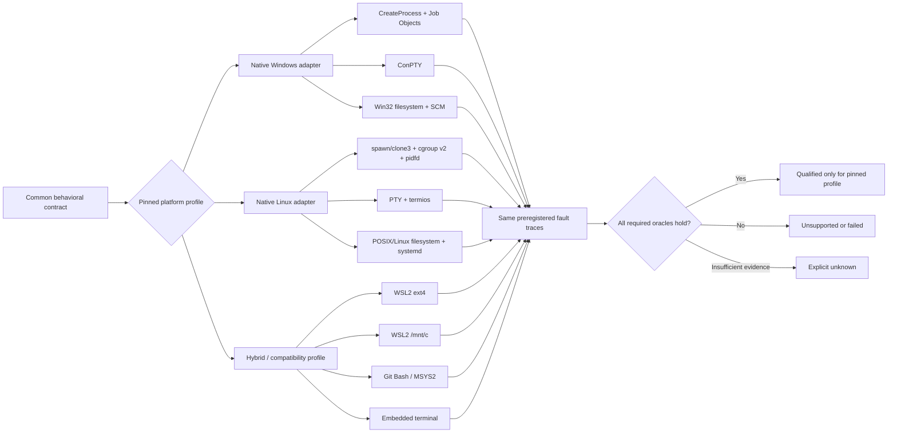

# Cross-Platform Operating-System Conformance: Research Portfolio and Analytical Report

## Executive summary

The query does not name a subject, but the uploaded **DS-19 — Operating-system platform behavior** brief provides a strong, high-value research signal: it asks for evidence about the Windows/Linux seams that a trustworthy execution platform must cross before selecting a language, store, process library, terminal library, or other implementation default. I therefore use DS-19 as **context rather than implementation authority**: this report is read-only, source-based, makes no repository change, certifies no current OS build, and does not choose a runtime, store, framework, renderer, or process library. That is also consistent with the repository's higher-level direction to keep evidence classes distinct and not infer final technology selection from research alone. fileciteturn0file0 fileciteturn2file0 fileciteturn3file0

Five plausible research programs emerge from that context: cross-platform execution conformance; durable filesystem/state semantics; terminal/PTY interoperability; process containment and service supervision; and security/environment portability. **The most generally useful is cross-platform execution conformance**, because the other four become subordinate dimensions of the same release question: “Can a pinned Windows or Linux environment execute, contain, observe, stop, recover, and persist work without silently changing the platform's correctness model?” This selection is a research-prioritization judgment, not a product-default selection. fileciteturn0file0

The main technical conclusion is that **Windows and Linux should be specified against one behavioral contract but qualified through distinct native semantics**, rather than treated as interchangeable implementations of a vaguely POSIX-like abstraction. Windows Job Objects can propagate job membership to descendants and support kill-on-close, but configured breakaway can deliberately let children escape, and ordinary job completion messages are not universally guaranteed. Linux offers cgroup-v2 hierarchy-wide termination, `clone3(CLONE_INTO_CGROUP)` to place a new process into a target cgroup at creation time, and PID file descriptors to avoid PID-reuse races; process groups and sessions remain useful for terminal job control but are not by themselves equivalent to cgroup containment. citeturn11search11turn17search1turn17search15turn12search5turn13search0

Terminal semantics are likewise **not byte-for-byte equivalent**. A Linux PTY participates in the kernel terminal model: line discipline, foreground process groups, signal generation, software flow-control settings, and `SIGWINCH` are explicit parts of the interface. ConPTY instead exposes UTF-8 text interleaved with virtual-terminal sequences, performs compatibility translation internally, and has version-sensitive teardown behavior; Microsoft specifically documents output-drain/deadlock considerations, including changed behavior beginning with Windows 11 24H2 build 26100. A common broker therefore should regard terminal bytes as a transport/view, not as authoritative evidence that an external effect completed. citeturn13search5turn18search0turn18search1turn17search11

Filesystem **visibility atomicity must not be conflated with crash durability**. Linux `rename()` atomically replaces an existing destination name, while `fsync()` documentation explicitly says syncing the file does not necessarily persist the containing directory entry; the directory must also be synced. Windows exposes `ReplaceFileW`, `MoveFileEx`, `FlushFileBuffers`, and write-through modes, but the cited Win32 contracts do not provide a general POSIX-style “rename then directory-fsync” durability recipe. The safe cross-platform conclusion is therefore not that Windows is weaker, but that its proof obligation is different: critical-state recovery must be validated against the actual filesystem, volume/cache configuration, and abrupt-restart/power-loss trace rather than imported from the Linux proof. citeturn19search0turn21search2turn19search4turn19search13turn20search10

Resource limits also produce materially different fault shapes. Linux cgroup-v2 `memory.high` throttles/reclaims without invoking OOM, whereas `memory.max` can lead to an in-cgroup OOM kill and exposes counters through `memory.events`. A Windows Job Object memory limit instead causes a commit that would exceed the configured job or process limit to fail and can emit a completion-port notification. A portable execution contract consequently needs separate typed outcomes such as **pressure/throttle, allocation refusal, process kill, group kill, and unknown**, rather than a single generic “OOM” status. citeturn12search3turn17search1

Finally, **WSL2 `/mnt/c`, WSL2's Linux filesystem, Git Bash/MSYS2, embedded terminals such as Neovim, SMB, and NFS should not inherit certification from native Windows or native Linux**. Microsoft documents that WSL's mounted Windows filesystems use different permission/case metadata behavior and recommends the WSL filesystem for Linux-tool workloads; NFS has protocol/cache and retry behaviors that can change application-visible results, while Windows explicitly warns that flushing a mapped network file proves transmission from the local computer, not physical persistence on the remote storage. citeturn8search0turn8search2turn8search4turn19search0turn20search0

| Decision-level finding | Research consequence | Current evidence state |
|---|---|---|
| One behavior contract, distinct OS proofs | Do not assume a syscall/library abstraction equalizes semantics. | **Source-modelled; unmeasured locally**. citeturn17search15turn12search5 |
| Native containment must be established before arbitrary child code runs | Test Windows job assignment and Linux direct cgroup placement against intentional escape traces. | **Source-modelled; unmeasured locally**. citeturn11search11turn2view0 |
| Terminal EOF/exit/output cannot stand in for effect settlement | PTY/ConPTY should be transport evidence only. | **Source-modelled**. citeturn18search0turn13search5 |
| Atomic replacement is not sufficient evidence of power-loss durability | Test every canonical-state commit cut point independently per filesystem. | **Source-modelled; power-loss outcome unknown**. citeturn19search0turn21search2turn20search10 |
| “Memory limit” is not one portable failure | Normalize distinct throttle/refusal/kill evidence without erasing native detail. | **Source-modelled**. citeturn12search3turn17search1 |
| WSL, compatibility shells, embedded terminals, SMB and NFS are separate qualification cases | No alias-based certification. | **Partly modelled; largely unmeasured**. citeturn20search0turn19search0 |

## Candidate research topics and portfolio plan

**Cross-platform execution and recovery conformance — selected.**  
This is the highest-leverage program because it tests the complete behavioral envelope rather than optimizing one subsystem in isolation. Scope includes process creation, descendant containment and detection, PTY/ConPTY behavior, filesystem replacement/durability, locking, signals/control events, clocks, resource limits, service supervision, crash recovery, paths/locale, and host-security interference. The core questions are whether each platform can satisfy the same externally visible invariants, where it cannot, and what must remain explicitly `unknown`. Methodology should begin with Microsoft Learn/Windows SDK contracts, Linux kernel documentation, Linux man-pages/POSIX interfaces, systemd manuals, and protocol specifications, followed by preregistered destructive fault testing on pinned native Windows and Linux hosts. The deliverables are a claim ledger, conformance matrix, negative-trace suite, expiry triggers, and qualified recommendations. Principal risk: documentation describes contracts but cannot certify the project's precise hardware/filesystem/build combination, so source evidence must not be relabelled “measured.” This distinction is required by both the supplied research brief and repository evidence discipline. fileciteturn0file0 fileciteturn2file0

**Durable canonical-state and filesystem feasibility.**  
This program isolates the most dangerous persistence question: what “committed” can honestly mean across ext4/other Linux filesystems, NTFS/ReFS, WSL-backed storage, SMB and NFS. Key questions cover replacement atomicity, file-versus-directory persistence, append behavior, `mmap`, advisory versus enforced locks, process-death lock cleanup, disk-full behavior, path/case rules, and remote-cache boundaries. The priority sources are Linux `rename(2)`, `fsync(2)` and locking manuals; Microsoft `ReplaceFileW`, `MoveFileEx`, `FlushFileBuffers`, file-mapping and locking documentation; and NFS/SMB protocol documentation. Deliverables would include a persistence state machine and a power-cut test harness specification. The central gap is unavoidable without hardware or VM-level crash injection: a documented API sequence does not prove a particular drive, filesystem, hypervisor or remote server honors the desired post-power-loss oracle. citeturn19search0turn21search2turn19search13turn20search0turn20search6

**Interactive terminal and detachable-session interoperability.**  
This program asks whether a terminal broker can preserve correct interaction when the UI disconnects, resizes, suspends, produces flow-control sequences, changes alternate screens, or tears down mid-output. Linux PTY line discipline and foreground-process semantics would be compared with ConPTY's UTF-8/VT translation channel and documented teardown constraints. Priority evidence is Linux `pty(7)`, `termios(3/7)` and terminal ioctls plus Microsoft's Pseudoconsole and VT-sequence documentation; measurement would add interactive fixtures for resize storms, backpressure, full output pipes, Unicode boundaries and shutdown ordering. The deliverable is a terminal event/capture contract, not a terminal-library recommendation. Major risk: embedded terminals and compatibility layers can add another translation stage, making host-native results non-transferable. citeturn13search5turn18search0turn18search1turn18search2turn17search11

**Process containment, resource governance and service supervision.**  
This program focuses on the guarantee that stopping one admitted unit of work stops the correct descendants without restarting forbidden work or killing unrelated work. It would compare Job Objects, creation-time job assignment and SCM recovery with cgroup v2, PIDFDs, systemd cgroup killing/restart/watchdog behavior, then adversarially test breakaway, cgroup migration, reparenting, PID reuse, OOM and supervisor restart races. Microsoft Job Object/SCM documentation, Linux kernel cgroup-v2 documentation, Linux PIDFD interfaces and systemd manuals are the priority sources. Deliverables are a containment threat model, fault taxonomy and stop/restart state machine. The largest assumption to challenge is that “child of the process we launched” remains equivalent to “work we own”; neither operating system justifies that simplification without additional containment state. citeturn17search1turn13search0turn12search5turn16search0turn14search1

**Platform security, paths, locale and deployment policy.**  
This program addresses compatibility failures that often surface only after otherwise-correct process code ships: Windows case and long-path behavior, Linux/Windows ACL inheritance, WSL mount metadata, symlinks/junctions, locale/encoding, environment leakage, temporary-directory execution constraints, endpoint security controls, and service identities. Primary sources should be OS vendor filesystem/path/security documentation and distribution security policy manuals; tests should deliberately run under non-default ACLs, Unicode locales, long paths, read-only/denied directories and endpoint protection. The deliverable is a supported-environment policy and denial-observability matrix. The main risk is combinatorial scope, so qualification should be by explicit platform profile rather than a claim that “Windows” or “Linux” in the abstract is supported. Windows itself warns applications not to assume case sensitivity, and its historical `MAX_PATH` behavior still depends on API/application configuration. citeturn19search2turn19search7

### Notional project schedule

The following is a planning estimate, not a claim about elapsed execution time. With no external deadline, it assumes one primary analyst beginning **2026-10-01**, independent technical review, and parallel access to Windows/Linux test hosts. Hours are analyst/test-engineer hours; destructive fault testing would add machine time but no assumed budget constraint.

| Topic | Principal tasks | Deliverables | Estimated effort | Notional deadline |
|---|---|---|---:|---:|
| Cross-platform conformance | Pin requirements and source versions; build claim ledger; define common invariants; construct full OS matrix; independent source audit | Claim ledger, conformance matrix, stop conditions, Owner-decision packet | 52 h | 2026-10-09 |
| Durable state/filesystems | Model commit cut points; map local/remote filesystem semantics; specify disk-full and power-cut fixtures; review recovery oracle | Persistence model, crash-test vectors, durability support matrix | 36 h | 2026-10-16 |
| Terminal interoperability | Map PTY/ConPTY event semantics; define capture/resize/backpressure fixtures; test detach/reattach/teardown profiles | Terminal transport contract, event vectors, compatibility matrix | 30 h | 2026-10-22 |
| Containment/resources/services | Model descendant ownership; breakaway/migration/PID-reuse traces; OOM and supervisor restart tests | Containment model, fault taxonomy, service-supervision matrix | 42 h | 2026-10-30 |
| Security/environment policy | Path/ACL/locale matrix; WSL/compatibility-shell cases; denial injection; review supported-profile policy | Environmental qualification matrix, denial/error requirements | 28 h | 2026-11-05 |
| Cross-topic independent verification | Reproduce sources; rerun all conformance fixtures; check `unknown` cells and overclaims | Independent verification report and release/no-release recommendation | 32 h | 2026-11-10 |

The program totals **220 analyst/test-engineer hours** under this notional decomposition. A large portion can run concurrently after the first cross-platform contract is frozen; the ordering above intentionally puts the shared behavioral contract first so subsystem studies cannot quietly invent inconsistent definitions of “stopped,” “durable,” or “recovered.”

## Selected topic: framing, architecture and method

The selected research object is not “Which process library is best?” It is **which observable contracts must any eventual implementation satisfy on each supported operating-system profile**. That boundary is especially important here: DS-19 explicitly makes OS evidence blocking while forbidding research from selecting the language, store, process library, renderer or plugin runtime. fileciteturn0file0 The repository's current architecture likewise separates canonical authority and recovery from adapter/runtime convenience, and its orientation document warns that source checks and research do not constitute live platform qualification. fileciteturn5file0 fileciteturn6file0

The evidence classes used below are:

**SD — source-documented:** an OS vendor, kernel/manual project, standard or protocol specification states the property.  
**M — modelled/inferred:** a behavioral consequence follows from multiple source-documented facts but has not been exercised here.  
**Measured:** reproduced on a precisely identified target under a preregistered fixture. **There are no measured claims in this report.**  
**U — unknown/unmeasured:** the result depends on a target build/configuration or failure trace that has not been executed.

That separation follows the project's existing governance requirement that source-documented, locally observed, inferred and unmeasured evidence remain distinct. fileciteturn2file0

A useful conformance architecture is therefore:

The reason for the split is source-backed. Windows can assign a newly created process to a list of Job Objects through `PROC_THREAD_ATTRIBUTE_JOB_LIST`; Linux `posix_spawn()` supplies only a constrained spawn/pre-exec surface and, in current glibc, is itself implemented through clone-like machinery, whereas `clone3()` can place a child directly into a cgroup v2, eliminating the intermediate “spawn, then migrate” accounting window. These are different native construction models even when a higher-level library presents both as `spawn()`. citeturn11search11turn21search0turn2view0

This leads to a critical methodological rule: **compare externally required traces, not API names**. The test is not whether both systems have a “process group,” “kill tree,” “flush,” “terminal,” or “memory limit.” The test is what happens under the same negative trace: child escapes, parent dies before registration, PID is reused, output pipe fills during shutdown, disk fills between write and flush, machine suspends during a deadline, or supervisor sees an abnormal exit. The platform passes only if the required observation and recovery oracle still hold. That is an analytical recommendation grounded in the disparate documented semantics below. citeturn13search0turn17search11turn21search2turn12search3

## Evidence synthesis and claim ledger

### Process creation and descendant containment

On Windows, Job Objects are the strongest built-in process-family primitive in this comparison. A child normally remains associated with the job chain of its parent, and `JOB_OBJECT_LIMIT_KILL_ON_JOB_CLOSE` can terminate associated processes when the last job handle closes. But job configuration can explicitly permit breakaway, including silent breakaway; therefore “uses a Job Object” is not equivalent to “descendants cannot escape.” The creation attribute `PROC_THREAD_ATTRIBUTE_JOB_LIST` is particularly important because it allows job assignment as part of process creation instead of relying solely on a later assignment step. citeturn11search11turn17search1turn17search15

There is also an **observability caveat**. Microsoft documents Job Object completion-port events, but says ordinary job messages other than notification-limit messages are not guaranteed; it additionally warns that process-start/exit messages can be missed if completion-port association races with an active job. Thus an implementation cannot honestly equate “no job notification arrived” with “the descendant/event did not exist.” citeturn17search9turn17search15

On Linux, ordinary process groups are useful for signaling sets of processes, and sessions/foreground process groups are intrinsic to terminal job control, but process identity and resource containment have stronger primitives. `clone3()` supports `CLONE_INTO_CGROUP`, placing the new process directly in a cgroup v2; kernel documentation says writing `1` to `cgroup.kill` kills a cgroup and all descendant cgroups. PIDFD signaling avoids the classic race in which a numeric PID exits and is recycled before a signal is sent. citeturn2view0turn12search5turn13search0

The result is not “Linux is perfectly contained.” Cgroup membership is an administrative state and must itself be protected against unauthorized migration/delegation, while anything that leaves the tracked containment boundary before observation creates an evidence problem. The correct assurance claim is consequently conditional: **a cgroup hierarchy plus permissions preventing workload-directed migration, combined with stable process identity, is a materially stronger containment basis than process-group signalling alone**. This is an inference from the cgroup and PIDFD contracts and still requires adversarial measurement. citeturn12search5turn13search0

### Terminal semantics

Linux PTYs present master/slave terminal endpoints backed by ordinary terminal behavior. Terminal settings determine canonical versus noncanonical processing, signal-generating characters, and software flow control; changing the terminal window size with `TIOCSWINSZ` causes the kernel to send `SIGWINCH` to the foreground process group. The PTY therefore carries a substantial amount of kernel terminal/session semantics beyond “a pipe containing characters.” citeturn3view2turn3view3turn3view4turn13search5

ConPTY deliberately offers a different interface. Microsoft documents the pseudoconsole streams as UTF-8 text mixed with VT sequences, while translation from attached applications' console APIs/code pages occurs inside the pseudoconsole system. The hosting application is responsible for decoding/presenting output and serializing input. citeturn18search0turn18search1

Teardown deserves a **version-pinned test** rather than folklore. Microsoft's current `ClosePseudoConsole` documentation says closing sends `CTRL_CLOSE_EVENT`; clients can continue to produce output while disconnecting. Starting with Windows 11 24H2 build 26100, the call returns immediately to avoid accidental deadlocks, while older versions can wait indefinitely if output is not closed/drained. The wider session documentation also describes final-frame/cursor-query deadlock hazards. citeturn17search11turn17search2

That version difference alone is sufficient to reject a timeless statement such as “ConPTY close blocks until the terminal tree is gone.” The broker must expose **transport-close requested, client disconnect observed, process containment state, and execution settlement** as separable facts. This conclusion is an inference from Microsoft's own lifecycle semantics. citeturn17search11

### Persistence, locks and paths

Linux provides a particularly crisp distinction between namespace atomicity and durability. If `newpath` exists, `rename()` replaces it atomically from the viewpoint of name lookup; `renameat2(RENAME_NOREPLACE)` can instead reject an existing target where the filesystem supports that flag. But `fsync(file)` does not necessarily persist the containing directory entry, and the Linux manual requires a separate `fsync()` on the directory for that part of the persistence obligation. citeturn19search0turn21search2

A canonical Linux replacement protocol therefore has at least separate evidence points for new contents, renamed namespace state and containing-directory persistence. Even that is not a universal network-filesystem theorem: the Linux `rename()` documentation explicitly calls out NFS retry behavior where an operation can be reported as a failure after the server already carried out the rename before crashing. citeturn19search0

Windows exposes related but non-identical primitives. `ReplaceFileW` replaces one file with another while transferring the replacement into the replaced file's name/identity; `MoveFileEx` offers replacement and `MOVEFILE_WRITE_THROUGH`; `FlushFileBuffers` forces buffered file information toward the device, and Microsoft recommends write-through/unbuffered modes for critical persistence scenarios. The Windows sources cited here do **not** state a general directory-handle flush sequence equivalent to the Linux `fsync(directory)` guarantee, so importing the Linux crash proof would be unjustified. citeturn19search13turn19search4turn20search10

Mapped I/O requires another separate proof. `FlushViewOfFile` does not itself flush file metadata or guarantee that hardware-cache contents reached physical media; Microsoft directs applications needing the stronger local guarantee to combine mapped-view flushing with `FlushFileBuffers`. Over a network, Microsoft explicitly limits the guarantee: the mapped data may have left the local computer while still residing in the remote server's cache. citeturn20search0

Locks are also semantically distinct. Linux `flock()` locks are advisory and tied to open file descriptions; they disappear when all relevant descriptors close, including after process teardown, but a cooperating process can simply ignore an advisory lock. Windows `LockFileEx` denies overlapping ordinary reads/writes according to lock mode, but mapped-file access bypasses the byte-range lock; Windows releases locks after process termination/handle close, while warning that cleanup may not be instantaneous. citeturn13search3turn20search6

Therefore a persistent **“lock file exists” is not a safe liveness oracle** on either platform. A crashed process may leave the pathname behind even though the kernel-managed lock is gone; conversely, PID reuse can make a stale ownership record look current. The robust research target is a kernel lock plus a generation/instance identity and an explicit recovery procedure, with PIDFD-like stable identity used where available. That is an inferred design requirement, not a library selection. citeturn13search3turn20search6turn13search0

Windows path behavior is another explicit portability seam. Microsoft tells developers not to assume case sensitivity, lists reserved characters/device names, and documents the traditional `MAX_PATH` limit plus longer-path mechanisms and Windows 10 version 1607+ opt-in behavior. The project already records that its repository contains paths long enough to require explicit Windows Git long-path handling, so this is not merely theoretical project context. citeturn19search2turn19search7 fileciteturn5file0

### Signals, time, resources and supervisors

Unix terminal and process-control signals should not be mechanically mapped onto Windows console events. Windows' `GenerateConsoleCtrlEvent` documentation says a `CTRL_C_EVENT` cannot be constrained to one process group in the same way one might expect from a POSIX signal-to-process-group operation; Windows service control is a separate SCM protocol rather than a console-attached signalling channel. citeturn5search1turn14search11

Time requires at least two conceptual clocks. On Linux, `CLOCK_MONOTONIC` is immune to discontinuous wall-clock changes but excludes suspended time, while `CLOCK_BOOTTIME` includes suspension. On Windows, `QueryPerformanceCounter` is intended for high-resolution interval measurement rather than externally synchronized UTC, while precise system-time APIs serve wall-clock needs. Consequently “deadline after five minutes,” “lease expires while the laptop sleeps,” and “record the UTC audit time” are different requirements and should not share an unspecified clock source. citeturn11search6turn10search1turn10search8

Linux cgroup-v2 makes the resource-fault distinction unusually clear: `memory.high` induces throttling/heavy reclaim without triggering the OOM killer, while `memory.max` is a hard limit that can enter cgroup OOM; `memory.events` exposes counters including `high`, `max`, `oom`, `oom_kill`, and group-kill events. citeturn12search3 Windows Job Objects instead document commit failures when configured process/job memory ceilings would be exceeded, with completion-port messages available for the limit event. citeturn17search1

Service supervisors can themselves alter recovery semantics and therefore must be in the qualification matrix. systemd defaults `KillMode` to `control-group`, explicitly warns that main-process-only killing can leave processes outside the manager's lifecycle, and allows restart policies/watchdogs to turn abnormal termination into automatic relaunch. The Windows SCM likewise has configured failure actions, keeping a failure count and performing an indexed action such as restart after service failure. A product-level Stop/PAUSE guarantee must therefore ensure that supervisor recovery policy cannot silently reinterpret an intentional stop as a crash requiring relaunch. citeturn16search0turn16search2turn14search1

### Source-pinned claim ledger

| Claim | Pinned source/version or date | Class | Confidence | Expiry trigger |
|---|---|---|---|---|
| Windows can assign a child to jobs through `PROC_THREAD_ATTRIBUTE_JOB_LIST`. | Microsoft Learn, live doc accessed 2026-09-30; Windows 10/Server 2016+ applicability. citeturn11search11 | SD | High | Windows process-creation contract or target minimum changes |
| Job containment can intentionally permit descendant breakaway. | Microsoft Job Object limit docs, accessed 2026-09-30. citeturn17search1 | SD | High | Job semantics/build-specific regression |
| Job completion messages are not universally guaranteed. | Microsoft Job Objects / completion-port docs, accessed 2026-09-30. citeturn17search9turn17search15 | SD | High | Microsoft changes notification contract |
| Linux can create directly into cgroup v2 with `CLONE_INTO_CGROUP`; PIDFDs remove PID-reuse signalling race. | Linux `clone(2/clone3)` and `pidfd_send_signal(2)`; man-pages snapshot current during 2026 research. citeturn2view0turn13search0 | SD | High | Kernel/API minimum changes |
| `cgroup.kill` kills a cgroup and descendants. | Linux kernel cgroup-v2 6.5 documentation. citeturn12search5 | SD | High | Target kernel/cgroup mode changes |
| ConPTY's transport is UTF-8 text plus VT sequences. | Microsoft `CreatePseudoConsole`, updated 2022-09-20. citeturn18search0 | SD | High | Pseudoconsole contract changes |
| ConPTY teardown behavior differs before/after Windows 11 24H2 build 26100. | Microsoft `ClosePseudoConsole`, updated 2025-07-09. citeturn17search11 | SD | High | Target build changes |
| Linux window resize sends `SIGWINCH` to the foreground process group. | Linux man-pages `TIOCSWINSZ`, 6.18/2026-02-08 rendering. citeturn13search6 | SD | High | Kernel/terminal model changes |
| Linux atomic rename does not by itself prove persisted directory metadata. | Linux `rename(2)` and `fsync(2)`, man-pages 6.19-era snapshot. citeturn19search0turn21search2 | SD | High | Filesystem-specific guarantee supersedes generic model |
| Windows mapped-view flush alone does not prove remote physical persistence. | Microsoft `FlushViewOfFile`, updated 2022-05-13. citeturn20search0 | SD | High | Remote filesystem/protocol changes |
| Linux `memory.high` and `memory.max` produce different fault behavior. | Linux kernel cgroup-v2 6.10 docs. citeturn12search3 | SD | High | Target kernel/controller changes |
| Windows Job memory ceiling can fail commit rather than universally killing the workload. | Microsoft `JOBOBJECT_BASIC_LIMIT_INFORMATION`, accessed 2026-09-30. citeturn17search1 | SD | High | Windows job resource model changes |
| A portable “one OOM status” would erase material evidence. | Derived from preceding Windows/Linux resource contracts. citeturn12search3turn17search1 | M | High | A higher-level contract preserves all native distinctions another way |
| Terminal output/EOF should remain non-authoritative for external-effect completion. | Derived from PTY/ConPTY transport and lifecycle separation. citeturn18search0turn17search11 | M | High | Terminal channel itself gains authenticated durable effect receipts |

## Conformance matrix

No row below is “certified” or locally measured. **M** means there is enough primary-source evidence to model the expected behavior but the project-specific trace has not been executed; **U** means evidence is insufficient for that profile; **N/A** means the dimension belongs to the underlying host rather than the named compatibility layer. A future measured cell should record the exact OS/kernel/build, filesystem, mount options, terminal, supervisor configuration, fixture digest and test result. That qualification discipline is explicitly required by the supplied DS-19 brief. fileciteturn0file0

| Qualification case | Process containment | Terminal semantics | Canonical-state durability | Paths / permissions | Stop / resource / recovery | Overall today |
|---|---|---|---|---|---|---|
| **Native Windows** | **M** — Job Objects, creation-time job list and breakaway rules are documented. citeturn11search11turn17search1 | **M** — ConPTY UTF-8/VT and build-sensitive teardown documented. citeturn18search0turn17search11 | **M/U** — flush/replacement primitives documented; full project power-loss oracle unmeasured. citeturn19search13turn20search10 | **M** — case/reserved-name/long-path behavior documented. citeturn19search2turn19search7 | **M/U** — jobs/SCM modelled; PAUSE-versus-restart race unmeasured. citeturn14search1turn17search1 | **Unqualified** |
| **Native Linux** | **M** — cgroup v2, `clone3`, PIDFD and group signalling documented. citeturn2view0turn13search0turn12search5 | **M** — PTY/termios/`SIGWINCH` semantics documented. citeturn13search5 | **M/U** — rename+file/directory sync model documented; target FS power-loss test absent. citeturn19search0turn21search2 | **M/U** — generic Linux semantics modelled; target filesystem/ACL profile unspecified. | **M/U** — cgroup/systemd mechanisms known; exact restart/OOM/suspend traces unmeasured. citeturn12search3turn16search0 | **Unqualified** |
| **Git Bash / MSYS2 on Windows** | **U** — Windows native containment underlies the host, but compatibility-process behavior has not been tested. | **U** — translation layer may alter terminal/signal behavior. | **U** — Win32 filesystem still underlying, but path/locking translation requires measurement. | **U** | **U** | **Separate mandatory case** |
| **WSL2, Linux filesystem** | **U/M** — Linux guest primitives are modelled; host/VM lifecycle boundaries are not. | **U** — terminal front end and host integration matter. | **U** — native Linux filesystem path is distinct from DrvFS but host power-loss/reboot trace is unmeasured. | **M/U** — standard Linux behavior inside guest, integration effects unmeasured. | **U** — suspend/VM termination boundaries need explicit tests. | **Separate case** |
| **WSL2, `/mnt/c`** | **U/M** — guest process model plus Windows-backed storage. | **U** | **U** — must not import Linux-ext4 durability assumptions into DrvFS. | **M/U** — Microsoft documents DrvFS metadata/permission/case differences. citeturn8search2turn8search4 | **U** | **Separate high-risk case** |
| **Neovim embedded terminal, Windows host** | **N/A/M** — host containment is Windows. | **U** — extra terminal/rendering/input stage not qualified. | **N/A/M** — host filesystem semantics dominate. | **N/A/M** | **U** for terminal-driven stop/detach interactions | **Separate terminal profile** |
| **Neovim embedded terminal, Linux host** | **N/A/M** — host containment is Linux. | **U** — embedded terminal integration unqualified. | **N/A/M** | **N/A/M** | **U** for terminal lifecycle integration | **Separate terminal profile** |
| **SMB-backed canonical state** | N/A | N/A | **U/M** — protocol/platform flush capabilities exist, but client/server/cache/storage durability must be measured; mapped flush does not guarantee remote physical media. citeturn20search0 | **U** — server/share policy dependent. | **U** | **Do not inherit local-FS qualification** |
| **NFS-backed canonical state** | N/A | N/A | **U/M** — close/cache and retry semantics differ; rename can have ambiguous reported failure after server crash. citeturn19search0turn9search0 | **U** — mount/server dependent. | **U** | **Do not inherit local-FS qualification** |

The important feature of this table is not how many cells can eventually turn green; it is that **none may become green by analogy**. Native Windows success does not prove Git Bash or an embedded terminal. Native Linux success does not prove WSL. WSL ext4 success does not prove `/mnt/c`. Local SSD success does not prove SMB or NFS. That is a conservative inference from the documented translation, cache and filesystem differences. citeturn18search8turn20search0turn19search0

A narrower feature matrix exposes where negative traces are mandatory:

| Required invariant | Windows proof target | Linux proof target | Decisive negative trace |
|---|---|---|---|
| No owned descendant silently survives Stop | Job membership + no unauthorized breakaway + post-stop enumeration/reconciliation. citeturn17search1 | cgroup membership + `cgroup.kill` + protected migration boundary. citeturn12search5 | Child → grandchild → attempted escape before parent registration |
| Stable target identity despite PID reuse | Process handle/job identity; verify lifecycle races explicitly. | PIDFD reference; `pidfd_send_signal` rejects a terminated target rather than hitting recycled PID. citeturn13search0 | Kill target, force/reproduce numeric PID reuse, retry cancellation |
| Resize is delivered to terminal client correctly | `ResizePseudoConsole` updates pseudoconsole dimensions. citeturn18search5 | `TIOCSWINSZ` + foreground-group `SIGWINCH`. citeturn13search5 | Resize storm while output pipe is backpressured |
| Terminal teardown cannot deadlock broker | Drain/close ConPTY output per build-specific lifecycle. citeturn17search11 | Exercise master/slave close, SIGHUP/EIO ordering on pinned kernel/terminal stack | Close during full output + child still writing |
| Accepted canonical state is old-or-new, never a falsely accepted torn version | Replacement/flush protocol proven on target filesystem. citeturn19search13turn20search10 | Temp write → file fsync → rename → directory fsync, then test each crash cut. citeturn19search0turn21search2 | Hard reset at every persistence boundary |
| Process death cannot leave an authoritative stale lock | OS lock-release behavior + generation/fence validation. citeturn20search6 | Open-description lock lifecycle + generation/fence validation. citeturn13search3 | SIGKILL/TerminateProcess after lock acquisition; stale filename retained |
| Memory limit becomes a typed event | Distinguish failed commit/limit notification. citeturn17search1 | Distinguish `memory.high`, `max`, OOM and OOM-kill counters. citeturn12search3 | Controlled allocation ramp through each threshold |
| Supervisor never restarts intentionally stopped work | SCM failure actions reconciled with explicit Stop state. citeturn14search1 | systemd `Restart=`/watchdog policy reconciled with explicit stop. citeturn16search2 | Stop concurrent with crash/watchdog expiration |
| Suspend cannot silently alter deadline semantics | QPC/wall-clock policy tested through sleep/resume. citeturn10search1 | Explicit choice between `CLOCK_MONOTONIC` and `CLOCK_BOOTTIME`. citeturn11search6 | Suspend across lease/deadline boundary |

## Fault-test plan, recommendations and decisive falsifiers

The next useful evidence is **not more architectural opinion**; it is a preregistered fault campaign whose oracles are fixed before the runs. Each run should retain the exact environment identity, fixture, event trace, expected oracle, observed result and any `unknown`. The supplied brief specifically calls for descendant escape, PTY teardown, atomic-rename crash, stale lock, disk-full, OOM and suspend/resume testing. fileciteturn0file0

| Fault fixture | Injection | Passing oracle | Stop condition |
|---|---|---|---|
| **Descendant escape** | Worker spawns child/grandchild; Windows requests permitted/forbidden breakaway paths; Linux attempts `setsid`, process-group escape and cgroup migration. | Every owned descendant either remains in the containment identity and terminates, or an escape is durably surfaced as `unknown/containment-breach`; no false “fully stopped.” | Any surviving owned process accompanied by a successful full-stop claim |
| **Parent dies before child registration** | Kill broker/launcher between create and bookkeeping. | Creation-time containment still owns the child, or recovery explicitly reports uncertainty; no untracked effect is promoted to success. | Child continues with neither containment membership nor unknown record |
| **PTY/ConPTY teardown** | Saturate output, resize repeatedly, then detach/close while client emits output and cursor/VT traffic. | Broker remains responsive; terminal transport state, process state and effect state remain separate; no deadlock. Microsoft's documented ConPTY drain hazard makes this a required Windows case. citeturn17search11 | Deadlock, lost authority transition, or EOF treated as effect success |
| **Atomic-replace crash** | Crash/reset before data flush, after data flush, during/after replacement, and after final metadata/directory persistence point. | Recovery exposes either the prior accepted state or a wholly valid newer accepted state; corrupt/torn candidate is rejected. Linux stages follow documented file+directory sync distinction. citeturn21search2 | Truncated state accepted as canonical, or unknown state silently “repaired” without evidence |
| **Stale lock and PID reuse** | Kill owner while locked; preserve lock filename; rapidly create processes to force identity reuse where practical. | Kernel lock disappears according to native semantics, but stale metadata never authorizes takeover without generation/fence check. PIDFD case must not signal a recycled target. citeturn13search0turn13search3turn20search6 | New process mistaken for old owner |
| **Disk full / quota** | Exhaust state volume at temp-write, flush, rename/replace and log-append boundaries. | Last accepted state remains readable; error becomes durable fault evidence; retries do not reinterpret partial state as success. | Accepted state disappears or partial write is promoted |
| **Memory pressure / OOM** | Cross Linux `memory.high` then `memory.max`; cross Windows job memory threshold. | Linux distinguishes throttle/max/OOM/kill evidence; Windows distinguishes commit refusal and limit notification. citeturn12search3turn17search1 | Generic “worker crashed” loses the causal resource event |
| **Supervisor restart race** | Explicit Stop concurrent with abnormal worker/broker exit and configured auto-recovery. | Intentional Stop wins admission/relaunch policy; any restart is fenced before work can resume. systemd and SCM both have configurable restart/recovery mechanisms. citeturn16search2turn14search1 | Supervisor revives stopped work and it performs admitted work |
| **Suspend/resume** | Suspend machine across deadline, lease, terminal attachment and scheduled retry. | Chosen clock semantics are explicit; wall-clock jumps never create fresh authority; suspend-aware deadlines behave per specification. citeturn11search6turn10search1 | Work becomes authorized solely because a clock interpretation changed |
| **Network storage interruption** | Disconnect/restart SMB/NFS server during flush/replacement/lock operations. | State is either reconciled from durable identity/version information or remains unknown; local return alone cannot imply remote physical persistence. citeturn20search0turn19search0 | Local success return is automatically promoted to power-loss-safe remote commit |

**Recommendation: adopt a contract-first, native-semantics qualification model.** The competing option is a lowest-common-denominator cross-platform process/filesystem abstraction whose API shape becomes the specification. The recommendation is preferred because Job Objects, cgroups/PIDFDs, PTYs/ConPTY, flush primitives and service supervisors expose materially different failure and observation semantics. citeturn17search1turn13search0turn18search0turn21search2 **Decisive falsifier:** a candidate abstraction could overturn this recommendation if, without platform-specific side channels, it passes the complete preregistered Windows/Linux fault corpus while preserving every required native distinction and `unknown` state. No library has been selected or evaluated here.

**Recommendation: use a kernel containment anchor plus stable process identity, not process-group-only tree walking, as the research baseline.** The competing option is “remember parent/child PIDs and recursively kill the tree.” PID recycling, process-group/session changes, breakaway configuration and registration races make that option harder to prove. PIDFDs explicitly solve the recycled-PID signalling race on Linux; Windows Job Objects represent an owned process collection independently of a user-space parent tree. citeturn13search0turn17search15 **Decisive falsifier:** tree-walking wins if adversarial escape, PID-reuse and parent-death fixtures demonstrate equivalent containment and detection guarantees across every required platform profile with less privileged state and no false-stop result.

**Recommendation: keep terminal transport non-authoritative.** The competing option is to infer execution/effect completion from terminal EOF, shell exit, final prompt or ConPTY/PTTY disconnect. ConPTY explicitly allows output during closure and has distinct teardown behavior, while terminal resize/input/output concern presentation and process interaction rather than durable effect settlement. citeturn17search11turn13search5 **Decisive falsifier:** this separation would be unnecessary only if the terminal channel were itself transformed into the authenticated, durable, replayable source of effect receipts required by the canonical execution contract; nothing in the cited PTY/ConPTY contracts supplies that property.

**Recommendation: certify persistence per filesystem/storage profile, beginning with local native filesystems; do not automatically extend that claim to `/mnt/c`, SMB or NFS.** The competing option is “an atomic rename/replace plus flush is portable enough.” Linux's explicit directory-sync rule, NFS's rename retry caveat and Microsoft's remote mapped-flush limitation refute that as a general proof. citeturn21search2turn19search0turn20search0 **Decisive falsifier:** a remote or hybrid storage profile earns equivalence when the identical crash/power/network-partition corpus demonstrates the same accepted-state oracle with a pinned client/server/mount configuration.

**Recommendation: model resource exhaustion as a family of faults rather than `OOM`.** The competing option is a single portable “resource exceeded” status. Linux explicitly distinguishes throttle/reclaim from cgroup OOM and process/group kills, while Windows Job memory limits can manifest as failed commits with separate notifications. citeturn12search3turn17search1 **Decisive falsifier:** a single status is adequate only if no downstream recovery, accounting, retry or observability decision depends on whether the process was throttled, denied an allocation, individually killed or group-killed.

**Recommendation: supervisor restart must be subordinate to canonical Stop/PAUSE authority.** The competing option is allowing systemd/SCM recovery configuration to restart the broker/workers independently and relying on them to reconstruct intent afterward. Both supervisors can automatically recover failed services, so this creates a real relaunch race. citeturn16search2turn14search1 **Decisive falsifier:** independent supervisor recovery is acceptable if a fault campaign proves that every restarted instance is fenced before it can admit or resume work, including during partial-state recovery and watchdog/failure-action races.

The principal unresolved Owner-level questions are therefore product-boundary questions, not library questions:

| Owner decision required | Why it changes the proof |
|---|---|
| Which exact Windows editions/build floors and Linux kernel/distribution profiles are release targets? | ConPTY teardown is demonstrably build-sensitive, and Linux features such as PIDFDs/`CLONE_INTO_CGROUP` have kernel-version floors. citeturn17search11turn13search0turn2view0 |
| Is WSL2 a supported production platform, a development convenience, or both? | Guest process semantics and Windows-backed `/mnt` storage create hybrid proof obligations that neither native matrix fully covers. |
| Is canonical state on SMB/NFS supported, conditionally supported, or explicitly out of scope for the first release? | Remote persistence and retry/cache semantics need a much larger failure matrix. citeturn20search0turn19search0 |
| Must containment resist intentionally hostile descendants, or only buggy/cooperative tools? | The required permissions, cgroup delegation restrictions and breakaway testing differ dramatically. citeturn17search1turn12search5 |
| What is the required definition of “survives power loss”: application-consistent state after VM reset, host reset, or physical power interruption? | The durability oracle and required test infrastructure differ. |
| Does a suspended laptop consume task/lease time? | Linux deliberately offers both suspend-excluding and suspend-including monotonic clocks, so this is a product semantic decision rather than a technical inevitability. citeturn11search6 |
| Which terminal embeddings are first-release qualification targets beyond native terminals? | An embedded terminal adds another protocol/render/input lifecycle not certified by raw PTY/ConPTY testing. |
| Is an escaped/unobservable descendant a hard platform failure or an explicit recoverable `unknown` state? | This determines the conformance stop condition and whether future work may resume after containment ambiguity. |

## Prioritized sources and next steps

The highest-priority source family is the **native process-containment documentation**: Microsoft Job Objects, creation attributes and Job completion semantics for Windows; Linux kernel cgroup-v2 documentation plus `clone3()` and PIDFD interfaces for Linux. These define the process-ownership boundary and should be frozen into the claim ledger before any cross-platform process library is assessed. citeturn11search11turn17search1turn17search15turn12search5turn13search0

Second is the **filesystem durability corpus**: Linux `rename(2)` and `fsync(2)`, Microsoft `ReplaceFileW`, `MoveFileEx`, `FlushFileBuffers`, file-mapping flush behavior, and lock semantics. These sources make clear that visibility, persistence and locking are separate contracts and that network-backed storage needs its own evidence. citeturn19search0turn21search2turn19search13turn19search4turn20search0turn20search6

Third is the **terminal corpus**: Linux PTY/termios/window-size semantics and Microsoft ConPTY/VT/lifecycle documentation. The Windows 11 24H2 teardown change makes version pinning especially important; a terminal conformance suite that does not record the Windows build is not sufficient evidence. citeturn13search5turn18search0turn18search2turn17search11

Fourth is the **resource and service-supervision corpus**: Linux cgroup memory controls, systemd kill/restart/watchdog behavior, and Windows Job memory limits plus SCM failure actions. These should drive typed fault receipts and the “explicit Stop versus automatic restart” race tests. citeturn12search3turn16search0turn16search2turn17search1turn14search1

Fifth is the **environment-profile corpus**: Windows path/case documentation, WSL filesystem/mount behavior and network filesystem specifications. These should determine which matrix rows are separate release targets rather than being treated as aliases of “Windows” or “Linux.” citeturn19search2turn19search7turn8search0turn8search2turn20search0

The immediate next research artifact should be a **machine-readable conformance manifest** whose primary key is a platform profile, not an operating-system name. Each profile should pin OS build/kernel, architecture, filesystem and mount options, terminal path, supervisor configuration, storage locality, security policy, and every expected fault-test oracle. The sequence should then be: freeze the claims and oracles; run native Windows and Linux first; rerun the same corpus under Git Bash/MSYS2, WSL2 native filesystem, WSL2 `/mnt/c`, and embedded terminals; separately qualify SMB/NFS only if they are intended product targets; and subject every apparent PASS to independent reproduction. That sequencing follows the project's own requirement that generated/source-backed reasoning is not equivalent to independent local verification. fileciteturn0file0 fileciteturn2file0

The resulting decision should allow three honest outcomes for every profile: **qualified at a pinned configuration, rejected/unsupported, or unknown pending named evidence**. It should not produce a fourth outcome—“probably equivalent to another platform.” That is the most important cross-platform correctness conclusion of the research.