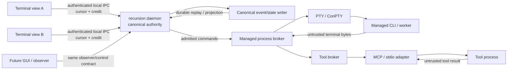

# DS-23 IPC Process Broker and Terminal Protocol — Deep Research Report

## Executive summary

DS-23 is sufficiently specified to make several architecture decisions now, but **it is not yet complete enough to freeze as a fully self-contained wire protocol**. The repository has already fixed the most important semantic boundary: terminal windows are detachable views, the daemon owns canonical state, the process broker owns managed process lifetime, attaching a view must not create work, and a slow or disconnected view must not block canonical progress. Those requirements are consistent across the terminal, CLI, interaction, security, performance, and M1B specifications. fileciteturn0file0 fileciteturn7file0 fileciteturn8file0 fileciteturn9file0 fileciteturn11file0

The strongest evidence supports the following **proposed DS-23 disposition**:

| Area | Research disposition | Confidence |
|---|---|---:|
| Local transport | **Windows named pipes** on Windows; **pathname `AF_UNIX` stream sockets** on Linux/BSD-family systems. Do not use FIFO or loopback TCP as the default authority-bearing local endpoint. | High |
| Peer authentication | Windows: restrictive DACL + `PIPE_REJECT_REMOTE_CLIENTS` + successful named-pipe impersonation/token inspection; client PID only as supplemental correlation. Linux: private socket directory + `SO_PEERCRED`; BSD/macOS: private socket directory + `getpeereid`. | High for primitives; medium until native negative fixtures run |
| Framing | **Four-byte unsigned big-endian length + canonical UTF-8 JCS/I-JSON payload**, with the existing M1B maximum canonical object size of 262,144 bytes. Do not depend on pipe/message boundaries. | High as a protocol design; unmeasured operationally |
| Framing competitor | RFC 7464 JSON Text Sequences is the strongest alternative because RS framing provides resynchronization after malformed/truncated elements. | High |
| Protocol version | For existing `m1b-broker/1`, **exact-version matching only**. The current message schema cannot truthfully claim major/minor or schema-epoch negotiation. | High |
| Cursor | Prefer **event-sequence cursors** for the broker event stream; account raw decoded payload bytes separately for credit. Preserve `utf8-byte` only where a stream truly needs byte-addressed replay. | Medium-high |
| Flow control | Per-view additive byte/event credit, monotonic contiguous ACKs, bounded pending state, no canonical-writer wait on a view, mandatory reset on an actual replay gap. | High semantically; unimplemented |
| Replay | `HELLO → WELCOME → RESET → SNAPSHOT → ACK → fresh CREDIT → EVENT` is the recommended gap-recovery state machine. A non-RESET continuation after a detected gap is a permanent refusal for that stream incarnation. | High except snapshot materialization |
| Input/resize | Fence by daemon epoch, process epoch, active lease, and durable command ID. Exact duplicate command = no second effect; same ID/different command = refusal; crash ambiguity = `uncertain`, never blind replay. | High as required semantics |
| Windows containment | Creation-time Job Object membership using `PROC_THREAD_ATTRIBUTE_JOB_LIST`, breakaway disabled, kill-on-close policy where appropriate, membership verification before normal execution. ConPTY is terminal I/O, not containment. | High on documented primitives; medium on complete tree guarantee |
| Linux containment | Dedicated cgroup v2 boundary, preferably child placement at birth using `CLONE_INTO_CGROUP` when admitted, plus pidfds for stable process identity; session/process group remains terminal-control machinery, not full containment. | High on primitives; medium on target-host guarantee |
| Full descendant termination | **Still unproved.** It must remain `unknown` until the pinned Windows/Linux fault matrix passes, including breakaway/migration/fork races and broker death. | High confidence that the claim is presently unproved |
| MCP | Treat MCP/stdio as a separate untrusted adapter boundary behind the broker. Current MCP 2026-07-28 semantics differ materially from the older assumptions in the repository, so notification/backpressure claims need requalification against current SDKs. | High |
| Tool broker | Separate from terminal IPC; every call is independently authorized, bounded, correlated, receipted, and cleaned up. Tool output is untrusted evidence, never authority. | High |
| Renderer | Remains deliberately unselected. | High |

The local-transport conclusions follow directly from the available OS security primitives. Linux `AF_UNIX` exposes kernel-generated peer credentials through `SO_PEERCRED`, while credentials passed through `SCM_CREDENTIALS` have namespace and privilege qualifications; pathname sockets can also be protected by filesystem permissions. citeturn12search0turn0search10 On BSD/macOS, `getpeereid` reports the peer's effective UID and GID captured for a connected UNIX-domain stream. citeturn1search2 Windows named pipes can combine an explicit security descriptor, rejection of remote clients, client impersonation, and token inspection; Microsoft also exposes client PID retrieval, but a PID is better treated as correlation than as the primary authentication decision. citeturn14search0turn15search13turn22search16turn14search1

The central protocol finding is less comfortable: **M1B/1 does not currently satisfy every DS-23 completion criterion.** Its message union fixes `protocol_version` to `m1b-broker/1`; `HELLO` has no supported-version interval or schema epoch; `WELCOME` has no selected schema identifier; there is no in-band pre-admission `REFUSAL` message; and `SNAPSHOT` carries a digest but neither snapshot bytes nor an opaque materialization reference. fileciteturn12file0 Consequently, major/minor downgrade negotiation, typed refusal of an unknown major, and self-contained replay-gap snapshot recovery cannot be claimed for v1 without either a new major protocol or an explicit external contract.

A second issue deserves treatment as a release blocker rather than a detail: M1B defines cursor/count values with a maximum of **2,147,483,647**. fileciteturn12file0 At one thousand events per second, an event cursor reaches that ceiling in about **24.9 days**; at one hundred events per second, in about **248.6 days**. A long-lived daemon therefore needs a specified stream-incarnation rollover rule before v1 can honestly be called durable. This is arithmetic from the frozen bound, not evidence of an observed failure.

A third specification ambiguity is internal: M1B says ACK cursors cannot move backward, while its prose also says pending bytes/events accumulate until a “non-forward ACK” releases them. fileciteturn12file0 The coherent interpretation is that a **strictly forward contiguous ACK releases acknowledged pending state; a duplicate ACK is a no-op; a backward ACK is refused**. That interpretation should be made normative rather than left to independent implementations.

The process-containment evidence strongly supports creation-time containment. The repository's own bounded Windows probe observed the exact failure DS-23 is designed to avoid: a child created before later Job association was outside the operation Job and survived broker death, whereas creation-time Job membership using `PROC_THREAD_ATTRIBUTE_JOB_LIST` placed observed children in the Job from birth. The repository correctly limits that evidence to the tested path and does not claim it proves hostile-breakaway, alternate-launcher, or complete recovery behavior. fileciteturn7file0 Microsoft documents both creation-time job assignment and Job Object breakaway/kill-on-close behaviors. citeturn13search1turn0search6turn0search15 Linux cgroup v2 similarly gives a hierarchical process boundary in which children are born into their parent's cgroup, while migration remains possible subject to permissions; newer v2 interfaces include subtree kill semantics, and `clone3(CLONE_INTO_CGROUP)` avoids the ordinary fork-then-migrate window. citeturn22search17turn16search5turn16search1

The resulting recommendation is therefore **conditional adoption, not completion**: adopt the transport, framing, flow-control, idempotency, and containment rules below as the DS-23 candidate; keep renderer/library selection open; and block a final “frozen” status until the protocol-gap items and the native fault matrix are resolved.



This topology preserves the existing product ruling: presentation clients are projections; PTY/ConPTY bytes are data; neither a view nor a terminal stream owns actor identity, process lifetime, authorization, or canonical state. fileciteturn7file0 fileciteturn9file0

## Background

The governing repository material makes the evidentiary standard unusually clear. `CONTROL_PLANE.md` distinguishes **source-documented, locally observed, inferred, and unmeasured** evidence and forbids silently converting one class into another. fileciteturn3file0 `ANCHOR.md` requires open research questions to resolve to a pinned source, an executable gate, or an explicit `unknown`. fileciteturn4file0 `AGENTS.md` further says research must not select a language, store, framework, or sandbox merely from research preference. fileciteturn5file0 Those constraints are particularly appropriate for DS-23 because OS process containment is a composed behavioral property: no individual API reference can prove that an actual broker closes every descendant escape path.

There is one terminology tension in the uploaded brief worth resolving explicitly. DS-23 says to preserve the “current Hermes constitution,” whereas the higher-precedence `CONTROL_PLANE.md`, adopted September 28, 2026, says the former Hermes-led v1/v2 control plane was retired and that Recursion v3 is now the product. fileciteturn0file0 fileciteturn3file0 For this report, the operative reading is therefore the higher-precedence one: **make no control-plane or protected-path changes and perform no runtime effects**, while treating DS-23 as v3 protocol research.

The required product behavior itself is coherent across the repository. OR-012 requires an interactive CLI with several terminal windows/panes in which closing a terminal does not end the process; the daemon and process broker own lifetime. fileciteturn14file0 `TERMINAL-RUNTIME.md` states that clients detach rather than terminate actors, that attaching does not create another model request, and that slow or absent clients cannot create unbounded buffers or block canonical state. fileciteturn7file0 `INTERACTION-SURFACES.md` independently requires that a slow or absent view cannot block Stop, canonical append, or recovery. fileciteturn9file0 `PERFORMANCE-PLAN.md` turns the same behavior into a measurable hypothesis by requiring multi-view tests, queue high-water measurements, cursor preservation, and proof that passive views do not multiply model/index work. fileciteturn11file0

M1B already supplies a valuable formal baseline. Its current construction contract uses UTF-8 I-JSON with RFC 8785 canonicalization, rejects duplicate fields and malformed/noncanonical encodings, limits canonical objects to 262,144 UTF-8 bytes, and gives the broker a closed message union of `HELLO`, `WELCOME`, `SNAPSHOT`, `EVENT`, `ACK`, `CREDIT`, `INPUT`, `RESIZE`, and `RESET`. fileciteturn12file0 RFC 8785 is specifically designed to turn JSON data into a deterministic canonical representation suitable for repeatable hashing/signing and interoperable byte comparison. citeturn18search1

The relevant standards and API history also explains why the design should separate terminal semantics from containment semantics:

| Date / version | Source milestone | DS-23 significance |
|---|---|---|
| 2006 | SSH Connection Protocol, RFC 4254 | Provides a useful established distinction between channel EOF and channel close: EOF ends one data direction, not the entire channel or underlying process semantics. citeturn18search4 |
| 2015 | RFC 7464 JSON Text Sequences | Defines RS-delimited UTF-8 JSON sequences and explicit recovery from malformed/truncated elements; strongest alternative to length framing. citeturn18search0 |
| 2020 | RFC 8785 JCS | Supplies deterministic canonical JSON, already adopted by M1B. citeturn18search1 |
| Windows 10 / Server 2016 generation | Creation-time process Job assignment via `PROC_THREAD_ATTRIBUTE_JOB_LIST` | Enables eliminating the ordinary create-then-associate containment gap on supported Windows versions. citeturn13search1 |
| Linux cgroup v2, documented across current kernels | Hierarchical process membership, migration rules, later kill interfaces | Provides a Linux process-tree ownership boundary stronger than terminal process groups alone. citeturn22search17turn16search5 |
| 2026-07-28 | Current MCP protocol generation / v2 SDK line | Current MCP is materially different from the older session/initialize model; modern requests are designed around the 2026 protocol lifecycle, while v2 SDKs retain compatibility with older-generation clients. citeturn22search0turn22search12 |
| 2026-09-04 | `M1B-WIRE-PROFILE.md` | Freezes the existing broker message shape and formal replay/idempotency rules. fileciteturn12file0 |
| 2026-09-28 | Current `CONTROL_PLANE.md` | Establishes current v3 authority and evidence discipline. fileciteturn3file0 |
| 2026-09-29 | DS-23 brief | Requests the IPC/process-broker protocol research and completion gate evaluated here. fileciteturn0file0 |

The practical implication is that DS-23 should not seek one “magic primitive.” It needs a composition: OS-authenticated local transport, deterministic application framing, explicit replay and credit semantics, process containment independent of PTY/session semantics, stable process identity, a watchdog/reconciliation layer, and a tool/MCP boundary separate from terminal views.

## Methods

This review treated the repository contracts as requirements evidence and public primary sources as mechanism evidence. For operating-system and protocol behavior, the analysis prioritized Microsoft Learn/Win32 documentation, Linux kernel/man-pages documentation, POSIX material, RFCs, and official MCP/SDK documentation. Secondary commentary was not used to establish technical semantics.

No runtime was started, no socket or named pipe was opened, no process was launched, no provider was called, and no configuration or repository path was modified. The only repository interaction was read-only source inspection through the connected GitHub repository. That matches DS-23's explicit non-goals. fileciteturn0file0

The evidence was evaluated in four classes inherited from the repository:

| Evidence class | Meaning in this report | Example |
|---|---|---|
| **Source-documented** | An OS vendor, standards body, kernel documentation, or official SDK specifies the behavior. | `SO_PEERCRED`; named-pipe impersonation; Job Object breakaway rules; cgroup membership; RFC framing. |
| **Locally observed** | A repository-recorded experiment observed behavior on a particular pinned setup. | The Windows create-before-Job-association escape reproduced by the existing probe. fileciteturn7file0 |
| **Inferred** | A DS-23 protocol/design conclusion derived from documented primitives and existing requirements. | Prefer pathname `AF_UNIX` over loopback TCP for local authority IPC. |
| **Unmeasured** | A required property for which neither documents nor prior local probes establish actual Recursion behavior. | Full descendant-tree termination on the complete supported Windows/Linux matrix. |

The most load-bearing source set is summarized below.

| Source | Version/date used | What it establishes | What it does **not** establish |
|---|---|---|---|
| Linux `unix(7)` | Current man-pages source opened 2026-09-30 | `SO_PEERCRED`, `SCM_CREDENTIALS`, pathname vs abstract UNIX-socket semantics. citeturn12search0 | That same-UID means correct application/process. |
| Linux PID/user namespace docs | Current primary docs | Peer PID/UID observations have namespace qualifications. citeturn0search10 | Recursion's desired trust policy across namespaces. |
| Apple `getpeereid(3)` | Official Apple/BSD-derived documentation | Effective UID/GID of connected UNIX-domain peer. citeturn1search2 | Portable peer PID identity. |
| Microsoft named-pipe security | Microsoft Learn, opened 2026-09-30 | DACL-based access control; default security is too broad for a privileged broker boundary. citeturn14search0 | That an arbitrary chosen DACL is correct for Recursion. |
| `PIPE_REJECT_REMOTE_CLIENTS` | Microsoft Learn | Explicit rejection of remote named-pipe clients. citeturn15search13 | Local principal authorization. |
| Named-pipe impersonation / PID | Microsoft Learn | Server can impersonate the connected client; client PID can be queried. citeturn22search16turn14search1 | That PID alone authenticates the client. |
| Job Objects | Microsoft Learn | Job membership, descendant association, breakaway, kill-on-close semantics. citeturn0search6turn0search15 | That every alternate Windows process-creation path is captured by a particular implementation. |
| `PROC_THREAD_ATTRIBUTE_JOB_LIST` | Microsoft Learn | Job association can occur as part of child creation. citeturn13search1 | Complete Recursion containment on all target builds. |
| Linux cgroup v2 | Kernel docs | Hierarchical process membership, fork inheritance, migration, observability. citeturn22search17turn22search1 | Prevention of escape if the workload has sufficient cgroup-management privilege. |
| `clone3` / pidfd | Linux man-pages/kernel sources | Direct child placement into cgroup and stable process-handle semantics. citeturn16search1turn16search3 | Full descendant ownership when external helpers create work elsewhere. |
| RFC 7464 | February 2015 | RS/LF JSON sequence framing and resynchronization characteristics. citeturn18search0 | Canonical JSON or application semantics. |
| RFC 8785 | June 2020 | Deterministic JSON canonicalization. citeturn18search1 | Stream framing. |
| MCP Python/TypeScript v2 documentation | 2026-07-28 generation | Current lifecycle/version behavior and current stable SDK generation. citeturn22search0turn22search12 | Recursion-specific queue bounds or notification-loss guarantees. |
| M1B wire profile | 2026-09-04 | Exact existing broker fields, bounds, cursor types, replay and duplicate-command oracle. fileciteturn12file0 | Physical transport, snapshot storage, real process containment or current SDK behavior. |

The research method deliberately treats “documented API exists” and “composed system is safe” as separate claims. For example, `SO_PEERCRED` proves that Linux can expose kernel peer credentials; it does not prove that accepting every same-UID client is an appropriate Recursion policy. Similarly, `cgroup.kill` can be part of a full-stop mechanism, but it does not prove that a process that previously escaped the cgroup will be killed. citeturn12search0turn16search5

## Findings

**Transport and peer authentication.** The appropriate authority-bearing endpoint is one that both limits who can reach it and lets the broker independently bind a connection to an OS principal. A transport that merely moves bytes is insufficient.

| Transport | Admission boundary | Peer-authentication primitive | Can prove OS user? | Can prove intended process? | Principal weakness / unknown | DS-23 disposition |
|---|---|---|---|---|---|---|
| Linux pathname `AF_UNIX` stream | Private parent directory + socket pathname permissions | `SO_PEERCRED`; optionally credential messages via `SCM_CREDENTIALS` | **Yes**, with namespace qualifications. citeturn12search0turn0search10 | Kernel provides a PID observation, but **same UID/PID metadata is not application authorization** | User/PID namespaces; same-UID hostile local process; pathname race hardening | **Preferred Linux local endpoint** |
| Linux abstract `AF_UNIX` | No filesystem pathname permission boundary | `SO_PEERCRED` | Yes | Same caveat | Abstract namespace lacks pathname permission semantics and is Linux-specific. citeturn12search0 | **Reject as default authority endpoint** |
| BSD/macOS pathname UNIX socket | Private directory / filesystem controls | `getpeereid` | **Yes: effective UID/GID**. citeturn1search2 | Portable PID proof: **unknown** | Platform permission differences and absence of portable PID binding | **Preferred BSD-family shape**, subject to platform fixture |
| Windows named pipe | Explicit security descriptor/DACL | Named-pipe impersonation and token inspection; `GetNamedPipeClientProcessId` supplemental | **Yes**, through the impersonated access token. citeturn22search16turn14search1 | PID correlation is available; application identity still needs policy | DACL mistakes; remote access; integrity/AppContainer compatibility | **Preferred Windows endpoint** |
| Anonymous pipe | Handle inheritance/duplication provenance | No general peer-account query on the pipe itself | **No independent peer identity** | Only if the creator's handle graph is itself trusted | Not discoverable/attachable in the ordinary sense | Use only for broker-created child wiring, not external attach |
| FIFO | Filesystem permissions | **No per-message/per-peer identity primitive** | Path admission only | No | Multiple writers/readers and no authenticated message origin | **Reject for authority-bearing commands** |
| Loopback TCP | IP loopback reachability | No portable local-account/process credential equivalent in the reviewed socket model | **No, not by transport alone** | No | Any local process can attempt connection; port squatting | **Default reject**, or require an application cryptographic authentication protocol |

On Windows, relying on the default named-pipe ACL would be inappropriate. Microsoft's documented default grants access broader than a dedicated privileged control channel should normally accept. citeturn14search0 DS-23 should require an explicit DACL scoped to the intended operator/logon identity, `PIPE_REJECT_REMOTE_CLIENTS`, and a successful impersonation/token check before `HELLO` gains semantic standing. citeturn15search13turn22search16 Where integrity levels matter, Windows Mandatory Integrity Control adds an additional mandatory-policy layer; this should be included in a low-integrity-client negative fixture rather than inferred from the DACL alone. citeturn15search8

`GetNamedPipeClientProcessId` should **not** be promoted into the authentication root. Microsoft documents that it obtains the connected client process identifier, but PID identity has reuse/lifecycle concerns and does not encode the authorization policy. citeturn14search1 The stronger ordering is: object DACL → remote rejection → connection → impersonate → inspect authenticated token/SID/integrity → optionally correlate PID and executable/process policy.

On Linux, `SO_PEERCRED` is the preferred connection-level primitive. Linux documents that these credentials correspond to the peer on the connected UNIX socket, while credential messages and namespace translation introduce additional qualifications. citeturn12search0turn0search10 This authenticates an OS identity, **not a particular Recursion binary**. If the threat model says a malicious process running as the same desktop user must be excluded, UID equality alone does not solve that problem; a per-installation secret/key or stronger executable/process attestation layer would be needed. That is a policy choice, not something `AF_UNIX` can infer.

For endpoint creation, the safe Unix shape is a private owner-controlled runtime directory, pathname socket, restrictive creation permissions, and refusal rather than blind cleanup when an unexpected endpoint already exists. A stale endpoint should be removed only after type/ownership checks performed without following symlinks; abstract sockets should not be used to bypass this filesystem admission boundary. The precise race-free `openat`/`fstatat`/bind/unlink construction remains an implementation task and must be validated on each supported OS rather than asserted from generic POSIX behavior.

Loopback TCP should be retained only as an explicit competitor. Unlike the reviewed local IPC mechanisms, it does not itself bind a connection to the caller's local account. A TCP fallback would therefore need a real authenticated handshake—for example an installation trust key plus fresh nonces and transcript binding—not a secret endpoint number or the assumption that `127.0.0.1` means “trusted.” This recommendation is an inference from the stronger peer-credential facilities available on the preferred local transports.

**Framing and canonical bytes.** The cleanest framing profile is:

```text
offset   size        meaning
0        4 bytes     N = unsigned 32-bit big-endian payload length
4        N bytes     one canonical M1B UTF-8 JCS JSON object
```

The valid range should be `1 <= N <= 262144`, preserving M1B's existing maximum canonical-object size; therefore the largest complete framed message is 262,148 bytes including the length field. M1B already requires canonical UTF-8/I-JSON, RFC 8785 canonicalization, exact named fields, and rejection of duplicate or malformed values. fileciteturn12file0 RFC 8785 supplies the deterministic JSON canonicalization basis. citeturn18search1

The receiver state machine should be exact:

1. Accumulate exactly four header bytes. Transport reads may split these anywhere.
2. Decode `N` as unsigned big-endian.
3. If `N == 0` or `N > 262144`, refuse the connection **before allocating or waiting for the claimed body**.
4. Accumulate exactly `N` bytes.
5. EOF or connection loss before all `N` bytes arrive produces `truncated-frame`; no semantic message is delivered.
6. Validate UTF-8 and the M1B lexical restrictions.
7. Parse the closed JSON object and schema.
8. Re-serialize under the canonical M1B/JCS profile and require byte-for-byte equality when canonical-on-wire enforcement is enabled.
9. Only then dispatch the semantic message.
10. Any bytes following byte `4+N-1` start the next length header.

The protocol should **not depend on Windows named-pipe message boundaries**. Microsoft distinguishes byte-mode and message-mode pipe semantics; message-mode reads can return `ERROR_MORE_DATA` when the application buffer is smaller than a pipe message. citeturn15search0 A transport-independent framing decoder works over `AF_UNIX`, named-pipe byte streams, and fragmented reads without changing protocol semantics.

RFC 7464 is the strongest competitor. It prefixes each JSON text with an ASCII Record Separator and uses LF after JSON texts; its design explicitly allows a parser to recover from malformed/truncated elements and find later RS-delimited records. citeturn18search0 That is a genuine advantage if the fault model requires in-connection recovery from arbitrary byte corruption. The length-prefix recommendation instead treats a corrupt/torn frame as a connection failure followed by cursor-based reconnect. That is simpler and makes allocation bounds obvious.

The alternatives rank as follows for this particular contract:

| Candidate | Deterministic/diffable | Frame bound | Recovery after corrupted framing | Additional protocol burden | Disposition |
|---|---|---|---|---|---|
| **Length + JCS JSON** | Excellent with existing M1B/JCS | Explicit before body allocation | Reconnect/reset rather than in-stream scan | Minimal | **Recommended** |
| **RFC 7464 + JCS JSON** | Excellent if JCS is separately required | Must add a maximum-record rule | Stronger RS resync | Small | Strong competitor |
| NDJSON | Human-friendly | Must add maximum line | Newline-in-string is escaped in JSON, but line-scanner failure/oversize behavior still requires a profile | Small | Inferior to RS/length for fault recovery |
| gRPC | Schema/implementation dependent | gRPC already has message framing | HTTP/2 machinery handles transport framing | Considerably larger local stack | Not justified for this local broker baseline; gRPC's wire framing itself is formally specified. citeturn9search2 |
| MessagePack | Compact | Format supports bounded object lengths, but application must impose DS bounds | No canonical DS profile by default | Must define deterministic representation/map rules | Defer; official format alone does not supply the M1B canonicality contract. citeturn10search1 |
| Cap'n Proto | Efficient/schema-driven | Schema-specific | Transport framing still must be selected | Canonicalization/schema/versioning model differs substantially from current M1B | Defer; canonical representation is a separate concern from ordinary encoding. citeturn10search2 |

This is a framing recommendation, **not a serialization-library selection**.

**Exact broker message contract.** The existing M1B fields should remain the semantic base:

| Direction | Message | Required v1 fields | Proposed DS-23 semantics |
|---|---|---|---|
| Client → broker | `HELLO` | `client_id, stream_id, daemon_epoch, last_cursor, cursor_unit, columns, rows, capabilities` | First semantic message. Requests an attachment projection only; never creates actor/process/model/effect. |
| Broker → client | `WELCOME` | `client_id, stream_id, daemon_epoch, replay_floor, snapshot_cursor, cursor_unit, input_lease?, resize_lease?, capabilities` | Confirms current incarnation and the **subset** of capabilities available for this connection. |
| Broker → client | `SNAPSHOT` | `stream_id, daemon_epoch, cursor, cursor_unit, snapshot_digest` | Identifies state at an exact cursor. Current v1 carries no snapshot material—see blocker below. |
| Broker → client | `EVENT` | `stream_id, daemon_epoch, cursor, cursor_unit, event_class, process_id?, payload_base64, payload_untrusted=true` | Durable/projection event. Payload remains data, never control syntax. |
| Client → broker | `ACK` | `client_id, stream_id, daemon_epoch, cursor, cursor_unit` | Highest contiguous event/snapshot cursor actually accepted by this view. |
| Client → broker | `CREDIT` | `client_id, stream_id, daemon_epoch, bytes, events` | Additive permission for future delivery, capped by M1B at 16,777,216 bytes and 65,536 events. |
| Client → broker | `INPUT` | `command_id, client_id, stream_id, daemon_epoch, process_epoch, input_lease, bytes_base64` | Authority-fenced process input. |
| Client → broker | `RESIZE` | `command_id, client_id, stream_id, daemon_epoch, process_epoch, resize_lease, columns, rows` | Authority-fenced terminal resize. |
| Broker → client | `RESET` | `client_id, stream_id, daemon_epoch, reason=gap, snapshot_cursor, cursor_unit` | Invalidates incremental continuation and moves client to snapshot recovery. |

Those fields and limits are source-documented by the existing M1B construction contract. fileciteturn12file0 The direction column above is a DS-23 inference/proposal because M1B's trace model does not itself provide a complete bidirectional transport state-machine specification.

**Version and capability negotiation exposes a real v1 gap.** Every current broker message fixes `protocol_version` to exactly `m1b-broker/1`; `HELLO` and `WELCOME` do not contain a major/minor range or schema epoch. fileciteturn12file0 Therefore the only honest v1 rule is:

```text
if protocol_version != "m1b-broker/1":
    reject before semantic admission
```

There is no v1 minor-version downgrade. There is no v1 schema-epoch negotiation. There is also no pre-WELCOME wire-level `REFUSAL` message with which to tell a parseable but incompatible client why admission failed. The model's `BrokerTraceDecision` refusal reasons are an oracle/output type, not a transport message. fileciteturn12file0

Capabilities can still be negotiated conservatively inside v1: `WELCOME.capabilities` should be the intersection of what the client requested, what the broker implementation supports, and what the currently authenticated operator/GoalSpec is authorized to use. Returning a capability may never create authority. This follows the repository-wide rule that presentation and adapter surfaces cannot widen the underlying grant. fileciteturn10file0 A client that locally requires a capability absent from `WELCOME` must decline the session instead of treating omission as support.

A future major can solve the missing mechanics with fields such as version intervals, an exact schema digest/epoch, and required versus optional capability sets. That is a protocol amendment, not something v1 should simulate.

**Cursor and flow-control semantics.** M1B permits `event` and `utf8-byte` cursor units. fileciteturn12file0 For DS-23's canonical terminal/event stream, `event` is the cleaner default because segmentation and replay identity remain independent of host-language string representation and terminal Unicode rendering. Raw bytes are already carried separately in base64 payloads and can be counted as bytes for credit. `utf8-byte` remains appropriate only for a stream whose durable identity is explicitly a byte offset.

The following invariants should be normative:

| Invariant | Required property |
|---|---|
| Cursor binding | A stream incarnation chooses one cursor unit at cursor zero and never changes it. |
| Event advance | With `event` cursors, each delivered durable event has exactly previous cursor + 1. |
| ACK monotonicity | ACK cannot move backward or exceed the highest contiguous event/snapshot accepted. |
| Duplicate ACK | Same cursor again is a no-op. |
| Pending release | **Only a forward ACK** releases the newly acknowledged per-view pending range. |
| Credit | Sender may deliver an event only if both its decoded-payload byte cost and one event unit fit available credit. |
| Credit independence | ACK does not implicitly grant credit; new `CREDIT` does. |
| Isolation | No sender operation for view `i` may be awaited by the canonical append path. |
| Queue bound | Each view has a hard byte and event bound independent of every other view. |
| Durable ordering | Durable append/canonical acceptance occurs before projection delivery. |
| Gap | `requested_cursor < replay_floor` is a real replay gap. |
| Reset | After gap detection, no ordinary same-stream continuation is legal before `RESET`. |
| Fresh credit | RESET clears old credit; continuation requires fresh credit. |
| Control reserve | View bulk delivery cannot consume the reserved capacity required to admit Stop/revocation/control traffic. |

The ACK-release clarification is necessary because the present prose's phrase “non-forward ACK releases them” conflicts with the same profile's monotonic ACK rule. fileciteturn12file0 A backward ACK cannot simultaneously be illegal and the normal mechanism that frees newly acknowledged state. The proposed interpretation above is the only coherent contiguous-ACK model and should be written explicitly into the frozen protocol.

The slow-client proof obligation is not “the queue is usually small.” It is:

\[
\forall i:\; pendingBytes_i \le B_i,\quad pendingEvents_i \le E_i
\]

and, independently,

\[
canonicalAppend \not\rightarrow wait(view_i)
\]

for every view `i`. When a view cannot stay within those bounds, **the view loses incremental continuity; the canonical writer does not lose progress**. That view is detached or placed into reset-required state at a known cursor. This directly implements the repository's existing requirement that a slow view cannot block canonical state. fileciteturn7file0 fileciteturn11file0

The flow-control proof obligations are:

| Proof obligation | Failing trace |
|---|---|
| Writer isolation | Stop draining one view entirely; canonical append latency or queue growth becomes dependent on that view. |
| No silent loss of durable events | Client later reconnects at a retained cursor but receives a later event without the missing durable sequence or RESET. |
| Byte bound | One large/event flood makes per-view retained bytes exceed the configured bound. |
| Event bound | Huge number of tiny events exceeds event-count bound despite low byte use. |
| No over-credit | Sender transmits an event for which either byte or event credit is insufficient. |
| ACK integrity | ACK jumps ahead of an undelivered event and frees it. |
| Cursor integrity | Event cursor repeats, goes backward, or skips without a typed gap/reset transition. |
| Reset integrity | Old pre-reset credit or pending state is reused after RESET. |
| Control reserve | Bulk replay/flood prevents a previously admitted Stop/revocation command from entering the canonical control path. |

M1B's current treatment of **credit exhaustion as reset-requiring** is stricter than many window protocols: the trace profile says exhaustion remains unrecovered until explicit RESET. fileciteturn12file0 That should be consciously retained or consciously changed, not reinterpreted by an implementation. A soak test that produces repeated unnecessary RESET storms would be the decisive falsifier for retaining that behavior in a future major.

**Gap and snapshot recovery.** The recommended successful trace is:

```text
Client                                            Broker
  |                                                  |
  | HELLO(last_cursor = C)                           |
  |------------------------------------------------->|
  |                                                  |
  | WELCOME(replay_floor = F, snapshot_cursor = S)   |
  |<-------------------------------------------------|
  |                                                  |
  |      if C < F: this is a replay gap              |
  |                                                  |
  | RESET(reason=gap, snapshot_cursor=S)             |
  |<-------------------------------------------------|
  | SNAPSHOT(cursor=S, snapshot_digest=D)             |
  |<-------------------------------------------------|
  | ACK(cursor=S)                                    |
  |------------------------------------------------->|
  | CREDIT(bytes=B, events=E)                        |
  |------------------------------------------------->|
  | EVENT(cursor=S+1)                                |
  |<-------------------------------------------------|
```

The required negative trace is:

```text
HELLO(C), WELCOME(F,S), where C < F,
then CREDIT / ACK / INPUT / RESIZE / EVENT before RESET
=> replay-gap-continuation
=> current stream incarnation is refused
```

That matches the repository's explicit rule that after a replay gap is detected, RESET is the only permitted continuation and an intervening message cannot be “repaired” merely by sending RESET afterward. fileciteturn7file0 fileciteturn12file0

However, the sequence above reveals another blocker: **`SNAPSHOT` contains only `snapshot_digest`**. fileciteturn12file0 There is no payload and no snapshot reference field. A digest authenticates/identifies material; it does not materialize it. Unless another already-ratified contract guarantees that every view can retrieve that digest's snapshot bytes, v1 replay repair is not self-contained. DS-23 correctly forbids choosing the physical store, but it still needs a transport-neutral way to identify/retrieve snapshot material—or it must explicitly declare that dependency.

**Reconnect and command idempotency.** `INPUT` is the critical case because terminal input can cause an irreversible effect inside the managed CLI. M1B already says reuse of a command ID is a no-op only when the command is byte-identical and conflicting reuse is refused. fileciteturn12file0 That rule should be extended operationally with a durable command ledger keyed by command identity and bound to daemon epoch, process epoch, stream, and lease:

```text
new command_id + current epochs/lease
    -> durably record accepted intent
    -> attempt OS delivery
    -> durably record delivered / refused / uncertain disposition

same command_id + byte-identical full command
    -> return/replay existing disposition
    -> DO NOT redeliver bytes

same command_id + different command
    -> duplicate-command-conflict

old process_epoch / daemon_epoch / lease
    -> stale-* refusal
```

The crash window matters. If the broker has proof that an input intent was accepted but cannot prove whether the bytes reached the process before a crash, the outcome must be `uncertain`; it must not send the bytes again merely because a client reconnects. This is consistent with the repository's broader rule against blind replay of ambiguous external effects. fileciteturn10file0

A receipt can be represented without inventing a new top-level v1 message by using a durable `EVENT` class whose payload records `command_id`, disposition, process epoch, and causation. That is an inferred v1-compatible mapping; the exact event payload schema remains to be frozen.

`RESIZE` is conceptually closer to desired state than raw input, but the protocol should still apply the same command-ID rule. Otherwise two independent implementations could disagree over whether a replayed resize is an innocuous retry or a duplicate command.

Transport closure must remain distinct from process death. SSH's mature channel protocol is useful precedent: an EOF indication means one side will send no further data, while full channel closure is a separate operation. citeturn18search4 Accordingly:

```text
view socket EOF             != managed process exit
view abrupt disconnect      != managed process exit
one transport half-close    != managed process exit
daemon restart              != managed process exit
PTY/ConPTY output EOF       != sufficient proof of full descendant settlement
```

A process-exit conclusion requires an OS observation tied to the recorded process epoch/stable identity and, for Full Stop, the containment set.

**Process containment and watchdog.**

| Platform primitive | Role | Strong property | Named escape/failure case | Required verification | DS-23 disposition |
|---|---|---|---|---|---|
| Windows ConPTY | Terminal byte/VT transport | Presents pseudoconsole I/O to hosted console apps. citeturn12search2 | Treating ConPTY closure as process-tree death | Separate process/Job observations | **I/O only; never containment** |
| Windows Job Object | Process ownership/accounting/termination set | Descendants normally associate with the Job; kill-on-close and other limits are documented. citeturn0search6turn0search15 | `BREAKAWAY_OK`, silent breakaway, alternate creation outside the Job, leaked Job handles | Root and descendant membership; job events; post-stop emptiness | **Primary Windows containment primitive** |
| `PROC_THREAD_ATTRIBUTE_JOB_LIST` | At-birth Job association | Child enters specified Jobs as part of creation. citeturn13search1 | Unsupported path/build; launcher bypasses the broker; invalid nested-Job interaction | Membership before normal execution | **Prefer over create-suspended + later assignment** |
| `IsProcessInJob` | Membership query | Tests whether a process is associated with a specified Job. citeturn12search5 | Querying only root while descendant escaped | Reconcile all known process identities plus Job events | Supplemental verification |
| POSIX session/process group | Terminal job control | Organizes terminal foreground/background signaling and session membership. citeturn19search1 | Child calls `setsid`/changes process group; unrelated descendant topology | Never infer full containment from pgrp alone | **Supplemental terminal semantics** |
| Linux cgroup v2 | Hierarchical process ownership/resource boundary | Children are born in parent's cgroup; membership is observable; processes can also be migrated subject to permissions. citeturn22search17turn22search1 | Authorized/privileged migration; helper created outside cgroup | Membership, `cgroup.events`/population, post-stop emptiness | **Primary Linux containment primitive** |
| `clone3(CLONE_INTO_CGROUP)` | At-birth cgroup placement | Avoids the ordinary child-birth-then-migrate accounting window. citeturn16search1 | Kernel/platform support or permissions unavailable | Verify child appears in target cgroup immediately | Preferred where admitted |
| `cgroup.kill` | Whole-cgroup termination operation | Kills processes in the cgroup subtree and is designed to deal with concurrent membership/fork behavior. citeturn16search5 | Process escaped before kill or exists outside owned cgroup | Require observed empty owned cgroup; separately reconcile escapes | Strong Full-Stop candidate |
| pidfd | Stable process identity/liveness | Process file descriptor avoids ordinary PID-number reuse ambiguity and can be polled/signaled through pidfd APIs. citeturn16search3 | Does not itself capture descendants | pidfd + cgroup membership | **Use for root/stable identities, not as tree containment** |

Creation-time containment is the common theme. The existing local Windows probe provides unusually relevant empirical support: it observed that a create-suspended-then-associate gap allowed a live child outside the operation Job, while the creation-time Job-list path removed that tested gap. fileciteturn7file0 That evidence is strong enough to reject ordinary post-creation association as the preferred design, but not strong enough to claim total tree termination.

On Linux, process groups and sessions should remain useful for PTY foreground-control and signal behavior, but they are not the ownership set. A process can reorganize its process-group/session relationship independently of the cgroup hierarchy. POSIX documents these as terminal/session constructs, while cgroup v2 separately defines hierarchical process membership. citeturn19search1turn22search17

The watchdog's model should therefore be based on **recorded ownership plus independent observation**, not on “did the PTY close?” Suggested states are:

| State | Required evidence |
|---|---|
| `starting` | Durable process intent exists; creation/containment not yet verified |
| `contained-running` | Stable root identity live; required containment membership verified |
| `exited-awaiting-reap` | Root has exited but lifecycle/reap or containment observations remain |
| `orphaned` | Broker/session owner disappeared while owned containment remains populated |
| `escaped` | A known owned descendant is observed outside the required containment boundary |
| `hung` | Deadline/progress criterion expired while stable identity remains live; not equivalent to death |
| `zombie` | Exit observed but unreaped where the OS exposes that distinction |
| `terminating` | Stop issued; settlement deadline not reached |
| `partial` | Termination attempted but known owned processes remain |
| `unknown` | Evidence cannot prove either live/contained or settled |
| `terminated` | Stable identities exited and the required owned containment set is verified empty |

A watchdog must not silently relaunch after broker death. Restart and recovery should first reconcile the durable process epoch against observed Job/cgroup state; an ambiguous pre-crash operation remains ambiguous. That follows the existing security and terminal-runtime contracts. fileciteturn7file0 fileciteturn10file0

**Stop disposition model.** The repository has already fixed three distinct product modes and says not to collapse them. fileciteturn14file0 They should be reported through separate stages rather than one Boolean `cancelled`:

```text
OFFERED
  -> ACCEPTED
  -> RECIPIENT_FENCE_INSTALLED
  -> CANCELLATION_OR_TERMINATION_DELIVERED
  -> OWNED_PROCESS_SETTLEMENT
  -> EXTERNAL_EFFECT_SETTLEMENT
```

Each stage can independently be `yes`, `no`, or `unknown`. A transport ACK can establish at most a transport/protocol observation; it cannot prove the later stages.

| Stop mode | Admission/fence behavior | Process behavior | Required final reporting |
|---|---|---|---|
| **Aggressive** | Immediately fence further selected-agent dispatch/input | Interrupt/terminate the selected operation without waiting for an ordinary safe boundary | State what was killed, what descendants remain, and which in-flight external effects are uncertain |
| **Full** | Fence selected root plus owned subagents/shells/monitors/relaunchers | Use the platform-owned containment termination primitive; suppress supervisor restart | `terminated`, `partial`, or `unknown` for every owned scope; remote/external settlement remains separate |
| **Lazy** | Fence new admissions while allowing the currently defined observable operation to reach its boundary | Stop at the next admitted observable boundary | Boundary identity, waiting/deadline status, and any configured escalation; never infer hidden reasoning completion |

The exact Lazy timeout/escalation policy is not settled by the examined material and should remain an explicit policy/Owner question.

**MCP/stdio and tool broker.** This is where the freshness check most materially changes prior assumptions. The current MCP 2026-07-28 generation is designed differently from the older initialize/session lifecycle: current v2 documentation says modern requests carry protocol/client/capability metadata per request, while the v2 SDK retains compatibility with older-generation clients. citeturn22search0turn22search12 Therefore older repository concerns tied specifically to the prior SDK's initialization/session machinery should not be generalized to current MCP without reinspection.

The safe DS-23 abstraction is independent of those SDK internals:

```text
managed tool process
      │
      │ stdout/stdin: vendor protocol
      ▼
bounded MCP/stdio adapter
      │
      │ typed call / response / notification events
      ▼
tool broker
      │
      │ authorization + budget + command identity + receipts
      ▼
canonical daemon
```

The stdio bridge contract should require finite parser buffers, a maximum accepted line/message size declared before ingestion, dedicated draining of stderr so stderr backpressure cannot deadlock the protocol pump, and no inline application handler that is allowed to block the sole reader needed to receive its own completion. Oversize, malformed, torn-at-EOF, and unsupported-version records produce typed adapter faults rather than unbounded accumulation.

The existing repository statement that a pinned older MCP Python SDK could evict notifications before application ingestion should now be treated as **historical/local evidence for that pinned version, not a current-v2 fact**. fileciteturn7file0 Current v2 SDK/protocol behavior needs its own source inspection and chaos fixture. The safe general requirement remains: if a notification contains a fact necessary for canonical correctness, there must be a query/reconciliation path or the fact must remain `unknown`; lossy notification delivery can never be converted into invented settlement.

The tool broker should be separate from the terminal-view channel and enforce this call envelope semantically:

```text
ToolCall {
  command_id
  actor / task / process causation
  exact tool identity + version/schema
  current GoalSpec / grant / authority epoch
  allowed capability subset
  arguments digest
  input byte cap
  output byte cap
  deadline
  CPU / memory / process / concurrency budget
  descendant-containment identity
}
```

Per call, the broker must recheck that the named tool is allowed, that its exact requested operation is within the current grant, and that revocation/fencing has not advanced. A registry entry or MCP tool advertisement is capability **availability**, not capability authority. That distinction follows the repository security contract. fileciteturn10file0

The output contract should distinguish `accepted`, `started`, `completed`, `refused`, `timed-out`, `terminated`, `partial`, and `uncertain`. Output is bounded and treated as untrusted data. Tool descendants are attached to the same or a separately explicit containment scope and must be reconciled during Full Stop. Charged budget includes unsuccessful starts, retries, subprocesses, and cleanup; failure is not free.

Finally, ANSI/VT sequences, OSC/DCS controls, alternate-screen content, malformed UTF-8, and strings that resemble protocol JSON remain **terminal payload data**. They never pass through the IPC command decoder. This is the simplest structural defense against output-to-command injection and is already reflected by M1B's `payload_untrusted=true`. fileciteturn12file0

## Evidence assessment

The evidence is strongest for individual platform mechanisms and weakest for their composition under failure—which is exactly where DS-23's completion gate should concentrate.

| Claim | Pinned source / version | Classification | Confidence | Expiry / revalidation trigger |
|---|---|---|---:|---|
| Terminal closure means detach, not work termination; attach must not create another model/process/actor/effect | Recursion v3 terminal/CLI rulings, 2026-09-07 and OR-012. fileciteturn7file0 fileciteturn14file0 | Source-documented repository requirement | **High** | Owner/product ruling superseded |
| Linux pathname `AF_UNIX` can expose peer credentials with `SO_PEERCRED` | Linux `unix(7)`. citeturn12search0 | Source-documented | **High** | Supported OS/API semantics change |
| Peer UID/PID observations require namespace awareness | Linux namespace docs. citeturn0search10 | Source-documented | **High** | Namespace semantics or target deployment changes |
| BSD/macOS UNIX stream can expose peer effective UID/GID through `getpeereid` | Apple official `getpeereid`. citeturn1search2 | Source-documented | **High** | OS support matrix change |
| Windows named pipes can enforce ACL admission, reject remote clients, and impersonate the client | Microsoft named-pipe security / create / impersonation docs. citeturn14search0turn15search13turn22search16 | Source-documented | **High** | Windows API/security behavior change |
| Client PID alone should not be the authentication root | PID is only one exposed attribute; recommendation combines it with token auth. citeturn14search1turn22search16 | Inferred | **High** | A stronger documented process-identity primitive is adopted |
| Creation-time Windows Job membership removes the ordinary broker-side post-create association interval | Microsoft `PROC_THREAD_ATTRIBUTE_JOB_LIST`; repository's bounded probe observed the corresponding difference. citeturn13search1 fileciteturn7file0 | Source-documented + locally observed | **High** for tested mechanism | Target build changes or alternate launcher |
| Windows Full Stop always kills every Recursion descendant | No complete native matrix exists; documented breakaway/alternate paths remain. citeturn0search6turn0search15 | **Unmeasured** | **Unknown** | Only becomes a claim after fault matrix passes |
| cgroup v2 is hierarchical; children inherit cgroup at fork; processes may migrate | Linux cgroup v2 kernel docs. citeturn22search17turn22search1 | Source-documented | **High** | Kernel/cgroup mode changes |
| `CLONE_INTO_CGROUP` can place child directly in target v2 cgroup | Linux clone documentation. citeturn16search1 | Source-documented | **High** | Kernel floor changes |
| pidfd is suitable for stable root-process identity/exit observation | Linux pidfd documentation. citeturn16search3 | Source-documented | **High** | Kernel/API floor changes |
| Process groups/sessions alone are not sufficient full-tree containment | POSIX terminal group semantics plus separate cgroup hierarchy support this conclusion. citeturn19search1turn22search17 | Inferred from source-documented primitives | **High** |
| Length+JCS framing is cheaper to make deterministic than adding an HTTP/2/gRPC or separate binary canonical profile | Comparison of existing M1B/JCS against competing protocol requirements. fileciteturn12file0 citeturn18search1turn9search2 | Inferred | **Medium-high** | Native implementation measurements |
| RFC 7464 provides stronger in-stream JSON record resynchronization | RFC 7464. citeturn18search0 | Source-documented | **High** | RFC superseded |
| M1B/1 already defines exact broker fields, duplicate-command behavior, gap RESET, and frame-object bound | M1B 2026-09-04. fileciteturn12file0 | Source-documented local contract | **High** | M1B superseded |
| M1B/1 supports major/minor/schema negotiation | It does **not** contain the necessary fields. fileciteturn12file0 | Source-documented negative finding | **High** | New protocol major |
| Current `SNAPSHOT` is self-contained | It is **not**: the message contains a digest but no bytes/materialization reference. fileciteturn12file0 | Source-documented negative finding | **High** | Snapshot transport contract added |
| Slow-client isolation can be proven from the existing schema alone | No; schema/model semantics do not prove an implementation's queue topology. fileciteturn11file0 | Unmeasured | **Unknown** | Implementation + soak/fault gate |
| Old MCP notification-queue observations still describe the current 2026 SDK | Not established. Current v2 implements the 2026-07-28 generation and changed protocol lifecycle materially. citeturn22search0turn22search12 | **Unknown for current SDK** | **Low unless remeasured** | Pin exact SDK and inspect/run fixture |
| A transport ACK establishes semantic Stop or external settlement | Repository explicitly forbids that interpretation. fileciteturn7file0 | Source-documented requirement | **High** | Product semantics superseded |

The most important evidence-quality distinction is between **containment membership** and **containment completeness**. We can document that a child is placed into a Job or cgroup. We cannot infer that every process causally resulting from an operation stays there. A subprocess could use an allowed breakaway mechanism, migrate where it has permission, invoke a privileged helper, or cause an external service to create work under another owner. The chaos matrix must therefore test named escape paths rather than just “spawn child; kill parent.”

Likewise, framing correctness does not prove flow-control correctness. A parser can be perfectly bounded while a downstream renderer queue grows without limit. The proof boundary must span transport read → frame accumulator → decode/dispatch → canonical writer → per-view projection → render sink, exactly as the existing terminal research already recognizes. fileciteturn7file0

The current M1B counter bound deserves explicit risk classification:

| Event rate | Time to `2,147,483,647` event cursor |
|---:|---:|
| 10 events/s | ~6.80 years |
| 100 events/s | ~248.6 days |
| 1,000 events/s | ~24.9 days |
| 10,000 events/s | ~2.49 days |

These are calculations from M1B's `Count` maximum. fileciteturn12file0 The high-rate rows are plausible enough for a terminal/log event stream that **cursor exhaustion must have a specified stream-rollover rule before freeze**. A protocol intended to support persistent detachable work should not discover its rollover semantics in production.

The source record also supports a clear hierarchy of what is known today:

**Strongly source-backed:** peer-credential mechanisms, named-pipe ACL/impersonation primitives, Job creation-time association, cgroup membership/migration, pidfd semantics, RFC framing/canonicalization, and M1B's formal rules. citeturn12search0turn22search16turn13search1turn22search17turn16search3turn18search0turn18search1

**Source-backed plus some local observation:** the preference for Windows Job association at process birth rather than delayed assignment. fileciteturn7file0

**Designed but not implemented/proved:** per-view no-block flow architecture, durable input deduplication across broker restart, complete watchdog reconciliation, Linux native cgroup launch behavior, and current MCP notification/flood behavior.

**Explicitly unknown:** complete descendant-tree termination across the intended Windows/Linux acceptance matrix.

## Recommendations

The recommendations below are ordered by how directly they block protocol freeze. Each names a competitor and a decisive falsifier, as DS-23 requires.

| Priority | Proposed recommendation | Competing option | Decisive falsifier |
|---|---|---|---|
| **Freeze blocker** | Do **not** label `m1b-broker/1` as supporting major/minor/schema negotiation. Treat v1 as exact-match only; decide whether DS-23 needs a new major before final freeze. | Pretend `capabilities` or `protocol_version` string supplies negotiation | An interoperability fixture demonstrates that two independently implemented v1 peers can safely resolve version/schema skew and return a typed incompatible-major refusal without undocumented conventions |
| **Freeze blocker** | Define snapshot materialization independently of storage: `SNAPSHOT` must lead to verifiable state bytes at exactly `snapshot_cursor`, or recovery remains blocked. | Digest-only snapshot message | A fresh client with no prior local state can reconstruct and verify the snapshot using only already-ratified v1 contracts |
| **Freeze blocker** | Define cursor-rollover/incarnation behavior before `Count` exhaustion. | Assume practical streams never reach 2^31−1 | Soak/workload evidence proves the bound cannot be reached during the maximum supported stream lifetime under the product's event model |
| **Freeze blocker** | Resolve ACK prose normatively: forward contiguous ACK releases state; duplicate is no-op; backward is refusal. | Preserve ambiguous “non-forward ACK releases” wording | A formal trace interpretation exists in which that wording produces the intended memory-release behavior without conflicting with non-backward ACK |
| **P0** | Windows local IPC: named pipe with explicit DACL, `PIPE_REJECT_REMOTE_CLIENTS`, impersonation/token check, PID as correlation. | Loopback TCP + bearer token | Named-pipe native tests fail required environments while an authenticated TCP design passes equivalent remote/local/identity/fuzz tests with lower total complexity |
| **P0** | Linux/BSD-family local IPC: pathname UNIX-domain stream in an owner-controlled private runtime directory, with platform peer credentials. | Loopback TCP or Linux abstract sockets | Required target platform lacks usable UNIX peer identity/permission behavior, or native negative fixtures show the boundary cannot enforce intended local principal policy |
| **P0** | Use four-byte BE length + canonical M1B/JCS payload, maximum 262,144 payload bytes. | RFC 7464/JCS | Torn/corrupt stream tests demonstrate a required availability/recovery target that reconnect+cursor replay cannot meet while RFC 7464 resynchronization can |
| **P0** | Prefer `event` cursor for durable broker event streams; credit decoded payload bytes + events independently. | `utf8-byte` as universal cursor | Event segmentation cannot be made stable enough for byte-exact replay/interoperation across implementations while byte offset can |
| **P0** | Canonical writer never awaits a view. Each view is a bounded pull/replay projection with independent credit and reset state. | Shared push/fanout queue with backpressure propagated upstream | A bounded shared-push implementation passes slow/dead-view chaos tests with equivalent memory bounds and never delays canonical append or reserved controls |
| **P0** | INPUT/RESIZE require durable command-id dedupe tied to daemon/process epochs and leases; ambiguous crash outcomes never auto-replay. | Re-send on reconnect until success | Fault injection proves the downstream operation provides a stronger idempotency primitive that makes blind replay safe and verifiable |
| **P0** | Windows processes enter their operation Job at creation, with breakaway disallowed in the admitted profile and membership verified before normal execution. | Create suspended → assign to Job → resume | Creation-time Job membership fails supported application compatibility while an alternative closes the same broker-death/fork gap in native tests |
| **P0** | Linux process ownership uses cgroup v2 plus stable process identity; at-birth placement with `CLONE_INTO_CGROUP` where the admitted host supports it. | Process group/session alone, or fork then late cgroup migration | Target Linux acceptance environments cannot supply the required cgroup semantics, or another primitive passes all migration/fork/broker-death tests with equal isolation |
| **P1** | Use session/process-group state only for PTY job control; never as proof of whole-tree ownership. | Process-group kill as Full Stop | Native adversarial tests prove every owned descendant remains in the process group/session under all admitted creation paths—a substantially stronger property than the OS interface itself promises |
| **P1** | Watchdog/recovery reconciles stable process identity and containment membership; no automatic relaunch from ambiguous state. | Broker PID/liveness alone | An implementation can prove equivalent no-resurrection and orphan detection from broker state alone under every registered crash boundary |
| **P1** | Current MCP/stdio lives behind a bounded adapter; pin exact SDK/protocol build during tests and never treat notification delivery as authoritative without query repair. | Direct SDK callbacks into canonical state | Current SDK source plus fault tests prove notifications required for correctness are bounded, loss-detectable/recoverable, and cannot block the reserved control/canonical writer path |
| **P1** | Tool broker is a separate authority layer with per-call grant check, command ID, deadline/budget, output cap, containment, and receipt. | Treat advertised MCP tools as implicitly authorized | A formal authority proof demonstrates that registry availability cannot widen GoalSpec/grants even without the separate broker checks |

The recommended transport authentication policy should be tested with the following **preregistered cross-platform chaos/fault matrix**, not merely happy-path integration tests:

| Fixture | Injection | Required result / stop condition | Pin before run |
|---|---|---|---|
| `AUTH-WIN-REMOTE` | Attempt named-pipe connection from remote network identity/path | Refused before semantic `HELLO`; no daemon command accepted | Windows edition/build, pipe flags, DACL, account type |
| `AUTH-WIN-LOWIL` | Lower-integrity local process attempts write/control connection | Refused if the broker's declared integrity policy excludes it; no fallback to server's own privileged token | Windows build, integrity labels, AppContainer state |
| `AUTH-WIN-SID` | Same machine, wrong user/logon SID | DACL/token policy refuses before authority admission | Windows build/account configuration |
| `AUTH-UNIX-UID` | Different UID connects to pathname socket | Filesystem and/or peer-auth refusal; no accepted command | Kernel/libc, mount/runtime-dir permissions, UID namespace |
| `AUTH-UNIX-SAMEUID` | Different same-UID process connects | Result exactly matches declared trust policy; never silently assumed “correct process” | Namespace/session context |
| `ENDPOINT-SYMLINK` | Existing pathname is symlink/wrong owner/wrong file type | Startup refuses; no blind unlink or bind-over | Filesystem type and OS |
| `FRAME-SPLIT` | Split every header/body position across reads | Exactly one message, no semantic difference |
| `FRAME-EOF` | EOF after 1–3 header bytes or every partial body length | `truncated-frame`; zero semantic dispatch |
| `FRAME-OVERSIZE` | Length `262145` and extreme u32 values | Immediate refusal before body allocation |
| `FRAME-NONCANON` | Duplicate key, BOM, malformed UTF-8, alternative noncanonical JCS bytes | Refusal before command dispatch |
| `GAP-RESET-OK` | Cursor below replay floor | `WELCOME → RESET → snapshot recovery → fresh credit → next event` |
| `GAP-RESET-BAD` | Send ACK/CREDIT/INPUT/RESIZE after gap but before RESET | Permanent `replay-gap-continuation` refusal for current stream incarnation |
| `SNAPSHOT-MISSING` | Gap exists but snapshot material is unavailable | Typed blocked/unknown state; **never invent an event or continue from floor** |
| `ACK-BACKWARD` | ACK lower than previous ACK | Refusal; pending state unchanged |
| `SLOW-ONE` | One attached view never ACKs/drains; others remain fast | Slow view memory bounded; canonical append/control latency stays within preregistered budget |
| `SLOW-TWENTY` | 20 views at varied drain rates | Per-view isolation; no multiplied model/process work; no unbounded aggregate buffer |
| `CTRL-FLOOD` | Bulk history/replay fills presentation queues while Stop is issued | Reserved control enters canonical path within declared latency bound |
| `DUP-INPUT-BEFORE` | Duplicate identical INPUT before first delivery | One downstream delivery only |
| `DUP-INPUT-AFTER` | Lose connection after OS delivery but before client observes receipt | Reconnect returns existing/uncertain disposition; no second input |
| `DUP-CONFLICT` | Same command ID with changed bytes/dimensions | `duplicate-command-conflict` |
| `STALE-LEASE` | Old attached view sends input after lease transfer | `stale-lease`; zero downstream bytes |
| `STALE-PROCESS` | Old input retries after process epoch changes | `stale-process-epoch`; never targets replacement process |
| `EOF-NOT-DEATH` | View or PTY channel half-closes while process remains live | Process remains live/unknown according OS observation; no synthetic exit event |
| `WIN-BIRTH` | Immediate child/grandchild fork during process creation | Every admitted descendant in expected Job before normal execution |
| `WIN-BREAKAWAY` | Child attempts documented breakaway path | Escape fails or admission profile fails closed; any escape is decisive failure |
| `WIN-HANDLE-LEAK` | Duplicate/inherit Job handle then kill broker | Test exposes whether kill-on-close is delayed; remaining handle must be attributable |
| `WIN-BROKER-DEATH` | Kill broker at create/association/register boundaries | No child, or identifiable contained child under documented recovery rule |
| `LNX-BIRTH` | Fork storm immediately at startup | All admitted descendants in expected cgroup |
| `LNX-SETSID` | Child calls `setsid`/changes pgrp | Terminal grouping may change but cgroup membership remains; no containment escape |
| `LNX-MIGRATE` | Unprivileged child tries to move outside owned cgroup | Migration denied by admitted permission model; successful escape fails profile |
| `LNX-KILL-FORK` | Concurrent fork storm while Full Stop uses cgroup kill | Owned cgroup reaches verified empty state or test fails as partial |
| `LNX-BROKER-DEATH` | Broker dies while cgroup remains populated | Watchdog reports orphan/contained state; no blind relaunch |
| `WATCH-ZOMBIE` | Root exits leaving reap state and descendants | Distinguish root exit, zombie/reap, and containment population |
| `SUPERVISOR-RESTART` | Kill managed worker whose supervisor would normally relaunch it | Full Stop fences the relaunch source; unnoticed restart is a failure |
| `MCP-LONG-LINE` | Tool emits a line/message over configured parser cap | Typed adapter fault; bounded memory |
| `MCP-PARTIAL` | Tool dies mid-record | Typed torn-record/uncertain result; no invented completion |
| `MCP-FLOOD` | Notifications/result stream saturates adapter | Canonical controls remain live; loss requiring correctness triggers reconciliation/unknown |
| `MCP-HANDLER-DEADLOCK` | Handler blocks awaiting a response whose read pump it would otherwise block | Architecture must continue pumping or fixture fails |
| `TOOL-DESC` | Tool spawns grandchild then hangs | Full Stop either verifies owned descendants terminated or reports `partial/unknown` |
| `VT-INJECTION` | ANSI/OSC/DCS/control bytes resemble command/protocol text | Rendered/sanitized only as presentation data; no broker command generated |
| `RESIZE-RACE` | Rapid resizes plus reconnect/lease transfer | Only current lease/process epoch changes desired size |
| `DAEMON-RESTART` | Restart between durable command intent and downstream settlement | No duplicate non-idempotent effect; state becomes reconciled or explicit `unknown` |

Every native result should pin the **exact OS build/kernel, architecture, filesystem, shell, PTY/ConPTY configuration, locale, Unicode data version, terminal dimensions, renderer build for presentation-only cases, runtime/SDK versions, and fault-injection point**. The repository already calls for those pins and explicitly treats prior platform probes as bounded rather than universal. fileciteturn13file0

For the Windows lane, a candidate passes only if the breakaway and broker-death negatives pass—not merely if an ordinary child dies. Microsoft documents both Job inheritance and breakaway policies, so those are first-class fault cases rather than theoretical edge conditions. citeturn0search6turn0search15 For Linux, migration is similarly first-class because cgroup v2 explicitly supports process migration when the caller has sufficient permissions. citeturn22search17

For MCP, exact SDK pinning is especially important. Current v2 is the stable SDK generation implementing the 2026-07-28 protocol line; older 2025-generation clients are still handled through compatibility behavior. citeturn22search0turn22search12 A result against an older pinned SDK should therefore not be reported as current-MCP behavior without qualification.

## Uncertainties

Several open questions are now precise enough that they should block claims, not invite broad redesign.

**Protocol-major decision.** Is `m1b-broker/1` immutable for DS-23, in which case the report must explicitly accept **exact-version-only** semantics, or is DS-23 authorized to propose a new broker major before final freeze? The existing v1 fields cannot encode supported-major ranges, negotiated minor, schema epoch/digest, required versus optional capabilities, or a pre-admission typed refusal. fileciteturn12file0 This is the largest mismatch between DS-23's requested completion gate and M1B's current wire schema.

**Snapshot materialization.** What already-approved contract turns `SNAPSHOT.snapshot_digest` into actual view state? If no such contract exists, the gap-repair protocol is incomplete. The solution does not need to select a physical store; it merely needs an implementation-neutral rule that lets a client obtain bytes whose digest and cursor are verifiable. A missing snapshot must remain a typed recovery failure, exactly as the terminal-runtime research already requires. fileciteturn7file0

**Cursor rollover.** What happens before cursor `2,147,483,647`? fileciteturn12file0 A fresh `stream_id`/incarnation is the natural candidate, but the transition must specify how a client distinguishes legitimate rollover from stale/replayed state and where the snapshot boundary lies. This is an engineering protocol question with product consequences because long-lived detachable sessions are an accepted requirement.

**Local trust domain.** Is “same OS user/logon identity” sufficient authorization to attach to the daemon, or must Recursion distinguish the legitimate client from another arbitrary same-user process? `SO_PEERCRED`, `getpeereid`, and Windows impersonation can authenticate OS principal identity, but they do not by themselves prove “this is the approved Recursion executable.” citeturn12search0turn1search2turn22search16 If same-user hostile processes are in the threat model, an additional installation key/process-attestation design is required.

**Named-pipe integrity/AppContainer policy.** The exact supported Windows client matrix—ordinary desktop process, lower-integrity process, AppContainer, elevated/non-elevated pair, service/session boundary—needs to be declared before the DACL and integrity-label policy can be called correct. Windows exposes the necessary security machinery, but product policy determines which clients should pass. citeturn15search8turn14search0

**Linux platform floor.** Is cgroup v2 a mandatory requirement for the supported Linux execution-broker profile, and what kernel floor is admitted for `CLONE_INTO_CGROUP`, pidfd, and `cgroup.kill` behavior? Kernel documentation establishes the mechanisms but not Recursion's release floor. citeturn16search1turn16search3turn16search5 A host lacking the required containment profile should fail admission rather than silently fall back to process groups and claim equivalent Full Stop.

**Windows compatibility versus strict Job containment.** Some Windows software may have its own Job expectations. Microsoft documents nested Jobs and breakaway-related behavior, but the actual supported external CLI set has to be tested under the strict no-breakaway profile. citeturn0search6turn0search15 The falsifier is straightforward: a launch-critical supported route cannot function under creation-time containment without weakening a required ownership property.

**Lazy Stop escalation.** OR-028 distinguishes Aggressive, Full, and Lazy Stop, but the examined sources do not freeze what happens when a Lazy boundary never arrives. fileciteturn14file0 Timeout, escalation-to-Aggressive, escalation-to-Full, or “remain waiting and report” are materially different product behaviors. No implementation should choose among them silently.

**MCP stdio numerical bounds.** DS-23 needs bounded partial-line/message buffers and tool output caps, but the correct MCP-specific numerical ceiling is not established by the current source set. M1B's 262,144-byte broker-object cap should not automatically be imposed on arbitrary third-party tool results merely because it exists elsewhere. Current SDK/protocol behavior should be pinned, then representative tool payloads measured before setting that resource profile. citeturn22search0turn22search12

**Current MCP notification-loss behavior.** The repository contains an older, pinned observation that an MCP SDK queue could lose vendor notifications before Recursion ingested them. fileciteturn7file0 The current 2026-07-28 protocol/SDK generation has changed materially, so current notification queueing and recovery behavior is **unknown in this report** until the exact v2 implementation is inspected and fault-tested. citeturn22search0turn22search12 The protocol requirement should therefore remain implementation-independent: no correctness-critical fact may depend on an unrecoverable lossy notification.

**Complete tree termination.** No source or existing bounded probe establishes the strongest desired claim—“Full Stop always terminates the complete Recursion-owned descendant tree on every supported Windows and Linux configuration.” Windows has documented Job breakaway/creation-path considerations, while Linux cgroups permit migration subject to authority. citeturn0search6turn0search15turn22search17 Until the preregistered native matrix passes, the correct claim is **unknown**, not “supported.”

The final research disposition is therefore:

> **Adopt the DS-23 ownership model, preferred local transports, deterministic bounded framing, event/credit/replay semantics, creation-time containment strategy, and separate MCP/tool-broker boundary as the leading protocol design. Do not declare the protocol frozen or full descendant termination proved until version/refusal negotiation, snapshot materialization, cursor rollover, ACK wording, and the native Windows/Linux chaos matrix are resolved.**

That disposition preserves the repository's strongest existing principle: a terminal or adapter is never promoted into authority merely because it successfully transported bytes, and a documented operating-system primitive is never promoted into a full-system guarantee without the corresponding measured composition evidence. fileciteturn3file0 fileciteturn7file0