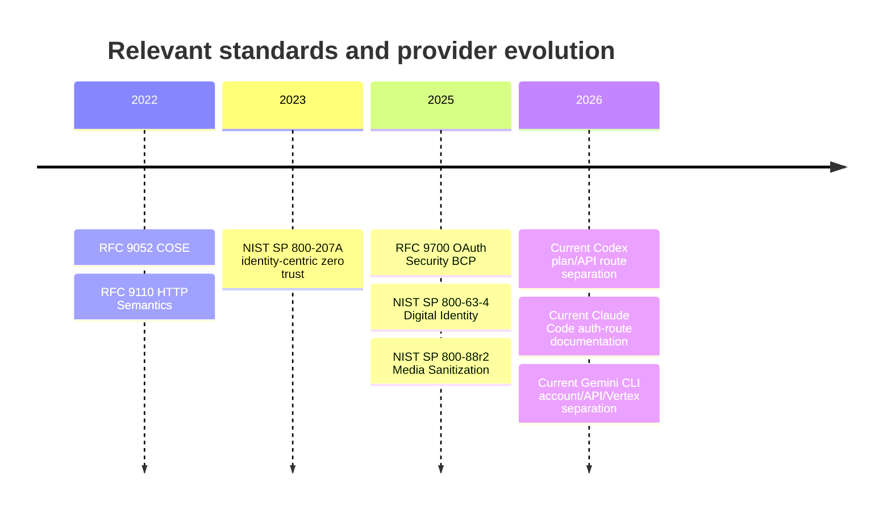

# DS-24 Research Report: Credentials, Enrollment, Egress, and Secret Lifecycle

## Executive summary and assumptions

**Assumption.** The otherwise unspecified research query is the uploaded **DS-24 — Credentials, enrollment, egress and secret lifecycle** brief. That brief asks for a source-pinned architecture covering authentication-route separation, a hypothetical `recursiond` credential broker, secret lifecycle, deny-by-default egress, node enrollment and revocation, zero-model preflight, provider refusals, and a complete threat-to-test matrix, without enrolling a node, reading a secret, contacting a provider, changing configuration, or promoting research into an Owner decision. fileciteturn20file0

The governing repository boundary is unusually important here. Recursion's accepted direction makes the versioned Recursion release the sole future canonical authority and recovery dependency; an external provider account, CLI session, or harness may supply execution but must never become the source from which canonical identity or authority is reconstructed. fileciteturn13file0 The proposed constitutional application sharpens that boundary: external engines, providers, terminals, plugins, databases, and frontends are adapters or libraries; only the deterministic kernel admits authoritative transitions and writes canonical events. That proposal is explicitly **not operative yet**. fileciteturn19file0

The central research conclusion is therefore:

> **Credentials should be treated as leased capabilities used by an admitted route, never as identity, authority, canonical continuity, or a property of a model session.**

This leads to eight concrete conclusions.

| Question | Research conclusion |
|---|---|
| How should routes be represented? | Preserve the four DS-24 route labels, but make **authentication mechanism, entitlement, billing basis, distribution permission, and terms-of-service evidence separate typed fields**. In particular, “subscription-backed” is an entitlement/billing attribute, not a cryptographic authentication mechanism. |
| What should `recursiond` own? | It should be the sole Recursion component permitted to resolve an opaque credential reference into usable credential material. Persistent secrets remain only in a provider-native auth home, operating-system secret store, or explicitly configured vault. |
| May Recursion reuse a vendor CLI OAuth token in an SDK? | **No unless a pinned provider source explicitly authorizes that exact client, account type, distribution channel, and use.** A technically accessible token does not establish entitlement or permission. |
| Can overlay teardown alone prove revocation? | No. Deleting a temporary directory cannot invalidate a bearer credential that a descendant copied. Strong teardown requires process containment plus either short-lived/sender-constrained credentials, provider revocation, or a design in which the untrusted worker never receives reusable credential bytes. OAuth BCP explicitly favors audience restriction and sender-constrained or rotating refresh credentials. citeturn13search3 |
| Where must egress be enforced? | At the **byte-and-socket boundary**, after route resolution and immediately before transmission. Prompt scanning is defense in depth, not the authority boundary. |
| How should offline revocation work? | “Immediate” means the authority side immediately rejects new admission and renewal. A disconnected node cannot learn an unseen revocation instantaneously; stale-authority exposure must therefore be bounded by short leases, preauthorized scope, fencing, and a ban on disconnected publication or authority widening. |
| How should node identity work? | Keep the installation trust root, operator authentication, device/workload key, role grants, and provider credential references separate. A valid device certificate identifies a device; it does not grant executor, verifier, credential, publication, or spending authority. |
| What is the release gate? | Official release evidence should require full adversarial conformance; an ordinary install should require only deterministic zero-model preflight and should quarantine a failing capability rather than disable the local kernel. This matches the repository's existing acceptance direction. fileciteturn17file0 |

The last five years have strengthened exactly the primitives DS-24 needs. HTTP semantics were consolidated in RFC 9110 in 2022, including warnings about arbitrary CONNECT tunnels and intermediary routing; COSE was standardized in RFC 9052 in 2022; NIST extended zero-trust guidance to identity-centric cloud-native enforcement in 2023; OAuth Security BCP RFC 9700, NIST SP 800-63-4, and the revised media-sanitization SP 800-88r2 arrived in 2025; and current 2026 OpenAI, Anthropic, and Gemini documentation now exposes several visibly distinct authentication and billing routes rather than one generic “OAuth/API” concept. citeturn13search1turn16search0turn12search7turn13search3turn14search10turn14search4turn8search1turn9search1turn11search3



There is **no defensible longitudinal quantitative data series** in the source set from which to plot a security “trend” without inventing a denominator. The repository does, however, report a route matrix spanning **13 requested integrations, 23 explicit paths, and 130 feature/control cells**, while explicitly stating that source documentation did not certify live account entitlement or runtime conformance. fileciteturn16file0 The appropriate quantitative output for DS-24 is therefore a future conformance scorecard—replay acceptance, egress bypasses, secret leakage, stale-fence acceptance, preflight latency, and unsupported-route unknowns—not a synthetic historical chart.

## Source-pinned route and policy model

The highest-value modeling correction is to stop making one field called “auth” carry five meanings. The repository already says provider, engine, integration interface, authentication, billing, account/capacity pool, credential reference, and host are independent dimensions, and that unknown billing, privacy, or entitlement must remain unknown rather than being interpreted as free or authorized. fileciteturn16file0 The execution-fabric hypothesis likewise defines a resolved route from separate model, engine, provider, billing/capacity pool, credential reference, host, network profile, and privacy constraints, and specifically says that subscription-to-metered-API movement is an authority transition rather than ordinary failover. fileciteturn9file0

**Recommended route schema:**

```text
RouteDescriptor {
    route_id
    engine
    provider
    interface
    model

    route_class                  // DS-24 compatibility label
    auth_mechanism               // api_key, oauth_public_client, native_login, cloud_identity...
    credential_ref               // opaque; never credential bytes
    authenticated_principal_ref

    entitlement_class            // subscription, API account, cloud project, local, unknown
    entitlement_evidence
    billing_basis                // included_quota, metered, BYOK, cloud, unknown
    capacity_pool_id

    distribution_channel
    distribution_permission_evidence
    terms_profile
    terms_evidence
    jurisdiction_constraints

    privacy_profile
    training_or_contributor_status
    egress_profile
    proxy_resolver_profile

    adapter_version
    source_revision
    evidence_retrieved_at
    evidence_expiry_trigger
}
```

This model makes an important distinction: **`route_class = subscription-backed` does not imply `auth_mechanism = subscription`**. A subscription-backed route may authenticate through a first-party browser OAuth flow, an account login handled by a vendor binary, or another provider-defined mechanism. Current OpenAI Codex documentation, for example, says signing into Codex with ChatGPT uses the ChatGPT plan's usage/billing, while use with one's own API key uses API pricing. citeturn8search1turn8search4 Anthropic separately documents Claude Code login through a Claude Pro/Max account, Anthropic Console/API access, Bedrock, and Vertex AI; its SDK documentation recommends a dedicated API key or cloud-provider credentials for programmatic embedding. citeturn9search1turn10search0 Gemini CLI similarly documents Google-account login, Gemini API-key authentication, and Vertex AI as distinct choices. citeturn11search3

**Source-pinned claim table**

| Claim | Primary source / version or date | Classification | Confidence | Expiry trigger | Entitlement fact | Distribution fact | Terms-of-service fact |
|---|---|---:|---:|---|---|---|---|
| Recursion, not a provider session, is the future canonical authority/recovery owner. | Repository OR-019 / current migration and decision records. fileciteturn13file0 | Accepted product direction; constitutional application still separate | High | Owner ruling superseded or operative constitution changed | Not an entitlement statement | Not a distribution statement | Not a provider-terms statement |
| Codex can use a ChatGPT plan; current first-party clients include desktop, CLI, IDE extension and web. | OpenAI Help, updated Sept. 2026. citeturn8search1 | Current provider documentation | High | OpenAI client/plan/support article changes | Plan-specific limits apply | Named first-party clients documented | ChatGPT Terms or applicable business/enterprise agreement governs ChatGPT sign-in route |
| Codex ChatGPT-plan usage and own-API-key usage have different billing bases. | OpenAI Help, current 2026. citeturn8search4 | Current provider documentation | High | Pricing/auth architecture changes | ChatGPT allowance versus API account | Both routes documented in provider client | Applicable terms differ by account/product agreement |
| Claude Code supports Claude Pro/Max login, Anthropic Console/API, Bedrock and Vertex routes. | Anthropic Claude Code setup documentation. citeturn9search1 | Provider documentation | High | Claude Code auth documentation changes | Pro/Max subscription or active API/cloud entitlement, route dependent | First-party Claude Code distribution documented | Exact account-specific terms must remain pinned separately |
| Programmatic Claude Code SDK documentation recommends a dedicated Anthropic API key and also documents Bedrock/Vertex credentials. | Anthropic SDK documentation. citeturn10search0 | Provider SDK documentation | High | SDK auth docs/version changes | API/cloud entitlement | SDK embedding documented | API use is subject to Anthropic commercial terms; third-party platform cases may carry platform terms. citeturn10search7turn10search3 |
| Public evidence located in this run does **not** establish a blanket right for a third-party app to extract and reuse a Claude consumer-login token as its SDK credential. | Comparison of current first-party login docs and SDK auth docs. citeturn9search1turn10search0 | Research inference from absence of supporting primary documentation | Medium-high | Provider explicitly publishes such permission or prohibition | **unknown** | **unknown for token reuse** | **unknown for token reuse** |
| Gemini CLI distinguishes Google sign-in, Gemini API key and Vertex AI, with subscription users directed to use the account attached to the subscription. | Gemini CLI official docs, current Sept. 2026. citeturn11search3 | Provider documentation | High | Gemini CLI/auth docs change | Account/license/API/cloud-project dependent | Official Gemini CLI route | Exact terms should be pinned per route/account |
| Native-app OAuth should use an external browser; public native clients use PKCE; embedded user-agents are unsafe because the hosting app can observe credentials/cookies. | RFC 8252, BCP 212. citeturn13search2 | IETF Best Current Practice | High | Superseding BCP | N/A | Does not establish provider distribution permission | Does not establish provider ToS permission |
| OAuth access tokens should be minimum-privilege and audience-restricted; public-client refresh tokens must be sender-constrained or rotated. | RFC 9700, BCP 240, 2025. citeturn13search3 | IETF Best Current Practice | High | Superseding BCP | N/A | N/A | N/A |
| Secret scanning is useful but cannot be the only boundary: supported-pattern gaps, old token formats, huge pushes and scan timeouts can produce misses. | GitHub secret-scanning documentation, current. citeturn12search1turn12search10 | Operational security evidence | High | Scanner behavior/docs change | N/A | N/A | N/A |
| Secret deletion should distinguish key destruction/cryptographic erase from proof that all logical copies disappeared. | NIST SP 800-88r2, Sept. 2025; NIST key-destruction terminology. citeturn14search4turn14search0turn14search19 | Current NIST guidance | High | NIST revision | N/A | N/A | N/A |

The claim table exposes an important policy discipline: **a successful OAuth exchange proves authentication, not entitlement, redistributability, billing status, or terms compliance.** Conversely, an open-source license on a CLI or SDK does not prove account access. Recursion's route-capability document already records this distinction and explicitly warns that source licenses do not grant account access or settle downstream distribution terms. fileciteturn16file0

The resulting four-route matrix is:

| DS-24 route class | Authentication mechanism | Supported pattern | Refused pattern | Entitlement / billing | Distribution / terms |
|---|---|---|---|---|---|
| **API-key / BYOK** | Provider API key, cloud service credential, or equivalent broker-resolved secret | Broker resolves opaque `credential_ref`; exposes the minimum route-specific credential only for the admitted operation; all usage bound to the named billing pool | Key in Git, SQLite, prompt/context, global inherited environment, command line, telemetry, plugin manifest, or silent use by a helper | Explicit API/cloud account and billing pool required; possession of a key is not sufficient evidence of budget authority | Require provider/API terms plus intended embedding/distribution evidence |
| **SDK OAuth** | OAuth client explicitly supported for programmatic application use | Provider-documented client registration, browser-based authorization, PKCE where applicable, audience restriction, route-scoped refresh handling | Copying a consumer/native-CLI token or browser cookie into an SDK because the bytes are technically accessible | Must be pinned independently; **unknown** absent provider evidence | **unknown** absent explicit provider permission for that client and application |
| **Native-binary login** | User signs into an unmodified provider binary through its supported login flow | Provider binary owns its login flow and credential home; Recursion launches it inside a bounded execution/egress scope and records only opaque route/account references | Recursion intercepts password, cookie, access token, refresh token, or session file and becomes the login intermediary | Whatever entitlement that exact provider binary documents for the account | Only the provider-documented client/channel is presumed; no token portability is inferred |
| **Subscription-backed** | An explicit underlying mechanism, usually native login or provider account OAuth | Exact subscription + exact provider-supported client + observed route is bound to a subscription capacity pool | Treating subscription login as general API entitlement, helper API authority, or permission for automatic metered fallback | Included allowance/credits/quota are first-class accounting units, separate from API dollars | Must pin supported client/account/terms; no generic “subscription OAuth” permission |

OpenAI's current documentation is a particularly clear validation of that separation: using ChatGPT sign-in in Codex consumes the relevant plan allowance, while using one's own API key remains an API route; a model availability change on the ChatGPT-authenticated route was explicitly documented as not affecting the API/BYOK route. citeturn8search1turn8search2 Anthropic's public documentation supplies a similar distinction between Claude Pro/Max login and programmatic API/cloud credentials. citeturn9search1turn10search0

**No-token-intermediation negative fixture.** The test must not contain a literal fake credential. Instead, the test process generates ephemeral secret-shaped bytes internally and assigns them only the symbolic identifier `SECRET_FIXTURE_BYTES`; those bytes never enter the repository, packet, report, or durable test log. The adapter then attempts each forbidden operation: export credential bytes from the broker, persist them, refresh a token on behalf of an unapproved client, substitute the credential for another principal, proxy it to an unapproved endpoint, or re-sign/wrap it as a new identity. Every attempt must fail **before network activity** with a receipt equivalent to:

```text
status                  = refused
reason                  = credential_intermediation_forbidden
attempted_effect        = false
network_effect          = none
credential_ref          = <opaque ref only>
requesting_principal    = <canonical principal id>
target_principal        = <canonical principal id>
route_id                = <route>
policy_revision         = <revision>
secret_value_recorded   = false
```

A test fails if credential bytes appear in stdout, stderr, an environment dump, canonical state, evidence, model-visible context, a subprocess argument, tracked files, or outbound traffic. This converts “we do not intermediate tokens” from a policy statement into a falsifiable machine contract.

## Credential broker, secret lifecycle, and egress

The repository's security hypothesis already specifies the right persistent placement rule: credentials remain in provider-native auth homes, an OS secret store, or a configured vault; they do not belong in Git, SQLite, prompts, worktrees, telemetry, context artifacts, or plugin manifests. It further proposes that workers receive only opaque references and route-specific temporary environment/home overlays. fileciteturn7file0 That should be made more exact rather than broadened.

**Proposed `recursiond` credential-broker contract**

| Surface | Permitted | Forbidden |
|---|---|---|
| Persistent secret storage | Provider-native authentication home when that exact native route requires it; OS-protected secret store; configured external vault | Canonical event store; SQLite application rows; Git; worktrees; project config; Markdown/YAML/JSON manifests; cache indexes |
| Runtime reference | Opaque `credential_ref` containing no secret-derived material | Raw API key, access token, refresh token, password, cookie, session secret, cloud private key |
| Worker exposure | Prefer none. When unavoidable, minimum route-specific temporary materialization into a private overlay or process channel | Global environment, parent shell, command line, terminal scrollback, inherited credentials for unrelated accounts |
| Model-visible data | Stable account/route pseudonym, capability and billing class only | Secret bytes, auth headers, credential files, recovery codes |
| Logging / evidence | Credential reference, provider route, policy/rotation version, success/refusal metadata | Secret value or reversible derivative |
| Plugin access | Explicit capability request + exact digest-aware grant + broker-mediated operation | Enumerating credential inventory or opening secret-store files directly |
| Recovery | Reconstruct references and required reauthentication status from canonical state | Reconstruct a secret from provider transcript/session state |

The plugin architecture is consistent with this model: disabled/no-action plugins are supposed to perform no plugin import, process, network, credential, or model effect, and plugin artifact provenance is deliberately kept distinct from runtime authority. fileciteturn8file0 SLSA provenance similarly answers where an artifact came from and how it was produced; it is not a verdict that the program is safe to receive credentials. citeturn16search2

The safe overlay lifecycle should be:

```mermaid
flowchart LR
    A[Route candidate] --> B[Deterministic admission]
    B -->|denied| X[No credential resolution]
    B -->|admitted| C[Issue bounded credential lease]
    C --> D[Resolve opaque reference inside broker]
    D --> E[Create empty route-specific overlay]
    E --> F[Expose minimum required material]
    F --> G[Launch in owned process scope]
    G --> H[Broker-owned egress enforcement]
    H --> I[Complete, cancel, expire, or revoke]
    I --> J[Block new use and terminate owned descendants]
    J --> K[Unmount/delete/zeroize overlay]
    K --> L[Record non-secret teardown receipt]
```



The crucial qualifier is that **filesystem teardown is not equivalent to credential revocation**. Once a reusable bearer token has escaped into another process's memory or storage, deleting the original overlay does not make the copy unusable. RFC 9700 therefore matters directly: narrow audience/scope and sender-constraining or refresh-token rotation reduce the damage from copied OAuth material. citeturn13search3 For a credential that cannot be made short-lived or sender-bound, Recursion has only three defensible choices: keep it entirely inside the vendor's own isolated process boundary; provide a brokered operation in which the worker never receives the value; or refuse the route when containment cannot prevent descendant exfiltration.

A temporary overlay should therefore have a **credential lease** independent of the task lease:

```text
CredentialLease {
    lease_id
    credential_ref
    credential_version
    route_id
    principal
    process_scope_id
    permitted_provider_audience
    permitted_egress_profile
    issued_at
    expires_at
    revocation_epoch
    max_uses_or_operation_scope
}
```

Rotation should not alter content identity. Canonical events and artifacts refer to the stable opaque `credential_ref`; the broker maps that reference to a versioned secret internally. New admissions receive the newest eligible version. An already-running operation either retains a precisely bounded version lease until expiry, or is fenced immediately if policy marks rotation as revocation. A revoked credential may not trigger a blind retry through another account. Recursion's execution-fabric design already requires provider/model/account/billing changes to go through a fresh route decision rather than being silent recovery. fileciteturn9file0

**Deletion should be a proof-state machine, not a boolean.** The repository already reaches this conclusion for private artifacts, distinguishing local deletion, key destruction, propagation pending, verified completion, partial status, blocked status, and backup-expiry boundaries. fileciteturn18file0 NIST SP 800-88r2 likewise distinguishes sanitization programs, validation, cryptographic erase, and key sanitization, while NIST defines key destruction as eliminating key traces so the key cannot be recovered. citeturn14search4turn14search0turn14search19 A suitable credential-reference lifecycle is therefore:

```text
ACTIVE
  -> ROTATED
  -> REVOKED
  -> LOCAL_MATERIAL_REMOVED
  -> KEY_DESTRUCTION_REQUESTED
  -> KEY_DESTRUCTION_VERIFIED
  -> REPLICA_OR_BACKUP_PROPAGATION_PENDING
  -> DELETION_PROVED
       | PARTIAL
       | BLOCKED
       | EXPIRY_BOUND
       | LEGAL_HOLD
```

`REVOKED` means **no new authorization**; it does not assert physical deletion. `KEY_DESTRUCTION_VERIFIED` means the relevant encryption key is no longer recoverable; it does not prove that an unencrypted copy never escaped. `DELETION_PROVED` requires evidence over every recoverable copy or a recorded backup-expiry boundary, matching the repository's artifact-deletion rule. fileciteturn18file0

**Redaction and scanning must be sink-enforced and layered.** GitHub's own secret-scanning documentation is useful precisely because it documents limitations: not every credential form is covered by push protection; legacy variants may be absent; sufficiently large pushes can time out; and custom patterns are needed for organization-specific forms. citeturn12search1turn12search3 Thus scanning cannot justify allowing raw credentials into model context and hoping to remove them later.

The proposed pipeline is:

| Layer | Required behavior | Falsifier |
|---|---|---|
| Architectural prevention | Secret bytes do not enter canonical messages or model context in the normal design | Model input contains `SECRET_FIXTURE_BYTES` |
| Broker-known exact matching | Broker creates an in-memory, nonreversible detector/fingerprint for currently leased values without logging the value | Current leased secret reaches a durable sink undetected |
| Provider-format rules | Match known provider token/key shapes, credential headers and secret files | Supported format passes |
| Generic detection | Entropy/generic-secret classifier and structured-field denylist | High-entropy fixture in forbidden field passes |
| Bounded decoding | Inspect common nested encodings and structured payloads under size/CPU limits | Encoded fixture passes while within limits |
| Sink gate | Scan before model visibility, durable evidence, telemetry, publication and tracked-file write | Any sink writes first and scans second |
| Failure semantics | Scanner error, timeout or unknown decoder state fails closed for secret-sensitive sinks | Scanner timeout results in publication |
| Alert privacy | Report field/path/class/ref, never the matching bytes | Alert reproduces the secret |

The required negative test generates the secret-shaped bytes inside the test process, sends them through stdout, stderr, a tool-result object, exception string, structured telemetry and proposed tracked-file content, and requires each forbidden sink to reject or quarantine the record. The secret itself is never included in the fixture source or output.

**Egress should be a compiled decision over exact outbound bytes.** Recursion's security hypothesis already sets `private` and deny-by-default as the base and says prompt/configuration text must not widen route eligibility. fileciteturn7file0 The stronger implementation contract is:

```text
EgressDecision =
    ProjectClassification
  ∩ GoalSpecNetworkGrant
  ∩ RouteEligibility
  ∩ ProviderDataUseProfile
  ∩ DestinationAllowlist
  ∩ ProxyResolverProfile
  ∩ CredentialLease
  ∩ ArtifactClassification
  ∩ SecretScanPass
  ∩ BillingAuthority
  ∩ RequiredOwnerAcknowledgement
```

The intersection model matters: no input may contribute additional authority merely because another input is broad. A project file saying “allow all providers,” for example, cannot widen a parent GoalSpec or installation policy.

For each outbound request, the broker should assemble the **final bytes in memory before any socket write**, classify them, run the secret controls, bind their project-local audit identity to the route and policy revision, then open the connection. Exact private request bytes need not become permanent evidence. A receipt can retain byte count in a disclosure-safe bucket, a project-scoped keyed digest when equality testing is genuinely needed, classification, route, and decision result. The repository already warns that raw digests and exact sizes must not be exposed across project/public-observer boundaries because they can become membership or equality oracles. fileciteturn18file0

Contributor/training-eligible routes should require an explicit acknowledgement bound to:

```text
project_id
route_id
provider_profile_revision
data_use_class
exact outbound classification classes permitted
acknowledging_principal
policy_digest
issued_at
expires_at
```

It must **not** be a global “allow training” preference. A project that changes its configuration or prompt cannot mint or broaden this acknowledgement.

Proxy and DNS behavior must also remain part of admission rather than inherited ambient state. HTTP CONNECT creates a tunnel to a host and port and RFC 9110 explicitly warns that proxies allowing arbitrary CONNECT targets create security risks; it recommends restricting targets. The same RFC warns that host/port routing is a frequent target for malicious redirection and that interception proxies can introduce security and interoperability problems. citeturn13search0turn13search1 RFC 8484 similarly specifies that a DoH client uses a configured resolver URI and must not simply adopt an unconfigured DoH server discovered through another mechanism; it also notes that different DNS servers can legitimately give different results under split-DNS policy. citeturn12search0

| Threat | Recommended DS-24 behavior |
|---|---|
| `HTTP_PROXY` / `HTTPS_PROXY` inherited from shell | Remove from worker inheritance. Only re-inject a broker-compiled proxy profile explicitly admitted for the route. |
| PAC file | Initial secure profile: unsupported unless independently admitted. A future PAC implementation must pin the PAC artifact, isolate evaluation and subject every selected proxy/destination to the same route policy. |
| Arbitrary CONNECT | Permit only route-approved destination/port tuples; proxy cannot convert a narrow provider grant into a generic TCP tunnel. |
| DNS rebinding | Resolve at admission and again at connect; reject a resulting IP outside the approved address policy, including loopback/private/link-local/reserved space absent explicit local grants. |
| DoH bypass | Only configured resolver/DoH endpoints are usable; direct unapproved DoH is an egress violation. |
| Redirect | Every redirect is a new destination decision; never inherit approval merely from the first URL. |
| TLS/SNI mismatch | Validate canonical destination, SNI/hostname and certificate chain. |
| Enterprise TLS interception | Require an explicit proxy/trust profile and pinned trust anchor; never silently inherit a newly installed CA as route authority. |
| Private metadata oracle | Keep exact sizes, global digests, destinations and timing project-scoped; public views receive disclosure-minimized aggregates. |

A decisive DNS-rebinding fixture is straightforward: the approved hostname resolves to an allowed public address at classification time and to a blocked local/private address immediately before connection. **Zero payload bytes may be emitted** on the second result.

## Node identity, enrollment, revocation, and zero-model preflight

The repository's existing security direction is already close to a strong node design: it separates a trust root from everyday credentials, requires enrollment to combine possession with Owner approval, grants controller/executor/observer/verifier capabilities separately, requires signed/scoped/expiring/replay-protected packets, and says revocation blocks new admission while disconnected nodes may only finish previously permitted bounded work and must revalidate on reconnect. fileciteturn7file0 That should be made precise with five independent identities.

| Identity layer | Purpose | Must **not** imply |
|---|---|---|
| Installation trust root | Authorize installation-level trust changes and sign/enroll subordinate identities | Everyday execution, provider login, model use |
| Operator identity/authenticator | Prove the human principal approving an action | Device identity or automatic executor rights |
| Node/device key | Prove possession by an enrolled machine/process boundary | Executor, verifier, publication, credential or spending authority |
| Role/capability grant | Express controller/executor/observer/verifier and scoped operation rights | Provider credential possession |
| Credential reference | Select an admitted provider/account route | Canonical actor identity or node role |

NIST's current digital-identity guidance is a useful comparator rather than a claim that Recursion is a federal NIST-conformant system. SP 800-63B-4 requires replay resistance at AAL2, requires phishing resistance and non-exportable private keys at AAL3, and specifies periodic reauthentication; AAL3 also requires authentication intent. citeturn15search0turn15search1 Those properties map naturally onto high-risk Owner step-up and device-key design.

**Enrollment protocol.**

| Phase | Required evidence | Failure behavior |
|---|---|---|
| Node initialization | Node generates a fresh device key, preferably non-exportable/hardware-protected where the platform permits | No preexisting provider secret is imported |
| Challenge | Authority issues one-time enrollment nonce with expiry and intended installation | Expired/replayed challenge rejected |
| Proof of possession | Node signs nonce plus its enrollment request | Mere possession of a copied public certificate is insufficient |
| Out-of-band display | Owner sees installation, node fingerprint, requested roles, requested host profile and expiry | Hidden requested capability blocks enrollment |
| Owner step-up | Authenticated Owner approves exact digest of request | Approval for node A cannot enroll B |
| Credential issuance | Authority signs a short-lived node credential/identity | Credential carries identity, not omnibus role rights |
| Grant issuance | Separate signed role grants specify controller/executor/observer/verifier scope | Missing role remains denied |
| Activation | Node passes zero-model preflight and records the admitted trust revision | Failure quarantines remote capability |

The device credential should be short-lived and renewable under current policy. SPIFFE provides a useful comparator: its X.509 workload identity format binds one SPIFFE identity to an X.509 certificate, while its JWT form explicitly warns that bearer identities are replayable and recommends aggressive expiry. citeturn16search4turn16search3 Recursion need not adopt SPIFFE, but the comparison favors proof-of-possession credentials over long-lived bearer node tokens.

**Signed work-envelope semantics should be format-neutral at this research stage.** The required semantic fields are:

```text
envelope_version
packet_id
operation_id
attempt_id

issuer
subject
audience
installation_id
node_id
signing_key_id

parent_envelope_digest
delegation_depth

constitution_digest
goalspec_id
goalspec_version
goalspec_digest
policy_version
policy_digest
route_digest

capability_verbs
resource_scope
network_scope
credential_ref
billing_pool
budget_limits
rate_limits

issued_at
not_before
expires_at
deadline

revocation_epoch
admission_epoch
lease_id
lease_generation
fencing_token

step_up_receipt_digest
idempotency_key
nonce_or_jti

payload_digest
artifact_references

signature_algorithm
signature
```

A wire format should not be selected by DS-24. **COSE_Sign1 is a strong comparator**, because RFC 9052 standardizes single-signer signed objects and authenticated protected headers, but the RFC itself notes that successful signature verification is not enough: the application must still verify that the key corresponds to the expected signing identity and that the identity is authorized. citeturn16search0 That aligns exactly with Recursion's model—cryptography proves message/key integrity; the canonical kernel still decides authority.

Step-up should be **risk-triggered**, independently from whatever periodic reauthentication cadence the Owner eventually chooses. Mandatory triggers should include installation-trust changes, new credential/account introduction, credential export or recovery, grant administration, new egress domains or proxy trust, spending/billing-class widening, publication/deployment, destructive external effects, constitutional/GoalSpec widening, and recovery from a suspicious or revoked node. NIST's 2025 guidance supplies reasonable experimental comparators—AAL2 recommends at most a 24-hour overall session with a one-hour inactivity timeout, while AAL3 permits no more than 12 hours overall and recommends a 15-minute inactivity timeout—but those numbers should **not** silently become Recursion product policy. citeturn15search0turn15search5

A skipped/replayed step-up fixture should bind the receipt to the exact operation digest, risk class, principal, installation, policy/GoalSpec revision, issue time, expiry, and a single-use consumption identifier. Reusing it against a different destination, account, node, GoalSpec version, or later operation must produce no authoritative event.

**Offline revocation requires precise language.** There is no protocol that can inform a truly disconnected machine of a newly issued revocation before communication resumes. Recursion can nevertheless make revocation safe by dividing the guarantee:

* At the authority/controller, revocation immediately prevents new work admission, lease renewal, publication admission, credential issuance and route widening.
* The disconnected node possesses only pre-issued rights bounded by expiry, GoalSpec/policy digest, operation identity, capability verbs and fencing token.
* Disconnected work can produce signed evidence only; it cannot publish, add credentials, expand egress, amend authority or mint a new lease.
* Upon reconnection, the controller validates current revocation epoch, GoalSpec/policy version, PAUSE state, lease generation, fence, evidence digest and operation identity before the evidence can affect canonical state.

This interpretation matches the repository's existing requirement that stale returning processes may supply reconciliation evidence but cannot reacquire authority or publish, and that recipient-installed fences and outstanding launch permits are distinct facts. fileciteturn9file0

Split brain is resolved with **monotonically ordered fencing**, not faith that only one process thinks it is executive. The canonical writer and every effect-enforcing broker must reject a stale fence. Two processes may temporarily believe they hold a lease after partition; only the current fence may write or dispatch. State documentation already requires one fenced writer per aggregate and explicitly rejects the idea that datastore single-writer behavior alone identifies the authorized Recursion writer. fileciteturn18file0

**Zero-model preflight** should be a pure deterministic function of local trust inputs:

```text
PreflightCacheKey = hash(
    recursion_release_digest,
    runtime_executable_digest,
    dependency_lock_digest,
    adapter_manifest_digests,
    plugin_graph_digest,
    effective_config_digest,
    trust_bundle_digest,
    trust_bundle_version,
    node_certificate_identity_and_expiry,
    revocation_epoch,
    protocol_versions,
    schema_versions,
    permission_snapshot_digest,
    OS_containment_capability_snapshot,
    egress_profile_digest,
    proxy_profile_digest,
    resolver_profile_digest,
    secret_broker_contract_version,
    clock_health_class
)
```

The repository security design already calls for zero-model preflight on enrollment and trust-input changes and identifies runtime hash, configuration hash, trust bundle/protocol versions, certificate state and permission snapshot as cache inputs. fileciteturn7file0 The added OS containment and egress/proxy/resolver keys are necessary because a previously passing authorization configuration is unsafe if the enforcement mechanism itself changed.

Preflight should perform **no model inference and no provider request**. It verifies signatures/digests, certificate state, role/grant consistency, clock sanity, supported protocol/schema versions, secret-store accessibility without reading secret values, process-containment primitives, the ability to enforce the compiled network profile, and canonical-store replay/readability. A cache hit is valid only while every trust-relevant key is unchanged.

Rather than inventing a latency threshold, DS-24 should establish the measurement vector:

| Metric | Required reporting |
|---|---|
| Cold preflight latency | median, p95, p99 by Windows/Linux reference host |
| Warm cache-hit latency | median, p95, p99 |
| CPU / peak resident memory | exact reference host/build |
| Cache invalidation rate | reason grouped by trust input |
| False cache acceptance | **must be zero in adversarial fixtures** |
| Model/provider calls | **must be zero** |
| Secret values read | **must be zero** unless a separately admitted operational check explicitly requires them; DS-24 itself does not authorize such a check |

The current repository requirement is that this operation complete in seconds; a numeric release threshold should wait for actual measurements rather than being manufactured by this report. fileciteturn7file0

## Threat tests, conformance, and provider refusals

DS-24's threat list should become a fixed adversarial suite rather than prose. The acceptance document already states the governing philosophy: successful scenarios cannot prove absence of failures; release evidence must combine invariant/property tests, fault injection, independent review, resource measurement and soak evidence. fileciteturn17file0

| Required threat | Concrete fault injection | Required result / decisive falsifier |
|---|---|---|
| **Stolen node credential** | Copy a node credential without its non-exportable signing key, or use it from a different node/process identity | Proof-of-possession fails. **Falsifier:** copied credential alone admits work |
| **Replayed work packet** | Submit identical signed packet after acceptance and again after lease/fence advancement | Exact duplicate produces prior idempotent outcome or replay refusal; no second effect. **Falsifier:** duplicate dispatch/effect |
| **Malicious project config widens egress/permissions** | Project config requests a destination/capability denied by parent GoalSpec/policy | Effective authority remains the intersection and request is denied. **Falsifier:** child config widens route |
| **Prompt/tool-output exfiltration** | Tool output contains in-memory `SECRET_FIXTURE_BYTES`; prompt requests sending it to an allowed provider | Sink scanner blocks before model/egress. **Falsifier:** bytes reach model or socket |
| **Plugin dependency confusion/update compromise** | Same package name/new digest or substituted transitive lock artifact requests prior grant | Digest-bound grant invalid; plugin quarantined. **Falsifier:** signature/name alone inherits old authority |
| **Symlink/reparse/path traversal across worktrees** | Replace permitted path with symlink/junction/reparse target outside admitted root after preflight | Effect-time resolver rejects target. **Falsifier:** write/read escapes canonical resolved scope |
| **Stale route/GoalSpec after revocation** | Hold admitted packet, advance revocation/GoalSpec epoch, then dispatch | Effect-time revalidation rejects. **Falsifier:** old packet executes |
| **Provider response forges evidence/completion** | Provider output claims tests passed or effect completed without independently admitted receipt | Output remains proposal/observation. **Falsifier:** provider text alone changes canonical completion state |
| **Split-brain executive leases** | Partition nodes; grant higher fencing generation to one while stale peer continues | Lower fence cannot write/dispatch. **Falsifier:** two fences accepted for same protected epoch |
| **Disconnected node publishes stale work** | Disconnect node, revoke or PAUSE centrally, let node finish local task and attempt publication | Evidence may spool; publication blocked until reconnect/revalidation. **Falsifier:** disconnected publication succeeds |
| **Public event metadata leaks project membership** | Observe public stream while two private projects emit distinct sizes/timing/raw digests | Cross-project/public view cannot correlate private artifacts or membership. **Falsifier:** equality/membership inference from exposed metadata |
| **Owner-hostile defaults prevent local recovery** | Break/revoke every remote provider/plugin/credential path and restart | Local kernel boots, replays canonical state and provides Owner-readable status. **Falsifier:** optional external route is required for recovery |

Several of these tests directly match existing architecture invariants. The proposed constitutional direction says external engines cannot reconstruct canonical state and requires the kernel to boot/replay/status with optional adapters absent. fileciteturn19file0 The state design rejects exactly-once claims for distributed side effects and instead requires idempotency, fences, authenticated receipts and reconciliation of ambiguous effects. fileciteturn18file0 Plugin policy similarly treats exact artifact and dependency-lock identity as separate from authority, and does not let signatures or provenance imply safe runtime behavior. fileciteturn8file0

The proxy/DNS tests should add at least four fixed traces: DNS public-to-private rebinding before connect; proxy CONNECT to an unapproved port; inherited shell proxy attempting to rewrite an approved destination; and an unconfigured DoH endpoint attempting resolution. RFC 9110's CONNECT target restriction and RFC 8484's configured-DoH-server rule give these tests standards-level grounding. citeturn13search1turn12search0

**Release and install conformance should be asymmetric by design.**

| Context | Required gate | Failure consequence |
|---|---|---|
| Official v3 release claim | Full deterministic schemas + all DS-24 adversarial fixtures + Windows/Linux containment and preflight + route-specific source pins + independent verification | Release claim blocked |
| Certified remote capability | Full capability-specific conformance for exact build/config/trust profile | Capability quarantined |
| Ordinary Owner install | Integrity/signature checks + zero-model deterministic preflight; full suite available on request | Only failing remote/optional capability unavailable |
| Local recovery | Canonical replay/status without provider, plugin, credential or frontend dependency | Failure is core release blocker |
| Individual provider route | Exact route/auth/account/billing/privacy/distribution/TOS evidence plus local observation before support claim | Route remains `documented`, `unknown`, `stale`, or `unavailable`; no silent fallback |

That mirrors the repository's explicit direction that missing optional capability must block only the work requiring it, never auto-install a substitute route or silently enable spending. fileciteturn17file0

**Provider refusal policy also needs typed semantics.** A model response saying “this is a poor fit” is qualitatively different from local authorization, credential, privacy, budget, node-identity, publication, or egress enforcement. The latter are hard Recursion boundaries and remain enforced regardless of what a model recommends. The repository already says provider refusals are recorded and alternate routes are allowed only when authorized by the GoalSpec/local policy and other applicable boundaries. fileciteturn7file0

A refusal receipt should include:

```text
refusal_id
operation_id
route_id
provider
model_or_interface
request_policy_digest
project_classification
refusal_class
provider_reason_code_if_structured
received_at
billing_observation
external_effect_status
alternate_route_eligible
alternate_route_policy_digest
```

The raw private prompt need not be retained simply to prove that a refusal occurred.

Recommended refusal classes are:

| Refusal class | Alternate behavior |
|---|---|
| Authentication/entitlement failure | No fallback to another account or billing basis without fresh explicit route admission |
| Quota/rate limit/outage | May use a previously approved alternate with compatible privacy, billing and egress policy |
| Capability mismatch | May recommend compatible admitted routes; no automatic widening |
| Provider safety/legal/policy refusal | Must not use alternate routing **for the purpose of evading the same applicable safeguard** |
| Local Recursion credential/privacy/budget/egress refusal | No model/provider response can override it |
| Unknown/unstructured refusal | Preserve unknown; do not convert it into authorization for retry elsewhere |

This is also where billing closure is essential. A helper call made during a subscription-backed workflow is not automatically subscription-backed. Every model-using dependency must resolve its own route and capacity-pool binding before execution; the repository already prohibits an upstream-only workflow from discovering a hidden direct API dependency or silently using an unapproved metered pool. fileciteturn9file0

The measurable DS-24 security scorecard should therefore include at least:

| Metric | Release interpretation |
|---|---|
| Successful token-intermediation attempts | **0 required** |
| Successful secret-to-model/durable/public sink escapes | **0 required** |
| Successful unadmitted outbound-byte transmissions | **0 required** |
| Successful stale/replayed packet effects | **0 required** |
| Successful stale-fence canonical/effect writes | **0 required** |
| Supported routes with unknown auth/entitlement/distribution/TOS fields | Must be explicitly counted; unknown cannot be hidden |
| Route fallbacks crossing billing class without prior authorization | **0 required** |
| Zero-model preflight provider/model calls | **0 required** |
| Remote-capability failures that prevent local recovery | **0 required** |
| Negative-test coverage | 12/12 DS-24 threats plus proxy/DNS, token intermediation, scanner failure and step-up replay |

## Recommendation, implementation sequence, and open Owner questions

Three architectural alternatives emerge from the evidence.

| Alternative | Description | Advantages | Principal risks |
|---|---|---|---|
| **Brokered capability intersection** — **recommended** | Stable opaque credential references; route-specific materialization only when required; broker-owned egress; short leases; process containment; signed node envelopes; auth/entitlement/billing/distribution/TOS independent | Preserves native subscription clients, API/BYOK routes and local recovery while maintaining a single authority boundary; fail-closed unknowns; supports provider diversity | More implementation complexity; native CLIs whose credential storage is inseparable from unrestricted descendants may require route-specific containment or refusal |
| **Host credential inheritance** | Launch existing CLIs with the user's normal home/environment/proxy/DNS state and treat provider sessions as ambient capability | Lowest integration effort; maximum compatibility with unmodified tools | Unrelated-account enumeration, accidental billing fallback, secret leakage, weak revocation, ambient proxy/DNS widening, provider session starts to behave like authority; conflicts with DS-24's core goals |
| **Universal central API proxy** | No native auth homes; all provider calls brokered through a single central API credential service | Cleanest secret handling and network enforcement | Breaks or degrades required native/subscription-backed routes; risks inventing API dependencies for upstream-only configurations; may violate provider distribution/auth boundaries; sacrifices useful first-party harness behavior |

The recommended architecture is therefore **Brokered Capability Intersection**.

Its decisive falsifier should be stronger than “implementation is difficult”:

> **The recommendation fails if an admitted route can cause any outbound provider byte or credential use outside the broker/enforced route boundary, or if a revoked credential lease can still be exercised by an owned descendant after the system has issued a successful revocation/teardown receipt.**

A single reproducible bypass means the design cannot claim `recursiond` as the sole credential/egress boundary for that route. The response is not to relabel the test a limitation. The route must be narrowed, isolated differently, or marked unsupported until an enforceable boundary exists.

This recommendation also beats host inheritance on a second decisive test: take a machine with several provider accounts, ambient proxy variables, a stale CLI session and an unapproved API key. Launch a WorkPacket authorized for exactly one subscription route. If the execution can discover or consume any other account, proxy, API key or billing pool, host inheritance fails DS-24. The broker model must expose only the one admitted route.

A practical implementation sequence, without selecting a language, secret-store vendor, wire serialization, or runtime, is:

| Construction slice | Output | Gate before proceeding |
|---|---|---|
| **Semantic schemas first** | `RouteDescriptor`, `CredentialRef`, `CredentialLease`, `EgressDecision`, `NodeIdentity`, `RoleGrant`, `WorkEnvelope`, `StepUpReceipt`, refusal and teardown receipts | Unknown/widening/replay fixtures fail closed |
| **Pure policy compiler** | Deterministic capability intersection for route, auth, billing, privacy and egress | Config-widening and stale-policy tests |
| **Fake broker and synthetic sink harness** | Opaque-reference lifecycle with no real secret store or provider | Token-intermediation and secret-sink fixtures |
| **Network decision harness** | Exact outbound-byte capture, destination/DNS/proxy/redirect revalidation using local synthetic endpoints | DNS rebinding, CONNECT, proxy rewrite, DoH bypass |
| **Node envelope verifier** | Enrollment challenge, proof-of-possession, signed packet and fencing validation | Replay, skipped step-up, stale fence, split brain |
| **Zero-model preflight** | Cache-key implementation and Windows/Linux trust probes | Zero model/provider calls; adversarial cache invalidation |
| **One route-specific adapter at a time** | Exact provider/client evidence bundle and contained local fixture | No public support claim before auth/entitlement/distribution/TOS closure |
| **Full DS-24 conformance** | All threat fixtures, two clean passes/independent review under the existing release philosophy | Only then propose changes to operative product specifications |

That ordering deliberately keeps secrets and providers out of the first several construction slices. It is consistent with the repository's current research posture: route source evidence is not itself live entitlement evidence, and acceptance documentation explicitly distinguishes documentation consistency from runtime certification. fileciteturn16file0turn17file0

Three **Owner decisions remain genuinely open and should not be silently settled by this research**.

**Installation maximum.** The cleanest model is to separate *installed capability* from *active authority*. A “full” installation could contain the broker and provider adapters without possessing a credential or having egress/spending grants. The alternative is to cap ordinary installations so credential/grant-administration features are not even present. The repository already distinguishes plugin/capability availability from task activation and authority, so the first model composes better technically. fileciteturn8file0 The Owner still needs to decide how easily a local installation may graduate to maximum credential/grant capability and what user ceremony is required.

**Step-up cadence.** The security recommendation is **risk-triggered step-up plus a finite time-based validity window**, rather than either “every command” or “login once indefinitely.” Current NIST comparators use at-most-24-hour overall sessions for AAL2 and at-most-12-hour sessions for AAL3, with substantially shorter inactivity windows, but Recursion's actual cadence should be selected from measured usability/security evidence rather than copied wholesale. citeturn15search0turn15search5 The unresolved Owner choice is the maximum validity period for routine high-trust sessions and whether credential/grant administration requires step-up on every consequential operation.

**Delegated credential administration.** A conservative first-release boundary would let delegated operators **select, rotate, disable, or revoke already-approved opaque references inside an existing provider/account envelope without ever seeing secret values**, while creation of a new provider/account credential, export of credential material, changes to the installation trust root, and widening to a new billing/egress domain remain Owner-only. This aligns with the repository's broader principle that grant administration must itself be an explicit capability rather than an implicit consequence of “Full Access.” fileciteturn12file0 Whether any model-driven or non-Owner role may eventually hold that capability remains an Owner decision and should be tested separately.

The resulting DS-24 contract can be stated compactly:

**Canonical identity comes only from Recursion. Authentication proves a principal to a route; it does not establish entitlement, billing, distribution permission, or terms compliance. Credentials are opaque leased capabilities. Secrets persist only in approved secret homes. Workers receive the minimum route exposure, never ambient accounts. Egress is admitted over exact bytes and exact destinations before transmission. Nodes prove possession and carry signed, expiring, fenced authority rather than ambient trust. Disconnection bounds authority rather than suspending revocation semantics. Scanners are defense in depth, not the secret boundary. Unknown provider rights fail closed. Local recovery survives the total absence of every optional provider, credential, plugin, and frontend.** These properties directly preserve the DS-24 objective and OR-019's requirement that no external account, session, or harness can become Recursion's canonical authority or recovery source. fileciteturn20file0 fileciteturn13file0