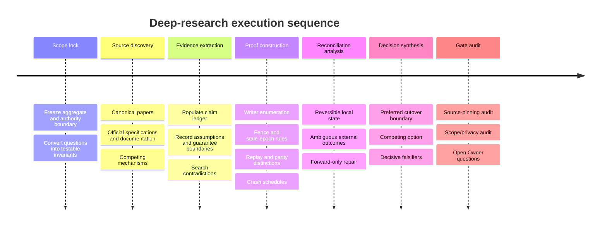

# Deep-Research Plan for the DS-05 Brief and a Reusable Topic-X Workflow

## Executive summary

Although the request describes the research topic as unspecified, the uploaded brief does in fact supply a concrete research lane: **DS-05 — Single-writer migration and effect rollback**. It defines the target problem, twelve research questions, required deliverables, non-goals, evidence discipline, privacy constraints, and a completion gate. In particular, it asks for a defensible checkpoint for transferring one aggregate from legacy writers to a fenced v3 writer; explicit separation of projection parity from replay parity; deterministic crash testing; safe rollback before external acceptance; and forward-only reconciliation after an external effect may have been accepted. fileciteturn0file0

Accordingly, the most useful plan is two-layered:

1. **Use DS-05 as the concrete working topic** when the research is actually executed.
2. **Keep the research machinery generic enough to reuse for an arbitrary topic “X”**, including query templates, evidence extraction, synthesis rules, and the final-report structure requested here.

For DS-05, the research should be **proof-oriented rather than pattern-catalog-oriented**. “Event sourcing,” “saga,” “outbox,” “strangler,” or “fencing” should not win merely because they are established patterns. Each consequential recommendation should be reduced to a machine-checkable invariant, a failure case, a competing option, and a falsifier. That is especially important because distributed locking and leader election do not by themselves guarantee that there can never be two actors believing they have authority; AWS explicitly discusses temporary zero- or two-leader states and recommends correctness modeling rather than relying on intuition. citeturn0search6turn0search0

The source hierarchy should therefore start with foundational primary research and official specifications/documentation. The 1987 *Sagas* paper is the canonical primary source for decomposing long-lived transactions into local transactions plus compensating actions. citeturn1search4turn1search7 The Chubby paper provides production experience with coarse-grained distributed locking and leases. citeturn1search0turn1search11 Official Debezium documentation describes the transactional-outbox boundary for keeping persisted service state aligned with emitted events. citeturn0search1 Apache Kafka's own design documentation is useful precisely because it scopes “exactly once” to particular transactional boundaries and cautions that the phrase does not automatically extend across arbitrary external systems. citeturn2search0

The research output should culminate not merely in prose but in four audit artifacts: a **source-pinned claim ledger**, **per-aggregate cutover/rollback table**, **deterministic crash/recovery matrix**, and **recommendation-vs-competing-option decision record with decisive falsifiers**.

## Scope definition and keyword generation

The first research pass should freeze the question before broad searching. For DS-05, the uploaded brief already establishes most of this scope, so the scope-definition step is mainly one of translating prose into testable propositions rather than asking the user for more information. fileciteturn0file0

The working unit of analysis should be **one aggregate and all paths capable of authoritatively mutating it**. The research should not silently broaden into a platform-wide storage redesign, broker selection, programming-language choice, or recovery-reservation arithmetic; those are outside the attached lane. fileciteturn0file0

A useful scope sheet would look like this:

| Scope dimension | DS-05 working definition | Research consequence |
|---|---|---|
| Object under study | One synthetic execution-attempt/lease aggregate | Do not infer safety for unrelated aggregates |
| Core safety property | At most one admitted authoritative writer for a given current epoch, with monotonically ordered aggregate events | Search for fencing, epochs, leases, compare-and-set/admission rules |
| Migration problem | Legacy → snapshot/validate/quiesce/fence/import/replay/shadow verification/v3 ownership/checkpoint | Evidence must cover every state transition, not only steady state |
| Rollback boundary | Reversible before an externally accepted effect; forward reconciliation afterward | Separate state restoration from real-world compensation |
| Parity | Projection, event-order/replay, and crash behavior are distinct | Build three separate proof columns |
| Cross-aggregate work | Explicit saga/outbox boundary | Search transaction decomposition, outbox, idempotency, compensation |
| Verification mode | Deterministic, zero-model default gate | Favor executable/state-machine tests over qualitative review |
| Out of scope | Recovery-reservation integer arithmetic, engine/language selection, live cutover | Exclude attractive but irrelevant sources |

The keyword-generation step should construct **concept clusters**, not a single long query.

| Concept cluster | Seed terms | Useful expansions |
|---|---|---|
| Writer exclusion | single writer, fencing token, fencing epoch | stale lease, epoch monotonicity, generation number, ownership transfer, split brain |
| Migration | event sourcing migration, strangler migration | expand contract, dual read, shadow read, cutover checkpoint, reverse reader |
| Replay | event replay, deterministic replay | projection parity, log equivalence, event ordering, snapshot validation |
| Duplicate suppression | idempotency key, command deduplication | request token, retry safety, duplicate command, sequence number |
| Distributed transaction boundary | saga, transactional outbox | compensation, pivot transaction, choreography, orchestration, CDC |
| Failure behavior | crash recovery, fault injection | prepare/commit gap, lost acknowledgement, torn write, partial execution |
| External effects | effect journal, receipt, reconciliation | uncertain outcome, ambiguous completion, forward recovery |
| Formal safety | state machine invariant, model checking | TLA+, linearizability, safety property, refinement mapping |

The terms should also be deliberately combined with **adversarial vocabulary**: `"counterexample"`, `"split brain"`, `"stale leader"`, `"lost acknowledgement"`, `"duplicate side effect"`, `"network partition"`, `"crash after commit"`, `"replay divergence"`, and `"ambiguous result"`. Research quality improves when queries search for how a mechanism fails, not only how its proponents describe it.

## Source priorities and search strategy

The search should follow an evidence ladder in which **primary and normative material outranks explanatory material**. Google Scholar and ordinary web search are discovery mechanisms, not evidence grades in themselves.

| Priority | Source family | Use in this research | Examples / notes |
|---|---|---|---|
| Highest | Peer-reviewed foundational papers | Define mechanisms, guarantees, assumptions and known failure models | ACM Digital Library, IEEE Xplore, USENIX proceedings |
| Highest | Official standards/specifications | Establish normative semantics where applicable | IETF/RFCs, language/runtime or protocol specifications |
| Highest | Official product/design documentation | Verify actual guarantees of any cited implementation or mechanism | Apache, PostgreSQL, Debezium, major cloud vendor engineering docs |
| High | Vendor engineering papers authored by system designers | Production evidence and failure experience | Google Research's Chubby publication, Amazon Builders' Library |
| High | Pinned source code / design proposals | Resolve ambiguous documentation when an implementation-specific claim matters | Only after a particular technology enters scope |
| Medium | University technical reports/preprints from original authors | Fill accessibility gaps and inspect earlier/fuller versions | Princeton's original Sagas technical report is an example. citeturn1search7 |
| Discovery only | Google Scholar, Crossref, DBLP | Citation chaining and metadata verification | Do not treat ranking or citation count as proof |
| Conditional | Industry analyst reports | Market/adoption context only | Not evidence of distributed-systems correctness |
| Conditional | Company filings | Business, risk, financial or governance questions | Usually irrelevant to DS-05's technical safety questions |
| Conditional | PubMed | Biomedical/clinical topics | Low priority for DS-05; high priority if topic X is biomedical |

For DS-05 specifically, three foundational source groups should be searched first.

**Coordination and fencing.** Chubby is useful because it documents a real-world coarse-grained lock service rather than an abstract “just acquire a lock” recipe. citeturn1search0turn1search11 Amazon's distributed leader-election guidance is complementary: it explicitly emphasizes that lease expiry, slow networks, pauses, and competing leaders must be considered, and recommends modeling correctness for distributed coordination. citeturn0search0turn0search6 These sources should inform the search for a **monotonic epoch checked by the protected resource**, rather than treating possession of a lease as sufficient evidence that an old actor cannot still issue work.

**Saga and effect boundaries.** Garcia-Molina and Salem's original saga formulation decomposes a long-running transaction into smaller transactions and invokes compensating actions after partial execution. citeturn1search4turn1search7 Modern official saga documentation also distinguishes compensable actions from a “point of no return,” which is directly relevant to the DS-05 distinction between reversible local state and externally accepted effects. citeturn0search9 The research should nevertheless avoid equating “compensation” with literal erasure of an already-real external effect.

**Outbox, replay and duplicate handling.** Debezium describes an outbox as a mechanism for keeping a service's persisted state aligned with events transmitted to other services. citeturn0search1 Official AWS documentation treats retries and replay as reasons to make side-effecting operations idempotent, while also distinguishing execution semantics when an interruption happens around a checkpoint. citeturn2search2turn2search14 Apache Kafka's documentation is particularly useful as a negative guardrail: its “exactly-once” guarantees depend on a defined transactional domain, and its own design discussion warns against casually extending such language to failure scenarios outside that domain. citeturn2search0turn2search13

The search itself should proceed in widening and then narrowing passes:

**Discovery pass:** identify canonical papers, official terminology, aliases, and competing mechanisms.

**Mechanism pass:** search each mechanism together with its claimed invariant: fencing + stale writer; saga + point of no return; outbox + crash; replay + ordering; idempotency + lost acknowledgement.

**Failure pass:** search specifically for counterexamples and crash windows.

**Boundary pass:** search what the claimed guarantee explicitly *does not* cover, especially external providers and multiple persistence systems.

**Citation-chain pass:** inspect sources cited by the strongest primary sources and papers that formally critique or extend them.

**Freshness pass:** re-check official documentation for mechanisms whose semantics may have changed; foundational research need not be rejected merely for age.

**Contradiction pass:** actively seek a source or failure schedule that defeats the emerging recommendation.

For every official webpage used as evidence, record the retrieval date and, when possible, the version/release to which the guarantee applies. Current official Kafka documentation, for example, describes exactly-once functionality with explicit transactional boundaries; such statements should not be silently generalized to a different storage/effect topology. citeturn2search0turn2search13

## Inclusion, exclusion, and evidence classification

The inclusion criteria should favor evidence that can change a design decision.

A source should normally be **included** when it does at least one of the following: defines a relevant mechanism; states a precise guarantee; states the assumptions under which that guarantee holds; documents a failure mode; provides an executable/formal model; reports production behavior by the system's designers; or supplies a counterexample to a candidate design.

A source should normally be **excluded from the evidence core** when it merely repeats a pattern name, offers unsourced architecture advice, provides vendor marketing without a guarantee boundary, summarizes another source that is available directly, assumes “exactly once” without defining the transaction/effect domain, or discusses migrations without addressing concurrent writers and crash recovery.

The attached DS-05 brief already imposes a particularly useful four-way claim discipline: **source-documented, locally observed, inferred, or unverified**, with unknown kept distinct from zero. fileciteturn0file0 I would operationalize it as follows:

| Classification | Meaning | Allowed use |
|---|---|---|
| Source-documented | A primary/official source directly supports the proposition under stated assumptions | May anchor a recommendation |
| Locally observed | A deterministic synthetic fixture/test produces the stated result | May prove behavior of that fixture/configuration only |
| Inferred | Conclusion logically combines documented/observed premises but is not directly stated by them | Must expose premises and falsifier |
| Unverified | Plausible but no adequate evidence yet | Cannot carry a safety gate |

Each material claim should also receive two separate judgments:

**Confidence** measures how strongly the available evidence supports it: high, medium, low.

**Expiry/recheck condition** identifies when the claim must be reviewed: source-version change, architecture-boundary change, new writer path, new external effect class, modified retry semantics, or newly discovered contradictory evidence.

This is stronger than attaching a calendar expiration to everything. A 1987 saga theorem does not become false simply because a year passes; an implementation-specific transactional guarantee may become stale immediately when the relevant software boundary changes. The saga mechanism itself is established in the original SIGMOD work. citeturn1search4

## Data extraction and synthesis

The evidence-extraction table should be the central working artifact rather than notes scattered across prose.

| Field | Purpose |
|---|---|
| `claim_id` | Stable identifier, e.g. `FENCE-003` |
| `research_question` | Which DS-05 or topic-X question it answers |
| `candidate_design` | Mechanism/design option affected |
| `source_title` | Human-readable title |
| `source_authority` | ACM, USENIX, Apache, official vendor docs, etc. |
| `source_type` | Paper, standard, official docs, source code, local deterministic test |
| `publication_or_version_date` | Age/version context |
| `source_pin` | DOI, version, commit/release, or canonical document identity |
| `extracted_claim` | Paraphrased proposition |
| `guarantee_scope` | Exactly what domain the guarantee covers |
| `assumptions` | Timing, storage atomicity, identity, network, broker, etc. |
| `failure_model` | Crash, partition, duplicate, stale lease, torn data, ambiguous acknowledgement |
| `evidence_class` | Source-documented / locally observed / inferred / unverified |
| `supports_option` | Which candidate it strengthens |
| `contradicts_option` | Which candidate it weakens |
| `what_it_does_not_prove` | Explicit negative boundary |
| `decisive_falsifier` | Observation/test that defeats the claim or recommendation |
| `confidence` | High / medium / low |
| `recheck_trigger` | Condition requiring revalidation |
| `notes` | Minimal context |

For DS-05 I would add five specialized columns: `aggregate`, `writer_identity`, `epoch_or_fence`, `event_sequence`, and `effect_receipt_state`. These are the dimensions most likely to expose hidden second-writer or ambiguity conditions.

Synthesis should happen in four layers.

**Claim synthesis.** Collapse duplicate sources into one proposition while preserving disagreements.

**Invariant synthesis.** Translate architecture language into properties that can be tested. For example, rather than “use a fencing token,” the candidate property becomes: *a command carrying epoch E is rejected at every authoritative admission/execution point whenever the durable current epoch is greater than E*. The exact implementation is intentionally left open.

**Failure-schedule synthesis.** Test the invariant against each required crash point. This follows the uploaded requirement that transitions be tested before prepare, after prepare, during effect, after effect before receipt, and after receipt before projection. fileciteturn0file0

**Decision synthesis.** Every recommended mechanism must appear next to its strongest competing option, evidence for both, the deciding test, and what remains unproved.

For example, the literature already gives a reason not to write “leases solve writer fencing” without qualification. AWS describes lease expiry, pauses and temporary competing-leader cases as correctness concerns, while Chubby's design is specifically a coordination/locking service rather than proof that every downstream protected resource automatically rejects an obsolete actor. citeturn0search0turn1search0 That makes a **resource-checked monotonic fence** a research hypothesis to prove, not a conclusion to assume.

Likewise, outbox evidence supports atomic alignment between an application's state change and a durable outbox record within the relevant persistence boundary; it does not prove that an arbitrary later external side effect such as a sent message or provider operation can be “rolled back.” citeturn0search1 Kafka's own qualification of exactly-once processing reinforces why guarantee boundaries must be named explicitly. citeturn2search0

## Deliverables and research sequence

For DS-05, the planned output should consist of six mutually checking artifacts.

| Deliverable | Contents | Completion test | Relative effort |
|---|---|---|---|
| Evidence ledger | All consequential claims with pins, class, confidence, scope and falsifier | No recommendation rests on uncited/unverified evidence | High |
| Migration/cutover table | One row per aggregate/state-transition checkpoint | Every transition names old/new writer permissions and refusal behavior | High |
| Writer enumeration specification | Machine-readable allowlist/discovery rule plus rename/new-writer failure test | An unknown writer causes the gate to fail closed | Medium |
| Replay/parity proof | Projection parity, event-order parity and crash parity tested separately | No “equal final state ⇒ equal replay” inference | High |
| Crash/recovery matrix | Required crash windows × transitions × expected durable state | All reruns deterministic and model-free | High |
| Effect-reconciliation taxonomy | External effect class, ambiguity state, receipt evidence, block/reconcile procedure, falsifier | No accepted external effect is described as erased by state rollback | High |

Because this environment executes research synchronously rather than scheduling background work, the useful timeline is a **dependency sequence**, not a promise of delivery at some later wall-clock time. The relative-effort column above indicates where the investigation is expected to concentrate.



The final DS-05 report outline should be:

| Report section | Content |
|---|---|
| Executive summary | Recommended checkpoint, principal risk, competing option, confidence |
| Scope and definitions | Aggregate, writer, event, epoch, effect, receipt, checkpoint |
| Evidence method | Source hierarchy, classification, inclusion/exclusion |
| Legacy-writer enumeration | Machine-checkable discovery/allowlist design |
| Import and replay protocol | Exact state progression and refusal states |
| Fencing proof | Epoch issuance, admission rule, stale command behavior |
| Parity proof | Projection vs event-order vs crash-behavior evidence |
| Crash matrix | All mandated interruption windows and rerun expectations |
| Backup and reverse-read proof | Conditions for pre-effect rollback without history merge |
| External-effect reconciliation | Provider submission, ref push, message, credential operation, deployment/service change |
| Cross-aggregate saga/outbox boundary | Ambiguity blocking and forward reconciliation |
| Competing cutover boundaries | Small aggregate + bounded broker refinement vs broker-inclusive model |
| Recommendation and falsifiers | Preferred option, alternative, decisive tests, non-proofs |
| Reservation-ledger boundary | Explicit declaration that integer reservation arithmetic remains out of scope |
| Open Owner questions | Matters requiring owner decision rather than research inference |
| Completion-gate audit | Evidence, privacy, non-goal, and safety checklist |

That outline mirrors the attached brief without treating its desired outcome as already proven. fileciteturn0file0

## Reusable search and extraction templates

**Academic search template**

```text
("<PRIMARY CONCEPT>" OR "<SYNONYM>" OR "<FORMAL TERM>")
AND ("<FAILURE MODE>" OR "<CORRECTNESS PROPERTY>")
AND ("<SYSTEM CONTEXT>" OR "<TRANSACTION BOUNDARY>")
```

For DS-05:

```text
("fencing token" OR "lease" OR "generation number" OR "writer epoch")
AND ("stale writer" OR "split brain" OR "network partition")
AND ("distributed system" OR "state machine" OR "storage")
```

A second academic template is designed to find counterexamples:

```text
("<MECHANISM>")
AND ("failure" OR "counterexample" OR "limitation" OR "safety")
AND ("crash" OR "retry" OR "partition" OR "duplicate")
```

A migration-oriented template:

```text
("event sourcing" OR "event log")
AND ("migration" OR "cutover" OR "replay" OR "snapshot")
AND ("ordering" OR "deterministic replay" OR "writer fencing")
```

A transaction/effect template:

```text
("saga" OR "transactional outbox")
AND ("compensation" OR "point of no return" OR "external side effect")
AND ("crash recovery" OR "ambiguous outcome" OR "retry")
```

The foundational saga search should terminate in the original Garcia-Molina and Salem publication rather than a secondary blog because the primary paper directly defines the mechanism. citeturn1search4turn1search7

**Official-web search template**

```text
site:<official-domain>
("<exact mechanism>")
("<guarantee term>" OR "<failure term>")
```

Examples:

```text
site:apache.org "exactly once" transaction external
site:debezium.io outbox transaction consistency
site:aws.amazon.com leader election lease failure
site:usenix.org distributed lock lease fencing
```

The point of domain restriction is to find the system designer's stated guarantee before relying on commentary. For example, Debezium's own documentation directly states the intended outbox consistency relationship, and Kafka's own design page states the transactional scope and caveats around exactly-once semantics. citeturn0search1turn2search0

**Version-sensitive query template**

```text
site:<official-domain> "<FEATURE>"
("<CURRENT VERSION>" OR "<RELEASE>")
("semantics" OR "guarantee" OR "transaction")
```

Use this when a finding depends on current software behavior rather than a stable abstract concept.

**Data-extraction record template**

```text
Claim ID:
Research question:
Candidate design:
Aggregate / boundary:

Source:
Source class:
Source pin/version:
Publication or update date:

Claim:
Guarantee scope:
Assumptions:
Failure model:

Evidence classification:
Confidence:
Contradicting evidence:

What this supports:
What this does NOT prove:

Decisive falsifier:
Recheck trigger:

Test/proof implication:
```

**Recommendation template**

```text
Recommendation:
Evidence basis:
Confidence:

Competing option:
Why it remains plausible:

Decisive test separating the options:

Failure mode the recommendation is intended to prevent:

What the recommendation does not prove:

Conditions that would reverse the recommendation:
```

This last form is particularly important for DS-05 because the brief explicitly requires each recommendation to have a competing option and a decisive falsifier. fileciteturn0file0

## Sample mini-literature scan for placeholder topic “X”

The following is deliberately a **format example**, not a set of factual claims about a real technology.

Suppose the topic were:

> **X: Does mechanism X safely transfer exclusive mutation authority from an old writer to a new writer during migration?**

A weak literature review might say:

> Several papers recommend X. X is commonly used in distributed systems. Therefore X should be safe.

That is insufficient because it does not define the safety property, the guarantee boundary, assumptions, or a counterexample.

A research-grade mini-scan would instead look like this:

| Evidence item | Illustrative extracted finding | Classification | What it does not prove | Decisive falsifier |
|---|---|---|---|---|
| Primary paper A | X grants authority identified by monotonically increasing generation G | Source-documented | Does not establish that every downstream write checks G | A stale G−1 write is accepted after G becomes current |
| Official spec B | Operations with the current generation are admitted; older generations are rejected | Source-documented | Does not prove atomic handoff between two independent stores | Crash between authority update and durable state transfer yields two writable truths |
| Deterministic fixture C | Old-writer commands are rejected after the synthetic fence transition across the tested crash matrix | Locally observed | Does not generalize beyond enumerated writer paths | Introduce a legitimate writer path absent from the enumeration and observe successful mutation |
| Researcher synthesis | X is sufficient only when the generation check is on every authoritative mutation path and generation installation precedes new-writer activation | Inferred | Does not establish external-effect exactly-once behavior | Produce an admissible execution schedule violating single-writer safety |

The corresponding literature-scan narrative would read:

> **Preliminary finding for X.** The strongest evidence supports X only under a narrower condition than “X provides exclusive ownership.” Primary evidence establishes the generation mechanism, while the authoritative specification establishes stale-generation rejection. The combined evidence therefore supports a conditional claim: X can fence obsolete writers when every authoritative mutation path validates the durable current generation before mutation. This is an inference, not a direct quotation from either source. Confidence is **medium** until a machine-checkable enumeration demonstrates that no writable path bypasses the check.
>
> **Competing explanation.** A quiesce-only migration could appear sufficient if all known old writers are stopped before activation. Its advantage is lower protocol complexity. Its decisive weakness is that correctness depends on the completeness of the writer inventory rather than on rejecting stale authority at the protected boundary.
>
> **Decisive test.** Add or rename one writer without updating the approved writer enumeration, preserve a stale pre-cutover process, and attempt a mutation after the new epoch becomes current. The proposed fenced design passes only if the migration gate detects the unenumerated writer or the mutation is rejected by the authoritative boundary. Acceptance of the stale write falsifies the recommendation.
>
> **Non-proof statement.** Even a pass would demonstrate writer exclusion only for the tested aggregate and admission boundary. It would not prove exactly-once external effects, equivalence of two histories, or safe rollback after an external system may already have accepted an operation.

That style should carry into the real DS-05 investigation. It is consistent with the warning implicit in official distributed-systems sources: coordination mechanisms have sharply bounded guarantees, retries can replay operations, and “exactly once” is meaningful only after defining the transactional boundary. AWS's durable-execution documentation explicitly notes that replay and retry can cause the same side-effecting operation to run again, while Kafka documents exactly-once behavior within particular Kafka transactional arrangements rather than as a universal property of arbitrary external effects. citeturn2search2turn2search0

The resulting research process therefore has a clear stopping condition: a conclusion is ready for the final report only when it has a **source or deterministic observation, evidence classification, explicit assumptions, guarantee boundary, competing interpretation, decisive falsifier, and statement of what remains unproved**. For the supplied DS-05 lane, that standard should be applied independently to legacy-writer enumeration, fencing, import/replay parity, crash recovery, rollback, and every class of externally accepted effect named in the brief. fileciteturn0file0