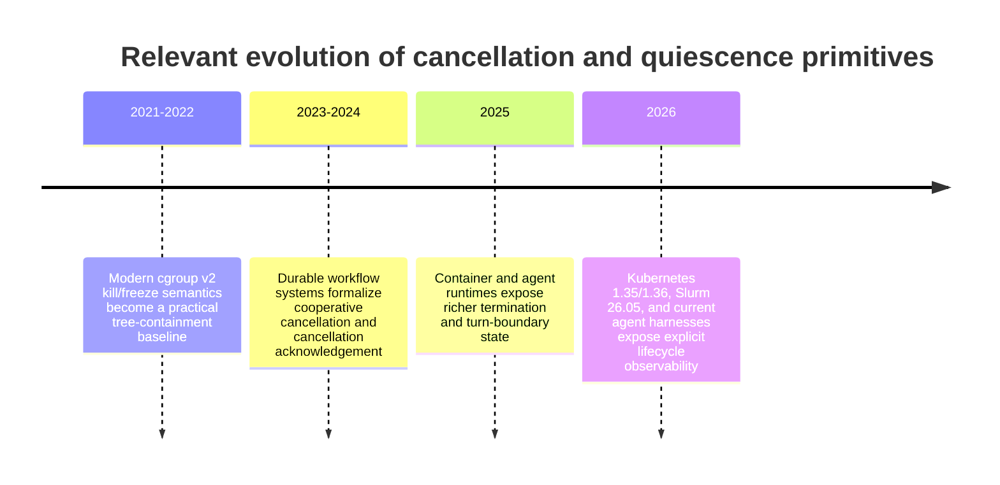
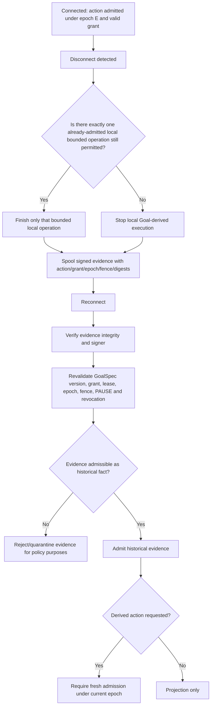

# DS-01 — Pause, Cancellation, and Effect Fencing: Research Report

## Executive summary

The research brief fixes an important constitutional boundary before any technical analysis begins: **the operative PAUSE remains immediate halt**. `checkpoint` is the already-selected *future* ordinary default under `OR-004`, and `OR-020` authorizes a future policy family, but neither ruling makes that future family operative until the authorized constitutional amendment is actually applied. This report therefore specifies and tests a future schema; it does not change the current constitution, decide the default, or implement anything. fileciteturn0file0

The central finding is that a pause protocol cannot be made safe by “stop scheduling” or process cancellation alone. A robust design needs three independent mechanisms:

1. **Admission fencing:** the pause transition advances a monotonically increasing admission epoch, so work admitted under an older epoch but not yet executing becomes `stale` and fails closed.
2. **Execution containment:** already-running local work is taken to a mode-specific terminal boundary—checkpoint, cancellation, enumerated drain completion, or hard containment—with OS/scheduler-level process-tree semantics where subprocesses are involved.
3. **External-effect reconciliation:** an effect that may already have been accepted by an external system is never treated as undone merely because its caller was killed. It must be reconciled using provider-issued identity/status evidence or remain `ambiguous` and `quarantined`.

The need for receiver-side fencing is well established by the Chubby lock service: a delayed request from a former lock holder can reach a server after ownership changes, which is why Chubby includes a monotonically advancing generation in a sequencer that the receiving server validates. citeturn2view0turn2view1 For the future pause schema, the analogous falsifiable invariant should be:

> **An effect may cross its irreversible boundary only if the effect recipient, a trusted mediation point immediately before it, or an atomic local transaction validates the action’s current admission epoch and fencing token.**

A controller-only `paused=true` flag does **not** prove this invariant. Delayed network requests, queues, subprocess descendants, cleanup handlers, disconnected workers, and force-deleted orchestration objects can all outlive the initiating control decision. Kubernetes provides a particularly useful counterexample: force deletion can remove a Pod from the API without waiting for confirmation that processes stopped, and documentation explicitly warns that the resource can continue to run. citeturn15search0turn15search1

The resulting per-effect semantics are:

| Effect class | `checkpoint` | `interrupt` | `drain` | Emergency stop |
|---|---|---|---|---|
| Model turn | Finish only the already-running turn to a **provable terminal model boundary**; execute no newly proposed tool/effect | Cancel the turn; partial output is non-completed; quarantine already-dispatched effects | Finish only if model-turn is explicitly drain-enabled | Cancel/kill local harness immediately; partial output is not completion |
| Local transaction | An already-running atomic transaction may reach commit/rollback; an unstarted transaction is stale | Roll back before commit; after an uncertain commit, reconcile rather than assume rollback | Finish only if local transactions are explicitly drain-enabled | Abort/terminate where possible; committed or uncertain commit cannot be undone by status declaration |
| Subprocess | Existing contained process tree may reach a declared checkpoint/exit; deadline then contains tree | Graceful cancellation followed by hard process-tree containment at deadline | Existing tree may finish only if subprocess class is enumerated | Hard local containment immediately |
| Remote/disconnected action | Never transmit an unsent stale request; already-dispatched action may complete/reconcile | Cancel only through a provider-defined cancellation contract; otherwise quarantine uncertainty | Only enumerated already-dispatched work may finish; never start merely prepared work | Stop new dispatch immediately; accepted remote work may still exist and therefore requires reconciliation |
| Read-only gate | Already-started read may finish, but its answer cannot release new stale work | Cancel/discard as appropriate; any result is observational only | Finish only if enumerated | Stop it; a returned observation does not authorize derived work |
| Publication | Do not cross an unexecuted visibility boundary after pause; retain staged data; reconcile an already-dispatched visibility change | Cancel pre-publication; do not describe accepted publication as rolled back | May finish only when publication is explicitly enumerated **and** the adapter has a conditional/fenced visibility primitive | Prevent any new visibility change; reconcile anything already accepted |
| Ambiguous external effect | Reconcile only; no retry or derived effect | Same | Same—even a drain allowlist does not authorize blind re-execution | Preserve ambiguity/quarantine; containment cannot rewrite external reality |

This disposition follows the brief’s “narrower adapter, never wider” rule. fileciteturn0file0 It is deliberately conservative around publication and opaque model harnesses.

The strongest process containment primitives surveyed are OS/scheduler constructs, not agent-level cancellation APIs. Linux cgroup v2 exposes `cgroup.kill` for a cgroup and its descendants and `cgroup.freeze` with observable frozen state; Windows Job Objects can terminate all associated processes and nested child jobs; Slurm has an explicit TERM → `KillWait` → KILL sequence and an observable wait for running steps to disappear. citeturn14search3turn0search0turn0search3turn7search0turn7search5 By contrast, Temporal Activity cancellation is intentionally cooperative and commonly delivered through heartbeats, and Kubernetes force deletion can acknowledge the control-plane deletion before execution has actually ceased. citeturn4search0turn4search2turn15search1 Agent-level “interrupted” therefore cannot serve as proof of process-tree quiescence.

For model turns, explicit protocol events are the best boundary evidence available. OpenAI’s current app-server contract treats `turn/completed` with status `completed` as success and distinguishes `failed` and `interrupted`; the Responses lifecycle likewise exposes terminal completion events. citeturn15search5turn9search0 Anthropic’s streaming protocol has a terminal `message_stop`, with stop reasons including tool-use and pause-related states. citeturn10search1turn10search7 A provider message boundary is nevertheless **not automatically a safe agent checkpoint**: a terminal message that requests a tool still leaves an unresolved proposed effect. The safe checkpoint requires both terminal model evidence and no unresolved effect dispatch.

The proposed acknowledgement model should also separate **admission stopped** from **execution quiescent**. A pause request can be acknowledged immediately once the epoch advances and the admission gate closes; `paused` should not be emitted until all controllable execution is terminal and every nonterminal external effect is either authoritatively reconciled or explicitly `ambiguous` + `quarantined`. Kubernetes’ distinction between API deletion and actual process termination is direct evidence for why those acknowledgements must not be conflated. citeturn15search1turn15search10

Finally, no fixed timeout value can be justified from the public evidence alone. What *can* be frozen is the deterministic rule: **when the controller-owned pause/drain deadline is reached and quiescence has not been proved, the state machine transitions to containment rather than silently extending the deadline**. Locally controllable execution is killed or rolled back according to its effect class; unverifiable external work becomes `ambiguous`/`quarantined`. Actual timeout durations remain a configuration/Owner question, not a research conclusion.

## Scope, evidence, and governing invariants

### Constitutional scope and stakeholder boundary

The supplied directive is complete and explicitly states that this lane is analytical only. It authorizes research into future per-effect pause semantics while prohibiting implementation, deployment, provider/auth changes, spending, PAUSE invocation, merge, and constitutional editing. It also fixes the relationship between current and future policy: current PAUSE is immediate halt; the checkpoint family is future and non-operative. fileciteturn0file0

The relevant stakeholders can therefore be separated by authority:

| Stakeholder / component | Authority in this research | Must not be inferred |
|---|---|---|
| Owner | Final policy and constitutional acceptance | Research conclusions are not Owner rulings |
| Control plane | Advances admission state, applies precedence, revalidates evidence | Cannot make an already-accepted remote effect cease to exist |
| Deterministic kernel | Enforces common epoch/fence/deadline/status invariants | Must not contain provider-specific optimistic assumptions |
| Typed adapters | Interpret provider/runtime contracts and may narrow disposition | May never widen a disposition allowed by the kernel |
| Bounded workers | Execute already-admitted operations | Cannot mint new scope after pause/disconnect |
| OS / scheduler layer | Provides local process-tree control and quiescence evidence | Does not roll back network effects already accepted elsewhere |
| External provider | Source of truth for externally accepted resource/action state | Local process death is not provider-state evidence |
| Operator / owner-facing UI | Receives acknowledgements and terminal labels | A single “stopped” label must not collapse `stale`, `ambiguous`, and completed states |

Those authority boundaries are directly prescribed by the research brief. fileciteturn0file0

### Evidence classification

This report uses the brief’s required evidence discipline:

**Source-documented** means the mechanism is explicitly documented by an authoritative primary source. **Locally directed** means the research brief itself fixes the condition, such as the non-operative status of `checkpoint`. **Inferred** means the proposed product semantic is a reasoned consequence of the brief plus external mechanism evidence; it is not presented as an existing Owner decision. **Unverified** is reserved for a claim that lacks sufficient primary evidence.

Confidence in the tables is about **research support**, not probability. “High” means primary-source semantics line up directly with the claim; “Medium” means the mechanism is well supported but the exact product disposition is necessarily an architectural inference.

“Expiry” is a research-refresh trigger rather than a runtime TTL:

- **Freeze** — revalidate at pause-schema freeze or after any governing Owner ruling changes.
- **Version** — revalidate when the implementation target upgrades the cited runtime/SDK/platform.
- **P90** — provider API details should be rechecked within 90 days of adapter implementation or release because external contracts change more quickly.

### The admission and fencing invariant

The future action envelope described by the brief binds command, principal, goal/grant/policy digests, admission epoch, fencing token, effect class, idempotency key, and deadline. fileciteturn0file0 The research supports making acceptance an explicit predicate rather than an informal convention:

```text
may_cross_effect_boundary(action, current_state) :=
    action.admission_epoch == current_state.admission_epoch
    AND validate_fence(action.fencing_token)
    AND action.goal_digest      == current_state.goal_digest
    AND action.policy_digest    == current_state.policy_digest
    AND action.grant_is_valid
    AND action.deadline_not_expired
    AND action.effect_class     is permitted by active mode
    AND no higher-precedence stop/revocation state applies
```

There is one intentional exception to a literal “current epoch only” rule: an operation that was **already executing** before the epoch advance may, under `checkpoint` or an enabled `drain` class, reach the narrowly defined terminal boundary of that *same admitted operation*. That continuation is not a fresh admission; it must retain its original identity and cannot create a new child action outside the previously admitted effect envelope. An operation merely queued or prepared but not yet executing is stale after the epoch change. That distinction is required by the brief’s simultaneous requirements that checkpoint allow the current bounded operation to finish while pre-epoch, not-yet-executed work fail closed. fileciteturn0file0

The crucial external-systems lesson comes from Chubby. Chubby’s designers describe a stale request arriving after a previous lock holder has failed and another has acquired the lock; their fencing mechanism includes a monotonically increasing generation so the server receiving the request can reject the stale holder. citeturn2view0turn2view1 **Inference:** a pause epoch checked only in the dispatcher is weaker than a fence validated at the irreversible boundary. Where the destination cannot validate the token directly, the architecture needs an equivalent trusted mediation point immediately before that boundary, or it must conservatively classify the destination as not fence-capable.

This makes “no undeclared post-pause effect” falsifiable:

> After epoch transition `e → e+1`, fault injection must be able to release every queued, delayed, forked, duplicated, retried, and disconnected action carrying `e`; none may cross an undeclared irreversible boundary. Any allowed continuation must be traceable to a pre-transition already-running operation and its mode-specific continuation rule.

A source-only flag can leak through at least four documented mechanism boundaries: delayed remote requests, subprocess descendants, cooperative cancellation that is not yet observed, and orchestration deletion without physical termination. Temporal documents that Activity cancellation normally requires heartbeating to be observed, while Kubernetes documents that force-deleted work can continue after the API object disappears. citeturn4search0turn4search3turn15search1 Windows additionally exposes breakaway semantics for Job Objects, demonstrating that tree containment itself must forbid escape paths if it is to be relied upon. citeturn0search0

The precedence specified by the brief is **emergency > revocation > interrupt > checkpoint**. fileciteturn0file0 `drain` is not placed in that precedence chain by the supplied authority; the conservative interpretation is that it is a base disposition mode that can itself be overridden by emergency, revocation, or interrupt. Its ordering relative to an independently issued `checkpoint` command is therefore an open schema/Owner question rather than something this report silently invents.

Precedence also has a fundamental limit: it orders **control decisions**, not history. An emergency stop can prevent a new publication or kill a subprocess, but it cannot reverse a database commit already made durable or make a cloud action that was already accepted cease to have occurred. PostgreSQL documents `COMMIT` as making transaction changes durable and visible, while external APIs such as Stripe and AWS expose idempotency/status mechanisms precisely because a caller may need to determine what happened after an uncertain response. citeturn11search0turn12search0turn1search7

### Recent mechanism evolution relevant to the last five years

The last five years have strengthened the primitives available to implement this policy without removing the fundamental distributed-systems ambiguity. Modern Linux cgroup v2 documentation exposes tree-wide `cgroup.kill` and observable freeze state; Kubernetes v1.35–v1.36 has increasingly explicit shutdown/termination state but still warns about the gap between force deletion and actual execution; current agent APIs expose explicit turn-terminal states; and current job schedulers expose more explicit wait-for-quiescence contracts. citeturn14search3turn15search1turn15search3turn15search5turn7search5



The important architectural trend is not toward “perfect cancellation”; it is toward **better observable lifecycle state**. That favors a schema based on explicit acknowledgements, fences, terminal evidence, and ambiguity rather than one based on assuming that a cancellation request is synonymous with cancellation completion. Temporal, Kubernetes, and current agent protocols all expose this distinction in different forms. citeturn4search2turn15search1turn15search5

## Per-effect disposition claim register

The following table is the source-pinned claim register required by the directive. Every effect class has an explicit claim for every mode. These are proposed future semantics, so even when built from strong primary documentation, the exact product disposition is classified as **inferred** unless the supplied brief itself dictates it.

| ID | Effect | Mode | Exact future disposition | Class / confidence | Expiry | Evidence |
|---|---|---|---|---|---|---|
| M-C | Model turn | `checkpoint` | If a model request is already running, allow it to reach an explicit terminal response/turn event. Do not execute a tool call merely because it was emitted before terminal completion. No next model turn. If terminal boundary is unobservable, checkpoint is unproved and deadline containment applies. | Inferred / High | Freeze + Version | OpenAI exposes terminal completion and distinguishes interrupted/failed turns; Anthropic exposes terminal message-stop and stop reasons. citeturn9search0turn15search5turn10search1turn10search7 |
| M-I | Model turn | `interrupt` | Request model/harness cancellation. Partial streamed output is not a completed turn. Any already-dispatched tool or external effect is reconciled independently rather than implied cancelled. | Inferred / High | Freeze + Version | Current harness lifecycle distinguishes completed and interrupted outcomes. citeturn15search5turn9search10 |
| M-D | Model turn | `drain` | Finish the already-running model turn only when `model_turn` is in the explicit drain allowlist; do not begin a subsequent turn or tool effect without fresh admission. | Inferred / High | Freeze | Explicit enumeration is required by the brief; model terminal-state evidence is externally documented. fileciteturn0file0 citeturn15search5 |
| M-E | Model turn | Emergency | Immediately cancel/close the harness and, where necessary, locally contain its process tree. Partial response remains interrupted rather than completed; any already-dispatched effect is separately quarantined/reconciled. | Inferred / High | Freeze + Version | Brief defines emergency as break-glass immediate blocking; current agent protocol distinguishes interruption from successful completion. fileciteturn0file0 citeturn15search5 |
| T-C | Local transaction | `checkpoint` | An already-executing atomic transaction may reach its commit-or-rollback terminal boundary if that is the next mechanically safe checkpoint. A transaction not yet started is stale. | Inferred / High | Freeze + Version | PostgreSQL distinguishes durable `COMMIT` from rollback; the brief permits the current already-running bounded operation to finish at checkpoint. citeturn11search0turn11search5 fileciteturn0file0 |
| T-I | Local transaction | `interrupt` | Before commit is accepted, cancel/rollback. After commit has been issued and its outcome is uncertain, query authoritative database state; do not report rollback without evidence. | Inferred / High | Freeze + Version | `COMMIT`, `ROLLBACK`, and prepared-transaction contracts establish the atomic-state distinction. citeturn11search0turn11search5turn11search11 |
| T-D | Local transaction | `drain` | Finish an in-flight transaction only if `local_transaction` is explicitly drain-enabled; otherwise apply interrupt semantics. Never start a merely queued transaction. | Inferred / High | Freeze | Brief requires explicitly enumerated in-flight classes. fileciteturn0file0 |
| T-E | Local transaction | Emergency | Abort/terminate before commit where possible. A transaction known committed remains completed; an indeterminate commit is reconciled and may remain ambiguous. | Inferred / High | Freeze + Version | Durable commit cannot be undone by killing the client. citeturn11search0turn11search5 |
| S-C | Subprocess | `checkpoint` | An already-running subprocess tree may reach an explicit application checkpoint or clean exit only while remaining inside a containment scope; no new sibling/root work is admitted. Deadline miss triggers tree containment. | Inferred / High | Freeze + Version | Linux cgroup v2 and Windows Job Objects provide descendant containment primitives. citeturn14search3turn0search0turn0search8 |
| S-I | Subprocess | `interrupt` | Send cooperative termination where useful; require confirmed termination of the whole controlled tree. On deadline, use hard tree containment. External effects triggered before death are separately reconciled. | Inferred / High | Freeze + Version | Slurm uses TERM then KILL after `KillWait`; Linux and Windows expose hard whole-group/job termination. citeturn7search0turn7search1turn14search3turn0search3 |
| S-D | Subprocess | `drain` | Let the already-running tree exit only when `subprocess` is in the explicit drain set; otherwise interrupt it. Deadline still bounds drain. | Inferred / High | Freeze | Brief requires explicitly enumerated drain classes; scheduler contracts demonstrate bounded graceful shutdown followed by kill. fileciteturn0file0 citeturn7search0 |
| S-E | Subprocess | Emergency | Immediately invoke hard containment for the controlled process tree; do not depend on application cleanup hooks. | Inferred / High | Freeze + Version | Linux `cgroup.kill` and Windows `TerminateJobObject` are hard containment primitives. citeturn14search3turn0search3 |
| R-C | Remote / disconnected action | `checkpoint` | A request that was prepared but not transmitted is stale. An already-dispatched request may be observed to terminal state, but no blind retry is allowed after lost receipt. | Inferred / High | Freeze + P90 | AWS idempotency tokens and Stripe idempotency/status mechanisms show why identity must survive uncertain responses. citeturn1search7turn12search0 |
| R-I | Remote / disconnected action | `interrupt` | Invoke provider cancellation only where the provider has an explicit safe cancellation contract. Failure to prove cancellation leaves the action ambiguous/quarantined; do not convert local cancellation into a provider rollback claim. | Inferred / High | Freeze + P90 | External APIs distinguish request identity/status from caller lifetime. citeturn1search17turn12search8 |
| R-D | Remote / disconnected action | `drain` | Already-dispatched work may reach terminal state only when the remote class is explicitly enabled. An unsent request does not become “in flight” merely because local preparation completed. | Inferred / High | Freeze + P90 | Brief’s drain rule plus provider idempotency/status contracts. fileciteturn0file0 citeturn1search7 |
| R-E | Remote / disconnected action | Emergency | Block new network mutations immediately and contain local execution. A provider may nevertheless finish an already-accepted operation; its state remains completed, failed, or ambiguous according to provider evidence. | Inferred / High | Freeze + P90 | Caller shutdown does not erase provider acceptance; provider identity/status is required. citeturn12search0turn1search17 |
| G-C | Read-only gate | `checkpoint` | An already-running read can finish and be recorded; its result cannot authorize a new effect under the stale epoch. | Inferred / High | Freeze | The future admission-epoch rule in the brief blocks derived stale work. fileciteturn0file0 |
| G-I | Read-only gate | `interrupt` | Cancel the read when practical. A concurrently returned answer may be retained as observation, but cannot release new effectful work without fresh admission. | Inferred / High | Freeze | Follows the brief’s effect fencing and precedence requirements. fileciteturn0file0 |
| G-D | Read-only gate | `drain` | Finish only if `read_only_gate` is explicitly in the drain allowlist; otherwise interrupt/discard. There is no implicit low-risk exception. | Inferred / High | Freeze | Drain is explicitly enumerated, not ambient permission. fileciteturn0file0 |
| G-E | Read-only gate | Emergency | Stop the read locally. Already-returned observation may remain in audit history but cannot authorize further work. Any emergency reconciliation query must be separately defined as control-plane observation, not ordinary Goal-derived work. | Inferred / Medium | Freeze | The first part follows the brief; whether emergency reconciliation reads form a privileged control class remains an Owner/schema question. fileciteturn0file0 |
| P-C | Publication | `checkpoint` | If the public visibility mutation has not been transmitted, do not perform it after pause; retain staged material privately. If visibility change was already dispatched, reconcile its status. | Inferred / High | Freeze + P90 | S3 and Google Cloud Storage support conditional mutation primitives that make staging-plus-conditional-flip practical; the brief permits adapters to be narrower. citeturn13search0turn13search12 fileciteturn0file0 |
| P-I | Publication | `interrupt` | Cancel pre-publication work. Do not issue a compensating “unpublish” and call it rollback unless that separate mutation is freshly authorized. Already-accepted publication is reconciled. | Inferred / High | Freeze + P90 | Conditional-write semantics distinguish whether the visibility write itself succeeded; external mutation is not undone by client cancellation. citeturn13search0turn13search10 |
| P-D | Publication | `drain` | Publication may finish only if explicitly drain-enabled **and** the adapter can protect the final visibility boundary with a conditional/fenced operation; otherwise leave the staged artifact unpublished. | Inferred / Medium-High | Freeze + P90 | Conditional writes/generation matches provide the necessary race-prevention primitive, but exact adapter coverage is provider-specific. citeturn13search0turn13search12 |
| P-E | Publication | Emergency | Prevent every not-yet-dispatched visibility mutation immediately. If the public write was already accepted or may have been accepted, preserve reality and mark/reconcile uncertainty. | Inferred / High | Freeze + P90 | External conditional-write/status semantics support distinguishing unsuccessful from accepted mutation. citeturn13search0 |
| A-C | Ambiguous external effect | `checkpoint` | Perform reconciliation only. No retry, compensation, derived action, or assertion of rollback until authoritative evidence resolves reality. | Locally directed + inferred / High | Freeze + P90 | Explicitly required by the brief; AWS/Stripe provide concrete identity/idempotency patterns. fileciteturn0file0 citeturn1search7turn12search0 |
| A-I | Ambiguous external effect | `interrupt` | Same as checkpoint: cancellation cannot resolve an already-uncertain acceptance event unless the provider confirms its outcome. Keep effect quarantined. | Locally directed + inferred / High | Freeze + P90 | Brief plus provider status evidence. fileciteturn0file0 citeturn1search17turn12search8 |
| A-D | Ambiguous external effect | `drain` | Drain permission does **not** authorize a second mutation. It permits only bounded reconciliation of the original identity; unresolved state remains ambiguous. | Locally directed + inferred / High | Freeze + P90 | Blind retry is excluded by the brief; idempotency scope/retention is provider-specific. fileciteturn0file0 citeturn1search7turn12search0 |
| A-E | Ambiguous external effect | Emergency | Preserve and quarantine the unknown. Emergency can halt new local effects but cannot convert unknown external reality into failure or rollback. | Locally directed + inferred / High | Freeze | Direct consequence of the brief’s ambiguity rule and irreversible external acceptance. fileciteturn0file0 |

### Model-turn boundary when the harness is opaque

A safe model checkpoint is not “the process became quiet.” Where the provider or harness exposes a typed terminal event, that event should be required. OpenAI’s app-server guidance says clients wait for `turn/completed` and treat only status `completed` as success; `failed` and `interrupted` are distinct. citeturn15search5 OpenAI’s response streaming likewise includes terminal completion state, and Anthropic ends a streaming message with `message_stop`. citeturn9search0turn10search1

**Inferred checkpoint rule:** a model boundary is mechanically safe only after:

```text
terminal_model_event_received
AND no unresolved tool/effect dispatch exists
AND all output required for projection has been durably captured
AND no continuation turn has been admitted
```

A stop reason such as `tool_use` is a model-message boundary but not necessarily an agent-operation checkpoint because a proposed tool effect is still outstanding. Anthropic explicitly exposes tool-use as a stop reason. citeturn10search7

If a harness exposes only process/session boundaries and no reliable turn event, the conservative fallback is **not** to infer a turn boundary from token silence, inactivity, or a still-running session. The operation remains opaque. Checkpoint can let that already-running opaque operation continue only if the adapter has proved that it cannot emit any effect outside its pre-admitted envelope; otherwise the pause deadline eventually escalates to containment. This is an inference from the requirement that checkpoints be mechanically testable, not heuristic.

### Capacity exhaustion

A “final bounded turn” may reach checkpoint on capacity exhaustion only under a narrow condition: the turn must already have been admitted and started before capacity was exhausted, and all remaining resource/effect authority needed to reach its checkpoint must already be included in that admission. A newly created “one last summarization turn” after exhaustion would be a new admission and therefore an escape hatch.

Likewise, a running model turn may finish producing pure response output if that continuation is within its existing admitted envelope. A tool call it proposes after capacity exhaustion does **not** gain authority merely because completing the tool would make the model turn cleaner; the tool action must independently pass current admission. This follows directly from separating model generation from tool-effect classes in the supplied design. fileciteturn0file0

A decisive test is simple: inject exhaustion at every token/tool boundary. The number of newly admitted effectful actions after the exhaustion transition must be exactly zero. Any “cleanup,” “summary,” or “finish” path that increments that count falsifies the design.

## Transition and crash matrix

The crash stages requested by the brief are defined here uniformly:

- **B0 — before prepare:** no durable intent/request preparation has begun.
- **B1 — after prepare:** local intent/request/staged data exists, but the irreversible effect boundary has not been crossed.
- **B2 — during call:** the operation has entered execution or dispatch and cancellation may race completion.
- **B3 — after effect, before receipt:** the effect may have happened, but local durable proof of outcome is missing.
- **B4 — after receipt, before projection:** authoritative outcome evidence exists; only local state projection/audit recording remains.

The matrix uses these explicit dispositions:

`S` = stale/drop without execution; `F` = finish the same already-running admitted operation to its permitted terminal boundary; `C` = cooperative cancel/rollback; `K` = hard local containment; `R` = reconcile authoritative state; `Q` = `ambiguous` + `quarantined`; `H` = hold prepared/staged material without crossing effect boundary; `P` = project already-received evidence into local state; `D` = perform the row’s finish behavior only if that effect class is explicitly drain-enabled; `N` = structurally not applicable for the class.

`P` is not a new external effect: it records historical outcome. It must retain the original effect identity and epoch and must not itself authorize derived work.

### Checkpoint transition matrix

| Effect class | B0 before prepare | B1 after prepare | B2 during call | B3 effect before receipt | B4 receipt before projection |
|---|---|---|---|---|---|
| Model turn | `S` | `S` if request unsent | `F` to proven terminal model boundary; no new tool effect | `R` if provider can retrieve; else `Q` | `P` |
| Local transaction | `S` | `F` only if transaction is already the running atomic operation; otherwise `S` | `F` to commit/rollback safe endpoint | `R`; if outcome cannot be proved, `Q` | `P` |
| Subprocess | `S` | `S` if not spawned | `F` to explicit checkpoint/exit inside containment scope | inspect authoritative process/output state; external unknowns `Q` | `P` |
| Remote/disconnected | `S` | `S` — prepared-but-unsent does not execute | allow already-dispatched request to settle; no retry | `R`; unresolved → `Q` | `P` |
| Read-only gate | `S` | `S` if not issued | `F`; returned value is observation only | retain/discard observation; no effect ambiguity | `P`, but no derived stale admission |
| Publication | `S` | `H` staged but unpublished | do not initiate a new visibility flip; if flip already dispatched, `R/Q` | `R`; unresolved → `Q` | `P` |
| Ambiguous external | `N` | `N` | uncertainty entering external boundary → `Q` | `R` or remain `Q` | if valid receipt resolves outcome, `P` and reclassify; otherwise `Q` |

PostgreSQL’s commit/rollback distinctions support the transaction cells; cloud idempotency/status primitives support the remote cells; conditional-object writes support the publication distinction between prepared content and the public visibility mutation. citeturn11search0turn11search5turn1search7turn12search0turn13search0turn13search12

### Interrupt transition matrix

| Effect class | B0 | B1 | B2 | B3 | B4 |
|---|---|---|---|---|---|
| Model turn | `S` | `S` | `C`; if tool/effect already dispatched, handle separately | `R/Q` for any external child effect; model itself interrupted | `P` only if terminal receipt proves completed; otherwise interrupted |
| Local transaction | `S` | `C`/rollback | `C`; race with commit requires `R` | `R`; uncertain commit → `Q` | `P` |
| Subprocess | `S` | `S` | `C`, then `K` at deadline | local result inspection; external unknown → `Q` | `P` |
| Remote/disconnected | `S` | `S` | provider cancel if defined; cancellation uncertainty → `Q` | `R/Q` | `P` |
| Read-only gate | `S` | `S` | `C` or discard returned observation | discard/retain as observation | `P` without release authority |
| Publication | `S` | `H` | cancel before acceptance; otherwise `R/Q` | `R/Q` | `P` |
| Ambiguous external | `N` | `N` | `Q` | `R/Q` | `P` only if evidence resolves it |

Temporal demonstrates why `C` and “cancelled” must not be synonymous: an Activity can receive cancellation cooperatively via heartbeat, while some cancellation modes return to the workflow without waiting for Activity cancellation to complete. citeturn4search0turn4search2turn4search3 That distinction is directly applicable to owner-facing pause status.

### Drain transition matrix

For every `D` cell below, “not enumerated” deterministically falls back to the interrupt disposition rather than silently finishing.

| Effect class | B0 | B1 | B2 | B3 | B4 |
|---|---|---|---|---|---|
| Model turn | `S` | `S` | `D → F`; otherwise interrupt | `R/Q` | `P` |
| Local transaction | `S` | `D → F` if already-active transaction; otherwise interrupt | `D → F`; otherwise cancel/rollback | `R/Q` | `P` |
| Subprocess | `S` | `S` if not spawned | `D → F` to exit; otherwise interrupt; deadline always bounds it | inspect result; external unknown → `Q` | `P` |
| Remote/disconnected | `S` | `S` | `D` allows only already-dispatched request to settle | `R/Q` | `P` |
| Read-only gate | `S` | `S` | `D → F`; otherwise interrupt/discard | retain/discard observation | `P` |
| Publication | `S` | `H`; preparation does not imply permission to publish | `D` only with explicit publication allowlist and conditional/fenced final mutation; otherwise interrupt | `R/Q` | `P` |
| Ambiguous external | `N` | `N` | `Q`; drain never means repeat mutation | `R/Q` only | `P` only after authoritative resolution |

This strict distinction between “prepared” and “in flight” prevents drain from becoming a hidden admission mechanism. It is an inference from the brief’s wording that drain lets explicitly enumerated **in-flight** classes finish rather than granting permission to begin queued work. fileciteturn0file0

### Emergency-stop transition matrix

| Effect class | B0 | B1 | B2 | B3 | B4 |
|---|---|---|---|---|---|
| Model turn | `S` | `S` | immediate cancel/`K` local harness | child external effect `R/Q`; model stays interrupted unless terminal evidence exists | `P` if completion receipt already exists |
| Local transaction | `S` | abort/rollback if active | abort/terminate; commit race → `R` | `R/Q` | `P` |
| Subprocess | `S` | `S` | immediate `K` whole contained tree | inspect local state; external unknown → `Q` | `P` |
| Remote/disconnected | `S` | `S` | block local continuation; already-accepted provider action cannot be hard-killed generically → `R/Q` | `R/Q` | `P` |
| Read-only gate | `S` | `S` | cancel/close locally | discard or retain observation | `P` without derived work |
| Publication | `S` | `H` | stop local sender; if mutation may have crossed boundary → `R/Q` | `R/Q` | `P` |
| Ambiguous external | `N` | `N` | `Q` | `R/Q` when later safe to reconcile | `P` only on resolution |

Linux cgroup v2 can kill a cgroup and descendant cgroups; Windows `TerminateJobObject` terminates associated processes, including nested jobs under the documented nesting semantics. citeturn14search3turn0search3turn0search8 Those mechanisms justify `K` for local trees. They provide no basis for converting an already-accepted external effect into `failed`.

### Deterministic deadline escalation

The schema can freeze a deterministic transition without freezing a duration:

```text
IF pause_mode IN {checkpoint, drain}
AND controller_time >= pause_deadline
AND quiescence_proof != satisfied
THEN
    transition pause_state -> containment
    forbid all further checkpoint/drain continuation
    apply effect-specific interrupt/hard-containment rule
    classify every unresolved external effect as ambiguous + quarantined
```

This deadline must be owned by the controller state machine rather than extended opportunistically by workers. Temporal demonstrates that heartbeat-mediated cancellation can be delayed, and Kubernetes/Slurm use explicit grace periods followed by stronger termination actions rather than treating graceful shutdown as unbounded. citeturn4search3turn15search9turn7search0

A deterministic test suite should inject stuck work just before every checkpoint and advance a virtual/controller clock past the deadline. A passing implementation must show: no new admissions, no continued local execution after containment proof, no false `completed` result for killed work, and `Q` rather than invented failure/rollback for unresolved remote effects. Kubernetes’ force-deletion warning provides the negative test case: disappearance of a control-plane object alone must not satisfy local quiescence. citeturn15search1turn15search10

## Cancellation, fencing, reconciliation, and disconnect mechanisms

### Cancellation and quiescence contracts

The research question asks which contracts are strong enough for process-tree termination and quiescence. The answer is layered: **OS/scheduler mechanisms can provide local containment; workflow/agent cancellation generally provides semantic cancellation but should not be treated as process-tree proof.**

| Contract | Pinned baseline | License | What primary documentation guarantees | Suitability for this schema |
|---|---|---|---|---|
| Linux cgroup v2 | Linux v6.7 documentation baseline | GPL-2.0-only for Linux kernel | `cgroup.freeze` freezes member processes/descendants and exposes frozen state; `cgroup.kill` kills the cgroup and descendant cgroups and is designed to handle concurrent forks/migration constraints. citeturn14search3turn14search4 | **Strong local containment primitive.** Suitable evidence source for subprocess emergency/timeout containment. Does not address remote effects. |
| Windows Job Objects | Nested jobs available from Windows 8 / Server 2012; current Windows SDK family is 10.0.28000 in 2026 | Microsoft software license terms, not an OSS license citeturn19search0turn19search5 | `TerminateJobObject` terminates associated processes; nested-job termination propagates to child jobs. `JOB_OBJECT_LIMIT_KILL_ON_JOB_CLOSE` can kill the contained job tree when the final handle closes. Breakaway features can weaken containment and therefore must not be enabled for a containment scope. citeturn0search0turn0search3turn0search8 | **Strong local containment primitive** when breakaway is prohibited and containment is verified. |
| POSIX `kill()` / process groups | POSIX/Open Group contract | Standards contract, implementation-dependent OS licensing | Standard specifies signaling a process or process group. citeturn0search9 | **Insufficient as the sole tree-containment proof** in this research because the cited contract is process/process-group signaling rather than a descendant-containment abstraction. |
| Slurm | Documentation baseline 26.05 | GPLv2+ project packaging | Whole-job cancellation sends SIGCONT/SIGTERM, waits `KillWait`, then SIGKILL; scheduler tools expose waiting for jobs/steps to cease. citeturn7search0turn7search1turn7search2turn7search5 | **Strong scheduler-level graceful→hard shutdown contract**, subject to scheduler/node containment assumptions. |
| Kubernetes | v1.36 lifecycle contract | Apache-2.0 project license | Graceful pod termination transitions from termination signal to forced kill; **force deletion does not by itself wait for kubelet termination confirmation**. citeturn15search1 | **Useful orchestration signal, not sufficient quiescence proof by itself.** Never equate API deletion with zero running processes. |
| Temporal | Java cancellation API baseline 1.37.0; server/SDK line | MIT | Activity cancellation is cooperative and commonly delivered through heartbeats; cancellation modes may return immediately, wait for cancellation completion, or abandon. Workflow termination is forceful at workflow level. citeturn4search0turn4search2turn4search8turn3search0 | **Semantic cancellation model, not process-tree containment.** Valuable model for `interrupt` acknowledgement states. |
| LangGraph agent/orchestration harness | Python 1.2.12, released Sept. 21, 2026 | MIT | Package provides durable agent execution; run APIs expose interruption/cancellation at run level. citeturn18search0turn18search12 | **Agent-run lifecycle, not accepted here as OS quiescence proof.** Must sit above an OS/scheduler containment layer. |
| OpenAI Codex app-server lifecycle | Current public 2026 app-server contract; page is not a version-pinned package contract | Product documentation; license not established by the lifecycle page | Explicit `turn/completed` and status values distinguish success, failure and interruption. citeturn15search5 | **Good model-turn boundary evidence; rejected as standalone process-tree containment evidence.** |

No single row proves the entire pause property. For example, cgroup/job-object termination can prove that controlled local processes are gone, but it cannot prove what a network request sent milliseconds earlier did. Conversely, a cloud provider’s status endpoint can prove a remote operation’s state but says nothing about surviving local descendants.

A notable failure mode appears in workflow cleanup. Temporal’s cancellation model allows cancellation-aware code and cleanup behavior, and documentation describes cancellation delivery through cooperative points rather than an unconditional process kill. citeturn4search0turn4search3 **Inference:** cleanup execution must remain subject to the same effect fence. “Cleanup” is not a privileged escape hatch for publishing, retrying, or launching fresh work after the epoch transition.

### Provider identity and lost-receipt reconciliation

The strongest evidence for an already-dispatched effect is not a local socket status; it is an authoritative provider identity tied to the original normalized request.

A robust reconciliation record should include:

```text
provider/account scope
provider-issued resource or operation ID, when available
provider request ID
idempotency/client token
normalized request digest
principal / target
effect class
original admission epoch and fence
dispatch timestamp
provider terminal status and status timestamp
receipt/event identity
```

AWS EC2 documents client-token idempotency: repeating a request with the same token and matching parameters avoids performing the action again, while token semantics can be regional/zonal and therefore require correct scope binding. citeturn1search7 AWS also exposes status-query patterns for operations identified by client tokens in relevant APIs. citeturn1search17

Stripe similarly documents idempotency keys but with crucial caveats: it records the result once endpoint execution begins, repeated matching requests return the recorded result, and keys can be pruned after a retention period. citeturn12search0 Stripe also exposes request IDs and event/resource retrieval facilities. citeturn12search8turn12search2 The architectural lesson is that **an idempotency key is an aid to reconciliation, not eternal proof**. Its scope, parameter binding, and retention must be part of the adapter contract.

The evidence hierarchy should therefore be:

1. **Strongest:** provider resource/operation ID plus authoritative terminal status and matching request identity.
2. Provider event/receipt tied to the original request/resource and verified principal/target.
3. Idempotency/client token plus exact request digest and a provider status lookup confirming outcome.
4. Provider request ID without state lookup—useful for support/audit, but not necessarily enough to prove the business effect.
5. Local “request sent”/socket success/process exit—**not proof** that the external effect happened or did not happen.

When none of levels 1–3 can resolve a lost-receipt write, the truthful terminal description is not `failed` or `rolled_back`; it is `ambiguous`, with retry/propagation `quarantined`. This is precisely the distinction required in the source brief. fileciteturn0file0

### Publication as a staged, conditional effect

Publication deserves a narrower rule than a generic transaction because its irreversible boundary is owner-visible exposure. Object stores already provide useful primitives for designing that boundary. Amazon S3 supports conditional writes through `If-None-Match` and `If-Match`; concurrent attempts can be rejected when the precondition no longer holds. citeturn13search0turn13search10 Google Cloud Storage similarly exposes generation-match preconditions, including conditions that distinguish creating a previously absent object from overwriting an existing generation. citeturn13search12

The inferred best pattern is therefore:

```text
prepare immutable private artifact
        ↓
record digest + intended publication target
        ↓
pause fence check
        ↓
single conditional visibility mutation
        ↓
provider receipt / generation / version
        ↓
project "published"
```

A pause that lands before the conditional visibility mutation leaves the staged artifact private. A pause that races the visibility mutation reconciles the provider result. This is safer than a sequence that first publishes and later tries to “undo” publication because compensation is itself a new external effect and is not rollback in the transactional sense.

This pattern does **not** prove that every publication backend exposes a usable conditional mutation. Adapters for backends without one must narrow behavior further, potentially forbidding drain-completion of publication and quarantining uncertain direct publishes.

### Signed evidence over disconnect and reconnect

The brief permits a disconnected worker to finish only the local bounded operation expressly permitted by its last valid grant, spool signed evidence, and then revalidate after reconnect before that evidence or any derived action is admitted. It expressly forbids disconnected widening or publication. fileciteturn0file0

A standard signed-envelope format can help with integrity but does not replace revalidation. DSSE authenticates the signed payload bytes and payload type and deliberately leaves key management, trust establishment, payload semantics, and verification policy outside the specification. citeturn16search0turn16search2turn17view3 DSSE’s Apache-2.0 implementation/specification materials therefore provide a credible **format pattern**, but a valid DSSE signature would prove only that the signed evidence came from an accepted signer over the signed bytes—not that the old grant is still authorized after a pause, revocation, lease expiry, or GoalSpec change. citeturn16search0turn17view3

The reconnect path should consequently be:



The signature protects the historical evidence against undetected alteration; **current revalidation protects authorization**. That separation is a key defense against treating “cryptographically authentic” as synonymous with “currently permitted.”

### Owner-facing acknowledgements and terminal labels

A single pause acknowledgement is too weak. The recommended status model separates:

| Status / label | Meaning | What it explicitly does **not** mean |
|---|---|---|
| `pause_accepted` | Controller advanced admission epoch and closed the relevant admission gate | Does not mean all running work has stopped |
| `pausing` | Existing work is being checkpointed/cancelled/drained/contained | Does not imply external effects are resolved |
| `paused` | No locally controlled effectful work remains runnable under the old state; unresolved external effects, if permitted by schema, are explicitly quarantined | Does not mean every past external effect was undone |
| `contained` | Deadline/emergency containment completed for controllable local execution | Does not prove remote operations stopped |
| `stale` | Admission was superseded before the action crossed its execution boundary | Must not be used where execution may actually have occurred |
| `ambiguous` | Reality of an external effect cannot currently be proved | Is not synonymous with failed |
| `quarantined` | Policy prevents retry, propagation, publication, or derived use pending resolution | Is a disposition, not necessarily an uncertainty itself |
| `completed` | Authoritative terminal evidence shows the effect completed | Must not be inferred from caller/process termination |

This allows an effect to have both `truth_state=ambiguous` and `disposition=quarantined`, which is more precise than treating the words as mutually exclusive terminal outcomes.

The separation between control acknowledgement and actual quiescence has strong external precedent. Kubernetes specifically warns that a forcibly deleted Pod can disappear from the API before the kubelet proves the workload is stopped. citeturn15search1turn15search10 Slurm, by contrast, exposes waiting until asynchronous steps are no longer running/pending, illustrating the stronger type of evidence suitable for a quiescence acknowledgement. citeturn7search5

## Options, tradeoffs, risks, and constitutional reconciliation

### Architectural recommendations with competing options and decisive falsifiers

Every recommendation below includes the competing option required by the research directive, a test capable of falsifying the recommendation, and the boundary of what the recommendation does not establish.

| Research recommendation | Competing option | Why the recommendation currently leads | Decisive falsifier | What it does **not** prove |
|---|---|---|---|---|
| **Validate epoch/fence at the irreversible boundary or an atomic trusted mediator immediately before it.** | Controller-only admission flag checked before dispatch | Chubby’s stale-holder example demonstrates why delayed requests require receiver-side generation validation. citeturn2view0turn2view1 | A fault campaign across all supported effect transports demonstrates that controller-only checking prevents every delayed/queued/duplicated old-epoch action from crossing the boundary under partitions, restarts, and scheduler delay. | Does not undo effects that crossed before the new fence took effect. |
| **Separate `pause_accepted` from `paused/quiescent`.** | One acknowledgement called `paused` as soon as admission closes | Kubernetes proves control-plane deletion can precede actual termination; Temporal cancellation can precede acknowledgement by an Activity. citeturn15search1turn4search2 | For every supported runtime, formal/fault testing demonstrates admission closure and full quiescence are the same atomic event, including remote effects. | Does not itself define which work is allowed to finish. |
| **On checkpoint/drain deadline miss, deterministically transition to containment.** | Wait indefinitely for graceful completion | Scheduler/container contracts routinely distinguish graceful periods from forced termination; unbounded waiting prevents a falsifiable pause deadline. citeturn7search0turn15search9 | Measured workloads establish a safety requirement that cannot tolerate containment and a separately proven finite protocol provides a stronger bound without hard containment. | Does not supply the correct numerical timeout. |
| **Treat opaque model sessions as non-checkpointable unless a protocol boundary or equivalent adapter proof exists.** | Infer turn end from silence/session-idle/process state | Current model/harness protocols expose explicit terminal events, making heuristic inference unnecessary where adapters expose them. citeturn15search5turn10search1 | Harness conformance testing proves its process/session event is exactly equivalent to model terminal state and cannot coexist with an unresolved tool/effect. | Does not guarantee semantic correctness of the model output. |
| **Stage publication and make final visibility change conditional/fenced.** | Publish directly, then compensate if pause races | S3/GCS conditional-write primitives allow race-aware final mutations, avoiding false rollback language. citeturn13search0turn13search12 | Target publication backends lack conditional/idempotent visibility operations and a trusted mediator cannot supply equivalent atomicity; direct publication plus another mechanism proves a stronger invariant in testing. | Does not guarantee every publisher supports the pattern. |
| **Reconcile lost receipts through provider identity/status; never blind-retry an unresolved mutation.** | Retry immediately under a new request identity | AWS/Stripe idempotency and request/status mechanisms exist specifically to correlate retries and outcomes. citeturn1search7turn12search0turn12search8 | A provider formally guarantees that the target operation is globally idempotent by semantic identity independent of request key and exposes no conflicting duplicate outcome under tested failure conditions. | Does not make all ambiguous effects eventually resolvable; retention can expire. |
| **Revalidate signed disconnected evidence on reconnect.** | Trust a valid worker signature as sufficient authorization | DSSE authenticates bytes/type but explicitly leaves trust, key management and payload semantics outside its scope; current authorization can change while disconnected. citeturn16search2 | The Owner deliberately chooses irrevocable offline capabilities whose scope remains valid across pause/revocation until fixed expiry, and the constitution is amended accordingly. | Does not specify the signature system or key-management implementation. |
| **Make publication and ambiguous effects narrower than generic checkpoint completion.** | Let every current bounded operation, including an unissued publish, “finish” under checkpoint | External visibility is difficult to compensate, and the brief explicitly allows adapters to narrow kernel behavior. fileciteturn0file0 | End-to-end testing plus an authoritative publication backend proves an unissued final publish can be committed after pause while still satisfying the exact Owner-approved meaning of checkpoint and no undeclared post-pause effect. | Does not decide a future Owner policy; it is a conservative research recommendation. |

### Where precedence can observably “break”

The precedence chain does not fail as a state-machine ordering; it reaches a boundary where control no longer implies reversibility.

A revocation or emergency arriving **before** an effect crosses its fence can stop it. The same event arriving **after** a durable database commit cannot make that commit disappear. PostgreSQL defines commit as making transaction changes durable. citeturn11search0 Similarly, if an external provider has accepted a request, killing the client cannot establish that the provider cancelled it; provider status is required. citeturn1search7turn12search0

The schema should therefore describe precedence as:

```text
emergency
    > revocation
        > interrupt
            > selected base continuation policy
                (checkpoint or drain, subject to final schema)
```

with the qualification:

```text
precedence controls future permission and local continuation;
it does not rewrite already-established external reality.
```

The relative arbitration of simultaneous `checkpoint` versus `drain` commands is **unspecified by the supplied precedence rule** and should be frozen explicitly rather than inferred.

### Operational and economic tradeoff surface

No dollar budget, throughput target, provider spend ceiling, or market-sizing objective is specified in the research brief, so a quantitative budget would be invented rather than evidence-based. The economically relevant surface is nevertheless clear as an architectural inference:

| Mode | Resource/cost tendency | Main operational cost risk |
|---|---|---|
| `checkpoint` | Preserves more sunk computation but holds capacity until a safe boundary | Long-tail checkpoint latency; ongoing model/compute use during the bounded finish |
| `interrupt` | Releases capacity faster but may throw away partial work | Recompute/restart cost and more ambiguous in-flight provider operations |
| `drain` | Maximizes preservation of explicitly allowed in-flight work | Highest tail resource occupancy if the allowlist is broad |
| Emergency stop | Minimizes permitted local continuation | Highest recovery cost, partial-work loss, and potential ambiguous external effects |

These are tradeoff directions, not forecasted costs. Exact thresholds should be measured in implementation trials rather than embedded in the constitutional schema.

### Licensing and legal boundary

The relevant legal consideration found in this lane is mainly dependency/platform licensing, not a sector-specific regulatory mandate. Linux kernel licensing is GPL-2.0-only. citeturn14search4 LangGraph 1.2.12 reports an MIT license. citeturn18search0 The DSSE repository/spec implementation materials report Apache-2.0. citeturn17view3 Kubernetes is Apache-2.0, while Microsoft’s Windows SDK is governed by Microsoft software license terms rather than an open-source license. citeturn19search0

Nothing in this research establishes that one containment technology should be selected; doing so is expressly a non-goal. The licensing table is therefore an implementation constraint to revalidate later, not a product choice.

### Constitutional reconciliation options

The directive explicitly requests comparison among keeping immediate halt, adopting the future family, and staging adoption. The following analysis does **not** reopen `OR-004` or `OR-020`: those rulings already establish the selected future direction and its current non-operative status. fileciteturn0file0

| Constitutional option | Advantages | Risks / costs | Decisive test separating it from competitors |
|---|---|---|---|
| **Keep immediate halt as operative behavior indefinitely** | Conceptually smallest state machine; minimum permitted continuation after PAUSE | Can interrupt atomic operations, strand partially prepared state, increase recovery ambiguity, and cannot by itself guarantee that already-dispatched external effects stopped | Fault testing shows whether immediate halt can preserve all required local invariants and external exactly-once/reconciliation properties with no unacceptable stranded state. Failure of that test falsifies indefinite retention as the complete long-term policy. |
| **Activate the complete future family after its authorized amendment** | Expresses checkpoint, interrupt, explicit drain, and independent emergency semantics directly; effect-class behavior can match actual cancellation contracts | Larger state space; requires complete matrix testing, owner-facing status distinctions, and adapter conformance across every effect class | Exhaustive model/fault tests must demonstrate epoch/fence invariants, mode precedence, timeout containment, reconnect safety, and no undeclared post-pause effect. A single reproducible stale-effect escape falsifies readiness. |
| **Stage adoption** — first freeze common fencing/status/evidence semantics, then enable future modes only after conformance | Reduces migration risk; allows common epoch, labels, reconciliation, and containment to mature before every continuation path becomes operative | Temporary coexistence of old and future semantics can itself cause confusion; migration code becomes part of the safety surface | If dual-semantics testing shows that staged operation creates more untestable ambiguity or incompatible persisted state than all-at-once activation, staging is falsified. Conversely, if staged conformance catches unsafe adapters before mode activation, it has evidence in its favor. |

Because `OR-004` and `OR-020` already select and authorize a future path while preserving current immediate halt, this report treats the table as **reconciliation/readiness analysis**, not as a new vote on the default. fileciteturn0file0

### Case studies that most strongly constrain the schema

**Chubby: stale requests survive ownership change.** A former lock holder can issue a delayed request after another holder takes over; monotonically changing generations and receiver validation are the remedy. This is the strongest conceptual precedent for combining admission epochs with fencing tokens rather than trusting controller state alone. citeturn2view0turn2view1

**Kubernetes: control-plane disappearance is not process quiescence.** Force deletion can remove the API object without waiting for the kubelet to confirm process termination; the documentation warns that the resource can continue running. This falsifies any proposed acknowledgement design in which “scheduler says deleted” alone is sufficient for `paused`. citeturn15search1turn15search10

**Temporal: cancellation request is not cancellation completion.** Cancellation can be delivered via Activity heartbeat, and cancellation policies distinguish immediate return, waiting for completion, and abandonment. This strongly supports explicit `cancel_requested`, `quiescent`, and ambiguity states rather than a single boolean. citeturn4search0turn4search2

**AWS/Stripe: idempotency requires identity and scope.** Both ecosystems expose request identities/idempotency semantics; those mechanisms reduce duplicate execution but have scope/retention rules. They support the requirement to bind provider identity, normalized request digest, and status lookup into the effect record instead of blindly replaying after lost receipts. citeturn1search7turn12search0

**Conditional object writes: publication can have a genuine commit point.** S3 and Google Cloud Storage provide precondition-based mutation primitives. They demonstrate a practical way to separate staging from a single final visibility boundary suitable for fencing. citeturn13search0turn13search12

## Open Owner questions and completion gate

### Explicit difference between desired v3 policy and the operative constitution

The current and future states must remain visibly separate:

| Dimension | Operative constitution | Desired future family described by the brief |
|---|---|---|
| Ordinary PAUSE | **Immediate halt** | `checkpoint` is selected as future ordinary default |
| Additional pause modes | Not operative as the future family | `interrupt` and explicit `drain` |
| Emergency behavior | Current constitution governs; this research does not alter it | Independent break-glass emergency stop that immediately blocks new effects and may sacrifice in-flight work |
| Admission epoch/fencing | This report does not claim these future semantics are currently operative | Monotonic epoch + action-bound fence/digests/idempotency/deadline |
| External ambiguity | No research-created constitutional change | Explicit `ambiguous` / `quarantined` / reconciliation semantics |
| Status schema | Current behavior remains authoritative | Distinct admission, quiescence, containment, stale, ambiguity and quarantine states |
| Authority to activate | None held by this research session | Requires the already-authorized amendment/application process under `OR-020` |

This distinction is expressly required by the source directive. `OR-004` is not reopened, `OR-020` is not promoted into operative behavior, and no recommendation in this report is an Owner decision. fileciteturn0file0

### Open Owner questions

The remaining questions are policy choices or schema details for which the research evidence does not supply legitimate Owner authority:

1. **Drain arbitration:** Is `drain` mutually exclusive with `checkpoint`, or can a later command replace one with the other? The supplied precedence chain explicitly orders emergency, revocation, interrupt, and checkpoint but does not position drain.

2. **Default drain allowlist:** Should the initial drain allowlist be empty, or should low-risk classes such as read-only gates and already-active local transactions be enabled by default? Research can describe risk, but an allowlist default is policy.

3. **Publication:** Should publication ever be drain-eligible, even when an adapter supplies a conditional/fenced final visibility operation, or should adapters universally narrow publication to “never cross an unexecuted public boundary after PAUSE”?

4. **Emergency reconciliation reads:** May a narrowly defined control-plane read capability query provider status during an emergency stop, or should emergency prohibit every fresh network call and defer reconciliation until a subsequent recovery state? Either design can be made coherent, but the control-plane exemption must be explicit to avoid an effect escape hatch.

5. **Meaning of `paused` with ambiguity:** May the system report `paused` when local quiescence is proved but one or more remote effects remain `ambiguous` + `quarantined`, or should owner-facing status be a distinct state such as `paused_with_ambiguity`? The technical model supports either; user semantics are an Owner concern.

6. **Deadline policy:** What default and maximum checkpoint/drain durations should be permitted per effect class? The deterministic escalation rule can be frozen without inventing numerical values.

7. **Capacity exhaustion:** Should “remaining resources already reserved by the current admitted operation” be a formal field required before an in-progress final turn may finish, or is simple proof that no new effect/admission occurs sufficient?

8. **Prepared local transactions:** Does the product consider an opened-but-not-yet-mutating transaction “already executing” for checkpoint purposes, or should checkpoint conservatively roll it back unless a write has crossed the transaction’s internal prepare boundary? The database mechanisms support both; the product boundary needs one exact definition.

9. **Ambiguity retention:** How long should unresolved provider effects remain automatically quarantined before owner intervention is required, particularly where provider idempotency/status retention can expire? Stripe’s documented idempotency retention behavior shows why the answer cannot be “forever queryable.” citeturn12search0

10. **Quiescence proof vocabulary:** Should process-tree zero, scheduler-terminal, model-terminal, provider-terminal, and transaction-terminal proofs be represented as typed evidence objects in the common kernel schema, or merely normalized status codes emitted by adapters? Typed evidence creates a stronger audit boundary but is a schema choice.

### Open research questions

Several questions remain empirical rather than constitutional.

The first is whether all intended provider adapters can place the admission/fencing decision sufficiently close to the irreversible effect boundary. Chubby supports the principle of sink-side fencing, but not every SaaS API has a field capable of carrying an application fencing token. citeturn2view0turn2view1 Where no such field exists, a trusted mediation/gateway architecture needs separate verification.

Second, adapter conformance needs experiments around provider idempotency expiry and status availability. AWS and Stripe show useful patterns, but they are not universal provider guarantees. citeturn1search7turn12search0 An adapter whose external service cannot query an operation after lost receipt may have to classify more failures as permanently ambiguous.

Third, an opaque agent harness needs a conformance test proving whether its lifecycle events coincide with provider/model turn boundaries. Current OpenAI contracts expose explicit terminal turn status and therefore make the boundary observable in that specific integration model; that does not prove every upstream/native harness does. citeturn15search5

Fourth, the transition matrix should eventually be model-checked against races among PAUSE, revocation, disconnect, lease expiry, deadline expiry, external receipt arrival, and process death. The highest-value invariant is not “every request gets cancelled,” but: **every irreversible effect has exactly one explainable disposition—proved completed, proved not executed/stale, or explicitly ambiguous and quarantined.**

### Completion gate

| Gate | Research result |
|---|---|
| Every per-effect claim pinned to a primary source or explicitly marked unverified/inferred | **Satisfied.** All 28 per-effect/per-mode dispositions are classified; product semantics are intentionally marked inferred where primary systems cannot dictate product policy. |
| All seven effect classes and all four modes covered | **Satisfied.** The claim register contains 28 explicit mode/effect claims and the crash matrices include every class. |
| Crash stages have no silent gaps | **Satisfied.** B0 through B4 are explicit in each mode matrix; structurally impossible ambiguity cells are marked `N`, not omitted. |
| Every recommendation has a competing option and decisive falsifier | **Satisfied.** The recommendations table includes both plus a “does not prove” boundary. |
| Current immediate-halt PAUSE and `OR-004`/`OR-020` not reopened or promoted | **Satisfied.** Immediate halt is explicitly retained as operative; future semantics remain non-operative research. fileciteturn0file0 |
| Process containment technology selected | **No selection made**, as required. Linux, Windows, Slurm, Kubernetes, workflow and agent contracts are evidence candidates, not implementation decisions. |
| Runtime/provider/auth/config/PAUSE/spending/deployment/publication/merge action performed | **None performed.** This report is analysis only. |
| Disconnect evidence treated as automatically authorized because signed | **No.** Signature integrity and current authorization are explicitly separated; DSSE itself states that trust/key management/payload semantics are outside its scope. citeturn16search2 |
| Lost-receipt external effect blindly retried or called rolled back | **No.** Reconciliation or `ambiguous` + `quarantined` is required. |
| Deadline miss behavior deterministic | **Specified.** Checkpoint/drain deadline miss transitions to containment; exact numerical duration remains deliberately unspecified. |
| Capacity-exhaustion escape hatch closed | **Specified.** Only an already-admitted, already-running bounded turn with already-reserved authority may reach its checkpoint; a new “final” turn or new tool effect is not admitted. |
| Privacy/secret scan | **Pass for this deliverable.** No credentials, account identifiers, infrastructure identifiers, private repository contents, transcripts, or filesystem paths are reproduced. |
| Owner questions separated from research conclusions | **Satisfied.** Unresolved policy choices are listed above and are not presented as decisions. |

The resulting schema-level conclusion is therefore narrow but strong: **freeze the pause family around explicit admission fencing, mode-specific continuation boundaries, typed ambiguity, and proof-based quiescence—not around cancellation requests themselves.** That conclusion does not decide whether or when the future family becomes operative; it defines what must be true for its semantics to be testable without falsely claiming that local cancellation rewrites external reality.