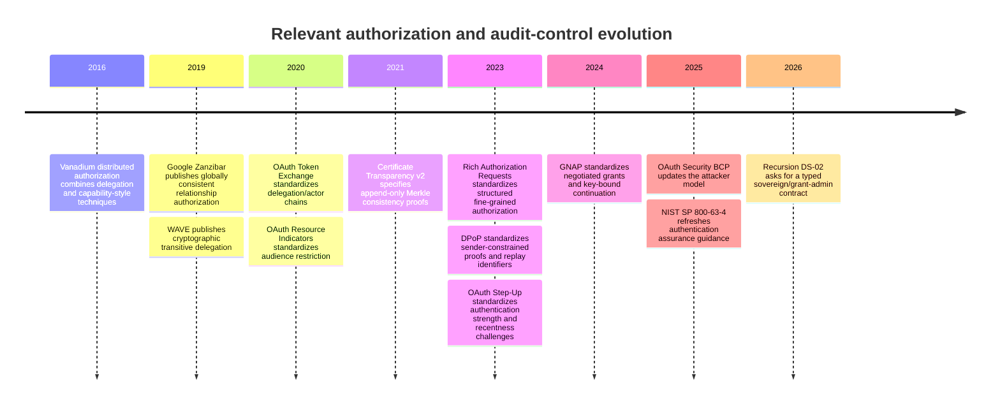
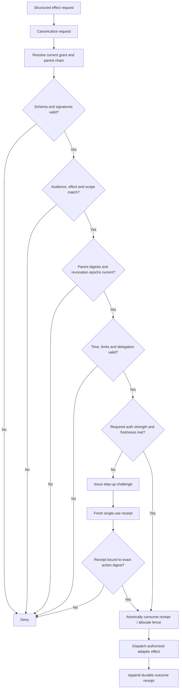

# Recursion v3 Full Access and Calibrated Authority — Research Report

## Executive summary

This report executes the DS-02 research directive as supplied. It treats the brief’s ratified premises as constraints rather than questions to be reopened: `sovereign` may explicitly include `grant-admin`; a `sovereign` actor may modify its own grants attributably; installing the `full` edition must never imply `sovereign`; model text is not authority; grant administration remains distinct from audit-retention and audit-erasure; and this research produces recommendations rather than Owner decisions. fileciteturn0file0

The central recommendation is to freeze the Recursion v3 authority model around an **explicit capability catalog plus typed grant objects**, not a `full_access=true` ambient bit. “Full Access” should be a user-facing description of the effective vector *only when that vector contains every grantable capability in the installation’s declared capability catalog at the displayed scopes and limits*. A `sovereign` preset may construct such a vector, but a preset must never itself authorize anything. This design follows a common property of mature authorization systems: permission grants and permission ceilings are separate. AWS permission boundaries and organization policies define maxima rather than grants; Kubernetes separately protects privilege-escalating `escalate` and `bind` operations; seL4 represents authority as granular capabilities that may be copied with restricted rights and descendants revoked; and Biscuit supports offline attenuation rather than amplification. citeturn4search0turn3search1turn1search4turn11search0turn6search13

The minimal high-impact vector should separate at least **control-plane authoring, credential administration, credential-material revelation if supported, provider enrollment if supported, metered spending, publication, merge, deployment, service control, grant administration, audit-retention administration, and audit erasure**. Those are not interchangeable authorities: for example, merge rights need not imply deployment, deployment need not imply service lifecycle control, and grant administration must not imply the ability to erase evidence of the grant mutation. GitHub itself separates protected-branch merge controls from protected deployment environments; Google and Microsoft privileged-access systems make temporary elevation independently configurable; and Google Cloud separates administrative logging from configurable data-access logging and retention controls. citeturn12search0turn12search3turn1search5turn1search10turn8search0turn8search7

A grant should be admitted only when a deterministic kernel check proves all of the following at the time of the effect: the grant is structurally valid; issuer, subject, installation/audience, capability/effect, and scope match; current time is within `[not_before, expiry)`; authentication/step-up requirements are satisfied; spend/resource/rate limits have not been exceeded; its parent digest and delegation depth are valid; the child is a subset of the parent in every ordered dimension; the referenced revocation epoch is current; and, for leased execution, the presented fencing value is the currently admissible one. **A signature alone is insufficient**: it authenticates an artifact but does not prove that its parent has not since been narrowed or revoked, that it is being used at the intended resource, that authentication is still fresh, or that a one-time authorization has not already been consumed. OAuth’s current specifications separately address audience restriction, delegation identity, proof-of-possession/replay detection, step-up authentication and fine-grained authorization, which is strong evidence that these properties cannot safely be collapsed into “validly signed.” citeturn10search2turn10search3turn0search6turn0search2turn0search3turn0search0

For `grant-admin` self-mutation, the recommended primitive is a **two-phase prepare/commit kernel action**, not unrestricted editing of grant records. Preparation canonicalizes the requested before/after grant and produces a blast-radius preview plus digest. Commit requires a fresh, single-use step-up receipt cryptographically or transactionally bound to that exact digest, checks the actor’s *current* authority and installation maximum, atomically consumes the receipt, increments the appropriate mutation/revocation generation, writes the new grant state, and appends an immutable receipt. Google PAM, Microsoft PIM and RFC 9470 independently establish temporary elevation, justification, authentication strength/recentness and automatic expiry as production patterns; Vault demonstrates limited-use tokens and parent-child revocation. citeturn1search5turn1search10turn0search5turn2search0turn2search3

For auditability, the minimum useful invariant is **receipts are append-only evidence, while raw artifacts may have a separately governed lifecycle**. A receipt can retain hashes, before/after digests, actor, issuer, reason, authentication receipt identity, scope and effect outcome after associated raw content has been deleted. Transparency-log designs such as Certificate Transparency and Sigstore/Rekor show how Merkle inclusion and consistency proofs can make silent rewriting or removal detectable, while also making clear that transparency logs do not by themselves prevent a bad action and require independent monitoring to detect equivocation. citeturn7search0turn9search0turn9search2

The most important open Owner decisions are therefore **policy values, not architecture**: the maximum duration and re-step-up cadence by capability class; whether particular sovereign actions require independent human approval in addition to owner authentication; whether raw credential material is ever a grantable capability; audit-retention and audit-erasure policy; and the recovery root/out-of-band mechanism. None is decided by this report.

## Scope, assumptions, and methodology

**Scope definition.** The investigation is limited to the capability-vector contract behind Full Access, `sovereign`, `grant-admin`, break-glass privilege elevation, grant inheritance/revocation, replay and stale-parent prevention, audit separation, blast-radius acknowledgement and recovery. It does not modify any system, grant authority, access a private repository, change providers or credentials, spend money, deploy, merge, publish or alter the operative constitution. These boundaries and the ratified `OR-005`/`OR-014` premises come directly from the supplied DS-02 brief. fileciteturn0file0

**Evidence classification used below.**

| Classification | Meaning in this report |
|---|---|
| **Source-documented** | Directly supported by a primary standard, official product documentation, or original research publication. |
| **Locally observed** | Explicitly stated in the user-supplied DS-02 brief; no private repository inspection was performed. |
| **Inferred** | A design conclusion synthesized from documented mechanisms and the Recursion constraints. |
| **Unverified** | Would require implementation/repository/runtime evidence unavailable to this public research session. |

**Key assumptions and unspecified constraints.** The grant store is assumed to be reachable by the deterministic kernel at effect-admission time; how it is persisted or replicated is unspecified. The capability vector is assumed to describe product-supported actions, not arbitrary operating-system root access. The exact installation topology, provider APIs, model transport, credential storage, external deployment targets, quorum rules and disaster-recovery implementation are unknown. Therefore, source-backed conclusions can establish desirable authorization semantics, but they do **not** prove that the current Recursion implementation has them.

The methodology favored standards and original/official material from the last ten years, then used older concepts only where needed as background. The strongest recent evidence comes from IETF authorization standards; NIST Digital Identity Guidelines; official Google Cloud, Microsoft, AWS, Kubernetes, GitHub, Vault, seL4 and Sigstore documentation; and original papers on Zanzibar, WAVE and Vanadium. RFC 9700 is particularly useful because it updates the OAuth attacker model based on operational experience and explicitly emphasizes moving security-critical enforcement away from unreliable clients toward authorization/resource servers. citeturn0search0

The research questions were tested against five properties: **expressiveness** (can distinct authority be represented without side channels?), **monotonic delegation** (can children only attenuate?), **freshness/revocation** (does authorization remain current?), **attribution/auditability** (can a privileged effect be reconstructed without mutable prose?), and **recoverability** (can mistakes be corrected forward without falsifying history).

The research trajectory is summarized below.



Vanadium was published in 2016; Zanzibar and WAVE in 2019; RFCs 8693 and 8707 in 2020; RFC 9162 in 2021; RFCs 9396, 9449 and 9470 in 2023; GNAP in 2024; and OAuth BCP 240/RFC 9700 and NIST SP 800-63-4 provide current security guidance from 2025. citeturn6search3turn5search0turn6search1turn10search3turn10search2turn7search0turn0search3turn0search6turn0search2turn10search0turn0search0turn7search2

## Evidence base and recent literature

The literature does not reveal one existing system whose semantics can simply be copied. Instead, the useful pattern is a convergence of mechanisms: capability attenuation and revocation from capability systems; consistent graph authorization from Zanzibar; cryptographically attributable delegation from modern token protocols; JIT/expiring elevation from PAM/PIM systems; escalation-sensitive verbs from Kubernetes; guardrails from AWS; and append-only evidence from transparency logs.

| Major source | Type and date | Most relevant documented mechanism | What it contributes to DS-02 | Important limit |
|---|---|---|---|---|
| **Google Zanzibar** | Original USENIX paper, 2019 | Unified relationship authorization with causal ordering/external consistency; production deployment at very large scale | Strong evidence that authorization state consistency is a first-class correctness problem, especially after ACL changes | It is not a break-glass or self-grant-administration design and does not define the proposed grant schema. citeturn5search0turn5search1 |
| **WAVE** | Original USENIX Security paper, 2019 | Cryptographically enforced transitive delegation in which participants delegate portions of authority | Evidence for explicit delegation chains and attenuated delegated rights | Its decentralized trust model and IoT deployment are not directly the proposed deterministic local kernel. citeturn6search1 |
| **Vanadium** | Original distributed-authorization work, 2016 | Decentralized authorization synthesizing SPKI/SDSI, Macaroon and trust-management techniques | Relevant precedent for provider-neutral delegated authority | The publication sits at the edge of the ten-year window and is not a modern PAM design. citeturn6search3 |
| **seL4 / capDL** | Official capability-OS documentation | Unforgeable granular capabilities, restricted copies, descendant revocation, declarative capability distributions | Strong conceptual precedent for explicit capability vectors and revocable derivation | Kernel-object capabilities do not supply Recursion’s time, billing, authentication or audit semantics. citeturn11search0turn11search1turn11search4 |
| **Eclipse Biscuit** | Official capability-token specification/documentation | Offline attenuation; holders can add restrictions but not increase authority; revocation identifiers | Very close conceptual match for non-widening child grants | Offline verification makes revocation a separate problem; moreover, an earlier Biscuit signature design had a serious vulnerability, illustrating that cryptography does not eliminate implementation risk. citeturn6search13turn6search14 |
| **OAuth Token Exchange** | IETF RFC 8693, 2020 | Delegation versus impersonation, actor chains, audience, `nbf`/`exp`; one-time limitations can be imposed | Supports explicit issuer/subject/actor and delegation history | It intentionally leaves authorization policy and many token-format choices to implementations. citeturn10search3 |
| **OAuth Resource Indicators / RAR** | IETF RFCs 8707, 2020 and 9396, 2023 | Audience/resource restriction plus structured fine-grained `authorization_details` | Supports separate scope/audience and exact action metadata rather than coarse string roles | These RFCs do not define Recursion’s parent-subset lattice or grant-admin rules. citeturn10search2turn0search3 |
| **DPoP / OAuth Step-Up / OAuth BCP** | IETF RFCs 9449, 9470, 9700 | Sender constraint and `jti` replay handling; authentication strength/age; updated attacker model | Direct support for fresh step-up plus anti-replay instead of trusting bearer artifacts indefinitely | DPoP does not itself make an authorization single-use, and step-up does not define an interoperable universal authentication-strength hierarchy. citeturn0search6turn0search5turn0search0 |
| **GNAP** | IETF RFC 9635, 2024 | Negotiated delegated grants, pending approval, receipts, multi-owner approval possibilities, key-bound continuation | Good recent model for treating a “grant” as stateful authorization rather than a boolean | GNAP does not prescribe Recursion’s internal implementation or owner policy. citeturn10search0turn10search1 |
| **Google Cloud PAM** | Official product/API documentation | Request-based temporary grants, required justification, maximum duration, optional multi-level approval, automatic removal | Direct production precedent for bounded JIT privilege | Google’s documented minimum/maximum durations are product values, not evidence that Recursion should copy them. citeturn1search5turn1search7 |
| **Microsoft Entra PIM** | Official product documentation | Eligible vs active privilege, MFA/Conditional Access, justification, approval and activation maximum duration | Strong precedent for non-ambient privilege and configurable activation ceremony | Microsoft’s one-to-24-hour setting is not a universal security optimum. citeturn1search3turn1search10 |
| **Kubernetes RBAC** | Official documentation | Explicit `escalate` and `bind` authorities; ordinary role writers cannot create permissions they do not hold | Especially strong precedent for making privilege administration its own dangerous capability | Kubernetes RBAC is not temporal by default and is not a complete delegation-chain system. citeturn1search4turn1search16 |
| **AWS IAM / Organizations** | Official documentation | Permissions boundaries/SCPs cap maximum permission but do not grant it; intersections constrain effective authority | Supports installation maximum separate from actor grants and presets | AWS policy evaluation has resource-policy nuances that should not be imported wholesale. citeturn3search1turn4search0turn4search8 |
| **Vault** | Official documentation | Token parent-child hierarchy, revocation of descendants, explicit TTL/max TTL, limited-use tokens | Strong operational precedent for parent invalidation and one-use authorization artifacts | Vault also permits intentionally exceptional orphan behavior; Recursion should not inherit that escape hatch by accident. citeturn2search0turn2search3 |
| **Certificate Transparency / Rekor** | IETF RFC 9162 and Sigstore official docs | Append-only Merkle logs, inclusion/consistency proofs, external monitoring | Basis for non-silent receipt alteration/deletion | Transparency detects misbehavior; it does not itself prevent an unauthorized privileged effect, and split-view resistance requires monitoring/gossip. citeturn7search0turn9search0turn9search7 |
| **GitHub protected branches/environments** | Official documentation | Merge protections and bypasses are separate from deployment-environment reviewers and self-review prevention | Concrete evidence that merge, bypass and deploy are distinct authorities | These are provider-specific controls, not a full general capability model. citeturn12search0turn12search1turn12search3 |

Several conclusions emerge from the literature.

First, **attenuation must be structural rather than conventional**. Kubernetes explicitly prevents a role creator from embedding permissions they do not already possess unless the creator has the dangerous `escalate` authority; Vault child tokens can be created with subsets of parent policies; Biscuit token holders can add restrictions; and seL4 copies can carry restricted rights. The Recursion analogue is that a child grant must be rejected if *any* ordered grant component is wider than its parent, unless the operation being performed is an explicitly authorized `grant-admin` mutation against the installation maximum rather than ordinary delegation. citeturn1search4turn2search3turn6search13turn11search0

Second, **JIT privilege is mature industry practice rather than an experimental idea**. Google PAM can require a reason, limit requested duration, require approval and automatically withdraw privileges at the end of a grant. Microsoft PIM supports eligible-but-inactive privilege that becomes active only after configurable authentication/justification/approval and expires after a configured interval. NIST’s current authentication guidance separately requires or recommends replay resistance, phishing resistance and bounded reauthentication according to assurance level. citeturn1search5turn1search10turn7search5

Third, **current validity is distinct from authentic origin**. RFC 9449’s replay defenses require a unique proof identifier and request bindings in addition to a signature; RFC 8707 narrows where a token is valid; RFC 9470 represents authentication recentness explicitly; RFC 8693 carries delegation actors; and Vault revocation invalidates descendants independently of their original issuance. That makes a Recursion design that checks only a signed grant digest incomplete. citeturn0search6turn10search2turn0search5turn10search3turn2search0

Fourth, **Full Access and an installation ceiling are different objects**. AWS SCPs and permissions boundaries are explicit examples of controls that constrain maximum available permissions but do not grant them. This maps cleanly to a Recursion installation-level maximum capability set `M`, an actor grant `G`, and effective authority `E` computed from valid grants constrained by `M`; neither an edition name nor an unconstrained preset needs to appear in the authorization equation. citeturn3search1turn4search0

## Capability vector and grant contract

The recommended model is:

\[
E(s,t,a)=M \cap G_s \cap P \cap T \cap A \cap L
\]

where `M` is the installation maximum, `G_s` is the subject’s currently valid grant chain, `P` represents current policy/version constraints, `T` covers temporal validity and revocation/fencing state, `A` covers authentication/step-up requirements, and `L` covers limits such as spending, resource use and rate. This is an **inferred Recursion design**, not a formula taken from one source. It synthesizes the intersection/guardrail model documented by AWS with the temporal, delegation and authentication mechanisms documented elsewhere. citeturn4search0turn3search1turn0search5turn2search0

The top-level vector should remain small; detailed operations belong in **effect verbs**. This avoids replacing one boolean with hundreds of unrelated booleans while preserving meaningful separation.

| Capability domain and exact effects | Authority represented and non-implications | Minimum scope fields | Expiry/step-up rule proposed | Classification / confidence | Primary evidence |
|---|---|---|---|---|---|
| `control-plane:{author,change-policy-definition}` | Author/change control-plane artifacts or policy definitions. **Does not itself mutate live grants or retroactively change policy versions bound into existing grants.** | Installation; component/path or policy namespace | Finite grant for autonomous actor recommended; fresh step-up before changes that can alter future authority semantics | **Inferred, high** | Version/policy separation is an architectural inference; capDL supports explicit capability state, while AWS demonstrates guardrail separation. citeturn11search4turn3search1 |
| `credential:{create-ref,assign,rotate,revoke}` | Administer opaque credential references without revealing credential material. Does not imply use outside granted endpoints or material export. | Account/provider + credential class + permitted endpoints | Finite; fresh step-up for create/rotate/revoke | **Inferred, high** | NIST supports stronger authentication for higher-assurance operations; Vault distinguishes token/secret lifecycle and revocation. citeturn7search5turn2search2 |
| `credential:{reveal,export}` **only if product supports it** | Expose credential material. Must not be silently included inside generic credential administration because disclosure changes the threat model. | Exact credential reference and destination/audience | Single-purpose, very short finite authorization; fresh phishing-resistant step-up; ideally one use | **Inferred, high; product support unverified** | NIST phishing resistance and Vault limited-use tokens support the ingredients, not this exact capability name. citeturn7search2turn2search3 |
| `provider:{enroll,unenroll}` **if supported** | Establish/remove an external provider relationship. Does not inherently grant provider-side spending or deployment. | Provider + account/tenant audience | Finite and step-up protected | **Locally observed requirement + inferred semantics, high** | Provider enrollment is named in the supplied sovereign context; RFC 8707 supports explicit audience/resource restriction. fileciteturn0file0 citeturn10search2 |
| `billing:{spend}` | Authorize metered cost up to explicit cumulative/per-effect/rate limits. `unknown` is invalid, not zero or unlimited. | Provider/account + service/SKU class where known | Finite; mandatory numeric or explicit `unbounded` ceiling at every applicable level; step-up for widening | **Inferred, high** | The brief requires spend limits; AWS demonstrates maximum-policy guardrails, but no cited external source specifies this exact Recursion schema. fileciteturn0file0 citeturn3search1 |
| `publication:{publish,unpublish}` | Make an artifact externally visible or withdraw it. Does not imply merge or deployment. | Registry/site/channel + project/artifact namespace | Finite; fresh step-up for public publication unless policy explicitly permits standing authority | **Inferred, high** | GitHub Packages documents publication as an operation requiring write permission, distinct from merge/deploy controls. citeturn12search2turn12search0 |
| `source:{merge}` | Merge an approved change. Does **not** imply bypassing required review/rulesets. A provider-supported `merge-bypass` must be separately catalogued if Recursion exposes it. | Repository + branch/ruleset | Finite; normal merge may reuse fresh authenticated session; bypass, if supported, requires separate step-up | **Source-documented distinction + inferred mapping, high** | GitHub requires write permission to merge and separately models protected-branch bypass. citeturn12search17turn12search1 |
| `deployment:{deploy,rollback}` | Change deployed software/release state. Does not imply branch merge or service-control beyond deployment adapter semantics. | Environment + project/service + artifact/version | Finite; fresh step-up for protected/production-class scopes | **Inferred, high** | GitHub treats deployments as independently protected environments with reviewers and optional self-review prevention. citeturn12search0 |
| `service:{start,stop,restart}` | Runtime lifecycle control. Does not modify deployment definition, grants or audit policy. | Host/pool/service endpoint | Finite for break-glass; standing bounded grants can be Owner-configured | **Inferred, high** | The separation is architectural; contemporary PAM systems support temporary privilege over high-risk operations. citeturn1search5 |
| `grant:{create,widen,narrow,revoke,self-mutate}` under `grant-admin` | Alter grant state within installation maximum. **Ordinary delegation does not include `widen`; `self-mutate` is explicitly dangerous and schema-checked.** | Subject + installation/audience + capability domains affected | Mandatory finite authorization for self-widening; fresh single-use step-up bound to mutation digest | **Locally observed requirement + inferred mechanism, very high** | Kubernetes’ explicit `escalate`/`bind` rights and Vault parent-child semantics strongly support separating privilege administration. fileciteturn0file0 citeturn1search4turn2search0 |
| `audit-retention:{change}` | Change future evidence-retention rules. Not implied by `grant-admin`. | Log/receipt class + retention domain | **Owner policy unresolved; capability must remain separate** | **Locally observed, very high** | Separation is mandatory in DS-02; Google demonstrates retention as independently controlled log-bucket policy. fileciteturn0file0 citeturn8search6turn8search7 |
| `audit:{erase-raw}` | Delete specifically erasure-eligible raw artifacts. Must not permit rewriting/deleting immutable mutation receipts. | Artifact class + exact object/range | **Owner policy unresolved; separate from retention and grant-admin** | **Locally observed + inferred receipt rule, very high** | DS-02 requires the separation; CT/Rekor demonstrate independently verifiable append-only evidence. fileciteturn0file0 citeturn7search0turn9search0 |

Two further rules are critical.

**The catalog must be complete.** If the product exposes an action such as “bypass merge protection,” “export credential material,” “change spending ceiling,” or “erase audit data,” it cannot live as an undocumented exception behind “Full Access.” Either it becomes an explicit catalog capability/effect with its own policy, or it is declared **not a product capability at all**. That is how Full Access can genuinely mean all grantable installation authority without becoming a single ambient bit. This conclusion is **inferred, high confidence**, based on the brief’s non-deceptive Full Access requirement and on external systems that distinguish bypass/escalation rights from ordinary access. fileciteturn0file0 citeturn1search4turn12search1

**The grant should carry normalized, typed fields rather than encoded policy prose.** A proposed canonical form is:

```text
Grant {
    schema_version
    grant_id
    issuer_id
    subject_id
    audience_installation_id
    signing_key_id

    parent_grant_id
    parent_digest
    delegation_depth_remaining

    goalspec_version
    policy_version

    capabilities: [
        {
            domain
            effects[]
            scope {
                project[]
                host[]
                account[]
                pool[]
                endpoint[]
            }
            limits {
                resource_limits
                spend_limit
                rate_limit
            }
        }
    ]

    not_before
    expires_at

    revocation_epoch
    lease_id
    fencing_token

    auth_requirement {
        required_strength
        max_auth_age
    }
    step_up_receipt_id

    credential_refs[]   // opaque identifiers only

    issuer_signature
}
```

This shape is **inferred**, but individual fields map directly onto established concepts: `audience`/resource restriction from RFC 8707; actor/delegation identity and `nbf`/`exp` from RFC 8693; structured authorization detail from RFC 9396; authentication strength and age from RFC 9470; and parent/TTL/revocation concepts from Vault. citeturn10search2turn10search3turn0search3turn0search5turn2search0

For every ordered field, there must be an explicit subset relation. A valid child `C` of parent `P` requires, conceptually:

```text
effects(C)          ⊆ effects(P)
scope(C)            ⊆ scope(P)
resource_limit(C)   ≤ resource_limit(P)
spend_limit(C)      ≤ spend_limit(P)
rate_limit(C)       ≤ rate_limit(P)
not_before(C)       ≥ not_before(P)
expires_at(C)       ≤ expires_at(P)
delegation_depth(C) < delegation_depth(P)
auth_strength(C)    ≥ required minimum
```

`unknown`, absent, malformed and incomparable values must cause rejection where comparison is required. They must never be coerced into zero or “unlimited.” `unbounded`, where the installation genuinely permits it, should therefore be an explicit tagged value rather than a missing integer. This is an **inferred schema rule with very high confidence**: without it, deterministic subset checking is impossible.

Ordinary child issuance is monotonic attenuation. `grant-admin` is intentionally different: it is an explicit authority to mutate grants, including widening where allowed by the installation maximum. That exception must occur through the grant-administration action itself, not by teaching the ordinary child-delegation rule an escape hatch. Kubernetes’ separation of normal role creation from the `escalate` verb is a particularly strong analogous design. citeturn1search4

## Grant lifecycle, break-glass, and auditability

A high-impact effect should pass through this deterministic admission sequence:



The flow is **inferred**, with its component controls grounded in RFC 9470 step-up, DPoP replay identifiers and request binding, Vault limited-use tokens/TTL, and contemporary PAM practice. citeturn0search5turn0search6turn2search3turn1search5

**Time semantics.** `not_before` and `expires_at` should be interpreted by the kernel, not adapters or model prose. A high-impact grant with missing or unparsable temporal bounds should fail closed. Break-glass elevation must have a finite automatic expiry. Vault treats TTL as a core token/lease property and makes explicit maximum TTL a hard upper limit; Google PAM automatically removes temporary access at the end of the requested duration; Microsoft PIM similarly activates privilege for a configured period. citeturn2search0turn2search2turn1search7turn1search3

**Step-up semantics.** Authentication *strength* and authentication *recentness* are separate inputs. RFC 9470 explicitly represents these with `acr_values` and `max_age`; NIST likewise defines authentication assurance and reauthentication requirements, and its current AAL3 requires phishing-resistant cryptographic authentication with a non-exportable key. Recursion therefore should not encode “MFA happened” as a timeless boolean. The grant should specify a required strength/freshness class, while a step-up receipt carries the actual satisfied class and `auth_time`. citeturn0search5turn7search5

For high-impact self-mutation and other one-shot elevation, the step-up receipt should additionally contain `receipt_id`, `subject`, `audience`, `action_digest`, `issued_at`, `expires_at`, `auth_time`, authentication class, and an unpredictable nonce. The kernel must **atomically consume it with admission of the privileged action**. A second use of the same ID must deny. DPoP’s unique `jti` and request bindings show why freshness and request specificity matter, while Vault documents tokens whose allowed use count is exactly one. citeturn0search6turn2search3

**Revocation epochs and stale parents.** A signed child must not remain valid merely because it was valid when signed. Each relevant authority root/parent should carry a monotonic generation such as a revocation epoch. Any parent mutation that changes the semantics under which descendants were issued should produce a new digest and, when necessary, increment the generation. Admission of a child compares its stored parent digest/generation to authoritative current state; mismatch denies until the child is explicitly reissued or reconciled. Vault provides the operational analogue of parent revocation invalidating descendants, and Zanzibar’s emphasis on causal/external consistency illustrates why authorization checks must respect permission updates rather than returning an arbitrarily stale view. citeturn2search0turn5search0

The recommended rule is deliberately conservative: **narrow or revoke a parent → invalidate affected descendants; widen a parent → old children remain no broader than before and need not automatically widen.** A child never receives newly added authority merely because its parent became broader. This is an **inferred monotonicity rule** that prevents privilege accumulation by passive inheritance.

**Lease and fencing semantics.** A lease proves that an executor was admitted for a bounded interval; a fencing token is a monotonic execution-generation value intended to distinguish the newest admitted executor from stale work. DS-02 already requires lease/fencing fields. The important schema rule is that *having a still-unexpired lease is not sufficient when its grant generation has been superseded*. At effect admission, the kernel must verify both lease validity and the current authority generation. Whether a remote provider can itself reject stale fences is **unverified and adapter-dependent**; therefore a kernel-side fence does not prove that an already-dispatched irreversible external request can be recalled. fileciteturn0file0

**Self-modifying `grant-admin`.** To reconcile explicit self-administration with the prohibition on model-text self-modification, authority mutation should only occur through a typed kernel action such as:

```text
PrepareGrantMutation {
    target_grant_id
    expected_current_digest
    requested_after_state
    reason_code
    reason_text
}
```

The kernel returns a canonical proposed diff and `mutation_digest`. Commit then requires:

```text
CommitGrantMutation {
    mutation_digest
    expected_current_digest
    step_up_receipt_id
    blast_radius_ack_digest
}
```

Natural-language text can populate a reason field or motivate a tool request, but it is **never evaluated as an authorization statement**. The kernel verifies the actor’s current `grant-admin` effects, the installation maximum, temporal and authentication conditions, and the exact before/after delta. This design is **inferred**, but its separation of privilege administration from ordinary permissions is strongly supported by Kubernetes `escalate`/`bind`, while GNAP and PAM demonstrate explicit grant/approval state rather than authority derived from application prose. citeturn1search4turn10search1turn1search7

The resulting mutation receipt should be durable and independent of the mutable grant object:

```text
GrantMutationReceipt {
    receipt_schema_version
    receipt_id
    timestamp

    actor_id
    issuer_id
    audience_installation_id

    target_grant_id
    operation               // create | widen | narrow | revoke
    self_mutation           // true | false

    before_digest
    after_digest
    canonical_diff_digest

    affected_capabilities[]
    affected_scopes_digest
    limit_delta_digest

    reason_code
    reason_digest

    auth_receipt_id
    auth_strength
    auth_time

    previous_revocation_epoch
    new_revocation_epoch
    fencing_token

    parent_before_digest
    parent_after_digest

    result                  // admitted | denied | committed | dispatched | failed
    external_effect_refs[]  // opaque identifiers/digests, never secrets

    previous_receipt_hash
    receipt_hash
    kernel_signature
}
```

The receipt should intentionally retain digests rather than every potentially sensitive raw artifact. That permits a future Owner policy to delete scoped raw content without silently deleting evidence that a privileged event occurred.

**Audit separation.** Google Cloud demonstrates that different audit classes can have fundamentally different mutability: Admin Activity logs are always written and cannot be disabled, while many Data Access logs are configurable; its `_Required` bucket cannot be deleted or have its 400-day retention changed, while configurable log buckets have separately managed retention and may be locked. These are product-specific values, but they provide strong precedent for keeping “administer permissions” separate from “control evidence retention.” citeturn8search0turn8search7turn8search6

For Recursion, the recommended proof states are:

| Receipt proof state | Meaning |
|---|---|
| `present + included` | The receipt exists and its digest is included in the committed append-only receipt history. |
| `raw-present` | Associated raw artifacts remain retained and can be resolved by authorized readers. |
| `raw-deleted + tombstoned` | Raw artifact was erased under a separately authorized policy; immutable receipt retains its hash, deletion event and policy basis. |
| `superseded` | State has been changed by a later compensating receipt; the old receipt remains historically true. |
| `consistency-failed` | Append-only or cross-check proof failed; evidence integrity is suspect and must not be silently treated as absence. |
| `unknown` | Required evidence cannot currently be established. This is not equivalent to “no event occurred.” |

Certificate Transparency v2 and Rekor show the core cryptographic pattern: append entries, periodically commit a tree head, and let independent verifiers obtain inclusion and consistency proofs. They also document a significant limit: an inconsistent log can try to present split views, so independent monitoring/witnessing is needed; the cryptographic log is evidence infrastructure, not infallible truth. citeturn7search0turn9search0turn9search7

**Blast-radius acknowledgement.** Before committing a high-impact widening or break-glass elevation, the UI/CLI should render a canonical preview from the same normalized object the kernel will authorize. At minimum it should show newly added capability/effect pairs, project/host/account/pool/endpoint scope, spend/resource/rate ceilings, start and expiry, delegation-depth change, authentication requirement, descendants that will be invalidated or potentially affected, and explicit flags for public, destructive, credential-revealing or audit-policy operations. The acknowledgement should sign or otherwise bind the user interaction to the preview’s digest; an acknowledgement of generic warning text is inadequate. This exact UI contract is **inferred**. PAM/PIM documentation supports showing privilege scope, duration and justification, while AWS’s role-switch UI even uses a visual role indicator to remind users when their effective permission context changes; none of those sources proves this proposed digest-binding UI by itself. citeturn1search3turn1search5turn3search0

## Threat model, tests, and option tradeoffs

The target adversary model must include not only forged artifacts but also **validly authenticated actors using valid artifacts in the wrong context**. Modern OAuth guidance explicitly expands beyond simple token forgery to web attackers, endpoint confusion, token leakage/replay and dynamic multi-party deployments. citeturn0search0

| Threat | Failure mode | Required control | Per-threat decisive falsifier | What signatures do **not** prove |
|---|---|---|---|---|
| **Confused deputy / wrong audience** | Valid authority intended for one project/account/endpoint is exercised against another | Installation/audience plus explicit resource/scope binding at admission | A valid grant for endpoint A succeeds at endpoint B without an independently granted B scope | A signature says who signed the object, not where it may safely be redeemed. RFC 8707 exists specifically to constrain resources/audiences. citeturn10search2 |
| **Privilege accumulation** | Repeated delegation or combination creates more authority than the ancestor | Componentwise child-subset checks; no union with ambient permissions | Property test finds any child whose effective effects, scope, limit, lifetime or delegation exceeds its parent | A chain can be perfectly signed and still encode an authorization-policy error. Kubernetes protects this class with explicit escalation controls. citeturn1search4 |
| **Authority bundling** | `grant-admin`, audit erasure, credential reveal, spending or deployment arrives implicitly through an unrelated role/preset | Orthogonal catalog entries; exact effects; presets expand only into explicit proposed grants | Granting one domain changes a second unrelated domain without that second capability appearing in the canonical grant | Signature integrity does not make bundled authority least-privileged. |
| **Replay** | A valid step-up/effect authorization is reused | Unique nonce/receipt ID, action binding and atomic one-time consumption | Exact same privileged receipt succeeds twice | DPoP explicitly notes that request/time/jti checks are required in addition to cryptographic proof. citeturn0search6 |
| **Stale parent** | Child remains active after parent revocation/narrowing | Parent digest + revocation epoch checked against current state on every high-impact admission | Revoke/narrow parent, then old child still admits a new effect | Original parent signature proves historical issuance, not current validity. Vault revokes descendant trees when parents are revoked. citeturn2search0 |
| **Stale authentication** | Strong authentication occurred long ago and is reused for a new dangerous operation | Auth strength + `auth_time` + per-capability `max_auth_age` | A high-impact effect succeeds after required authentication freshness has expired | A grant signature contains no evidence that the human is presently in control. RFC 9470 explicitly treats strength and recentness separately. citeturn0search5 |
| **Delegation-depth escape** | A chain recursively delegates forever or obscures actor identity | Explicit remaining depth, parent digests and actor chain | A zero-depth grant successfully creates a child with further delegation ability | Signatures can authenticate a long chain without deciding whether that chain was allowed. RFC 8693 represents actor chains but leaves authorization policy to implementations. citeturn10search3 |
| **TOCTOU between preview and commit** | User acknowledges one scope but a changed grant/action is committed | Canonical action/mutation digest; optimistic concurrency against expected current digest | Modify any relevant field after preview and the original acknowledgement still commits it | Signature on the user session does not bind the user to a particular diff. Google PAM’s API uses `etag` optimistic concurrency for entitlement update, demonstrating the value of version checks. citeturn1search1 |
| **Self-approval collapse** | Actor both widens authority and silently satisfies every control | Explicit policy for independent approval where required; prevent self-review mode | A policy marked “independent approval required” accepts initiator as approver | Actor signatures do not establish separation of duties. GitHub deployment environments can explicitly prevent self-review. citeturn12search0 |
| **Audit concealment** | Privileged actor edits/deletes the evidence of its own grant mutation | Separate audit capabilities; append-only committed receipts; external monitor/witness | Holder of `grant-admin` alone removes an already committed receipt without a detectable inconsistency | Signing each record does not prove records were not selectively deleted. CT/Rekor use append-only consistency verification for that problem. citeturn7search0turn9search0 |
| **Irreversible side effect after revocation** | Revocation occurs after an external provider accepted publish/merge/spend/deploy request | Admission fence before dispatch; idempotency keys where supported; forward reconciliation | System claims revocation “undid” an already accepted irreversible external effect without compensating provider action | Neither grant signatures nor local revocation can recall an effect already committed by another system. **Adapter behavior remains unverified.** |

**Signatures-only falsifier.** One deterministic test can settle whether signatures are being over-trusted: issue a correctly signed child, then revoke its parent without changing the child’s bytes. If the child is still admitted solely because its signature verifies, the design fails DS-02’s stale-parent requirement. Vault’s documented descendant revocation and modern OAuth’s separate revocation/replay/audience controls make the conceptual defect clear. citeturn2search0turn10search2turn0search6

**One-step versus staged elevation.**

| Option | Advantages | Failure modes | Appropriate use |
|---|---|---|---|
| **Confirmed one-step elevation** | Fastest emergency path; minimum state machinery | Human sees authorization and execution as one gesture; difficult to bind acknowledgement to a stable before/after diff; accidental scope widening and stale-preview races are more likely | Reversible, pre-bounded emergency operations where the grant is not being widened; for example, a narrowly preauthorized service restart |
| **Staged prepare → step-up → commit** | Stable canonical preview; digest-bound acknowledgement; fresh authentication can be single-use; optimistic concurrency catches changes; optional independent approval can fit between phases | More state and expiry handling; extra interaction can harm emergency usability | Recommended for self-widening `grant-admin`, credential revelation/rotation, spending-ceiling widening, public publication, policy-changing control-plane writes and audit-policy changes |
| **Multi-person staged approval** | Strongest separation of duties | Human availability can itself become a recovery failure and lock out the installation | Owner-configurable for the most destructive scopes, not a universal architectural requirement |

Google PAM supports optional multi-level approval rather than making approval inseparable from temporary privilege; Microsoft PIM similarly makes approval a configurable activation condition; GitHub can require independent deployment review. These systems support the conclusion that **staging and independent approval are distinct knobs**. citeturn1search5turn1search10turn12search0

The recommendation is therefore staged elevation **without universally requiring two humans**. The minimum stage boundary for `grant-admin` is a deterministic prepare/commit split with fresh step-up and digest binding. Independent human approval is a separate policy capability. The decisive falsifier for this recommendation would be evidence that the staged path makes required emergency recovery impossible even when no independent approver is configured; in that case, the fallback should be a predeclared one-person break-glass path with the same finite scope, reason, authentication, receipt and automatic expiry—not an ambient sovereign boolean.

**Deterministic acceptance tests.** These are recommendations and have not been executed against Recursion, so implementation status is **unverified**.

| Required invariant | Deterministic test | Pass condition |
|---|---|---|
| `full` edition never implies `sovereign` | Create/install configuration with `edition=full`, no `sovereign` grant and no explicit high-impact grant; enumerate effective capability vector and invoke representative sovereign-only effects | Vector contains no authority derived solely from edition; every attempted sovereign-only effect deterministically denies `NO_GRANT` or equivalent before adapter dispatch |
| Preset is not authority | Select `sovereign` preset but stop before creation/issuance of a valid grant | Effective capabilities remain unchanged |
| Child cannot widen effects | Parent has `{deploy}`; child requests `{deploy,publish}` | Issuance rejects |
| Child cannot widen scope | Parent scope is one project/host/account/pool/endpoint; child adds another | Issuance rejects |
| Child cannot widen limits | Child raises spend/resource/rate ceiling | Issuance rejects |
| Child cannot widen lifetime | Child `not_before` precedes parent or expiry exceeds parent | Issuance rejects |
| Child cannot widen delegation | Child has equal/greater remaining delegation depth than permitted | Issuance rejects |
| `unknown` is not zero/unlimited | Replace a numeric bound needed for comparison with absent/unknown | Validation rejects rather than interpreting it as `0` or infinity |
| Parent revocation kills stale child | Admit child once; revoke/narrow parent/increment epoch; retry child | Second admission denies before effect dispatch |
| Parent widening does not widen child | Add capability to parent, leave child untouched | Child’s effective vector does not change |
| Step-up is one use | Commit privileged action with receipt `R`; replay exact request with `R` | First is consumed; second denies replay |
| Step-up is action-bound | Obtain receipt for mutation digest A, present it with mutation digest B | Deny |
| Preview is commit-bound | Prepare mutation; modify target grant concurrently; try old commit | Expected-current-digest comparison fails |
| `grant-admin` does not imply audit erasure | Grant only `grant-admin`; invoke receipt deletion or retention change | Deny |
| Historical receipts are forward-only | Widen, then revoke the grant | Both receipts remain; later receipt supersedes state without altering prior evidence |

The **single-boolean alternative fails expressiveness**. Its decisive falsifier is straightforward: construct two valid Full Access sessions that differ only in one required dimension—say identical effects but different account scope, spend ceiling, authentication age or expiry. A boolean has only two values and therefore cannot encode both states without authority-critical side channels. Once those side channels exist, the boolean is no longer the authorization model; it is merely a UI label.

The **preset-by-edition alternative fails non-surprise and OR-014**. Its decisive test is equally simple: install `full` with no explicit `sovereign` grant and invoke a sovereign-only effect. Any success means edition selection acted as authority. The supplied brief explicitly forbids that result. fileciteturn0file0

A preset remains useful as a **proposal constructor**. “Sovereign” may fill an editor with all catalogued grantable capabilities and maximal installation-bounded scopes, after which normal authentication, acknowledgement and issuance create the actual grant. That preserves convenience without making preset text a security principal.

## Recommendations, owner questions, and prioritized bibliography

**Recommended contract to freeze.** Adopt a typed capability-vector model in which the installation publishes an explicit maximum capability catalog and every grant contains exact capability/effect pairs, scopes, finite/infinite-as-explicit limits, timing, delegation depth, parent digest, policy/GoalSpec versions, authentication requirement, revocation generation, lease/fence metadata and opaque credential references. Effective authority must be deterministically computed at effect-admission time. This recommendation’s competing option is a confirmed ambient Full Access boolean. Its decisive falsifier is any pair of legitimate “full” grants that require differing scope, lifetime, spend, delegation or authentication semantics; such a pair cannot be represented by one bit without security-significant hidden state. **What this recommendation does not prove:** it does not show that the current Recursion kernel or adapters implement this model.

Adopt monotonic ordinary delegation: a child can only narrow effects, scope, limits, lifetime and delegation depth. `grant-admin` is the explicit exception that can change grants within the installation maximum and current actor authority. This recommendation’s competing option is allowing ordinary child creation to widen under some inherited administrator role. Its decisive falsifier is a child obtaining any authority not expressible as a subset of its parent without an explicit `grant-admin` admission receipt. **What it does not prove:** subset checking alone does not prevent confused deputies, replay or malicious provider behavior. Kubernetes, Vault, Biscuit and seL4 provide complementary support for the monotonic pattern. citeturn1search4turn2search3turn6search13turn11search0

Use revocation epochs/current parent digests in addition to signatures. The competing option is stateless acceptance of a validly signed child until its own expiry. The decisive falsifier is the stale-parent test: revoke the parent and observe whether the untouched child can still begin a new effect. **What this does not prove:** a revocation check cannot rewind an effect that a remote system has already committed. citeturn2search0turn5search0

For self-mutating `grant-admin`, use prepare → preview → fresh single-use step-up → commit, with optimistic concurrency and a before/after receipt. The competing option is one-call self-widening authorized by an existing sovereign session. Its decisive falsifier is whether changing any scope/limit/grant bytes after acknowledgement can still commit with the old authentication/acknowledgement artifact. **What this does not prove:** staged authorization does not guarantee a human makes a wise choice; it makes the choice attributable and bound to the admitted mutation. RFC 9470, DPoP, Google PAM’s `etag` semantics and Vault one-use tokens support the constituent mechanisms. citeturn0search5turn0search6turn1search1turn2search3

For break-glass, require a captured reason, finite automatic expiry, authentication-strength/freshness requirement, explicit blast-radius preview and durable receipt. Permit independent approval to be policy-configurable rather than universally mandatory. The competing option is persistent emergency administrator authority. The decisive falsifier is finding a break-glass session that remains usable indefinitely, has no attributable reason, or cannot be distinguished in the audit record from routine authority. **What this does not prove:** a captured reason can still be dishonest, so reason capture is attribution rather than authorization by itself. Google PAM and Microsoft PIM document the relevant temporary-access, justification, MFA and approval patterns. citeturn1search5turn1search10

Keep audit-retention and audit-erasure outside `grant-admin` and outside `sovereign` unless the Owner explicitly grants those independently catalogued capabilities. The competing option is treating audit control as an administrator side effect. Its decisive falsifier is whether a holder of only `grant-admin` can shorten protected receipt retention or erase its own historical mutation evidence. **What this does not prove:** append-only storage alone does not solve split-view or monitoring failures; CT and Rekor explicitly depend on auditing/monitoring to detect log misbehavior. citeturn7search0turn9search2turn9search7

For recovery after a mistaken sovereign mutation, **never rewrite history**. Issue a compensating narrow/revoke mutation, increment the relevant epoch, invalidate affected descendants, and reconcile external state forward through explicit rollback/stop/redeploy/unpublish actions where the provider supports them. The original receipt remains valid evidence that the mistake happened. The competing option is mutating/deleting the erroneous receipt to make the audit history mirror the corrected state. Its decisive falsifier is whether two auditors with earlier and later checkpoints can observe incompatible historical receipt histories without a detectable consistency failure. Transparency-log consistency proofs are the strongest primary-source analogue for this property. citeturn7search0turn9search0

**Open Owner questions — deliberately unresolved.**

| Owner question | Why it cannot be settled by this research |
|---|---|
| **Audit-retention duration and authority** | Architecture can keep it separate from grant-admin, but acceptable retention duration is product/legal/operational policy. Google’s 400-day `_Required` value is only a product precedent, not a Recursion requirement. citeturn8search7 |
| **Audit-erasure authority and eligible artifact classes** | The research supports immutable receipts plus separable raw artifacts; which raw data may be erased is an Owner policy question. |
| **Step-up cadence by capability class** | NIST, Azure and Google establish bounded/fresh privilege patterns but do not identify one universally correct interval for Recursion. citeturn7search5turn1search10turn1search5 |
| **Whether sovereign self-widening requires an independent human** | Staging can support single-owner or multi-party approval. Availability and separation-of-duties objectives determine which is appropriate. GNAP explicitly allows multiple resource owners but does not require them universally. citeturn10search1 |
| **Whether raw credential material is ever grantable** | If supported, it should be an explicit separate capability; the research cannot determine whether Recursion should expose this feature at all. |
| **Maximum spend policy and meaning of “unbounded”** | The schema can make infinity explicit and refuse unknown limits, but only the Owner can authorize an installation maximum. |
| **Out-of-band recovery/root mechanism** | A sovereign system needs recoverability from self-lockout, but the exact custody, quorum and authentication mechanism depends on implementation and operational assumptions not provided. |
| **Which external adapters can honor fencing/idempotency** | This depends on provider APIs and has not been inspected. It remains **unverified** rather than assumed true. |

**Prioritized primary bibliography.**

| Priority | Primary source | Why it should pin the eventual design review |
|---|---|---|
| **P0** | IETF RFC 9700, *Best Current Practice for OAuth 2.0 Security* (2025) | Current attacker model and defense-in-depth guidance; particularly important for confused-deputy, replay and dynamic authorization-system assumptions. citeturn0search0 |
| **P0** | IETF RFC 9470, *OAuth 2.0 Step Up Authentication Challenge Protocol* (2023) | Primary basis for distinguishing authentication strength from authentication recentness. citeturn0search2turn0search5 |
| **P0** | IETF RFC 9449, *DPoP* (2023) | Primary source for sender constraint, unique proof IDs and replay-oriented request binding. citeturn0search6 |
| **P0** | IETF RFC 9396, *Rich Authorization Requests* (2023) | Primary standard supporting structured fine-grained authorization rather than one coarse scope bit. citeturn0search3 |
| **P0** | IETF RFC 8693, *OAuth 2.0 Token Exchange* (2020) | Delegation versus impersonation, actor history, audience and time-bounded composite tokens. citeturn10search3 |
| **P0** | IETF RFC 8707, *Resource Indicators for OAuth 2.0* (2020) | Strong support for explicit resource/audience restriction and confused-deputy containment. citeturn10search2 |
| **P0** | Kubernetes, *Using RBAC Authorization* | Production precedent for treating `escalate` and `bind` as distinct sensitive authority rather than ordinary policy-edit rights. citeturn1search4 |
| **P0** | HashiCorp Vault, *Tokens* and token internals | Parent/child revocation, TTLs, explicit max TTL and limited-use tokens provide directly relevant operational semantics. citeturn2search0turn2search3 |
| **P0** | IETF RFC 9162, *Certificate Transparency Version 2.0* (2021) | Best standards-level source for append-only inclusion/consistency proofs and their limitations. citeturn7search0 |
| **P1** | NIST SP 800-63B-4 (2025) | Authentication assurance, replay resistance, phishing resistance and reauthentication requirements. citeturn7search2turn7search5 |
| **P1** | Google Cloud Privileged Access Manager documentation/API | Production evidence for justification, finite JIT grants, approval and automatic privilege removal. citeturn1search5turn1search7 |
| **P1** | Microsoft Entra PIM documentation | Independent production precedent for eligible vs active privilege, MFA, justification, approval and time-bound activation. citeturn1search3turn1search10 |
| **P1** | AWS IAM policy-evaluation and Organizations SCP documentation | Strong source for “maximum allowed authority is not itself a grant” and intersection-style permission ceilings. citeturn3search1turn4search0 |
| **P1** | Pang et al., *Zanzibar: Google’s Consistent, Global Authorization System*, USENIX ATC 2019 | Original production research establishing consistency as a major authorization-system property. citeturn5search0turn5search1 |
| **P1** | Andersen et al., *WAVE: A Decentralized Authorization Framework with Transitive Delegation*, USENIX Security 2019 | Original research specifically addressing transitive delegated authorization. citeturn6search1 |
| **P1** | IETF RFC 9635, *GNAP* (2024) | Modern standards work treating grants as negotiated state with key binding, approval and receipt possibilities. citeturn10search0turn10search1 |
| **P1** | Sigstore/Rekor security and logging documentation | Operational transparency-log precedent; especially useful for receipt witnessing and limits of append-only claims. citeturn9search0turn9search2turn9search7 |
| **P2** | seL4 capability and capDL documentation | Clean capability-model precedent for granular unforgeable authority, restricted derivation and revocation. citeturn11search0turn11search1turn11search4 |
| **P2** | Eclipse Biscuit documentation | Useful recent attenuation/revocation model, with its historical vulnerability also serving as a caution against equating elegant cryptography with verified implementation. citeturn6search13turn6search14 |
| **P2** | GitHub protected-branch and protected-environment documentation | Provider evidence that merge, bypass and deployment approvals have meaningfully different blast radii. citeturn12search0turn12search1turn12search3 |

**Completion-gate assessment.**

| Gate | Research result |
|---|---|
| Every capability claim pinned or marked | **Pass for the research deliverable.** Public mechanisms are source-documented; Recursion-specific designs are explicitly identified as inferred; implementation claims are marked unverified. |
| Matrix covers control-plane, credential, billing, publication, merge, deployment, service and grant administration | **Pass.** Audit retention/erasure are additionally separated rather than bundled. |
| Every recommendation has competing option and decisive falsifier | **Pass.** Recommendations above state both. |
| `OR-005`/`OR-014` not reopened; audit retention remains separate | **Pass.** Both are treated as supplied constraints, not reconsidered decisions. fileciteturn0file0 |
| No protected path/runtime/provider/auth/cron/PAUSE/spending effect | **Pass for this research session.** The investigation used public sources and the supplied brief only; no such operational action was undertaken. |
| Privacy/secret discipline | **Pass for the report.** No credential, account, infrastructure identifier or private repository content has been introduced; examples are schema abstractions. |
| Owner questions separated from recommendations | **Pass.** They are listed explicitly above. |

The resulting design position is therefore narrow but strong: **make maximum authority genuinely possible, but never ambient; make every dangerous dimension explicit; permit self-administration only through the very same deterministic authorization machinery it modifies; treat authentication, freshness, scope, limits, delegation and revocation as independent admission predicates; and make correction append new truth rather than erase old truth.** The evidence supports these as defensible architecture principles. It does **not** constitute acceptance of an implementation, prove adapter behavior, or resolve the outstanding Owner policy choices.