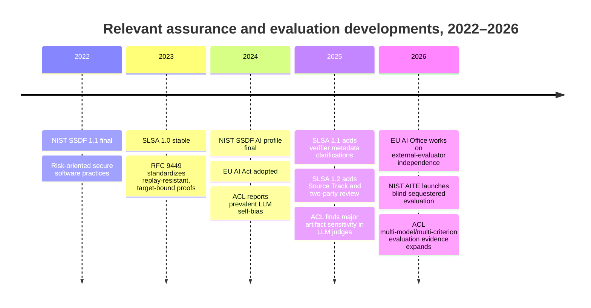
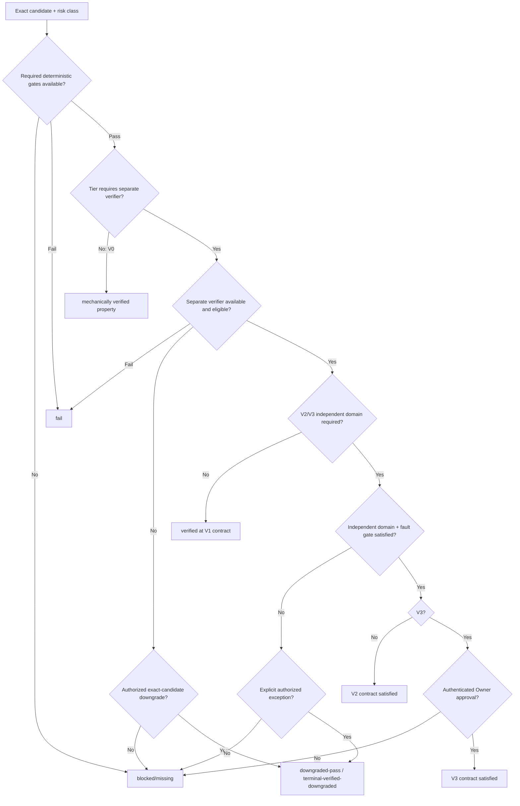

# Risk-Scaled Verifier Independence: Evidence Base, Verification Contract, and Preregistered Evaluation Design

## Executive summary

This report treats the supplied DS-03 brief as the operative research scope. It does **not** reopen the accepted risk-tier direction, redefine the canonical independence vector, select a verifier/provider/model, issue or simulate an exception, or authorize any runtime or repository change. The fixed vector remains: **actor; workspace/state; evidence acquisition; implementation authorship; model family; provider; account/capacity pool; host/failure domain; evaluator/oracle**. The fixed classes remain `V0`–`V3`, and weaker verification may never silently become full verification. fileciteturn0file0

The central finding is that **verifier independence should be treated as a set of separable failure-domain properties, not as “use another model.”** Public software-assurance practice strongly supports technical separation from the developer, separate organizational authority, independent evidence gathering, two-person review, isolated/reproducible execution, and verification tied to an exact revision or artifact. NASA IV&V explicitly distinguishes technical, managerial, and financial independence; current SLSA requires distinct trusted persons for its two-party-review property and separately recognizes reproduction by independently operated build platforms. citeturn16search6turn15search0turn15search2

There is also strong evidence for a **common-mode-failure warning**: nominal independence is not enough. Knight and Leveson's classic experiment used 27 independently developed program versions and one million tests, yet simultaneous failures occurred substantially more often than the statistical-independence assumption predicted. A 2026 exploratory IEEE study of LLM-generated program variants reports the same qualitative concern: errors often remained correlated across generated implementations. citeturn18search0turn18search16 This directly argues against interpreting a second reviewer, second account, or second model label as proof of independent failure behavior.

For model-based evaluation specifically, same-system or closely coupled judging is a material concern. ACL 2024 found self-bias across six examined LLMs and reported that self-refinement can amplify it; a TACL survey found reliable external feedback to be a key condition under which self-correction works. ACL 2025 then showed that 11 LLM judges were vulnerable to superficial artifacts, with one artifact skewing preferences by as much as 98%; multi-model juries improved robustness but did not eliminate the problem. Findings ACL 2026 likewise found gains from multi-model, multi-criterion panels over its baselines. citeturn17search1turn17search9turn17search0turn17search2 Thus, **“stronger model” is not an evidence class and must not substitute for exact deterministic evidence**.

The evidence is substantially weaker for some dimensions in the canonical vector. In the public literature reviewed, there is **no clean controlled result establishing that changing provider, account/capacity pool, or host by itself improves semantic defect detection after model-family, actor, evidence, and task differences are controlled**. Those dimensions are nevertheless meaningful as threat-model and availability separations: SLSA distinguishes independently operated build platforms, requires isolation against build-to-build influence, and recognizes that controls can fail under shared administrative authority. But their semantic-verification value should remain classified as **inferred or unverified**, not advertised as empirically proven. citeturn15search2turn15search5

The recommended contract is therefore the one already implied by DS-03:

| Risk class | Minimum defensible assurance | Result when required evidence is missing |
|---|---|---|
| `V0-mechanical` | Exact deterministic gate re-execution. A model has no authority to turn a gate failure into success. | `blocked/missing` if the required gate cannot run; `fail` if it runs and fails. |
| `V1-routine-reversible` | Clean separate verifier actor/state, independent evidence acquisition, exact gate rerun. Same-family review is acceptable only as actor/context separation. | Only an explicitly authorized routine downgrade can produce `downgraded-pass`; otherwise `blocked/missing`. |
| `V2-sensitive` | `V1` plus an independent failure domain and an adversarial fault gate. Family/provider diversity, a deterministic specialist/oracle, or independent human review may supply the required independent domain according to the fixed contract. | Missing required independence blocks. An explicit authorized exception can only produce the downgraded state for the exact candidate. |
| `V3-constitutional-release` | Deterministic gates, separate verifier, independent failure domain, adversarial/critical evidence as applicable, and authenticated Owner approval. | Any missing required element blocks. A separate explicit exception to a verification deficit can never turn that deficit into ordinary `pass`. |

That mapping is a **locally observed design constraint from the supplied brief**, while the public sources establish the rationale for independent review, risk proportionality, isolated evidence, and exact-context binding. fileciteturn0file0 NASA itself applies IV&V based on criticality/risk rather than as an undifferentiated universal process, while the EU AI Act requires state-of-the-art evaluation and documented adversarial testing for systemic-risk general-purpose AI; in 2026 the European AI Office was explicitly developing independence and qualification expectations for external evaluators. citeturn16search12turn16search4turn19search0

The decisive unresolved empirical question is **not whether two reviewers are intuitively better than one**, but which vector dimensions reduce false-green gates after other dimensions are held fixed. The recommended next research action is therefore a preregistered, blinded, sequestered matrix over synthetic candidates. NIST's 2026 AITE program provides a useful public precedent: it evaluates models on blind data in a sequestered environment specifically to mitigate contamination and increase objective comparability. citeturn16search0turn16search1

The main competing architecture is a **single universal strong verifier**. It should not be rejected by assertion. It should win if, on the preregistered `V2`/`V3` sample, it is statistically non-inferior within a predeclared five-percentage-point false-green margin, exhibits no materially higher common-mode miss rate, has no defect stratum in which independent-domain verification improves recall by more than five points, and reduces measured review effort by at least 30%. Until such a result exists, the current evidence favors risk-scaled independence because evaluator errors demonstrably correlate, self-bias exists, “larger” does not guarantee robust judging, and separate deterministic or independently acquired evidence protects against failure modes that a single judge cannot establish away. citeturn18search0turn17search1turn17search0

## Scope, assumptions, and evidence method

**Research cut: October 1, 2026.** Public primary standards, regulator material, official technical guidance, and original academic studies were prioritized. Secondary industry commentary was not used to establish consequential independence claims where a primary source was available.

Four evidence labels are used throughout:

**Source-documented** means the source directly supports the factual proposition. **Locally observed** means the proposition is stipulated by the supplied DS-03 brief rather than established by public evidence. **Inferred** means the report derives a design implication from documented evidence but the source did not test the platform-specific claim. **Unverified** means the reviewed evidence did not establish the proposed causal effect.

“Expiry” in the claim table below is an **evidence review-by date**, not an assertion that old evidence becomes false. Mature software-assurance results receive longer review windows; fast-moving LLM-evaluation and regulatory claims receive shorter ones.

The investigation tested five broad hypotheses.

First, **actor/authorship separation matters**, because an evaluator that created the candidate can share assumptions, mistakes, incentives, or self-evaluation biases with it. NASA's definition of technical independence explicitly places the IV&V assessment independent of the developer, while SLSA Source Level 4 requires agreement by two trusted persons and treats the uploader and reviewer as distinct people in one acceptable configuration. citeturn16search6turn15search0

Second, **state and evidence separation matter when the relevant failure mechanism is contamination or shared observations**. Reproducible Builds defines reproducibility around another party recreating bit-for-bit artifacts from defined source, environment, and instructions, rather than accepting the producer's claim. SLSA's verified build-reproduction property requires provenance from at least two independently operated build platforms. citeturn18search10turn15search2

Third, **model-family diversity can reduce some evaluator-specific failure modes, but multiple models do not automatically create statistical independence**. Multi-model evaluation studies report gains in particular settings, while both classic multiversion-software evidence and modern LLM-judge evidence show correlated and artifact-sensitive errors. citeturn17search0turn17search2turn18search0

Fourth, **provider, account/pool, and host separation primarily have a failure-domain rationale today, not a proven universal semantic-accuracy benefit**. Their value is clearest against outages, compromised infrastructure, shared policy layers, contaminated state, shared credentials/quotas, or a common build environment. SLSA provides strong analogical evidence for separate build environments and separately operated builders, but that should not be overextended into the unsupported proposition that changing cloud/API provider inherently makes a semantic reviewer better. citeturn15search2turn15search5

Fifth, **deterministic evidence and probabilistic judgment should remain distinguishable**. A reproducible-build comparison can answer whether designated artifacts match bit for bit; it cannot prove that the underlying source is secure or correct. Conversely, a model may reason about requirements not encoded in a deterministic gate, but its favorable judgment does not demonstrate that the gate was executed successfully. This argues for typed evidence rather than a scalar “verification strength” score. citeturn18search10turn15search7

The recent public trajectory reinforces that direction:

NIST SSDF 1.1 was finalized in February 2022, SLSA 1.0 became stable on April 19, 2023, SLSA 1.1 was approved on April 21, 2025, and SLSA 1.2 was released on November 24, 2025 with its Source Track. citeturn18search1turn20search4turn20search0turn20search3 NIST added its generative-AI SSDF profile in July 2024, and in July 2026 launched AITE around blind, sequestered evaluation. citeturn18search2turn16search0

This is not evidence that public standards have independently converged on the exact `V0`–`V3` scheme. They have not. It is evidence that modern assurance practice increasingly makes **risk, provenance, separation of roles, independently obtainable evidence, explicit verified properties, adversarial testing, and context-bound claims** first-class concepts. citeturn15search2turn16search4turn18search1

## Independence claim matrix

The table below uses **only the canonical dimensions specified in DS-03**. It does not introduce “model,” “session,” “task,” or “context” as additional dimensions. Where those concepts matter, they are implementation details of the existing actor, workspace/state, evidence-acquisition, family, or evaluator/oracle fields. fileciteturn0file0

| Canonical dimension | Public evidence and interpretation | Risk-class implication | Classification | Confidence | Evidence expiry / review by |
|---|---|---|---|---|---|
| **Actor** | NASA IV&V defines technical independence around assessment independent of the developer and managerial independence through a separate organization; SLSA two-party review requires distinct trusted persons in the uploader/reviewer case. citeturn16search6turn15search0 | `V0`: no model authority. `V1+`: separate verifier actor is well supported. | Source-documented for separation; inferred for exact platform mapping | **High** | 2028-10-01 |
| **Workspace/state** | SLSA's isolation and reproducibility concepts treat shared mutable execution state as a potential supply-chain failure path; reproducible builds rely on recreating results under specified environments rather than trusting the producing environment. citeturn15search2turn18search10 | `V1`: clean state should be part of verifier separation. `V2/V3`: especially important where state contamination is in the threat model. | Source-documented for environment independence; inferred for agent-state defect detection | **Medium-high** | 2028-10-01 |
| **Evidence acquisition** | NASA managerial independence includes independent choice of what to analyze and how; reproducible-build practice and SLSA verification rely on inspecting/recreating evidence rather than simply accepting the producer's assertion. citeturn16search6turn15search7turn18search10 | `V0`: exact rerun. `V1+`: verifier should reacquire/re-execute relevant evidence rather than consume only an implementer-written verdict. | Source-documented principle; inferred platform rule | **High** | 2028-10-01 |
| **Implementation authorship** | NASA technical independence separates analyst from development; SLSA two-party review is explicitly intended to prevent unilateral source changes. LLM self-evaluation research independently finds self-bias. citeturn16search6turn15search0turn17search1 | `V1+`: author must not be sole accepting verifier. `V2/V3`: stronger separation justified. | Source-documented | **High** | 2027-10-01 |
| **Model family** | ACL studies show model-based judges can have systematic/self biases and that diversified panels can improve robustness or human alignment in tested settings, though correlations remain. citeturn17search1turn17search0turn17search2 | `V1`: same-family verifier can add actor/state separation but not cross-family independence. `V2/V3`: different family is a defensible route to an independent failure domain, not proof of independence. | Source-documented for evaluator diversity effects; inferred for tier rule | **Medium** | 2027-04-01 |
| **Provider** | No reviewed controlled study isolates provider identity and demonstrates a general causal gain in semantic defect detection. Provider diversity plausibly reduces shared infrastructure/policy failure modes, but that is a threat-model inference. | `V1`: unnecessary for full routine separation. `V2/V3`: useful independent-domain evidence when genuinely separate, but should not be claimed to add a known number of defect-detection points. | **Unverified** for semantic detection; inferred for failure-domain diversity | **Low-medium** | 2027-04-01 |
| **Account/capacity pool** | Public assurance literature supports independent administrative/funding/control boundaries in analogous settings, but there is no direct public defect-detection experiment establishing account/pool diversity as an evaluator-accuracy factor. NASA's managerial/financial independence illustrates why shared authority can matter. citeturn16search6 | Treat shared/unknown pool as a potential collision, especially for availability and correlated operational failure. Do not market it as proven semantic independence. | Inferred / unverified | **Low** | 2027-04-01 |
| **Host/failure domain** | SLSA explicitly distinguishes independently operated build platforms, and supply-chain assurance relies on isolation to prevent one build/environment from affecting another. citeturn15search2turn15search5 | Strong for environment-, compromise-, and shared-state faults. `V2/V3` can benefit from a separate host where that is the relevant independent domain; host separation alone does not prove semantic reasoning independence. | Source-documented for environment assurance; inferred for semantic review | **Medium-high** for environmental faults; **low** for semantic accuracy | 2028-10-01 |
| **Evaluator/oracle** | Deterministic/reproducible verification can establish narrow exact properties; model judges remain artifact-sensitive and imperfect; reliable external feedback improves correction. citeturn18search10turn17search0turn17search9 | `V0`: deterministic oracle dominates its encoded property. `V1`: reviewer plus gates. `V2/V3`: deterministic specialist or independent human can provide a qualitatively different failure domain where applicable. | Source-documented principle; inferred platform mapping | **High** for exact properties; **medium** for semantic evaluators | 2027-10-01 |

Two findings deserve particular emphasis.

**Different is not the same as independent.** Knight and Leveson showed this four decades ago: 27 separately written versions could still share failure behavior. Current SLSA likewise recognizes that even two-person review leaves collusion, deceptive changes, and rubber-stamping outside some of its protections. citeturn18search0turn15search5 Consequently, a vector record should say exactly *which* dimensions differ; it should never collapse them into an undocumented boolean such as `independent=true`.

**A property claim should remain property-specific.** SLSA 1.2 deliberately supports separately named verified properties such as `SLSA_SOURCE_TWO_PARTY_REVIEWED` and `SLSA_BUILD_REPRODUCED` rather than requiring every assurance claim to be hidden inside one aggregate level. citeturn15search2 This is a particularly strong precedent for retaining the vector and terminal-state labels rather than inventing a hidden numerical “independence score.”

A useful collision interpretation is therefore:

| Observed collision | What can honestly be claimed | What cannot be claimed |
|---|---|---|
| Same author/actor | At most self-check evidence | Independent review |
| Different actor, shared state/evidence | Some actor separation | Clean independent evidence acquisition |
| Clean separate actor/state, same family | `V1`-style actor/context independence | Cross-family review |
| Different family, same provider/account | Family diversity | Cross-provider or account independence |
| Different provider but unknown account/host relationships | Provider label differs | Proven independent operational failure domain |
| Separate host but same reasoning family/evidence | Environmental failure-domain separation | Independent semantic reasoning |
| Deterministic specialist with exact property | Independent evidence for that encoded property | General correctness outside the oracle's scope |
| Human independent reviewer | Distinct human judgment path | Freedom from human error, anchoring, or shared-specification mistakes |

Unknown metadata must remain **unknown**. Treating an unknown provider relationship, account pool, or host as “different” would turn absence of evidence into evidence of independence—the exact failure DS-03 is trying to prevent.

## Risk-tier contract, downgrades, and blocking behavior

The risk-tier values below are **locally observed requirements from DS-03**, not conclusions invented by this study. Public evidence is used to assess whether their shape is defensible. fileciteturn0file0

| Tier | Minimum assurance contract | Permitted downgrade | Mandatory blocking behavior | Relative work / trade-off |
|---|---|---|---|---|
| **`V0-mechanical`** | Re-execute the designated deterministic gate against the exact candidate. Model judgment has no acceptance authority for the property decided by that gate. | None needed to replace a model verifier; if the gate itself is unavailable, evidence is missing. | Gate unavailable → `blocked/missing`. Gate executes unsuccessfully → `fail`. | Lowest review complexity; strongest only for properties actually encoded in the gate. |
| **`V1-routine-reversible`** | Exact gates plus a clean separate verifier actor/workspace and independently obtained evidence. Same-family use is allowable but must be labeled only as actor/context separation. | A valid risk-approved canonical downgrade for the **exact candidate** may yield only `downgraded-pass` / `terminal-verified-downgraded`. | Missing separate verification without authorized downgrade → `blocked/missing`; negative verifier result → `fail`. | One additional review path; appropriate where consequences are routine and reversible. |
| **`V2-sensitive`** | Everything in `V1` plus a required independent failure domain and adversarial fault gate. Different family/provider, deterministic specialist/oracle, or human review are qualitatively different routes under the stipulated contract. | Only an explicit authorized exception to the missing requirement; result remains downgraded and candidate-bound. | Required independent domain or fault gate unavailable → block unless explicit exception exists. Exception never converts missing evidence into full verification. | Additional route/tool/human effort; materially better common-mode defense is hypothesized but must be measured. |
| **`V3-constitutional-release`** | Deterministic gates, separate verifier, required independent failure domain, and authenticated Owner approval. | An explicit Owner exception can authorize proceeding despite a named deficit only under the existing downgrade semantics; it does not create ordinary `pass`. | Missing gate, verifier, independent domain, or ordinary Owner approval → block. A verifier exception and ordinary release approval must not be conflated. | Highest coordination cost; appropriate where a false green has constitutional, release, security, or irreversible consequences. |

This is consistent with established assurance practice in two ways. NASA scales IV&V attention according to project/software risk and uses independence to provide an assessment not controlled by development. citeturn16search6turn16search12 SLSA likewise increases assurance through explicitly stronger properties and controls rather than asserting that every artifact should receive the same process. citeturn15search0turn15search2

The status transition should be monotonic:

The important property of this state machine is that there is **no edge from missing evidence to ordinary pass**. An exception changes the disposition of an explicitly named deficit; it does not falsify the historical fact that the required verifier was absent.

### Evidence precedence

For an exact property, the recommended evidence ordering is:

**candidate-bound deterministic execution → independent deterministic specialist/oracle → independently reacquired empirical evidence → independent human/model semantic judgment → uncorroborated model consensus/self-report.**

This is not a universal ranking of “intelligence.” It is a ranking of evidentiary directness **for the property under examination**. Reproducible-build verification can establish an exact artifact-equivalence property through bit-for-bit comparison; that says nothing by itself about whether the source has a logic vulnerability. citeturn18search10 Conversely, an excellent semantic reviewer may discover a specification flaw, but that does not constitute evidence that a hash, test suite, policy engine, or build reproduction actually succeeded.

Therefore:

> **A stronger-model assertion may supplement an exact deterministic gate, challenge the validity of the gate specification, or trigger investigation; it may not retroactively make a failed exact gate successful.**

If a gate is itself demonstrated to be invalid, stale, or incorrectly specified, the correct action is to invalidate/version/fix that gate's authority—not to record “the gate failed but the model says pass.” This separation is supported by NIST's broader SSDF approach of defining concrete secure-development practices and by SLSA's property-specific verification model. citeturn18search1turn15search2

### Canonical downgrade receipt requirements

This report does **not** define another receipt. The existing canonical `VerifierDowngradeReceipt` remains the only receipt concept from the brief. fileciteturn0file0 The research conclusion is instead a set of properties against which that canonical design should be checked.

A valid downgrade authorization should be unable to migrate to another candidate, another risk deficit, or another acceptance attempt. SLSA's current Source Track provides a close assurance analogy: approvals apply to a specific context, and the final revision must be reviewed after later changes. citeturn15search0 IETF DPoP provides a protocol-level replay analogy: RFC 9449 binds a proof to a target and method, requires a unique `jti`, checks freshness, supports nonce binding, and describes strict duplicate-`jti` rejection as providing strong replay protection. citeturn16search2

Accordingly, the canonical receipt should be verified to possess these properties, without redefining its schema:

| Property to validate | Required semantic effect | Evidence basis |
|---|---|---|
| **Exact-candidate binding** | Any material candidate change makes the authorization inapplicable. | SLSA final-revision/context-specific review. citeturn15search0 |
| **Named deficit binding** | An exception to one missing independence property cannot excuse another. | Inference from property-specific SLSA verified claims. citeturn15search2 |
| **Acceptance-context binding** | Authorization cannot migrate to a different release/action/risk classification. | SLSA context-specific approvals and RFC target binding. citeturn15search0turn16search2 |
| **Unique identity** | Replay can be detected. | RFC 9449 `jti`. citeturn16search2 |
| **Explicit validity interval** | Stale exceptions cease to authorize proceeding. | RFC 9449's time-window/freshness checks. citeturn16search2 |
| **Atomic consume semantics** | The same authorization cannot successfully authorize two terminal actions. | RFC 9449 describes duplicate unique-proof rejection as strong replay protection. citeturn16search2 |
| **Immutable downgraded terminal label** | Downstream display/query/export cannot reinterpret the event as ordinary `pass` or full independence. | Locally observed DS-03 invariant; conceptually aligned with distinct verified properties rather than collapsing claims. fileciteturn0file0 citeturn15search2 |

A broad reusable waiver is therefore a poor competing design. SLSA's threat analysis specifically notes that exceptions to review rules can create exploitable gaps, and its Source Track makes approval context-specific. citeturn15search5turn15search0

### Fallback semantics

When the preferred independent route is unavailable, fallbacks should be selected by **failure mode covered**, not by prestige:

| Fallback | What it can add | Principal limit |
|---|---|---|
| **Deterministic specialist/oracle** | Excellent independent evidence for a formally decidable property; repeatable and auditable. | Cannot judge properties it does not encode. |
| **Independent human review** | Different cognitive and accountability path; useful for policy, intent, novel semantic failures. | Variable performance and susceptibility to common assumptions or anchoring; not a deterministic oracle. |
| **Cross-host rerun** | Strong against environmental contamination, compromised build state, cache/state leakage, or host-specific faults. | Does not by itself create independent semantic reasoning. |
| **Different model family** | Can reduce some model-specific evaluator biases and create a different reasoning failure mode. | Families can still share training data, benchmarks, specifications, or learned heuristics; correlated failure remains possible. citeturn18search0turn17search0 |
| **Same-family clean reviewer** | Valuable actor/workspace/evidence separation and appropriate to the stipulated `V1` role. | Must never be represented as cross-family independence. |

No fallback should silently satisfy a requirement it does not actually cover.

## Preregistered blind evaluation matrix

The public evidence supports the *direction* of the tier contract, but it does not quantify the marginal value of every canonical vector dimension. The right way to close that gap is a controlled matrix, not model consensus.

NIST's AITE program is directly relevant to the experimental methodology: it uses blind data and a sequestered testbed to mitigate train/test contamination and provides common tasks, metrics, and scoring for comparability. citeturn16search0turn16search1 The proposed study applies those principles to verifier independence.

### Candidate corpus and ground truth

Preregister **480 public/synthetic candidates**, with **120 per risk class**. No private project artifact, private transcript, credential, account identifier, or unpublished implementation content enters the corpus.

Within every tier:

- **90 candidates contain exactly one deliberately seeded defect**, split equally across six preregistered defect families: logic/specification mismatch; shared/stale-state contamination; misleading or insufficient deterministic gate; evidence/provenance mismatch; adversarial/security-boundary fault; authorization/release-policy fault.
- **30 candidates are clean controls**.
- The seed manifest is generated before evaluation, sealed from all evaluators, and records the exact defect location, acceptance criterion, and any deterministic oracle that can prove the fault.
- All candidate content receives randomized opaque identifiers. No evaluator receives the implementer's identity, model identity, provider identity, narrative justification, prior verdict, or other persuasive metadata unless that information is the intentional independent variable.

This produces **360 known-defective** and **120 known-clean** candidates. The study evaluates verifier ability to identify the known condition, not subjective agreement with another model.

### Treatment matrix

Every feasible candidate is reviewed under the applicable treatments below. Treatment metadata are frozen before execution.

| Treatment | Actor / state / evidence | Family | Provider / pool | Host domain | Evaluator type | Question isolated |
|---|---|---|---|---|---|---|
| **T0 — self-check control** | Shared with implementer | Same | Same | Same | Implementer/self-evaluator | Baseline common-mode/self-review performance |
| **T1 — clean same-family verifier** | Separate actor, clean state, independent gate/evidence reacquisition | Same | Same | Same | Model verifier | Value of actor/state/evidence separation |
| **T2 — family-diverse verifier** | As T1 | Different | Held constant where technically possible | Held constant | Model verifier | Marginal effect of family diversity |
| **T3 — provider/pool contrast** | As T1 | Held constant where legitimately possible | Different | Held constant where possible | Model verifier | Provider/pool effect without family confound |
| **T4 — host contrast** | As T1 | Held constant | Held constant | Different | Same evaluator configuration | Environmental/failure-domain effect |
| **T5 — full diverse model path** | Separate | Different | Different / independently evidenced | Different where feasible | Model verifier | Bundled independent failure-domain performance |
| **T6 — deterministic specialist** | Independently executed | N/A | N/A | Independent execution where relevant | Exact oracle/tool | Value and scope of non-model oracle |
| **T7 — independent human** | Separate and blind | N/A | N/A | N/A | Human | Independent semantic-review baseline |

The phrase **“where technically possible” is methodologically important**. If the available routing substrate cannot instantiate, for example, the same model family across genuinely distinct providers, then `T3` does not exist for that stratum. The study must report the cell as missing and leave the provider-specific causal hypothesis unverified. It must not substitute a cross-family/cross-provider bundle and call the observed difference a “provider effect.”

That is the experimental analogue of the platform rule **unknown is not independent**.

### Blinding and anti-persuasion controls

For every model or human verifier, the evaluation package contains only the candidate, normative requirements, permitted evidence interfaces, and the fixed rubric. It omits the implementer's reasoning, confidence, claimed result, model/vendor identity, and intended treatment.

Each verifier independently runs or obtains the evidence it is permitted to use under its treatment. It is not handed prose such as “all tests passed” when the treatment is supposed to measure evidence independence.

Candidate order is randomized independently per verifier. A verifier that has already seen a candidate under one treatment may not later judge the same candidate under another treatment unless the crossover is deliberately modeled and washout is impossible to violate. A practical implementation should therefore use different evaluator instances/actors for paired treatment cells.

The following are frozen before the first evaluation: candidate hashes, defect manifests, treatment assignment rules, prompts/rubrics, gate versions, oracle versions, eligibility/collision rules, randomization seed, exclusion rules, stopping rule, metrics, statistical tests, and non-inferiority margins. This is an inference from NIST's blind/sequestered evaluation rationale and the broader principle of context-specific, auditable verification. citeturn16search0turn15search0

### Deterministic gates

Every candidate has a declared gate set appropriate to the property under test. Examples include exact schema validation, tests with known expected outputs, static assertions, cryptographic artifact comparison, permission-policy checks, or deterministic fault injectors.

The study must separately record:

`gate_executed`, `gate_result`, `verifier_result`, `defect_present`, `defect_identified`, and the vector of observed independence relationships.

This prevents a model verdict from erasing evidence about a failed gate.

### Primary metrics

No composite score is permitted. The experiment reports the following dimensions separately:

| Metric | Exact definition | Why it matters |
|---|---|---|
| **False-green rate** | defective candidates accepted ÷ defective candidates evaluated | Primary safety outcome |
| **Defect recall** | seeded defects correctly identified ÷ seeded defects | Detection effectiveness |
| **Clean first-review acceptance** | clean candidates accepted on initial review ÷ clean candidates | Cost/overblocking counterpart |
| **False-block rate** | clean candidates rejected ÷ clean candidates | Measures excessive conservatism |
| **Pairwise disagreement** | candidates with different verdicts between two treatments ÷ paired candidates | Reveals behavioral diversity, not necessarily correctness |
| **Common-mode miss rate** | seeded defects missed by both implementer and verifier ÷ seeded defects | Directly tests whether “independence” reduces correlated misses |
| **Gate/verifier discordance** | cases where semantic verdict contradicts exact gate evidence | Detects attempted gate override or gate defects |
| **Escaped-defect rate** | defects not detected by the complete tier-specific assurance path ÷ defects | End-to-end contract outcome |
| **Review effort** | separately reported machine invocations/tokens or compute units, wall-clock critical path, and human minutes | Economic comparison without inventing a scalar |
| **Unavailable-cell rate** | required treatment cells that cannot prove their independence metadata ÷ planned cells | Reveals whether the theoretical contract is operationally attainable |

“Disagreement” is deliberately **not** treated as quality. Two reviewers can disagree because one is wrong; two correlated reviewers can agree because both are wrong. Knight-Leveson is the key historical warning against equating agreement with independent reliability. citeturn18search0

For paired binary outcomes, the preregistered analysis should use paired confidence intervals and an exact or appropriately corrected paired test such as McNemar's test, stratified by risk tier and defect class. Multiple pairwise comparisons should receive a declared correction. Those choices are proposed statistical methods, not claims from the cited assurance standards.

### Hypotheses

The matrix should preregister at least these directional hypotheses:

**H-A:** `T1` reduces false greens versus `T0`, demonstrating value from separate actor/state/evidence acquisition.

**H-F:** `T2` reduces common-mode misses relative to `T1` on `V2`/`V3`, establishing incremental value from family diversity.

**H-P:** `T3` changes false-green/common-mode behavior after family is held constant. Until an orthogonal cell exists, the provider-specific hypothesis remains unverified.

**H-H:** `T4` improves detection specifically on state/environment/host-seeded faults more than on semantic logic faults.

**H-O:** `T6` dominates model judgment on exact oracle-eligible properties but supplies little or no evidence outside those encoded properties.

**H-D:** `T5`, `T6`, or `T7` materially reduce `V2`/`V3` common-mode misses relative to same-family clean verification alone.

This design prevents a favorable result for one dimension from laundering evidence for another.

## Recommendations, competing designs, and broader implications

The report's principal recommendation is to **freeze a risk-scaled, vector-explicit contract provisionally, while treating the marginal empirical value of several dimensions as an open measurement problem**. The public record is strong enough to reject “one favorable model verdict means verified,” but not strong enough to claim that every vector dimension independently raises defect recall by a known amount.

| Recommendation | Competing option | Decisive falsifier | What the recommendation does **not** prove |
|---|---|---|---|
| **Retain risk-scaled `V0`–`V3` verification instead of one undifferentiated verifier rule.** | One universal strong verifier for every tier. | On preregistered `V2` and `V3` candidates, the universal verifier is non-inferior to the independent-domain path within **5 percentage points** of false-green rate in each tier; its common-mode miss rate is not >5 points worse; no defect family gains >5 points recall from the independent path; and it reduces measured review effort by ≥30%. | That every proposed dimension contributes equally, or that higher tiers are always economically optimal. |
| **Keep exact deterministic gates non-substitutable for the properties they encode.** | Permit a sufficiently capable model to overrule a deterministic failure. | Repeated validation shows the supposed “exact” gate is not a valid oracle for its stated property. The gate should then lose/revise its authority; the falsifier does not justify silently relabeling a gate failure as success. | That deterministic gates establish general correctness or security. |
| **Require a genuinely different failure domain for `V2`/`V3`; same-family clean review remains valuable but insufficient for that claim.** | Treat clean same-family review as full high-tier independence. | In the preregistered `V2`/`V3` sample, all feasible independent-domain treatments fail to improve false-green/common-mode-miss outcomes beyond the declared 5-point materiality margin, while imposing meaningful extra effort. | That “different provider” is inherently better than “different family,” or vice versa. |
| **Record and enforce the vector dimensions explicitly; unknown relationship metadata cannot count as independence.** | Infer independence from different model names, endpoint labels, or reviewer identities. | A controlled study plus threat analysis demonstrates that the omitted relationship can neither create correlated operational failure nor predict correlated verification error in the relevant risk class. Until then, unknown remains unknown. | That every collision invalidates every tier; `V1` intentionally tolerates some shared dimensions. |
| **Keep the canonical downgrade candidate-bound, deficit-bound, expiring, and single-use, and preserve its distinct downgraded terminal label.** | Reusable broad waiver or a downgraded result that can later render as ordinary pass. | A formal authorization design demonstrates that reuse cannot authorize a different candidate, context, deficit, or terminal action. A token satisfying that condition is functionally exact-bound already. | That an exception makes the missing verifier evidence exist. |
| **Use blinded, preregistered verifier evaluation to establish dimension effects.** | Let implementers conversationally brief/persuade reviewers and analyze results retrospectively. | The blinded condition reduces defect recall by >5 points with no measurable reduction in anchoring/common-mode error, while the open condition remains calibrated across all defect strata in replication. | That all production verification should hide all context; reviewers still need the normative requirements and relevant technical evidence. |

The main competitor—**single universal strong verifier**—has genuine advantages: simpler operations, lower routing complexity, fewer unavailable cells, and potentially lower latency. A preprint on “panels of LLM evaluators” even found that diversified panels of smaller models outperformed one large judge in its tested settings while costing over seven times less, illustrating that cost does not have a fixed relationship to model count. Because that result is task- and price-dependent and was published as a preprint, it should not be generalized into a platform cost law. citeturn17academia36

Its deeper problem is epistemic: public evidence provides no basis for assuming that a universally strong judge's failures are independent from the system it judges. ACL 2025 found larger judges were not consistently more robust to evaluator artifacts, while the older Knight-Leveson result shows why high individual reliability does not eliminate correlated-failure risk. citeturn17search0turn18search0

### Technical implications

The verification substrate needs to preserve **evidence provenance and relationship metadata**, not just final verdicts. A terminal record should be able to answer which gates ran, against which candidate, which required dimensions were distinct or collided, which relationships were unknown, what oracle was used, and whether the result used a downgrade. This follows the same general assurance logic by which SLSA provenance and verification summaries distinguish a claim about an artifact from the evidence supporting it. citeturn15search7turn20search0

The collision detector should be conservative. For each tier it evaluates the existing canonical dimensions against that tier's requirements. A known collision may be allowable at one tier and disqualifying at another; an unknown relationship cannot satisfy a “must be different” rule. Same-family review is explicitly useful at `V1`, while its reuse at `V2` as if it were cross-family would be mislabeling, not stronger verification. fileciteturn0file0

Independent evidence acquisition is especially important because a nominally different verifier can otherwise inherit the implementer's corrupted observation. Asking two models to interpret the same fabricated “all tests passed” summary creates two actors but only one evidence channel. Re-executing the gate creates a new observation.

### Regulatory and assurance implications

Nothing reviewed establishes that these exact internal tiers are legally mandated. The more relevant signal is directional. The EU AI Act requires providers of systemic-risk general-purpose AI models to conduct and document state-of-the-art evaluation including adversarial testing, risk assessment/mitigation, incident handling, and cybersecurity. citeturn16search4 In June–July 2026, the European AI Office specifically sought expert input on **independence and qualification requirements for external evaluators**, describing those requirements as important to credible and reliable external evaluation. citeturn19search0

That 2026 work is still a moving regulatory target; it should therefore be rechecked before any future claim that a particular verifier arrangement satisfies European requirements. The appropriate conclusion today is that evaluator independence has become an explicit regulatory-design issue, not that the DS-03 vector is an EU-mandated schema.

NIST provides a complementary, non-regulatory measurement signal. AITE's blind, sequestered design explicitly addresses evaluation contamination, while SSDF 1.1 and its AI profile frame secure software development as a set of concrete practices rather than a single trust assertion. citeturn16search0turn18search1turn18search2

### Economic and operational implications

There is no defensible public dollar estimate for the proposed platform tiers without selecting providers, models, human labor rates, workload distributions, and actual candidate sizes—actions outside this research lane.

The useful cost representation is therefore **resource composition**, not invented currency:

| Assurance option | Incremental resources | Expected critical-path effect | Coverage / trade-off |
|---|---|---|---|
| Deterministic rerun | One additional exact gate execution | Usually gate-runtime bounded | Cheapest high-quality evidence when property is mechanically decidable; narrow scope |
| Same-family clean verifier | One independent review plus gates | One reviewer path | Good `V1` separation; common reasoning family remains |
| Family-diverse verifier | Additional distinct evaluation route | Can be parallelized; availability dependent | Potential reduction in model-specific bias; correlated errors still possible |
| Cross-provider/pool path | Separate operational route plus relationship evidence | Higher coordination/failure surface | Better infrastructure-domain diversity; semantic benefit unverified |
| Cross-host rerun | Second isolated execution environment | Build/test runtime plus provisioning | Stronger evidence against environmental contamination |
| Deterministic specialist | Tool/oracle execution | Property dependent | Excellent precision on encoded property |
| Human independent review | Human review/adjudication time | Usually highest and least predictable latency | Useful for ambiguous intent/policy; variable consistency |
| Full `V3` path | Gates + verifier + independent domain + Owner approval | Highest coordination | Maximizes separation for the contract's highest-consequence class |

This makes the logic for **risk scaling** clearer. The architecture should spend additional independent-verification resources where the consequence of a false green justifies them, rather than forcing every routine reversible action through the maximum-assurance path. That is an inference from risk-based IV&V and secure-development practice, not a quantified local ROI claim. citeturn16search12turn18search1

### Social and governance implications

Independent human review is not merely a “backup model.” It changes accountability and introduces a qualitatively different reasoning process. Conversely, human reviewers can share specifications, organizational assumptions, or anchoring cues; independence therefore still benefits from blinding and independent evidence.

The most important governance implication is semantic honesty. `downgraded-pass`, `blocked/missing`, and `fail` must remain distinguishable historical states. SLSA's property-specific claims provide a useful external precedent: software can satisfy one verified property without the specification pretending that it satisfies every stronger assurance property. citeturn15search2

## Owner decisions and open research questions

The research evidence resolves the **shape** of the contract more strongly than its numerical thresholds. The following questions remain appropriate for explicit Owner disposition rather than researcher invention.

**Risk-class boundary tests.** The contract should have canonical examples for ambiguous boundaries: what makes an action “routine reversible” rather than “sensitive,” what constitutes an irreversible external effect, and when a policy/configuration change becomes constitutional rather than ordinary. The report does not alter the four accepted classes. fileciteturn0file0

**Independence-metadata sufficiency.** The Owner should decide which canonical vector relationships must be positively evidenced versus permitted to remain unknown for each tier. The research recommendation is that an unknown may never satisfy a positive “independent” predicate.

**Empirical materiality margin.** The proposed blind study uses five percentage points as the decisive false-green/common-mode materiality threshold. That is a preregistration choice rather than a discovered natural constant. The Owner should freeze or replace it before data are observed.

**Human-review eligibility.** The accepted `V2` direction allows human review as an independent failure domain, but operational policy eventually needs to define qualification and conflict-of-interest evidence without introducing a second independence vector.

**Receipt lifetime ceiling.** The canonical receipt should have explicit freshness/expiry semantics, but the maximum permissible lifetime is a policy decision. RFC 9449 supports the security value of freshness and replay controls; it does not prescribe a suitable lifetime for this platform's downgrade authority. citeturn16search2

**Provider/account/host claims.** These should remain research hypotheses until the blind matrix can isolate them. A route should not be made mandatory merely because it sounds more independent; conversely, absence of current empirical measurement should not be confused with evidence that shared operational failure domains are harmless.

The largest open scientific question is correlated error. Classic multiversion programming showed that independently produced implementations can still fail together more often than naive independence predicts, and current LLM-judge research likewise shows systematic evaluator biases. citeturn18search0turn17search0 The proposed matrix should therefore study **joint misses**, not merely each verifier's standalone accuracy.

A second question is whether model-family diversity is a stable concept over time. Models may share training sources, synthetic data pipelines, distillation ancestors, benchmarks, or alignment techniques even when marketed as separate families. The canonical vector can record declared family distinction, but the experiment should determine whether that label predicts error diversity. This is currently an **inferred research hypothesis**, not a settled assurance fact.

A third question is how to handle a deterministic gate shown to be wrong. The correct conceptual separation is between **candidate failure** and **oracle failure**. A gate that ceases to be a valid oracle should be challenged through a separate gate-validation process; allowing ordinary candidate reviewers to override it case by case would collapse the evidence hierarchy the system is intended to protect.

## Appendix: source ledger, study method, and completion gate

### Source hierarchy and data ledger

The investigation prioritized the following source classes.

**Software-assurance independence.** NASA's current IV&V material establishes technical, managerial, and financial independence and explicitly positions independent assessment outside development control. citeturn16search6turn16search12

**Independent development and common-mode failure.** Knight and Leveson's IEEE experiment is the strongest classic empirical warning that separately produced implementations do not necessarily fail independently. citeturn18search0 A 2026 IEEE exploratory study reports qualitatively correlated error behavior in LLM-generated code, but because it is recent and exploratory it receives less weight than the established experiment. citeturn18search16

**Supply-chain assurance and reproducibility.** Current SLSA 1.2 specifies two-party source review and distinct verified properties for two-party review and reproduction by independently operated builders. citeturn15search0turn15search2 Reproducible Builds supplies the precise “same inputs/environment/instructions → bit-identical artifacts” concept used here for independently recreatable mechanical evidence. citeturn18search10

**Secure development.** NIST SP 800-218 version 1.1 is the final 2022 SSDF; its AI community profile was finalized in July 2024. NIST currently also lists an SSDF 1.2 revision as draft, so this report does not treat that draft as the normative final replacement. citeturn18search1turn18search2turn18search7

**LLM evaluation.** ACL/TACL evidence establishes self-evaluation bias, limitations of intrinsic self-correction, artifact sensitivity among LLM judges, and gains—but not perfection—from multi-model evaluation. citeturn17search1turn17search9turn17search0turn17search2

**Blind evaluation.** NIST AITE, launched July 27, 2026, uses blind data and a sequestered environment specifically to mitigate contamination and support common scoring. citeturn16search0

**Authorization/replay semantics.** RFC 9449 supplies mature protocol evidence for unique proof identifiers, target binding, freshness, nonces, and duplicate-use rejection. Those concepts are used only as design validation analogies for the already-canonical downgrade receipt. citeturn16search2

**Regulatory direction.** The consolidated EU AI Act sets adversarial model-evaluation obligations for GPAI models with systemic risk, while the AI Office's July 2026 workshop demonstrates ongoing work on external-evaluator independence and qualifications. citeturn16search4turn19search0

### Claim-status summary

The strongest **source-documented** conclusions are:

1. Independent software assurance distinguishes reviewer/developer roles and can include organizational/financial separation. citeturn16search6
2. Two-person review and independently operated reproduction environments are recognized software-assurance properties. citeturn15search0turn15search2
3. Separate implementations can still suffer correlated failures. citeturn18search0
4. LLM self-evaluation and LLM-as-judge systems exhibit systematic biases; multiple evaluators can improve some outcomes but do not eliminate evaluator failure. citeturn17search1turn17search0turn17search2
5. Blind/sequestered evaluation is an active NIST method for reducing contamination. citeturn16search0
6. Unique, target-bound, freshness-checked, one-use proofs are a mature replay-defense pattern. citeturn16search2

The strongest **inferences** are that clean workspace/state and independent evidence acquisition should be part of `V1`, that family diversity is a reasonable `V2/V3` failure-domain mechanism, and that host separation is especially valuable against environmental faults.

The principal **unverified** causal claims are that changing provider alone, account/capacity pool alone, or host alone improves general semantic defect detection. Those claims should remain visibly unverified until an orthogonal controlled study supports them.

### Completion-gate audit

| Required completion condition | Result |
|---|---|
| Every canonical independence dimension has a public evidence pin or is explicitly marked inferred/unverified | **Satisfied** |
| All four risk classes have minimum assurance, downgrade semantics, and blocking behavior | **Satisfied** |
| Missing verification is never called `pass` or full independence | **Satisfied** |
| Same-family separation is not mislabeled cross-family | **Satisfied** |
| A blind preregistered matrix defines candidates, treatments, ground truth, metrics, gates, and analysis rules | **Satisfied** |
| Competing “single universal strong verifier” option is explicitly represented | **Satisfied** |
| A decisive falsifier for the principal recommendation is preregistered | **Satisfied** |
| Every recommendation lists a competing option, decisive falsifier, and what it does not prove | **Satisfied** |
| Canonical receipt is not redefined; only validation properties are proposed | **Satisfied** |
| No second independence vector is introduced | **Satisfied** |
| Existing accepted Owner decisions are treated as constraints rather than reopened or promoted | **Satisfied** |
| No verifier/provider/model/product route is selected | **Satisfied** |
| No repository, runtime, authentication, configuration, scheduling, spending, deployment, publication, or merge action is performed | **Satisfied** |
| Privacy/secret scan: no credentials, infrastructure identifiers, private transcript, local path, or private implementation content included | **Satisfied** |
| Open Owner decisions are isolated separately | **Satisfied** |

The resulting research position is therefore narrow but strong: **risk-scaled verifier independence is well supported as an assurance architecture; exact deterministic evidence should retain authority over the properties it actually decides; same-family clean review is useful but is not cross-family independence; diverse model or operational routes should never be presumed statistically independent merely because their labels differ; and provider/account/host effects should remain explicitly unverified until the blind matrix measures them.** Public assurance practice and recent evaluator research support that contract shape, while the proposed preregistered experiment supplies the path from plausible independence dimensions to measured ones. citeturn16search6turn15search2turn18search0turn17search0