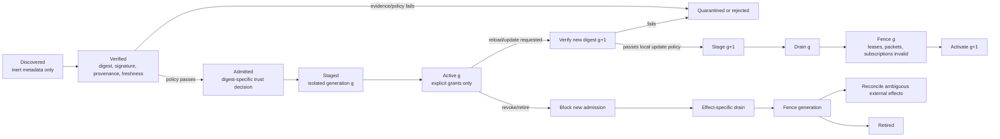

# Plugin Trust and Supply-Chain Contract for Recursion v3

## Executive summary

The research topic is no longer genuinely unspecified. The supplied research directive defines the subject as **DS-04 — Plugin trust and supply chain**, with the objective of freezing the semantics of maintainer signing, unsigned-plugin admission, authority grants, update/reload/revocation, and owner sovereignty for Recursion v3. The intended audience is not named explicitly; this report assumes product owners, maintainers, security reviewers, and implementers. The requested depth is comprehensive, and the brief explicitly forbids implementation, installation, publication, provider/auth/configuration changes, spending, deployment, or a mandatory remote control plane. fileciteturn0file0

The central finding is that **trust evidence and execution authority must be modeled as orthogonal dimensions**. A maintainer signature can authenticate an artifact or metadata under a configured trust policy; it cannot establish that the artifact is benign, appropriate for a particular project, entitled to credentials or network access, or authorized to consume subscription quota or money. Sigstore makes this distinction unusually explicit: successful signature verification establishes authentication of the signing identity under Sigstore's model, but does not establish that the signer should have signed the artifact or that the artifact itself is good. Debian's package-authentication documentation likewise distinguishes trusting an archive from trusting every package's behavior. citeturn14view1turn14view7

Accordingly, the recommended Recursion contract is:

> **A maintainer signature is an admission/review assertion over an exact artifact identity. It is never, by itself, an authority grant.**

For Recursion, the strongest defensible meaning is: **“this exact digest was accepted under the installation trust root's maintainer/review policy.”** That meaning is contingent on the signing keys or authenticated identity still being trusted and on the applicable review policy. It does **not** mean “safe,” “appropriate,” “non-malicious,” “permitted to spend,” or “permitted to act with the owner's credentials.” This interpretation is consistent with Sigstore's threat model and with TUF, which deliberately treats target files as opaque and guarantees that the client obtains the expected trusted file rather than deciding what the application should do with it. citeturn14view1turn14view0

A compact design rule follows:

\[
\text{effective authority}(d,g)
=
\text{explicit local grants}(d,g)
\cap
\text{host policy}
\]

where \(d\) is the plugin's immutable digest or digest-closed artifact identity and \(g\) is its active generation. **Signature status, provenance, transparency evidence, and trust tier influence admission, review requirements, and isolation; they do not add bits to the authority set.** This is a design inference from the supplied constraints plus capability-security precedents, especially WASI's explicit host-grant model. fileciteturn0file0 citeturn14view4turn14view5

Unsigned local plugins therefore do not need to be crippled. They can retain the complete plugin API after a **digest-specific owner acknowledgement**, provided that acknowledgement is not confused with the requested authority grants. The digest, provenance/source status, requested authorities, and unsigned status should be visible before admission; after admission, the plugin can receive exactly the same typed capabilities as signed code if the local owner chooses to grant them. That gives unsigned code **full expressiveness without warning-only security**: the warning creates a local trust decision, while the effect brokers still enforce the same capability contract.

The evidence also argues strongly for **defense by composition rather than a single “trusted” bit**:

| Question | Mechanism best suited to answer it | What it cannot answer |
|---|---|---|
| Who or what policy approved these bytes? | Signature / installation trust root / Sigstore-like identity binding | Whether the code is benign or suitable |
| Is this the intended current release rather than a replay or rollback? | TUF-style root, targets, snapshot, timestamp metadata | Runtime safety or spending authority |
| Where and how was this artifact built? | SLSA provenance / in-toto attestations | Whether its runtime behavior is acceptable |
| What dependency bytes were resolved? | Lockfile + immutable source binding + digests | Whether those bytes are malicious |
| What is in the software? | SPDX/SBOM | What it will do when executed |
| What resources can it reach at runtime? | Capability broker / sandbox / WASI-style imports | Whether code will misuse an allowed capability |
| May it spend, launch models, use credentials, or select an account? | Explicit local Recursion grants | Publisher identity or software quality |

TUF protects update *distribution* against rollback, freeze, mix-and-match, wrong-file, and several key-compromise scenarios using separated signing roles and freshness metadata; its specification explicitly says target files are opaque and that after verification the application decides what to do with them. citeturn14view0 SLSA provenance records verifiable information about where, when, and how an artifact was produced, while SPDX SBOMs describe software composition and related metadata. Neither standard defines runtime authorization or spending permission. citeturn14view2turn14view3 WASI and the WebAssembly Component Model provide the most relevant precedent for runtime capability separation: components operate through explicitly supplied interfaces, although the actual security outcome still depends on what the host grants. citeturn14view4turn14view5turn15view4

Three conclusions are particularly important for freezing the contract:

1. **A new digest is new code identity.** Existing admission or authority should not silently attach to arbitrary replacement bytes. An owner-controlled update policy may explicitly pre-authorize a bounded class of replacements, but that policy is itself a separate local grant. TUF's exact-target and version/freshness machinery, npm lockfiles' exact dependency trees and integrity fields, and the supplied digest-aware requirements all support this direction. citeturn14view0turn14view6
2. **Semantic grant separation is more important than the number of dialogs.** A novice flow can gather several decisions in one installation transaction, but it should emit independently inspectable and independently revocable grant records. Metered spending in particular must never be inferred merely from installation or trust acknowledgement. The exact UX grouping remains an Owner decision under the brief. fileciteturn0file0
3. **Remote security information may inform local policy but must not itself be local authority.** A maintainer advisory, transparency-log observation, repository revocation, or registry status can cause a local policy engine to warn, reject a future admission, or quarantine according to owner-configured rules. It must not constitute an unconditional remote kill/update primitive, because that would contradict the stated owner-sovereignty invariant. fileciteturn0file0

## Scope and methodology

The investigation was performed against the supplied DS-04 directive rather than an unspecified generic topic. The brief fixes the architectural premises: maintainer-signed trust, digest-aware acknowledgement, separately visible authority dimensions, five trust tiers, a discover-to-active lifecycle with quarantine and fencing, immediate blocking of new admission after revocation, a zero-effect disabled-plugin invariant, and the prohibition on a mandatory centralized marketplace or remote maintainer veto. These are treated as requirements, not hypotheses to reopen. fileciteturn0file0

**Research period.** The default evidence window was the requested ten years, **October 1, 2016 through October 1, 2026**, with current specifications preferred over historical descriptions. Older concepts were included only through current documentation where useful. Original research inside the window included the 2019 in-toto paper and the 2021 dependency-confusion disclosure. Current documents checked include TUF Specification 1.0.36, last modified August 5, 2026, and WASI 0.3, whose current documentation lists WASI 0.3 as the stable current line and 0.3.1 as released August 11, 2026. citeturn14view0turn16view0turn16view1

**Source strategy.** Priority was given to primary standards, specifications, official documentation, and original papers: TUF, Sigstore, SLSA, SPDX, WASI/Bytecode Alliance, npm documentation, Debian package-authentication documentation, NIST software-supply-chain guidance, and the peer-reviewed in-toto paper. The original dependency-confusion report by Alex Birsan was used for that attack class because it documents the technique directly. No repository inspection or GitHub connector was used for project-specific content, and no plugin/package was installed, signed, updated, or executed. citeturn14view0turn14view1turn14view2turn14view3turn14view4turn15view5turn14view8turn14view9

**Evidence labels used below:**

- **Source-documented** means the source directly asserts the relevant property.
- **Inferred** means the report derives a Recursion design consequence from one or more documented properties.
- **Unverified** means the available authoritative evidence does not establish the claim; it must not be treated as zero, false, or implicitly safe.

The source-license column in the claim table records a license only when it was established from an authoritative source. Sigstore states that its projects must use Apache-2.0. SLSA specifies Community Specification License 1.0 for specification contributions under its current governance model, with older portions under Apache-2.0, and software under Apache-2.0 unless otherwise specified. The Python TUF reference implementation is dual MIT/Apache-2.0; this does **not** establish the documentation license of every TUF webpage, so that distinction is retained. citeturn15view0turn15view1turn15view2

The investigation asks four kinds of questions simultaneously: what evidence mechanisms actually prove; how runtime authority should be represented; how updates/reloads/revocation remain fail-closed; and which policy choices must remain with the local owner. NIST's current C-SCRM guidance is useful at this level because it treats software supply-chain security as risk identification, assessment, and mitigation across the lifecycle rather than as a single signature check. citeturn15view5

## Evidence synthesis and source-pinned trust claims

The most important distinction is between **cryptographic authenticity**, **supply-chain traceability**, **freshness**, **composition knowledge**, **runtime confinement**, and **authorization**. Mature systems generally solve only one or several of these—not all of them.

### Source-pinned claim table

| Mechanism and pin | What it actually establishes | What it does **not** establish | Classification / confidence | Revalidation or expiry trigger | Source / license note |
|---|---|---|---|---|---|
| **Recursion maintainer signature over exact digest** | **Inferred contract:** verification under the installation trust root establishes that the artifact digest was approved according to the key/identity-to-maintainer policy and applicable review policy. | Benign runtime behavior; correctness; fitness for this project; credential access; network access; model launch; account/route choice; quota; spending. | Inferred, **high**, because both Sigstore and established package-authentication systems sharply limit signature semantics. | Digest changes; trust-root/key/identity policy changes; signing key or identity is revoked/compromised; review-policy version changes. | Sigstore threat model explicitly limits what verification guarantees; Debian similarly distinguishes archive trust from package goodness. Sigstore projects: Apache-2.0. Debian page license not established here. citeturn14view1turn14view7turn15view0 |
| **TUF Specification 1.0.36** | Authentic and timely metadata for trusted targets; distinct root/targets/snapshot/timestamp roles; protection goals include rollback, freeze, mix-and-match, wrong-file and certain key-compromise attacks. | Runtime behavior of target; whether target is appropriate; effect authority; spend entitlement. TUF calls targets opaque and hands verified targets back to the application. | Source-documented, **high**. | Spec/profile changes; metadata expires; trusted root changes; threshold compromise; local policy changes. | TUF 1.0.36, modified Aug. 5, 2026. Python reference implementation is MIT OR Apache-2.0; spec-page documentation license not independently established. citeturn14view0turn15view2 |
| **Sigstore keyless signing / transparency model** | Under normal operation, verification can establish that an identity authenticated to Sigstore at signing time and that signed evidence can be recorded/audited through the transparency architecture. | That the identity ought to have signed; that the artifact is good; that the signer has local project authority. | Source-documented, **high**. | Identity-provider/trust-root/key/log assumptions change; certificate/signature validity conditions fail; local identity policy changes. | Official Sigstore threat model; Sigstore project policy requires Apache-2.0. citeturn14view1turn15view0 |
| **SLSA v1.2 provenance** | Verifiable information describing where, when, and how an artifact was produced; supports policy about build/source provenance. | Runtime goodness, project suitability, credentials, network, quotas or spending. | Source-documented for provenance; “not an authority grant” is an **inference**, **high**. | Provenance predicate/policy version changes; builder identity no longer trusted; artifact digest changes. | SLSA v1.2 provenance. Spec is Community-Spec-1.0 for post-governance contributions, with specified older material under Apache-2.0; code generally Apache-2.0. citeturn14view2turn15view1 |
| **in-toto, USENIX Security 2019** | Cryptographic end-to-end verification that expected software-supply-chain steps were performed by authorized parties according to a defined layout. | Runtime safety after the verified supply chain completes; owner permission for effects. | Source-documented / inferred limit, **high**. | Layout or authorized-functionary policy changes; unmodeled build/runtime steps appear. | Peer-reviewed USENIX Security 2019 paper; publication license beyond USENIX's publication terms not independently established here. citeturn14view8 |
| **npm `package-lock.json` / integrity data** | The lockfile describes a precise dependency tree; entries can record resolved source and SRI integrity values, allowing repeatable resolution and byte-integrity checks. | Publisher benevolence, package safety, authority, or protection if an already-malicious package is intentionally pinned. | Source-documented / inferred limit, **high**. | Lockfile changes; unlocked/dynamic dependencies appear; package source semantics or installer behavior changes. | Official npm documentation; documentation-content license not established by the cited page. citeturn14view6turn15view6 |
| **SPDX 3.0.1 SBOM** | A structured collection of SPDX elements describing a package, with possible information about composition, provenance, licensing, and known quality/security concerns. | Dynamic runtime behavior, malicious intent, permission to perform effects. | Source-documented / inferred limit, **high**. | SBOM no longer corresponds to exact artifact; component graph changes; SPDX schema changes. | SPDX Specification 3.0.1; cited page does not independently establish the documentation license. SPDX is maintained as a Linux Foundation project. citeturn14view3turn16view3 |
| **WASI / WebAssembly Component Model** | A component can be constrained to host-supplied interfaces; WIT worlds declare imports/exports, providing a strong basis for capability-oriented confinement. WASI 0.3 is the stable current branch as of Oct. 1, 2026. | That a host grants only narrow capabilities, or that component code will use allowed capabilities benignly. Some hosts/runners can intentionally expose broad underlying resources. | Source-documented / inferred security consequence, **high** on model; **medium** on cross-runtime enforcement until implementation is tested. | Runtime/toolchain changes; interface/world changes; native escape/bypass exists; host maps narrow imports to broad ambient access. | WASI/Component Model official documentation. Bytecode Alliance project licensing varies by project; commonly Apache-2.0 with LLVM exception and/or MIT—exact Recursion-selected runtime license must be pinned separately. citeturn14view4turn14view5turn16view0turn15view4turn15view3 |
| **Debian APT archive authentication** | Signed repository metadata and hashes establish an authenticated chain from trusted archive metadata to package content. | That an authenticated package is non-malicious. | Source-documented, **high**. | Repository signing policy/key changes; metadata freshness/authentication fails. | Official Debian `apt-secure` documentation; page/license status not independently verified in this research. citeturn14view7turn16view2 |

The practical conclusion is not that any of these mechanisms is weak. It is that **each answers a different question**. TUF is exceptionally strong against classes of update-channel attacks, but it expressly leaves target files opaque. SLSA and in-toto strengthen provenance and process traceability. SPDX strengthens inventory knowledge. Lockfiles make dependency resolution reproducible. Sigstore strengthens identity-linked signing and transparency. WASI supplies a mechanism for restricting runtime opportunity. None converts a cryptographic statement into a generic judgment that the code deserves money, credentials, a model account, arbitrary egress, or project-wide filesystem access. citeturn14view0turn14view1turn14view2turn14view3turn14view4turn14view8

**What a maintainer signature should prove.** In ordinary public-key signatures, the cryptography establishes that a holder of the corresponding private key produced a valid signature over the signed material. The meaning “maintainer-approved” comes from the local trust root's mapping between that key or authenticated identity and a maintainer/review role. Therefore Recursion should bind the signature statement to the **artifact digest plus review-policy identity/version**, not merely to a human-readable plugin name. This makes an approval auditable while avoiding the stronger and unsupported claim that a reviewer can certify future runtime behavior. This is an inference from the identity/authentication distinctions made explicit by Sigstore and TUF's separation of metadata trust from target semantics. citeturn14view1turn14view0

**What an SBOM and provenance should add.** They should enrich the admission record, not mutate authority. A provenance attestation can let policy reject an artifact built by an unexpected builder; an SBOM can permit inventory or vulnerability policy; a lockfile can make dependency closure inspectable. Their failure can justifiably prevent admission under local policy, but their success should never synthesize a credential, network, quota, or spend grant. citeturn14view2turn14view3turn14view6

**What capability isolation adds.** The WebAssembly Component Model is particularly useful conceptually because a component's world makes its required and supplied interfaces explicit. That gives Recursion a direct analogue: plugin API verbs and effect brokers can be explicit imports rather than ambient host powers. WASI 0.3 is nevertheless not itself a complete Recursion policy system; the current WASI documentation, for example, includes filesystem, socket and HTTP surfaces, and notes that network access in WASI 0.3 is granted at the world level. The host still decides what concrete authority those interfaces embody. citeturn16view1turn14view5

This yields a clean three-axis model:

| Axis | Examples | Decides |
|---|---|---|
| **Evidence / provenance** | Signed vs unsigned; maintainer key; TUF metadata; Sigstore evidence; SLSA; SBOM; lockfile | Whether the exact bytes meet local admission/evidence requirements |
| **Trust tier / isolation** | T0 kernel, T1 signed built-in, T2 signed isolated third party, T3 untrusted view, T4 external engine/provider | Which containment/review boundary must apply |
| **Authority grants** | API verbs, paths, egress, secrets, model launch, account, quota, spend, update/downgrade/revocation policy | What effects are actually permitted |

The supplied trust-tier taxonomy is therefore safest if interpreted as an **engineering constraint on where and how code may execute**, not as a shorthand for grants. A T2 signed plugin with no network grant should have no network authority; a locally admitted unsigned plugin should not need to be permanently feature-incomplete merely because its evidence axis differs. Conversely, the fact that a T1 built-in is signed must not silently create a spend budget. fileciteturn0file0

## Grant model and lifecycle

The research supports **semantic separation of every listed grant dimension**. This does not require eleven pop-up dialogs. It requires eleven independently meaningful policy fields or records so that installation, inspection, revocation, and audit never have to reverse-engineer a broad “trusted” bit.

### Grant-dimension matrix

“Shared acknowledgement” below means a single user-facing transaction may co-present decisions; it does **not** mean the permissions merge. The brief leaves the final batching choice to the Owner, and this report preserves that constraint. fileciteturn0file0

| Grant dimension | Required semantic separation | Shared-acknowledgement safety | Deterministic falsifier |
|---|---|---|---|
| **Functional API verbs** | Record exact plugin/API operations independently of signing status. | **Potentially safe to co-present** when exact verbs or a visibly expanded profile are shown. Owner decides final UX. | Plugin successfully invokes a verb absent from its effective grant set. |
| **OS / workspace scope** | Bind filesystem/process-facing scope to explicit roots/resources/modes. | **Potentially safe to co-present** with API verbs when scope is concrete and separately recorded. | Read/write/open succeeds outside allowed workspace/resource scope. |
| **Network egress** | Explicit destinations/protocol/service boundaries; no inference from “networked plugin.” | **Conditional.** May appear in one transaction, but scope must remain independently visible and revocable. | Connection/DNS/HTTP request reaches an undeclared destination through any plugin-accessible route. |
| **Credential access** | Named credential classes or broker scopes, never raw ambient credential inheritance. | **High-risk conditional.** Same transaction is possible only with explicit credential scope; never implied by install trust. | Plugin obtains or uses a credential outside the named grant, including via environment/process inheritance. |
| **Model launch** | Separate permission to initiate model/provider work. | **High-risk conditional.** Must remain distinct even if co-confirmed with route or quota. | Model invocation reaches an adapter/provider without an active model-launch grant. |
| **Route / account** | Which provider route/account/tenant may be used is an independent choice. | **High-risk conditional.** Never implied by “model launch.” | Plugin selects or causes use of an ungranted route/account. |
| **Subscription quota** | Bounded non-metered or subscription-backed capacity is a resource entitlement distinct from launch. | **Conditional.** May be co-presented but must expose the applicable limit. | Plugin consumes beyond the locally granted quota without a new authorization. |
| **Metered spending** | Explicit budget/limit/approval object. No trust or installation action synthesizes it. | **Unsafe to infer or hide in a general acknowledgement.** It may be on the same screen only if the spend amount/rule is explicitly confirmed and separately recorded. | Any billable external effect is initiated where no matching spend authorization exists, or a limit can be exceeded without another authorization. |
| **Update** | Explicit policy describing whether a different digest may replace/stage alongside the admitted digest and under what evidence constraints. | **Conditional.** An install flow may ask for an update policy, but install approval itself is not update approval. | A different digest becomes active without satisfying the locally stored update rule. |
| **Downgrade** | Separate rule because intentional rollback and adversarial rollback are semantically different. | **Conditional.** May share a policy transaction with updates but must remain separately inspectable. | A lower/disallowed version or old digest becomes active without the downgrade rule authorizing it. |
| **Revocation** | Local ability to stop new admission and fence authority. Remote advisories are input to local policy, not ownership of the switch. | **Conditional.** Policy can be configured alongside lifecycle settings, but cannot be silently delegated to a remote maintainer. | A remote maintainer/registry message alone changes active state, grants, or installed digest contrary to owner-configured policy. |

The main UX insight is that **semantic granularity and interaction count need not be the same thing**. A novice-oriented installation flow can show one concise trust summary and one authority summary, then atomically commit multiple typed records. What must not happen is an implementation shortcut in which “I trust this unsigned digest” becomes indistinguishable from “I authorize its network, credentials, model account, and spend.” That distinction follows both from the explicit DS-04 constraints and from capability systems in which authority must be deliberately supplied by the host. fileciteturn0file0 citeturn14view4turn14view5

A useful internal conceptual representation is:

\[
\begin{aligned}
A(d) &= \text{admission evidence for digest }d \\
T(d) &= \text{isolation/review tier for }d \\
G(d) &= \{g_{\mathrm{api}},g_{\mathrm{os}},g_{\mathrm{net}},g_{\mathrm{cred}}, \ldots,g_{\mathrm{spend}}\}\\
P &= \text{local owner policy}\\
E(d,g) &= G(d,g)\cap P
\end{aligned}
\]

No function in that model is `G := signature`. The signature contributes to \(A\); tier contributes to \(T\); only explicit local policy contributes to \(G\).

**Unsigned local code.** The minimum defensible admission record is not merely “user clicked through a warning.” It is a record binding the warning/acknowledgement to the **exact digest**, source identity or source absence, the requested authority vector as displayed at that time, and the applicable local policy version. Where a plugin has dependencies outside the artifact itself, the practical “digest identity” should cover the dependency closure or immutable dependency references; otherwise an acknowledged top-level digest could load different executable code later. npm's lockfile model demonstrates why resolved sources and integrity values matter, while the original dependency-confusion work demonstrates how a resolver can otherwise select attacker-controlled public packages that collide with internal names. citeturn14view6turn14view9

That last point is important: **digest-specific acknowledgement is only as strong as the executable closure it identifies**. If a plugin installation later runs an unpinned package manager, resolves a floating dependency, downloads native code, or dynamically imports code fetched from the network, that fetched code is a new supply-chain event. The system should therefore either include it in the admitted closure or route it through the same update/admission machinery. This is an inferred requirement supported by lockfile integrity practice and dependency-confusion evidence. citeturn14view6turn14view9

### Lifecycle and fencing

The supplied lifecycle—discovered → verified → admitted → staged → active—is sound if **no stage before activation accidentally grants an effect path** and if generations are fenced during reload/update/revocation. fileciteturn0file0

The critical design object here is a **generation identity** carried by every effect-bearing packet, lease, subscription, credential handle, and asynchronous completion. Once generation \(g\) is fenced, a stale packet from \(g\) must not become valid merely because plugin identity or name still matches. This is an inferred design pattern, but it is the most direct way to satisfy the brief's requirement that stale packets, leases, and subscriptions fail closed during reload or retirement. fileciteturn0file0

| Event | Required sequence | Failure containment | Owner-sovereignty property |
|---|---|---|---|
| **Install / first admission** | Discover inert metadata → calculate artifact/closure digest → verify signatures/provenance where present → evaluate signed/unsigned policy → collect digest acknowledgement and grants → stage → activate. | Any verification/admission failure rejects or quarantines before plugin effects become possible. | Owner may locally admit unsigned code; maintainer approval is not mandatory authority over local choice. |
| **Reload, same digest** | Create a new generation under the same digest/grants → stage → drain old generation → fence it → activate replacement generation. | Old generation identifiers become unusable; stale callbacks and leases fail closed. | Local runtime controls reload; no external party gains lifecycle authority. |
| **Update, new digest** | Treat replacement as new code identity → verify source/signature/provenance/freshness → compare requested grant vector → evaluate explicit local update policy → stage new generation → drain/fence old → activate. | New digest cannot borrow old admission merely by sharing name/version metadata. New authority requests cannot silently appear. | Automatic update, if supported, is delegated in advance by local policy—not acquired by the publisher. |
| **Downgrade / rollback** | Detect version/digest regression → evaluate separate downgrade rule and freshness/security constraints → only then stage. | Unexpected rollback is rejected; deliberate owner rollback remains possible. | Owner can retain last-known-good code despite a maintainer preferring a newer version, subject to locally chosen safety policy. |
| **Revocation** | Immediately deny new admission/launch → stop issuing new leases → drain or pause according to effect-specific rules → fence → reconcile uncertain remote effects. | “Revoked” does not falsely claim an already-issued remote side effect was canceled. | Local owner or local policy controls revocation; external advisory data need not have veto semantics. |
| **Quarantine** | Preserve artifact/evidence without activation → deny external-effect capability issuance → expose reason and provenance to local owner. | Suspicious artifact cannot become active by ordinary scheduling or reload. | Quarantine can be locally overridden through an explicit new owner decision if product policy permits; there is no mandatory remote kill switch. |

TUF gives a strong precedent for separating **normal freshness protection from intentional rollback policy**. Its goals include preventing attackers from persuading clients to install software older than what the client previously knew to be available, while its architecture leaves application-specific decisions to the updater. Recursion can therefore protect against silent rollback while still retaining an explicit local downgrade capability; the latter is an owner action, not a weakening of rollback detection. citeturn14view0

Version support windows and security-emergency rules should follow the same pattern: **make them explicit local policy data**. A policy can record permitted release channels or versions, last-known-good digests, support-expiry dates, advisory sources, minimum acceptable versions, and whether an emergency advisory causes warning, quarantine, or refusal. A remote source can assert “digest X is compromised”; the owner's policy decides the local consequence. This preserves emergency response without turning advisory publication into an undisclosed kill-switch protocol. This is an inferred design recommendation grounded in the stated owner-sovereignty requirement. fileciteturn0file0

## Threats, containment, and deterministic verification

Supply-chain systems frequently fail when one control is asked to protect against a different threat. The most important attack classes for DS-04 are dependency confusion, authorized-but-malicious updates, rollback/freeze, signer or repository compromise, unmaintained software, sandbox bypass, and stale work surviving a reload or revocation.

### Threat-to-control synthesis

| Threat | What evidence shows | Required Recursion containment | Adversarial test |
|---|---|---|---|
| **Dependency confusion** | Birsan demonstrated that internal-looking dependency names could resolve to attacker-controlled public packages in real environments. Lockfiles can bind resolved source and integrity. citeturn14view9turn14view6 | Bind dependency identity to source/namespace **and** digest; do not allow an undeclared fallback from an expected private/local source to a public resolver. Runtime-added dependencies become new admission events. | Publish/simulate a higher-version same-name package on an alternate source. Resolver must not select it unless the source policy explicitly permits it. |
| **Update compromise** | A valid signing key can authorize a bad target if the party or sufficient threshold keys are compromised; TUF reduces key-compromise impact but explicitly cannot make the problem disappear when enough trusted keys are compromised. citeturn14view0 | New digest is independently verified; update grant does not imply new credentials/spend scope. Keep signer identity and capability grants orthogonal. | Feed a correctly signed update that requests a new credential scope or spend budget. Artifact may satisfy signature policy but must not receive the new grant silently. |
| **Rollback / freeze / mix-and-match** | These are explicit TUF threat classes; snapshot and timestamp roles address consistency and freshness. citeturn14view0 | TUF-like monotonic/freshness state or equivalent; explicit owner downgrade path distinct from ordinary update. | Replay previously valid metadata/artifact after client learned a newer version. Reject unless explicit downgrade policy applies. |
| **Authentic but malicious package** | Debian explicitly separates authenticated archives from an assurance that package content is non-malicious; Sigstore likewise refuses to equate verified identity with a “good” artifact. citeturn14view7turn14view1 | Capability restriction at runtime; signed status changes admission evidence, not authority. | Correctly signed plugin attempts undeclared file/network/credential/model effects. Every attempt must fail at the relevant broker. |
| **Unmaintained source** | Cryptographic validity can persist after maintenance ceases; neither signature nor provenance inherently conveys present support status. That limitation follows from the semantics of the cited mechanisms. citeturn14view0turn14view2 | Separate local support-window/freshness policy with explicit unknown state; do not silently broaden grants to “make old plugin work.” | Advance synthetic time beyond support/EOL policy. System should enter configured warning/refusal/quarantine state without changing permissions. |
| **Host/sandbox grants too much** | WASI/Component Model can express narrow imports, but hosts determine what resources are supplied; runner configurations can expose broad host resources. citeturn14view5turn15view4 | All effectful host interfaces pass through Recursion's capability checks; trust tier chooses required isolation, not authority. | Give component no network/secret interface and attempt alternate host/runtime paths. Any bypass falsifies containment. |
| **Stale work after reload/revoke** | This is a Recursion-specific lifecycle requirement rather than something TUF or Sigstore solves. fileciteturn0file0 | Generation-number fencing on packets, leases, subscriptions and broker handles; remote outcomes with uncertain completion go to reconciliation. | Queue old-generation packets before fence and deliver them afterward. All effect-bearing operations must be rejected or recognized strictly as reconciliation of a previously initiated effect. |
| **Remote maintainer veto** | The supplied architecture expressly forbids a mandatory remote kill switch or maintainer veto. fileciteturn0file0 | External revocation/advisory signals are evidence inputs evaluated by local owner policy. | Disconnect registry/maintainer or issue a remote “disable” against an owner-pinned digest. Local state must follow configured local policy rather than an unconditional remote command. |

The attack that most cleanly exposes why “signed = trusted” is inadequate is an **authorized update compromise**. If an attacker compromises an authorized maintainer account or enough signing keys, a malicious artifact can still be authentically signed. TUF deliberately reduces the blast radius by separating roles and supporting threshold signatures, but its specification acknowledges that compromise of enough trusted keys can compromise clients. Runtime capability restrictions therefore remain valuable even after the supply-chain checks succeed. citeturn14view0

Similarly, an SBOM can correctly list every malicious dependency and a provenance statement can correctly explain exactly how a malicious artifact was built. Those records are still valuable because they enable policy, investigation, and traceability; they simply are not behavioral proofs. citeturn14view2turn14view3

### Disabled-plugin invariant

The requirement that a disabled plugin perform **no import, install, subprocess, network, credential, model, or quota effect** is stronger than “do not call its main entry point.” To make the requirement deterministic, discovery metadata needed to decide that a plugin is disabled must be readable **without executing plugin code**. Otherwise merely listing or discovering a plugin could trigger import-time initializers, installers, or dependency resolution. That is a direct design inference from the zero-effect invariant. fileciteturn0file0

The verification suite should use a synthetic “tripwire” plugin whose every possible effect path increments or trips a separately instrumented sentinel. No real network, credential, model, provider, package installation, or spend is required: the test can use fake adapters and denied brokers. The pass condition is **zero**, not “no unexpected errors.”

| Disabled-plugin effect class | Deterministic sentinel | Pass condition |
|---|---|---|
| **Import / code load** | Module/static-initializer trap or loader event counter in executable payload | Executable payload load/import count = 0 during boot, discovery, listing, reload, recovery, and update scan. |
| **Install / dependency resolution** | Fake installer/package resolver that records every invocation | Invocation count = 0. |
| **Subprocess / native process** | Process-spawn broker trap plus OS-level CI instrumentation where feasible | No spawn attempt attributed to plugin; broker count = 0. |
| **Filesystem/workspace effect** | Guarded synthetic filesystem with access audit | No plugin-originated read/write/open outside inert metadata path; executable payload itself is not opened as code. |
| **Network** | Network broker/DNS/HTTP/socket sentinels | All counters = 0. |
| **Credential access** | Synthetic secret broker that records lookup/open/handle issuance | All counters = 0. |
| **Model launch / route selection** | Fake provider adapter and model-launch broker | Launch, account selection and provider request counts = 0. |
| **Quota / metered effect** | Synthetic quota and billing ledgers | Reservations, debits, billable-attempt records = 0. |
| **Subscription / lease registration** | Scheduler/event-bus subscription counter | New subscription and lease counts = 0. |

The invariant needs to be exercised across **cold boot, plugin discovery/rescan, CLI inspection, configuration reload, crash recovery, update availability checks, invalid-signature handling, quarantine, and explicit disable→restart cycles**. A product that passes only “disabled plugins receive no callbacks” has not demonstrated the stronger invariant, because import-time behavior or a package install hook could already have violated it before callback registration. This is a Recursion-specific inference from the brief; it is not a property supplied by TUF, Sigstore, SLSA, or SBOM tooling. fileciteturn0file0

For isolated component plugins, WASI/Component Model boundaries can make several of these tests easier because omitted imports remove direct access to classes of host functionality. Nevertheless, enforcement must be tested against the actual selected runtime and host mapping on both target operating systems. Current WASI documentation shows improving cross-platform conformance testing, including Linux and Windows coverage for WASI 0.3 implementations, but that is not evidence that a future Recursion host has no bypass. citeturn16view0turn16view1

## Recommendations, competing options, and decisive falsifiers

The recommendations below deliberately distinguish **architectural recommendations** from unresolved Owner policy. None selects the final set of dimensions that share one UI acknowledgement, reopens OR-007/OR-014, or delegates control to a remote marketplace.

| Recommendation | Competing option | Why the recommendation is stronger | Decisive falsifier | What it does **not** prove |
|---|---|---|---|---|
| **Separate trust evidence, isolation tier, and authority into three independent axes.** | Collapse them into a single trust tier where “signed/built-in” automatically receives broad authority. | Signatures/provenance establish authenticity or traceability, not runtime goodness or entitlement; capability models demonstrate that authority can be separately supplied. citeturn14view1turn14view2turn14view4 | Any route by which signed/tier status alone creates an otherwise absent network, credential, account, model, quota, or spend permission falsifies the separation. | That explicit grants guarantee safe behavior; allowed capabilities can still be abused. |
| **Make admission digest-specific for signed and unsigned code, with the executable dependency closure pinned or separately admitted.** | Warning-only installation tied to plugin name/version, or banning all unsigned plugins. | Digests/lockfiles give byte-level stability while preserving owner choice; dependency-confusion history shows why names alone are insufficient. citeturn14view6turn14view9 | Same recorded admission can cause materially different executable bytes to run without another verified/admitted dependency or digest transition. | That the pinned bytes are benign. |
| **Permit unsigned local plugins full API expressiveness after admission, but subject them to exactly the same explicit effect grants and tier-required isolation as other plugins.** | Permanently cripple unsigned plugins, or conversely treat the unsigned warning as a blanket grant. | A warning-only blanket grant creates silent authority; permanent API crippling conflicts with the stated owner-sovereign expressiveness requirement. Capability enforcement gives a third option. fileciteturn0file0 citeturn14view4turn14view5 | An admitted unsigned plugin cannot perform an otherwise legitimate operation even when the owner has issued every relevant explicit grant **solely because it is unsigned**, or it can perform an ungranted effect because acknowledgement was treated as authority. | That owner acknowledgement correctly predicts future software behavior. |
| **Use effect brokers/capability interfaces for filesystem, network, secrets, model launch, routing, quota and spending; make native escape paths subject to equivalent enforcement.** | Depend primarily on reviewer trust, process convention, or tier labels. | A runtime boundary limits what compromised but correctly signed code can actually do; WASI provides a mature capability-oriented precedent. citeturn14view4turn14view5 | Plugin code reaches an effect directly, bypassing the broker/policy decision. A single reproducible bypass means the capability model is not complete for that runtime. | Absence of vulnerabilities in the sandbox/runtime itself. |
| **Treat update/reload as generation transitions with stage → drain → fence → activate, and make a new digest a new code identity subject to local update policy.** | In-place hot replacement inheriting all state and authority solely by plugin name. | Generation fencing gives stale packets, leases and subscriptions an unambiguous invalidation point; TUF supports treating exact target identity and freshness as first-class. citeturn14view0 | Any old-generation packet/lease/subscription can cause a new external effect after its fence is committed. If a class of effect cannot be fenced, the proposed seamless reload mechanism is inadequate for that effect. | That a previously initiated external effect was remotely canceled; ambiguous effects still require reconciliation. |
| **Represent update, downgrade, support windows and emergency refusal as explicit local owner policies fed by external evidence.** | Hard-coded mandatory central registry with remote revocation/update authority. | TUF shows robust update authenticity/freshness can exist without making the distribution system decide every application-specific response; local policy preserves the supplied sovereignty invariant. citeturn14view0 | A remote maintainer, registry, or advisory can—without a previously configured local policy rule—disable, replace, or expand/reduce the plugin's authority. | That an owner-chosen policy will always be prudent or current. |
| **Keep metered spending a separately explicit grant even if novice UX co-presents it with other decisions.** | Installation/trust acknowledgement implicitly enables whatever spending a plugin needs. | A publisher signature says nothing about the local owner's financial intent; neither supply-chain provenance nor sandbox tier establishes a budget. citeturn14view1turn14view2 | A billable effect can begin with no locally inspectable spend rule covering that amount/account/context. | That a billable provider will always report/cancel effects perfectly; external reconciliation remains necessary. |
| **Make the disabled state a zero-effect property verified by tripwire tests, not a callback convention.** | “Disabled” merely means the scheduler does not invoke normal plugin hooks. | Import hooks, installers and initializers can act before ordinary callbacks; the supplied invariant explicitly prohibits those effects. fileciteturn0file0 | Any disabled-state test yields a non-zero import/install/process/network/credential/model/quota sentinel. | That enabled plugins are safe; it proves only the disabled-state invariant. |

### The central-registry alternative

The principal competing architecture is a **mandatory central plugin registry with remote revocation/update authority**. It offers genuine benefits in other systems: centralized abuse response, simpler publisher governance, common metadata, and a fast emergency channel. TUF, Sigstore, SBOM systems, and provenance infrastructure all demonstrate the value of shared public supply-chain information. citeturn14view0turn14view1turn14view3

It nonetheless fails the fixed Recursion requirement because it conflates **remote evidence** with **local authority**.

The decisive sovereignty test is simple:

> Configure a local installation to keep exact digest \(D\) admitted and active absent a local policy violation. Then make the central registry unavailable—or have it publish a remote revocation for \(D\). A sovereign-owner architecture may warn or take whatever action the owner's preconfigured local policy specifies, but the maintainer message itself cannot be an unconditional command that disables, updates, or replaces \(D\).

If the remote message alone can change the local installed digest, active state, or capability grants, the architecture has a remote maintainer veto and therefore fails DS-04's stated owner-sovereignty condition. fileciteturn0file0

The opposite must also be tested: sovereignty cannot mean ignoring security metadata. A local policy is free to say “quarantine automatically when advisory source X marks this exact digest compromised.” In that case the remote advisory supplies a fact and the **pre-existing local rule supplies the authority**. The distinction is subtle operationally but precise in the policy model.

### Recommended contract to freeze

The evidence is strong enough to freeze the following semantics without resolving Owner-level UX questions:

**Maintainer-signature contract.** A valid maintainer signature over artifact identity \(D\), verified through the installation trust root, asserts that \(D\) satisfied the configured maintainer signing/review identity policy. It conveys no runtime capability, project approval, credential authority, quota, route/account permission, or spend authority. Compromise of the signer or review process remains in the threat model. citeturn14view1turn14view0

**Unsigned-admission contract.** Unsigned local artifact \(D\) may be admitted following a digest-specific warning/acknowledgement that clearly records its unsigned status and displayed requested authorities. Once admitted, unsigned status does not by itself make the plugin API incomplete; effective effects remain determined by independently issued local grants and required isolation.

**Digest-transition contract.** A transition \(D \rightarrow D'\) is a code-identity transition. An explicit owner update policy may preauthorize such transitions based on signer, source, release channel, version/freshness, provenance, or other predicates; absent such a rule, \(D'\) does not silently inherit admission from \(D\). TUF's model of signed exact target metadata and npm's exact dependency-tree/integrity model support the underlying identity/freshness distinction. citeturn14view0turn14view6

**Authority contract.** Functional API, OS/workspace scope, egress, credentials, model launch, route/account, quota, spending, update, downgrade, and revocation remain semantically distinct and independently auditable. UI batching is not equivalent to policy merging.

**Tier contract.** T0–T4 determine review/isolation obligations. A tier is never the source of a plugin effect grant. fileciteturn0file0

**Revocation contract.** Revocation prevents new admission/launch immediately and fences future authority according to local policy. It does not claim that an already transmitted external request or remote financial/model effect ceased. Uncertain externally visible outcomes move to reconciliation rather than success.

**Owner-sovereignty contract.** External maintainers, registries, transparency services, and advisory publishers provide evidence. Only local owner policy converts that evidence into local lifecycle action. No remote source receives an unconditional disable/update capability.

## Gaps, uncertainties, and Owner questions

Several areas cannot responsibly be frozen from public precedent alone.

**Digest closure remains an engineering question.** A single package digest is sufficient only when it identifies all executable material whose behavior is being admitted. Plugins capable of dynamic module installation, interpreter-level package resolution, native-library loading, or runtime code download complicate the closure. Lockfiles provide one useful pattern but do not cover every dynamic loader or external interpreter. The falsifier is straightforward: if an unchanged admitted top-level digest can execute new bytes without a separately authorized update or fetch event, the closure definition is inadequate. citeturn14view6turn14view9

**Capability enforcement for native plugins is not settled by WASI evidence.** WASI/Component Model is a strong architectural analogue, and current WASI 0.3 documentation shows explicit filesystem/socket/HTTP interfaces and cross-platform conformance work. But Recursion also targets full plugin expressiveness and may need native or upstream execution paths. Those paths require their own containment proof; choosing a trust tier does not magically mediate direct OS syscalls or inherited credentials. citeturn16view0turn16view1

**Usability is an unresolved security parameter.** The evidence establishes why authority dimensions should remain semantically separate; it does not tell us whether the best novice interaction is one transaction, multiple staged prompts, named capability profiles, or just-in-time requests. The supplied brief correctly leaves the shared-acknowledgement choice open. fileciteturn0file0

**Security-emergency defaults are an Owner policy choice.** The research supports making advisories inputs to configurable local policy. It does not resolve whether the default response to a high-confidence compromise notice should be “warn,” “quarantine before next launch,” “refuse update,” or another state. The same is true for unmaintained packages and end-of-support expiration.

**External-effect cancellation is provider-specific.** A local fence can deterministically prevent a stale local generation from initiating another brokered operation. It cannot establish that a previously accepted remote request was canceled. The brief's reconciliation state is therefore necessary whenever completion is ambiguous. fileciteturn0file0

**Licensing evidence is uneven at the documentation layer.** Sigstore and SLSA publish clear project/spec licensing policies, and the TUF Python reference implementation publishes its MIT/Apache-2.0 licensing. The exact content licenses of several cited documentation pages—particularly npm, Debian manpages, and the specific SPDX documentation page—were not established by the authoritative pages reviewed, so this report leaves those license fields **unverified rather than inferred**. citeturn15view0turn15view1turn15view2

The remaining **Owner questions**, kept separate from recommendations, are:

| Owner question | Why it remains open |
|---|---|
| **Which grant dimensions may be confirmed in one user interaction?** | Semantic separation is well-supported; optimal consent batching is a product/UX choice and is explicitly left unresolved by DS-04. |
| **What exact authority, if any, carries from digest \(D\) to an approved update \(D'\)?** | Digest-aware grants are the stated default direction, but an owner-controlled grant template or bounded update delegation could safely reduce prompting. The transfer rule needs an Owner decision. |
| **How is executable dependency closure defined for interpreted/dynamic plugins?** | Package formats and languages differ; a top-level digest may not cover dynamically resolved code. |
| **Which tiers may use native execution rather than WASI/component-style isolation?** | The public evidence supports capability confinement but does not choose Recursion's runtime mix. |
| **What are default support-window and unmaintained-source policies?** | Authenticity can outlive maintenance; the appropriate default risk tolerance is product policy. |
| **What is the default local reaction to a credible emergency advisory?** | Warning, quarantine and refusal all preserve sovereignty when selected by local policy; the default is not established by supply-chain standards. |
| **How granular is downgrade authority?** | Per digest, version range, channel, or one-time event are all plausible; TUF supplies rollback detection, not Recursion's owner UX. |
| **How are in-flight model/spend operations handled at revocation under each effect-specific PAUSE rule?** | Local fencing prevents new operations, but already accepted remote effects can be indeterminate and require effect-specific reconciliation. |
| **What trust-root/review-policy metadata is signed or recorded with maintainer approval?** | A signature alone proves only cryptographic validity; durable semantics are stronger if the approval record identifies the review-policy version to which “maintainer approved” refers. |

None of these questions requires reopening the already supplied premise that maintainer signing and digest-aware acknowledgement exist; they concern the boundaries around inheritance, batching, defaults, and runtime containment.

## Prioritized source base and final assessment

The source base below is prioritized by direct relevance to the contract rather than by prestige alone.

| Priority | Source | Why it matters to DS-04 | Status / license note |
|---|---|---|---|
| **Foundational** | **DS-04 supplied research directive** | Defines Recursion-specific invariants, authority dimensions, lifecycle, tiers, owner sovereignty, and non-goals. | User-provided authoritative project brief. fileciteturn0file0 |
| **Foundational** | **Sigstore Threat Model** | Most explicit primary-source statement that authenticated signing identity is not a judgment that an artifact is good or that the signer should have signed it. | Current official docs; Sigstore projects Apache-2.0. citeturn14view1turn15view0 |
| **Foundational** | **The Update Framework Specification 1.0.36** | Strongest directly relevant model for trust roots, role separation, exact targets, freshness, rollback, freeze, mix-and-match and key compromise; expressly leaves target semantics to the application. | Modified Aug. 5, 2026. Reference implementation MIT OR Apache-2.0; spec-page license not independently pinned here. citeturn14view0turn15view2 |
| **Foundational** | **WASI / WebAssembly Component Model** | Primary precedent for host-supplied capability surfaces and strict component interfaces; directly informs tier-vs-authority separation. | WASI 0.3 current; 0.3.1 released Aug. 11, 2026. citeturn14view4turn14view5turn16view0turn16view1 |
| **High** | **SLSA v1.2 Provenance** | Defines supply-chain provenance as verifiable build/origin information without conflating it with runtime policy. | SLSA specification licensing explicitly documented. citeturn14view2turn15view1 |
| **High** | **in-toto, USENIX Security 2019** | Peer-reviewed end-to-end supply-chain verification design; demonstrates composition of signed supply-chain steps. | Original peer-reviewed paper. citeturn14view8 |
| **High** | **SPDX Specification 3.0.1** | Establishes what an SBOM represents and therefore the boundary between composition evidence and behavioral authority. | Official SPDX spec. citeturn14view3turn16view3 |
| **High** | **npm `package-lock.json` documentation** | Concrete, widely used precedent for exact dependency-tree and integrity/source pinning. | Official npm docs; page content license not verified here. citeturn14view6turn15view6 |
| **High** | **Debian `apt-secure`** | Useful package-signing precedent explicitly separating authenticated archive trust from guarantees that packages are non-malicious. | Official Debian documentation; documentation license not verified here. citeturn14view7turn16view2 |
| **Supporting** | **NIST SP 800-161 Rev. 1 Update 1** | Provides lifecycle-level software and technology supply-chain risk framing rather than a single-control model. | Current NIST C-SCRM publication page. citeturn15view5 |
| **Supporting** | **Alex Birsan, “Dependency Confusion”** | Original disclosure illustrating how ambiguous package-source resolution can turn dependency naming into code execution. | Original 2021 research account; publication/content license not established here. citeturn14view9 |

The overall evidence is unusually consistent. Modern supply-chain mechanisms are strongest when their claims remain narrow: **signatures authenticate; update frameworks establish trusted/fresh distribution state; provenance records production history; lockfiles constrain resolution; SBOMs describe composition; sandboxes constrain opportunity; local grants confer authority.** Attempts to collapse these into a single “trusted plugin” state discard information and create exactly the kind of silent privilege transfer that DS-04 is intended to prevent. citeturn14view0turn14view1turn14view2turn14view3turn14view4

The resulting Recursion contract can therefore be frozen at the architectural level without overclaiming what any supply-chain artifact proves:

**Maintainer approval authenticates a digest under a review identity; unsigned owner approval authenticates a local decision about a digest; neither is an authority grant. Every consequential effect remains separately authorized and broker-enforced. Updates create new code identity unless local policy explicitly delegates a bounded transition. Revocation fences new local authority but does not rewrite history about remote effects. Trust tier governs isolation, not privilege. Remote maintainers provide evidence, not veto power.**

That formulation preserves the two properties that otherwise tend to be placed in tension: **full owner-controlled extensibility for unsigned local plugins** and **fail-closed supply-chain and runtime boundaries**. It also gives each claim a decisive test: change the bytes, exceed a capability, replay a stale generation, substitute a dependency source, exceed a budget, or issue a remote revocation contrary to local policy. If any such event succeeds without the corresponding explicit local authority, the contract has been falsified.