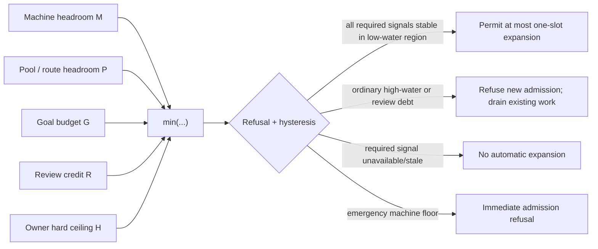
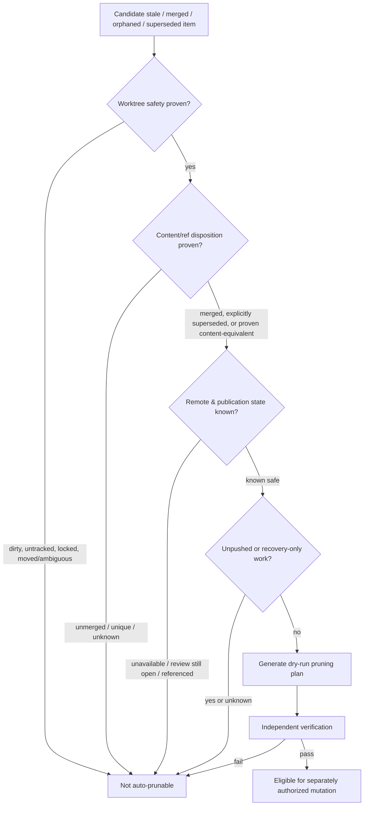

# DS-06 — Capacity Admission and Review Debt: Evidence-Backed Control Policy

## Executive summary

This report answers research lane R8: how Recursion v3 should bound new branches, linked worktrees, and concurrent ARM output using measured capacity while keeping **machine pressure distinct from human review debt**. The governing constraints are already fixed by the research brief: admission has the shape `min(machine_headroom, pool_headroom, goal_budget, review_credit, owner_hard_ceiling)`; expansion requires stable low-water conditions; high-water or emergency conditions refuse new work; review capacity cannot be inferred from machine size; unobservable counters remain `unavailable`; and the historical branch figure of 75 is not a v3 default. fileciteturn0file0

The central finding is that there is **no defensible single “number of branches/worktrees” capacity metric**. Branch creation itself is cheap relative to the work and review obligations attached to a branch. Git exposes useful structural state—worktree state, merge reachability, aggregate churn, commit divergence, and remote-tracking state—but Git does not expose “safe concurrency” or “review capacity.” Git also documents that `status` latency depends on worktree size, untracked-file enumeration, caching, and index behavior, making measured latency more useful than merely counting worktrees. citeturn17search0turn17search1

The recommended controller is therefore a **dual-domain adaptive credit controller**:

\[
A(t)=\min\{M(t),P(t),G(t),R(t),H\}
\]

where \(M\) is host machine headroom, \(P\) is route/pool headroom, \(G\) is remaining goal budget, \(R\) is review credit, and \(H\) is the owner-set hard ceiling. All terms are integer slot credits; no term should be replaced by a weighted average. A red review signal must therefore be able to stop admission even when machine resources are abundant, and vice versa. This preserves the accepted admission shape while making the limiting reason observable. fileciteturn0file0

For **machine pressure**, the best primary signals are not raw utilization alone but a combination of: measured Git/worktree latency; free disk and filesystem-object capacity; memory headroom; process/handle headroom; and contention/pressure signals. Linux PSI directly reports CPU, memory, and I/O stall time and supports per-cgroup accounting; cgroup v2 additionally exposes memory usage, PID counts, I/O limits, and pressure state. citeturn14search0turn16view0turn16view1turn16view2 On Windows, free storage is directly observable, per-process handle counts are observable, and Job Objects can expose and constrain process and memory usage when workers are actually assigned to jobs. citeturn19search0turn19search1turn19search8 Route-level measurements should be marked `unavailable`, rather than inferred from host-wide data, when no cgroup/Job Object or equivalent attribution boundary exists.

For **review debt**, the first implementation should avoid inventing subjective “review points.” The privacy-preserving core trace can consist of timestamps and aggregate counters only: review obligations opened, independently closed, current queue count, queue-age distribution, aggregate changed files/insertions/deletions, commits ahead, binary-change indicator, and integration-conflict events. Git can produce aggregate churn without needing to export diff text; by contrast, path-bearing output should remain local. citeturn10view2turn13search9turn13search14 Google’s industrial data confirms that code review consumes material author/reviewer time and that effort increases with review interaction, but Google’s absolute numbers are not transferable as Recursion thresholds. citeturn20search0

A service-rate trace should measure **completed independent-review obligations per elapsed time**, not reviewer identities or transcripts. Arrival rate \(\hat\lambda\), completion rate \(\hat\mu\), queue size \(Q\), and queue age together provide the minimum defensible review-capacity model. Little’s Law establishes \(L=\lambda W\) under its assumptions, making queue size, throughput, and waiting time mathematically linked in stable systems; it should be used here as a diagnostic relationship rather than blindly assumed to hold over a short, nonstationary development window. citeturn20search1

The key refusal condition is therefore not simply “there are too many branches.” It is: **do not automatically increase concurrency when review arrivals are persistently outrunning review completions and review backlog or age is worsening**, regardless of spare CPU/RAM. Conversely, review capacity being healthy cannot authorize expansion when machine pressure, route quota, goal budget, or the owner ceiling says no. Required signals that are stale or unavailable should block automatic expansion without being falsified into a numeric zero.

Hysteresis should be asymmetric. Normal high-water events stop **new admission and drain naturally** rather than killing existing work. Expansion occurs only after all required limiting signals have remained in their low-water region for an owner-configured dwell interval and should increase at most one slot per decision epoch. Emergency machine floors block admission immediately. This follows the brief’s required direction and mirrors the general control-system reason for stabilization windows: rapid metric fluctuation otherwise produces control flapping. fileciteturn0file0

Pruning requires a stricter safety model than Git’s notion of “merged.” Git 2.56.0 can establish that a branch tip is reachable from an upstream and provides additional safeguards around worktrees/upstreams, while `git worktree prune` specifically cleans administrative information for missing working trees. Neither fact establishes that a branch has no outstanding review, publication, reference, or recovery obligation. citeturn17search2turn18view4 Accordingly, **staleness is a triage signal, never deletion authority**. Automatic deletion should be limited to cases where content safety, worktree safety, reference safety, remote/publication safety, and independent verification are all proven. Unknown remote or review state must prevent automatic destructive pruning.

The recommended policy competes directly with a **simple owner-set fixed ceiling**. That simpler policy should win if controlled experiments show that adaptive signals do not predict overload/review debt, if adaptive decisions converge to essentially the same cap across machine and review regimes, or if the telemetry/control burden produces no material benefit. Conversely, adaptive admission is falsified if its apparent success merely moves work into a longer external queue: end-of-run backlog, age, and drain time must therefore be part of the comparison, not just active-concurrency metrics.

## Research method and evidence base

The investigation used the supplied synthetic/public DS-06 brief as the sole project-specific authority and did not access a repository, execute Git, inspect private source code, call a provider, or mutate any branch/worktree. fileciteturn0file0 Public evidence was prioritized in this order: current official Git documentation; Linux kernel and Microsoft platform documentation; original queueing theory; and primary empirical software-engineering research. Current Git manuals were checked against the September 28, 2026 Git 2.56.0 documentation where applicable. citeturn17search1turn17search2turn21search0

The empirical literature is used to establish **which kinds of measurements matter**, not to import workload constants from other organizations. For example, Google’s industrial review study demonstrates meaningful human review effort, while merge-conflict and code-review studies establish that review delay, change size, and integration conflict are meaningful dimensions of development work. Those sources do not establish a Recursion-specific concurrency threshold. citeturn20search0turn2search1turn2search13

The following claim table separates externally documented facts, directives supplied by the project brief, observations from this research session, and inferences that still require Recursion-local validation.

| Consequential claim | Pinned source / date | Classification | Confidence | Expiry trigger |
|---|---|---:|---:|---|
| Admission must preserve independent machine, pool, goal, review, and owner-ceiling credits; 75 is historical rather than a v3 constant. | DS-06, updated 2026-09-30. fileciteturn0file0 | Source-documented, project brief | High | Owner/constitutional decision explicitly changes |
| Worktree inventory can distinguish branch/detached, locked, and prunable state; porcelain output is intended for stable scripted parsing. | Git `git-worktree` 2.56.0, 2026-09-28. citeturn17search1turn18view0turn18view3 | Source-documented | High | Relevant Git semantics change |
| `git status` cost can increase in large worktrees, especially during untracked-file scans; background refresh may contend on the index lock. | Git `git-status`, last changed 2.53.0, 2026-02-02. citeturn17search0 | Source-documented | High | Git status/index implementation semantics change |
| Aggregate line/file churn is directly available; exact “changed bytes” is not equivalent to those Git diff statistics and should be adapter-derived if required. | Git `git-diff` 2.56.0, 2026-09-28. citeturn10view2turn13search9turn13search14 | Source-documented + inferred | High for Git behavior; medium for proposed adapter | Git adds a suitable portable byte-delta statistic, or adapter methodology changes |
| Commit timestamps on a branch tip are observable, but tip commit time is not proof of branch-creation time. | Git `git-for-each-ref`, last changed 2.54.0, 2026-04-20. citeturn21search4 | Source-documented + inferred | High | Git gains authoritative branch-creation metadata |
| Linux PSI directly measures CPU/memory/I/O stall pressure; cgroup v2 can expose resource usage and pressure at a workload grouping boundary. | Linux 6.18 docs; PSI document dated Apr. 2018. citeturn14search0turn15view0turn16view0turn16view2 | Source-documented | High | Kernel interface changes or route is not actually isolated in a cgroup |
| Linux cgroup v2 exposes current PID counts and PID ceilings. | Linux 6.18 cgroup-v2 docs. citeturn16view1 | Source-documented | High | Kernel/controller unavailable on target host |
| Windows can expose job-level memory/process accounting and limits when workload processes are associated with Job Objects; disk free bytes are separately observable. | Microsoft Win32 Job Object/File APIs, current pages accessed 2026-10-01. citeturn19search0turn19search1turn19search8turn19search11 | Source-documented | High | Windows API or runtime isolation model changes |
| Human review must be modeled as a capacity-constrained resource independent of machine resources. | Project requirement plus industrial review evidence. fileciteturn0file0 citeturn20search0 | Source-documented + inferred | High | Review ceases to be an independent acceptance requirement |
| Queue count, throughput, and mean waiting time are related by Little’s Law under its required limiting/stationary conditions; short development windows may violate those assumptions. | Little, *Operations Research* 9(3), 1961. citeturn20search1 | Source-documented + inferred application | High theorem; medium application | None for theorem; empirical behavior invalidates diagnostic use |
| Merge-conflict incidence is meaningful integration-debt evidence, but does not by itself define a safe branch limit. | Empirical merge-conflict research, 2021–2023. citeturn2search1turn2search14 | Source-documented + inferred | Medium-high | Local Recursion data show no predictive relation |
| “Fully merged” Git reachability is insufficient evidence that review/publication obligations have ended. | Git branch/fetch/worktree semantics plus project safety requirements. citeturn17search2turn21search0turn18view4 | Inferred | High | All publication/review state becomes provably encoded into the Git reachability model |
| Adaptive min-credit admission with separate review gating should outperform machine-only admission when machine capacity and review capacity diverge. | Synthesis of the project safety requirement, OS capacity evidence, queueing evidence, and review evidence. fileciteturn0file0 citeturn14search0turn20search0turn20search1 | Inferred; must be tested | Medium | Controlled experiment fails the falsification criteria below |
| No repository-local resource, branch, worktree, or review metric was measured in this research session. | Session scope and execution record | Locally observed | High | A later authorized measurement run is performed |

The most important limitation is consequently explicit: **this report determines a measurement contract and controller shape, not any numeric threshold**. Neither coordinator-small nor workstation was profiled in this session. Any statement about marginal per-ARM memory, disk, process, latency, or review cost therefore remains unverified until measured on those profiles.

## Findings: measurable machine and review signals

A useful signal must satisfy three tests: it is observable without exporting private code content; it corresponds to an independent failure/debt mode; and it can either bound slots or trigger an admission gate. Merely increasing the number of counters does not improve safety if several counters are proxies for the same phenomenon.

### Signal contract

| Signal | Unit | Scope | How it should be interpreted | Observability status |
|---|---:|---|---|---|
| Git status/index latency | elapsed time per measurement | Worktree, then profile aggregate | Direct symptom of repository/worktree operational cost; track distribution and trend rather than one sample. Git explicitly notes large-worktree/untracked scans can be slow and index refresh can create locking interactions. citeturn17search0 | **Measurable locally** on both profiles; not measured in this session |
| Worktree count/state | count plus categorical state | Host/repository | Inventory signal only; count does not imply capacity. Locked, detached and prunable states should be separately visible. citeturn18view0turn18view2 | **Measurable locally** |
| Aggregate changed files / inserted / deleted lines | files, lines | Branch/review obligation | Privacy-safer review-volume descriptors when exported only in aggregate. Git supports aggregate diff statistics; raw path-bearing output should remain local. citeturn10view2turn13search9 | **Measurable locally** |
| Exact changed-byte magnitude | bytes | Branch/review obligation | Optional change-volume feature; not interchangeable with line churn or Git object-store disk usage. | **Adapter-derived if implemented**; otherwise `unavailable` |
| Commits ahead/behind | commit count | Branch vs integration target | Useful divergence/integration-work signal; Git revision walking supports counts. citeturn21search2 | **Measurable locally** |
| Branch age | elapsed time | Branch | Should mean time since the platform admitted/created the work obligation, not simply age of the tip commit. | **Measurable only if authoritative admission/creation timestamp exists**; otherwise `unavailable` |
| Tip age | elapsed time | Branch | Age of the current tip commit; useful but semantically different from branch age. Git refs can expose commit date fields. citeturn21search4 | **Measurable locally** |
| Filesystem free bytes | bytes | Host/filesystem | Hard physical headroom and growth denominator. Windows directly exposes caller-available and total/free bytes. citeturn19search11 | **Measurable** |
| Filesystem-object/inode headroom | objects/inodes or adapter-specific equivalent | Host/filesystem | Independent exhaustion mode where supported; do not infer from byte capacity. | **Linux/filesystem adapter-dependent**; portable Windows value is `unavailable` unless a filesystem-specific adapter supplies an equivalent |
| Per-slot worktree disk growth | bytes/slot, bytes/time | Profile/route | Empirical marginal cost used to turn disk reserve into slot credit. Git object-disk usage may help attribute object-store growth but has different semantics from changed bytes. citeturn21search2 | **Must be profiled locally** |
| CPU pressure | stalled-time ratio/trend | Host or Linux cgroup route | Better overload symptom than CPU utilization alone when work is waiting for CPU. Linux PSI exposes recent stall percentages and cumulative stall time. citeturn14search0 | Linux **measurable**; Windows needs an adapter-specific substitute |
| Memory usage/headroom | bytes | Host/route | Reserve must include recovery/verification capacity; cgroup `memory.current` gives route usage when route placement exists. citeturn16view0 | **Measurable** at host; route-level only with isolation/accounting |
| Memory pressure | stalled-time ratio/trend | Linux host/cgroup | Identifies reclaim/contention effects not visible in simple allocation totals. citeturn14search0 | Linux **measurable**; otherwise adapter-dependent |
| I/O pressure | stalled-time ratio/trend | Linux host/cgroup | Detects contention even while nominal free disk remains large; cgroup v2 exposes `io.pressure`. citeturn16view2 | Linux **measurable** when PSI enabled |
| Route I/O quota/headroom | bytes/s, operations/s | Linux cgroup route | Pool-level capacity when configured: cgroup v2 `io.max` can specify read/write BPS and IOPS. citeturn16view3 | **Measurable only where such quota exists** |
| Process/TID count | count | Host/route | Independent exhaustion limit; cgroup v2 exposes current count and ceiling. citeturn16view1 | Linux route **measurable** with cgroup; otherwise host/adapter-specific |
| Open handles | count | Process/worker/host aggregation | Windows-specific resource-pressure signal; per-process handle count is observable through Win32. citeturn4search0 | Windows **measurable**; cross-platform semantics differ |
| Windows job memory/process state | bytes, count | Route/pool | Useful only when route workers are actually associated with the Job Object; otherwise it cannot honestly represent route capacity. citeturn19search0turn19search8 | **Conditional** |
| Open review obligations \(Q\) | count | Goal/owner queue | Primary debt inventory independent of machine state | **Measurable if review lifecycle events exist** |
| Review arrival rate \(\hat\lambda\) | obligations/time | Owner or goal | Creation rate of independent-review obligations; no code content or identity needed | **Modeled from content-free event timestamps** |
| Review service rate \(\hat\mu\) | completed obligations/time | Owner or goal | Empirical independent-review completion rate; use elapsed-time windows and retain sample confidence | **Modeled from content-free completion events** |
| Review queue age | time; distribution | Goal/owner queue | Detects starvation hidden by a stable raw queue count | **Measurable if obligation-open timestamp exists** |
| Review change-volume vector | aggregate files, lines, commits, optional bytes | Obligation/queue | Describes heterogeneous workload without publishing code/path content. Do not collapse to arbitrary weights before calibration. citeturn10view2turn20search0 | Mostly **measurable**; byte field optional |
| Integration-conflict events | conflicts/attempt and repeats/branch | Branch/goal | Direct integration-debt indicator; empirical research supports conflicts as a distinct source of merge effort, but no universal safe rate follows from that literature. citeturn2search1turn2search14 | **Measurable if integration attempts are instrumented** |
| Verification/build conflict events | failures/attempt | Branch/goal | Captures higher-level incompatibilities not equivalent to textual Git conflicts. | **Unavailable** whenever verification was not executed; never assume zero |
| Remote publication/review state | categorical | Branch | Required for destructive branch cleanup if externally published/reviewed | **Only measurable when an authoritative remote/review adapter exists; otherwise `unavailable`** |

Three distinctions matter particularly.

**Status latency should be measured, not predicted from branch count.** Git itself says `status` may become slow because of untracked-file enumeration and that caching can materially alter repeated runs; therefore two repositories with the same branch/worktree count can have very different operational cost. citeturn17search0 The relevant controller input is consequently a profile-specific latency distribution and its trend under concurrency, not a hardcoded “N worktrees = expensive” assertion.

**Exact changed bytes is not a native substitute for Git churn statistics.** Git can directly provide aggregate file/line statistics, while Git’s object `--disk-usage` measures bytes used by selected objects in object storage rather than logical changed bytes. citeturn21search2 If Recursion later needs exact logical byte change, it should be defined as an adapter-derived aggregate and should not export filenames, snippets, or per-file values. Until that metric exists, it remains `unavailable`; line/file churn remains a valid but different quantity.

**Branch age needs an authoritative lifecycle timestamp.** Git can expose commit dates, but a branch ref can move and its tip commit may predate or postdate the branch’s creation. citeturn21search4 Therefore “tip age” can be observed from Git, whereas “branch age” should come from a Recursion admission/creation event. If that lifecycle event has never been recorded, the correct branch-age value is `unavailable`, not a guessed timestamp.

### Privacy-preserving review trace

No source text, diff, path, transcript, reviewer identity, or prompt is required to model review service rate. A minimum event record can conceptually contain:

`{goal-token, obligation-token, opened-at, independently-closed-at?, outcome-class?, aggregate-files, aggregate-additions, aggregate-deletions, commits-ahead, binary-change-present?, conflict-event-count}`.

This is a proposed data contract rather than an implemented schema. The aggregate Git fields are available without exporting diff content, and empirical review evidence makes clear that review itself consumes nontrivial human effort. citeturn10view2turn20search0 The project’s privacy restriction further requires that public research never receive private code or transcripts. fileciteturn0file0

For a window \(T\),

\[
\hat\lambda_T=\frac{\text{review obligations opened in }T}{|T|}
\]

\[
\hat\mu_T=\frac{\text{independently closed review obligations in }T}{|T|}
\]

and \(Q(t)\) is the current number of open obligations. The trace should also retain oldest age and a configured tail-age statistic, because a stable queue count can conceal starvation when new items complete while old items remain. Little’s Law provides a reason to jointly inspect inventory, completion/arrival throughput, and wait, but its formal assumptions mean it should not be treated as an exact instantaneous control equation in a bursty, nonstationary development queue. citeturn20search1

Initially, `review_credit` should therefore use **raw queue/service signals rather than an invented weighted “review-unit” formula**. Only after enough local completed reviews exist should Recursion test whether aggregate churn, commit count, conflict history, or other privacy-safe features reliably predict review service time. Google’s results establish that review interaction and active effort can be related, but its ~60-minute average author shepherding measurement is organization-specific and must not be imported as a Recursion constant. citeturn20search0

## Admission policy candidates and control behavior

The policy should distinguish **credits** from **gates**. Credits answer “how many additional slots could this resource support?” Gates answer “is expansion permissible at all?” This prevents nonsensical arithmetic such as averaging severe I/O pressure with abundant RAM.

The accepted top-level function remains:

\[
\boxed{
A(t)=\min\left(M(t),P(t),G(t),R(t),H\right)
}
\]

with all five quantities evaluated independently. fileciteturn0file0

This is a synthesized control contract, not evidence for any numeric boundary. It implements the brief’s explicit min-credit and hysteresis requirements. fileciteturn0file0

### Machine credit

For resources that have both a reserve and an empirically measurable marginal per-slot cost, candidate slot credit can take the generic form

\[
C_r(t)
=
\left\lfloor
\frac{\text{usable headroom}_r(t)-\text{reserved capacity}_r}
{\widehat{\Delta r}_{slot}}
\right\rfloor_+
\]

where \(\widehat{\Delta r}_{slot}\) is an upper-tail estimate of observed marginal resource usage from adding one ARM/worktree under the profile being controlled. No quantile, reserve fraction, or window length is selected by this report.

Then:

\[
M(t)=
\min(
C_{\text{memory}},
C_{\text{disk}},
C_{\text{filesystem-objects}},
C_{\text{process}},
C_{\text{handles}},
\dots
)
\times G_{\text{pressure}}
\]

where `G_pressure` is effectively open/closed according to CPU, memory, and I/O pressure gates. Linux PSI is particularly valuable because it measures time actually lost to resource contention rather than merely reporting allocation totals. citeturn14search0

The critical empirical work is obtaining \(\widehat{\Delta r}_{slot}\) separately for **coordinator-small** and **workstation** profiles. Nothing in public Git/Linux/Windows documentation can supply those Recursion-specific values.

### Pool credit

`pool_headroom` is route-specific rather than host-wide. On Linux, a worker route assigned to a cgroup can be associated with memory, PID, I/O, and pressure counters; cgroup v2 explicitly exposes these controller interfaces. citeturn15view0turn16view0turn16view1turn16view2 On Windows, Job Objects can provide analogous process/job accounting if execution is actually contained in jobs. citeturn19search0turn19search8

A host having free memory does **not** make route/pool headroom observable. When processes cannot be attributed to the route, the route metric remains `unavailable`. Policy may fail closed for new automatic admissions because of that unknown, but its raw telemetry must still say `unavailable`; the controller must not rewrite “unknown” to measured zero.

### Review credit

A first defensible review controller is gate-dominant:

\[
R(t)=
\min(
R_{queue},
R_{rate},
R_{age},
R_{integration}
)
\]

where each component either produces empirically calibrated slot credit or refuses expansion.

`R_rate` should refuse additional discovery concurrency when the observed review-arrival rate persistently meets/exceeds service rate **and** backlog or age is worsening. This conjunction matters: short bursts where \(\hat\lambda>\hat\mu\) are not by themselves proof of instability, while sustained excess arrival with increasing inventory is direct evidence that generation is outrunning clearance. The queueing relationship between throughput, inventory, and waiting time supports tracking all three rather than a single raw count. citeturn20search1

`R_queue` compares current debt to an owner-calibrated high-water region; `R_age` prevents a constant queue size from concealing old neglected obligations; and `R_integration` responds to repeated integration conflicts that indicate growing divergence/integration debt. Empirical conflict research supports treating conflict occurrence as a separate integration-risk dimension rather than equating it with branch count. citeturn2search1turn2search14

No formula should initially multiply lines changed by a hand-selected coefficient and call the result “review hours.” Such a model can be introduced only after local completed-review data show stable predictive value and its calibration is independently reviewed.

### Signal disagreement matrix

| Machine domain | Review domain | Admission behavior | Rationale |
|---|---|---|---|
| Healthy | Healthy | After stable low-water dwell, permit **at most one** additional slot, still bounded by pool, goal budget and owner ceiling | Both independent bottleneck classes currently permit expansion; one-at-a-time expansion supplies a new observation before the next increment. fileciteturn0file0 |
| Healthy | High debt / worsening | **Refuse new discovery admission**; keep existing work progressing toward synthesis, integration and review | Large machines cannot make human review throughput larger merely by producing more branches. fileciteturn0file0 |
| High pressure | Healthy | **Refuse new admission**; preserve reserved verification/recovery capacity | Human capacity cannot compensate for imminent machine exhaustion; Linux pressure documentation explicitly frames pressure as a basis for dynamic load management. citeturn14search0 |
| High pressure | High debt | Refuse; prioritize drain/recovery, without treating either problem as the cause of the other | Two independent bottlenecks are active |
| Required machine metric `unavailable` | Healthy | No automatic expansion through the affected scope | Unknown resource safety is not positive headroom |
| Healthy | Required review state `unavailable` | No automatic review-credit expansion | Unknown review capacity is not an empty queue |
| Emergency machine floor | Any state | Immediate admission refusal | Required by lane policy; ordinary hysteresis must not delay an emergency. fileciteturn0file0 |
| Owner ceiling or goal budget exhausted | Any state | Refuse irrespective of telemetry | Those are explicit upper bounds, not measurements. fileciteturn0file0 |

Ordinary contraction should mean **reducing future permissible active concurrency**, not terminating an ARM, deleting a branch, or destroying a worktree. That distinction is essential because the lane authorizes admission-policy research but not destructive recovery behavior. fileciteturn0file0

### Hysteresis contract

A robust controller should have separate transition rules:

\[
\text{expand by one}
\iff
A(t)>\text{current slots}
\land
\text{all required signals stayed below low-water marks for dwell}
\]

\[
\text{refuse new work}
\iff
\text{any relevant signal reaches high-water}
\]

\[
\text{emergency refusal}
\iff
\text{any emergency floor is breached}
\]

No numerical water marks or dwell interval are set here. The low/high boundaries need to be learned from the two actual machine profiles and owner review behavior. The one-slot rule is especially useful because it turns an expansion into a small system-identification experiment: after one new slot, the controller can observe its marginal disk, latency, pressure, process, and review-arrival effect before permitting another.

Candidate approaches compare as follows:

| Policy | Strength | Failure mode | Assessment |
|---|---|---|---|
| **Dual-domain adaptive min-credit controller** | Responds independently to machine, route, goal and human-review bottlenecks; provides an explainable limiting term | More instrumentation and calibration; poor metrics could create unnecessary refusals | **Recommended for validation**, not yet proven |
| **Owner hard ceiling only** | Extremely simple, deterministic, easy to reason about | Cannot exploit different coordinator/workstation headroom and cannot react to changing review service rate below the ceiling | **Named primary competitor** |
| Static per-profile ceilings | Captures coordinator-small vs workstation differences with less runtime complexity | Still blind to review debt and workload-dependent resource cost | Credible fallback if adaptive machine signals add little value |
| Machine-only adaptive admission | Can use available hardware efficiently | Explicitly fails the safety requirement when review capacity is the bottleneck | Rejected under current owner direction. fileciteturn0file0 |
| Review-only throttle | Prevents review runaway | Ignores machine exhaustion and route constraints | Incomplete |
| Weighted score across all metrics | Compact single number | A strong healthy signal can mathematically compensate for an unsafe independent resource unless carefully hard-gated | Inferior to min-of-independent-credits for safety-critical limits |

## Safe pruning and operator-facing observability

Git makes an important distinction between **worktree administrative cleanup** and **branch/ref deletion**. `git worktree prune` removes worktree information for working trees that are missing; if a worktree has actually been moved, Git documents `repair` as the operation that reconnects its metadata. `worktree prune --dry-run` reports what would be removed without doing it, and locked worktrees are specifically protected from pruning. citeturn18view2turn18view3turn18view4

Git 2.56.0 also distinguishes branch reachability from arbitrary force deletion. Its branch documentation defines merged branches in terms of reachability and contains safeguards involving linked worktrees and tracked upstream relationships. citeturn17search2 These are useful primitives, but they cannot prove that an independently reviewed or externally published branch no longer has semantic obligations.

Similarly, remote-tracking state is not self-refreshing truth. `git fetch` updates remote-tracking refs, while pruning operates according to refspecs and can have non-obvious effects—particularly around tags and namespaces. citeturn21search0 A destructive policy therefore cannot infer “not published” merely because a stale local remote-tracking ref is absent.

The safe protocol should be viewed as a proof ladder:

The diagram deliberately stops at **eligibility**. This lane does not authorize deletion. fileciteturn0file0

### Pruning classification

| Candidate state | What it proves | Safe-policy treatment |
|---|---|---|
| Old branch | Only that some age metric is large | **Inspection priority only. Never sufficient for deletion.** |
| Old tip commit | Tip has not changed recently | Not equivalent to branch creation age; inspection only |
| Worktree marked prunable by Git | Its registered working tree appears missing under Git’s worktree metadata semantics. citeturn18view1turn18view4 | First distinguish genuinely abandoned from moved/recoverable; use repair semantics when appropriate |
| Locked worktree | Explicit protection exists. Git lock prevents normal pruning/removal behavior. citeturn18view2 | Automatic destructive action prohibited |
| Dirty/untracked worktree | Content exists outside a clean checked-out state; Git itself refuses ordinary removal of unclean worktrees without force. citeturn18view4 | Automatic destructive action prohibited |
| Fully merged branch | Tip is reachable from the comparison/upstream commit under Git semantics. citeturn17search2 | Necessary evidence for one deletion class, not sufficient proof of review/publication safety |
| Superseded branch | Platform/owner explicitly records a newer obligation replacing it | Eligible only after proving unique content/reference/publication obligations are gone |
| Content-identical branch | No unique intended content relative to retained successor/target under an approved equivalence definition | Potential candidate; equivalence definition and reference safety still require verification |
| Unpushed work | Local commits would be lost from the known remote publication path | Never auto-delete |
| Published review branch | External review/publication obligation exists or may exist | Preserve until authoritative external state says closed/withdrawn and other proofs pass |
| Remote state unavailable/stale | Nothing reliable about current publication state | Fail closed for destructive branch deletion |
| Repeated integration conflicts | Branch is increasingly costly/risky to integrate | Raise review/integration priority; **not** deletion authorization |
| Review-only work | Branch exists to support evidence/review rather than implementation | Explicitly protected by project rule. fileciteturn0file0 |

The strongest rule is that **age and conflict frequency affect priority, not entitlement to delete**. Repeated conflicts indicate integration debt; an old branch may be dangerous or valuable. Neither says its content is disposable.

### Read-only CLI concepts

The requested concepts can be given a behavioral contract without authorizing a CLI/schema implementation:

| Concept | Read-only result | Must not do |
|---|---|---|
| `recursion branch inventory` | Show branches/worktrees and categorized facts: current worktree state, lock/prunable state, authoritative branch age if known, tip age, aggregate churn, ahead/behind counts, remote freshness, review obligation state, conflict count, and every field’s `observed / modeled / unavailable` provenance | Write canonical state, refresh remote state invisibly, infer unavailable values as zero, or delete anything |
| `recursion branch explain` | Explain current admission decision: each credit, limiting term, relevant water-mark state, dwell status, unavailable/stale inputs, reserve reason, and owner/goal cap | Turn a view into an admission mutation or hide uncertainty |
| `recursion branch prune-safe` | Produce candidate classifications and evidence checklist; distinguish worktree-metadata cleanup from branch/ref deletion; show blockers; expose an equivalent of a dry-run plan | Force-delete, bypass locks, infer external review closure, or mutate merely because the view says “eligible” |

Git’s porcelain worktree format is explicitly intended to remain stable for scripted consumption, making it a suitable *source primitive* for an inventory adapter, though this report does not prescribe an implementation. citeturn18view3

An `explain` view should favor reason codes such as `review_rate_saturated`, `review_age_high`, `io_pressure_high`, `pool_accounting_unavailable`, `owner_ceiling`, `goal_budget`, or `stable_low_water_pending`. This is an inferred interface principle: it preserves the fact that the final admission count is the minimum of independent credits instead of presenting an opaque score.

## Validation plan, falsifiers, and research gaps

The adaptive policy is not accepted merely because it sounds more sophisticated. Its advantage over a fixed limit must be demonstrated under **the same owner ceiling and the same workload**, and the evaluation must distinguish true load control from simply moving work into an invisible queue.

### Adaptive-versus-fixed experiment

| Element | Pre-registered design |
|---|---|
| **Baseline** | A simple owner-set fixed concurrency ceiling \(H\), with no adaptive expansion above it. No number is selected by this report. |
| **Treatment** | The proposed adaptive controller, always capped by the same \(H\). |
| **Machine profiles** | Coordinator-small and workstation, measured separately rather than assuming proportional scaling. |
| **Input trace** | Identical synthetic/replayed content-free arrival trace for both policies: branch/work obligations, aggregate change-size vectors, review completions, and conflict events. No private source needs to leave the local test environment. |
| **Workload phases** | Include ordinary load; burst arrivals; machine-rich/review-poor conditions; machine-poor/review-rich conditions; disk/I/O pressure; and a conflict-heavy phase. |
| **Machine endpoints** | Git/status latency distribution, pressure excursions, free disk/object headroom, memory pressure/headroom, process/handle headroom, and emergency-floor events. |
| **Human-review endpoints** | Queue count, oldest/tail queue age, \(\hat\lambda/\hat\mu\) behavior, conflict incidence, independent-review completions, and post-arrival drain time. |
| **Productivity endpoint** | Independently accepted/closed obligations per elapsed experiment time, not merely ARM starts or branches created. |
| **Hidden-backlog check** | End-of-phase queue size, queue-age distribution, and time required to drain remaining review debt after new arrivals stop. |
| **Stopping rule** | Before execution, the owner specifies repetition count \(N\), meaningful-effect criterion, and analysis method. Execute every predefined phase under both policies on both profiles for those repetitions. Stop early only for a predefined safety-floor breach, correctness violation, or invalid/missing required measurement; such an early stop counts as an adverse result for the policy that caused it rather than disappearing from analysis. |
| **Decision rule** | Adaptive admission must improve at least one predeclared overload/review-latency outcome without violating the owner ceiling, worsening accepted-throughput beyond the preregistered tolerance, or leaving materially worse hidden backlog/drain debt. |

This baseline/workload/stopping-rule structure directly tests the question “does adaptation outperform a fixed cap?” without choosing a threshold in this research lane.

The **decisive falsifier** for the headline recommendation is:

> Reject adaptive admission in favor of the simpler owner-set ceiling if, across the controlled profiles and workload regimes, adaptive control produces no preregistered meaningful improvement in machine-safety or review-debt endpoints, or if its apparent improvement is explained by increased end-of-run backlog, queue age, or drain time.

A second strong falsifier is structural: if the adaptive controller repeatedly settles at effectively the same concurrency as a fixed ceiling across machine-rich, machine-poor, review-rich, and review-poor conditions, then its instrumentation and complexity are not earning their cost.

### What remains unknown

The largest evidence gap is **local marginal cost per ARM slot**. Public sources can tell us what Linux, Windows, and Git expose; they cannot tell us the coordinator-small or workstation marginal RAM, disk, handle, process, status-latency, I/O-pressure, or review-arrival increment. Those values remain unverified.

A second gap is the relationship between privacy-safe change descriptors and **actual Recursion review effort**. Existing industrial work shows that code review takes material human time and that review interaction correlates with effort, but external studies cannot validate a local model that predicts owner review time from changed files, lines, commits, or conflicts. citeturn20search0 Consequently, no review-effort weights are justified yet.

A third gap is branch lifecycle observability. Git tip dates are not authoritative branch-creation dates. Until a trustworthy lifecycle event is available, true branch age is `unavailable`; a tip-age proxy should remain explicitly labeled as such. citeturn21search4

A fourth gap is **route-level attribution on Windows and Linux deployments**. Linux cgroups and Windows Job Objects can provide workload-scoped accounting, but only when the execution topology actually uses those boundaries. citeturn15view0turn19search8 Host-wide counters cannot simply be re-labeled as route metrics.

A fifth gap concerns external review/publication state. Git fetch/refspec semantics describe refs, not every review system’s semantic state. citeturn21search0 Until an authoritative external adapter exists, “published review closed” is `unavailable`, and automatic destructive pruning of potentially published work must therefore remain blocked.

Finally, there is no public evidence that one universal low-water/high-water pair is correct for both target profiles or for all repositories. Git explicitly warns that even status performance has no single configuration optimal for everyone. citeturn17search0 This strongly supports calibration rather than inventing a v3 constant, but it does not itself prove that a fully adaptive controller will outperform a fixed ceiling.

## Recommendations and open Owner questions

The following recommendations are deliberately paired with a competing option, a decisive falsifier, and an explicit statement of what the recommendation does **not** prove, matching the evidence discipline in the supplied brief. fileciteturn0file0

| Priority | Recommendation | Named competing option | Decisive falsifier | What it does not prove |
|---|---|---|---|---|
| **Highest** | Validate the **dual-domain adaptive min-credit controller** with independent machine, pool, goal, review and owner-ceiling credits; no weighted averaging across bottlenecks. | **Fixed owner hard ceiling only** | Controlled experiment shows no meaningful safety/review benefit, or benefit is only hidden backlog; adaptive slot choice effectively collapses to the fixed cap across regimes | Does not prove any numeric ceiling, water mark, reserve or dwell interval |
| **Highest** | Make **review credit service-rate/queue/age aware**, initially without synthetic effort weights. Refuse automatic expansion when arrivals persistently outrun completions while debt/age worsens. | Branch-count-only review cap | Local data show service-rate/age signals have no incremental predictive value for review delay/conflict and branch count alone performs equivalently | Does not prove Little’s Law holds instantaneously or that each branch has equal effort |
| **Highest** | Treat `unavailable` as a first-class raw telemetry state and **fail closed for automatic expansion when a required safety input is unavailable or stale**. | Substitute zero/default estimates for missing counters | Measurements demonstrate a formally bounded, independently verified conservative estimator that never understates the relevant risk and materially improves availability | Does not prove unavailable means unsafe; it only means automatic positive credit is not evidenced |
| **High** | Profile marginal per-slot machine cost separately on coordinator-small and workstation and derive slot credits from measured headroom plus reserved synthesis/verification/recovery capacity. | Static per-profile concurrency caps | Marginal-cost telemetry is unstable/nonpredictive and static per-profile limits yield equivalent safety/performance with lower operational complexity | Does not prove resource use scales linearly with slots |
| **High** | Use **pressure as a gate** alongside quantity-based capacity, especially Linux PSI for CPU/memory/I/O where available. | Resource totals/utilization only | Pressure adds no predictive signal for latency/overload after controlling for resource totals in target workloads | Does not establish Windows equivalents or any PSI threshold |
| **High** | Make **branch age an authoritative lifecycle metric** only when a platform admission/creation timestamp exists; otherwise show branch age as `unavailable` and keep Git tip age separate. | Approximate branch age from tip commit timestamp | A Git-supported authoritative branch-creation primitive becomes available and is shown to match lifecycle semantics | Does not require a schema change in this research session |
| **High** | Treat conflict rate/repeated conflicts as a **review/integration-debt gate or prioritization signal**, never as automatic deletion authority. | Ignore conflicts until final merge | Local conflict history fails to predict integration delay/rework and adds no useful control information | Does not prove a conflict count threshold or that every conflict has equal severity |
| **Highest for pruning** | Require layered proof before automatic pruning: clean/unlocked worktree state, disposition of unique content, known remote/publication state, no unpushed/review-only obligation, dry-run plan, and independent verification. | Delete any branch Git identifies as merged or old | An authoritative system proves that every protected semantic obligation is completely represented by Git reachability alone | Does not authorize any actual deletion or establish retention periods |
| **High for observability** | Make inventory/explain/prune-safe concepts **read-only views of canonical facts and provenance**, including limiting credit and `unavailable` inputs. | Views that opportunistically repair/write canonical state | Read-only separation creates demonstrable consistency problems that cannot be solved through transactional mutation commands outside the view path | Does not authorize a CLI/schema change |
| **Exit criterion** | Delete the adaptive policy and keep the **simpler owner-set hard ceiling** if adaptation does not materially outperform it after calibrated testing. | Retain adaptation because it is theoretically richer | The adaptive experiment shows robust improvement across divergent machine/review conditions without hidden debt and with acceptable complexity | Does not imply a fixed cap is universally optimal; only that the tested adaptive machinery failed to earn its complexity |

The remaining **Owner decisions** are policy choices rather than facts that this research can select:

| Open Owner question | Why evidence cannot decide it alone |
|---|---|
| What is the hard ceiling \(H\)? | It is an owner governance boundary by explicit project direction; the historical 75 must not be promoted to v3 default. fileciteturn0file0 |
| What machine reserves must always be held for synthesis, verification and recovery? | Their size depends on actual Recursion workloads and the owner’s risk tolerance; neither public OS docs nor this session measured the profiles |
| Which machine/review signals are mandatory versus advisory for automatic expansion? | Platform availability differs by OS/route; the policy must decide where missing telemetry should prevent adaptation |
| Which review queue-age statistic and high/low boundaries represent unacceptable review debt? | Requires local service-rate/debt traces plus an owner service objective |
| What dwell interval and experiment observation epoch are acceptable? | Control stability must be traded against responsiveness using measured dynamics; no universal interval is evidenced |
| Is content-free exact changed-byte aggregation worth adding beyond line/file churn? | Its incremental predictive value for review or disk risk is unmeasured |
| Which external publication/review systems must be authoritative prerequisites for pruning? | Depends on Recursion’s actual integration surface and owner definition of “published/referenced” |
| When adaptive admission fails validation, should the fallback be one global owner ceiling or static per-profile ceilings below that ceiling? | Requires experiment results showing whether coordinator/workstation differences remain materially useful |

**Suggested next steps within the lane’s non-mutating boundary** are therefore ordered by information value: first, define a synthetic measurement protocol that captures one-slot marginal cost on both target profiles; second, obtain a content-free review arrival/completion/age trace; third, run the fixed-versus-adaptive crossover experiment above; fourth, calibrate low/high-water regions only from those measurements; and fifth, test the pruning proof ladder on synthetic branch/worktree inventories, including deliberately missing remote/review state. These are proposed research/validation activities, not implementation or authorization to mutate Git state.

The completion gate is satisfied as far as a public research-only session can satisfy it:

| Completion-gate item | Status |
|---|---|
| Primary sources pinned by version/date; structural project claims separated from public evidence | **Met.** Git 2.56.0/other specific manual revisions, Linux 6.18 docs, Microsoft API docs and original papers are distinguished from DS-06 directives. citeturn17search1turn17search2turn15view0turn20search1 |
| Every machine/review signal observable or explicitly `unavailable` | **Met in the proposed contract.** Conditional route-level and lifecycle metrics remain explicitly unavailable where attribution/data does not exist |
| Every recommendation names a competing option and decisive falsifier | **Met** in the recommendation table |
| Adaptive-vs-fixed baseline, workload and stopping rule specified | **Met**; owner-selected \(N\) and meaningful-effect criterion remain deliberately unspecified numerically |
| No owner decision reopened; no number promoted to default | **Met.** No hard ceiling, watermark, dwell interval, reserve, or concurrency count has been selected. fileciteturn0file0 |
| Protected paths and Git state untouched | **Met.** No Git command, repository connector, provider operation, branch/worktree mutation, deletion, merge, deployment, or configuration change was performed |
| Privacy/secret boundary | **Met by source scope.** Only the supplied synthetic/public brief and public sources were analyzed; no private repository, transcript, credential, host/account identifier, or secret-bearing source was accessed. No claim is made that an unrelated private repository was scanned |
| Report distinguishes locally measurable from modeled signals | **Met.** The signal table identifies directly measurable, conditional, adapter-derived, modeled and unavailable quantities |
| Actual local profile measurements obtained | **Not performed by design.** The brief prohibits repository/Git implementation work; therefore all coordinator-small/workstation threshold values remain unverified and no fabricated values are supplied |

The resulting construction contract is consequently narrow but testable: **admission is limited by the minimum independent credit; review debt is a first-class capacity domain; unknown stays unknown; expansion is one slot after stable low-water evidence; any high-water refuses new admission, emergency floors refuse immediately; staleness prioritizes review but never authorizes deletion; and adaptive policy survives only if it demonstrably beats the simpler fixed-ceiling competitor without concealing a growing backlog.** fileciteturn0file0