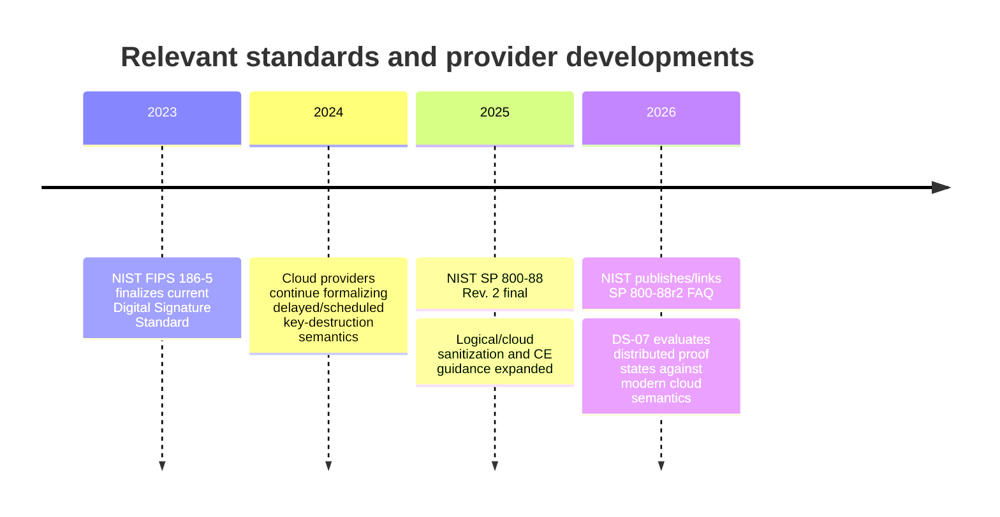
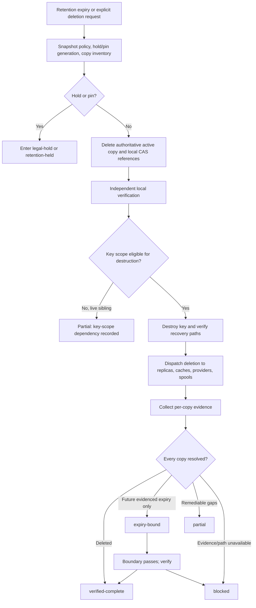

# DS-07 — Privacy-Preserving Retention and Deletion

## Executive summary

The central finding is that Recursion should treat deletion as an **evidence-backed distributed protocol**, not as a successful `DELETE` call and not as synonymous with cryptographic erasure. The ratified direction remains intact: raw private artifacts expire under scoped encryption; blobs and applicable keys are deleted; deletion propagates through replicas, caches, backups, provider-held copies, and disconnected spools; and a minimal signed non-sensitive tombstone preserves durable lineage. The Owner-selected retention defaults—30 days for successful raw sessions, 90 days for failed or disputed raw sessions, policy-governed durable metadata, and explicit pinning—are inputs to this lane rather than decisions to reopen. fileciteturn0file0

NIST SP 800-88 Rev. 2, finalized in September 2025, materially strengthens this design direction. It explicitly accommodates logical storage and cloud environments, gives cryptographic erase a larger role, and emphasizes verification and validation rather than merely invoking a sanitization operation. NIST also warns that cryptographic erase should not be trusted as disposal of backed-up or escrowed copies unless the organization has high confidence about where all relevant keys are stored and managed; all copies of target keys must be accounted for. citeturn16search0turn16search3turn11view2

That distinction is visible in real provider semantics. Google Cloud KMS can mark a key version `DESTROYED` when logical removal from active systems has begun while key material may remain in Google systems for up to 45 days from scheduled destruction; AWS says deletion of KMS-backed CloudHSM material is best effort and does not delete material from CloudHSM backups; Azure Key Vault says a restored key backup is independent of the original and is unaffected by deleting or purging the original. These examples make a provider status an important piece of evidence, but not a universal proof that every recoverable copy is gone. citeturn15search0turn15search1turn15search14

The recommended contract therefore has five core properties:

| Contract property | Recommended interpretation |
|---|---|
| **Completion is derived, never asserted** | `verified-complete` is computed only when every enumerated recoverable copy has satisfactory evidence and every relevant recovery path for the scoped key is resolved. |
| **Unexpired backups are visible states** | A recoverable backup that cannot yet be physically purged produces `expiry-bound`, with a source-pinned boundary, not `verified-complete`. |
| **Disconnected copies fail closed** | An offline spool or node remains unresolved until it provides acceptable evidence after reconnection or is covered by a separately justified, non-bypassable destruction/expiry mechanism. Mere silence is not evidence. |
| **Key scope cannot cross incompatible deletion fates silently** | If two artifacts protected by one key can have different expiry, pin, or legal-hold outcomes, cryptographic erasure of one cannot be claimed while that shared key remains required by the other. |
| **Audit lineage is separate from content identity** | Tombstones use opaque non-content-derived identifiers and signed structured data; they do not retain raw content, global plaintext/ciphertext digests, paths, exact size unnecessarily, or key/account identifiers. |

The decisive architectural invariant is:

> **No component may emit `verified-complete` while any enumerated recoverable copy is present, any expected copy class is unaccounted for, any applicable key recovery path is unresolved, or any unresolved copy lacks a recorded and evidence-backed expiry boundary.**

Cryptographic erasure remains **defense in depth rather than proof of universal physical disappearance**. NIST defines key destruction in terms of removing all traces so that the key cannot be recovered physically or electronically, but cloud and backup architectures make establishing that predicate a system-level evidence problem rather than something implied by a single API response. citeturn18search2turn11view2

The principal design tension is key granularity. Project- or retention-class-scoped keys—the ratified direction—reduce key cardinality and can align naturally with policy. They do **not**, by themselves, permit independent cryptographic erasure of one artifact whose siblings still require the same key. Project/retention-class plus bounded epochs can reduce that mismatch, while per-artifact keys maximize deletion isolation at substantially greater key/metadata operational cost. This report does **not** promote a new default. Instead, it recommends a falsifiable rule: **a key scope may contain only artifacts whose cryptographic deletion fate can legitimately remain coupled for the duration of that scope**. If product requirements demand earlier independent cryptographic erasure, the shared scope fails its acceptance test and must be escalated to the Owner rather than papered over with a stronger deletion claim.

Cross-scope content deduplication deserves equal caution. Research on cross-user deduplication has long shown membership/privacy side channels, while message-locked/convergent encryption trades conventional randomized encryption for deduplication and is inherently vulnerable to guessing attacks on low-entropy or known candidate content. citeturn17search7turn17search8 The safe contract is therefore to distinguish **artifact identity**, **storage address**, **encryption/key scope**, and **deletion ownership**; a global content digest should not serve simultaneously as all four.

Finally, a signed tombstone proves that an authorized component made a particular, integrity-protected deletion-state assertion. FIPS 186-5 describes digital signatures as mechanisms for detecting modification and authenticating a signatory; they do **not** prove that storage actually disappeared. An append-only Merkle log can add consistency and inclusion evidence, but similarly proves logging behavior rather than deletion itself. citeturn17search0turn18search0

## Scope, evidence baseline, and recent developments

This research treats the supplied DS-07 brief as authoritative for Recursion-specific decisions. It does not reopen `OR-009`, retention durations, the Hermes constitution, or the Owner/legal authority over legal hold. It performed no encryption, deletion, KMS operation, deployment, repository mutation, provider configuration, spending, or publication. No real keys, raw artifacts, content digests, credentials, account identifiers, or private project identities are included below. fileciteturn0file0

### Working definitions

For this lane, several terms need deliberately narrower meanings than everyday usage.

**Deletion** is the policy-directed process of making a raw artifact unavailable and ultimately eliminating recoverable copies according to the applicable contract. A successful logical unlink is one step, not necessarily completion.

**Cryptographic erasure** means making encrypted target data infeasible to recover by sanitizing the necessary cryptographic key material under conditions where the encryption boundary has actually contained the target data. NIST SP 800-88 Rev. 2 treats CE as a purge technique but places conditions on its use and separately addresses backed-up, escrowed, and external key material. citeturn16search3turn11view2

**Key destruction** is stronger than “the API no longer returns the key.” NIST's glossary, sourced to SP 800-57 Part 1 Rev. 5, defines it as removing all traces so the key cannot be recovered physically or electronically. citeturn18search2

**Deletion evidence** is an observation relevant to a deletion predicate: an authoritative provider event, independent readback, replica inventory result, expiry-policy record, or comparable artifact.

**Deletion proof**, in the Recursion contract, should mean a *structured body of evidence sufficient for the claimed proof state*. It must not imply a mathematical proof that every physical bit is absent from every medium.

**Independent evidence** means evidence from a different observation path than the command that requested deletion. The strength varies: a second local read path is weaker than a provider audit event plus state query; both are weaker than an independently attested physical process. The brief's rule that an implementer's own PASS is never acceptance makes this separation especially important. fileciteturn0file0

### Recent standards trajectory

The last several years have moved authoritative guidance toward the exact problem DS-07 is addressing: logical/cloud deletion, auditable validation, and durable evidence.

FIPS 186-5 was finalized in February 2023 and specifies digital-signature mechanisms for authenticating signatories and detecting modification. NIST finalized SP 800-88 Rev. 2 in September 2025, shifting emphasis toward enterprise sanitization programs, logical sanitization, validation, vendor trust, and expanded cryptographic-erasure guidance; NIST's publication page added an SP 800-88r2 FAQ planning note in July 2026. citeturn17search1turn16search0turn16search3

The practical lesson is not that Recursion should copy any one cloud provider. It is that **provider deletion states are provider-specific abstractions with materially different recovery semantics**, so the provider adapter needs to translate them into Recursion evidence rather than equate a vendor state name with `verified-complete`. Google, AWS, and Azure supply useful counterexamples to that equivalence. citeturn15search0turn15search1turn15search14

### Source-pinned claim table

“Expiry trigger” below means the condition requiring the claim to be revalidated, not the artifact-retention deadline.

| Consequential claim | Source and version/date | Classification | Confidence | Expiry / recheck trigger |
|---|---|---|---|---|
| Successful raw sessions are 30 days; failed/disputed raw sessions 90 days; durable lineage is indefinite/project-policy governed; pinning and project overrides remain Owner-selected. | DS-07 brief, 2026-09-30. fileciteturn0file0 | Source-documented | High | Owner amendment only |
| Deletion may not be reported complete while a recoverable copy lacks evidence or a recorded expiry boundary. | DS-07 completion gate. fileciteturn0file0 | Source-documented | High | Owner/constitutional amendment |
| NIST SP 800-88r2 is the current final NIST media-sanitization publication and explicitly incorporates logical/cloud sanitization concerns. | NIST SP 800-88r2, Sep. 2025. citeturn16search0turn16search3 | Source-documented | High | New NIST revision/erratum |
| CE should not be treated as automatically resolving backed-up or escrowed key/data copies; recovery sources require separate consideration. | NIST SP 800-88r2 CE guidance. citeturn11view2turn12view0 | Source-documented | High | New NIST revision |
| A logical operation against an external KMS can lack visibility into key copies, escrow, or backup recovery paths. | NIST SP 800-88r2. citeturn11view2 | Source-documented | High | New NIST revision/provider contract |
| An OS keystore API success, by itself, is insufficient to establish the NIST key-destruction predicate unless the underlying key provider supplies stronger evidence about zeroization and recovery copies. | Derived from NIST key-destruction definition and SP 800-88 validation requirements. citeturn18search2turn16search3 | Inferred | Medium-high | Platform provides complete independently verifiable zeroization semantics |
| Google Cloud KMS `DESTROYED` begins logical removal from active systems; key material may remain in Google systems for up to 45 days from scheduled destruction. | Google Cloud KMS documentation, current retrieval 2026. citeturn15search0turn15search10 | Source-documented | High | Provider documentation/API change |
| AWS CloudHSM-backed KMS deletion is best effort against the cluster and does not itself delete material from cluster backups. | AWS KMS/CloudHSM documentation, current retrieval 2026. citeturn15search1turn15search5 | Source-documented | High | Provider documentation/API change |
| A restored Azure Key Vault key backup is independent of the original; deleting/purging the original does not invalidate restored copies or the pre-existing backup blob. | Microsoft Azure Key Vault documentation, current retrieval 2026. citeturn15search14 | Source-documented | High | Provider documentation/API change |
| Cross-user/global deduplication can leak whether content is already present; deterministic/message-locked encryption also creates known-content guessing exposure. | IBM Research 2010; USENIX Security 2013. citeturn17search7turn17search8 | Source-documented | High | Threat model/storage primitive materially changes |
| A signed tombstone authenticates and integrity-protects an assertion; it does not itself prove physical deletion. | FIPS 186-5 plus inference about scope of signatures. citeturn17search0 | Source-documented + inferred | High | Signature/audit architecture changes |
| An append-only Merkle structure can prove inclusion and consistency of an audit log but still relies on assumptions about log behavior and does not prove deletion of the referenced object. | RFC 9162. citeturn18search0 | Source-documented + inferred | High | Audit architecture changes |
| A generic, vendor-independent way to prove physical destruction of key material on an arbitrary disconnected OS node is not established by the reviewed public standards. | Evidence gap after NIST/provider review. | Unverified / unavailable | High that evidence is unavailable | Concrete platform/HSM design selected |

The last row is intentionally **not** converted into a positive assumption. “Unknown” or “unavailable” must stay distinct from “zero recoverable copies.”

## Deletion contract and proof-state machine

### The state machine should describe evidence, not intent

The supplied state sequence is a sound starting point:

`requested -> local-content-deleted -> key-destroyed -> propagation-pending -> verified-complete | partial | blocked | legal-hold | expiry-bound`

The important refinement is that the global state should be **derived from a copy ledger and key ledger**. Otherwise, a component can advance the state based on its own local success while a backup, offline spool, cache, or key recovery path remains unresolved.

A second refinement is needed around shared keys. `key-destroyed` is only a truthful artifact-level state when the key's destruction unit is compatible with that artifact's deletion unit. If live siblings still require the same key, then key destruction has *not* occurred for the target; that fact must remain visible instead of being treated as equivalent to successful cryptographic erasure.

A third refinement is that legal hold and ordinary pin/retention override are semantically different. Both prevent destructive progress, but a legal hold has separate authority and compliance implications. The system should not silently encode a user pin as “legal hold,” nor vice versa. GDPR itself illustrates why deletion systems must admit exceptions and competing legal duties: Article 17 establishes erasure rights under specified grounds while also containing exceptions, including where processing is necessary for legal claims. This is a legal-design reason to represent holds explicitly, not legal advice about any particular Recursion deployment. citeturn16search5turn16search6

A proposed evidence-oriented machine is:

```mermaid
stateDiagram-v2
    [*] --> requested

    requested --> legal_hold : authoritative legal hold active
    requested --> retention_held : pin / policy override active
    legal_hold --> requested : authorized hold release
    retention_held --> requested : pin / override released

    requested --> local_content_deleted : authoritative local content predicate satisfied
    requested --> blocked : local deletion cannot proceed

    local_content_deleted --> key_destroyed : applicable key scope closed + destruction evidenced
    local_content_deleted --> partial : key still required by live artifacts in same scope
    local_content_deleted --> blocked : required key evidence unavailable

    key_destroyed --> propagation_pending : residual copy classes enumerated

    propagation_pending --> verified_complete : all recoverable copies evidenced deleted
    propagation_pending --> expiry_bound : only unresolved copies have evidenced future expiry
    propagation_pending --> partial : mixed evidence; remediation still possible
    propagation_pending --> blocked : evidence or deletion path unavailable

    expiry_bound --> verified_complete : all boundaries passed + required verification
    expiry_bound --> blocked : copy survives boundary or boundary cannot be verified
    partial --> propagation_pending : missing work/evidence resolved
    blocked --> propagation_pending : blocker resolved
```

`retention_held` is the only new top-level state proposed here. If schema stability is more important than semantic clarity, it can instead be represented as `blocked(reason=retention-override)`, but that competing representation should not obscure that the condition is expected policy, not a deletion failure.

### Observable predicates for every state

| State | Observable predicate | What does **not** satisfy it |
|---|---|---|
| `requested` | Durable request exists with opaque request ID, artifact/deletion-unit class, policy/version snapshot, request time, hold/pin generation, and initial copy inventory. | An in-memory job or log line only. |
| `legal-hold` | Current authoritative legal-hold record covers the deletion unit and has a traceable authority/version. | A generic “do not delete” flag with unknown provenance. |
| `retention-held` | Pin or policy override is active and versioned. | Failure to run the deleter. |
| `local-content-deleted` | Authoritative active-store object/reference is absent; local CAS references are reconciled; a readback/inventory path independent of the deletion call sees no locally recoverable target copy. | HTTP/API success from the deleter alone; a logical tombstone hiding still-readable versions. |
| `key-destroyed` | The applicable key scope has no remaining live dependency and target key material has reached the provider/platform's terminal destruction predicate, with evidence covering known recovery copies. NIST's standard for “key destruction” is nonrecoverability of all traces. citeturn18search2 | “Disabled,” “scheduled for deletion,” “pending deletion,” inaccessible because of a network failure, or deletion of metadata while recoverable key backup remains. Provider counterexamples demonstrate the distinction. citeturn15search0turn15search1turn15search14 |
| `propagation-pending` | Copy ledger is closed over all expected copy classes and at least one residual deletion/evidence action remains in progress. | “We assume caches/backups expire.” |
| `expiry-bound` | Every unresolved copy has a documented, source-backed, non-silently-renewed maximum recovery boundary, recorded with calculation basis and evidence. No other copy is unaccounted for. | A guessed TTL, an undocumented “eventual” provider promise, or an automatically moved deadline. |
| `partial` | At least one deletion predicate is proven and at least one is unresolved; remaining remediation/evidence work is identified. | Treating absence of telemetry as deletion. |
| `blocked` | Required progress or evidence is unavailable and cannot continue without external remediation, authority, provider capability, or new information. | Converting the unknown to success after a timeout. |
| `verified-complete` | Universal predicate over the deletion ledger succeeds: every enumerated recoverable copy is independently evidenced gone, all applicable key recovery paths are resolved, no hold/pin blocks deletion, and no unexpired boundary remains. | Merely reaching the last step in a workflow; a signed tombstone by itself; CE by itself. |

This interpretation tracks NIST's distinction between carrying out a sanitization technique and verifying/validating the result. NIST's 2025 revision specifically increased emphasis on validation and on trust in vendor sanitization implementations. citeturn16search1turn16search3

### Copy-ledger contract

Every deletion request should enumerate the copy classes named in the brief even when the answer is “none,” “unavailable,” or “not applicable.” An omitted class is not equivalent to an empty class.

| Copy class | Minimum evidence to close it | When evidence is unavailable | Stop condition |
|---|---|---|---|
| **Active store** | Deletion receipt plus independent authoritative lookup/inventory showing target data and recoverable versions absent. | `blocked` or `partial`. | Never complete on command acknowledgment alone. |
| **CAS replicas** | Replica membership inventory, reference reconciliation, deletion result per recoverable replica, and post-delete verification. | `partial`; `blocked` if inventory itself is unavailable. | Shared physical blob/reference must not be reported deleted if another scope still owns a recoverable copy. |
| **Caches** | Invalidation/eviction evidence plus a bounded cache lifecycle and protection against refill from an expired origin. | `expiry-bound` only if maximum retention is authoritative and non-bypassable; otherwise `partial/blocked`. | A cache that can resurrect the artifact blocks completion. |
| **Backups** | Identification of the latest backup that could contain artifact **and key material**, lifecycle policy/version, immutable latest recovery time, and later boundary verification; direct purge evidence where available. | `expiry-bound` if the boundary is credible; otherwise `blocked`. | An unexpired recoverable backup cannot coexist with `verified-complete`. |
| **Provider-side copies** | Provider terminal state plus authoritative audit evidence and documented residual-copy semantics. | `blocked` when provider semantics are unknown; `expiry-bound` when the provider documents a maximum residual period. | Vendor state names must be translated rather than trusted lexically. |
| **Disconnected spools/nodes** | After reconnection, signed local deletion receipt plus independent reconciliation showing expired material was deleted before ordinary synchronization; or separate attestation of permanent decommission/destruction. | `partial` or `blocked`; exceptionally `expiry-bound` only for a separately evidenced non-bypassable local expiration mechanism. | Offline silence is never deletion proof, and an expired spool must never upload the expired artifact on reconnect. |

NIST explicitly notes that external KMS arrangements can place target-key storage and recovery sources outside the visibility of the information-storage medium itself. AWS's documented custom-key-store behavior provides a concrete example: key material can remain in a disconnected CloudHSM or its backups after the KMS-side deletion process. citeturn11view2turn15search1

### Backup-expiry boundaries

A backup boundary should be an auditable fact, not a calculated promise that silently drifts. Each boundary record should contain:

| Field | Purpose |
|---|---|
| `copy_class` | `backup`, `provider-residual`, `cache`, etc. |
| `opaque_copy_set_id` | Locally meaningful random identifier, not an account/storage path exposed in the tombstone. |
| `policy_id` / `policy_version` | Exact lifecycle basis. |
| `latest_possible_containing_snapshot_time` | Establishes which backup generations could contain the target. |
| `expiry_boundary_time` | Latest time the copy is supposed to remain recoverable. |
| `calculation_basis` | Provider guarantee, configured immutable lifecycle, physical rotation schedule, etc. |
| `evidence_ref` | Reference to provider policy/audit evidence, separate from raw data. |
| `observed_at` | Freshness of the evidence. |
| `post_boundary_verification` | Pending / passed / failed / unavailable. |

Provider documentation shows why the boundary has to be specific. Google Cloud KMS commits to removing destroyed key material from its infrastructure on a documented timeline, while AWS CloudHSM backups can preserve otherwise deleted backing material and Azure backups/restores can produce independent usable key copies. citeturn15search0turn15search5turn15search14

If a copy outlives its recorded boundary, **do not roll the date forward and preserve the appearance of success**. The deletion must leave `expiry-bound`, enter `blocked` or `partial`, record the boundary violation as new durable evidence, and require a newly justified disposition. This is an inferred control designed to make the state machine falsifiable.

### KMS, OS store, and disconnected-node evidence levels

A useful evidence hierarchy is:

| Key location | Strongest reasonably available evidence | Residual uncertainty |
|---|---|---|
| Managed KMS | Terminal key-version state, separately retrieved audit event, documented deletion semantics, inventory of backups/import/export/external-key recovery paths, and negative use test in a healthy test path. | Provider internal physical process remains dependent on provider assurance. |
| HSM/custom KMS | All of the above plus backing-HSM key deletion status and backup inventory. | Backups, disconnected HSMs, and external key stores can escape KMS deletion. AWS documents all three failure modes. citeturn15search1turn15search2 |
| OS/platform keystore | Delete/zeroize operation result, independent enumeration/readback, platform/HSM documentation concerning zeroization, and evidence concerning backups or exported key blobs. | In a vendor-neutral design there is no universal proof that all physical traces are gone. NIST's stronger definition therefore remains `unavailable` unless the adapter can meet it. citeturn18search2 |
| Disconnected node | Locally signed deletion receipt after reconnection, boot/session identity, monotonic policy generation, inventory reconciliation, and independent control-plane acceptance. | No contemporaneous remote evidence exists while the node is offline. |

A negative decryption attempt by itself is **weak evidence** because the same result can be caused by lost network access, IAM failure, a disabled key, or a broken service. It becomes useful only when paired with a healthy control operation and an error classification proving that the tested key itself is irrecoverably unavailable. This is an inference from the distinction between inaccessibility and NIST's stronger key-destruction definition. citeturn18search2

## Key granularity, content addressing, and copy propagation

### Key-granularity alternatives

No mechanism below is promoted to a Recursion default. The fixed Owner direction permits project- or retention-class-scoped encryption; this table establishes when those scopes are or are not defensible and identifies the alternatives that would require an Owner-level design change. fileciteturn0file0

| Key scheme | Deletion isolation | Operational/key cost | Dedup interaction | Principal tradeoff | Decisive falsifier |
|---|---|---:|---|---|---|
| **Per project** | Low within project | Lowest | Easiest to share storage inside project | Simple lifecycle, but one key couples every encrypted artifact in the project. | Any requirement for cryptographic erasure of one artifact while another artifact under that project key must remain decryptable. |
| **Per project × retention class** | Medium | Low–medium | Dedup can remain scope-local | Aligns key fate with broad 30/90/pinned classes, but items within a class still have staggered creation/expiry and hold states. | A same-class artifact must be erased cryptographically before a live sibling or legal-held sibling using the same key. |
| **Project/retention class × bounded epoch** | Tunable | Medium | Dedup possible only within a narrower window if deterministic mechanisms are used | Bounds blast radius and maximum shared-key lifetime but introduces epoch rollover and potential migration/hold complexity. | Required deletion latency is shorter than the selected epoch, or late holds make safe epoch closure impractical. |
| **Per artifact** | Highest | Highest key/metadata cardinality | Randomized per-artifact encryption normally sacrifices ciphertext-level global dedup | Simple reasoning about cryptographic erasure of an individual artifact. | Measured key-object/API/latency/storage overhead exceeds product constraints or the Owner rejects the change from ratified scope. |
| **Per-artifact DEK wrapped by scope KEK** | High if every wrapped-DEK copy is controlled | High complexity, potentially lower KMS object count | Can separate key-management scaling from artifact encryption | Individual deletion requires eliminating every recoverable wrapped DEK; backup copies of wrapped keys become part of deletion proof. | Wrapped-DEK copies cannot be enumerated through backups/replicas or operational complexity exceeds acceptable assurance. |

The key invariant is more important than any row:

> **A shared key is permissible only where sharing the key's cryptographic deletion fate is also permissible.**

A project/retention-class key can therefore be perfectly reasonable for encryption while being insufficient to support a stronger claim of per-artifact cryptographic erasure. The truthful outcome is to distinguish “all artifact copies physically/logically deleted” from “artifact cryptographically erased via unique key destruction,” rather than claim the latter while a shared key remains live.

NIST's CE guidance is compatible with this caution. Its FAQ notes that selective CE can be appropriate for a logical partition or file only when there is sufficient confidence that target data never escaped the encrypted boundary; SP 800-88r2 also stresses sanitization of all copies of the relevant target keys. citeturn11view4turn11view2

### Identity, addressing, encryption, and deduplication must be separate concepts

For raw private artifacts, a robust model separates at least four identifiers:

`artifact_id` → opaque lineage identity  
`storage_address` → CAS/object locator  
`key_scope_id` → deletion/encryption cohort  
`deletion_request_id` → lifecycle event identity

None should automatically equal the plaintext digest.

A global plaintext-content digest is attractive for CAS deduplication because identical content maps to one object, but it can also act as an equality or membership oracle. Cross-user deduplication has documented privacy side-channel problems. citeturn17search7 Message-locked or convergent encryption preserves deduplication by deriving encryption behavior from content, but the original DupLESS work notes that such encryption is inherently vulnerable to brute-force recovery for content drawn from a predictable candidate set. citeturn17search8

That creates three distinct failure modes for deletion isolation:

**Shared physical blob.** Project A and Project B contain identical private payloads that collapse to one global CAS object. Project A cannot truthfully claim that the shared physical blob was deleted when B legitimately retains it. A's claim must be “reference/access removed,” not “physical copy destroyed,” unless cross-scope storage is itself isolated.

**Shared key.** Two artifacts share a key but have divergent retention/hold outcomes. Keeping the key preserves cryptographic recoverability of ciphertext copies of the deleted artifact; deleting it can destroy a live sibling.

**Content-derived locator.** Even if encryption keys differ, a public/global hash can reveal that two artifacts contain equal data and may let a party probe for the existence of known content.

The conservative rule for private raw artifacts is therefore:

> **Deduplication must not cross a privacy/deletion scope unless the product has an explicit, tested contract for reference ownership, membership-oracle resistance, and truthful deletion semantics.**

Within a scope, deduplication can still be considered, but the equality leakage remains within that scope and therefore belongs in its threat model. This recommendation competes with maximal global deduplication; the decisive falsifier is a demonstrated storage/economic requirement for global dedup that cannot be met within the privacy boundary. In that case, the Owner must explicitly accept the altered leakage and deletion semantics rather than obtaining them accidentally.

No defensible dollar budget can be derived from the research brief because artifact volume, average object size, KMS pricing, backup volume, request rate, and recovery objectives are unspecified. The meaningful budget comparison at this stage is therefore resource scaling:

| Design dimension | Coarse scoped keys | Epoch keys | Per-artifact keys |
|---|---:|---:|---:|
| Key objects / key metadata | Low | Medium | High |
| Destruction operations | Low | Medium | High |
| Blast radius | High | Medium/tunable | Low |
| Per-artifact CE precision | Low | Medium | High |
| Hold/override complexity | High when fates diverge | Medium–high | Lower locally, higher metadata |
| Proof-ledger complexity | Medium | Medium–high | High cardinality, simpler causality |
| Opportunity for dedup | Higher | Intermediate | Lower under randomized encryption |

This is a qualitative engineering-cost model, not market pricing.

### Propagation protocol

A deletion request should carry a **policy generation** and **copy-inventory generation**. Every worker acts conditionally on those values. This prevents a destructive worker from racing a newly arrived pin or hold and acting on a stale policy view.

A defensible sequence is:

The primary concurrency rule is **hold/pin precedence before each irreversible operation**, not merely at initial request creation. A worker should refuse a destructive transition when its policy-generation token is stale. This is a proposed design invariant, not a claim sourced to a specific standard.

### Case studies from provider behavior

**Google Cloud KMS demonstrates “terminal-looking state ≠ immediate physical absence.”** Google documents that after the scheduled destruction period, a version becomes `DESTROYED`, meaning logical deletion from active systems has begun and the customer can no longer recover it; the key material can nevertheless remain in Google systems for up to 45 days from scheduled destruction. For a Recursion adapter, that supports `key inaccessible/customer-unrecoverable` plus a provider residual boundary, not an unsupported assertion about instantaneous physical erasure. citeturn15search0turn15search10

**AWS CloudHSM demonstrates “KMS deletion ≠ every backing copy.”** AWS says KMS makes a best-effort attempt to delete backing key material and reports its result through CloudTrail, but a disconnected cluster can leave orphaned material and CloudHSM backups are not automatically purged; restoration from a backup may recover deleted material. citeturn15search1turn15search5

**Azure Key Vault demonstrates “backup copy becomes a distinct recovery object.”** Microsoft states that a restored copy is independent of the original and that deleting or purging the original does not affect it; a pre-created backup blob also cannot simply be invalidated by deleting the original key. citeturn15search14

Together these cases justify making **key backups and restored copies first-class members of the copy ledger**, rather than treating “the KMS” as one indivisible object.

## Tombstone, leakage, regulatory and ethical constraints

### Minimal signed tombstone

The tombstone must answer: **what policy-governed deletion event was asserted, by whom, when, with what final disposition?** It should not be a surrogate copy of the deleted artifact's identifying metadata.

A proposed minimal schema is:

| Tombstone field | Keep? | Rationale |
|---|---|---|
| `schema_version` | Yes | Enables durable interpretation. |
| `deletion_request_id` | Yes | Random opaque identifier; never content-derived. |
| `artifact_class` | Yes, coarse | Required by brief; avoid filename/MIME detail if unnecessary. |
| `policy_id` and `policy_version` | Yes | Establishes governing rule. |
| `requested_at` | Yes | Required chronology. |
| `terminal_state` | Yes | `verified-complete`, `expiry-bound`, `partial`, `blocked`, `legal-hold`, etc. |
| `terminal_at` | Yes when applicable | Indicates when that state was established, not necessarily physical bit-erasure time. |
| `responsible_component` | Yes, logical role | Component class/instance pseudonym; no host/account identifier in the durable non-sensitive form unless strictly needed. |
| `copy_dispositions` | Yes, coarse | Per copy class: deleted / boundary / blocked / unavailable; no sensitive topology. |
| `boundary_summary` | Only when needed | Latest expiry time and policy reference for `expiry-bound`; no provider account path. |
| `evidence_refs` | Yes, opaque | References separate protected evidence without embedding raw provider logs. |
| `signature_algorithm` / verification-key ID | Yes | Enables long-term validation of tombstone integrity. |
| Raw artifact content | **No** | Explicitly prohibited. |
| Plaintext or ciphertext global digest | **No** | Creates unnecessary equality/membership correlation. |
| File/path/transcript/project/user name | **No by default** | Private identity leakage. |
| Exact raw byte size | **No by default** | Can fingerprint content or project behavior. |
| Data-encryption key/KMS resource identifier | **No** | Sensitive infrastructure lineage and unnecessary coupling. |

A compact deterministic signed representation such as CBOR/COSE is technically suitable if Recursion later selects it: RFC 9052 defines COSE signing structures and deterministic encoding constraints for their signature input. This is an *option*, not a requirement. citeturn17search9

For the signature algorithm itself, the important requirement is approved, maintainable verification rather than a DS-07-specific cryptographic choice. FIPS 186-5 describes signatures as protection against unauthorized modification and as authentication of the signatory. citeturn17search0 The tombstone signing key must be lifecycle-separated from raw-data deletion keys; otherwise destroying a project's data-encryption key could also destroy the ability to verify its durable deletion lineage. That separation is an inferred architectural requirement.

A transparency-style append-only log can further make tombstone removal or rewriting detectable. RFC 9162 shows how Merkle inclusion and consistency proofs establish inclusion and append-only consistency, while also warning that a malicious log can show inconsistent views unless additional monitoring/trust mechanisms are present. Such a structure therefore strengthens auditability but still **does not prove the deletion event described inside a leaf**. citeturn18search0

### Leakage surfaces

A “non-sensitive tombstone” is not automatically privacy preserving. An observer can infer private project membership or activity without reading content.

| Observable | Possible inference | Preferred bounding control |
|---|---|---|
| Global content-address hit/miss | Known-content membership; equality across projects | Scope-local storage namespace; avoid public global plaintext hashes; no externally distinguishable dedup hit path. Cross-user dedup leakage is documented. citeturn17search7 |
| Deterministic/message-locked ciphertext | Equality and candidate-content guessing | Randomized encryption where dedup is not explicitly required; otherwise confine deterministic mechanism to a threat-modelled scope. citeturn17search8 |
| Exact artifact size | File/content class or session fingerprinting | Omit from public/non-sensitive tombstone; bucket/pad only when threat analysis justifies operational cost. |
| Exact deletion times | Session/project activity cadence | Keep precise times in access-controlled audit lineage; export coarser time if tombstones become externally observable. |
| Copy-disposition topology | Provider/deployment architecture | Record coarse classes, not account IDs, region IDs, host names, or private topology. |
| Access timing / repeated lookups | Which objects are active | Avoid public differentiated paths; stronger ORAM-like techniques are possible but impose substantial complexity and should require a concrete threat model. |
| Tombstone content digest | Equality between deleted objects | Do not include a global digest; use opaque deletion/lineage IDs. |

The goal is not zero metadata leakage at any cost. It is to state what is observable, keep identifiers local and opaque, and make any stronger anti-traffic-analysis mechanisms a threat-modelled engineering choice rather than an accidental requirement.

### Legal hold and retention overrides

The lane should encode legal hold as a **blocking authority state**, never as deletion success. GDPR Article 17 demonstrates that even a strong right-to-erasure regime contains exceptions, including processing necessary for legal claims. citeturn16search5turn16search6 Recursion's actual jurisdictional/legal-hold decisions remain with the Owner and counsel under the supplied brief. fileciteturn0file0

The state-transition rules should be:

| Event | Required effect |
|---|---|
| Hold exists before request | Request is recorded but enters `legal-hold`; no destructive transition executes. |
| Hold arrives after request but before destructive CAS/commit | Policy-generation mismatch aborts the worker; transition to `legal-hold`. |
| Hold arrives after some copies were already deleted | Never fabricate restoration. Record `legal-hold` plus the existing copy dispositions and surface that preservation arrived after partial deletion. |
| Authorized hold release | Create/revalidate a deletion request against the **current** policy and copy inventory; do not resume blindly from a stale pre-hold generation. |
| Pin/retention override | Enter `retention-held` or equivalent explicit policy state; do not label it legal hold. |
| Override expiry/removal | Re-evaluate retention from governing policy; do not infer that the original deletion deadline automatically applies without the policy's defined semantics. |

### Where NIST SP 800-88 stops

NIST SP 800-88r2 is important but should not be overextended. It gives Recursion strong concepts for sanitization, CE, key sanitization, verification, validation, and documentation. It does **not** by itself supply evidence that a particular SaaS provider, cache, replica, third-party backup, or disconnected node actually deleted every copy. NIST explicitly recognizes modern logical/cloud storage, and its CE discussion emphasizes that backed-up or externally managed key material needs separate treatment. citeturn16search1turn11view2

Accordingly:

**NIST can ground the sanitization objective and evidence discipline.** It cannot replace provider-specific copy inventories.

**Media sanitization can describe what should become infeasible to recover.** It cannot tell Recursion whether an undocumented provider replica exists.

**Cryptographic erasure can make surviving ciphertext useless under the assumed cryptographic boundary.** It does not establish that ciphertext disappeared, nor that an escrowed/exported/restored key copy cannot later re-enable it. NIST itself cautions around backups and key copies. citeturn12view0turn11view2

**A provider's attestation may be the strongest evidence available for provider-held infrastructure.** That remains an assurance boundary, not direct physical observation by Recursion.

## Negative fixtures, recommendation, and Owner questions

### Required negative fixtures

These tests are intentionally designed so an unsafe implementation fails visibly. They use only synthetic content and keys.

| Fixture | Synthetic setup | Unsafe behavior it must expose | Passing condition |
|---|---|---|---|
| **Cross-project equality oracle** | Store the same synthetic payload in two isolated project scopes. | B can infer A's prior possession through CAS ID, dedup response, timing, quota, or storage-side effect. | No unauthorized cross-scope membership signal beyond an explicitly accepted threat-model bound. |
| **Shared-key blast radius** | Two synthetic artifacts share one candidate project/class key; only one expires. | Destroying the key destroys the live sibling, or retaining it is nevertheless reported as per-artifact cryptographic erasure. | System either couples their deletion truthfully or refuses the stronger artifact-level CE claim. |
| **Known-content CAS probe** | Adversary knows a candidate payload/hash and probes existence. | Global CAS exposes whether private scope already contains the object. | Opaque/scope-local addressing prevents unauthorized membership discovery. Cross-user dedup risk is established in prior research. citeturn17search7 |
| **Convergent-encryption dictionary** | Use synthetic low-entropy candidate content under a message-locked design. | Attacker can test candidate contents offline/cheaply. | Design either prevents the attack under its stated model or records deterministic/MLE leakage as unacceptable. DupLESS describes the underlying brute-force concern. citeturn17search8 |
| **Backup key resurrection** | Delete active synthetic key/material, then restore a backup that predates deletion. | Artifact becomes decryptable while state says `verified-complete`. | Any recoverable backup keeps state non-complete until purged/expired and verified. AWS/Azure behavior makes this a realistic class of failure. citeturn15search1turn15search14 |
| **Provider residual window** | Simulate a provider state analogous to KMS `DESTROYED` with documented residual retention. | Adapter translates provider state directly to `verified-complete`. | It records the provider evidence plus residual `expiry-bound` until the documented boundary passes. Google KMS supplies a concrete model. citeturn15search0 |
| **Cache resurrection** | Delete origin object while a stale cache retains it, then exercise refill/write-back path. | Cache restores expired raw content to active/CAS storage. | Expired content remains quarantined/deleted and cannot become an authoritative copy again. |
| **Disconnected spool reconnect** | Node goes offline before retention deadline and reconnects afterward with expired synthetic spool data. | Node uploads or serves expired content before reconciliation. | Reconnection enters deletion quarantine first, removes expired material, returns evidence, then resumes synchronization. |
| **Lost disconnected node** | Node never reconnects and no trustworthy hardware expiry evidence exists. | Timeout converts unknown node state to complete. | State remains `partial`/`blocked`; `unknown` is never treated as zero copies. |
| **Backup-boundary overrun** | Synthetic backup remains recoverable after recorded expiry. | System silently moves boundary and preserves success appearance. | Transition to `blocked`/`partial`; preserve original violated boundary in audit lineage. |
| **Legal-hold race** | Hold generation increments between deletion request and execution. | Stale worker deletes despite the hold. | Generation check aborts destructive transition and state becomes `legal-hold`. |
| **Pin race** | Pin is applied during propagation. | Later worker ignores policy change. | Stale request stops; copy dispositions remain auditable. |
| **Tombstone equality leak** | Delete two equal synthetic artifacts in unrelated scopes. | Tombstones expose same content digest, exact identifying size, project name, or global CAS address. | Tombstones remain unlinkable by content-derived identifiers. |
| **Fake negative key test** | Make KMS unreachable rather than delete test key. | Failed decrypt is accepted as destruction proof. | Health control distinguishes network/service failure from terminal key-destruction state. |
| **Audit-log-only proof** | Generate a signed tombstone without deleting synthetic data. | Signed receipt is accepted as deletion. | Signature establishes integrity/authorship only; copy predicates remain unsatisfied. FIPS 186-5 supports that limited signature meaning. citeturn17search0 |

### Recommendation

The recommendation is to **standardize the deletion evidence contract, not a single key granularity**.

The contract should require:

1. a closed per-request copy inventory;
2. explicit per-copy predicates and evidence references;
3. a key-recovery inventory separate from blob copies;
4. a strict distinction among `partial`, `blocked`, `expiry-bound`, and `verified-complete`;
5. a policy-generation guard for pin/legal-hold races;
6. scope separation among lineage identity, storage address, key identity, and deletion request identity;
7. a minimal signed tombstone generated from the derived terminal state; and
8. an independent review step before `verified-complete` is accepted.

This recommendation follows NIST's verification/validation emphasis and addresses the recovery-copy behavior documented across major KMS implementations. citeturn16search3turn15search0turn15search1turn15search14

The key-scope decision should then be governed by one acceptance invariant:

> **A key must not span artifacts whose required cryptographic deletion fates can diverge unless the product explicitly accepts that cryptographic erasure of an individual artifact cannot complete until that shared key scope closes.**

**Named competing option:** per-artifact encryption keys, with no cross-artifact dependence for cryptographic erasure.

**Why not simply choose it here:** per-artifact keys maximize deletion isolation but increase key cardinality, key metadata, proof records, operations, and recovery bookkeeping, and they would go beyond the Owner-ratified project/retention-class direction without explicit authority.

**Decisive falsifier of the shared-scope approach:** a product requirement demonstrates that one raw artifact must receive a completed cryptographic-erasure claim before another live artifact in the same project/retention-class scope can lose decryptability. At that point, a shared scope is not merely suboptimal—it is logically incompatible with the required claim. The correct action is Owner escalation for finer granularity, not a weakened proof disguised as `verified-complete`.

**What the recommendation does not prove:** it does not prove that any particular storage provider's internal media are physically blank; it does not prove that cryptographic algorithms will remain secure forever; it does not resolve jurisdiction-specific legal obligations; and it does not establish that a chosen epoch/project/class scope will meet performance or cost targets without implementation measurements.

A second recommendation is to **disallow cross-deletion-scope deduplication for raw private artifacts unless an explicit exception passes the equality-oracle, reference-isolation, and deletion-truthfulness fixtures**.

**Competing option:** global content-addressed deduplication with deterministic or message-locked encryption.

**Decisive falsifier:** measured system constraints show that scoped/no-global deduplication makes the product economically or technically infeasible *and* a reviewed cryptographic/dedup scheme can meet the defined privacy and deletion predicates. Existing research shows why this cannot be presumed: cross-user deduplication and message-locked encryption introduce concrete privacy/guessing risks. citeturn17search7turn17search8

**What it does not prove:** scope-local deduplication is not automatically leak-free; equal-size, timing, access-pattern, and intra-scope equality leakage can remain.

A third recommendation is to make **`verified-complete` a read-only derived state**. No adapter, worker, storage engine, or KMS wrapper should be able to set it directly.

**Competing option:** let the orchestrating deletion worker mark completion after all of its calls succeed.

**Decisive falsifier:** only if every recoverable copy and key path is controlled synchronously by that single worker and has no independent backup, provider, cache, or disconnected lifecycle—conditions incompatible with the lane's required copy classes.

**What it does not prove:** a correct state derivation is only as complete as the copy inventory and evidence adapters feeding it.

### Open Owner questions

These are genuine policy/product decisions left open by the brief; they do not reopen the fixed 30/90-day retention direction.

| Owner question | Why it matters |
|---|---|
| **Is `expiry-bound` explicitly a non-complete user-visible outcome?** | The brief implies yes; ratifying the wording prevents UIs/APIs from presenting it as “deleted completely” while recoverable backup copies remain. |
| **What deletion claim is promised at artifact level when a shared project/class key remains live?** | Determines whether physical/logical blob deletion is sufficient for an artifact-level completion claim or whether the product promises cryptographic erasure too. |
| **What maximum coupling window is acceptable for shared keys?** | Needed before choosing whether epochs are required and how narrow they must be. No default is proposed here. |
| **May private raw artifacts ever participate in cross-project/global deduplication?** | This is the clearest unresolved privacy/storage-economics policy decision. |
| **Is the signed tombstone strictly internal/audit-scoped, or intended for external/public export?** | External visibility materially tightens requirements around timing, size, project identity, copy topology, and correlation. |
| **What authority can create/release a pin versus a legal hold?** | Necessary to define precedence and race resolution without conflating product retention preferences with legal preservation. |
| **What evidence tier is sufficient for provider-held copies?** | Recursion may often have only provider state/audit assurances, not direct physical verification. The accepted assurance threshold should be explicit. |
| **When is a permanently lost disconnected node considered irrecoverable rather than indefinitely `blocked`?** | Requires a product/physical-security policy, especially when no remote destruction evidence can ever arrive. |
| **Must every boundary receive a post-expiry verification event before completion?** | Recommended here. Explicit ratification prevents “the clock passed, therefore gone” semantics. |
| **What independent reviewer role accepts `verified-complete` evidence?** | The constitution already rejects an implementer's self-PASS; the concrete acceptance authority remains to be named. fileciteturn0file0 |

### Open research questions

Several matters require implementation-specific evidence later rather than more abstract standards research.

The first is **platform-keystore assurance**. The generic contract can specify required evidence, but it cannot decide whether Windows, Linux, TPM/HSM-backed, file-based, or application-level key stores satisfy that evidence without selecting concrete adapters. NIST's definition of key destruction is clear; the vendor-neutral proof path is not. citeturn18search2

The second is **epoch economics**. The optimal upper bound on key-scope duration depends on actual session rates, artifact distribution, legal-hold frequency, KMS latency/cost, and acceptable deletion delay. Those measurements are absent, so any numeric epoch would be false precision.

The third is **traffic-analysis requirements**. Global membership leakage from deduplication is well established, but whether Recursion needs padding, batching, fixed-rate operations, or stronger oblivious-access mechanisms depends on who can observe storage timings and what inference risk is in scope. citeturn17search7turn17search8

The fourth is **provider-evidence normalization**. AWS, Google, Azure, local stores, object stores, and future providers expose substantially different deletion and audit models. The typed adapter should preserve those differences while mapping them into a common evidence taxonomy rather than flattening them into boolean `deleted=true`. Current provider documentation already demonstrates why. citeturn15search0turn15search1turn15search14

## Source register and completion gate

### Principal sources

**Recursion DS-07 research brief, 2026-09-30.** Governs the lane, fixed retention choices, privacy boundaries, deliverable, and completion conditions. fileciteturn0file0

**NIST SP 800-88 Rev. 2, _Guidelines for Media Sanitization_, final September 2025.** Primary baseline for sanitization programs, logical storage, cryptographic erase, verification/validation, key sanitization, and external key-management caveats. citeturn16search0turn16search3turn11view2

**NIST SP 800-57-derived key-destruction definition.** Establishes the stronger meaning of destroying a cryptographic key: traces must not remain physically or electronically recoverable. citeturn18search2

**NIST FIPS 186-5, _Digital Signature Standard_, 2023.** Establishes what tombstone signatures can substantiate—integrity and signatory authentication—and therefore also helps bound what they cannot substantiate. citeturn17search0turn17search1

**RFC 9052, COSE.** Primary specification for a possible compact deterministic signed tombstone representation; cited as an option, not a required design. citeturn17search9

**RFC 9162, Certificate Transparency v2.** Primary specification illustrating append-only Merkle inclusion/consistency evidence and its trust limitations. citeturn18search0

**Google Cloud KMS destruction documentation.** Primary provider evidence that customer-unrecoverable/`DESTROYED` state and physical backend deletion can have different timelines. citeturn15search0turn15search10

**AWS KMS and CloudHSM documentation.** Primary provider evidence for best-effort backing-key deletion, disconnected-store failure, audit reporting, and recoverability through cluster backups. citeturn15search1turn15search5

**Microsoft Azure Key Vault backup documentation.** Primary provider evidence that restored copies and backup blobs can remain independent of deletion of the original key. citeturn15search14

**Harnik, Pinkas, Shulman-Peleg, _Side Channels in Cloud Services: Deduplication in Cloud Storage_.** Primary research basis for cross-user deduplication privacy risk. citeturn17search7

**Bellare, Keelveedhi, Ristenpart, _DupLESS: Server-Aided Encryption for Deduplicated Storage_, USENIX Security 2013.** Primary research basis for the confidentiality/deduplication tension and known-content brute-force exposure of message-locked encryption. citeturn17search8

**EU GDPR, Article 17, EUR-Lex.** Primary regulatory example showing that deletion rights coexist with enumerated exceptions such as legal-claims processing; used only to justify explicit hold states, not as legal advice. citeturn16search5turn16search6

### Completion-gate check

| Gate requirement | Status | Evidence in this report |
|---|---|---|
| Every proof state maps to an observable predicate or is explicitly unavailable. | **Satisfied** | State predicate table defines `requested`, holds, local deletion, key destruction, propagation, expiry, partial, blocked, and completion; generic OS physical-destruction proof is explicitly `unavailable` absent adapter-specific assurance. |
| No completion claim while a recoverable copy lacks evidence or a recorded expiry boundary. | **Satisfied as contract requirement** | Universal `verified-complete` predicate and per-copy ledger forbid it. `expiry-bound` remains non-complete while copies remain recoverable. |
| Key-granularity options each name a tradeoff and falsifier. | **Satisfied** | Project, retention-class, epoch, per-artifact, and wrapped-DEK alternatives are compared with explicit falsifiers. |
| Content-address and deduplication leakage negative fixtures are specified. | **Satisfied** | Cross-project equality, known-content CAS probe, message-locked dictionary, shared-blob ownership, and tombstone-equality fixtures are specified. |
| Owner retention direction is not reopened and no mechanism is promoted to a default. | **Satisfied** | 30/90-day and pin/project-policy choices are treated as fixed; recommendation selects an invariant/evidence contract rather than a key default. fileciteturn0file0 |
| Disconnected-node and backup-expiry proof states have explicit stop conditions. | **Satisfied** | Offline silence cannot complete deletion; backups require source-backed boundaries; overrun moves to `blocked`/`partial`, never a silently extended success. |
| Cryptographic erasure is not claimed to prove every copy disappeared. | **Satisfied** | CE is explicitly defense in depth; provider backup/recovery examples demonstrate the boundary. citeturn11view2turn15search1turn15search14 |
| NIST SP 800-88 is not misrepresented as proving logical/provider copy deletion. | **Satisfied** | Scope section distinguishes sanitization objectives from provider/copy-specific evidence. citeturn16search0turn11view2 |
| Tombstone remains minimal and non-sensitive. | **Satisfied at specification level** | Schema excludes content, global content digests, private names/paths, exact size by default, keys, and infrastructure identifiers. |
| Independent evidence precedes `verified-complete`. | **Satisfied as contract requirement** | Operation acknowledgments alone are explicitly insufficient; separate readback/audit observations are required. |
| Legal hold/pinning cannot silently become completion. | **Satisfied** | Explicit hold states and stale-policy generation checks prevent destructive advancement. |
| Protected paths untouched. | **Satisfied for this research session** | No repository, implementation, provider, configuration, deployment, or deletion write was performed. |
| Privacy/secret scan clean. | **Satisfied at report level** | No real secrets, credentials, keys, content digests, private artifact content, account identifiers, or private infrastructure paths are present. A repository-level scan was neither needed nor performed because the repository was not accessed. |

The resulting deletion contract is deliberately conservative: **absence of evidence remains absence of evidence; an expiry boundary is not completion before it passes; a signed statement is not deletion; key inaccessibility is not automatically key destruction; and a shared key or shared CAS object cannot support a stronger isolation claim than its actual ownership and recovery structure permit.** Those constraints preserve the ratified retention direction while turning deletion from an optimistic workflow outcome into an auditable, falsifiable proof state.