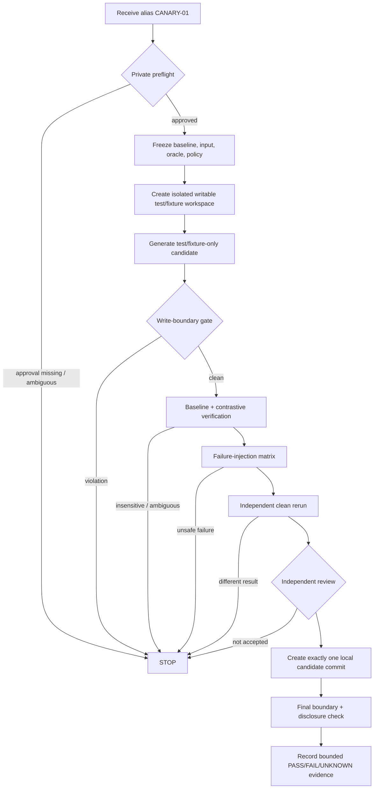

# CANARY-01 Private Canary Methodology

## Executive summary

The supplied DS-08 brief is sufficiently specific to govern this research: the first private canary is `CANARY-01`, it is alias-only in tracked/public artifacts, it may alter tests and fixtures but not production code, it requires an independent clean rerun and failure injection, and **it must not execute during this research campaign**. No real project identity, path, content, digest, transcript, private route identifier, or infrastructure identifier is reproduced in this report. fileciteturn0file0

The recommended methodology is a **sealed, two-layer canary protocol**. The public/tracked layer contains only the alias, policy version, pass/fail/unknown outcomes, classification, and non-sensitive verification claims. A separate private control layer resolves the alias to the real project, approved path classes, and pre-existing approved route. This separation is consistent with established approaches in which verification results can be communicated without disclosing all underlying pipeline details; SLSA's Verification Summary Attestation is a useful precedent because it explicitly supports communicating a verification decision while keeping build-pipeline details confidential. citeturn4search5turn4search4

The write boundary should be enforced twice: **preventively**, by making the repository read-only except for privately configured test/fixture allowlists and ephemeral scratch space; and **detectively**, by machine-parsing every changed, untracked, renamed, and type-changed path relative to a frozen baseline. Git provides stable script-oriented `status --porcelain` output and NUL-delimited path output specifically suitable for such machine checks. citeturn4search2turn0search0 A post-hoc Git diff by itself is not enough because the canary requirement concerns what the run was allowed to write, not merely what remained as a tracked diff; that conclusion is an inference from Git's documented scope and the DS-08 boundary.

A passing canary can establish that, **for one frozen deterministic rule and one constrained execution context**, the agent can produce an admissible test/fixture-only change, the harness can detect defined failures, an independent clean rerun reproduces the expected result, the change remains inside the boundary, and exactly one local candidate commit can subsequently represent it. It cannot establish correctness of the production rule unless the expected result comes from an independent authority; it cannot establish general migration correctness, security, fault coverage, route reliability, release readiness, or Recursion-wide conformance. Mutation-testing research reinforces this distinction: injected faults are useful for evaluating test sensitivity, but even mutation scores have only limited predictive power for real-fault detection when confounders such as suite size are controlled. citeturn3search3turn3search10

The essential anti-tautology rule is therefore: **a characterization pass is not automatically a correctness pass**. Whenever an independent specification or authoritative known-good example exists, expected output should be fixed from that source before observing the candidate behavior. Regardless, the canary must include a contrastive negative control—for example, a deliberately wrong expected result at the test/fixture layer—and that control must fail. Research on automated test suites has found inadequate assertions to be a real test-oracle problem, so a test that simply executes without a sensitive assertion is insufficient evidence. citeturn3search11

Finally, **the canary did not start during this research session; no private route was exercised, no private repository was accessed, and no candidate commit was created here**. That is a locally observed statement about this research session, not evidence that no unrelated actor acted elsewhere. DS-08 itself expressly prohibits canary execution and candidate-commit creation during this campaign. fileciteturn0file0

## Evidence base and claim register

The methodology below treats externally documented facts, the supplied brief, local observations, and design inferences separately. NIST's SSDF is used as a general secure-development reference rather than as evidence that this particular canary is secure; SSDF is deliberately a framework of practices that organizations integrate into their own development lifecycle. As of this research, NIST SP 800-218 Version 1.1 remains the final SSDF publication, while Version 1.2 is an initial public draft published in December 2025. citeturn1search0turn1search2turn1search6

| Claim | Source pin | Version/date | Classification | Confidence | Expiry trigger |
|---|---|---|---|---|---|
| `CANARY-01` is alias-only; its real identity, path, content, digest and transcript must not enter tracked/public artifacts, and the canary must not run during this campaign. | Supplied DS-08 brief. fileciteturn0file0 | 2026-09-30 | Source-documented | Very high | Owner/constitution or ratified canary scope changes |
| Only tests and fixtures may receive project-content writes; production writes, publication, push, merge and deployment are outside the authorized scope. | Supplied DS-08 brief. fileciteturn0file0 | 2026-09-30 | Source-documented | Very high | Ratified scope changes |
| Git has a stable, script-oriented status representation; porcelain format is intended for parsing, and `-z` avoids ambiguous pathname delimiters. | Official Git `status` documentation. citeturn4search2 | Current docs retrieved 2026 | Source-documented | Very high | Incompatible Git porcelain specification change |
| Git diff can report changed path names/statuses and NUL-delimit names; rename/copy handling means both source and destination must be considered by a boundary checker. | Official Git `diff` documentation. citeturn0search0turn0search1 | Current docs, last updated in Git 2.55.0 | Source-documented | Very high | Git output semantics change |
| A Git commit records a new local repository commit; `git push`, separately, is the operation that updates remote refs and transfers required objects. | Official Git `commit` and `push` documentation. citeturn5search4turn5search7 | Git 2.52-era/current documentation | Source-documented | Very high | Git semantics change |
| An independent repeatability check should freeze source, relevant environment and instructions; reproducibility depends on all three rather than source alone. | Reproducible Builds definition. citeturn6search0 | Current definition | Source-documented | High | Definition materially changes |
| Verification evidence is meaningful only when checked against expectations; provenance by itself is not sufficient. | SLSA 1.2 verification guidance. citeturn4search4 | SLSA 1.2, Approved | Source-documented | Very high | New SLSA major specification |
| A verification summary can communicate that verification occurred without exposing all underlying pipeline details. | SLSA VSA specification. citeturn4search5 | SLSA 1.2, Approved | Source-documented | High | VSA model changes |
| Logs should avoid source code, tokens, credentials, higher-classification information and other sensitive material; file paths can themselves require special handling. | OWASP Logging Cheat Sheet. citeturn2search0 | Current retrieved guidance | Source-documented | High | OWASP guidance changes or local policy is stricter |
| Secrets should be least-privileged and should not be logged in plaintext. | OWASP Secrets Management Cheat Sheet. citeturn2search8 | Current retrieved guidance | Source-documented | High | OWASP/local policy change |
| Mutation/fault injection can measure whether tests detect injected faults, but mutation adequacy is not equivalent to demonstrated real-world fault coverage. | ICSE empirical study; IEEE mutation-testing literature. citeturn3search3turn3search10 | 2018; 2021 | Source-documented | High | Strong contrary empirical evidence |
| A single passing `CANARY-01` should therefore be interpreted as evidence for the tested pipeline slice, not Recursion-wide conformance or release readiness. | DS-08 constraints plus evidence above. fileciteturn0file0 citeturn3search3turn4search4 | This report | Inferred | High | Canary scope or evidence model changes |
| A Git-diff-only boundary is weaker than preventive filesystem enforcement because the specification concerns attempted/permitted writes, not only surviving version-control differences. | Git documents what status/diff observe; conclusion is methodological. citeturn4search2turn0search0 | This report | Inferred | High | Runner gains equivalent complete write-audit guarantees |
| The canary was not started and no candidate commit was created in this research session. | Session activity plus DS-08 prohibition. fileciteturn0file0 | This session | Locally observed | Very high for this session only | Any subsequent canary-execution session begins |
| Whether an independent authoritative oracle exists for the chosen private business rule is not known from the public/synthetic brief. | DS-08 intentionally withholds private project content. fileciteturn0file0 | This report | Unverified | N/A | Private owner supplies such an oracle |

The distinction between **unknown** and **false/zero** is important. For example, this research cannot state that the private project has zero secrets, zero flaky dependencies, or zero protected-path hazards; those facts were deliberately unavailable. The proper value is *unknown until privately verified*, exactly as DS-08's evidence discipline requires. fileciteturn0file0

## Proof boundary and alias-only runbook

`CANARY-01` should be treated as a capability-limited experiment, not a miniature release. Its public identity is exactly the alias `CANARY-01`; all resolution from alias to real project or approved private route occurs behind the private control boundary. This minimizes linkability and follows the same broad confidentiality principle reflected in SLSA's ability to publish verification summaries without exposing all underlying verification inputs. citeturn4search5

The runbook shape should be:



This proposed flow is an inference from DS-08's ratified scope, Git's local/remote distinction, reproducibility principles, and the general verification principle that evidence has to be evaluated against predeclared expectations. fileciteturn0file0 citeturn5search4turn5search7turn6search0turn4search4

A run record should contain only alias-safe fields such as:

```text
canary_alias: CANARY-01
protocol_version: <public methodology version>
baseline_class: frozen
input_class: frozen
expected_output_source: independent | characterization-only
write_boundary: PASS | FAIL | UNKNOWN
negative_control: PASS | FAIL | UNKNOWN
failure_injection: PASS | FAIL | UNKNOWN
clean_rerun: PASS | FAIL | UNKNOWN
independent_review: ACCEPT | REJECT | UNKNOWN
route_eligibility: ELIGIBLE | INELIGIBLE | UNKNOWN
candidate_commit_created: true | false
publication_performed: false
overall_result: PASS | FAIL | UNKNOWN
```

The public/tracked form must **not** contain a repository locator, filesystem path, source snippet, customer/project name, source or candidate digest, commit identifier, transcript, provider/model/account identifier, credential, or stable private-route handle. OWASP explicitly warns against directly logging source code, access tokens, sensitive or commercially sensitive material and, depending on context, file paths and internal infrastructure identifiers. citeturn2search0turn2search8

A single successful run may legitimately support the following bounded claims:

> The canary executor could operate on one pre-approved deterministic rule under the specified write boundary; the produced candidate was test/fixture-only; defined negative controls and failure conditions were detected; a separate clean execution reproduced the declared result; independent review accepted the evidence; and the final artifact remained local.

It **does not prove** that the characterized production behavior is semantically correct unless the oracle was independently derived; that other business rules are migratable; that all failure classes are covered; that the route is generally reliable; that the system is secure; that every worker or provider behaves equivalently; that migration is complete; or that release, merge, deployment, or conformance criteria have been met. SLSA similarly distinguishes particular verified properties from sweeping claims about all possible threats, and mutation-testing evidence is likewise useful without being equivalent to comprehensive real-fault assurance. citeturn4search4turn4search7turn3search3

## Machine-checkable controls

The project-content write boundary can be specified exactly without publishing any real paths. The private control plane instantiates four objects before the run:

```text
B                  := frozen baseline revision, private value
ALLOW_TEST         := set of privately approved canonical test prefixes
ALLOW_FIXTURE      := set of privately approved canonical fixture prefixes
DENY               := set of protected prefixes; DENY always wins
```

Let `Δ` be **all repository-content write events and final changes** attributable to the canary, not merely staged files. `Δ` includes tracked modifications, additions, untracked files, attempted writes, rename/copy endpoints, mode changes, symlink changes, submodule changes, and relevant ignored-file writes.

The mandatory predicate is:

```text
WRITE_BOUNDARY_PASS :=
    Δ is non-empty
    AND every path in Δ is canonical and repository-relative
    AND every path in Δ is within ALLOW_TEST ∪ ALLOW_FIXTURE
    AND no path in Δ is within DENY
    AND every candidate-content operation is ADD or MODIFY
    AND every candidate-content object is an approved regular-file type
    AND there are no DELETE, RENAME, COPY, TYPECHANGE,
        SYMLINK, or SUBMODULE candidate operations
    AND the sandbox recorded no write attempt outside the allowlist
```

Any normalization ambiguity, case-folding ambiguity, symlink traversal possibility, path not classifiable from the pre-existing private policy, or discrepancy between the preventive audit and Git's final view makes the result **FAIL or UNKNOWN, never PASS**. This stricter predicate is a design recommendation, not something required by Git itself.

Git should be the detective layer rather than the sole enforcement layer. `git status --porcelain` is documented as stable for scripts and can report tracked and untracked state, while `git diff --name-status` exposes path/status changes and `-z` makes pathname parsing safe from newline/quoting ambiguity. citeturn4search2turn0search0 The preventive layer should make the remainder of the repository read-only and direct temporary files, caches, test databases and similar mutable execution state into a fresh external scratch area. This implements least privilege more strongly than detecting an unauthorized write afterward; least privilege is a standard control concept in NIST's security-control catalog. citeturn2search2turn2search3

There is one narrowly defined exception to “tests and fixtures only”: **version-control metadata needed to create the single local candidate commit**, after all content gates and the independent rerun have passed. That exception does not authorize modifying project configuration, hooks, remotes, credentials or production content. Git documents `commit` as creating a new commit from the index and updating the applicable local branch/HEAD, while `push` is the separate action that updates remote refs and transmits objects. citeturn5search4turn5search7

“One local candidate commit” should therefore mean exactly:

```text
candidate_commit_count == 1
parent_count == 1
parent == frozen_baseline
commit_tree == independently_verified_candidate_tree
changed_content satisfies WRITE_BOUNDARY_PASS
push_count == 0
merge_count == 0
publication_count == 0
deployment_count == 0
```

The commit identifier itself remains private because a private repository revision can become a stable correlator or fingerprint and DS-08 expressly excludes the real project's hash/digest from tracked/public output. fileciteturn0file0

The clean rerun should be a separate execution by an independent bounded reviewer/executor, not merely the original implementer invoking the same command again. It should start from the same frozen baseline plus the exact candidate patch/tree, but with **fresh mutable state**: no prior test cache, generated files, temporary database, process state or writable working tree carried over. Relevant dependency versions, environment variables, locale and other behavior-affecting environmental properties should be frozen. The Reproducible Builds definition is instructive here: repeatability requires controlling source, environment and instructions, not just source. citeturn6search0 Git's own documentation notes that removal of untracked and ignored build products can be used to obtain a pristine working directory, although for this canary a separately isolated fresh state is stronger than relying solely on cleanup. citeturn5search0

The rerun passes only when the machine-readable test verdict, deterministic expected output, boundary audit and required failure-injection verdicts equal the first verified run. A different result is a **determinism failure**, not an invitation to keep rerunning until a pass appears. The canary may prove clean-state reproducibility of this particular test scenario; it does not thereby establish the stronger SLSA concept of reproduction by independently operated build platforms. SLSA makes that stronger distinction explicit for its `SLSA_BUILD_REPRODUCED` property. citeturn4search7

Private-route eligibility must also be a fail-closed predicate:

```text
ROUTE_ELIGIBLE :=
    pre_existing_private_approval exists
    AND approval is currently active
    AND approval scope covers CANARY-01's data/classification
    AND the intended route belongs to that already-approved scope
    AND no new provider, model, authentication method, or configuration is selected
    AND no unapproved fallback route is possible
```

The real route identity and approval handle remain in the private control plane. The tracked/public evidence should contain only the alias, policy version and `ELIGIBLE | INELIGIBLE | UNKNOWN`. A private verifier may retain the binding necessary for audit. The design is analogous to SLSA's delegated-verification model, where consumers can rely on a trusted verifier's result without having every underlying attestation or pipeline detail. citeturn4search5 **No route was exercised to establish eligibility in this research campaign; eligibility is a policy predicate for the later authorized canary session.** fileciteturn0file0

## Baseline, failure injection, disclosure, and stop rules

The baseline must distinguish three different questions that are easy to conflate:

| Check | Method | What a pass establishes | What it does not establish |
|---|---|---|---|
| Characterization baseline | Frozen input produces the frozen observed behavior on the untouched baseline. | The harness captured existing behavior reproducibly. | That behavior is correct according to the business rule. |
| Independent-oracle baseline | Expected output is fixed from an owner-approved specification/reference independently of the candidate's observed result. | Agreement with that oracle for the tested cases. | General correctness outside the tested domain. |
| Contrastive sensitivity check | Deliberately wrong test-layer expected output or synthetic mismatch must be detected. | The assertion/oracle is capable of rejecting at least that wrong outcome. | Broad fault coverage or absence of overfitting. |

Automated tests depend on adequate assertions—the test oracle—not merely execution. Empirical work has found inadequate assertions in real automated test suites, and mutation testing specifically evaluates test-suite adequacy by introducing faults and asking whether tests detect them. citeturn3search11turn3search10 For `CANARY-01`, production mutation is unnecessary and outside the write boundary: a **test-layer contrastive fixture** is enough to establish that the canary's verification mechanism is not a pure “always pass” path.

If no independent authoritative oracle exists, the report must say **“characterization-only”**. It must not silently upgrade observed current behavior into normative correctness. This is especially important for legacy business rules: a golden-master test can faithfully freeze a pre-existing defect. That conclusion is methodological; the external testing literature supports the narrower proposition that passing tests and mutation scores are not equivalent to complete real-fault assurance. citeturn3search3turn3search11

The five required failure injections should be evaluated against explicit expected outcomes:

| Injection | Required behavior for the canary pipeline | Failure condition |
|---|---|---|
| Malformed input | Reject or classify it deterministically under the predeclared test expectation; do not turn malformed input into a successful verification. | Acceptance without the expected check, uncontrolled execution, or ambiguous result. |
| Expected-output mismatch | The test/oracle fails decisively. | Candidate still reports PASS. |
| Runner/process crash | Record failed execution, preserve only permitted sanitized diagnostics, create no candidate commit. | Crash is treated as PASS or execution resumes from uncertain state. |
| Missing dependency | Preflight or test fails closed and identifies the dependency class without leaking private identifiers. | Silent substitution, uncontrolled installation/route change, or PASS. |
| Stale state | Fresh rerun excludes the stale state; a deliberately planted stale-state sentinel must not affect the declared result. | Result depends on state from the previous run. |

“Survive failure injection” therefore means **detect and fail safely**, not somehow force every injected case to produce a successful business-rule result.

Disclosure should use at least three conceptual classes. **Tracked/public** material may contain `CANARY-01`, policy/methodology versions, bounded outcomes, evidence classifications and sanitized counts. **Private operational** material may contain the alias-to-project binding, concrete allowlists, route approval evidence and reviewer/audit details, visible only to authorized control-plane participants. **Private sensitive** material includes the real project identity, path, contents, source/candidate digests and execution transcript; DS-08 forbids those from public or tracked artifacts. fileciteturn0file0 This aligns with OWASP's guidance to avoid logging source code, tokens, sensitive information and higher-classification information and to treat internal paths specially where necessary. citeturn2search0

The canary must stop immediately on any of these conditions:

- actual or suspected identity, secret, credential, path, content or transcript disclosure beyond its authorized private boundary;
- any attempted contact with a protected project-content path;
- uncertainty about whether a path is a permitted test/fixture path;
- missing, expired, ambiguous or inapplicable private-route approval;
- any implicit route/model/authentication/configuration fallback;
- inability to determine the expected output's provenance;
- a negative-control mismatch that does not cause failure;
- malformed input, crash or missing dependency that leaves execution state ambiguous;
- disagreement between the first run and clean rerun;
- any evidence needed for PASS remaining unverified;
- any attempt to push, merge, deploy or publish.

These stop rules implement DS-08's instruction that ambiguity and unverified consequential claims are stopping conditions, and NIST's assessment guidance likewise treats evidence collection and assessment results as explicit parts of assurance rather than presuming a control works. fileciteturn0file0 citeturn2search1

## Recommendation and Owner questions

**Recommendation: adopt the sealed two-layer protocol described here: preventive test/fixture-only filesystem enforcement, a complete machine-readable write audit, an independent-oracle label, mandatory contrastive sensitivity test, all five failure injections, a separate fresh-state rerun and independent review before exactly one local candidate commit.**

The principal competing option is a **lighter post-hoc Git-diff gate**: allow the worker to operate in an ordinary writable checkout, then inspect the final Git diff and run the tests once. Git's diff/status machinery is excellent for enumerating repository changes, but this lighter design does not by itself establish that there were no transient, ignored, out-of-tree or subsequently reverted writes; nor does a single positive test establish oracle sensitivity or clean-state repeatability. citeturn0search0turn4search2 The lighter option is attractive because it is simpler and cheaper, but it answers a materially weaker question than DS-08 asks.

The **decisive falsifier** for the recommended protocol is a controlled red-team exercise in which any one of the following occurs while the protocol nevertheless reports PASS: a write escapes into a protected path; a real project or route identifier reaches tracked/public output; an intentionally wrong oracle passes; an injected crash or missing dependency is normalized into success; planted stale state changes the result without detection; or the independent fresh rerun disagrees but the overall decision still passes. Any such event demonstrates that the relevant gate is not enforcing the claimed property and the canary must remain blocked.

What this recommendation explicitly **does not prove** is that the business rule is correct outside independently specified cases, that mutation/failure coverage is exhaustive, that the selected private route is generally safe or reliable, that the migration architecture as a whole conforms, or that Recursion is ready to release. SLSA's verification guidance similarly ties assurance to specified expectations and threat coverage rather than treating a successful verification as proof of every property, while empirical mutation-testing work cautions against equating a test-adequacy metric with comprehensive real-fault detection. citeturn4search4turn3search3

The remaining Owner decisions are intentionally narrow and do not reopen ratified scope:

| Open Owner question | Why it remains open |
|---|---|
| Which privately configured logical prefixes instantiate `ALLOW_TEST`, `ALLOW_FIXTURE`, and `DENY` for `CANARY-01`? | Publishing them here would violate the alias/privacy boundary; the methodology only defines their required semantics. |
| What source is authoritative for the deterministic rule's expected output? | Without a private specification/reference, the canary can prove characterization and sensitivity but not semantic correctness. |
| What qualifies operationally as “independent” for the clean rerun: a distinct bounded worker under the same machine, or an additional execution-isolation requirement? | DS-08 requires independent review and fresh state but does not define the required trust-domain separation. fileciteturn0file0 |
| What private retention period and access policy should govern route-approval evidence, sanitized audit events, and the local candidate revision? | Public evidence should be minimal, but durable private auditability needs an Owner-approved retention rule. |
| Is the local candidate commit retained on an isolated local ref after evaluation or deleted after acceptance/rejection? | Both preserve “no publication,” but lifecycle/retention policy is not fixed by the brief. |

None of these questions authorizes execution. Until the private values and Owner decisions required by the run-time protocol exist, the appropriate state is **not-ready-to-run**, not an inferred PASS.

## Completion gate and research-session attestation

| DS-08 completion item | Research result |
|---|---|
| Alias-only reference verified; no real identity/content in tracked output | **PASS for this report.** Only `CANARY-01` is used. The private identity, path, content, digest and transcript were neither requested nor reproduced. fileciteturn0file0 |
| Write boundary machine-checkable and test/fixture-only | **Specified.** The `WRITE_BOUNDARY_PASS` predicate requires private test/fixture allowlists, deny precedence, add/modify-only regular content and both preventive and detective enforcement. Git provides stable machine-readable state/diff primitives for the detective layer. citeturn4search2turn0search0 |
| Independent clean rerun and baseline comparison specified | **Specified.** Fresh state, same baseline/candidate/input/oracle/environment, separate reviewer/executor, exact verdict comparison, independent-oracle labeling and negative control are required. Reproducibility guidance supports freezing source, environment and instructions. citeturn6search0 |
| Failure injection, disclosure and stop conditions falsifiable | **Specified.** Malformed input, mismatch, crash, missing dependency and stale state each have explicit expected/failure outcomes; privacy/boundary/ambiguity/unverified-claim stops are defined. |
| Report states canary did not start and no candidate commit was created here | **PASS. `CANARY-01` did not start during this research campaign, and no candidate commit was created in this session.** fileciteturn0file0 |
| Private-approved route eligibility stated without private identifiers | **Specified.** Eligibility is a fail-closed private predicate; tracked output retains only alias-safe policy/result fields. No route was exercised here. |
| What the canary proves separated from what it cannot prove | **PASS.** The bounded proof and non-proof sets are stated explicitly above. |
| Protected paths untouched; privacy and secret scan clean | **PASS for this research artifact, with scope qualification.** No private repository was accessed in this research session, so no repository protected path could be touched here. The report contains no supplied credential, private route identifier, real project identity, real path, project content, digest or transcript. This is **not** a secret scan of the unseen private repository; that repository-level condition remains a mandatory canary-time preflight rather than something this public research session can honestly claim to have tested. OWASP guidance supports excluding precisely these sensitive categories from logs and artifacts. citeturn2search0turn2search8 |

The durable no-start evidence that should accompany this report in the Recursion control plane is a minimal audit assertion such as:

```text
subject: CANARY-01
research_only: true
private_repository_accessed: false
private_route_exercised: false
canary_execution_started: false
candidate_commit_created: false
publication_push_merge_deploy: false
result: RESEARCH_COMPLETE_CANARY_NOT_STARTED
```

That assertion should be generated by the trusted control plane from actual session events rather than self-certified by the canary worker. This follows the same general verification principle used by SLSA: a claim becomes materially stronger when a trusted verifier evaluates evidence against a defined policy, while the public-facing result can remain substantially less revealing than the underlying evidence. citeturn4search4turn4search5

Accordingly, the final disposition is:

**DS-08 methodology: research-complete. `CANARY-01`: not executed. Candidate commit: not created. Private route: not exercised. Authorization to begin the canary: not granted by this report.** fileciteturn0file0