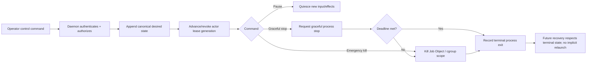
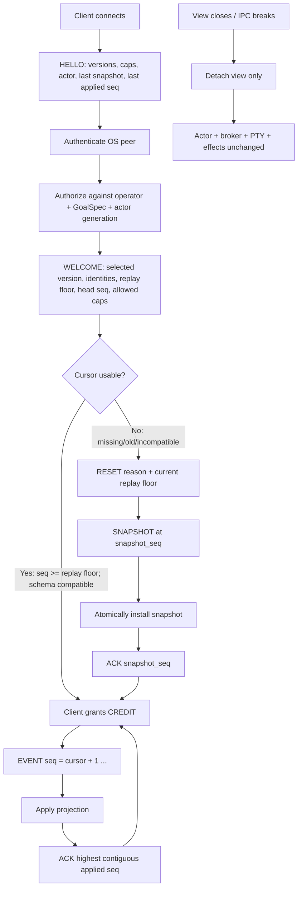
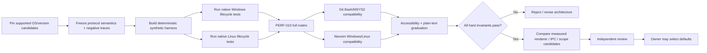

# DS-09 Research Report: Interactive Terminal and Communication Views

## Executive summary

This report executes the DS-09 research directive supplied for Recursion v3. The fixed product premise is that terminal windows are **detachable views, not process owners**: closing a terminal must detach that view while Head, ARM, worker, verifier, external engine, and daemon work continue; deliberate control commands—not terminal lifetime—pause or terminate work. The lane also requires multiple simultaneous views, Windows/Linux process containment, bounded flow control, reconnect/replay, causal communication visualization, Git Bash/MSYS2 and Neovim compatibility, accessibility, and the PERF-010 0/1/5/10/20-view experiment. fileciteturn0file0

**Principal conclusion.** The architecture should separate four responsibilities that are easy to conflate:

1. **The daemon owns canonical actor state, identities, leases, durable event order, authorization, and reconnect state.**
2. **The process broker owns PTY/ConPTY handles and external process containment.** A view must never own these handles.
3. **The client owns only a projection and transient presentation state.** It reconstructs that projection from a snapshot plus ordered events.
4. **An OS containment primitive—not the PTY—is the emergency process-tree boundary.**

On Windows, the strongest candidate is a non-breakaway **Job Object**, with the process placed in the job **at creation time** using `PROC_THREAD_ATTRIBUTE_JOB_LIST`, while ConPTY remains only the UTF-8/VT I/O transport. Microsoft documents both creation-time job assignment and default descendant inheritance; it also documents explicit breakaway mechanisms and the fact that `Win32_Process.Create` does not preserve ordinary job inheritance. Consequently, the defensible guarantee is “all processes remaining inside the managed job scope are killed,” not “arbitrary effects launched anywhere on the machine are always captured.” citeturn18search5turn18search0turn18search10

On Linux, a PTY plus POSIX session/process groups is appropriate for interactive job control and graceful signalling, but it is **not** a strong descendant-containment primitive: processes can create new sessions/process groups. A dedicated **cgroup v2 domain cgroup** is the stronger scope. Linux 6.7 documents `cgroup.kill` as recursively sending `SIGKILL` to the cgroup and descendants while handling concurrent forks and protecting the kill operation against migrations. `clone3(CLONE_INTO_CGROUP)` can eliminate the child-creation-to-cgroup-migration race by placing the child directly in the target v2 cgroup. citeturn20view3turn19search1turn19search10

Neither OS mechanism is absolute against work deliberately launched through an **external privileged broker** or against a process that was legitimately permitted to escape/migrate beforehand. Windows explicitly documents breakaway and a `Win32_Process.Create` exception; Linux exposes cgroup migration through `cgroup.procs` to principals with the required write authority. Recursion therefore must couple process containment with launch-authority policy: managed actors should not receive the authority needed to migrate themselves out of their cgroup/job scope or delegate untracked process creation to outside services. citeturn18search0turn20view1turn19search0

For reconnect, DS-09 should specify two different “cursors.” A **stream cursor** identifies the last canonically applied event sequence. A **terminal cursor** is part of the broker-maintained terminal emulator state. The process broker must continue draining and interpreting PTY/ConPTY output even when there are zero attached views; otherwise detached output can fill the PTY pipeline and influence the child. A reconnecting view receives a `SNAPSHOT` containing actor identity, terminal grid/modes/cursor and projection state, then ordered `EVENT`s. If its stream cursor is older than the retained replay floor or incompatible with the projection schema, the server sends `RESET` and a fresh snapshot. None of `HELLO`, `WELCOME`, `SNAPSHOT`, replay, or `RESET` may trigger actor/process/model execution. This is an **inferred protocol contract** from the product requirements, not an observed implementation result. fileciteturn0file0

Flow control should use **per-view explicit credit**. SSH's connection protocol provides a mature precedent for decrementing a bounded send window and replenishing it explicitly, although DS-09 needs stricter semantics because a terminal view is a projection of canonical state rather than the canonical transport itself. A zero-credit client must simply stop receiving; it must never backpressure the canonical append path. Durable events remain in canonical retention, while redundant **presentation frames** may coalesce after the durable state has been materialized. citeturn15search5

Local IPC authentication should be OS-native and then followed by Recursion authorization. On Linux, a filesystem-path AF_UNIX stream socket in a private runtime directory can use filesystem access controls plus `SO_PEERCRED`, which exposes the peer credentials captured when the connection was established. On Windows, a named pipe should have an explicit restrictive security descriptor and should verify/impersonate its connecting client; Microsoft warns that failure to check impersonation can cause subsequent work to execute with the privileged server's own context. OS identity establishes **who connected**; it does not itself establish **what that connection may do**. `WELCOME` must therefore return only the intersection of server capabilities, authenticated operator authority, and the active GoalSpec. citeturn20view0turn20view2turn18search7

For rendering, the architectural candidate is a **retained screen/application model with one terminal writer, frame coalescing, and diff output**. Ratatui's documented double-buffer/diff approach illustrates this class of design without implying that Ratatui should become the Recursion default. Unicode 18.0 segmentation and width data should be version-pinned: UAX #29 defines extended grapheme clusters suitable for editing/cursor movement, while UAX #11 explicitly cautions that East Asian Width alone does not fully determine actual contextual display width. Terminal-specific width behavior therefore remains a compatibility test, not something a Unicode property can settle by itself. citeturn21search6turn22search0turn15search0

**No renderer, TUI library, multiplexer, terminal application, IPC serialization, or product default is selected by this report.** Ratatui, crossterm, tmux, Zellij, JSON, CBOR, MessagePack, Protocol Buffers and comparable options remain measurement candidates. That constraint is part of the supplied lane directive. fileciteturn0file0

The central recommendation is therefore to freeze **semantic invariants before implementations**: durable canonical append isolation; daemon/broker ownership; OS-scoped containment; stable actor and lease identities; snapshot/event replay; bounded per-view credit; fail-closed capability negotiation; one active terminal-input/resize lease; semantic communication views; and plain-text accessibility. The competing design—letting individual terminal sessions own shells/processes and relying on PTY lifetime, terminal multiplexers, or renderer backpressure—is decisively falsified by the fixed detach requirement and by any negative trace in which closing a view ends work, attaching launches work, or a blocked client stalls canonical state. fileciteturn0file0

## Scope, assumptions, and evidence

The objective is not to implement a terminal stack but to determine which **architectural contracts** should be tested before R11 can unblock the v3 terminal runtime. The supplied brief defines Recursion as a provider-neutral agent platform with one Head, delegated ARM executives, bounded workers and verifiers, GoalSpec-scoped authority, a persistent daemon/process broker, several detachable terminal views, and no required graphical frontend. It explicitly prohibits implementation, provider/model/authentication changes, deployment, publication, spending, merges, or selection of a default terminal renderer/multiplexer. fileciteturn0file0

The research used public primary/official sources wherever available: Microsoft Win32/Console documentation, Linux kernel documentation, POSIX/Open Group material, RFC 4254, Unicode Consortium specifications, W3C accessibility guidance, and official MSYS2, Neovim, systemd and Ratatui documentation. The evidence is therefore mainly standards and platform contracts rather than benchmark claims or vendor marketing. No repository or GitHub connector was used, in accordance with the brief. fileciteturn0file0

**Assumptions.** First, the goal is a single-user or workstation-local Recursion daemon rather than a remotely exposed multi-tenant service; remote access would require a separate authenticated transport threat model. Second, external actor processes may execute arbitrary normal child-process creation APIs, so containment has to survive shelling out and grandchildren. Third, actor/private context separation is an authorization boundary: a shared visualization may expose identity, GoalSpec, state and authorized event summaries but must not concatenate private contexts. Fourth, “negligible passive overhead” is not yet an Owner-approved numeric SLA; this report therefore preregisters **provisional falsifiable engineering thresholds** rather than claiming them as accepted product requirements. These are inferred assumptions, not locally observed facts. fileciteturn0file0

The classifications used below match the evidence discipline in the brief:

- **Source-documented** means the behavior appears in a cited primary/official source.
- **Inferred** means it is an architectural consequence or research recommendation supported by sources and DS-09 constraints but not itself demonstrated by the source.
- **Locally observed** would require an executed Recursion/platform experiment; there are **no locally observed runtime claims in this report**.
- **Unverified** means an intended Recursion guarantee that still requires the cross-platform experiment.

### Source-pinned claim register

| Consequential claim | Source and pin | Classification | Confidence | Expiry / revalidation trigger |
|---|---|---|---|---|
| Closing a terminal is a detach operation, not an actor/process stop; attach must not launch execution. | DS-09 brief, updated 2026-09-30. fileciteturn0file0 | Source-documented product ruling | Very high | Owner/constitution explicitly changes ruling |
| Windows ConPTY carries UTF-8 text plus VT sequences and requires a host to interpret/present output. | Microsoft `CreatePseudoConsole`, last updated 2022-09-20. citeturn18search8 | Source-documented | High | ConPTY API contract/support baseline changes |
| A Windows child can be assigned to one or more Job Objects at process creation using `PROC_THREAD_ATTRIBUTE_JOB_LIST`. | Microsoft `UpdateProcThreadAttribute`, current docs; supported Windows 10+/Server 2016+. citeturn18search5 | Source-documented | High | Supported Windows baseline/API behavior changes |
| Standard descendants inherit a Job Object by default; breakaway flags can create exceptions, and `Win32_Process.Create` is specifically documented as not inheriting the job. | Microsoft Job Objects / process creation flags. citeturn18search0turn18search10 | Source-documented | High | Windows process/job semantics change |
| A non-breakaway nested job can retain descendant membership; terminating a job covers processes in its child jobs. | Microsoft nested jobs / Job Objects. citeturn18search11turn18search0 | Source-documented | High | Windows job semantics change |
| Linux cgroup v2 `cgroup.kill` recursively kills processes in a domain cgroup tree with SIGKILL and is designed to handle concurrent forks and kill-time migration. | Linux kernel 6.7 cgroup-v2 docs. citeturn20view3 | Source-documented | Very high | Minimum/target Linux kernel differs materially |
| Processes can be migrated between v2 cgroups only with required `cgroup.procs` write authority; therefore migration authority is security-sensitive. | Linux 6.7 cgroup-v2 docs. citeturn19search0 | Source-documented | High | Kernel cgroup delegation model changes |
| `clone3(CLONE_INTO_CGROUP)` can place a child directly in a v2 cgroup, avoiding post-create migration jitter/race. | Linux man-pages `clone(2)/clone3`, current. citeturn19search1 | Source-documented | High | Supported minimum kernel/API changes |
| POSIX terminal sessions/process groups provide job-control and foreground-terminal semantics, not a general resource/descendant containment tree. POSIX.1-2024 can create a new session through `POSIX_SPAWN_SETSID`. | Open Group POSIX.1-2024 definitions/`posix_spawn`; terminal model crosschecked with the Open Group interface. citeturn19search10turn23search5turn23search1 | Source-documented + inference | High | Supported Unix semantics or product containment requirement changes |
| POSIX `kill()` targets individual processes or process groups; a process that leaves a process group is therefore not covered merely because it was once a descendant. | Open Group `kill()` semantics plus POSIX session definitions. citeturn23search0turn23search5 | Source-documented + inference | High | Platform behavior contradicts standard |
| Linux AF_UNIX can authenticate a connected peer using `SO_PEERCRED`; pathname sockets additionally have filesystem permission semantics on Linux. | Linux man-pages `unix(7)`. citeturn20view0turn20view1 | Source-documented | High | IPC transport choice changes |
| Windows named-pipe impersonation can bind server authorization to the client security context; failure must be checked fail-closed. | Microsoft `ImpersonateNamedPipeClient`, updated 2021-10-12/13. citeturn18search7 | Source-documented | High | IPC transport choice changes |
| Explicit credit/window flow control is a proven protocol pattern: SSH decrements per-channel byte windows and replenishes them with `WINDOW_ADJUST`. | RFC 4254, January 2006. citeturn15search5 | Source-documented pattern; DS-09 use inferred | High for pattern | Protocol experiments falsify usefulness |
| A retained double-buffer renderer can diff successive terminal frames rather than repaint everything. | Ratatui current rendering documentation. citeturn21search6 | Source-documented example, not product selection | High | Renderer candidates or benchmark results change |
| Unicode 18.0 extended grapheme clusters are appropriate units for editing/cursor movement; East Asian Width does not alone specify contextual terminal cell rendering. | UAX #29 rev.49, 2026-09-01; UAX #11 rev.46, 2026-07-31. citeturn22search0turn15search0 | Source-documented | Very high | Unicode version pin changes |
| Color cannot be the sole carrier of state information; WCAG 2.2 applies this principle directly to visual information, although terminal UI conformance itself is a separate question. | W3C WCAG 2.2 Recommendation, 2024-12-12; Use of Color guidance updated 2025-09-16. citeturn14search4turn14search1 | Source-documented principle + inferred terminal application | High | Accessibility requirements change |
| The proposed SNAPSHOT/EVENT/ACK/CREDIT/RESET protocol and daemon-side terminal projection will preserve detach/reconnect without effect relaunch. | DS-09 requirements + this synthesis. fileciteturn0file0 | **Inferred** | Medium-high | Prototype/replay testing contradicts it |
| Recursion can terminate its entire managed descendant tree on all target Windows/Linux environments. | Not yet experimentally demonstrated. | **Unverified** | Low until R11 tests pass | Becomes verified only after full adversarial matrix |

The last row is intentionally not promoted to “source-documented.” Platform documentation shows mechanisms and preconditions; it does **not** prove Recursion's future code will construct, retain, terminate and recover those scopes correctly.

## Process ownership, termination, and supervision

The most important architectural separation is **I/O transport versus lifecycle ownership**.

ConPTY is a pseudoconsole transport. Microsoft documents UTF-8 text intermixed with VT control sequences, with the host application responsible for decoding/presentation. It is therefore the correct conceptual place to connect Windows console programs to the process broker, but not the reason their descendants are contained. A Job Object supplies the process scope. citeturn18search8turn18search0

Likewise, a Linux PTY provides terminal semantics; POSIX sessions and foreground process groups provide job-control semantics, including which group receives terminal-generated signals. They do not constitute an immutable descendant tree. POSIX.1-2024 permits creating a new session, while Linux cgroup v2 separately provides a process hierarchy intended for grouping and control. citeturn23search5turn19search10turn19search0

### Windows ownership candidate

The leading **mechanism to test** is:

`broker → create Job Object → prohibit breakaway → configure kill-on-close/emergency policy → create child with STARTUPINFOEX attributes [PSEUDOCONSOLE + JOB_LIST]`.

The significance of `PROC_THREAD_ATTRIBUTE_JOB_LIST` is timing: Microsoft's API assigns the listed jobs to the new child as part of process creation, avoiding the avoidable race inherent in “create running process, then call `AssignProcessToJobObject`.” Microsoft documents the job-list attribute on Windows 10+ and Server 2016+. citeturn18search5

By default, normal `CreateProcess` descendants inherit the immediate job and job chain. Nested jobs are supported on modern Windows and a non-breakaway ancestor prevents a child from escaping farther up the chain. `JOB_OBJECT_LIMIT_KILL_ON_JOB_CLOSE` provides last-handle termination, while `TerminateJobObject` is the explicit bulk termination operation. citeturn18search0turn18search6turn18search11

There are important boundaries. Microsoft explicitly documents `JOB_OBJECT_LIMIT_BREAKAWAY_OK`, `JOB_OBJECT_LIMIT_SILENT_BREAKAWAY_OK`, and `CREATE_BREAKAWAY_FROM_JOB`; those settings must not accidentally be enabled in the containment job. More importantly, Microsoft notes that processes created through `Win32_Process.Create` are not automatically members of the caller's Job Object. Thus a process that asks an outside WMI/service process to perform creation is no longer relying on ordinary descendant inheritance. citeturn18search0turn18search10

**Implication:** “Windows Job Object containment” proves termination only for the managed job scope. It does not prove capture of arbitrary process creation delegated to a different service or privileged broker. The R11 test must explicitly reproduce both a prohibited breakaway attempt and an externally mediated launch. The latter should either be blocked by Recursion's authority model or recorded as an out-of-scope effect; silently calling it a descendant would be incorrect.

### Linux ownership candidate

A PTY plus `setsid()`/foreground process groups should be retained for interactive terminal behavior, but emergency containment should use a **non-threaded cgroup v2 domain scope**. Linux 6.7 says `cgroup.kill=1` kills the affected cgroup and descendant cgroups via `SIGKILL`, handles concurrent forks, and is protected against migrations occurring during the kill operation. The same interface is unavailable for threaded cgroups, which makes “domain cgroup” an explicit test precondition. citeturn20view3

Creation-time placement through `clone3(CLONE_INTO_CGROUP)` is technically attractive because the kernel documentation/man-pages describe direct target-cgroup placement as eliminating the accounting jitter of creating a child elsewhere and then migrating it. It should be compared with a systemd-managed/transient cgroup or another supervisor-created scope rather than selected now. citeturn19search1turn17search10

Migration is the Linux analogue of breakaway. The cgroup v2 interface permits writing a PID to `cgroup.procs` only when the writer has appropriate permissions in the destination and common ancestor. That makes the mitigation clear: an ordinary actor workload should not be delegated cgroup-management authority broad enough to migrate itself outside the managed tree. A workload that asks another privileged system service to create work outside the scope presents the same conceptual boundary as WMI on Windows. citeturn19search0turn19search8

`cgroup.freeze` should **not** be identified with Recursion's semantic `PAUSE`. Linux explicitly notes that processes may enter or leave a frozen cgroup due to explicit moves or races with `fork()`, whereas `cgroup.kill` has stronger kill-time guarantees. Recursion's `PAUSE` should therefore first be a canonical control-plane state—revoke new effect/input authority and quiesce the actor—and only optionally use an OS freezer as an implementation aid. citeturn19search0turn20view3

### Process and supervision matrix

| Case | Terminal transport | Lifecycle/kill scope to test | Graceful stop | Force/emergency stop | Primary escape risks | Graduation requirement |
|---|---|---|---|---|---|---|
| Native Windows | ConPTY, broker-owned. citeturn18search8 | Non-breakaway Job Object with creation-time `JOB_LIST`. citeturn18search5turn18search0 | Actor/application-specific graceful request, then broker-managed deadline | `TerminateJobObject`/scope termination; kill-on-close as backstop | Breakaway flags; wrong job nesting; WMI/outside service launches; leaked job handle | Adversarial tree empty after emergency kill; prohibited breakaway cannot escape; closing every view leaves job intact |
| Native Linux | PTY + session/foreground process-group semantics. citeturn23search5 | cgroup v2 domain scope; compare direct `CLONE_INTO_CGROUP` with supervisor-created scope. citeturn20view3turn19search1 | Signal intended foreground job/actor, then deadline | `cgroup.kill` | Prior authorized migration; delegated system-service launch outside scope; wrong threaded cgroup | Scope reports unpopulated/empty after kill; migration permission attacks denied |
| Git Bash / MSYS2 | Translation environment; **not synonymous with native ConPTY**. MSYS2 documents mintty as its default and explains that MSYS/POSIX programs and Windows console programs use different interfaces. citeturn21search0turn21search4 | Still the Windows broker's Job Object, not mintty's process lifetime | Same Recursion control semantics | Same Job Object scope | PTY/console translation, signal/key translation, native-Windows child behavior | Separate attach/input/resize/Unicode/kill suite passes; no native-Windows result is counted as an MSYS2 result |
| Neovim embedded terminal on Windows | Neovim's libvterm UI over its terminal job; Neovim documents system-ConPTY-specific behavior. citeturn21search1 | **Actor remains daemon/broker owned**; Neovim owns only the Recursion client process/view | Client detach command | Actor kill only through daemon | Closing terminal buffer interpreted as actor termination; session restoration restarts client command | Closing/wiping Neovim terminal detaches only; reattach identifies same actor instance |
| Neovim embedded terminal on Linux | Embedded VT220/xterm emulator based on libvterm. citeturn21search1 | Linux daemon cgroup, independent of Neovim | Same | Same cgroup scope | PTY nesting, key mapping, resize, terminal buffer lifecycle | Same detach and state-replay invariants as a native terminal |

Neovim deserves an especially explicit test because its documentation says `:mksession` restores a terminal buffer by **restarting the command**. That is acceptable for Neovim's own terminal-buffer semantics but must never be confused with Recursion actor recovery. If a saved editor session re-executes the Recursion client, the new client must attach to the existing actor; it must not recreate the actor or replay effects. citeturn21search1

Service supervision should cover the daemon separately from actor work. systemd is designed to track service processes with cgroups and exposes process-killing and `Restart=` settings; Windows SCM similarly supports configured service-failure actions. Those facilities can restart the **daemon**, but DS-09 should not make child work an implicitly auto-restarting OS service. A deliberate actor kill must be durably recorded as desired state before process termination; after a daemon restart, recovery reads that state and does not silently recreate the killed actor generation. citeturn17search2turn17search3

A robust ordering for pause/kill races is therefore **canonical intent first, OS effect second**: append the accepted command; advance/revoke the actor lease generation; reject new input/effects for the stale generation; then perform graceful or emergency process action. This is an inferred design. Its purpose is to prevent a service supervisor, reconnecting client, or late process event from interpreting an already-killed generation as live.



This ordering does **not** prove that every provider-side or remote effect is cancellable. Job Objects and cgroups govern local processes; external provider calls require their own cancellation/idempotency contracts.

## Client protocol, IPC, flow control, and reconnect

The local client protocol should specify **semantics before wire encoding**. DS-09 already names `HELLO`, `WELCOME`, `SNAPSHOT`, `EVENT`, `ACK`, `CREDIT`, `INPUT`, `RESIZE`, and `RESET`. The recommendation is to make their meaning independent of JSON/CBOR/MessagePack/Protocol Buffers or the concrete Windows/Linux stream transport. fileciteturn0file0

### Identity and attachment

Four identities should never be conflated:

| Identity | Lifetime | Purpose |
|---|---|---|
| `actor_id` | Logical actor lifetime | Stable logical Head/ARM/worker/verifier identity |
| `actor_instance_id` / lease generation | One execution incarnation | Detect stale process/input/events after restart or replacement |
| `goal_spec_id + version` | Immutable GoalSpec revision | Bind authority and display to the exact delegated goal |
| `view_id` / client session | One attached projection | Flow-control, input lease and observability; **never actor ownership** |

A fifth identifier, `daemon_instance_id`, is useful to detect a daemon restart without pretending the actor identity changed. This identity model is inferred from the fixed daemon/lease/product topology. fileciteturn0file0

`HELLO` should carry a supported protocol-version range, requested capabilities, authentication/session material provided by the local IPC transport, desired actor/goal view, last installed snapshot ID, last safely applied event sequence and view characteristics. It must **not** be authoritative simply because the client declares a capability.

`WELCOME` should contain the chosen protocol version, server instance ID, stable logical actor identity, current actor generation, current GoalSpec ID/version, replay floor, head sequence, supported server features and the **authorized capability intersection**. A client requesting `kill`, for example, cannot gain `kill` merely because both binaries understand the verb.

### Local IPC authentication and authorization

On Linux, a pathname AF_UNIX stream socket in an operator-private runtime directory is preferable to an abstract socket for this threat model because Linux documents filesystem permission handling for pathname sockets while abstract sockets have no analogous filesystem permission semantics. `SO_PEERCRED` adds kernel-reported connected-peer PID/UID/GID information. citeturn20view0turn20view1

On Windows, a named pipe should use an explicit access-control policy and authenticate the client through the operating system token/security context. `ImpersonateNamedPipeClient` provides a mechanism for examining/acting in the client's security context; Microsoft specifically warns that a failed impersonation must not be ignored because work would otherwise continue under the server's own, potentially more privileged, context. citeturn18search7

Those mechanisms answer **principal identity**, not GoalSpec authority. The authorization decision should be:

`effective capability = protocol support ∩ authenticated operator scope ∩ GoalSpec authority ∩ current actor state/lease`.

A view should begin read-only unless it acquires explicitly allowed input/control authority. Any unknown mutating protocol feature should fail closed. Capability negotiation may narrow authority; it may never increase it.

This architecture does **not** claim to defend the daemon against an attacker that already has daemon-equivalent OS credentials, arbitrary code execution as the same fully privileged account, or kernel compromise. Such a security guarantee would require a larger sandbox/isolation threat model.

### Replay, stream cursors, snapshots and RESET

Two cursor types must be documented separately:

**Stream cursor:** the monotonically increasing canonical `event_seq` through which a projection has been durably applied.

**Terminal cursor:** the current row/column and related terminal-emulator modes contained inside a screen snapshot.

Conflating them will produce hard-to-debug reconnect errors.

The broker should continuously drain PTY/ConPTY output whether there are 0 or 20 views. On Windows, Microsoft explicitly treats the pseudoconsole as a UTF-8/VT byte transport requiring a host to interpret output; on Linux, PTY terminal semantics likewise exist independently of any Recursion client view. The inference is that a persistent broker-side terminal emulator/projection is necessary if detached clients are to reconnect to a coherent current screen without keeping the original terminal window alive. citeturn18search8turn23search1

A terminal snapshot should minimally identify:

`actor_id`, `actor_instance_id`, `goal_spec`, `snapshot_id`, `snapshot_seq`, terminal dimensions, grid/cells, extended-grapheme text, attributes, cursor position/visibility, terminal modes required by the renderer, bounded scrollback metadata, selected communication projection state, and schema version.

Reconnect has three cases:



`RESET` is a **projection-repair signal**, not an actor reset. It may discard the client's local projection and install a current snapshot, but it cannot rerun the underlying effect.

If an event arrives with a sequence greater than `last_applied + 1`, the client must not silently bridge the gap. It should stop advancing the ACK, request/reset, and reinstall a coherent snapshot. If it receives a duplicate `seq <= last_applied`, the projection operation should be idempotent or ignored. This supports the normal crash window in which a client applies an event and dies before its ACK reaches the daemon.

A declared `replay_floor` also makes compaction semantics explicit. Events below the floor may no longer be available for **projection replay** if a snapshot subsumes them. This must not be confused with an audit-retention promise: if Recursion requires a complete causal audit log forever, that is a distinct durability requirement and cannot be satisfied merely by snapshot compaction.

### Bounded flow control

RFC 4254 uses a per-channel byte window: sending consumes window credit, and a peer explicitly grants more through `SSH_MSG_CHANNEL_WINDOW_ADJUST`. This demonstrates a mature bounded-credit pattern but does not by itself satisfy Recursion's durability requirements. citeturn15search5

The DS-09 variant should enforce:

| Path | Backpressure rule | May coalesce/drop? | Bound |
|---|---|---|---|
| Canonical state append | **Never waits on a view** | No | Canonical log/storage policy |
| Durable event retention | Independent of view queues | Only explicit retention/compaction policy, never silent loss | Retention policy |
| Per-view sender | Send only while `CREDIT > 0` | Unsent events remain represented by cursor/log, not copied without bound | Fixed negotiated queue/batch ceiling |
| Presentation frame generation | Rate-limited after state is applied | **Yes**, superseded frames may coalesce | One/few pending frame generations |
| Client input | Authorized input lease only | No silent merge of competing writers | Bounded input queue |
| ACK | Advances only through highest contiguous applied sequence | No | Constant-size cursor state |

The key implementation consequence is subtle: a slow client does not need a queue containing a copy of every missed durable event. The daemon can retain the client's **next sequence cursor** and only materialize/schedule a bounded batch when credit is available. The canonical log is the replay source.

This is what prevents twenty zero-credit views from turning durable history into twenty unbounded memory queues.

### Input and resize arbitration

Multiple views create an ambiguity that single-terminal designs avoid: one PTY has one input stream and one canonical geometry.

The recommended **candidate policy** is a renewable **terminal-control lease**. Exactly one authorized view at a time may send `INPUT` and authoritative `RESIZE` for a given external interactive terminal. Each such message carries the `actor_instance_id`, lease ID/generation and client input sequence. A stale or non-holder request is rejected, not merged.

Read-only views may independently resize their *local presentation* by clipping, scrolling or reflowing Recursion's surrounding UI, but only the control lease holder changes the PTY/ConPTY dimensions. Microsoft provides an explicit `ResizePseudoConsole` operation; POSIX similarly treats terminal geometry as shared terminal state, so unconstrained “last resize wins” from 20 viewers would create instability. citeturn18search8turn23search1

**Competing option:** last-authorized-resize-wins without a control lease.

**Decisive falsifier for the lease design:** if controlled experiments show that lease handoff creates materially worse input/resize latency or unusable ownership failure modes while a simpler arbitration policy remains deterministic and never corrupts input.

**What the lease recommendation does not prove:** that all Head/ARM views should expose raw PTY input; many will likely be event/control views with no terminal-input capability at all.

## Rendering, compatibility, accessibility, and communication views

The rendering contract should be designed around a **single writer to each terminal client**, not around whichever background task emits an event. Background event handlers update a retained model; a render scheduler produces frames; only the renderer writes VT output.

A double-buffer/diff renderer is a strong candidate because it minimizes output proportional to changed cells. Ratatui publicly documents this exact architecture: widgets render into a current buffer, the terminal layer computes a diff against the previous buffer, writes changed content and swaps buffers. This is evidence that the approach is practical, not evidence that Ratatui itself is the correct Recursion dependency. citeturn21search6

The competing rendering approach is full-screen repaint on every update. It has simpler invalidation semantics and may outperform fine-grained diffing when nearly the whole screen changes. Therefore the correct decision criterion is empirical: run both against PERF-010 high-output and resize storms. If diff bookkeeping causes higher p99 frame latency/CPU or more cursor corruption than bounded full repaint on target terminals, the diff recommendation is falsified.

Typed input must live in application state, not in an implicit terminal line that background output can overwrite. The frame includes the input editor state and its cursor; background model updates cannot directly print around it. On resize, the safe initial behavior is to invalidate the previous render buffer and issue a coherent redraw rather than attempting a stale-layout diff.

### Unicode and terminal width

Unicode 18.0 UAX #29 defines extended grapheme clusters as user-perceived-character boundaries and specifically discusses their use for selection, cursor movement and deletion. Recursion's input editor, graph labels and truncation should therefore operate on grapheme clusters rather than bytes or scalar values. citeturn22search0

Width is harder. Unicode 18.0 UAX #11 provides the `East_Asian_Width` property but expressly says that it does not completely specify font/layout behavior and that implementations may need contextual treatment, especially for ambiguous-width characters. Therefore DS-09 should pin a width algorithm/library version **and still test actual terminals** for CJK, combining marks, emoji/ZWJ sequences, regional indicators and ambiguous-width characters. citeturn15search0turn22search0

A renderer fails the compatibility lane if width disagreement causes persistent cursor drift, broken box geometry, input-cursor placement inside a grapheme cluster, or corruption after resize.

### Git Bash/MSYS2 is a separate platform case

MSYS2 explicitly describes mintty as its default terminal and describes a translation distinction between MSYS/POSIX programs that use in-band terminal sequences and Windows programs that use the Windows console interface. It also documents Windows Terminal as a distinct way to host an MSYS2 shell. Those facts are enough to reject any test plan that labels a native Windows ConPTY run as “Git Bash/MSYS2 covered.” citeturn21search0turn21search4

The Git Bash/MSYS2 graduation suite should separately exercise:

- launching the Recursion client from the translated environment while actor processes remain broker-owned;
- native-Windows and MSYS child tools;
- control-key/signal translation;
- UTF-8, combining/emoji/CJK width;
- resize propagation;
- clipboard/mouse sequences where supported;
- client close/detach;
- emergency termination of the **broker's** Job Object despite the outer shell/terminal stack.

No claim of compatibility should be promoted from “inferred” to “locally observed” until that suite passes.

### Neovim is an embedded terminal, not an owner

Neovim documents its terminal as an asynchronous VT220/xterm emulator based on libvterm, and on Windows it explicitly documents ConPTY-specific differences. It also gives terminal input its own mode and lifecycle events. citeturn21search1turn21search2

The architectural implication is that Neovim may contain the **Recursion client**, but it must not contain the canonical actor lifetime. Wiping a Neovim terminal buffer closes/destroys the client view. The daemon must observe only a detached connection, not a request to close the broker's ConPTY/PTy or Job/cgroup.

Neovim's session-restoration behavior is an especially useful negative case because its terminal documentation says restoration restarts the terminal command. A restored Recursion client must therefore execute an attach handshake and recover the old `actor_id`/generation rather than creating new work. citeturn21search1

### Communication visualization

The recommended communication surface has **two coordinated projections of the same authorized metadata**, as required by the brief: a stable actor/work graph and a selected causal event stream. fileciteturn0file0

**Actor/work graph wireframe**

```text
Goal: compile-release@v7                 State: RUNNING
Selected: ARM build-linux                Cursor: event 184,293

 [HEAD h1] Executive
      |
      +--delegates--> [ARM a1] Build Linux       [RUNNING]
      |                  |
      |                  +--> [W w14] compile     [BUSY]
      |                  +--> [V v03] verify      [WAIT]
      |
      +--delegates--> [ARM a2] Build Windows     [PAUSED]
                         |
                         +--> [W w21] package     [DONE]

Legend:
  --> delegates      ~~> waits-on      == verifies
  RUNNING / PAUSED / WAIT / DONE are always printed as text
  GoalSpec: gs_7f21...@7
```

Logical state is conveyed by text, symbols and structure rather than color alone, consistent with WCAG's general “use of color” principle. WCAG 2.2 is a web standard, so this is design guidance rather than a claim that a TUI automatically achieves WCAG conformance. citeturn14search4turn14search1

**Selected causal stream wireframe**

```text
Actor: ARM a1 / Build Linux
GoalSpec: gs_7f21...@7
Range: 184288..184293             Follow: ON

SEQ     TIME          FROM -> TO       KIND        CAUSE     STATE   SUMMARY
184288  12:31:04.112  a1   -> w14      delegate    184280    OK      compile target x
184289  12:31:04.419  w14  -> a1       progress    184288    OK      42/120 units
184290  12:31:04.501  h1   -> a2       control     184201    PAUSE   goal paused
184291  12:31:04.772  v03  -> a1       verify      184287    WAIT    awaiting artifact
184292  12:31:05.004  w14  -> system   tool        184288    OK      process exited 0
184293  12:31:05.091  a1   -> h1       result      184288    OK      build complete

Payload access: metadata + authorized summary only
Private worker/ARM context: NOT MERGED
```

Each visible event should carry a stable event ID/sequence, logical sender/receiver IDs, GoalSpec identity and causal/parent reference where applicable. The visualization can then highlight graph nodes when the stream selection changes and filter the stream when a graph node is selected. The graph's layout identity should remain stable across routine event updates so that causal activity does not continuously rearrange the user's mental map.

A shared multi-ARM room should contain **references**, not context concatenation: logical actor identity, GoalSpec/version, lifecycle state, authorized public summaries, dependencies and selected causal events. Private prompts, hidden model state, private worker context or unrelated goal context remain outside the room unless an independent authorization rule explicitly allows their disclosure. This is directly aligned with the brief's context-separation requirement. fileciteturn0file0

### Plain-text and assistive fallback

A `--plain` or negotiated `plain-text` capability should disable alternate-screen assumptions, cursor-addressed graph drawing, animation, color-dependent semantics and high-rate in-place frame replacement. It should emit stable append-only records such as:

```text
12:31:04 GOAL gs_7f21@7 ARM a1 RUNNING
12:31:04 DELEGATE a1 -> w14 event=184288 compile target x
12:31:04 PROGRESS w14 -> a1 event=184289 cause=184288 42/120 units
12:31:05 RESULT a1 -> h1 event=184293 cause=184288 build complete
```

Controls remain explicit keyboard commands with textual status confirmation. This mode is also the baseline for `TERM=dumb`-class unsupported terminals.

Accessibility graduation should require task-based testing rather than visual inspection alone: attach, identify the selected actor and GoalSpec, locate an error, follow a causal parent, enter a command, detach, reconnect, pause and kill must all be executable without color and without mouse input. A screen-reader run is required on each native OS target; Windows should cover at least one built-in and one commonly used reader where feasible, and Linux should cover a supported console/terminal accessibility stack. The exact supported assistive-technology matrix remains an Owner/product support question.

## Preregistered cross-platform test plan

The test program has three layers: **semantic invariants**, **adversarial lifecycle/reconnect traces**, and **PERF-010 scalability**. A design is rejected immediately on a semantic hard failure even if its latency numbers are excellent.

Every run must record exact OS build/kernel, terminal host, shell, client build, daemon build, renderer candidate, IPC transport/encoding candidate, Unicode-width version, CPU/memory configuration and test seed. An unrecorded platform version is `unknown`, not “default.”

### Mandatory platform lanes

Native Windows and native Linux are release-blocking. Git Bash/MSYS2 and Neovim are separate high-priority compatibility lanes, as required by DS-09. fileciteturn0file0

The supported-minimum OS versions have not been selected by the Owner, so the preregistration should use this rule:

| Lane | Required before R11 acceptance |
|---|---|
| Windows native | One current supported Recursion target build **and** the eventual minimum-supported Windows build |
| Linux native | One current target distribution/kernel with cgroup v2 **and** the eventual minimum-supported Linux baseline |
| Git Bash/MSYS2 | Current supported environment on the same Windows hardware where possible |
| Neovim / Windows | Current supported Neovim build in native Windows terminal/editor context |
| Neovim / Linux | Current supported Neovim build on the Linux target |
| Unsupported/basic terminal | Plain-text mode with intentionally reduced terminal capability |

Results from one row may not substitute for another.

### PERF-010 matrix

Each view-count/load cell is repeated on both mandatory native OS lanes. Compatibility lanes run the 1/5/20-view subset initially and the full matrix if any divergence is observed.

| Passive views | Idle | High output | Required measurements |
|---:|---|---|---|
| 0 | Baseline daemon/broker only | Baseline producer, no renderer clients | canonical append p50/p95/p99; CPU; RSS; wakeups/context switches; process/handle/fd count |
| 1 | Yes | Yes | plus input/frame p50/p95/p99, IPC bytes, client CPU/RSS |
| 5 | Yes | Yes | all above; per-view and aggregate queue high-water; coalesced frames |
| 10 | Yes | Yes | all above | 
| 20 | Yes | Yes | all above; fairness between clients; slow-client isolation |

**Idle workload:** after warm-up, canonical actor state remains stable except required protocol heartbeat/lease traffic. Measure for 10 minutes.

**High-output workload:** use a deterministic synthetic PTY/event source rather than a provider/model. Establish a 0-view saturation curve first; freeze the comparison rate at approximately 70% of the sustainable 0-view source rate so that subsequent failures measure view overhead rather than an already-overloaded baseline. Also record a fixed reference run targeting approximately 10 MiB/s of PTY output plus a high-rate synthetic event stream where the machine can sustain it. These numbers are test-harness parameters, not product SLAs.

Each cell should run at least five measured repetitions after warm-up. Use local monotonic timestamps and report the individual repetitions as well as aggregate percentiles; averages alone are insufficient for bursty interaction.

**Required measurements from the brief:** p50/p95/p99 input latency, p50/p95/p99 frame latency, CPU, RSS, wakeups, IPC bytes, per-view queue high-water, number of coalesced presentation frames, process/handle/fd counts and canonical append latency. fileciteturn0file0

Additional measurements that directly diagnose the architecture are: log head `event_seq`, ACK lag by client, CREDIT outstanding, reset count/reason, snapshot bytes/time, broker PTY-read backlog, terminal-emulator update time, input-lease handoff latency, renderer bytes written and actor/model/plugin/indexer launch counters.

### Provisional performance gates

These are **inferred preregistered engineering thresholds**, explicitly subject to Owner ratification; they are not externally sourced product SLAs.

| Condition | Provisional acceptance | Hard failure |
|---|---|---|
| Canonical append vs 0-view baseline | At 20 passive views, p99 regression ≤ `max(10%, +1 ms)` | Any client directly stalls writer; sustained regression beyond gate |
| Idle passive CPU | Aggregate daemon/broker incremental CPU remains small and approximately bounded with view count; provisional 20-view target <5% of one logical CPU over baseline | Busy-loop behavior or CPU growth while no view state changes |
| Input latency | p99 ≤100 ms idle and ≤250 ms high-output, and no >2× unexplained regression from 1 to 20 views | Lost/reordered/duplicated typed input |
| Frame latency | p99 ≤100 ms idle and ≤250 ms high-output; frame coalescing allowed | Canonical events lost to achieve presentation target |
| Memory/queues | Every per-view egress queue remains at or below configured hard cap; zero-credit client does not show monotonic growth | Any unbounded growth |
| Process/handle/fd lifecycle | Expected O(view) client resources only; after detach/settle, no attributable leaked broker/daemon resource | Actor/model/worker process count rises merely because views attach |
| Replay | Exact state equivalence after reconnect or explicit RESET+snapshot repair | Silent event gap, effect replay or new actor generation |
| Emergency termination | Managed OS scope empty within a recorded bounded deadline; provisional test deadline 5 s | Any in-scope descendant survives |
| Detach | Actor instance, process scope and canonical head continue unchanged | Closing last/all views terminates work |
| Durability | Every acknowledged durable sequence is recoverable through replay or a snapshot whose sequence subsumes it | ACK advances past missing state |

The most important threshold is not 100 ms or 10%; it is **zero tolerance for semantic coupling** between view count and execution count.

### Negative traces

Every rejection criterion in DS-09 should have a captured machine-readable negative trace.

| Failure to reproduce/test | Preregistered trace | Pass condition | Immediate rejection |
|---|---|---|---|
| **Terminal close kills work** | Start actor A → attach V1 → record actor generation/process scope/head seq → close V1 without control command → wait → attach V2 | Same `actor_id` and generation; process scope still live; sequence advanced or remained valid; no new execution | Job/cgroup/PTY closes because view closed |
| **Passive view launches execution** | Snapshot model/provider/plugin/indexer/worker launch counters → attach 20 views → detach all | Counters unchanged except client/view machinery | Any model, plugin, indexer, actor or tool execution causally launched by attach |
| **Slow/absent client blocks canonical state** | Vslow consumes initial snapshot then sets CREDIT=0 → high-output producer for 5 min | Canonical head advances; append p99 within gate; Vslow memory ≤ queue cap | Append blocks or throughput collapses because Vslow is stalled |
| **Unbounded view queue** | Hold CREDIT=0 through output exceeding many queue capacities | Queue caps; server retains cursor rather than copied backlog | Monotonic per-client RSS/queue growth |
| **Durable event loss** | Generate known checksummed event sequence; induce frame coalescing and disconnect | Replayed/current projection matches checksum or valid snapshot state | Missing durable event masked as presentation coalescing |
| **Input corruption** | Type deterministic grapheme/control-key sequence while background output bursts and resize storms occur | Application receives exact authorized input sequence | Reorder, duplicate, drop, split grapheme, or background output edits input |
| **Detach/reconnect relaunches** | External process increments one-shot effect counter → detach all → reconnect through normal and stale cursor paths | Effect count remains 1; same actor generation | Effect or actor process executes again |
| **Cursor below replay floor** | Force compaction beyond client's ACK → reconnect stale client | `RESET` then snapshot; no effect replay | Server pretends missing range is continuous or re-executes |
| **Daemon restart** | Actor running; clients attached → crash/restart daemon under supervisor → reconnect | Recovery follows durable desired state and lease policy; views get new daemon instance ID | Accidental duplicate actor/effect generation |
| **Killed work silently restarts** | Persist kill → terminate actor scope → restart daemon/service supervisor | Actor remains terminated until explicit new control decision | Supervisor/recovery recreates killed generation |
| **Orphaned grandchildren survive** | Spawn child→grandchild→great-grandchild; vary sessions/process groups/nested jobs → emergency kill | Managed scope becomes empty | Any in-scope descendant survives |
| **Windows breakaway escape** | Child attempts permitted-looking `CREATE_BREAKAWAY_FROM_JOB` while containment job denies breakaway | Child remains contained or creation fails safely | Child escapes managed job |
| **Windows alternate creation** | Workload attempts outside-service/WMI process launch | Attempt is denied by Recursion authority policy **or explicitly classified outside managed scope** | System incorrectly claims escaped process was contained |
| **Linux session escape** | Child calls `setsid`/new process group before kill | cgroup kill still removes it | New session evades kill |
| **Linux cgroup migration escape** | Child attempts to write itself into an outside cgroup | Permission denied | Managed workload can migrate itself out |
| **Kill/fork race** | Continuously fork while emergency kill begins | Job/cgroup scope reaches empty state | Surviving managed fork |
| **PAUSE/kill race** | Concurrent stale PAUSE, INPUT and emergency KILL carrying different lease generations | Canonically ordered kill wins; stale input rejected | Old generation becomes runnable again |
| **Resize race** | Two views alternate extreme dimensions; only one holds control lease | PTY follows lease holder only; both render coherently | Read-only viewer mutates canonical PTY geometry |
| **Plain-text/accessibility failure** | Run all core view/control tasks with no color, no mouse, no cursor addressing and screen reader | State, identity, cause and controls remain understandable/operable | Any required information exists only spatially or by color |

The process-tree test should deliberately include shells, grandchildren, new process groups/sessions, delayed children, children spawned while termination begins and platform-specific escape attempts. Windows additionally needs nested-job and handle-lifetime cases; Linux needs domain-versus-threaded cgroup verification and denied migration.

### Candidate decision experiments

The test harness should compare, without selecting a default:

| Decision | Candidate families | What decides |
|---|---|---|
| Renderer | retained diff; bounded full repaint; Ratatui-like implementation; other TUI renderer | frame/input latency, VT bytes, CPU, Unicode/resize correctness |
| Terminal I/O library | crossterm-like, direct platform adapter, alternatives | capability coverage, error behavior, wakeups, compatibility |
| Multiplexer | no product multiplexer; tmux; Zellij; OS terminal panes | detach semantics, process ownership independence, compatibility—not visual preference |
| IPC encoding | length-framed JSON; MessagePack; CBOR; Protocol Buffers/other schema encoding | bytes, encode/decode CPU, schema/version evolution, debugging, fuzz robustness |
| Linux scope creation | direct cgroup+`clone3`; systemd-managed/transient scope; other broker strategy | race freedom, permissions, minimum-distro support, kill correctness, operational complexity |
| Rendering synchronization | normal VT updates; negotiated synchronized-update extensions | tearing/flicker vs compatibility |
| Terminal geometry | input/control lease owner; last authorized resize wins; fixed broker geometry | deterministic behavior, multi-view usability, latency |
| Replay storage | event log + periodic snapshots at candidate cadences | reconnect time, storage, append overhead, recovery correctness |

No candidate graduates merely because its documentation is attractive.



## Recommendations, gaps, and Owner decisions

The research supports a strong architectural direction but deliberately stops short of selecting implementation defaults.

### Recommendation set

| Recommendation | Preferred architectural direction | Named competing option | Decisive falsifier | What it does **not** prove |
|---|---|---|---|---|
| **Separate view lifetime from process lifetime** | Daemon/broker own work; terminal client owns projection only | Terminal or multiplexer session owns actor process | Any broker-owned design requires actor relaunch merely to recover a view, while session ownership can satisfy all fixed detach invariants | That daemon recovery cannot itself duplicate work |
| **Windows process scope** | Creation-time, non-breakaway Job Object; ConPTY only for I/O | Create then `AssignProcessToJobObject`; or ConPTY/session lifetime as owner | Creation-time jobs fail required tools/compatibility while a race-free alternative passes all escape tests | Capture of work launched through unrelated privileged services |
| **Linux process scope** | cgroup v2 domain scope + PTY/process groups for terminal semantics; compare direct creation | Process-group/session signals only | Process-group-only design survives every daemonization/session escape and descendant-race test | Control of remote/provider-side effects |
| **Emergency kill** | Job/cgroup scope termination after durable kill intent | Recursively enumerate PIDs/children and signal each | OS scope leaves more survivors/races than verified enumeration across target matrix | Graceful application cleanup |
| **Reconnect** | Snapshot + ordered events + explicit replay floor/RESET | Replay terminal bytes from connection start, or restart process to reconstruct state | Snapshot installation cannot reproduce canonical projection/cursor without hidden effects | Full historical audit retention below replay floor |
| **Flow control** | Per-view CREDIT + bounded egress; canonical log is replay source | Shared broadcast queue/backpressure | Credit architecture materially blocks canonical append or requires unbounded state while a simpler bounded design does not | Storage durability of canonical log |
| **Input arbitration** | Single renewable control lease per external terminal | Multiple simultaneous writers / last-input-wins | Lease handoff creates unacceptable interaction failure while multiwriter is provably deterministic and non-corrupting | Whether every view needs input capability |
| **IPC identity** | Windows named-pipe OS identity; Linux AF_UNIX peer credentials; GoalSpec authorization above both | App-level bearer secret as sole local identity | Native identity cannot satisfy supported deployment cases and a stronger alternative can | Security against compromise of the daemon's own OS principal |
| **Version/capability negotiation** | Client request ∩ server support ∩ operator scope ∩ GoalSpec; unknown mutations denied | Client-declared capabilities or permissive downgrade | Strict negotiation makes supported-version recovery impossible without security benefit | Absence of implementation vulnerabilities |
| **Rendering** | Retained model + one writer + diff/coalesced frames | Full repaint every event | Diff path loses on p99 latency/CPU/correctness across target terminals | That Ratatui/crossterm is the preferred library |
| **Unicode** | Pin Unicode/grapheme algorithm; test actual terminal widths | Byte/codepoint indexing; width solely from EAW | A simpler method passes all international editing/geometry cases | Font-dependent rendering equivalence everywhere |
| **Communication view** | Stable actor graph + selected causal stream; private contexts remain separate | One merged chronological room/transcript | Users cannot reconstruct causal work from two-view model while merged model can do so without privacy/context leakage | That a particular graph layout algorithm is best |
| **Accessibility** | Semantic text labels + keyboard control + append-only plain mode | Color/box-layout-only TUI | Task testing shows fallback is less usable than an alternative accessible projection | Formal WCAG conformance of terminal applications |
| **Service supervision** | Supervisor may recover daemon; canonical desired state governs whether actors resume | OS supervisor independently restarts every actor process | Canonical recovery cannot meet availability targets while actor auto-restart can preserve exactly-once semantics | Recovery of uncancellable external effects |

The decisive recommendation is therefore not “use library X.” It is **adopt and test these invariants, then select the narrow implementation that passes them with the lowest measured cost**.

### Gaps and open Owner questions

Several decisions cannot honestly be resolved from platform documentation alone.

| Open Owner decision | Why it matters | Recommended default for experimentation, not product selection |
|---|---|---|
| Minimum supported Windows version/build | Determines availability expectations and the exact native test matrix | Pin both eventual minimum and one current supported Windows target |
| Minimum Linux kernel/distributions and whether systemd is mandatory | Determines cgroup/`clone3`/supervisor strategy | Require cgroup v2; compare direct and supervisor-managed scope |
| What counts as an actor “external effect” outside the OS process tree | WMI/system-service/provider delegation can escape local descendant scope | Define managed process containment separately from effect containment |
| Whether complete causal history is audit-durable or only current projection is durable | Determines whether compaction may discard old EVENT payloads | Preserve an explicit audit stream if historical causality is a product requirement |
| Default actor terminal geometry and lease-handoff rule | Multiple simultaneous views cannot all independently own one PTY geometry | Control-lease owner sets canonical PTY size |
| Read authorization for shared multi-ARM rooms | Identity/GoalSpec metadata may itself have sensitivity | Minimum metadata only; no private context inheritance |
| Approved PERF-010 numeric SLA | “Negligible” has no fixed number in the brief | Start with provisional thresholds in this report, then ratify before interpreting results |
| Supported accessibility technologies | Needed to turn “screen-reader usable” into reproducible acceptance | Pin at least one supported stack per native OS plus plain text |
| Snapshot cadence/retention floor | Trade-off among reconnect latency, append overhead and history | Benchmark multiple cadences; do not select yet |
| Whether client control capability survives daemon restart | Impacts stale input/control tokens | Invalidate connection-scoped control leases on daemon restart and reacquire |
| Multiplexer role | Product does not require tmux/Zellij, but users may run inside them | Treat multiplexers as compatibility environments, not lifecycle owners |
| Wire encoding | Semantic protocol can proceed without choosing one | Benchmark at least human-readable and compact schema-bearing candidates |

### Suggested next steps

The next research-to-engineering handoff should first freeze a **versioned test contract**, not a product implementation. That contract should define actor and daemon identity fields, replay-floor and RESET semantics, capability intersection rules, control-lease semantics, the negative traces above, and exact test instrumentation. Only after those semantics are reviewable should a synthetic process-tree/event generator and protocol harness be built.

The first execution milestone should be native process correctness: prove Windows creation-time Job Object containment and Linux domain-cgroup termination under grandchildren, session changes, fork/kill races, attempted breakaway/migration, and daemon restart. Neither platform may receive a “full descendant-tree termination” PASS merely because its happy-path child process exited. The Windows documentation itself exposes breakaway and alternate-creation boundaries, and the Linux documentation makes both migration permissions and cgroup type relevant. citeturn18search0turn20view3turn19search0

The second milestone should exercise detach/reconnect with **zero views** as a first-class state. The broker must continue draining terminal output and advancing canonical terminal projection while no client exists. Reconnect then proves snapshot/cursor restoration without process or effect creation. Only after that passes should the full 0/1/5/10/20 PERF-010 matrix determine whether passive views are actually negligible.

The third milestone should compare renderer, encoding and scope-management candidates using the same workload and traces. A library should not be selected from API familiarity or model consensus. Ratatui's diff architecture, for example, is a useful candidate reference, but its documented mechanism says nothing about Recursion's measured p99 input latency, width correctness, wakeups or Neovim/MSYS2 behavior. citeturn21search6turn21search0turn21search1

The fourth milestone should graduate Git Bash/MSYS2, Neovim and accessibility independently. MSYS2's own documentation shows why its terminal stack cannot simply inherit a native Windows pass, while Neovim's command-restarting terminal-session behavior gives DS-09 a particularly valuable test that a **new client process is not a new actor**. citeturn21search4turn21search1

Finally, selection of any default renderer, multiplexer strategy, IPC encoding or Linux supervision mechanism should occur only after independent review of the recorded measurements and negative traces. The implementer's own PASS is not sufficient under the supplied evidence discipline. fileciteturn0file0

**Completion-gate assessment:** Microsoft ConPTY and Job Object behavior, Linux cgroup v2, POSIX terminal/job-control and signalling semantics, and SSH credit-window semantics have been source-pinned; the 0/1/5/10/20 matrix and stop conditions are preregistered; native Windows/Linux plus distinct MSYS2/Git Bash and Neovim lanes are specified; each core rejection criterion has a negative trace; accessibility and plain-text fallback are covered; recommendations include competing options, falsifiers and non-proofs; and no renderer, multiplexer, serialization or terminal application is selected as a product default. citeturn18search8turn18search0turn20view3turn23search5turn15search5

No repository, protected path, runtime configuration, provider/model route, deployment target or private project data was accessed or modified in this research session. The material processed consisted of the supplied self-contained brief and public documentation. No credentials or secrets were observed in those materials; this is a clean privacy/secret check for **the material processed here**, not a repository-wide secret-scan claim. fileciteturn0file0