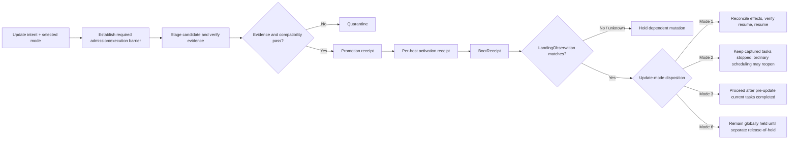
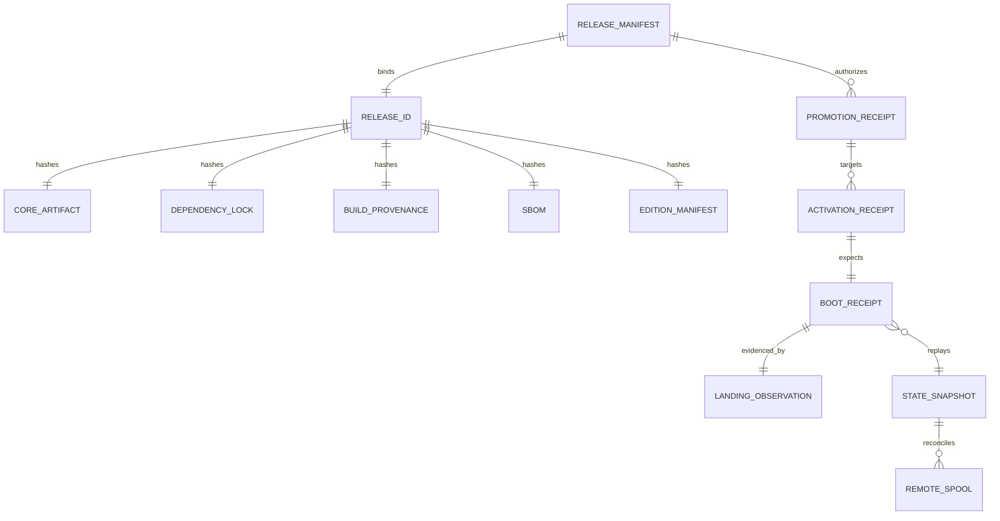

# DS-25 — Update, Release, Rollback, and Disaster-Recovery Contract

## Executive summary

**Research cut-off: October 1, 2026.** The uploaded DS-25 brief resolves the otherwise unspecified research topic: it explicitly invokes an investigation of update modes, release identity, activation receipts, migration, rollback, backup/restore, and disaster recovery for Recursion v3. Accordingly, the worked deliverable below uses **DS-25 as the concrete case study rather than the generic AI-productivity placeholder** while preserving the requested research plan, annotated sources, literature-review template, data-collection plan, visualizations, timeline, findings, recommendations, and stakeholder map. fileciteturn0file0

The central finding is that **software rollback, state recovery, history readability, newest-work preservation, and task resumability are different propositions and must never share one “recovered” bit**. The DS-25 brief already requires four separately measured restoration outcomes and forbids claiming that an old executable reverses an already accepted external effect. fileciteturn0file0 Public evidence supports that separation: SemVer communicates compatibility of a declared public API rather than database-schema, policy, build-provenance, or state-recovery compatibility; Microsoft likewise recommends maintaining application compatibility with previous schema versions and sequencing destructive schema changes over multiple versions where rollback is required. citeturn12view4turn14view2

The recommended starting disposition is therefore **verified compatible executable rollback while retaining the newest canonical state/history, followed by either verified task resume or explicit hold**. It is conditional, not universal. Its decisive falsifier is any trial in which the retained release cannot decode or replay the newest committed event/state/checkpoint, would lose newest work, or would contradict a real or ambiguous external effect. Once such a forward-only boundary has been crossed, **repair-forward, component isolation, or a separately restored noncanonical instance** is safer than a false rollback claim. This recommendation is an inference from the local requirements plus backward-compatibility and supply-chain evidence; it has not been runtime-verified. fileciteturn0file0 citeturn14view2

The exact update contract should make the six required modes observably different. In particular, **Mode 2** terminates the tasks that were current at update admission but may return the system to ordinary post-update scheduling after successful landing; **Mode 6** installs a system-wide execution/admission barrier and remains held even after the new release lands until a separate authorized release-of-hold event. That distinction makes the two modes falsifiably different under failure rather than alternate labels for the same shutdown path. fileciteturn0file0

Configuration publication should use **expected-revision compare-and-set semantics**, producing one receipt when a configuration revision is accepted and a different receipt when a runtime/session demonstrably adopts it. RFC 9110's `If-Match` semantics provide a strong analogous model: a state-changing operation is conditional on the currently observed validator and must not proceed when that precondition fails, specifically to prevent lost updates. citeturn14view0turn14view1 A configuration readback therefore proves only what is durably accepted; it is not evidence of runtime adoption.

Release identity should be multidimensional, exactly as DS-25 requires: product SemVer, protocol major/minor, schema epoch, constitution/policy digest, core artifact digest, dependency-lock digest, build-provenance digest, SBOM digest, and edition-manifest digest. fileciteturn0file0 The authenticity chain should use the threat properties of TUF-style versioned/expiring metadata, SLSA v1.2 provenance verification, and a deterministic SBOM representation, without prematurely selecting a signing implementation or updater. TUF requires clients not to replace trusted metadata with lower-version metadata and not to trust expired metadata; SLSA v1.2 calls for validating provenance signatures, artifact subjects, builder identities, build types, and external parameters; SPDX 3.0.1 defines a deterministic canonical serialization suitable for a stable SBOM digest. citeturn13search11turn13search1turn12view2

A bit-for-bit reproducible build is useful evidence of **source/build-input-to-artifact correspondence**; it does **not** show that the source is semantically safe, that a migration preserves state, that external effects are reversible, or that task recovery succeeds. Reproducible-build literature defines reproducibility around bit-identical results, while CHAINIAC demonstrates how verified builds can be combined with independent release witnesses and transparency. citeturn14view7turn14view4

For disaster recovery, a backup cannot be called consistent merely because files were copied successfully. The report specifies a snapshot receipt binding a state/event high-water mark, checkpoint digest, schema epoch, immutable artifact set, and consistency evidence. With an active writer, the exact mechanism remains **unverified until a storage engine is selected**: the selected engine must either provide documented point-in-time snapshot semantics or the system must establish a writer barrier/fence around the snapshot boundary. DS-25 additionally requires encrypted offsite capability, fresh-host restore, key/credential separation, fault injection, and remote-spool reconciliation. fileciteturn0file0 CISA independently recommends offline encrypted backups and regular testing of backup availability and integrity in disaster-recovery scenarios. citeturn13search0

No numeric RPO, RTO, support duration, emergency deadline, storage-engine behavior, or restore guarantee is ratified here. Those remain **unknown until measured or Owner-decided**, consistent with the brief's requirement that missing verification is never a pass. fileciteturn0file0

## Research method and source base

**Methodology.** The research proceeded from the supplied DS-25 directive as the requirements baseline, then triangulated its consequential design claims against primary standards, official security guidance, current supply-chain specifications, industry architecture guidance, and peer-reviewed systems/security research. The evidence hierarchy was: primary normative specifications and government guidance first; peer-reviewed primary research second; official industry architecture documentation third; secondary commentary only where it added terminology rather than authority. This follows the brief's own requirement to prefer standards, official documentation, pinned source, licenses, and peer-reviewed work. fileciteturn0file0

The search strategy covered the RFC Editor/IETF corpus, NIST and CISA, TUF, SLSA/OpenSSF/Linux Foundation material, SPDX, CycloneDX/OWASP/Ecma, USENIX, IEEE/arXiv author manuscripts, and major-vendor architecture documentation. Search families included `software update rollback freeze attack metadata expiration`, `release provenance artifact verification reproducible build`, `SBOM canonical serialization`, `optimistic concurrency expected revision lost update`, `expand contract schema rollback`, `backup restore RPO RTO encrypted offline`, `software update administrator recovery`, and `verified software update transparency`. Because release/security specifications change, currently published versions were checked as of the research cut-off. SLSA's published specification identifies v1.2 as approved; CycloneDX's official overview identifies 1.7 as its current version; SPDX documentation is available for 3.0.1. citeturn12view1turn12view3turn12view2

**Inclusion criteria** were English-language primary or official material; current normative specifications where available; peer-reviewed research with inspectable methods; sources directly relevant to update authenticity, schema compatibility, rollback, restore, or disaster recovery; and sources whose claims could be separated from vendor-product selection. **Exclusions** included unpinned vendor marketing, claims based solely on package import or process startup, product-specific behavior treated as a universal guarantee, private repository material, sources requiring hidden credentials, and prescriptive choices among the still Owner-owned storage engine, packaging format, signing stack, update channel, or SBOM tool. Those unresolved selections remain outside the research authority. fileciteturn0file0

**Research timeline.** Because this is a design investigation rather than a deployment plan, the useful timeline is gate-based rather than a speculative duration. Evidence is pinned first; the contract is then drafted; adversarial trials are executed against a later implementation; unresolved policy choices go to the Owner; independent acceptance follows only after falsification tests and empirical recovery measurements. This avoids presenting unevidenced calendar estimates as guarantees. fileciteturn0file0

| Gate | Work product | Exit condition | Status in this report |
|---|---|---|---|
| Evidence freeze | Source register, requirements map, claim classification | Consequential claims have a source or are labeled inferred/unverified | **Produced** |
| Contract draft | Six modes, receipts, `ReleaseId`, `BootReceipt`, migration and restore rules | Every required behavior has a falsifiable observable | **Produced as proposal** |
| Adversarial verification | Stale-write, partial-landing, incompatible rollback, migration and DR fault trials | Independent evidence for each required outcome | **Not executed; unknown** |
| Owner decisions | Storage/package/signing/channel/tool choices, support policy, exact Stop scopes | Explicit Owner decisions recorded | **Open** |
| Independent acceptance | Four restoration outcomes and recovery objectives measured separately | Independent reviewer, not implementer self-PASS | **Not executed** |

### Annotated authoritative source set

The governing local source is the supplied DS-25 research directive itself. fileciteturn0file0 The following ten public sources form the external evidence base.

| Source | Type | Why it is authoritative and how it is used |
|---|---|---|
| [The Update Framework Specification v1.0.36](https://theupdateframework.github.io/specification/v1.0.36/) | Primary specification | Supplies a mature threat model for signed update metadata, metadata version rollback protection, expiry/freeze defenses, threshold authorization, and target integrity. TUF requires metadata versions not to go backward and expired metadata not to be trusted. It is used here as a **reference security model**, not as a selected update/signing stack. citeturn13search11 |
| [SLSA Specification v1.2](https://slsa.dev/spec/v1.2/) | Primary specification | Current approved SLSA specification for software supply-chain provenance. Its verification guidance checks provenance signatures, builder identity, artifact digest/subject, build type, and external parameters. It supports the proposed build-provenance portion of `ReleaseId`. citeturn12view1turn13search1 |
| [SPDX Specification 3.0.1](https://spdx.github.io/spdx-spec/v3.0.1/) | Primary standard | Defines SPDX's model and a canonical serialization that is normalized, deterministic, and reproducible. That property makes canonical SPDX 3.0.1 suitable for calculating a stable `sbom_digest`, without selecting a particular SBOM-generation tool. citeturn12view2 |
| [CycloneDX Specification Overview](https://cyclonedx.org/specification/overview/) | Official standard/project | Official site reports CycloneDX 1.7 as current, released October 21, 2025, with components, dependencies, services and other supply-chain structures. It is suitable as an interoperability export from the canonical SBOM representation, not as the canonical identity itself. citeturn12view3 |
| [Semantic Versioning 2.0.0](https://semver.org/) | Primary specification | Defines MAJOR/MINOR/PATCH changes relative to a declared public API. This establishes why product SemVer is useful but insufficient to encode protocol, schema, policy, artifact, or state-recovery compatibility. citeturn12view4 |
| [RFC 9110 — HTTP Semantics](https://www.rfc-editor.org/rfc/rfc9110.html) | Internet standard | `If-Match` provides a well-defined compare-before-state-change pattern for avoiding lost updates: a failed precondition prevents the mutation. It supplies the model for expected-revision configuration publication. citeturn14view0turn14view1 |
| [NIST SP 800-34 Rev. 1](https://csrc.nist.gov/pubs/sp/800/34/r1/upd1/final) | Official government guidance | Establishes contingency planning as coordinated recovery of systems, operations and data after disruption. It provides the appropriate framework for treating recovery as more than merely restarting an executable. citeturn12view6turn13search3 |
| [CISA StopRansomware Guide](https://www.cisa.gov/stopransomware/ransomware-guide) | Official government guidance | Recommends offline encrypted backups and regular testing of availability/integrity in disaster-recovery scenarios, supporting the offsite/offline encrypted and restore-test portions of DS-25. citeturn13search0 |
| [Azure Architecture Center — Storage and Data](https://learn.microsoft.com/en-us/azure/architecture/guide/multitenant/approaches/storage-data) | Official industry architecture guidance | Advises version tracking, application compatibility with at least one previous schema, and sequencing destructive schema changes across versions to support rollback. Used as corroboration for expand/contract-style migration compatibility, not as a database selection. citeturn14view2 |
| [CHAINIAC, USENIX Security 2017](https://www.usenix.org/conference/usenixsecurity17/technical-sessions/presentation/nikitin) | Peer-reviewed research | Demonstrates an update framework in which independent witnesses check release policy, build verifiers validate source-to-binary correspondence, and a tamper-resistant release log improves transparency. It supports separating artifact/build authenticity from a bare version number. citeturn14view4 |

### Literature-review template populated with relevant research

| Authors / year | Methods | Sample / evaluation | Key result | Limitation for DS-25 |
|---|---|---|---|---|
| Nikitin et al., 2017 | Security architecture, prototype and empirical evaluation | Reproducible Debian packages plus PyPI data | Independent witnesses, verified builds and transparent release logging can reduce dependence on a single release authority; prototype evaluation showed practical verification overhead. citeturn14view4 | Validates release-process transparency, **not** application-state rollback, task resumability, or DR. |
| Li et al., 2019 | Survey plus in-depth interviews | 102 system administrators; 17 interviews | Administrators manage updates through multiple stages and face operational considerations distinct from end users, supporting explicit staging/testing/recovery states. citeturn14view5 | Human/process study; does not specify a deterministic update protocol. |
| Altekar et al., 2005 | Prototype dynamic-patching system and vulnerability trials | 26 CERT vulnerabilities; 22 dynamically patched | Certain updates can be introduced without conventional restart, with low measured runtime overhead in the tested prototype. citeturn14view6 | Narrow patch class and older systems context; says little about durable event state, migrations, or distributed effects. |
| Lamb & Zacchiroli, 2021/2022 | Systems/practitioner analysis of reproducible builds | Debian/Reproducible Builds experience | Reproducibility means repeated builds produce bit-for-bit identical output and provides integrity/QA evidence. citeturn14view7 | Bit equality does not establish semantic safety, correct migration, or successful recovery. |
| Malka, Zacchiroli & Zimmermann, 2025 | Large-scale historical rebuild analysis | 709,816 Nix packages from 2017–2023 snapshots | Reported very high rebuildability and reproducibility varying roughly from 69% to 91%, demonstrating that reproducibility is measurable at ecosystem scale rather than merely aspirational. citeturn12view13 | Functional-package ecosystem; cannot be generalized into Recursion runtime-state recovery guarantees. |
| Sharma, Baudry & Monperrus, 2025 | Empirical analysis and canonicalization of unreproducible Java builds | Large corpus of unreproducible Java artifacts | Shows that reproducibility failures can often arise from representational nondeterminism and that canonicalization can recover reproducibility for a material subset. citeturn12view14 | Package-byte reproducibility only; does not validate release policy, runtime state or side-effect reconciliation. |

The literature converges on one especially important point for DS-25: **release evidence is layered**. Source-to-binary correspondence, update authorization, schema compatibility, runtime activation, durable-state recovery, and external-effect reconciliation are different checks. CHAINIAC couples transparency with verified builds; SLSA separately requires provenance verification against trusted expectations; reproducible-build research limits its claim to reproducibility of outputs. None provides evidence that “a binary starts” implies “the previous application state and tasks are recovered.” citeturn14view4turn13search1turn14view7

## Operational update and configuration contract

### Observable vocabulary

The following definitions are **proposed contract semantics**, derived from the six modes required in DS-25; they are not observations of an implemented runtime. fileciteturn0file0

**Current tasks** are the finite set of task instances that, at the event sequence where the `UpdateIntent` is accepted, are in an execution-bearing state such as `running`, `effect_inflight`, or `checkpointing`. Merely queued work, idle sessions, and suspended tasks are not “current tasks.” Capturing the task-set boundary in the update-intent receipt prevents the membership of the set from changing retrospectively.

**Everything** means the full mutation/execution surface in the update target scope: new admissions, child/session spawns, queued-to-running transitions, scheduler dispatch, task execution, and new external-effect dispatch. It does **not** mean erasing state or pretending that an external effect already accepted by another system has been cancelled. That restriction comes directly from the supplied brief. fileciteturn0file0

**Lands** means more than file download, slot switch, or process start. A release has landed on host `H` only when the host has produced a valid `BootReceipt` matching the intended `ActivationReceipt`, its complete `ReleaseId` matches the promoted candidate, replay/recovery status is known, writer-fence state is known, and a `LandingObservation` binds those facts to `H`. A target fleet has landed only when every targeted host is either matched to its intended landing or explicitly isolated. This is an inferred contract designed to satisfy DS-25's requirement for per-host observation and partial-activation handling. fileciteturn0file0

### The six update modes

| Mode | Required observable behavior | Distinguishing failure behavior |
|---|---|---|
| **Interrupt, save, update, resume** | Close relevant admissions; freeze the captured current-task set; checkpoint each recoverable task; stop further execution/effect dispatch at a safe boundary; activate candidate; require matching landing; reconcile ambiguous effects; resume only tasks with valid resume evidence. | Failure before landing keeps tasks checkpointed/held. A task with an ambiguous external effect may not resume as though the effect never happened. |
| **Interrupt, update, stop tasks** | Interrupt and preserve enough state/history to diagnose recovery; mark captured current tasks `stopped_by_update`; activate and verify landing. Those task IDs are not automatically resumed. | **Unlike Mode 6**, successful landing can return the scheduler to ordinary admission of new work, subject to any independent PAUSE/Stop. |
| **Wait until current tasks finish** | Freeze the initial current-task set and prevent new work from joining it; allow those tasks to terminal completion; leave queued work queued; stage/activate only after the captured set terminates. | A hung current task delays activation rather than being silently converted to interruption. |
| **Auto-update off** | Discovery/notification may occur, but the system does not autonomously promote or activate a candidate. | Availability of an update causes no release transition. |
| **Notify and escalate to Owner** | Emit a durable notification/escalation receipt containing candidate identity, compatibility/evidence status and reason; no activation without the required explicit authority. | Notification loss/retry is idempotent; lack of Owner authorization remains a hold, not implicit approval. |
| **Stop everything and wait until update lands** | Establish the global update barrier over new admissions, scheduling, spawns and effect dispatch; bring running work to a recorded stopped/checkpointed state; activate and verify landing; **retain the barrier after landing**. | A correct landing is insufficient to resume. A separate authorized release-of-hold receipt is required, making Mode 6 observably different from Mode 2. |

These semantics preserve all six modes without claiming that their mechanics alone guarantee any restoration outcome. fileciteturn0file0

### Six-mode by four-outcome matrix

No implementation, rollback, or restore trial was authorized or executed. The correct empirical value for every restoration cell is therefore **`unknown`**, not “pass.” The table deliberately distinguishes intended update behavior from measured recovery. fileciteturn0file0

| Update mode | Working executable | Readable history | Newest work preserved | Tasks resumable |
|---|---|---|---|---|
| Interrupt/save/update/resume | **unknown** | **unknown** | **unknown** | **unknown** |
| Interrupt/update/stop tasks | **unknown** | **unknown** | **unknown** | **unknown** — mode intentionally does not auto-resume captured tasks |
| Wait current tasks finish | **unknown** | **unknown** | **unknown** | **unknown** |
| Auto-update off | **unknown** | **unknown** | **unknown** | **unknown** |
| Notify/escalate Owner | **unknown** | **unknown** | **unknown** | **unknown** |
| Stop everything/wait for landing | **unknown** | **unknown** | **unknown** | **unknown** — resume is additionally prohibited until hold release |

The required negative trial is straightforward: take a retained old executable that is demonstrably runnable, pair it with a state/checkpoint/event history produced after an incompatible migration or forward-only change, and test the four outcomes independently. **The test succeeds as a falsifier if the executable starts while one or more of history readability, newest-work preservation, or task resumability fails or remains unknown.** A system reporting “full recovery” solely from process startup fails the contract. fileciteturn0file0

### Expected-revision configuration publication

A configuration write should be represented as:

`PublishConfig(expected_revision, proposed_config_digest, propagation_policy, authority_ref)`

The authoritative configuration aggregate compares `expected_revision` with its current accepted revision. If unequal, the command performs no state mutation and emits a rejection recording at least the expected revision, actual current revision, proposed digest and reason. This is equivalent in purpose to the RFC 9110 lost-update protection in which `If-Match` must be evaluated before a state-changing method and a failed condition prevents the requested mutation. citeturn14view0turn14view1

On a successful publication, two receipts are required:

| Receipt | Minimum fields | What it proves | What it does **not** prove |
|---|---|---|---|
| `ConfigAcceptedReceipt` | `receipt_id`, prior revision, accepted revision, config digest, propagation policy, authority ref, acceptance event high-water | Canonical configuration state accepted revision `R` | That any already-running runtime/session has adopted `R` |
| `ConfigAppliedReceipt` | `receipt_id`, accepted-receipt ref, runtime/session ref, prior applied revision, newly applied revision, application event sequence, result | This particular runtime/session crossed to `R` | That every other session has crossed |

A configuration GET/readback therefore shows accepted state only. It cannot be substituted for a `ConfigAppliedReceipt`.

The **stale-write falsifier** is a concurrent test: client A reads revision `41`; client B successfully publishes `42`; client A then attempts a write with `expected_revision=41`. Any resulting configuration revision or applied runtime change from A is a failure. RFC 9110's treatment of validator preconditions is direct precedent for this concurrency property. citeturn14view1

Two propagation policies should be explicit:

| Session state | `outstanding_sessions` | `new_or_isolated_only` |
|---|---|---|
| Active | Apply at next verified mutation-safe boundary; until then mark `pending_revision` | Remains pinned to old accepted revision for its lifetime |
| Queued | Apply before first execution | Remains pinned if already part of an existing session lineage |
| Idle | Apply before next work admission | Remains pinned |
| Suspended | Apply before resumed mutation; incompatible checkpoint means isolate/hold rather than silently translate | Remains pinned on resume unless explicitly converted to isolated/new execution |
| Concurrent spawn after acceptance | Must bind the new revision; if the parent cannot safely cross yet, block spawn or create an explicitly isolated child | Ordinary descendants inherit the parent's pinned revision; an explicitly new/isolated session receives the new revision |
| Terminal | No action | No action |

This distinction is proposed to make propagation deterministic. It still requires Owner ratification because the brief identifies both choices but does not pick the default. fileciteturn0file0

A behavioral change under unchanged protocol/schema must still be visible because release identity carries independent core-artifact, dependency-lock, policy, provenance, SBOM, and edition-manifest digests. SemVer alone cannot do this: SemVer's normative meaning is explicitly tied to public-API compatibility. citeturn12view4

**PAUSE and Stop composition.** An update must never clear, decrement, or bypass an existing PAUSE/admission epoch or Stop control. The `BootReceipt` must carry the inherited PAUSE/Stop epochs and scope; post-update admission must satisfy both the normal control-plane epoch and update disposition. A retained release slot has no automatic authority to become canonical. The supplied brief refers to “the three Stop modes” but does not define their exact names/scopes in the baked context, so those detailed semantics remain **unverified/Owner-resolved rather than invented here**. fileciteturn0file0

## Release identity, staging, activation, and support policy

### Lifecycle and receipts

The proposed lifecycle is:

`candidate_received → staged → eligible | quarantined → promoted → activation_requested → activated → landing_observed`

No stage may be skipped by “emergency” status, and quarantine may be exited only through a new verified decision referencing the evidence that changed. This design reflects DS-25's requirement for staged/quarantine/promote/activation receipts and the general security principle that artifact provenance only helps when a verifier actually evaluates it against trusted expectations. SLSA v1.2 explicitly requires verification of provenance and its expected builder/build parameters. fileciteturn0file0 citeturn13search1

| Record | Required fields |
|---|---|
| `StageReceipt` | receipt schema version; receipt ID; candidate `ReleaseId`; release-manifest digest; staged artifact-set digest; observed artifact lengths/hashes; provenance-verification result; SBOM-verification result; target slot ref; event high-water |
| `QuarantineReceipt` | candidate/stage refs; reason code; failed verifier/policy; evidence digest; affected mutation scope; disposition |
| `PromotionReceipt` | candidate/stage refs; policy digest; authorization ref; compatible protocol/schema classes; permitted target set; promotion event sequence |
| `ActivationReceipt` | host ref; promotion ref; `from_release_id`; `to_release_id`; activation operation ID; retained-slot identities; expected landing nonce/ref; expected writer-fence disposition |
| `BootReceipt` | complete release identity and runtime/recovery facts specified below |
| `LandingObservation` | host ref; activation ref; observed `BootReceipt` digest; observed full `ReleaseId`; runtime instance ref; landing event sequence; canonical/noncanonical writer role; `complete/partial/unknown` status |

A host with an `ActivationReceipt` but no matching valid `LandingObservation` is `activation_unlanded`. It may not perform mutation that depends on the new release. A host that appears with a release identity not reachable from a trusted promotion is `unknown_release`; it enters recovery/quarantine status rather than acquiring mutation authority. A partially activated fleet is represented as an explicit per-host state map rather than rounded up to “updated.” This is an inferred rule required to make DS-25's partial-activation requirement enforceable. fileciteturn0file0

### `ReleaseId`

The release identity should be a structured value, not a decorated SemVer string. This directly instantiates the minimum in the supplied brief. fileciteturn0file0

| `ReleaseId` field | Independent verification rule | Why it cannot be collapsed into SemVer |
|---|---|---|
| `product_semver` | Parse/validate against product release policy | Describes declared public-API compatibility only. citeturn12view4 |
| `protocol_major`, `protocol_minor` | Compare against explicit peer compatibility matrix | Wire compatibility can change independently of product API |
| `schema_epoch` | Verify decoder/migration graph supports observed canonical state/checkpoint | Persistent-state compatibility has its own forward-only boundaries |
| `constitution_policy_digest` | Hash exact trusted policy/constitution representation | Same binary/API can operate under different authority rules |
| `core_artifact_digest` | Hash actual artifact bytes and compare with authorized release target | Binds release to bytes, not a label |
| `core_dependency_lock_digest` | Hash exact lock/dependency-resolution input | Dependency graph can change without an API-version change |
| `build_provenance_digest` | Retrieve provenance by digest and verify artifact subject, signature, trusted builder, `buildType`, external parameters | SLSA makes provenance a separately verifiable evidence object. citeturn13search1turn13search12 |
| `sbom_digest` | Hash canonical SPDX 3.0.1 representation | Canonical serialization provides deterministic representation independent of the product version. citeturn12view2 |
| `edition_manifest_digest` | Hash authorized manifest describing permitted optional capability set | Edition composition can differ while core product version remains unchanged |

For interoperability, a CycloneDX export is reasonable, but the current official CycloneDX version is 1.7 as of the research cut-off. A future 2.0 should not be treated as ratified merely because development exists. citeturn12view3 This recommendation selects neither a generator nor a signing tool.

### Authenticity chain

The proposed chain is:

`trusted release root/policy → authorized release manifest → target length/hash → ReleaseId → build provenance → dependency lock → canonical SBOM → edition manifest → StageReceipt → PromotionReceipt → ActivationReceipt → BootReceipt → LandingObservation`.

TUF provides useful reference semantics at the metadata edge: trusted metadata versions cannot regress, expired metadata cannot be trusted, role signatures may require thresholds, and target identity is bound to verified metadata. citeturn13search11 SLSA adds artifact-to-provenance verification: the subject digest must match the artifact, provenance signatures and builder identity are checked, and expected build parameters are compared. citeturn13search1 SPDX 3.0.1's canonical serialization supplies deterministic SBOM bytes for `sbom_digest`. citeturn12view2

No signing stack or update-channel implementation is selected by this architecture. TUF, SLSA and SPDX are being used to pin **properties to require**, not to reopen the Owner-owned implementation choices. fileciteturn0file0

A reproducible build adds a strong cross-check: the same inputs/environment/instructions should yield bit-for-bit identical outputs. citeturn14view7 SLSA v1.2 also defines a verified property for artifacts reproduced by two or more independently operated trusted build platforms. citeturn13search4 What reproducibility does **not** establish is equally important: malicious source can be reproducibly built; application invariants may still be wrong; a migration can still lose state; configuration can still be incompatible; and external effects can still be duplicated. Those are separate acceptance dimensions.

### `BootReceipt`

| Field | Required interpretation |
|---|---|
| `boot_receipt_schema` | Version of receipt encoding |
| `activation_receipt_ref` | Exact activation operation this boot is expected to satisfy |
| `runtime_instance_ref` | Unique non-authority-bearing runtime instance identity |
| `release_id` | Complete structured `ReleaseId`, not just SemVer |
| `release_manifest_digest` | Manifest used to authorize release |
| `core_artifact_digest` | Digest re-observed from running artifact |
| `dependency_lock_digest` | Exact dependency-lock identity |
| `state_checkpoint_digest` | State/checkpoint restored or selected at boot |
| `event_high_water` | Highest canonical event known/replayed |
| `schema_epoch_observed` | Schema epoch actually observed in durable state |
| `configuration_accepted_revision` | Canonically accepted config revision |
| `configuration_applied_revision` | Revision runtime has actually adopted |
| `recovery_disposition` | `normal`, `compatible_rollback`, `repair_forward`, `isolated`, `separate_instance`, or `hold` |
| `replay_status` | Explicit success/failure/unknown rather than inferred from process start |
| `lease_reconciliation_status` | Status of lease/fence reconciliation |
| `effect_reconciliation_status` | Status of real/ambiguous external effects |
| `pause_epoch` and Stop epochs/scope | Persisted control barriers inherited through boot |
| `writer_fence_status` | Whether instance is canonical, noncanonical/read-only, or blocked |
| `optional_capabilities` | Map each capability to exactly `absent`, `disabled`, `incompatible`, `unverified`, `quarantined`, or `active` |

The local requirement is that core boot, replay, lease/effect reconciliation, PAUSE preservation, and owner-status reporting remain possible with every provider, execution engine, plugin and frontend absent. A missing optional capability may block only mutation dependent on that capability; it does not authorize auto-installation, routing substitution, spending, or a pass. This is a DS-25 requirement, not an empirically demonstrated implementation property. fileciteturn0file0

### Support and emergency-update policy

A credible policy must distinguish three clocks:

**Metadata validity** is cryptographic/security freshness. TUF-style metadata semantics fail closed when trusted metadata is expired and prohibit metadata version rollback. citeturn13search11

**Compatibility support** states which protocol, schema, constitution/policy and rollback classes a release can interoperate with.

**Product support** is the Owner's declared maintenance commitment.

Each release manifest should therefore carry signed references such as `support_class`, `support_policy_ref`, compatibility classes, rollback-compatibility class and a support/expiry declaration. **No numeric support duration is ratified in this report**, because DS-25 explicitly forbids presenting one before measurement/decision. fileciteturn0file0

Emergency security updates may carry an explicit `emergency` classification, reason/severity, Owner-defined deadline and altered staging/notification policy, but emergency status must **not** bypass artifact authentication, provenance verification, migration compatibility, update-mode authority, PAUSE/Stop epochs, per-host landing observation, or external-effect reconciliation. An emergency may justify less soak time; it does not justify less identity evidence.

“Revoked/expired SBOM entries” need one qualification. SPDX and CycloneDX are representation standards; they do not themselves create a universal expiry protocol for every software component. The safe rule is therefore: **release metadata, signer/build evidence, or SBOM-derived eligibility evidence that the chosen trust policy marks revoked or expired causes fail-closed admission**. The exact revocation transport remains dependent on the still-unselected signing/trust stack. TUF directly supports expiration/version/key-rotation semantics for update metadata. citeturn13search11

## Migration and rollback versus state recovery

### Expand/contract map

Microsoft's architecture guidance explicitly recommends tracking schema versions, remaining backward-compatible with at least one prior schema where appropriate, and sequencing destructive changes over multiple versions to preserve rollback options. citeturn14view2 DS-25 strengthens that into a one-writer, per-aggregate migration protocol with frozen legacy import and shadow comparison. fileciteturn0file0

| Phase | Canonical contract | Failure rule |
|---|---|---|
| **Additive expand** | Add N+1 fields/events/read support without deleting N representation; retain a single fenced canonical writer | Any client that cannot safely ignore/understand additive state is marked incompatible before promotion |
| **Dual-read / compatible write** | Readers understand N and N+1; the one canonical writer may emit both representations transactionally if needed | “Dual” does not mean two writers |
| **Frozen legacy import** | Fix an immutable legacy import boundary/high-water; import inputs cannot continue mutating behind comparison | A changing legacy source invalidates comparison |
| **Backfill** | Versioned, idempotent transformation with progress receipts; ordinary mutations still use the same fenced writer | Process death resumes from verified progress, not inferred completion |
| **Shadow comparison** | Derive old/new projections from the same event high-water and compare digests/invariants | Any unexplained mismatch blocks cutover |
| **Cutover** | Atomically change authoritative read/write schema epoch and writer fence; establish exactly one canonical writer before mutation | Partial writer transition is a hold/quarantine condition |
| **Contract** | Remove legacy fields/readers only after no supported runtime/checkpoint/retained rollback slot requires them | Contraction is a forward-only boundary unless an explicit reverse migration exists |

The same phases should be applied per logical aggregate, with aggregate-specific invariants:

| Aggregate | Shadow/cutover invariant |
|---|---|
| Canonical event/state | Same accepted event high-water yields equivalent canonical state/invariants |
| Configuration | Revision, configuration digest, accepted/applied distinction preserved |
| Task/session | Task identity, status and compatible checkpoint meaning preserved |
| Effect/lease | No accepted external effect becomes “unaccepted”; leases/fences reject stale writers |
| Remote spool | Stable effect IDs/source sequence reconcile without duplication or omission |

The concrete storage transactions implementing these phases remain **unverified until the storage engine is selected**. The contract deliberately specifies outcomes and fences rather than assuming database-specific primitives. fileciteturn0file0

### Forward-only boundaries

A **real or ambiguous external effect** is always forward-only for rollback semantics. A release rollback cannot truthfully claim to reverse an email already sent, payment already accepted, process already launched, external API mutation already acknowledged, or an effect whose remote outcome is uncertain. The correct action is to reconcile forward against the durable effect ledger. This is a direct DS-25 constraint. fileciteturn0file0

A **destructive schema contraction** becomes forward-only when information or interpretation needed by an older executable no longer exists and no verified reverse transformation is available. Industry schema guidance similarly treats destructive schema evolution as something that must be sequenced carefully if rollback is expected. citeturn14view2

An **N+1-only checkpoint/event** is forward-only with respect to release N when N cannot decode it. The fact that the N binary itself remains runnable does not alter that incompatibility.

A **policy/constitution change** may also forbid an otherwise executable old release from acquiring authority. That is why `constitution_policy_digest` is independent of the artifact digest. fileciteturn0file0

### Rollback and competing recovery strategies

| Strategy | Appropriate when | Main advantage | Main risk / limitation |
|---|---|---|---|
| **Compatible executable rollback, preserving newest state/history** | Retained release can decode newest durable state/checkpoints and all external effects are reconciled | Smallest code-change surface during incident; can regain a known executable without discarding new state | Fails after incompatible state evolution; a successful process start can create false confidence |
| **Repair-forward** | Forward-only schema/checkpoint/effect boundary crossed | Operates from reality of newest state rather than pretending reversal | Introduces new code/change under incident pressure |
| **Component isolation** | Fault localized to optional provider/plugin/frontend/component and core state is compatible | Preserves healthy core and minimizes blast radius | Does not solve core-schema corruption or global state incompatibility |
| **Wait** | Existing tasks can safely finish and update urgency permits | Avoids interruption/checkpoint complexity | Does not cure incompatibility or security exposure |
| **Separate-instance restoration** | Existing host/storage may be damaged/compromised or recovery needs independent inspection | Clean recovery environment and useful forensic/read-only path | Must remain noncanonical until reconciliation and writer fencing succeed |

**Recommended starting policy:** prefer **verified compatible executable rollback while retaining newest canonical work/history**, then independently verify resume or keep tasks held. Its named primary competitor is **repair-forward**. Its decisive falsifier is any evidence that the retained executable cannot interpret the newest accepted state/checkpoint/events, would require discarding newest work/history, or would cause contradictory handling of a real/ambiguous external effect. In that case the default switches to repair-forward or isolation/separate-instance recovery. fileciteturn0file0

What the rollback path does **not** prove: it does not prove history readability merely because the process launches; it does not prove newest work survives; it does not prove tasks can resume; it does not prove external side effects are undone; and it does not prove the retained release remains authorized by the current constitution/policy. Those are separate tests.

**Offline host.** Catch it up in isolation; verify migrations and state parity; reconcile spools/effects; only then acquire a fresh canonical writer fence. A retained old instance must never race the existing canonical writer. fileciteturn0file0

**Torn migration.** Before a forward-only cutover, a retained compatible slot can be considered if its decoder/state contract remains valid. After destructive contraction or an incompatible checkpoint, repair-forward or separate-instance recovery is required.

**Disk full.** Hold/quarantine the transition and retain the last verified state/slot. Deleting the only known-good backup, event history, or rollback evidence merely to finish an update would turn a capacity incident into irreversible recovery damage.

## Backup, restore, disaster recovery, and measurement

### Consistent backup contract

A backup unit should combine the selected canonical state/event-store snapshot with its immutable release artifacts and evidence. A successful copy is insufficient. DS-25 requires consistency between the selected event store and artifacts, an encrypted offsite option, restore to a fresh host, separate key/credential provisioning, fault injection, and remote-spool reconciliation. fileciteturn0file0

A `SnapshotReceipt` should bind:

`backup_id`, complete `ReleaseId`, `schema_epoch`, `event_high_water`, `state/checkpoint_digest`, accepted/applied configuration revisions, immutable artifact-set digest, release-manifest/provenance/SBOM digests, writer-fence revision, snapshot-consistency method, verification evidence digest, and final disposition.

When the writer remains active, a snapshot is “consistent” only if the future selected engine provides documented atomic point-in-time snapshot semantics, **or** a writer barrier/fence establishes a high-water point before the captured data is declared complete. Since the storage engine is expressly unselected, the exact implementation is **unknown** and cannot be honestly filled in here. fileciteturn0file0

Post-snapshot verification should prove that all required canonical events through the declared high-water are present, replay reproduces the expected state/checkpoint digest, immutable artifact hashes match their release identities, and migration progress is internally coherent. Those checks turn “backup file exists” into a falsifiable restoration claim.

CISA recommends keeping critical-data backups offline and encrypted and regularly testing their availability and integrity under disaster-recovery conditions. citeturn13search0 The DS-25 design should add an offsite copy to that posture while keeping runtime secrets outside the backup authority boundary. fileciteturn0file0

**Key exclusion.** The backup may include public trust roots, non-secret key identifiers, credential references and policy needed to know *what* to re-provision, but not live provider tokens, private signing keys, runtime credentials, or other authorities that would allow possession of a backup to impersonate the active system. Backup-decryption keys and operational credentials should be separately provisioned during recovery. This is a proposed enforcement of the local requirement that restored data not automatically carry inappropriate authority. fileciteturn0file0

### Fresh-host restoration

A fresh-host restore should proceed in this order:

1. Establish a clean recovery host independent of the damaged host's VHDX/provider-managed volume.
2. Provision backup-decryption capability separately; do not yet provision operational mutation credentials.
3. Verify release metadata, artifact hashes, provenance, SBOM and edition manifest against the trusted recovery policy.
4. Materialize the immutable artifacts and restore the consistent snapshot.
5. Replay through the recorded event high-water and rebuild projections.
6. Compare resulting canonical-state/checkpoint digests and migration state.
7. Apply only verified forward migrations needed by the target release; do not “downgrade” across a destructive boundary.
8. Reconcile leases, writer fences, external effects, PAUSE/Stop epochs and remote-node spools.
9. Boot with every optional provider/engine/plugin/frontend absent and emit a complete `BootReceipt`.
10. Grant canonical writer authority only after restore verification and landing succeed; otherwise remain read-only, quarantined, or held.

This is a **restore procedure specification only**; no restore was performed. NIST treats contingency planning as coordinated recovery of systems, operations and data after disruption, supporting the distinction between successful startup and operational recovery. citeturn13search3

### Remote-spool reconciliation

Each remotely spooled operation needs a stable operation/effect ID, source-node sequence/digest, and originating lease/fence identity. Following controller recovery:

- an operation already represented as accepted in the canonical event/effect ledger is acknowledged/deduplicated;
- an operation demonstrably unaccepted may be re-admitted only under current authority and policy;
- an operation carrying a stale lease/fence is rejected;
- an operation whose external outcome is ambiguous is retained as `unknown` and reconciled forward against the external system rather than expired, refunded, or “rolled back” by assertion.

These semantics derive directly from DS-25's prohibition on falsely undoing already-accepted external effects and its requirement to reconcile remote spools after recovery. fileciteturn0file0

### Boundary fault-injection matrix

The required five fault classes should be injected at every lifecycle boundary rather than tested only against steady state. The table specifies expected disposition; empirical pass/fail remains unknown until trials exist. fileciteturn0file0

| Fault | Staging | Activation | Backup | Restore |
|---|---|---|---|---|
| **Torn write** | Artifact/manifest/digest mismatch → quarantine; partial stage cannot promote | Incomplete slot/pointer transition → use only a fully committed compatible state or hold; never infer landing | Incomplete backup remains unusable; prior verified backup retained | Checksum/replay/state-digest mismatch → restore failed/unknown; no writer authority |
| **Disk full** | Stage fails before promotion; existing active release unaffected | Preserve prior verified slot where possible; otherwise hold | Backup fails without deleting sole prior verified copy | Halt before admission; partial restored state remains quarantined |
| **Process death** | Retry/resume from durable operation/receipt ID | Activation with no subsequent matching landing becomes `activation_unlanded` | In-progress backup is not promoted to verified | Restart from last durable verified restore phase, not from process memory |
| **Duplicate delivery** | Same operation ID is idempotent | Same activation operation cannot produce a second semantic switch | Same backup/snapshot ID is deduplicated | Replay/event/effect IDs prevent duplicated accepted mutations/effects |
| **Stale lease/fence** | No staging operation gains mutation authority merely from stale identity | Retained instance remains noncanonical | Any coordinated writer barrier must reject stale writer identity | Restored host cannot become canonical while presenting stale fence/lease |

The exact atomic-write and fencing mechanism is storage-engine dependent and therefore remains **unverified**, rather than being silently assumed.

### RPO, RTO, and data-collection plan

No numeric RPO/RTO should be invented. The useful measurements are:

**RPO**: the difference between the pre-failure canonical accepted-event high-water and the highest high-water recoverable from a verified backup, augmented by any unresolved remote-spool/effect ambiguity. A wall-clock equivalent can be reported afterward, but the event-space measurement avoids equating `unknown` work with zero.

**RTO**: elapsed recovery time from the declared recovery start until a fresh or repaired instance has passed replay, migration, effect/lease reconciliation, `BootReceipt`, landing verification and canonical-writer admission. “Process started” is not the RTO endpoint.

NIST contingency guidance provides the broader recovery-planning framework, while DS-25 specifically requires numeric bounds to remain unratified until measurement. citeturn12view6 fileciteturn0file0

| Metric | Primary source | Frequency / trigger | Tooling class, without vendor selection |
|---|---|---|---|
| Update-mode conformance | Update intent, barrier, task and landing receipts | Every release candidate plus each fault-injection campaign | Deterministic synthetic update harness |
| Config acceptance→application lag | `ConfigAcceptedReceipt` ↔ `ConfigAppliedReceipt` | Every config publication | Receipt-join/conformance checker |
| Stale publication rejection rate | Config command/rejection receipts | Every concurrency test and sampled production-equivalent test | CAS race/fault harness |
| Per-host landing completeness | Promotion, activation, `BootReceipt`, landing records | Every activation | Release identity/receipt verifier |
| Working-executable outcome | Fresh-host/rollback trial | Every supported release transition | Boot verifier |
| Readable-history outcome | Replay/history validation | Every release and migration boundary | Replay/query parity checker |
| Newest-work preservation | Accepted-event HWM vs recovered HWM | Every restore/rollback drill | Event-store parity validator |
| Task resumability | Checkpoint/task receipt comparison | Every release/migration class supporting resume | Deterministic resume harness |
| Writer-fence rejection | Mutation and lease/fence receipts | Every stale-lease trial | Concurrency/fencing fault harness |
| RPO | Failure HWM vs highest verified restorable HWM | Every DR exercise | Receipt/event analysis |
| RTO | Recovery declaration through verified canonical admission | Every DR exercise | External monotonic observation/telemetry |
| Remote-spool reconciliation | Source spool vs canonical effect ledger | Every controller-recovery drill | Stable-ID reconciliation checker |

For RPO/RTO and restoration metrics, record distributions across fault classes and dataset sizes rather than presenting a single optimistic number. Numeric targets remain Owner-owned until empirical distributions exist. fileciteturn0file0

**Suggested visualizations for the eventual evidence package** are a six-mode state-transition chart; a four-outcome restoration heat map with `pass/fail/unknown` as independent dimensions; a per-host activation/landing matrix; a release-identity provenance graph; migration-state progression with forward-only boundaries; RPO and RTO distributions by injected fault class; event-high-water before/after restore; and a remote-spool reconciliation Sankey showing accepted, duplicate, rejected-stale, safely re-admitted, and ambiguous operations. These visualizations should display `unknown` explicitly rather than treating missing observations as zero. fileciteturn0file0

## Claim register, recommendations, stakeholders, and completion gate

### Consequential claim register

Here, **source-documented** means directly supported by a cited public primary/official source; **locally observed** means present in the supplied DS-25 brief, not observed in running software; **inferred** means a contract conclusion synthesized from evidence; and **unverified** means implementation/runtime evidence is still required. fileciteturn0file0

| Claim | Source and version/date | Classification | Confidence | Expiry / revalidation trigger |
|---|---|---|---|---|
| Six update modes must remain distinct | DS-25, updated 2026-09-30 fileciteturn0file0 | Locally observed requirement | High | Owner changes OR-033 |
| Working executable, readable history, newest work and resumable tasks are four separate outcomes | DS-25 fileciteturn0file0 | Locally observed requirement | High | Owner changes restoration contract |
| Restoring an old executable does not imply reversal of external effects | DS-25 fileciteturn0file0 | Locally observed requirement | High | Only explicit Owner constitutional change |
| Mode 2 ends captured tasks but can reopen ordinary post-land scheduling; Mode 6 remains globally held | DS-25 requirements plus contract synthesis fileciteturn0file0 | **Inferred** | Medium-high | Fault trial shows modes not observably distinguishable or Owner specifies different semantics |
| Expected-revision publication must reject stale writes | RFC 9110 lost-update semantics plus DS-25 citeturn14view1 fileciteturn0file0 | Source-documented pattern + inferred application | High | Concurrency test falsifies behavior |
| Accepted and applied config revisions require separate receipts | DS-25 requirement fileciteturn0file0 | Inferred specification | High | Runtime architecture demonstrates another equally falsifiable proof |
| SemVer cannot substitute for schema/protocol/policy/artifact identity | SemVer 2.0.0 defines public-API version semantics citeturn12view4 | Source-documented + inference | High | SemVer specification fundamentally changes |
| TUF-like trusted metadata should fail on version regression/expiry | TUF v1.0.36 citeturn13search11 | Source-documented reference property | High | New TUF spec or different selected threat model |
| Build provenance must be verified, not merely present | SLSA v1.2 verification guidance citeturn13search1 | Source-documented | High | SLSA revision or Owner selects incompatible provenance policy |
| SPDX 3.0.1 canonical serialization can support deterministic `sbom_digest` | SPDX 3.0.1 citeturn12view2 | Source-documented + design inference | High | SPDX canonicalization change |
| CycloneDX 1.7 is suitable as current derived interoperability export | CycloneDX official overview citeturn12view3 | Source-documented/current + recommendation | Medium-high | New final CycloneDX version or Owner choice |
| Reproducible build proves repeatable bit-level output, not semantic recovery safety | Lamb & Zacchiroli; SLSA verified properties citeturn14view7turn13search4 | Source-documented scope + inference | High | New evidence establishing additional verified property |
| `BootReceipt` must make every optional capability explicit and core boot must tolerate all absent | DS-25 fileciteturn0file0 | Locally observed requirement; **runtime unverified** | High requirement / low implementation confidence | Implementation test |
| Expand/contract migration should preserve backward compatibility before destructive contraction | DS-25; Microsoft schema guidance fileciteturn0file0 citeturn14view2 | Locally observed + source-documented | High | Schema/migration model changes |
| Exactly one canonical writer must exist through migration and retained-slot recovery | DS-25 fileciteturn0file0 | Locally observed requirement; implementation unverified | High | Fencing implementation tests |
| Compatible rollback is preferred only while newest state/checkpoints remain compatible | DS-25 plus schema evidence fileciteturn0file0 citeturn14view2 | Inferred recommendation | Medium-high | Any incompatibility/newest-work-loss/effect-conflict trial |
| Offline/encrypted backups and regular restoration testing improve recoverability posture | CISA StopRansomware citeturn13search0 | Source-documented | High | Updated CISA guidance |
| Active-writer snapshot consistency mechanism is engine-dependent | Storage engine intentionally unselected in DS-25 fileciteturn0file0 | **Unverified** | Low until selection | Storage engine selected and proven |
| Fresh-host restore must not inherit operational authority merely from backup possession | DS-25 fileciteturn0file0 | Locally observed + inferred enforcement | High | Credential/trust architecture changes |
| Numeric RPO/RTO and support windows remain unknown before measurement/Owner decision | DS-25 fileciteturn0file0 | Locally observed requirement | High | Controlled measurements and Owner ratification |

### Recommendation and decisive falsifier

Adopt **compatible executable rollback preserving the newest canonical event/state history as the first-line rollback strategy**, but only when all of the following are verified: the retained release is still authorized; it can decode/replay the current schema epoch and all committed events/checkpoints; immutable artifacts and provenance still verify; the retained instance is writer-fenced until admitted; and any real or ambiguous external effects have been reconciled. After those checks, resume tasks only when each has a compatible checkpoint and effect disposition; otherwise hold them. fileciteturn0file0

The principal competing option is **repair-forward**. Repair-forward wins automatically after an incompatible state/checkpoint, destructive contraction without a validated reverse migration, or real/ambiguous external effect that makes “rollback” semantically false. **Separate-instance restoration** is the preferred competitor when the original host or state environment itself is suspect; it remains noncanonical until parity and fencing are proven.

The decisive falsifier for the recommended compatible-rollback-first policy is:

> A controlled trial in which the retained release is authentically valid and executable but cannot reproduce the newest canonical state/history, cannot interpret a current task checkpoint, would discard accepted work, or would cause an already-real/ambiguous external effect to be duplicated or contradicted.

Any such result removes that release/state pair from the compatible rollback class. A process successfully starting does not defeat the falsifier.

### Potential stakeholders

The smallest useful review group spans the **Owner/final authority**, control-plane/constitution owner, deterministic-kernel maintainer, scheduler/session/task owner, storage/replay and migration engineer, release/supply-chain security owner, plugin/adapter owners, recovery/SRE and fault-injection engineer, incident-response/security reviewer, and an **independent acceptance reviewer** who did not implement the candidate. The latter matters because DS-25 explicitly rejects implementer self-PASS as acceptance. fileciteturn0file0

### Open Owner questions

The research should **not** decide these without Owner action: the storage engine; packaging format; signing/trust stack; update channel; SBOM-generation tool; default configuration propagation policy (`outstanding_sessions` versus `new_or_isolated_only`); exact semantics and scopes of the three referenced Stop modes; release-promotion authorization/quorum; normal support windows; emergency-update deadlines; retained-slot count/retention policy; and numeric RPO/RTO objectives after empirical DR measurements. fileciteturn0file0

The SBOM **format** recommendation does not select an SBOM tool, and the TUF-style threat semantics do not select a signing or update framework. Likewise, the snapshot contract intentionally does not select a storage engine.

### Deliverables and verification timeline

| Delivery gate | Concrete deliverable | Evidence needed | Responsible stakeholders |
|---|---|---|---|
| Evidence baseline | Source-pinned claim register and compatibility assumptions | Source versions and local requirement traceability | Lead researcher + independent reviewer |
| Contract review | Update modes, configuration receipts, staging/activation records, `ReleaseId`, `BootReceipt` | Falsifiable schemas/state-machine review | Kernel/control plane + release + recovery owners |
| Prototype conformance | Receipt and state-transition implementation | Deterministic unit/property tests; no self-PASS | Implementer + independent reviewer |
| Migration trials | Expand/backfill/shadow/cutover/contract tests | State parity, single-writer fencing, incompatible-checkpoint trials | Storage/migration + reviewer |
| Adversarial update trials | All six modes; partial landing; unknown release; stale config revision | Fault injection and event/receipt trace | Release/SRE/security |
| DR trials | Fresh-host restore and every fault × lifecycle boundary | Four independent restoration outcomes, replay parity, spool reconciliation | Recovery/SRE + independent reviewer |
| Recovery-objective ratification | Empirical RPO/RTO distributions and proposed targets | Repeated measured exercises | Owner + operations/security |
| Acceptance | Independent decision against all gates | Explicit evidence set; unknowns remain unknown | Owner + independent reviewer |

### Completion gate

| DS-25 gate | Research result |
|---|---|
| All six update modes distinguishable, including Modes 2 and 6 | **Specified in design.** Mode 2 stops captured current tasks; Mode 6 maintains a global post-landing hold. Runtime verification remains unknown. |
| “Current tasks,” “everything,” and “lands” observable | **Specified.** Each has an event/receipt boundary rather than informal prose. |
| Four restoration outcomes assessed separately | **Satisfied in model.** Every empirical cell remains explicitly `unknown` because no trial was run. |
| Old executable never equated with full recovery | **Satisfied.** Negative trial and decisive falsifier are specified. |
| Expected-revision publication; accepted vs applied receipts | **Specified.** Stale-write falsifier defined using compare-and-set semantics analogous to RFC 9110. citeturn14view1 |
| Activation receipts and per-host landing observation | **Specified.** Unlanded/unknown/partial states block dependent mutation. |
| `ReleaseId`, `BootReceipt`, authenticity chain | **Field-level specification provided.** TUF/SLSA/SPDX properties are independently represented. citeturn13search11turn13search1turn12view2 |
| Reproducible-build limits stated | **Satisfied.** Bit reproducibility is not represented as semantic safety or state recovery. citeturn14view7 |
| Support window and emergency updates | **Policy shape specified; numeric windows intentionally unknown.** Emergency status cannot bypass authenticity/landing/control epochs. |
| Expand/contract, forward-only effects, destructive contraction and alternatives | **Specified.** Storage-specific implementation remains unverified. |
| Exactly one writer through migration/retained slots | **Specified as invariant.** Must be independently fault-tested. |
| Consistent snapshot, encrypted offsite option, fresh-host restore, key exclusion | **Specified.** CISA supports offline encrypted/tested backup posture; active-writer mechanism waits on engine selection. citeturn13search0 |
| Torn write, disk full, process death, duplicate delivery, stale lease at every boundary | **Expected dispositions specified. Trials not executed.** |
| Remote-spool reconciliation after controller recovery | **Specified**, including explicit ambiguous-effect hold/reconciliation. |
| RPO/RTO realistic and measured | **No invented numbers.** Metrics and collection plan supplied; numeric values remain `unknown`. |
| Revoked/expired evidence fail closed | **Specified at policy level.** Exact revocation transport remains tied to unselected trust/signing stack. TUF expiry/version semantics supply the reference property. citeturn13search11 |
| No optional component becomes a core boot/recovery dependency | **Required in `BootReceipt` contract; runtime proof outstanding.** |
| No protected edit, deployment, publication, install, self-update or restore | **Satisfied by this research session:** the work performed was analysis of the supplied brief and public sources; no GitHub/repository connector, deployment, release installation, restore, publication, or self-update operation was performed. |

The resulting decision rule is intentionally conservative: **preserve the newest accepted truth first; change executable versions only where compatibility is verified; never report external reality as rolled back merely because local software moved backward; and treat every missing recovery observation as `unknown`, not success.** That rule satisfies the central safety constraint of the supplied DS-25 brief while remaining independent of the unresolved storage, packaging, signing, channel, and tooling choices. fileciteturn0file0