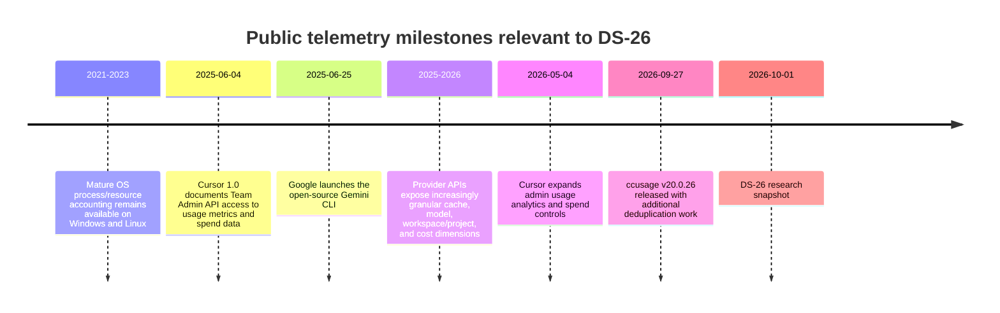
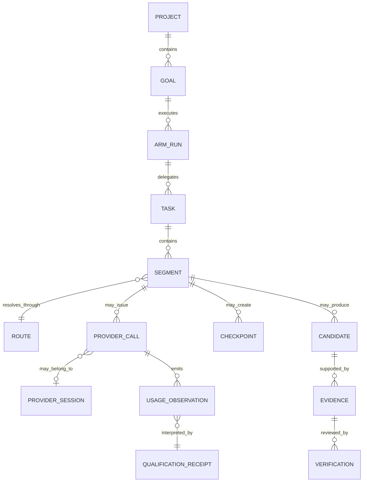
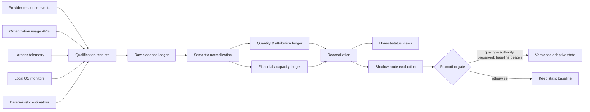

# DS-26 — Telemetry Accounting and Honest Status

## Executive summary

The governing topic is not actually unspecified: the uploaded DS-26 brief defines the research target as the evidence and accounting contract Recursion v3 needs before telemetry may drive dashboards, budget reservations, route learning, or optimization claims. This report treats that brief—including its existing Owner decisions, privacy boundary, provider-neutral architecture, correlation identifiers, cost-class separation, and prohibition on fabricated percent-complete—as controlling requirements rather than questions to reopen. fileciteturn0file0

**Recommendation:** adopt a **provenance-qualified, two-ledger telemetry architecture** rather than a single “usage” table. The first ledger is an **attribution/quantity ledger**, built from provider responses, provider usage APIs, qualified harness events, local resource monitors, and explicitly labeled estimators. The second is a **financial/capacity ledger**, in which invoice-reconciling provider cost data, subscription capacity, metered spend, human review time, and host resources remain dimensionally separate. Reconciliation may connect the two, but may never silently convert one into another.

The research supports six decisive conclusions:

| Decision | Finding |
|---|---|
| Provider APIs | OpenAI and Anthropic expose organization-scoped read-only usage/cost endpoints; Cursor exposes team usage events and an Enterprise organization API; Google does **not** present one equivalent Gemini Developer API organization-usage endpoint in the sources reviewed, but does provide per-response Gemini usage metadata, project-scoped Vertex AI Cloud Monitoring metrics, and Cloud Billing exports. citeturn13search0turn8search0turn18search11turn9search1turn10search0turn9search0 |
| Cache semantics | Vendor token fields are not directly summable. OpenAI aggregate `input_tokens` includes cached input; Anthropic explicitly separates ordinary input, cache creation, and cache reads; Gemini `promptTokenCount` includes the cached subset; Cursor exposes separate cache read/write fields. citeturn13search0turn17search0turn9search1turn18search11 |
| Rate-limit semantics | Cached tokens still count toward OpenAI TPM under its current prompt-caching documentation. Anthropic, by contrast, excludes `cache_read_input_tokens` from ITPM for most Claude models, with a documented Haiku 3.5 exception. These rules are rate-limit semantics, not subscription-debit conversion rules. citeturn7search0turn17search0 |
| CLI evidence | Gemini CLI has a documented OpenTelemetry event carrying per-response token classes and duration. Codex and Claude Code expose useful local usage signals, but upstream issue history shows missing/replayed/duplicate or incomplete token events, so those local streams require version-pinned conformance tests before accounting admission. citeturn15search3turn12search0turn12search3turn14search0turn14search2 |
| `ccusage` | The current canonical project is `ccusage/ccusage`; this research pins **v20.0.26**, release commit `d982108`, under MIT. Its license permits bundling/modification/distribution with the required copyright/license notice, but its calculated costs can depend on external pricing catalogs and its inputs inherit upstream CLI-log defects. It should therefore be an **optional, pinned harness adapter**, never billing authority. citeturn19search1turn19search0turn4search11turn14search9 |
| Honest status | A dashboard can truthfully report observations, explicit waits, native quota headroom, verifier outcomes, and freshness. It must not infer goal percent-complete from activity, translate missing counters to zero, call stale silence “healthy,” or convert a forecast into actual consumption. This is a design requirement from DS-26, reinforced by APIs that explicitly distinguish unavailable diagnostic data from hits/misses. fileciteturn0file0 citeturn7search2 |

The principal engineering risk is not lack of counters; it is **false equivalence between counters that have different provenance and semantics**. The provider ecosystem has converged on richer usage telemetry, but not on one accounting ontology. OpenAI itself warns that granular Usage API values need not perfectly reconcile with Costs and recommends Costs for financial reconciliation. citeturn13search0 That is strong evidence for maintaining separate usage-attribution and financial-reconciliation layers.

The principal governance risk is making the dashboard look more certain than the evidence. A telemetry record should therefore carry a value *and* an epistemic state: `observed`, `modeled`, `inferred`, or `unavailable`. `0` is a valid value only when the source actually observed zero.

## Scope, assumptions, and evidence base

This is a **public, documentation-only research session**. No provider account was queried, no credential was used, no paid inference or billing endpoint was called, no repository was accessed, no configuration was changed, and no implementation was performed. Consequently, the report can qualify **documented interfaces**, but it cannot certify a live Recursion adapter against real account data. That distinction matters: “documentation-qualified” is not the same as “runtime-qualified.”

The research snapshot is **October 1, 2026**. Current provider documentation is treated as volatile: each receipt below therefore has an expiry trigger tied to API/schema/model/client changes rather than being accepted indefinitely.

The core evidentiary hierarchy should be:

1. Provider invoice/cost authority for financial settlement.
2. Provider-native request/usage evidence for quantities.
3. Version-qualified harness-native events for task attribution.
4. Local OS measurements for host use.
5. Deterministic estimators, explicitly labeled modeled.
6. Unknown/unavailable when none of the above can support a value.

That hierarchy is not a statement that lower layers are less useful. A provider's daily cost API may be financially authoritative but far too coarse to assign a helper call to one segment; a per-response harness event may have excellent task attribution but not prove billed dollars. **Authority is dimension-specific.**

### Claim register

The following table records the most consequential source-dependent claims. “Classification” follows DS-26's requested evidence discipline rather than pretending all public material has equal status.

| Claim | Pinned source / date | Classification | Confidence | Expiry trigger |
|---|---|---|---|---|
| OpenAI exposes organization Usage and Costs endpoints; Costs is preferred for invoice reconciliation | OpenAI API reference, retrieved 2026-10-01 citeturn13search0 | Source-documented | High | Endpoint/schema/billing-doc change |
| OpenAI completion usage aggregates expose `input_tokens`, `input_cached_tokens`, output tokens, request count and grouping dimensions | Current API reference citeturn13search0 | Source-documented | High | Usage-object revision |
| OpenAI cached input still contributes to TPM calculations | Current Prompt Caching docs citeturn7search0 | Source-documented | High | Model/rate-limit policy change |
| Anthropic Usage & Cost API is organization-wide; individual accounts are excluded and Claude Platform on AWS lacks these programmatic endpoints | Current Anthropic Admin API docs citeturn8search0 | Source-documented | High | Admin API/platform-scope change |
| For most Claude models, cache reads do not count against ITPM; cache creation and uncached input do | Anthropic Rate Limits docs, retrieved 2026-10-01 citeturn17search0 | Source-documented | High | Model/rate-limit change |
| Gemini responses report prompt, cached-content, output, thought and tool-related token usage | Google Gemini API reference citeturn9search1 | Source-documented | High | `UsageMetadata` schema change |
| Vertex AI exports a DELTA `publisher/online_serving/token_count` Cloud Monitoring metric | Google Cloud Monitoring docs citeturn10search0 | Source-documented | High | Metric launch stage/schema change |
| Vertex AI token metric retention is likely six weeks under Google's “all other Google Cloud metrics” rule | Cloud Monitoring metric + retention documentation citeturn10search0turn11search0 | **Inferred** | Medium | Google explicitly categorizes AI Platform metric differently |
| Cursor's filtered usage events expose granular model/token/cost data and reconcile to spend through `chargedCents` | Cursor Admin API docs citeturn18search11 | Source-documented | High | Admin API schema/billing change |
| Gemini CLI emits documented per-response telemetry with token classes and duration | Gemini CLI OTel documentation citeturn15search3turn15search8 | Source-documented | High | CLI telemetry schema/version change |
| Codex cumulative/last-usage events can be replayed in ways that make naïve summation double count | OpenAI Codex upstream issue reports citeturn12search3turn12search5 | Upstream-observed; not stable API contract | Medium | Version-specific conformance proves fixed semantics |
| Claude Code JSONL usage has had duplicate/incomplete streaming records | Anthropic upstream issue reports citeturn14search0turn14search2turn14search3 | Upstream-observed; not stable API contract | Medium | Version-specific conformance proves fixed semantics |
| `ccusage` current release is v20.0.26 / `d982108`, MIT | Project release and license, 2026-09-27 snapshot citeturn19search1turn19search0 | Source-documented | High | New accepted pin/license change |
| Linux and Windows expose sufficient process-local CPU/memory/I/O primitives for baseline host accounting | Linux kernel and Microsoft API docs citeturn20search11turn20search17turn21search0turn21search9turn20search3 | Source-documented | High | Target OS/kernel/API support change |
| OTel GenAI message attributes can contain sensitive/PII data | OpenTelemetry GenAI semantic conventions citeturn20search16 | Source-documented | High | Semantic-convention revision |
| Recursion must not transform activity into percent-complete and must preserve unknowns | DS-26 governing brief fileciteturn0file0 | Owner/brief-mandated | High | Explicit Owner amendment only |

An important negative finding is that **documented query horizon is not retention**. OpenAI and Anthropic specify bucket sizes and maximum buckets per query, but the reviewed pages do not establish a guaranteed total historical-retention period. Those retention cells must remain `unknown` rather than being reverse-engineered from maximum query size. citeturn13search0turn8search0

## Evidence providers and recent developments

### Provider qualification matrix

“Qualified” below means **document-qualified for the stated purpose**. Runtime admission still requires a version-pinned fixture and reconciliation receipt.

| Source | Scope and access | Documented useful fields / granularity | Documented retention | Best authority | Qualification |
|---|---|---|---|---|---|
| **OpenAI Organization Usage** | Organization-scoped read endpoint using admin authorization | Completion aggregates include input, cached input, output, audio token fields, request count; grouping by project/user/key/model/batch/service tier. Buckets `1m`, `1h`, `1d`; max 1,440 minute, 168 hourly, 31 daily buckets per query. citeturn13search0 | **Unknown** in reviewed docs | Provider-observed usage | **Document-qualified** |
| **OpenAI Costs** | Organization cost endpoint | Daily costs; line-item/project grouping; OpenAI recommends this layer for financial reconciliation because Usage and Costs can differ slightly. citeturn13search0 | **Unknown** | Metered financial settlement | **Document-qualified** |
| **Anthropic Usage API** | Organization-wide Admin API; not individual account; unavailable programmatically for Claude Platform on AWS per current docs | Message usage can group/filter by API key, workspace, model, service tier, context window, geography/speed; separates uncached, cache-read, cache-creation and output usage. `1m`, `1h`, `1d` buckets with maximum 1,440/168/31. citeturn8search0 | **Unknown** | Provider-observed usage | **Document-qualified**, platform-qualified |
| **Anthropic Cost API** | Organization Admin API | Daily monetary reporting; cost categories include token/server-tool use; some offerings have documented exceptions such as Priority Tier handling. citeturn8search0 | **Unknown** | Metered financial settlement | **Document-qualified** |
| **Gemini Developer API `UsageMetadata`** | **Single response**, not account aggregate | Effective prompt token count, cached-content subset, candidate/output, thought and tool-use prompt token counts, modality details. citeturn9search1 | Request-local | Provider-observed request quantity | **Document-qualified** |
| **Vertex AI Cloud Monitoring** | Google Cloud project metric | `aiplatform.googleapis.com/publisher/online_serving/token_count` is DELTA with input/output and other labels; Cloud Monitoring provides a read API. citeturn10search0turn11search2 | **Six weeks inferred**, not explicitly guaranteed for this metric. citeturn11search0turn10search0 | Project-level capacity/quantity trend | **Document-qualified; retention inferred** |
| **Google Cloud Billing export** | Billing account/project via configured BigQuery export | Billing account, service, SKU, project, location, cost, credits, currency and usage windows; export setup and backfill behavior vary by configuration/region. citeturn9search0 | User/data-warehouse policy after export; no single Gemini API retention | Financial settlement | **Document-qualified if export is enabled** |
| **Cursor Team Admin API** | Team usage | Filtered usage events include model/API use, `inputTokens`, `outputTokens`, `cacheWriteTokens`, `cacheReadTokens`, cost fields, and `chargedCents`; data aggregated hourly; current docs recommend polling no more than hourly. citeturn18search11 | **Unknown** | Team usage + cost attribution | **Document-qualified** |
| **Cursor Organization API** | Organization-wide, Enterprise | Aggregates usage across teams; Enterprise-only in current documentation. citeturn1search6 | **Unknown** | Organization usage | **Document-qualified when entitlement exists** |
| **Gemini CLI OpenTelemetry** | Local CLI execution | `gemini_cli.api_response`: model, status, duration, input/output/cache/thought/tool/total token counts; also `chat_compression` and token metrics. citeturn15search3turn15search8 | Collector-defined | Per-request harness attribution | **Document-qualified; version pin required** |
| **Codex CLI token events** | Local CLI stream | Upstream reports show cumulative `total_token_usage` and last-call usage, but interactive omissions and duplicate/replayed events have occurred. citeturn12search0turn12search3turn12search5 | Local-log dependent | Candidate harness attribution only | **Not admitted without version fixture** |
| **Claude Code local JSONL/status signals** | Local CLI | Token/cache/context signals exist, but upstream reports document streaming placeholders and duplicate JSONL usage in affected versions. citeturn14search0turn14search2 | Local-log dependent | Activity/context evidence | **Not billing-qualified** |
| **`ccusage` v20.0.26** | Reads supported local usage data | Reports input/output/cache creation/cache read/total tokens and costs; supports multiple harness sources, some marked experimental. citeturn4search3turn3search0turn3search1 | Underlying local source | Optional normalization/parser layer | **Candidate optional adapter** |
| **Linux local monitor** | Local process/host | `/proc/PID/status`, `stat`, `io`: memory, threads, context switches, CPU/process state and I/O. Kernel warns some RSS readings are asynchronous; `smaps` is slower but more precise. citeturn20search11turn20search17 | Local collection policy | Host-resource observations | **Document-qualified** |
| **Windows local monitor** | Local process/host | `GetProcessTimes`, `GetProcessMemoryInfo`, `GetProcessIoCounters`, `GetProcessHandleCount`, disk-space APIs. citeturn21search0turn21search9turn20search3turn20search1turn21search1 | Local collection policy | Host-resource observations | **Document-qualified** |
| **Deterministic token estimator** | Local | Depends on tokenizer/model mapping; OpenAI itself notes local counting can diverge for richer inputs while its input-token endpoint provides accurate API-side preflight counts. citeturn12search13 | N/A | Modeled estimate only | **Admissible only as `modeled`** |

The Google answer therefore requires a nuance that the other three do not: **the reviewed official material does not establish a single Gemini Developer API equivalent of OpenAI's or Anthropic's organization Usage API.** Gemini itself gives excellent request-local `UsageMetadata`; Google Cloud supplies project metrics and billing exports at different layers. Those should not be collapsed into a fictitious “Google account usage API.” citeturn9search1turn10search0turn9search0

Likewise, “read-only API” must not be confused with “least-privileged credential.” For example, a reporting endpoint may only perform reads while still requiring an organization-admin credential. The qualification receipt should record **operation mutability and credential authority separately**. OpenAI and Anthropic's organization reporting documentation is sufficient to establish the former, but production admission must verify the credential boundary actually used. citeturn13search0turn8search0

### The `ccusage` decision

The canonical project at this snapshot is `ccusage/ccusage`, and the recommended research pin is:

| Property | Pin |
|---|---|
| Package | `ccusage` |
| Version | `20.0.26` |
| Release commit | `d982108` |
| Release snapshot | September 27, 2026 |
| License | MIT |
| Current repository | `ccusage/ccusage` |

The release and repository metadata support that pin. citeturn19search1turn19search3 The MIT license permits use, copying, modification, merging, publication, distribution, sublicensing and sale, provided the copyright and permission notice accompanies copies or substantial portions. citeturn19search0 That makes both a bundled and optional adapter legally possible under the license, subject to retaining the notice.

**Admission recommendation:** optional adapter, not bundled as an accounting authority. Its value is practical local parsing. Its limitation is provenance: some calculated costs use external pricing datasets, and any parser is downstream of defects in the CLI logs it reads. `ccusage` itself has had to add replay/deduplication fixes; v20.0.26 includes another Claude deduplication fix. citeturn4search11turn19search1 A February 2026 issue also documented that upstream Claude Code JSONL could understate input/output usage even when `ccusage` parsed it correctly. citeturn14search9turn14search0

Its license therefore passes; **its data does not automatically inherit provider authority**.

### Recent development timeline

The last five years show a shift from generic process/accounting primitives toward model- and agent-specific telemetry. The timeline below intentionally shows only dated milestones directly relevant to DS-26; lack of an earlier entry is not evidence that a capability did not exist.

Cursor documented team Admin API access to usage/spend as part of its June 4, 2025 release, and Google launched Gemini CLI on June 25, 2025. citeturn18search14turn18search2 Cursor added more detailed usage analytics and spend controls in May 2026. citeturn18search0 The September 2026 `ccusage` release is particularly instructive: its continued replay/dedupe fixes demonstrate why **version qualification belongs in the accounting contract, not just in adapter implementation notes**. citeturn19search1

### Stakeholders and competing evidence approaches

The principal stakeholders are Recursion's Owner/control plane, operators, bounded workers, independent verifiers, provider organization/billing administrators, CLI maintainers, privacy/security reviewers, and any human reviewers whose time becomes a measured resource. This stakeholder structure comes from the governing brief rather than an external organizational assumption. fileciteturn0file0

The meaningful “competitors” for DS-26 are competing accounting approaches:

| Approach | Strength | Failure mode | Appropriate role |
|---|---|---|---|
| Provider cost/invoice data | Best financial authority | Coarse task attribution, reporting lag | Financial settlement |
| Provider request/usage data | Native token semantics | Heterogeneous vendor schemas | Quantity authority |
| Harness-native telemetry | Best segment attribution | Schema/version instability | Task/segment allocation |
| `ccusage`-style parser | Broad practical compatibility | Inherits upstream log defects; derived pricing | Optional compatibility adapter |
| Local OS monitor | Provider-neutral host measurements | Cannot identify provider billing | Host-resource ledger |
| Deterministic estimator | Works offline/preflight | Not provider-observed; tokenizer/input mismatch | Planning/modeling only |
| One universal “usage” counter | Simple UI | Destroys semantics/provenance | **Reject** |

## Accounting and normalization contract

The central contract should be **dimension-preserving**. Before any aggregation, each raw measurement is converted into a canonical quantity *without destroying its original field, source, and semantics*.

### Canonical counter classes

Every value should carry at least:

| Field | Meaning |
|---|---|
| `value` | Numeric value only when actually available |
| `unit` | `token`, `request`, `USD`, `second`, `byte`, vendor-native capacity unit, etc. |
| `quantity_semantics` | `delta`, `cumulative`, `gauge`, `event`, `derived` |
| `epistemic_class` | `observed`, `modeled`, `inferred`, `unavailable` |
| `economic_class` | `metered_spend`, `subscription_capacity`, `quantity_only`, `human_resource`, `host_resource`, `unavailable` |
| `provisionality` | `provisional`, `final`, `reconciled`, `superseded` |
| `source_receipt_id` | Exact qualification receipt |
| `applicability` | Route, provider, endpoint, model/model family, client/source version and effective date |
| `observed_at` / interval | When the evidence applies |
| `availability_reason` | Mandatory when value is unavailable |

A missing counter is therefore represented as, conceptually, `value = null`, `epistemic_class = unavailable`, plus an explanation. It is **not** represented as `0`.

A provider's explicit zero *is* an observation and should remain zero. That distinction is essential for rates such as cache hit ratio: `cache_read_tokens = 0` can be real; an omitted cache field is unknown.

### Cache normalization

The minimum canonical token dimensions are:

`uncached_input_tokens`, `cache_read_tokens`, `cache_write_tokens_5m`, `cache_write_tokens_1h`, `cache_write_tokens_other`, `output_tokens`, and—where the provider distinguishes it—`reasoning_or_thinking_tokens`.

These are **parallel dimensions**, not immediately additive economic weights.

| Source | Native semantics | Canonical normalization | Do not do |
|---|---|---|---|
| **OpenAI organization completions usage** | `input_tokens` includes cached tokens; `input_cached_tokens` is the cached subset. citeturn13search0 | `cache_read = input_cached_tokens`; `uncached_input = input_tokens - input_cached_tokens`, after validating nonnegative values. | Do not add `input_tokens + input_cached_tokens`; that double counts cached input. Do not invent cache-write tokens from the aggregate object. |
| **OpenAI prompt caching / rate limits** | Cached input still contributes to TPM under current docs. citeturn7search0 | Maintain a separate `rate_limit_charge` semantic from monetary cost. | Do not infer discounted TPM because price is discounted. |
| **Anthropic Messages** | Total input is explicitly `input_tokens + cache_creation_input_tokens + cache_read_input_tokens`; creation can be divided into 5-minute and 1-hour categories. citeturn17search0turn16search0 | Map ordinary input, cache reads, and each cache-write TTL independently. | Do not treat `input_tokens` alone as total prompt size. |
| **Anthropic ITPM** | Most models count ordinary input + cache creation, not cache reads; Haiku 3.5 is documented as an exception. citeturn17search0 | Store model-qualified `itpm_charge_tokens`. | Do not encode one Anthropic-wide “cache free” rule. |
| **Gemini response** | `promptTokenCount` includes the effective prompt including cached content; `cachedContentTokenCount` is the cached subset. citeturn9search1 | `uncached_input = promptTokenCount - cachedContentTokenCount`; `cache_read = cachedContentTokenCount`. | Do not add the two. |
| **Google explicit caching** | Cache creation and storage have separate economic effects; cached-token usage is reported on generation responses, and explicit cache storage has TTL-based charging. citeturn13search1turn13search3 | Keep cache creation/storage as a separate event/cost dimension when the qualifying source exposes it. | Do not infer write tokens from later cache reads. |
| **Cursor usage event** | Admin API exposes `inputTokens`, `outputTokens`, `cacheWriteTokens`, `cacheReadTokens`. citeturn18search11 | Preserve all four fields. Before mapping `inputTokens` specifically to *uncached* input, prove whether the source version defines it as exclusive of cache dimensions. | Do not assume field-name exclusivity without a fixture/source guarantee. |

OpenAI's organization aggregate is an important “unknown” case: it documents cached-input consumption but, in the cited aggregate completion object, does not provide a canonical cache-write field. citeturn13search0 Therefore `cache_write_tokens` is `unavailable` for that evidence source unless a separately qualified route-level source supplies it.

### Cumulative versus per-request evidence

The preferred primitive is a **finalized request delta with a stable request ID**. Cumulative streams are accepted only through a reconciler.

For a cumulative counter stream, define:

\[
\Delta_t =
\begin{cases}
C_t-C_{t-1}, & \text{same proven epoch and } C_t \ge C_{t-1} \\
0, & \text{exact replay of an already accepted cumulative value} \\
\text{unknown}, & \text{unexplained decrease, missing boundary, or ambiguous reset}
\end{cases}
\]

A decrease is *not* automatically interpreted as “new session starts at `C_t`.” `C_t` becomes a new-epoch delta only when an independent boundary—new provider session, explicit reset marker, process incarnation, or source-defined epoch—proves that interpretation.

This is particularly important for Codex: upstream reports show `total_token_usage` as cumulative and `last_token_usage` as per-call-like state, but also show events where a rate-limit update can re-emit unchanged cumulative totals alongside unchanged nonzero “last” usage. Summing every `last_token_usage` event therefore risks double counting. citeturn12search3turn12search5 The safe compatibility rule is: **prefer request identity; otherwise difference validated cumulative totals; never sum replay-prone “last” fields merely because they are nonzero.**

Gemini CLI's `gemini_cli.api_response` is much cleaner for accounting because its documented token attributes belong to an individual response event. Its OpenTelemetry counter metric is useful for monitoring, but aggregation temporality is an exporter/backend concern; the response event is the better exactly-once primitive. citeturn15search3

### Exactly-once reconciliation procedure

| Stage | Procedure | Failure behavior |
|---|---|---|
| Ingest | Preserve source event verbatim or as a lossless normalized envelope; assign an ingestion ID. | Parsing failure produces rejected evidence, not zero. |
| Qualify | Resolve `source_receipt_id` against provider/endpoint/model/client/date. | No applicable receipt → `unavailable_for_accounting`; activity may still be displayed separately. |
| Identify | Prefer provider request/event ID. Otherwise use a version-qualified native sequence key. | No stable identity → degraded source; not suitable for money settlement. |
| Deduplicate | Same source identity and same revision is one economic event regardless of replay count. | Conflicting duplicates become a reconciliation exception. |
| Normalize | Convert native token/cache semantics into canonical parallel dimensions. | Impossible mapping leaves the dimension unavailable. |
| Reconcile cumulative | Difference within a proven counter epoch; detect resets/rotations/forks. | Ambiguous boundary → unknown interval; never negative usage. |
| Attribute child calls | Each actual model request gets one `call_id` and a `call_role` such as primary, helper, classifier, compaction or retry; parent segment aggregates unique call IDs. | Unknown role still counts once; it is `role=unknown`, not discarded. |
| Financial reconcile | Compare request/task allocation totals with the provider's qualified organization cost/usage bucket. | Difference remains an explicit reconciliation adjustment at provider/time-bucket level until traceable. |
| Finalize | Mark settled only after source-defined final event or reconciled final bucket. | Interrupted/in-flight final totals remain provisional. |

**Helpers, classifiers, compactors and retries must not be “excluded because they are internal.”** The official organization billing sources generally do not understand Recursion's semantic parent/child structure. If a helper generated a billable provider request, that request belongs in the ledger exactly once; the harness supplies `call_role` so it can be rolled up to the parent segment. If a provider headline counter cannot expose such roles, that is an attribution limitation, not evidence that the consumption did not occur.

A retry is likewise a new economic call only if a new provider operation was actually made. A UI retry marker without provider evidence is not token consumption. Conversely, an automatic provider call not surfaced by the UI is not free merely because the headline activity stream omitted it.

### Fail-closed edge cases

| Edge case | Required representation |
|---|---|
| Source omits token field | `unavailable`; never zero |
| Cache-hit denominator is zero | Cache-hit rate `not_applicable`, not 0% or 100% |
| Counter decreases without proven reset | Interval `unknown`; open reconciliation exception |
| Duplicate/replayed event | No new charge; retain replay observation |
| Session/fork copies historical events | Deduplicate on provider/event lineage; copied history is not new consumption |
| Crash before final cumulative emission | Last interval remains provisional/unknown unless later authority reconciles it |
| “No future work” in a forecast | Forecast `not_applicable`/no scheduled work; never converted into “actual future cost = 0” or “budget safe” |
| Partial final total | Keep provisional; do not label session cost final |
| Quota/reset counter missing | Availability unknown, not “full headroom” |
| Throttled request | Availability/rate-limit state changes; do not rewrite the task's budget |
| Provider billing correction arrives later | Append/supersede financial reconciliation; do not silently rewrite historical raw evidence |

### Subscription, metered, inferred and unavailable cost classes

There is no defensible universal token-to-subscription conversion in the researched sources. Cursor, for example, explicitly has plan/included-usage concepts alongside token/request-based billing, while OpenAI/Anthropic API reporting is organized around their API accounting systems. citeturn1search9turn13search0turn8search0 Consequently:

**Subscription capacity** stays in its native unit: vendor percentage, included requests, credits, capacity window, or whatever the qualified source actually reports.

**Metered/API spend** is currency from an invoice-reconciling provider cost source.

**Observed quantity** is tokens/requests reported by a provider.

**Modeled/inferred quantity** is explicitly a prediction or deterministic estimate.

**Unavailable** is a first-class value.

A quota warning or throttle changes `availability_state`; it does not mutate `task_budget`. A reset time belongs to capacity availability. An Owner-set task budget belongs to Recursion policy. Conflating them would allow an external provider meter to rewrite internal authority.

## Identity, latency, cost, and resource attribution

### Correlation schema

Every usage/evidence row should expose a fixed correlation envelope. Fields that do not apply should remain present with `null + availability_reason`, rather than disappearing unpredictably.

| Identifier | Requirement | Purpose |
|---|---|---|
| `project_id` | Required | Top-level product scope |
| `goal_id` | Required | Stable goal lineage |
| `goal_spec_version` | Required | Exact authorized goal contract |
| `arm_run_id` | Required | ARM executive run |
| `task_id` | Required | Bounded work unit |
| `segment_id` | Required | Smallest accounting/execution segment |
| `route_id` | Required | Approved route identity |
| `route_digest` | Required | Exact resolved route/configuration identity |
| `provider_session_id` | Nullable, present when provider supplies it | Disposable provider continuity aid; never authoritative lineage |
| `provider_request_id` / `call_id` | Required where request accounting exists | Exactly-once deduplication |
| `source_id` | Required | Evidence producer |
| `source_receipt_id` | Required | Qualification/version provenance |
| `checkpoint_id` | Fixed field, nullable when not applicable | Recovery lineage |
| `candidate_id` | Fixed field, nullable | Candidate-output lineage |
| `evidence_id` | Fixed field, nullable | Evidence object lineage |
| `verifier_id` | Fixed field, nullable | Independent verification lineage |

This directly implements the lineage required by the brief: Recursion's IDs are authoritative; provider sessions are disposable aids. fileciteturn0file0

A useful entity model is:

### Qualification receipt

Before a source's numbers may enter an accounting dashboard, its receipt should record:

| Receipt element | Required content |
|---|---|
| Source identity | Vendor/harness/OS and collector identity |
| Pin | API doc retrieval date; CLI/package version and commit when available |
| Applicability | Provider, endpoint, model/model family, route class, OS/client version |
| Scope | Request, session, project, team, organization, billing account |
| Credential authority | Read operation plus actual required credential privilege |
| Counter definitions | Native names, units, cumulative/delta/gauge semantics |
| Cache rules | Inclusion/exclusion and TTL/write distinctions |
| Time semantics | Event time, bucket width, timezone, inclusive/exclusive bounds |
| Retention/freshness | Documented value or literal `unknown` |
| Dedupe identity | Request/event ID or validated fallback |
| Known defects | Missing fields, replay behavior, client bugs, unsupported modes |
| Reconciliation authority | What source it may be checked against |
| Fixture result | Synthetic/offline fixture plus, later, permitted live conformance result |
| Expiry trigger | API/client/model/schema/license change or passed review date |
| Admission state | `candidate`, `document_qualified`, `runtime_qualified`, `suspended`, `unavailable` |

The receipt must be **applicability-bounded**, not merely “OpenAI qualified.” OpenAI's aggregate organization object and a particular Responses API model can expose different details; Anthropic's cache-rate behavior has a model exception; Gemini CLI caching itself varies by authentication mode. citeturn13search0turn17search0turn15search0 A receipt that loses model, endpoint, auth mode, and date is too broad to be falsifiable.

### Latency attribution

At least five temporal concepts should be distinct:

| Metric | Definition | Accounting rule |
|---|---|---|
| Queue/wait latency | Eligible-to-dispatch interval | Recursion control-plane time |
| Bridge/control preflight | Dispatch decision through provider-request initiation | Local/bridge time |
| Provider round-trip | Request initiation through response completion as observed by client | Observed externally; **not automatically “inference”** |
| Provider server/inference latency | Server-side model processing interval | Only populated if a qualified provider source explicitly reports it |
| Post-response/control latency | Provider completion through segment state/evidence update | Local bridge/control time |
| End-to-end segment wall time | Segment start through terminal segment observation | Composite, not a substitute for components |

This distinction is necessary because a client-side timer includes network/protocol effects. Subtracting guessed bridge latency from a round trip to fabricate “model inference milliseconds” would violate DS-26's evidence discipline. Gemini CLI, for example, documents an API-response `duration_ms`; it is a useful request duration measurement, but its public schema does not establish that the number is pure server inference time. citeturn15search3

Input stability should be a separate dimension. Locally, Recursion may use an opaque or keyed fingerprint to decide whether two benchmark inputs are equivalent, but an externally exported raw hash of private content can itself become a membership signal. The export contract should therefore expose only a safe equality/cohort identifier, not content or a reusable public content digest.

### Human, host, and inference costs

A segment may simultaneously consume four resources, which should remain separate:

\[
R = \{\text{inference quantity/spend},\ \text{subscription capacity},\ \text{host resources},\ \text{human review}\}
\]

No default scalar “total cost” is defined across that vector.

Human review is measured in time—preferably active review minutes with the measurement method stated. Monetary human cost exists only if the Owner supplies an accepted valuation model.

Host resources should initially report physical quantities: CPU user/kernel time, RSS/working set, I/O operations/bytes, disk headroom, process/thread/handle counts and relevant wall time. Windows exposes process CPU timing, memory usage, I/O and handle-count APIs directly. citeturn21search0turn21search9turn20search3turn20search1 Linux `/proc` exposes process status, memory, context switches and I/O; the kernel documentation specifically cautions that some RSS information is asynchronously maintained, which is exactly the kind of uncertainty a qualification receipt must retain. citeturn20search11turn20search17

A portable **process wakeup** counter is not established by the reviewed Windows/Linux baseline sources. It should therefore be `unavailable` in the portable profile unless an OS-specific, independently qualified collector is added. Context switches are available on Linux, but they are not semantically identical to “wakeups.” citeturn20search14

Similarly, host monetary cost is unavailable until a rate card exists. CPU seconds are not dollars. RSS byte-seconds are not dollars. If a later Owner-approved host valuation maps those resources to money, the result should be a new `modeled_host_cost` layer that preserves the raw physical measurements beneath it.

## Honest status, learning, privacy, and measurement

### Dashboard contract

The dashboard should be an **evidence viewer**, not a progress storyteller.

| Required view | Truthful contents | Forbidden inference |
|---|---|---|
| **Running** | Segments with a recent positive execution observation, last-event time, route and current evidence freshness | “Running therefore advancing”; inferred percent-complete |
| **Waiting** | Explicit wait state, wait reason/source, start time, dependency if known | Guessing “waiting on model/user” from silence |
| **Budget** | Metered spend, subscription capacity, modeled estimates and unavailable dimensions shown separately | One blended dollar figure; treating unknown subscription capacity as unlimited |
| **Backlog** | Known queued tasks/items at a timestamp, eligibility/block reason | Converting backlog reduction into goal percentage |
| **Regressions** | Current measurement against a named baseline, same fixture/profile, uncertainty and source | “Improved” without comparable baseline |
| **Compaction health** | Compression event count, tokens before/after where observed, failures, context headroom | Claiming semantic context quality solely from token reduction |
| **Headroom** | Native rate/quota/disk/memory headroom with freshness and reset semantics | Missing quota header → “100% available” |
| **Exact actions** | Current/last concrete action metadata, segment/call status, tool or provider category | Tool animation → work complete |

The required state vocabulary should include at least **observed-running, explicitly-waiting, blocked, terminal-verified, terminal-unverified, failed, no-recent-evidence, and unknown**. “No recent evidence” is deliberately not synonymous with idle, healthy, failed, or complete.

A visible activity feed may show statements such as:

> **Observed:** provider response received; accounting provisional; verifier not yet reported.

or:

> **No recent evidence:** last qualified execution event at *timestamp*; current execution state unknown.

It must not turn those observations into “67% complete.”

Native percentages remain legitimate for **bounded native quantities** such as a provider's own quota meter or disk utilization, provided the label is explicit. The ban is on repurposing activity/counter movement as inferred *goal completion*.

### Adaptive route learning

The route scorer should sit **after hard eligibility**, never before it:

\[
\text{Approved Routes}
\rightarrow \text{Authority / Privacy / Verification Filter}
\rightarrow \text{Eligible Set}
\rightarrow \text{Adaptive Reordering}
\rightarrow \text{Execution}
\]

Its hard constraints from DS-26 are that it cannot add/authenticate providers, activate metered billing or training, widen egress/permissions, lower verification, alter GoalSpec, or rewrite its own policy. fileciteturn0file0

Its telemetry-specific constraints should additionally be:

- Only runtime-qualified measurements may update production learning state. Candidate sources may participate in shadow analysis but not optimization authority.
- `unavailable` is a feature state, not a numeric zero. A model may explicitly use a missingness indicator, but it cannot silently zero-impute unknown cost, latency, quality, or headroom.
- Quality and authority are hard constraints, not compensable terms in a cost-weighted objective.
- Human time, host resources, subscription capacity, and metered money remain separate objectives until an Owner-approved valuation is supplied.
- Every learned state has a schema/version, training/evaluation interval, feature-source receipts, baseline, explanation, export format and reset path.
- Shadow/offline evaluation comes first. Promotion requires a predeclared representative workload/profile, a static baseline, an uncertainty method, an acceptance margin, and a decisive falsifier.

A valid falsifier is simple: **do not promote the adaptive default if it fails to outperform the declared static baseline on the predeclared target metric while maintaining every quality/verification/authority floor.** Also reject it immediately if any test causes an ineligible route to be selected, a missing metric to be treated as zero, or a required verifier to be bypassed. The acceptance margin and statistical confidence method are Owner inputs; inventing them here would itself violate the brief.

### Privacy default

The safe export model is **allowlist-based, metadata-minimal and local-first**. Prompts, raw model/tool output, source snippets, private artifact contents, file paths, credential material and account/infrastructure identifiers do not belong in telemetry metrics/export tables. That is the explicit DS-26 policy. fileciteturn0file0

This choice is also consistent with OpenTelemetry's own GenAI conventions, which warn that input/output message attributes are likely to contain sensitive information, including PII. citeturn20search16 Consequently, a generic OTel exporter must not be enabled with message-content capture merely because the semantic convention supports those attributes.

Aggregation must address **membership leakage**, not just direct content leakage. In particular:

- External reports should prefer coarse route/profile/task-class groupings to private project identifiers.
- Small cohorts and differencing-sensitive slices should be suppressible under an Owner-configured cohort policy rather than using an invented universal threshold.
- Equality fingerprints for private inputs should remain local or keyed/opaque; raw public content hashes should not be exported as telemetry.
- User/email dimensions exposed by administration APIs should be stripped or pseudonymized unless a declared operator purpose requires them.
- Source receipts should describe the source and semantics without retaining prompt or artifact content.

These are privacy engineering controls, not a claim of compliance with any particular jurisdictional statute.

### Measurement-family counter map

“Required” here means the canonical record family must represent the field or its explicit `unavailable` state. It does not mean every provider magically supplies the measurement.

| Family | Required counters/evidence | Optional | Explicitly unavailable unless separately qualified |
|---|---|---|---|
| **Quality** | Independent verifier outcome; acceptance/rejection state; test/evidence outcome counts; rework/retry linkage; quality-floor identifier | Severity/category, structured reviewer rationale, review minutes | Universal “quality score”; model self-confidence as acceptance evidence |
| **Capacity / cost** | Provider requests/calls; canonical token dimensions supported by source; economic class; metered spend where authoritative; subscription capacity in native unit; throttles/reset/headroom when observed | Tool-specific charges, cache storage, forecast burn | Subscription-to-dollar/token conversion not documented by source; missing quota/headroom |
| **Context quality** | Context limit where known; input/cache dimensions; compaction events; before/after token counts when emitted; truncation/failure observations | Retrieval counts, cache-hit rate where denominator is valid | Semantic “context quality” inferred only from smaller context; absent cache counter |
| **System performance** | Segment wall time; queue/control/round-trip components where measurable; CPU; memory; I/O; disk headroom; process/thread/handle data supported per OS | Linux context switches, server-side latency where supplied, profile-specific pressure metrics | Pure inference latency when only client RTT exists; portable wakeup count under current baseline |
| **Research quality** | Claim/evidence identifiers; source class; source date/version; unresolved/contradicted claims; verifier result | Primary-source share, evidence age distribution, contradiction categories | “Truth percentage”; hidden model confidence |
| **Continuity / safety** | Checkpoint/fork/stop/recovery events; checkpoint age; resume outcome; authority/permission denials; lost/unknown interval state; verifier continuity | Recovery duration, repeated-failure patterns | Unobserved hidden state; “safe” inferred from absence of violations |

The research-quality family is worth emphasizing: counting citations is not the same as demonstrating correctness. A high source count can coexist with weak evidence. The unit of acceptance should be the **claim-evidence-verifier relationship**, not activity volume.

### Technical, economic, regulatory, and social implications

Technically, the design becomes somewhat more elaborate because it refuses a universal token counter. The payoff is deterministic replay and auditability. Vendor-specific semantics are contained at adapter boundaries rather than bleeding into routing policy.

Economically, separating provider-billed spend from subscription capacity prevents a cheap-looking route from being “optimized” using a fictitious dollar conversion. Keeping human review and host use separate also prevents one resource from disappearing behind inference price.

From a privacy/regulatory posture, administrative APIs can expose user- and account-level dimensions and generic telemetry systems can capture prompt/output content. Minimizing what leaves the machine reduces the amount of sensitive information that later requires access control, retention and deletion governance. citeturn13search0turn18search11turn20search16 This report does not assert legal compliance.

Socially and organizationally, the strongest concern is metric gaming: once a dashboard equates visible agent activity with progress, participants and optimizers are rewarded for producing activity rather than independently verified outcomes. That is an analytical reason, consistent with DS-26's purpose, to make the verifier outcome and unknown state more visually authoritative than animation, token throughput, or “busy time.” fileciteturn0file0

## Recommendation, alternatives, open questions, and completion gate

### Recommended architecture

Adopt **qualified evidence adapters feeding separate attribution and settlement ledgers**, with an honest-status projection built on top:

The architecture deliberately puts reconciliation **after** normalization. A provider invoice can prove the organization's money total while remaining unable to determine which internal helper segment incurred it. Conversely, a per-call harness event can provide excellent segment attribution without proving the invoice. Neither should be allowed to impersonate the other.

### Alternative comparison

| Approach | Implementation complexity | Accounting accuracy | Privacy | Route-learning suitability | Trade-off |
|---|---:|---|---|---|---|
| **Recommended: qualified two-ledger model** | Higher | Highest attainable without fabricating equivalence | Strong; local/minimal by default | Strong after shadow qualification | More schema/provenance work |
| Provider billing API only | Low-medium | Strong for money, weak for segment attribution | Good if aggregated | Poor for fine route learning | Too coarse/latent |
| Harness logs only | Medium | Good local attribution, potentially weak billing truth | Strong if local | Medium | Vulnerable to version/log defects |
| `ccusage` as universal authority | Low-medium | Convenient but downstream of source/log/pricing semantics | Strong if local | Medium | Third-party parser becomes false source of truth |
| Generic OTel only | Medium | Excellent transport model, semantics still provider-specific | Depends strongly on attribute policy | Medium-high | Transport standard does not solve billing semantics |
| Single blended “cost/progress score” | Lowest dashboard complexity | Poor / non-falsifiable | Variable | Dangerous | Hides dimensions and incentivizes gaming |

The principal competing approach is therefore **a single normalized usage/cost table with one blended score**. It is simpler, but it fails decisively as soon as two valid native counters cannot be assigned the same semantics—for example, OpenAI cached tokens counting toward TPM while Anthropic cache reads usually do not. citeturn7search0turn17search0 That real vendor divergence is sufficient to reject a universal raw-token-cost scalar.

### Decisive falsifiers

The recommended architecture itself should be rejected or revised if any of the following occurs in a representative test:

| Falsifier | Consequence |
|---|---|
| Replaying identical raw evidence changes the normalized ledger | Exactly-once algorithm fails |
| A missing native counter becomes numeric zero without explicit source evidence | Epistemic contract fails |
| One provider request can be charged twice after crash/reset/fork/replay | Reconciler fails |
| Aggregate cache normalization does not reconstruct the provider's documented total-input identity | Adapter fails |
| Metered financial totals cannot be reconciled to the provider's financial authority within that authority's documented granularity/timing semantics | Financial adapter remains unqualified |
| A helper/retry disappears merely because it lacks a headline UI event | Parent accounting fails |
| Human/host/subscription resources are silently converted into inference dollars without accepted weights | Cost-separation contract fails |
| Dashboard silence can render as healthy/complete | Honest-status contract fails |
| Route learner can select an unapproved route or relax verification | Adaptive optimization must remain disabled |
| Export can reveal prompt/output/private artifact content under default configuration | Privacy contract fails |

This falsifier set deliberately does **not** invent a reconciliation tolerance or statistical confidence threshold. Those must be declared before the relevant test based on the provider's own rounding/bucketing behavior and the Owner's acceptance policy.

### Open Owner questions

| Owner decision needed | Why it cannot be resolved from public research alone |
|---|---|
| Exact v3 harness admission list and supported versions | Determines which CLI receipts/fixtures are mandatory |
| Whether organization-admin credentials are acceptable for read-only telemetry collectors | Public docs describe required access, but internal authority policy decides whether that privilege is acceptable |
| Local telemetry retention period | Provider retention does not determine Recursion's privacy/operational retention |
| External-export cohort suppression/differencing policy | A fixed anonymity threshold would be an invented policy choice |
| Whether provider session IDs may be stored raw locally | Privacy/operations trade-off is product policy |
| Host-resource monetary valuation, if any | Requires an Owner-accepted rate card; physical counters alone cannot supply money |
| Human-review valuation, if any | Same problem; minutes are observable, dollar value is policy |
| Promotion metric, acceptance margin and uncertainty method for route learning | Must be predeclared rather than selected after seeing results |
| Precedence for late provider billing corrections | Need policy on how settlement adjustments affect historical route-learning datasets |
| Whether document-qualified adapters may feed operator views before runtime qualification | Useful for development, but needs clear “candidate/unverified” UI semantics |

### Completion-gate assessment

| Gate | Status | Evidence |
|---|---|---|
| Evidence providers have pinned source/date or are unavailable | **Pass at documentation level** | Provider/current-doc snapshot given above; `ccusage` exact version/commit pinned |
| Every counter classified observed/modeled/inferred/unavailable | **Pass — proposed contract** | Canonical epistemic classes defined |
| Cache reads/writes normalized before summation | **Pass — specification** | Provider-specific mappings and unavailable cells stated |
| OpenAI/Anthropic/Google distinctions stated per source/endpoint | **Pass** | Counter-semantics matrix |
| Cumulative totals/replay/reset/fork procedure exactly once | **Pass — specification** | Watermark/epoch/dedupe procedure |
| Helper/compaction/retry calls counted once | **Pass — specification** | Unique `call_id` + parent aggregation |
| Human and host resource costs separate from inference | **Pass** | Resource vector model |
| Bridge/control separated from inference/round-trip latency | **Pass** | Latency model; pure inference left unavailable when not observed |
| Full correlation-identifier set | **Pass** | Correlation schema |
| Honest status forbids fabricated percent-complete | **Pass** | Explicit dashboard rule |
| Unknown remains unknown | **Pass** | First-class `unavailable`, freshness states |
| Route-learning constraints with falsifier | **Pass** | Hard-filter + shadow-promotion contract |
| Privacy defaults with falsifier | **Pass** | Local/minimal allowlist and content exclusion |
| `ccusage` source/version/license review | **Pass for candidate admission** | v20.0.26 / `d982108` / MIT citeturn19search1turn19search0 |
| Live runtime/provider qualification | **Not performed / unavailable** | Explicitly outside authorized research scope; no credentials or provider calls |
| Protected paths untouched | **Pass for this session** | No repository or implementation access occurred |
| Repository secret scan clean | **Unavailable, not “pass”** | No repository was accessed and no repository scan was authorized/performed; claiming “clean” would fabricate verification |

That last distinction is intentional. The brief requires honest status even when it makes a completion gate less cosmetically satisfying. A secret scan that was never run cannot truthfully be reported as clean.

**Conclusion.** Recursion v3 should not have a universal “telemetry number.” It should have a **falsifiable accounting system**: source-pinned evidence, provider-specific semantic adapters, canonical dimensions that preserve cache and economic distinctions, deterministic exactly-once reconciliation, and explicit unknowns. Provider billing sources settle money; request-local sources allocate work; local monitors measure host resources; estimators remain models. Dashboards expose observations and freshness rather than invented progress. Adaptive routing consumes only qualified evidence, remains subordinate to authority and verification, and earns promotion against a declared baseline in shadow evaluation. This approach costs more engineering than a single usage table, but the competing simplification fails precisely on the cases DS-26 is intended to block: replayed cumulative events, provider-specific cache rules, hidden helper calls, subscription/API conflation, stale silence, and fabricated certainty.