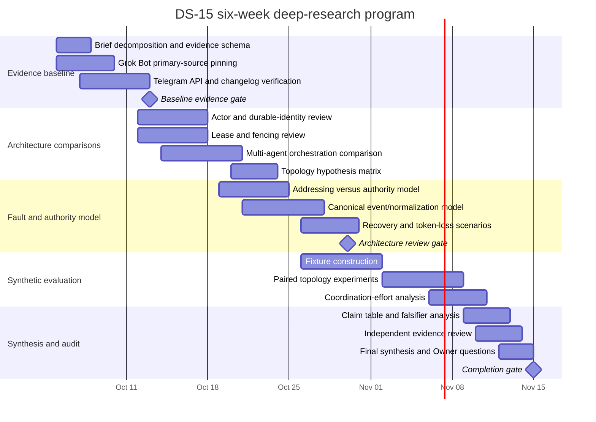

# Deep Research Scoping Plan: DS-15 — ARM Conversations and Multi-Agent Rooms

## Executive summary

The working topic is **DS-15 — ARM conversations and multi-agent rooms**, using the uploaded brief as the controlling scope despite the surrounding request describing the topic as unspecified. The brief fixes several boundaries: Recursion has a Head, goal-scoped ARM executives, bounded workers and verifiers; it must not acquire a separate AI “ARM Manager”; direct Owner-to-ARM conversation and bounded coordination leases are accepted constraints; Telegram is optional rather than canonical; and the research must use public or synthetic evidence rather than private project data. fileciteturn0file0

The proposed project is a **six-week, approximately 125–155 person-hour investigation** designed to answer a narrower architectural question: **how should durable logical actors map to `#general`, per-ARM conversations, and shared multi-ARM rooms while preserving attribution, authority boundaries, conflict resolution, recovery, and Owner usability without accidentally creating a second executive tier?** The research should compare three topology families—one transport bot with logical-actor routing, one transport identity per ARM, and a hybrid—without turning the research recommendation into a product decision. fileciteturn0file0

Initial source verification shows that the relevant Grok Bot pattern is real and unusually well documented. SpaceXAI's current official documentation describes Bots as persistent named teammates; allows group chats, explicit `@` addressing, asynchronous inter-Bot handoffs and parallel work; and states that all of a user's Bots share one cloud computer, including files, browser sessions and command-line credentials, so separate Bots are **not** security boundaries. The collaboration documentation also recommends a single owner for each handoff stage because excessive parallel handoffs can produce duplicate work and noisy updates. These pages were retrieved on **October 1, 2026** and were last updated in September 2026. citeturn2view0turn4view0turn4view1turn4view2

Telegram likewise has enough primary documentation to make its transport semantics a first-class research stream rather than an implementation footnote. The current Bot API exposes `message_thread_id`; stores incoming updates for no more than 24 hours; makes long polling and webhooks mutually exclusive; states that `update_id` becomes randomly chosen after at least a week with no updates; and documents free-send guidance of roughly one message per second in a single chat, 20 per minute in a group and about 30 per second for bulk notifications. These should be treated as **dated observations, not permanent guarantees**. citeturn0search0turn3search0turn3search1

A notable freshness item for the investigation is Telegram's current documentation for **Bot-to-Bot Communication Mode**, which now permits specified inter-bot communication patterns in groups. That means older assumptions about bots being categorically unable to receive messages from other bots must be revalidated against the current API and changelog rather than inherited from historical behavior. citeturn0search16

The final research output should therefore be evidence-led rather than framework-led: a source-pinned claim ledger, topology decision matrix, authority/lease model, message-normalization model, synthetic fault fixtures, measured Owner-coordination experiment, explicit falsifiers for every recommendation, and a short set of unresolved questions reserved for Lucas. No topology should be recommended merely because Grok Bot, AutoGen, LangGraph, Telegram or another system happens to expose a similar UI pattern.

## Research questions and objectives

The thirteen questions in the DS-15 brief can be operationalized into five testable research clusters. fileciteturn0file0

| Research cluster | Principal question | Objective | Evidence required before conclusion |
|---|---|---|---|
| **Actor and room topology** | How should Head, ARM, worker, verifier and persistent assistant identities map to `#general`, dedicated ARM conversations and shared rooms? | Establish an actor-to-surface model in which rooms are views/routing contexts rather than new authorities. | Official system analogues, formal state/identity model, synthetic topology fixtures. |
| **Transport identity and isolation** | Does one bot identity, one bot per ARM, or a hybrid best preserve isolation, credential scope, usability and recovery? | Compare topology options without confusing transport credentials with logical actor identity. | Telegram primary docs, security-boundary analysis, token-loss/replacement simulations, operational comparison. |
| **Addressing, authority and leases** | How can a message select an actor without granting that actor new powers, and how do coordination leases resolve temporary ownership? | Specify the invariant `routing ≠ authority`; test lease expiry, revocation, concurrent claims and fencing. | GoalSpec/lease model from the brief, distributed-systems analogues, adversarial state-transition fixtures. |
| **Canonical state and transport normalization** | How should duplicate, edited, deleted, delayed and out-of-order messages become canonical attributable events? | Define a deterministic normalization pipeline independent of transcript arrival order. | Telegram update semantics, actor/message models, event-state transition table, replay tests. |
| **Human coordination value** | Does direct Owner-to-ARM communication reduce Owner effort without increasing contradictions, lost context or unreviewed work? | Produce empirical evidence rather than relying on perceived chat convenience. | Paired synthetic scenarios with measurable workload, conflict, context-loss and review metrics. |

The primary research question is therefore:

> **What actor, routing and temporary-coordination model lets an Owner communicate directly with durable ARM executives through multiple conversational surfaces while ensuring that actor identity, GoalSpec authority, budget ownership, review requirements and conflict resolution remain properties of canonical state rather than properties of chat topology or transcript order?**

Four objectives determine whether the project is complete.

First, establish what **Grok Bot and Telegram actually document today**, with retrieval dates, page-update dates and expiry triggers rather than carrying forward remembered product behavior. Grok Bot's current documentation explicitly distinguishes persistent Bot identity from its shared-computer security boundary and documents both directed group messaging and asynchronous handoffs, making it useful as an interaction-pattern comparison but not a security model to copy. citeturn2view0turn4view0turn4view2

Second, produce an architecture-neutral comparison of **single-identity routing, per-ARM identity and hybrid identity** based on attribution, blast radius, credential scope, transport failure, usability, recovery cost and compatibility with the accepted coordination-lease model.

Third, prove by synthetic fixtures that **no room, mention, handoff or temporary coordinator becomes a portfolio executive**. A room may influence routing and visibility; a coordination lease may temporarily assign narrowly defined verbs for one workflow step; neither should acquire Head's ownership of goals, membership, strategic escalation or cross-goal dispute resolution. fileciteturn0file0

Fourth, determine which remaining questions are architectural facts, which are empirical unknowns, and which are Owner policy choices that **only Lucas can settle**.

## Priority topics and assumptions

The project should front-load questions that can invalidate whole topology families.

| Priority | Topic or assumption | Why investigate early | Test / evidence |
|---|---|---|---|
| **Critical** | Logical actor identity is independent of chat, topic and bot token. | If false, transport changes could implicitly create/destroy executives. | Actor-state model plus token-revocation and topic-deletion fixtures. |
| **Critical** | Addressing selects a recipient but never widens its GoalSpec. | Direct Owner-to-ARM chat becomes dangerous if a mention itself conveys authority. | Capability matrix; attempts to issue out-of-scope commands through every surface. |
| **Critical** | Transcript arrival order is never an authority tie-breaker. | Network and transport ordering are not a sound basis for conflict ownership. | Concurrent-command and out-of-order replay fixtures. |
| **Critical** | Coordination leases are narrow, expiring and fenced. | This is the primary defense against a temporary coordinator becoming a hidden manager. | Expiry, revocation, stale-holder and competing-holder tests. |
| **High** | Canonical state—not chat history—is the source for Head monitoring and Owner digests. | Mute, archive, deletion, outage or token rotation must not erase operational state. | State reconstruction test after transport loss. |
| **High** | Transport identity is not automatically a security boundary. | Grok Bot is a concrete example where distinct named agents share account-level credentials and files. | Credential/blast-radius comparison for each topology. citeturn4view1turn4view2 |
| **High** | Telegram behavior must be treated as versioned transport behavior. | Current primary documentation already differs materially from older bot-to-bot assumptions. | Changelog plus retrieval-date verification on every Telegram claim. citeturn0search16turn3search3 |
| **Medium** | Direct Owner-to-ARM interaction actually reduces coordination effort. | This is plausible but not established by a conversational UI existing elsewhere. | Paired human-in-the-loop synthetic experiment. |
| **Medium** | A shared room adds useful coordination without requiring an LLM speaker-manager. | Many existing agent frameworks use centralized or model-selected speakers, which may be the wrong authority pattern for Recursion. | Compare deterministic routing/lease approaches with centralized selector and handoff patterns. citeturn0search12turn0search2 |

### Assumptions created by the request

Because the surrounding request says no topic was supplied while an explicit DS-15 research brief was uploaded, this plan treats **the uploaded DS-15 brief as the intended query**. It does not broaden into a general survey of multi-agent UX. fileciteturn0file0

The following items are treated as fixed premises rather than questions to reopen: the absence of an AI ARM Manager; Head's overall ownership; direct Owner-to-ARM conversation; a bounded coordination lease; CLI as the canonical local interaction surface; Telegram as optional; and no v3 requirement for a graphical frontend. fileciteturn0file0

The research will use only public documentation, public research and synthetic scenarios. No private repository material, real credentials, real user transcripts, private infrastructure identifiers or live production actions are necessary for the investigation. fileciteturn0file0

## Methods and source hierarchy

The evidence hierarchy should be **primary protocol/product specification → primary implementation/framework documentation → original research → independent empirical studies → industry analysis only for discovery or context**. Vendor marketing may establish what a vendor publicly claims but will not by itself establish reliability, safety or suitability.

| Method | Main questions answered | Sources to prioritize | Output | Acceptance criterion |
|---|---|---|---|---|
| **Primary-document pinning** | What Grok Bot and Telegram actually expose | SpaceXAI/xAI docs and dated launch material; Telegram Bot API, FAQ and changelog | Claim ledger with retrieval date, source-update date, classification and expiry trigger | Every consequential transport/product fact has a primary citation or is marked unverified. |
| **Comparative actor-model analysis** | How durable identities should relate to physical/transport locations | Microsoft Orleans actor documentation; similar established actor systems | Identity/routing/state comparison matrix | Logical identity, activation, routing and persistence are kept conceptually separate. |
| **Lease and concurrency analysis** | How temporary coordination ownership should expire and be fenced | Kubernetes Lease/leader-election documentation and established distributed-systems literature | Lease state machine and race-condition table | Stale holders cannot continue exercising a lease after expiry/revocation. |
| **Multi-agent orchestration review** | Which coordination patterns exist and where they fail | AutoGen, LangGraph and recent primary research | Pattern matrix: centralized selector, local handoff, shared context, deterministic routing | Interaction pattern is separated from authority/security conclusions. |
| **Transport fault analysis** | Duplicate, delayed, edited, deleted, missing and replayed messages | Telegram primary API documentation and update semantics | Normalization table and recovery protocol | Canonical outcome does not depend on arrival timing alone. |
| **Synthetic A/B evaluation** | Whether direct ARM access reduces Owner effort safely | Controlled synthetic GoalSpecs, conflicts and handoffs | Metrics dataset and plots | Direct access must improve effort without breaching predefined contradiction/review thresholds. |
| **Independent evidence audit** | Whether conclusions overreach sources | Separate reviewer applying the brief's evidence rules | Claim audit and contradiction register | Unsupported claims are downgraded to inference/unverified before the final report. |

Microsoft Orleans is particularly useful as an architectural analogue because its current documentation explicitly models actors as logical, addressable entities whose identity is distinct from the server/location currently executing them; that is conceptually relevant to keeping an ARM distinct from the chat or bot through which it is addressed. It is an analogy, not evidence that Recursion should adopt Orleans. citeturn7search0turn7search7

Kubernetes is useful for the narrower coordination problem. Its Lease API represents holder identity, acquisition/renewal timing and expiry for coordination, while coordinated leader election uses optimistic concurrency to ensure that competing candidates do not simultaneously become the accepted holder. The investigation should extract invariants from this model but must not infer that Kubernetes leadership semantics automatically fit a GoalSpec-based agent system. citeturn7search16turn7search3

For multi-agent comparisons, AutoGen is valuable precisely because it exposes contrasting patterns: model-selected centralized group coordination and localized handoffs/shared-context “Swarm” behavior. LangGraph similarly documents supervisor-based and swarm/handoff architectures. These provide competing coordination patterns against which DS-15's explicit prohibition on a new executive tier can be tested. citeturn0search12turn0search2turn8search0turn8search2

Academic searching should concentrate on **2022–2026** work unless an older distributed-systems paper is foundational and indispensable. The starting corpus should include original multi-agent framework papers plus recent empirical work on failures and maintenance, rather than treating benchmark improvements as evidence about authority or operational safety. AutoGen's 2023 paper presents configurable conversational multi-agent infrastructure; a 2026 large-scale empirical study reports coordination issues among common classes of problems in open-source multi-agent systems. citeturn6academia0turn5academia3

## Search strategy, data collection, and validation

### Search strategy

Searches should be executed in descending evidence priority, first against specific official domains and then against academic indexes such as ACM Digital Library, IEEE Xplore, arXiv and Google Scholar for original papers and citation chaining.

| Workstream | Core queries and keyword families |
|---|---|
| **Grok Bot** | `site:docs.x.ai/grok-bot group chat handoff ownership Bot persistent named agent`; `shared computer security boundary`; `@ mention direct message group`; `approvals`, `team bots`, `delete hide recover`; `pass ownership`. |
| **Telegram topology** | `site:core.telegram.org/bots/api message_thread_id`; `update_id week random`; `"24 hours" updates`; `getUpdates webhook mutually exclusive`; `edited_message delete update`; `bot-to-bot communication`; `forum topic`; `token revoke replace`; `rate limit 20 messages minute`. |
| **Actor identity** | `"virtual actor" logical identity location transparency persistent state`; `"actor identity" asynchronous message failure recovery`; `durable actor address routing`. |
| **Coordination leases** | `lease holder identity expiry fencing token`; `leader election stale holder fencing`; `optimistic concurrency lease`; `epoch fencing distributed coordination`. |
| **Multi-agent orchestration** | `"multi-agent" handoff shared context selector group chat`; `supervisor swarm delegation`; `speaker selection failure loop`; `agent coordination contradiction`; `multi-agent maintenance issues`. |
| **Human coordination** | `"human AI delegation" coordination overhead`; `"multi-agent" human oversight contradictory instructions`; `direct delegation cognitive load`; `handoff loss context`; `human-in-the-loop agent evaluation`. |
| **Recovery/state** | `event normalization duplicate out-of-order idempotency`; `edited deleted message event sourcing`; `canonical state transcript`; `message replay deduplication`. |

Search records should capture the exact query, date, source database, inclusion/exclusion decision and reason. Official pages should be rechecked immediately before finalization because both the xAI and Telegram material is actively evolving; the xAI security page, for example, was updated as recently as September 28, 2026. citeturn4view2

### Evidence ledger

Every consequential claim should receive a structured record:

`claim_id | claim | classification | source | publisher | retrieval_date | source_last_updated | primary/secondary | exact supporting section | confidence | competing evidence | expiry trigger | what_this_does_not_prove`

The three claim classes should remain strict:

**Fact** means directly documented or experimentally observed.  
**Inference** means a conclusion drawn from cited facts, with the inferential step stated.  
**Unverified** means evidence is insufficient or conflicting.

An `unknown` value must not be converted to zero, false or unsupported.

### Synthetic data and experimental design

The empirical portion should use approximately **24–36 synthetic scenarios**, each replayed under the three topology families and, where meaningful, under two interaction modes: **Owner→Head→ARM relay** and **direct Owner→ARM**. Scenarios should deliberately include ordinary delegation as well as pathological conditions: conflicting Owner messages, simultaneous ARM claims, lease expiry during execution, stale fencing tokens, transport retries, duplicated updates, edited commands, topic deletion, transport outage, bot-token replacement, verifier rejection and cross-goal budget requests.

Primary metrics should include:

| Metric | Interpretation |
|---|---|
| Owner messages/turns per completed workflow | Coordination effort |
| Owner interventions after initial delegation | Residual management burden |
| Duplicate work events | Coordination quality |
| Contradictory active instructions | Context/authority failure |
| Out-of-GoalSpec attempted actions | Authority containment |
| Stale-lease actions accepted | Fencing correctness |
| Unreviewed consequential outputs | Review-integrity failure |
| Recovery completeness after transport loss | Actor/state durability |
| Digest precision/recall against canonical state | Monitoring quality |
| Time/event count to resolve conflict | Conflict-resolution efficiency |

The proposed experiment should be **paired**, so the same synthetic workload is executed under competing topologies. Results should be reported with raw counts, distributions and confidence intervals where the sample supports them, rather than merely saying one interaction “felt simpler.”

### Validation rules

A consequential product/API claim requires either a direct official source or an `unverified` label. Comparative architectural claims should preferably have two independent evidence types—for example, official framework documentation plus a synthetic test—unless the claim is purely about what a protocol specification says.

Vendor claims about their own architecture are acceptable evidence for **published behavior**, not for general safety. Thus Grok Bot documentation can establish that its Bots can use group chats and hand off work, and that their shared computer is not a per-Bot security boundary; it cannot establish that the same interaction model is safe for Recursion. citeturn4view0turn4view2

Telegram-specific limits should carry an expiry trigger such as **“recheck Bot API/FAQ/changelog before acceptance or after any Bot API version change.”** Current official documentation supports the rate and update-retention observations, but Telegram itself presents these as current operational/API behavior rather than an immutable architectural contract. citeturn0search0turn3search0

## Timeline and milestones

A six-week project balances current-document verification, comparative research and enough synthetic testing to falsify weak topology choices. The schedule below assumes a start on **October 5, 2026**.

The **first milestone** freezes the factual baseline: exact Grok Bot sources, Telegram version-sensitive facts, and an evidence ledger with no uncited consequential claims.

The **second milestone** requires a complete state/authority model and at least one decisive falsifier for every topology. No experiment should proceed with an ambiguous definition of actor identity, lease authority or canonical state.

The **final milestone** applies the DS-15 completion gate: all consequential claims classified, every recommendation paired with a competing option and decisive falsifier, transport claims freshness-checked, private-data scan clean, empirically open questions identified, and Lucas-only questions separated from research questions. fileciteturn0file0

## Deliverables and resource plan

### Deliverables

| Deliverable | Format | Contents | Primary audience |
|---|---|---|---|
| **Source-pinned claim ledger** | CSV + Markdown table | Claim, fact/inference/unverified class, source, retrieval date, confidence, expiry trigger, contradictory evidence | Reviewer / Head |
| **Topology comparison matrix** | Markdown + scored table | Single bot/logical routing vs per-ARM bot vs hybrid across isolation, credentials, usability, attribution, recovery and operational cost | Owner / architecture review |
| **Actor and authority model** | Mermaid diagrams + state tables | Head, ARM, worker, verifier, room, route, GoalSpec and lease relationships | Architecture review |
| **Lease/concurrency model** | State machine + adversarial cases | Issue, renewal/expiry, revocation, fencing, competing commands, stale holder behavior | Architecture review |
| **Transport normalization specification** | Event table + sequence diagrams | New/edit/delete/duplicate/out-of-order events; deduplication; attribution; canonical-state updates | Systems design |
| **Synthetic fixture pack** | JSON/YAML-style synthetic cases + results table | 24–36 normal and pathological workflows with expected invariants | Independent reviewer |
| **Evaluation dataset and charts** | CSV + bar/box/distribution charts | Owner effort, duplicate work, contradictions, violations, review completeness, recovery | Owner / Head |
| **Decision report** | Markdown and PDF-ready report | Source-pinned claim table, option tradeoffs, recommendation, competing option, decisive falsifier, non-proofs | Lucas / Head |
| **Open-questions register** | One-page table | Empirically unresolved questions versus Owner-policy questions | Lucas |

The visualization package should favor decision-relevant graphics: an actor/surface topology diagram, lease state machine, canonical-event normalization sequence, comparative topology radar or score table, and experiment distributions. Visuals should never replace raw evidence tables.

### Estimated effort

| Expertise | Estimated effort | Responsibilities |
|---|---:|---|
| Lead researcher / systems analyst | 50–60 h | Scope, evidence model, topology synthesis, final report |
| Distributed-systems / actor-model specialist | 20–24 h | Actor identity, leases, fencing, concurrency and recovery review |
| API/protocol researcher | 18–22 h | Grok Bot and Telegram primary-source verification and change tracking |
| Experiment/data analyst | 24–30 h | Fixtures, paired evaluation, metrics, tables and visualizations |
| Independent reviewer | 12–16 h | Claim/source audit, falsifier review, completion gate |
| **Total** | **124–152 h** | Approximately 2–3 people with partially overlapping roles |

No paid API, production deployment or real credentialed experiment is required for the research design. The work can remain document- and synthetic-fixture-based, consistent with the brief's authority and privacy boundaries. fileciteturn0file0

## Risks, decision gates, and starting bibliography

### Key risks and mitigation

| Risk / limitation | Consequence | Mitigation |
|---|---|---|
| **Rapidly changing vendor documentation** | A correct October claim may become stale before implementation. | Pin retrieval and page-update dates; add expiry triggers; recheck immediately before final acceptance. |
| **Interaction pattern mistaken for safety evidence** | Grok Bot's convenient handoffs could be copied along with inappropriate credential assumptions. | Separate documented interaction behavior from security conclusions; explicitly record what each source does not prove. Grok Bot itself warns that separate Bots are not security boundaries. citeturn4view2 |
| **Historical Telegram assumptions** | Architecture could be based on behavior that has changed. | Check current Bot API, FAQ, bot-to-bot documentation and changelog as one versioned evidence set. citeturn0search16turn3search3 |
| **Framework analogy overreach** | AutoGen/LangGraph “supervisor” terminology could silently reintroduce the prohibited ARM Manager concept. | Treat framework patterns as comparisons only; map authority separately from speaker selection. AutoGen and LangGraph explicitly document centralized supervisor/selector designs, making them useful negative/contrast cases as well as positive references. citeturn0search12turn8search0 |
| **Synthetic evaluation lacks production external validity** | Measured gains may not predict real Owner behavior. | Report this explicitly; use paired scenarios and sensitivity tests; leave real-world usability as empirically open rather than claiming proof. |
| **Lease analogies do not perfectly map to agent authority** | A distributed lock can solve exclusivity without solving GoalSpec or budget ownership. | Import only tested invariants such as holder, expiry and concurrency; maintain a separate authority model. |
| **Single metric optimization** | Fewer Owner messages could mask more unreviewed or contradictory work. | Use a metric bundle with hard safety constraints; coordination savings count only when authority/review metrics do not regress. |
| **Literature's rapid evolution** | Recent multi-agent research may be immature or prepublication. | Prefer original documentation and empirical work; label preprints as such and avoid treating benchmark performance as operational evidence. |

### Decision gates and falsifiers

The project should not select a topology until each candidate has a concrete failure condition.

**One transport bot with logical-actor routing** remains viable only if attribution, GoalSpec enforcement, independent ARM lifecycle and lease fencing survive shared transport identity. A decisive falsifier would be a requirement that cannot be satisfied without per-ARM transport-level credential or revocation isolation.

**One bot identity per ARM** remains viable only if its additional credentials and transport identities provide meaningful isolation/recovery value without making membership, bot-to-bot communication, token rotation or Owner usability the de facto actor-management layer. A decisive falsifier would be evidence that correct authority or canonical-state behavior begins to depend on Telegram bot membership/topology rather than durable actor state.

**Hybrid topology** remains viable only if the boundary between shared and dedicated identities is deterministic and recoverable. A decisive falsifier would be an unavoidable ambiguity in which two transport identities can simultaneously appear authoritative for the same logical ARM, or a recovery procedure that requires transcript order to choose the winner.

The final recommendation must name the strongest competing option and explain precisely what evidence would reverse the recommendation. A favorable result **does not prove** implementation correctness, production reliability, transport permanence or that future Telegram/xAI behavior will remain unchanged.

### Recommended starting bibliography

| Source | Research use | Status / freshness |
|---|---|---|
| **SpaceXAI, “Grok Bot” overview** | Establish persistent named Bot model, cross-Bot coordination, shared-computer boundary | Official; last updated Sep. 21, 2026; retrieved Oct. 1, 2026. citeturn2view0 |
| **SpaceXAI, “Message and collaborate”** | Group chats, `@` addressing, asynchronous handoffs, threads, ownership guidance | Official; last updated Sep. 21, 2026. citeturn4view0 |
| **SpaceXAI, “Use the computer and apps”** | Shared files, sessions, credentials and per-Bot screens; recovery behavior | Official; last updated Sep. 14, 2026. citeturn4view1 |
| **SpaceXAI, “Approvals, security, and privacy”** | Explicit security-boundary and least-privilege claims | Official; last updated Sep. 28, 2026. citeturn4view2 |
| **SpaceXAI, “Introducing Grok Bot”** | Launch-era interaction pattern and original multi-Bot positioning | Official, Aug. 11, 2026. citeturn2view1 |
| **Telegram Bot API** | Update semantics, `message_thread_id`, polling/webhook behavior, retention | Primary API documentation; current retrieval Oct. 1, 2026. citeturn0search0turn3search1 |
| **Telegram Bots FAQ** | Current free-send rate guidance and operational bot behavior | Primary documentation; current retrieval Oct. 1, 2026. citeturn3search0 |
| **Telegram Bot API Changelog** | Establish when topic and other transport capabilities changed | Primary version history. citeturn3search3 |
| **Telegram, “Bot-to-bot communication”** | Revalidate assumptions about communication between transport identities | Primary current documentation. citeturn0search16 |
| **Microsoft Orleans overview and benefits** | Logical actor identity, persistent state and location-transparent addressing analogue | Official documentation, current 2026 material. citeturn7search0turn7search7 |
| **Kubernetes, “Leases” and “Coordinated Leader Election”** | Lease holder/expiry and concurrency-control analogues | Official current documentation. citeturn7search16turn7search3 |
| **Wu et al., “AutoGen: Enabling Next-Gen LLM Applications via Multi-Agent Conversation”** | Primary research on configurable conversational multi-agent systems | 2023 original research/preprint. citeturn6academia0 |
| **Microsoft AutoGen, Selector Group Chat and Swarm documentation** | Contrast centralized model-selected coordination with localized handoffs | Official current framework documentation. citeturn0search12turn0search2 |
| **LangGraph Supervisor and Swarm documentation** | Additional comparison of hierarchical supervisor versus distributed handoff patterns | Official framework documentation. citeturn8search0turn8search2 |
| **Liu et al., “A Large-Scale Study on the Development and Issues of Multi-Agent AI Systems”** | Empirical starting point for failure/maintenance categories across multi-agent ecosystems | 2026 research preprint; use with explicit publication-status caveat. citeturn5academia3 |
| **Chen et al., “AgentVerse”** | Earlier primary work on dynamic multi-agent composition and emergent collaboration | 2023 original research/preprint. citeturn5academia0 |

The most important unresolved questions at the end of this **scoping** stage are empirical rather than documentary: whether direct Owner-to-ARM interaction actually lowers total coordination burden under realistic conflicts; whether a shared transport identity creates unacceptable operational blast radius after all authority is kept in canonical state; and what thresholds Lucas considers acceptable for extra credential/admin complexity versus transport isolation. Those questions should remain explicitly open until the synthetic evaluation and Owner decision gate, rather than being filled by analogy to Grok Bot or any multi-agent framework. fileciteturn0file0