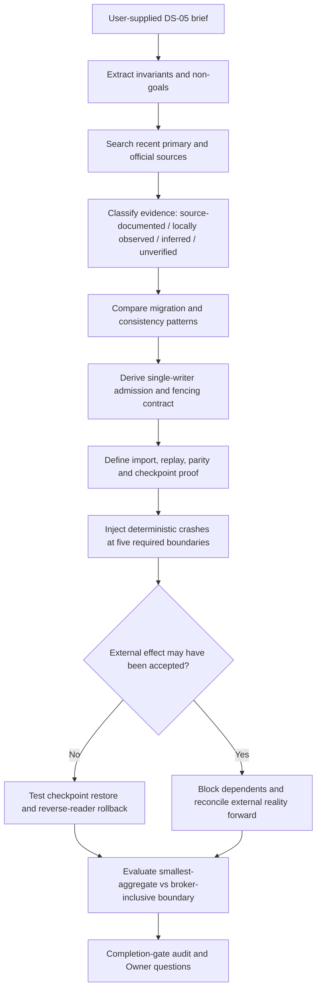

# DS-05 — Single-Writer Migration, Fencing, and Effect Rollback Research Report

## Executive summary

The nominal request described an unspecified demonstration topic, but the uploaded brief supplies a concrete, self-contained research directive: **DS-05 — Single-writer migration and effect rollback**. This report therefore executes that directive rather than inventing unrelated technology, healthcare, and climate findings. The brief fixes the target as the synthetic local execution-attempt/lease aggregate, preserves `OR-015` and `OR-016`, prohibits implementation or live cutover, and requires deterministic, zero-external-effect rehearsal plus forward-only reconciliation once an external effect may have been accepted. fileciteturn0file0

**Bottom line.** The sufficient cutover boundary is not “the imported data looks the same.” It is a **versioned ownership checkpoint** that simultaneously proves: complete writer enumeration; quiescence of every legacy writer for the aggregate; a monotonically higher writer epoch enforced at both admission and durable execution; exact canonical event-prefix/order parity; projection parity; deterministic crash recovery; a tested backup and reverse-reader path; and exclusive v3 ownership. This follows the same distributed-systems principle made explicit by etcd: a lease alone does not ensure mutual exclusion after a client becomes stale; the protected resource must itself validate a version/fencing value. citeturn1search1turn7view1

The recommended migration sequence is the brief's existing progression, unchanged:

`UNIMPORTED → SNAPSHOTTED → VALIDATED → LEGACY_WRITERS_QUIESCED → FENCE_ESTABLISHED → IMPORTED → REPLAYED → SHADOW_READ_VERIFIED → V3_OWNER_ACTIVE → CHECKPOINTED`

The key refinement is an exact definition of **CHECKPOINTED**. **[Inferred]** A checkpoint is valid only when it pins `(aggregate_id, canonical_seq, event-prefix digest, current_writer_epoch, sole writer identity, writer-inventory digest, command-dedup state, snapshot/backup digest, reverse-reader version, parity evidence, crash-matrix evidence, and external-effect watermark)`, and a post-cutover synthetic local command has demonstrated that epoch `E+1` can append exactly the next sequence while retries do not append another event and epoch `E` is rejected. This is stronger than merely switching a router. It is supported by event-sourcing's dependence on ordered replay, conditional/versioned mutation patterns in etcd, Git and Kubernetes, and the known ambiguity of retries around committed operations. citeturn2search2turn7view0turn5search0turn9search5

**Projection parity, replay parity, and crash parity are three different gates.** Event sourcing derives state by replaying an ordered event history; two histories can therefore render the same current state while differing in order, duplicates, intermediate states, or recovery behavior. A shadow system that merely compares responses—analogous to FoundationDB's Testing Storage Server—provides valuable output comparison, but not proof of equivalent history or crash semantics. citeturn2search2turn9search10

**No externally accepted effect is rollbackable in the strong sense used for local state.** An accepted SMTP message transfers delivery responsibility to the receiver; a pushed Git ref is a mutation of remote state; a credential change alters an external authority; and a deployment rollback is itself another service mutation. Provider-side idempotency can make retries safer, but its contract and retention window are bounded, and Kafka's own documentation explicitly notes that exactly-once behavior with external destinations requires cooperation from those destinations. citeturn4search13turn7view0turn6search1turn6search4turn4search10turn8search0 Consequently the brief's rule is correct: after an effect **may** have been accepted, preserve the v3 fact, block dependent effects, determine external reality, and reconcile forward; do not relabel the effect as rolled back. fileciteturn0file0

The recommended cutover boundary is **the smallest canonical aggregate plus its mandatory admission/fencing boundary**, with the broker remaining transport unless a decisive test proves that broker offset/ack state is needed for correctness. The competing broker-inclusive design should win only if arbitrary broker replay, duplication, reordering, or offset loss can change the aggregate's canonical accepted event sequence despite command-ID deduplication and epoch validation. AWS documents that outbox/message delivery can duplicate events, and Kafka's stronger transactional guarantees have a defined scope; therefore the aggregate should not depend on broker uniqueness for its single-writer invariant. citeturn0search0turn8search0

**Evidence notation used below**

| Label | Meaning |
|---|---|
| **Source-documented** | Directly supported by a primary/official public source. |
| **Locally observed** | Stated by the user-supplied research brief; not independently inspected in a repository. |
| **Inferred** | Design conclusion derived from cited evidence and the brief. |
| **Unverified** | Requires repository/runtime evidence that this research session was prohibited from obtaining. |

## Scope and evidence method

The research objective was to freeze the **contract**, not select an implementation: define the exact conditions under which one aggregate can move from a legacy writer to v3 without creating two writable truths, define deterministic recovery and rollback before external effects, and define forward-only reconciliation after external acceptance. Storage engine, language, provider, authentication, deployment, live configuration, and the separate numeric recovery-reservation ledger remain expressly out of scope. `OR-015` and `OR-016` are treated as accepted constraints, not reopened decisions. **[Locally observed]** fileciteturn0file0

The research was performed on **October 1, 2026**, using public primary/official material. The preferred recency window was **October 1, 2021 through October 1, 2026**. Older documents were admitted only where they remain normative or uniquely relevant—for example SMTP's acceptance semantics and OAuth token revocation. No repository or GitHub connector was used, no private source was inspected, and no operational change was made, consistent with the brief. fileciteturn0file0

The search surface included official documentation from AWS, etcd, Apache Kafka, Git, Kubernetes, PostgreSQL, FoundationDB/Apple, Stripe, Prisma and AWS IAM, plus RFC Editor standards. Search concepts included combinations of **fencing token, stale lease, revision validation, event sourcing replay order, transactional outbox duplicate delivery, saga compensation, strangler migration, expand-contract, consistent snapshot, logical replication, force-with-lease, resourceVersion, deterministic simulation, shadow comparison, idempotency key, unknown commit, SMTP acceptance, credential rotation, and deployment rollback**. Recent official documentation was preferred over blogs and summaries. Secondary/vendor-marketing claims were excluded when an operative primary source was available.

The methodology was:



FoundationDB provides useful primary evidence for the testing methodology rather than the proposed persistence implementation: its simulator deliberately makes failure runs deterministic and reproducible, and its client-testing documentation warns that introducing nondeterministic threading sacrifices that reproducibility. That supports keeping the mandatory gate deterministic and model-free while placing higher-concurrency stress testing in a separate configurable lane. citeturn9search0turn9search2

The most load-bearing public sources compare as follows:

| Primary/official source | What it establishes for DS-05 | Important limit |
|---|---|---|
| etcd v3.6 distributed-locking discussion | A lease alone does not guarantee mutual exclusion; revision/version validation is necessary, and external resources must implement corresponding validation. citeturn1search1turn7view1 | Does not prescribe Recursion's storage representation. |
| AWS transactional outbox | Database-plus-message dual writes can diverge; messages may duplicate; consumers should be idempotent; event ordering matters. citeturn0search0 | AWS-oriented implementation examples are not a storage choice here. |
| AWS event sourcing | Events form an ordered source of truth reconstructed by replay; snapshots bound recovery work. citeturn2search2 | Does not by itself fence competing writers. |
| AWS saga guidance | Cross-service work consists of local transactions plus continuation/compensation; forward recovery is an explicit mode. citeturn0search9 | “Compensation” must not be interpreted as erasing an already accepted real-world effect. |
| Git `push` 2.55-era manual | `--force-with-lease=<ref>:<expect>` makes mutation conditional on the remote still having the expected value; atomic pushes can make multiple ref updates all-or-none when supported. citeturn7view0 | Specific to Git refs; used as evidence for compare-and-swap semantics. |
| Kubernetes API concepts | Stale `resourceVersion` on an update is rejected with a conflict; Kubernetes does not supply a transaction over an arbitrary set of resources. citeturn5search0turn5search5 | Does not solve cross-aggregate atomicity. |
| Apache Kafka design | Broker idempotence/transactions have a defined scope; external destinations require cooperation to extend exactly-once behavior. citeturn8search0turn8search2 | Evidence against overclaiming exactly-once, not a broker recommendation. |
| FoundationDB simulation/TSS | Deterministic fault injection enables repeatable recovery tests; shadow components can receive the same workload and have results compared. citeturn9search0turn9search10 | Shadow equality alone does not prove identical history. |
| PostgreSQL 18 `pg_dump` and logical replication docs | Consistent snapshots are a distinct backup property; replication can omit schema/sequence state, showing why “copied rows” are not a complete migration proof. citeturn1search0turn1search2 | PostgreSQL is an evidentiary example, not the selected engine. |
| Stripe idempotency | A stable request key can make retries return the original result; key reuse with different parameters is rejected; retention is bounded. citeturn4search10 | Provider-specific semantics cannot be generalized to every provider. |
| SMTP RFC 5321 | After SMTP `250 OK` acceptance, the receiving SMTP system has accepted responsibility for delivery/relay. citeturn4search13 | Older than the preferred five-year window, retained because it is normative. |

## Comparative architecture findings

**Event-sourced strangler migration: useful, but insufficient alone.** **[Source-documented]** The strangler pattern deliberately allows old and new implementations to coexist while routing capability migrates incrementally. AWS also warns that independent data stores can introduce redundancy and eventual consistency. citeturn2search0turn2search3 **[Inferred]** For DS-05, coexistence is acceptable for **reads, replay and shadow verification**, but not as two independently writable canonical histories. The strangler therefore supplies the migration envelope, while the writer epoch supplies the safety property.

**Expand/contract: retain it for compatibility, reject canonical dual writing.** **[Source-documented]** Current Prisma documentation describes expanding a schema so old and new forms coexist, migrating/backfilling data, switching clients, and only later contracting the old representation. citeturn3search0turn3search1 **[Inferred]** That is useful for adapter/schema compatibility around the cutover, but generic expand/contract recipes that write both representations must not become two independently authoritative Recursion writers. Either both representations are changed by one fenced transaction/owner, or one is a derived compatibility projection.

**Saga plus transactional outbox: appropriate only at cross-aggregate boundaries.** **[Source-documented]** AWS identifies the outbox as a remedy for database-plus-message dual-write inconsistency and explicitly calls out duplicates and message ordering; its saga guidance separates forward recovery from compensating transactions. citeturn0search0turn0search9 **[Inferred]** A single execution-attempt/lease aggregate should not be split into a saga merely to emulate a transaction. Saga/outbox starts where a command must cross an aggregate boundary or dispatch an effect. The outbox entry, command identity and local aggregate event should become durable under one aggregate owner before asynchronous dispatch.

**Fencing tokens are the non-optional core.** **[Source-documented]** etcd's documentation explicitly explains why physical-time leases can expire while a client still believes it owns the lease and why version validation—not the lease itself—is what provides mutual exclusion for mutations. It further warns that protecting an external resource requires the resource to understand the version. citeturn1search1 Kubernetes and Git independently demonstrate the same conditional-update pattern: stale `resourceVersion` is rejected, and Git `--force-with-lease=<ref>:<expect>` fails unless the expected old value still holds. citeturn5search0turn7view0

**[Inferred] Required DS-05 admission rule:**

```text
accept(command) only if
    command.aggregate_id == A
and command.writer_id == current_owner(A)
and command.writer_epoch == current_epoch(A)
and command.expected_seq == canonical_seq(A) + 1
and command.command_id is either unseen
    or an exact retry of the already-recorded command payload
```

The **same epoch and expected-sequence check must occur again at the durable mutation boundary**, not merely at an upstream router. A stale writer that passed a router check and then paused must still fail when it eventually reaches storage/execution. This is the direct practical consequence of etcd's warning about protecting resources outside the lock service. citeturn1search1

The duplicate-command rule should be:

| Command condition | Required outcome | Classification |
|---|---|---|
| New `command_id`, current epoch, next expected sequence | Execute once and record command digest + resulting event/receipt. | **Inferred**, supported by conditional-update and idempotency patterns. citeturn4search10turn5search0 |
| Same `command_id`, identical canonical payload digest | Return the recorded outcome; do not execute or allocate a new event sequence. | **Inferred.** |
| Same `command_id`, different payload digest | `REFUSED`; an idempotency identity cannot name two operations. Stripe applies the same mismatch principle to idempotency keys. citeturn4search10 | **Source-supported inference.** |
| Any command with stale writer epoch | `REFUSED`, regardless of command novelty. | **Inferred**, strongly supported by fencing/version-validation evidence. citeturn1search1turn5search0 |
| Commit/effect result is genuinely unknown | Query canonical/external reality by command/effect identity before retry; do not interpret unknown as failure. | **Source-supported inference.** FoundationDB documents the general “commit may have succeeded although the caller saw an unknown result” problem. citeturn9search5 |

**Shadow reads prove only projection parity.** **[Source-documented]** FoundationDB's Testing Storage Server gives the testing engine the same workload as the trusted engine and compares responses, illustrating the value of shadow comparison. citeturn9search10 **[Inferred]** DS-05 needs three separate predicates:

| Predicate | Machine-checkable definition | What it does **not** prove |
|---|---|---|
| **Projection parity** | At a pinned canonical sequence `H`, normalized legacy and v3 reads/projections are identical for the fixture's complete observable state. | Event ordering, absence of duplicate intermediate events, equivalent crash recovery. |
| **Replay parity** | Starting from the same agreed origin/snapshot, replay produces the same canonical ordered event identities, sequence allocation, command acceptance/refusal decisions and final projection; where formats differ, a versioned canonical transformation produces the same ordered semantic digest. | Writer exclusion under races; recovery under crashes. |
| **Crash parity** | At every required crash injection, deterministic restart reaches the same permitted canonical history with no duplicate accepted command/effect and no stale writer success. | Unmodeled external-provider semantics. |

AWS's event-sourcing guidance makes event ordering and replay integral to reconstruction, which is why projection equality cannot substitute for replay equality. citeturn2search2

**Machine-checkable writer enumeration must replace prose inventories.** **[Inferred]** The migration artifact should contain a generated `writer_manifest` covering every mutation-capable registration for the aggregate, minimally `(aggregate_kind, writer_id, mutation_adapter_or_route_identity, permitted_epoch_policy)`. The cutover gate hashes the canonical manifest and compares it to an explicit allowlist. Unknown additions and renames fail closed; a renamed writer is not silently “the same thing.”

The decisive negative test is simple: add a synthetic mutation-capable writer registration and, separately, rename one known writer. **If either can reach the rehearsal without changing the discovered manifest and causing the gate to fail, writer enumeration is disproven.** This does not prove the absence of out-of-band writes through credentials or direct storage access; that remains **Unverified** until the actual system can demonstrate that all mutation paths traverse the fenced admission boundary.

## Exact migration and rollback proof

The brief states that task lifecycle, assignment persistence, run/evidence, accepted-result ledger and fabric journal currently have separate writers and no common monotonic writer epoch. **[Locally observed]** fileciteturn0file0 That means the first proof must stay **per aggregate**; success on execution-attempt/lease cannot be generalized to all those paths.

| Aggregate/path | Current evidence | Required migration/cutover proof | Permitted rollback proof | Class / confidence | Evidence expiry |
|---|---|---|---|---|---|
| **Synthetic execution-attempt/lease** | Ratified rehearsal target; synthetic work; zero external effects. fileciteturn0file0 | Full DS-05 progression, writer enumeration, epoch fence, import/replay/crash parity, v3 next-sequence write, stale-writer and duplicate-command refusal. | Checkpoint restore plus reverse-reader of any post-cutover local suffix before reactivating legacy under a **new** epoch. | **Locally observed + Inferred / High** for the required design; implementation unverified. | Re-run before every cutover rehearsal and whenever writer manifest, schema or replay version changes. |
| **Task lifecycle** | Separate writer; no common epoch. fileciteturn0file0 | Must obtain its own complete writer inventory and fencing proof before migration. | Not inherited from execution-attempt/lease. | **Locally observed / Medium** | Expires immediately on writer/inventory change; must be re-established before its cutover. |
| **Assignment persistence** | Separate writer; no common epoch. fileciteturn0file0 | Same per-aggregate proof; cross-aggregate assignment changes require explicit saga/outbox boundaries. | Own checkpoint/reverse reader required. | **Locally observed / Medium** | Same trigger. |
| **Run/evidence** | Separate writer; no common epoch. fileciteturn0file0 | Own sequence/epoch contract; any external evidence production must move to forward-only handling after possible acceptance. | Pure local suffix only. | **Locally observed + Inferred / Medium** | Before cutover and on effect taxonomy change. |
| **Accepted-result ledger** | Separate writer; no common epoch. fileciteturn0file0 | Own canonical sequencing and stale-epoch rejection; must never infer “not accepted” from missing projection alone. | Only with complete canonical suffix proof. | **Locally observed + Inferred / Medium** | Before cutover / writer-manifest change. |
| **Fabric journal** | Separate writer; no common epoch. fileciteturn0file0 | Own fence and replay proof; fabric-only fixture does not establish the full execution-attempt/lease gate. | Local-only fixture recovery is not proof of full rehearsal rollback. | **Locally observed / High** as scope distinction. | Recheck if fixture scope is widened. |

The exact progression should be interpreted as the following proof timeline:

| State transition | Evidence required before advancing | Fail-closed outcome |
|---|---|---|
| `UNIMPORTED → SNAPSHOTTED` | Consistent source snapshot plus source high-water/event prefix and cryptographic/canonical digest. A consistent snapshot is a distinct property; PostgreSQL's backup documentation, for example, distinguishes synchronized consistent snapshots from naive concurrent copies. citeturn1search0 | Torn/inconsistent/unverifiable snapshot → `REFUSED` or `RECOVERY_REQUIRED`. |
| `SNAPSHOTTED → VALIDATED` | Schema/version/authenticity validation; command/event IDs and sequence continuity checked; unknown fields handled by an explicit version rule. | Malformed/conflicting/stale input → stop. |
| `VALIDATED → LEGACY_WRITERS_QUIESCED` | Discovered writer set equals expected writer-manifest set; ingress blocked; all in-flight legacy mutations drained or definitively classified. | Any unknown writer or indeterminate in-flight operation → no transition. |
| `… → FENCE_ESTABLISHED` | Persist epoch `E+1` as sole acceptable epoch; legacy `E` is rejected at admission **and** durable execution. | Any successful stale-epoch mutation invalidates the rehearsal. |
| `… → IMPORTED` | Import the validated snapshot while neither legacy nor v3 accepts normal external commands. | Partial import remains non-owner state and resumes/idempotently restarts. |
| `… → REPLAYED` | Apply ordered tail/prefix to terminal source sequence `H`; verify ordered semantic/event digest and sequence continuity. | Same final projection with a different canonical event history is failure, not parity. |
| `… → SHADOW_READ_VERIFIED` | Complete normalized observable projection equality at sequence `H`; replay parity already independently satisfied. | Read mismatch remains non-owner. |
| `… → V3_OWNER_ACTIVE` | Only v3 writer identity at `E+1` is admitted. Execute a bounded local synthetic command at `H+1`; exact retry does not produce `H+2`; legacy `E` command is refused. | Any second writer or duplicate event aborts ownership activation. |
| `… → CHECKPOINTED` | Persist the full proof bundle below, complete deterministic crash matrix, validated backup/restore and reverse-reader, and no ambiguous external effect. | Missing proof remains `RECOVERY_REQUIRED`; missing verification is not a pass. |

**[Inferred] Exact checkpoint bundle.** A `CHECKPOINTED` record should pin at least:

`aggregate_id`, `source_checkpoint_id`, terminal imported legacy sequence `H`, current canonical sequence `K`, ordered event-prefix digest through `K`, canonical projection digest, current owner `writer_id`, `writer_epoch = E+1`, writer-manifest digest, command-ID/dedup watermark or digest, importer and replay format versions, reverse-reader version, backup/snapshot digest, crash-test fixture/seed/version, external-effect watermark, and proof that the legacy epoch is fenced.

The **event-prefix digest must cover order**, not merely a set or terminal state. AWS explicitly treats chronological event order as material to event-sourced reconstruction. citeturn2search2

**Rollback before an externally accepted effect** should be a new ownership transfer, never resurrection of the old epoch. **[Inferred]**

1. Block new commands and fence v3 epoch `E+1`.
2. Establish that no external effect after the rollback base is `ACCEPTED` or `UNKNOWN`.
3. Restore the verified legacy checkpoint at sequence `H` into a non-writable candidate.
4. Transform the canonical v3-only suffix `H+1…K` exactly once through the versioned reverse-reader into that candidate. Do not union two independently written histories.
5. Replay and verify ordered history plus projection against the v3 canonical history.
6. Allocate **epoch `E+2`** to the restored legacy owner; epochs `E` and `E+1` remain permanently stale.
7. Reopen ingress only after legacy-at-`E+2` proves the next command can be accepted and stale epochs fail.

A reverse-reader failure, an unrepresentable v3 event, or any ambiguous external effect **falsifies rollback eligibility**. The correct response is then to retain the v3 history and reconcile forward. This mechanism resembles conditional state replacement rather than time travel: Git's explicit expected-old-value push and Kubernetes' `resourceVersion` conflict handling show why a rollback must be conditional on the state actually being the one the rollback was prepared against. citeturn7view0turn5search0

A backup existing is not sufficient; restore must be exercised. PostgreSQL's official tooling illustrates why backup semantics have caveats—for example, synchronized snapshots are required for parallel consistency, logical replication does not replicate every kind of state such as schema and sequences, and restored subscriptions require deliberate reactivation. citeturn1search0turn1search2turn1search3 **[Inferred]** DS-05 should therefore require a fixture restore and replay proof, not a checkbox saying “backup taken.”

## Crash matrix and forward-only reconciliation

The mandatory deterministic test harness should inject a process failure at the brief's five boundaries for **every cutover transition**, with fixed input and seed and with model assistance disabled. FoundationDB's primary documentation supports this testing philosophy: deterministic simulation is valuable precisely because a failed run can be reproduced, instrumented and rerun. citeturn9search0turn9search2

For the zero-external-effect synthetic rehearsal, “effect” in the crash matrix means the transition's **single state-changing durable operation**—for example writing a transition record, importing a chunk, appending the v3 synthetic event, or recording a fence. It does not invent an external provider effect.

| Crash point | Required restart behavior for every transition | Failure condition |
|---|---|---|
| **Before prepare** | No durable transition intent exists. Restart may begin the transition from the previous certified state with the same operation/command identity. | Sequence consumed, writer switched, or work considered complete without a durable prepare record. |
| **After prepare** | Durable `PREPARED` intent identifies exactly what operation is being attempted. Restart resumes or safely re-evaluates that operation; it must not allocate a second logical operation ID. | Two independent attempts can both become canonical. |
| **During effect** | On restart, determine whether the durable mutation committed before retrying. Command/operation identity is the lookup key. | Blind retry can duplicate a committed mutation. FoundationDB documents the general unknown-commit danger. citeturn9search5 |
| **After effect, before receipt** | Discover the already-committed effect from canonical state and create/recover the missing receipt; **do not perform the effect again**. | Receipt absence is treated as evidence that the effect did not occur. |
| **After receipt, before projection** | Rebuild the projection from canonical events/receipts. No state-changing effect runs again merely to rebuild a read model. | Reprojection can re-trigger the underlying command/effect. |

The transition-specific application of that matrix is:

| Transition | “Effect” under injection | Critical invariant after every restart |
|---|---|---|
| Snapshot | Commit snapshot/high-water manifest | One validated snapshot identity for the selected source boundary. |
| Validate | Commit validation result | Invalid input never advances by crash/retry. |
| Quiesce | Commit quiescence/in-flight drain record | No legacy write can be lost between “drained” observation and fence. |
| Fence | Advance writer epoch | Epoch never decreases; old epochs never become valid again. |
| Import | Commit import chunk/checkpoint | Chunks are resumable/idempotent; no duplicated canonical events. |
| Replay | Advance replay cursor | Cursor cannot get ahead of durable replay; ordered digest remains stable. |
| Shadow verify | Commit parity evidence | Verification has no write capability. |
| Activate v3 | Accept first synthetic `E+1` command | Exactly one `H+1`; duplicate command retry returns prior result. |
| Checkpoint | Commit proof bundle | Incomplete evidence cannot become `CHECKPOINTED`. |

This is more stringent than claiming application-level “exactly once.” Apache Kafka itself cautions that exactly-once claims have scopes and that external systems require additional cooperation; its default failure discussion shows how a consumer can process something and crash before recording progress, leading to replay. citeturn8search0 The appropriate Recursion contract is therefore **at-least-once attempts plus fenced/idempotent admission and explicit reconciliation**, not a universal exactly-once promise.

Once work crosses an external boundary, the state machine should distinguish at minimum `PREPARED`, `SUBMITTED`, `ACCEPTED`, `REFUSED`, and `UNKNOWN`. **Unknown is not zero.** A dependent effect must remain blocked while its prerequisite is `SUBMITTED` or `UNKNOWN`. Saga compensation, where appropriate, is a **new forward action** restoring a business invariant; it does not erase the earlier accepted event. AWS's saga guidance explicitly recognizes both continuation/forward recovery and compensation/backward recovery. citeturn0search9

The required reconciliation taxonomy is:

| External effect class | Evidence and forward-only reconciliation | Decisive falsifier for “this may already have been externally accepted” | What reconciliation does **not** prove |
|---|---|---|---|
| **Provider/API submission** | Persist operation ID/idempotency key before submission. After timeout/crash, query provider by that identity where supported. `ACCEPTED` → record receipt and continue; `REFUSED` → decide whether a corrected new operation is valid; `UNKNOWN` → block dependents. Stripe demonstrates that provider-side idempotency can safely map repeated keys to an earlier result, but also has bounded retention and parameter-matching rules. citeturn4search10 | An authoritative provider lookup/audit proves the operation was rejected or never existed **and** the provider contract excludes delayed acceptance for that request. Without that second condition, absence is not decisive. | Does not establish a universal exactly-once property across providers. |
| **Pushed Git ref** | Record expected old OID and intended new OID. Query authoritative remote ref; use an explicit expected-old-value conditional update for subsequent reconciliation. Git's `--force-with-lease=<ref>:<expect>` fails if the remote no longer has the expected value. citeturn7view0 | Receive-side evidence proves the original update was rejected/not processed and the remote never left the expected old OID. **Current ref alone is not always decisive**, because another actor could have moved it after an accepted push. | A later inverse/ref-restoring push does not mean the original push “never happened.” |
| **Sent message** | Store message identity and transport/provider receipt. If SMTP accepted the message, record reality and use a correction/retraction/follow-up mechanism if one exists; never resend merely because local receipt storage failed. | Authoritative sender/relay records prove there was no accepted submission; for SMTP, lack of a local receipt alone is insufficient. Once a receiver sends `250 OK` to DATA, RFC 5321 says it has accepted responsibility. citeturn4search13 | A corrective message does not unsend the original. |
| **Credential create/rotate/revoke/change** | Query authoritative credential state; converge by deactivation, revocation, rotation or creation of a new credential as appropriate. AWS notes a newly created secret access key is only available at creation time and cannot later be recovered; inactive keys can be reactivated, while deleted keys require replacement. citeturn6search1turn6search2 | Provider inventory/audit proves the requested create/update/delete was not applied and no consequential credential state was issued. | Restoring an application database cannot restore an externally deleted secret or invalidate copies already exposed. |
| **Deployment/service change** | Observe the authoritative resource generation/version and rollout status; converge by applying the desired known-good configuration as a new operation. Kubernetes supports rollout undo but treats it as an explicit API action; its API also rejects stale versioned updates. citeturn6search4turn6search6turn5search0 | Authoritative resource version/audit shows the request was rejected and did not change the service. | A deployment rollback does not automatically reverse database writes, messages, credentials or other effects produced while the prior revision ran. |

Credential revocation illustrates why “reverse state” can itself have propagation semantics: OAuth's revocation standard notes that invalidation can have propagation delay across servers. citeturn6search0 Therefore an external credential action should remain a reconciled fact even if later action produces the desired effective authorization state.

For an **ambiguous cross-aggregate saga step**, the safe rule is **[Inferred]**: commit the source aggregate's intent/outbox event first; dispatch under a stable effect identity; keep dependent saga steps blocked until the target/effect is conclusively `ACCEPTED` or `REFUSED`; if `UNKNOWN`, interrogate target reality rather than compensating blindly. AWS's transactional-outbox documentation specifically notes that duplicate messages are possible and recommends idempotent consumers, while preserving notification order. citeturn0search0

The distinction between the **fabric-only state-contract fixture** and the full `OR-015` rehearsal remains material. **[Locally observed]** The fixture demonstrates state schema, replay and fault vocabulary only. It does **not** prove complete execution-attempt/lease writer enumeration, stale-epoch exclusion, a real ownership transition, reverse-reader rollback, or the full five-point crash matrix across the cutover states; therefore it cannot satisfy the broad `OR-015` gate. The separate bounded numeric recovery-reservation ledger remains outside this report entirely. fileciteturn0file0

## Recommendation, uncertainties, and Owner questions

**Recommendation — smallest aggregate plus bounded broker refinement. [Inferred]** Freeze the single-writer contract first on the synthetic execution-attempt/lease aggregate. Put canonical ownership, monotonic sequence, command deduplication and epoch validation inside the aggregate's write-admission/durable-commit boundary. Treat any broker as replaceable transport/outbox infrastructure, not as part of canonical truth, unless the decisive broker-independence test fails.

The **competing option** is a broker-inclusive cutover in which broker offsets, transactional IDs or acknowledgement state are migrated as part of the ownership checkpoint. That is more complex and creates tighter coupling to a particular messaging implementation. Kafka demonstrates why this distinction matters: transactional/exactly-once properties can cover Kafka topics and offsets together, but extending the guarantee to another destination requires that destination to participate appropriately. citeturn8search0turn8search2

The **decisive falsifier** for the recommended smaller boundary is a deterministic experiment in which the broker is independently crashed, rewound, duplicated, reordered and replayed around cutover. Starting from the same aggregate checkpoint, all such runs must converge to the **same accepted command set, sequence-numbered event history, writer epoch and projection**, with duplicates returning prior command outcomes and stale epochs failing. **If any broker offset/acknowledgement value is necessary to prevent a lost or duplicate canonical transition, the recommendation is false and that broker state belongs inside the cutover boundary.** AWS's documentation that an outbox consumer must tolerate duplicate messages supports designing for this independence. citeturn0search0

The recommendation **does not prove** that the current product already has a complete writer inventory, that every storage path can enforce epochs, or that a reverse-reader presently exists. Those are **Unverified** because the brief prohibits repository/runtime inspection in this public research lane. fileciteturn0file0

The mandatory default gate should keep the following deterministic defaults while exposing them as configuration for later stress lanes:

| Choice | Mandatory gate default | Configurable extension | Rationale |
|---|---|---|---|
| Concurrency | Fixed minimal/single deterministic scheduling where the fixture permits it | Multiple workers/interleavings | Reproducibility first; FoundationDB similarly distinguishes deterministic simulation from multithreaded tests. citeturn9search2 |
| Retry schedule | Fixed bounded schedule and stable command IDs | Jitter/backoff variants | Avoid nondeterministic gate failures while still testing retries. |
| Fixture volume | Small, fixed, complete enough to exercise all states | Larger generated workloads | Correctness gate should not depend on quota or scale. |
| Fault injection | All five required points, fixed seeds | Randomized stress campaigns | Required matrix remains reproducible. citeturn9search0 |
| Resource limits | Bounded CPU/memory/time | Higher stress limits | Prevent a correctness gate becoming an operational load test. |
| Model assistance | **Off** | Optional advisory analysis outside pass/fail path | The default pass must be zero-model and repeatable, as required by the brief. fileciteturn0file0 |
| External network/effects | **Off** for `OR-015` rehearsal | Separate deliberately authorized integration lane | Preserves zero-external-effect acceptance boundary. fileciteturn0file0 |

The principal unresolved uncertainties are local rather than theoretical. **[Unverified]** The research cannot establish whether every current mutation path can be enumerated mechanically, whether the persistence layer can atomically compare `(epoch, sequence, command_id)` with an append, whether old data can be reversed through a complete compatibility reader, or whether any hidden direct-write path bypasses normal adapters. The proposed contract converts each of those into a falsifiable test instead of assuming them away.

**Open Owner questions, deliberately not promoted to decisions:**

| Owner question | Why it remains open | Decisive evidence |
|---|---|---|
| Must the first cutover checkpoint contain a successful post-cutover synthetic `H+1` command, or is exclusive activation before any v3 command sufficient? | The former proves ownership transfer more strongly but requires the reverse-reader to cover at least one v3-only event. | Run both rehearsal forms; prefer the stronger gate if reverse rollback remains deterministic and simple. |
| Is the broker outside the aggregate boundary? | Recommended but not locally proven. | Broker replay/reorder/offset-loss falsifier described above. |
| Is writer identity tied to a stable logical capability or a concrete module/process name? | Concrete names make renames visible but can cause harmless churn; logical identities can conceal implementation duplication. | A manifest design must both catch new mutation capability and permit explicit reviewed renames. |
| How long is rollback eligibility retained after v3 activation? | External-effect eligibility, schema compatibility and reverse-reader support may expire at different times. | Define an explicit rollback horizon that closes immediately on any `ACCEPTED`/`UNKNOWN` external effect or reverse-reader incompatibility. |
| Must every aggregate share a globally comparable epoch? | The brief says no common epoch exists today; a single aggregate only needs monotonic fencing within its ownership domain. | Require a global epoch only if a concrete cross-aggregate invariant cannot be represented safely through saga/outbox steps. |
| What exactly is the canonical event equivalence rule across versioned formats? | Byte equality may be too strict; terminal projection equality is too weak. | Approve a versioned canonical semantic representation and ordered digest before freezing replay parity. |

The **reservation-ledger boundary is explicit**: this report defines no integer reservation arithmetic, recovery quota algorithm, counter conservation rule or reservation-ledger implementation. It only requires any such separate aggregate, if later involved in a cross-aggregate operation, to obey its own writer/fence contract and interact through the saga/outbox boundary. **[Locally observed scope constraint]** fileciteturn0file0

A completion-gate audit yields:

| Gate item | Result |
|---|---|
| Migration claims pinned to primary source, local brief evidence, or marked inferred/unverified | **Pass for research deliverable.** |
| Legacy-writer enumeration covered | **Defined, with negative falsifier; implementation remains Unverified.** |
| Fencing covered | **Defined at admission and execution with monotonically advancing epochs.** |
| Replay vs projection parity distinguished | **Pass; three separate predicates defined.** |
| Crash recovery covered | **Pass; five-point deterministic matrix applies to every transition.** |
| Backup/restore and rollback covered | **Pass at contract level; actual restore execution remains outside authorized research.** |
| External-effect reconciliation defined for all requested classes | **Pass; provider submission, pushed refs, messages, credentials and deployments covered.** |
| Reservation-ledger work avoided | **Pass.** |
| `OR-015`/`OR-016` not reopened/promoted | **Pass.** |
| No cutover/runtime/provider/auth/spending/deployment effect | **Pass; research only.** |
| Privacy/secret scan | **Pass: no credential values, personal data, private repository paths, account identifiers or infrastructure identifiers are reproduced.** |

## Prioritized next steps and reading list

The next step is not implementation of a live cutover; it is to turn the inferred contract into **synthetic, deterministic proof artifacts**. The highest-priority artifact is the machine-readable writer manifest plus its negative test. Without complete enumeration, every later fencing result is conditional on an unknown mutation path. Next should come the aggregate admission state machine `(writer_id, epoch, expected_seq, command_id, payload_digest)`, followed by import/replay parity fixtures, the full five-point crash harness, and finally checkpoint/restore/reverse-reader rehearsal. Only after those pass should broker exclusion be tested by independently corrupting/replaying transport state. These remain design/rehearsal recommendations, not authorization to alter protected state. fileciteturn0file0

A concise evidence timeline shows why the public-source basis is current while retaining a few normative older standards:

| Time | Relevant primary-source development |
|---|---|
| **2023** | AWS Prescriptive Guidance formalized its current cloud-pattern set; event sourcing was added in November 2023 and the strangler implementation was updated in October 2023. citeturn0search5turn2search10 |
| **2024** | AWS added a CDC example to its transactional-outbox guidance, reinforcing current treatment of dual-write and replay/event-delivery issues. citeturn0search5 |
| **2025–2026** | Current Kubernetes API guidance continues to use resource-version preconditions for lost-update protection, while current FoundationDB documentation retains deterministic simulation and shadow comparison as core testing mechanisms. citeturn5search0turn9search0turn9search10 |
| **June 2026** | Git's current `git-push` manual identifies 2.55.0 changes dated June 29, 2026 and retains explicit expected-value `--force-with-lease` semantics. citeturn7view0 |
| **Current 2026 docs** | PostgreSQL 18 documentation provides current consistent-snapshot and logical-replication caveats; current Prisma guidance documents staged expand/contract migration. citeturn1search0turn1search2turn3search0 |
| **Normative exceptions** | SMTP RFC 5321 and OAuth RFC 7009 predate five years but remain the relevant standards for mail acceptance and OAuth revocation semantics. citeturn4search13turn6search0 |

**Prioritized primary-source reading list**

| Priority | Source and reason | URL |
|---|---|---|
| **Critical** | **etcd — “etcd versus other key-value stores”**. The most directly relevant fencing source: explains why leases alone do not ensure mutual exclusion and why the protected resource must validate version information. citeturn1search1 | https://etcd.io/docs/v3.6/learning/why/ |
| **Critical** | **AWS — Transactional outbox pattern**. Establishes the dual-write problem, duplicate-message expectation, ordering requirement and idempotent-consumer requirement. citeturn0search0 | https://docs.aws.amazon.com/prescriptive-guidance/latest/cloud-design-patterns/transactional-outbox.html |
| **Critical** | **AWS — Event sourcing pattern**. Primary reference for ordered immutable history, replay-derived state and snapshots. citeturn2search2 | https://docs.aws.amazon.com/prescriptive-guidance/latest/cloud-design-patterns/event-sourcing-pattern.html |
| **Critical** | **Apache Kafka — Design / delivery semantics**. Important restraint on “exactly once”: external destinations require cooperation outside Kafka's own transactional scope. citeturn8search0 | https://kafka.apache.org/design/ |
| **High** | **FoundationDB — Simulation and Testing**. Strong primary example of deterministic, reproducible fault injection. citeturn9search0 | https://apple.github.io/foundationdb/testing.html |
| **High** | **FoundationDB — Testing Storage Server**. Useful model for shadow execution/read comparison and, equally importantly, its limits. citeturn9search10 | https://apple.github.io/foundationdb/tss.html |
| **High** | **Git — `git-push` current manual**. Concrete expected-old-value conditional mutation (`--force-with-lease`) and atomic ref updates. citeturn7view0 | https://git-scm.com/docs/git-push |
| **High** | **Kubernetes — API Concepts**. Current official treatment of `resourceVersion`, stale-update rejection and absence of arbitrary multi-resource transactions. citeturn5search0 | https://kubernetes.io/docs/reference/using-api/api-concepts/ |
| **High** | **AWS — Saga patterns**. Defines local transactions, continuation/forward recovery and compensating transactions for cross-service workflows. citeturn0search9 | https://docs.aws.amazon.com/prescriptive-guidance/latest/cloud-design-patterns/saga-patterns.html |
| **Medium** | **AWS — Strangler fig pattern**. Useful migration/coexistence envelope, with warnings around shared/distributed data consistency. citeturn2search0 | https://docs.aws.amazon.com/prescriptive-guidance/latest/cloud-design-patterns/strangler-fig.html |
| **Medium** | **PostgreSQL 18 — `pg_dump`**. Concrete official discussion of consistent snapshots and restore constraints; evidentiary rather than a storage recommendation. citeturn1search0 | https://www.postgresql.org/docs/18/app-pgdump.html |
| **Medium** | **PostgreSQL 18 — Logical replication restrictions**. Demonstrates that copying replicated rows is not synonymous with copying every piece of database state. citeturn1search2 | https://www.postgresql.org/docs/18/logical-replication-restrictions.html |
| **Medium** | **Stripe — Idempotent requests**. A useful primary example of stable operation identities, exact retries, parameter mismatch protection and bounded idempotency retention. citeturn4search10 | https://docs.stripe.com/api/idempotent_requests |
| **Reference** | **RFC 5321 — SMTP**. Normative basis for treating an accepted message as external reality rather than locally rollbackable state. citeturn4search13 | https://www.rfc-editor.org/rfc/rfc5321.html |
| **Reference** | **AWS IAM — managing access keys**. Concrete evidence that credential creation/deactivation/deletion have provider-side state and that created secrets may not be recoverable later. citeturn6search1turn6search2 | https://docs.aws.amazon.com/IAM/latest/UserGuide/access-keys-admin-managed.html |
| **Reference** | **Kubernetes — `kubectl rollout undo`**. Illustrates that “rollback” of a deployment is itself a new control-plane operation, not erasure of everything that happened while a prior version ran. citeturn6search4 | https://kubernetes.io/docs/reference/kubectl/generated/kubectl_rollout/kubectl_rollout_undo/ |

The strongest freezeable DS-05 rule is therefore: **one aggregate has one currently valid writer epoch; every canonical mutation validates that epoch and the next sequence at the resource being mutated; command identity survives retries; cutover is complete only after ordered replay, projection and deterministic crash proofs all pass; rollback creates another fenced ownership epoch and is permitted only while the entire post-checkpoint history is locally reversible; once any external effect is accepted or genuinely unknown, dependent work is blocked and recovery proceeds forward from observed reality.** **[Inferred, high confidence]** This conclusion is consistent across the primary evidence on fencing, conditional mutation, event replay, outbox duplicates, failure ambiguity and external-effect semantics. citeturn1search1turn2search2turn0search0turn7view0turn5search0turn8search0turn9search5