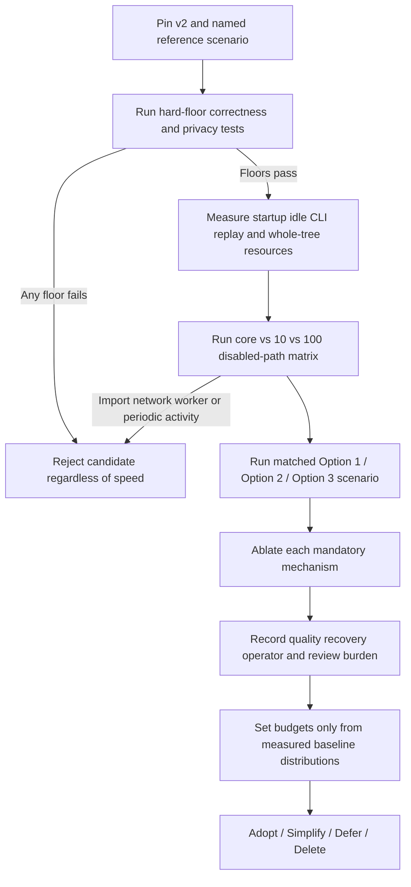
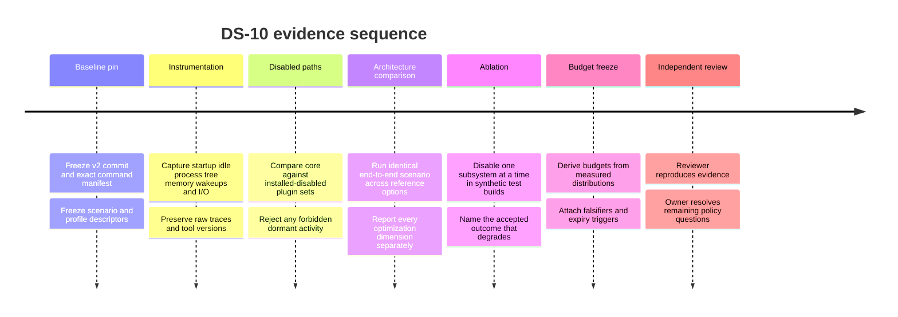

# DS-10 — Performance and Complexity Budget Research Report

## Assumptions and executive summary

**Research scope and assumptions.** The operative topic is the supplied DS-10 brief, not an unspecified general topic. I therefore treat this as a source-pinned research design for Recursion v3’s whole-system performance and complexity budget, with evidence considered through **September 30, 2026**. The audience is the Recursion owner, Hermes/executive control plane, implementers, and independent reviewers. Option 2—the small deterministic kernel with typed fail-closed adapters—is treated as owner-ratified and is **not** reopened. This report performs no implementation, benchmark, provider/model call, configuration change, deployment, publication, merge, or repository/GitHub operation. The supplied brief explicitly fixes v2 at commit `98113d6`, requires missing measurements to remain `unavailable` rather than zero, prohibits invented numeric budgets, and makes disabled-path execution/import/network/process/periodic activity a hard failure. fileciteturn0file0

The principal finding is that **DS-10 has enough information to define a rigorous measurement and decision protocol, but not enough information to truthfully claim the completion gate has fully passed**. In particular, the v2 commit is pinned, but the brief contains no canonical v2 executable, CLI syntax, startup/no-op/idle/replay command, source-tree ownership manifest, or benchmark results. Inventing those would violate the brief’s evidence discipline. The correct state for those fields is therefore **unavailable**, and the exact-command portion of the baseline gate remains open. fileciteturn0file0

The architectural evidence supports DS-10’s insistence on **matched measurement rather than architecture folklore**. Classic modularity research argues for decomposition around hidden design decisions rather than arbitrary processing steps, while microkernel research shows that a small kernel need not be intrinsically inefficient if it remains genuinely minimal. At the same time, empirical microservice work shows that distribution changes networking, operating-system behavior, tail latency, resource management, and failure modes. More recent controlled comparisons remain context-dependent: some configurations favor monoliths on latency and memory, while distributed configurations can gain scalability or resilience under other workloads. citeturn2search0turn5search0turn5search12turn10search16 This literature does **not** prove that Recursion Option 2 is faster; it does justify the brief’s requirement to compare Options 1/2/3 under an identical end-to-end scenario.

The most important methodological decision is to measure the **whole process tree or accounting group**, not just the apparent parent process. Linux cgroup v2 can account memory across processes in a cgroup, including major user-space and kernel-associated memory categories, while Windows documentation warns that a process working set is only a momentary and incomplete view of a process’s total system-memory effect. citeturn0search8turn4search2 A Recursion option that moves work into helpers must therefore not be allowed to appear “leaner” by shifting memory, CPU, I/O, network, or wakeups into child processes or services.

Benchmark methodology is also a hard requirement rather than presentation polish. Systems benchmarking literature emphasizes reproducible state, repeated trials, comparable warm/cold conditions, and preservation of raw environmental information; research on performance changes further shows why uncertainty around measured effects must be reported rather than treating one run or a point estimate as truth. citeturn1search7turn6academia0 Interactive CLI performance must be evaluated as response latency rather than hidden inside aggregate throughput. citeturn1search0

**Recommended disposition at this research stage:** keep the ratified **Option 2** architecture as the implementation target, but treat every claimed performance or complexity advantage over v2/Option 1 as **unverified until measured**. Adopt the kernel mechanisms whose removal demonstrably breaks an accepted safety/recovery invariant; simplify their implementation surface aggressively; defer machinery whose benefit can only be asserted, not measured; and delete duplicate routing/state/context/plugin paths if an ablation demonstrates no accepted outcome depends on them. This recommendation competes directly with **Option 1, incremental extraction from the existing runtime**. Its decisive falsifier is an Option 2 implementation that, in matched tests, adds meaningful resource/review/maintenance burden relative to Option 1 while its added mechanisms fail to produce a unique safety, recovery, quality, or efficiency benefit. It does **not** prove a language, storage engine, binary IPC format, plugin framework, or persistence technology.

### Source-pinned claim table

| Consequential claim | Source and version/date | Classification | Confidence | Expiry trigger |
|---|---|---:|---:|---|
| v2 is frozen at commit `98113d6`; Option 2 is owner-ratified; numerical budgets require a baseline first. | DS-10, updated 2026-09-30. fileciteturn0file0 | Source-documented | High | Owner changes the controlling brief or baseline commit. |
| PERF-003 requires comparison of core versus 10 and 100 installed-but-disabled plugins; disabled-path code/import/network/worker/periodic work is a hard failure. | DS-10, 2026-09-30. fileciteturn0file0 | Source-documented | High | PERF-003 is formally superseded. |
| The supplied materials do not specify an executable or canonical v2 benchmark command. | Inspection of supplied DS-10 brief. fileciteturn0file0 | Locally observed | High | A canonical command manifest or v2 interface specification is supplied. |
| Linux `/proc/PID/status` exposes fields including RSS, peak RSS, threads and context-switch counts; more precise memory maps are available through `smaps`. | Linux kernel procfs documentation. citeturn0search1turn0search3 | Source-documented | High | Kernel accounting semantics materially change. |
| GNU `time` can report elapsed/user/system time, maximum RSS, page faults, I/O and context switching, subject to platform availability. | `time(1)` documentation, current page crawled 2026. citeturn7search0turn7search1 | Source-documented | High | Measurement host lacks GNU-compatible implementation or semantics change. |
| `pidstat` can expose per-task thread/fd information and voluntary/non-voluntary context switches. | `pidstat(1)`. citeturn7search4 | Source-documented | High | Tool version/platform changes fields. |
| Linux tracefs exposes scheduler wakeup events suitable for identifying wakeups rather than inferring them from average CPU alone. | Linux event-tracing documentation. citeturn9search0turn9search7 | Source-documented | High | Tracepoint availability changes on benchmark kernel. |
| Windows working set alone is insufficient as a complete measure of memory impact; WPR reference-set tracing provides a broader scenario view. | Microsoft Windows Performance Toolkit documentation. citeturn4search2 | Source-documented | High | Windows/WPT accounting semantics change. |
| WPR offers CPU, disk, file, registry, networking and heap recording profiles that can test disabled-path activity on Windows. | Microsoft WPR documentation. citeturn4search3turn4search4 | Source-documented | High | Built-in profile behavior changes. |
| Reproducible performance comparison requires repeated, controlled experiments and preservation of environmental/raw-result context. | Wright et al., USENIX 2005; Kalibera & Jones performance methodology. citeturn1search7turn6academia0 | Source-documented | High | Better study design is adopted; principle itself is stable. |
| Decomposition improves comprehensibility/flexibility only when boundaries hide appropriate design decisions; modularity by itself is not a guarantee of low runtime cost. | Parnas, CACM 1972. citeturn2search0 | Source-documented | High | Stable foundational design result. |
| Very small kernels can avoid the assumption that microkernel organization is necessarily inefficient, but that evidence comes from OS kernels and does not directly establish Recursion’s performance. | Liedtke, SOSP 1995. citeturn5search0 | Source-documented with scope caveat | Medium–high | Recursion measurements supersede analogy. |
| Distributed/microservice decomposition changes communication and tail-latency behavior, making architecture performance workload-dependent. | Gan et al., ASPLOS 2019; recent empirical work. citeturn5search12turn10search16 | Source-documented | High | Matched Recursion-specific experiments become available. |
| Option 2 is presently the strongest hypothesis for minimizing privileged code while preserving extensibility, but no Recursion-specific performance benefit has yet been demonstrated in the supplied evidence. | Inference from DS-10 architecture plus modularity/microkernel literature. fileciteturn0file0 citeturn2search0turn5search0 | Inferred | Medium | R12/R17 measurements exist. |

No quantitative product chart is included because **no Recursion benchmark was authorized or executed and the brief expressly forbids inventing numeric budgets**. Producing a numeric chart now would turn unknown measurements into fabricated evidence. fileciteturn0file0

## Baseline and measurement protocol

The baseline should be a **versioned experiment artifact**, not merely a commit string. Each result needs the target revision, exact argument vector, configuration fixture, OS/kernel build, measurement-tool versions, benchmark-profile descriptor, scenario fixture hash, cache state, raw traces, and summary statistics. Benchmarking work has repeatedly shown that apparently small differences in experimental state can undermine comparability; raw state and repeated observations must therefore travel with the result. citeturn1search7turn6academia0

The two hardware profiles should remain abstract performance profiles rather than named personal machines, as DS-10 requires. A profile record should capture the effective CPU allocation/affinity or quota, memory limit, storage behavior relevant to the scenario, operating-system version, and background-load state. The comparison must hold the profile contract fixed across v2 and Options 1/2/3. fileciteturn0file0

### Baseline definition and command status

The commands below pin the **instrumentation layer**. Tokens such as `<V2_START_COMMAND>` remain deliberately unresolved because the brief does not provide the product invocation; therefore these rows do **not** falsely claim that the exact-v2-command gate is satisfied.

| Dimension | v2/reference definition | Linux instrumentation | Windows instrumentation | Current status |
|---|---|---|---|---|
| Startup | v2 commit `98113d6`, identical clean/warm-start scenario and configuration. | `/usr/bin/time -f 'elapsed=%e user=%U sys=%S maxrss_kb=%M majflt=%F minflt=%R voluntary_cs=%w involuntary_cs=%c' -- <V2_START_COMMAND>` | Launch `<V2_START_COMMAND>` under WPR CPU/process tracing; wall time can additionally be measured by a monotonic harness. WPR is intended for system/application performance tracing. citeturn4search3turn4search4 | **Invocation unavailable**; wrapper defined. |
| Idle CPU | Stable initialized but intentionally inactive coordinator. Measure the complete process group, not just the parent. | cgroup/process-tree CPU accounting plus `pidstat`; GNU `time` is insufficient for long-running steady state by itself. citeturn7search4turn0search8 | Performance counters/WPR over the complete Recursion process set. citeturn4search1turn4search9 | Invocation unavailable. |
| Idle RSS/memory | Same idle state after declared settling rule; report parent RSS **and aggregate accounting**. | `/proc/PID/status`/`smaps_rollup` for process detail plus cgroup memory accounting for total tree. citeturn0search1turn0search8 | Working set/private memory plus WPR reference-set analysis where appropriate; do not treat working set as complete system cost. citeturn4search2 | Invocation unavailable. |
| Idle wakeups | Scheduler wakeups attributable to the Recursion process tree during the idle observation window. | tracefs `sched_wakeup`/scheduler events, filtered to benchmark cgroup/PIDs; `pidstat -w` is a lower-fidelity cross-check. citeturn9search0turn7search4 | ETW/WPR CPU scheduling trace; if the selected WPR profile cannot attribute the required event exactly, report `unavailable`, not zero. citeturn4search3 | Counter technically observable; command fixture unresolved. |
| Installed footprint | Clean installation containing only the selected edition/profile. | Byte count of installation tree plus packaged artifact size; record sparse/compressed semantics separately. | Recursive file byte count plus installer/package size. | Product path/package definition unavailable. |
| Binary footprint | Executable/native image set required by the minimal core. | File-size sum of mandatory executable/shared objects; distinguish files on disk from mapped resident pages. | Mandatory PE/DLL set size; distinguish file footprint from working set. | Artifact manifest unavailable. |
| Dependencies | Direct/transitive dependency inventory **and** installed bytes, separated into mandatory versus optional. | Use build/package/SBOM graph if the product emits one; OS shared-library mappings alone do not prove logical-language dependency count. | Same principle; loaded DLLs can supplement but not replace logical dependency inventory. | Logical dependency mechanism unavailable. |
| Imported modules | Logical modules imported/initialized in core versus optional paths. | Runtime-specific import census required; `/proc/PID/maps` only establishes mapped native objects, not arbitrary script/runtime imports. citeturn0search1 | Runtime-specific module census; ETW/native-image data is only a partial proxy for language-level imports. | **Unavailable until engine/runtime is known.** |
| Process/daemon count | Entire process tree during startup, idle and each scenario. | cgroup membership/process tracing; spawning a disabled-plugin worker is a PERF-003 hard failure. fileciteturn0file0 | Process lifetime events under WPR/ETW. citeturn4search3 | Observable once invocation exists. |
| Handles/fds | Open descriptors/handles at defined checkpoints and steady state. | `/proc/PID/fd`, `pidstat` fd count where supported. citeturn7search4 | `GetProcessHandleCount`/Process performance data. Microsoft documents this API as returning the process’s open-handle count. citeturn0search7 | Observable. |
| File reads | Startup and idle filesystem activity, including plugin directories/manifests/code. | syscall/file trace on complete child tree; separate manifest metadata from plugin-code access. | WPR File I/O profile. citeturn4search3 | Observable. |
| Network/model activity | Any attempted socket/network/model action by disabled paths. | System-call/network tracing of process tree. | WPR Networking I/O plus product model-call audit. citeturn4search3 | Network observable; semantic “model call” additionally requires product audit. |
| CLI latency | Matched user operation from invocation to semantically complete result, including interactive attach/detach paths separately. | Monotonic harness around canonical CLI operation; distribution across repeated trials. | Same. | **Canonical CLI operations unavailable.** |
| Event/replay/WAL | Identical deterministic fixture; inject termination at declared cut points; restart and compare accepted state/event prefix. | Product test harness plus filesystem/process fault injection; OS resource trace alongside. | Same. | **Product-level replay command unavailable.** |
| Privileged vs optional code | Source reachable in kernel authority/trust boundary versus adapters/engines/plugins; physical code size is reported separately from structural complexity. | Language-aware source scanner against an owner manifest. | Same. | **Repository/source map unavailable.** |
| Structural complexity | Cyclomatic/control-flow complexity, dependency edges, ownership crossings and privileged review surface. | Language-specific analyzer selected only after implementation language is known. | Same. | **Unavailable; do not substitute LOC alone.** |

Linux exposes RSS, peak RSS, thread counts, context switches and related process fields through procfs, while cgroup v2 supports broader accounting across grouped tasks. citeturn0search1turn0search8 On Windows, Microsoft explicitly warns that working set is an incomplete, state-sensitive memory view and recommends reference-set tracing when scenario-wide physical-memory impact matters. citeturn4search2 That is why the primary host-resource report should contain **both per-process diagnostic values and whole-system-tree totals**.

**Cold versus warm starts must be separate experiments.** They should never be averaged into a single “startup” number. Prior systems benchmarking work notes that cached state left by earlier runs can materially affect subsequent measurements and stresses making test state reproducible. citeturn1search7 Likewise, a CLI should report latency distributions for representative operations rather than only aggregate throughput because interactive performance can diverge even when total elapsed workload time looks similar. citeturn1search0turn1search1

### Coordinate optimization vector

The v3 comparison should produce a vector rather than a score:

| Dimension | Required observation | Hard floor or tradeable? |
|---|---|---|
| Authority / safety / privacy | Unauthorized-action tests, fail-closed adapter tests, credential-reference tests, secret exposure check | **Hard floor** |
| Verified quality | Scenario correctness, independent acceptance, escaped defects/regressions | **Hard floor** for accepted behavior |
| Recovery / replay | State equivalence, event-order invariants, duplicate-action absence, recovery latency | Correctness is **hard floor**; latency is tradeable |
| Owner/operator cost | Required interventions, configuration steps, recovery actions, review burden | Tradeable only after floors pass |
| Quota / tokens / money | Model/API invocation counts and billed usage where applicable | Budgeted; disabled path is zero-call hard floor |
| Context/cache efficiency | Context loaded, compaction frequency, cache behavior, duplicated context state | Tradeable |
| Latency / throughput | Startup, CLI response distribution, scenario throughput | Tradeable |
| Host resources | Aggregate CPU time, RSS/reference-set memory, wakeups, disk/file I/O, descriptors, tasks/processes | Budgeted after baseline |
| Terminal interaction | Input-to-visible-result latency, detach/reattach correctness | Correctness floor plus latency budget |
| Portability/configurability | Windows/Linux parity, required conditional paths and config surface | Correctness floor; complexity tradeable |
| Code/maintenance surface | Privileged SLOC, complexity, dependency edges, owner crossings, independent-review effort | Tradeable, with privileged surface strongly disfavored |
| Extensibility/idle cost | 0/10/100 disabled-plugin deltas; code/network/process/background-work traces | Disabled execution/import/network/worker/periodic work is **hard failure** |

The “hard floor first” structure is important: an implementation with excellent startup time cannot compensate for an authority violation, stale action after PAUSE, replay corruption, secret disclosure, or disabled-plugin network activity. That ordering is explicitly required by DS-10. fileciteturn0file0

### Budget rule

No numeric product budget can responsibly be written today. Instead, each future budget is created by the same sequence: **measure v2 and the named simpler comparator → characterize variability → declare the acceptable regression/improvement envelope → independently review it → freeze the budget with its benchmark fixture and expiry trigger**. Reporting confidence around performance effects rather than only ratios is consistent with rigorous performance-evaluation methodology. citeturn6academia0

| Future budget | Baseline required before setting it | Decisive falsifier |
|---|---|---|
| Startup | v2 plus named simpler launcher/core baseline on both profiles | Candidate exceeds the accepted startup envelope or gains speed only by violating a hard floor. |
| Idle CPU | v2/Option 1 steady-state trace | Persistent work has no accepted outcome attached to it, or candidate exceeds the post-baseline envelope. |
| Idle RSS | Aggregate process-tree/cgroup or Windows scenario memory | Memory is shifted to helpers/services or exceeds accepted envelope. |
| Wakeups | Measured idle wakeup distribution | New periodic wake source has no accepted outcome or exceeds envelope. |
| Install/dependency size | v2 minimal edition inventory | Mandatory bytes/dependencies increase without unique accepted benefit. |
| Process count | v2 plus minimal Option 1/2 reference | New mandatory daemon/process has no ablation-demonstrated benefit. |
| CLI latency | Matched interactive scenarios | Confidence interval/equivalent uncertainty shows an unacceptable regression. |
| Replay cost | v2 crash/recovery fixture | Correctness differs at all, or cost exceeds envelope without recovery benefit. |
| Privileged complexity | v2 privileged source/review map | Authority-bound code grows without a necessary ownership/safety justification. |
| Disabled plugins | core versus 10/100 installed-disabled matrix | Any disabled plugin code import/execution, model/network action, worker, or periodic task: **immediate failure regardless of timing**. fileciteturn0file0 |

## Ownership, complexity, and disabled paths

Parnas’s information-hiding result is particularly relevant to Option 2: a useful module boundary hides a design decision likely to change, rather than merely dividing execution into more components. citeturn2search0 Saltzer and Schroeder’s classic protection principles independently support minimizing the mechanisms that must be trusted and avoiding unnecessary privilege. citeturn2search1turn2search12 For Recursion, this argues for **one authoritative implementation of each security/recovery mechanism and zero shadow implementations in engines, adapters, plugins or UI paths**.

### One-owner map

| Mandatory mechanism | Sole semantic owner | Adapters/engines/plugins may do | Forbidden duplicate path | Required ablation | Justification and initial disposition |
|---|---|---|---|---|---|
| Schema versions | Kernel schema/version authority | Encode/decode the versioned form | Independently accept incompatible or unknown versions | Remove/version-bypass in synthetic harness; incompatible input must cease to be rejected | Prevent incompatible interpretation. **Adopt.** |
| Authority/budget checks | Kernel authority gate | Submit typed requests | Perform an action solely because an engine/plugin approved it | Disable authority gate in adversarial fixture; unauthorized scenario must become distinguishable | Core safety property. **Adopt.** |
| Command idempotency | Kernel command identity/idempotency owner | Carry stable command identity | Plugin/provider-local duplicate suppression as authoritative truth | Disable idempotency; retry fixture must produce duplicate accepted effect | Prevent duplicate actions across retries/recovery. **Adopt.** |
| Event sequencing | Kernel event sequencer | Emit candidate events through kernel API | Independent authoritative sequence number/state stream | Disable sequencing; concurrent/restart fixture must lose accepted ordering guarantee | Deterministic replay requirement. **Adopt.** |
| Action admission | Kernel | Request execution through typed adapter | Adapter or engine bypass of kernel admission | Disable admission; disallowed action fixture must become executable | Authority boundary. **Adopt.** |
| PAUSE epoch | Kernel | Read/carry current epoch as required by protocol | Local “pause” state considered equivalent to kernel epoch | Disable epoch validation; stale pre-PAUSE work must become capable of acceptance in synthetic test | Prevent stale work crossing a control-plane transition. **Adopt.** |
| Credential-reference policy | Kernel policy boundary | Receive opaque approved references where required | Secret-value propagation into agent/plugin state as an alternate path | Replace refs with raw-secret-capable path in synthetic fixture; secret-handling floor must degrade | Privacy/trust-boundary requirement. **Adopt.** |
| Verification identity | Kernel verification/acceptance identity | Produce evidence for independent verifier | Implementer self-PASS becoming acceptance | Disable independent identity distinction; self-verification fixture must be able to pass improperly | Implements “implementer PASS is never acceptance.” **Adopt.** fileciteturn0file0 |
| Publication provenance | Kernel provenance owner | Attach candidate provenance inputs | Plugin/provider separately deciding canonical provenance | Remove provenance binding; output fixture must become unattributable/non-verifiable | Integrity/auditability. **Adopt, but keep implementation minimal.** |
| Plugin discovery/loading | One adapter/registry boundary, **not** multiple engine-specific loaders | Register/activate explicitly selected plugin | Startup-time eager imports, plugin-owned recurring scanners, provider-specific loader duplicates | Disable registry; only extension capability should disappear; core behavior must remain | Extensibility, not authority. **Simplify.** |
| Context/compaction implementation | Selected engine/context component, not kernel semantic authority except policy limits | Replace inner-loop strategy | Multiple concurrently authoritative context stores | Disable optional compactor/cache; measure accepted quality/resource change | Efficiency feature rather than authority primitive. **Defer from kernel unless measured.** |

This map does **not** establish that duplicate paths currently exist in the private implementation; there was no repository inspection, and claiming otherwise would violate the evidence rule. It establishes the criterion by which a later source audit should label a duplicate path. fileciteturn0file0

**Privileged code should not be equated with total code.** DS-10 needs at least three independent views: physical source size, structural/control-flow complexity, and trust/ownership surface. McCabe’s original work explicitly distinguishes control-flow complexity from physical size: adding straight-line statements does not necessarily alter cyclomatic complexity. citeturn5search2turn5search5 Therefore “v3 has fewer lines” is not sufficient evidence of a leaner core, nor is a complexity score sufficient evidence of a smaller trusted computing base.

### PERF-003 disabled-path proof

The 0/10/100 installed-but-disabled plugin test should be constructed so that **timing is secondary to semantic inactivity**. DS-10 already makes import/execution/network/worker/periodic work a hard failure. fileciteturn0file0 The measurement adds resource deltas only after those binary checks pass.

| Disabled-path property | Linux proof | Windows proof | Judgment |
|---|---|---|---|
| No plugin code execution/import | Runtime module census where supported; file/syscall trace against synthetic plugin code; sentinel plugin whose initialization would emit an observable marker | Runtime module/image census plus File I/O/ETW trace; sentinel initialization marker | Any disabled-plugin initializer/code load: **FAIL** |
| No model or network call | Complete process-tree socket/network syscall trace plus product-level model-call audit | WPR Networking I/O plus semantic model-call audit | Any call/attempt attributable to disabled path: **FAIL** |
| No worker process | Process events/cgroup membership during startup and idle | ETW process-lifetime events | Any disabled-path worker: **FAIL** |
| No periodic work | Scheduler `sched_wakeup` trace and CPU/task-switch evidence attributable to disabled subsystem | ETW scheduler/CPU activity | Recurring disabled-path task/wakeup: **FAIL** |
| File reads | File-open/read trace, classified as core manifest metadata versus disabled plugin code/data | WPR File I/O | Plugin-code/data read is strong failure evidence; manifest metadata reads are measured and budgeted after baseline rather than silently called zero. |
| RSS/handles | Aggregate group memory plus descriptors, at identical checkpoints | Reference-set/working-set plus handles | Compare 0 → 10 → 100; threshold comes only after baseline. |
| Startup latency | Repeated cold and warm distributions | Same | Budgeted only after measurement; cannot excuse a semantic disabled-path failure. |

Linux’s trace-event infrastructure provides direct scheduler events including `sched_wakeup`, rather than forcing wakeup inference solely from coarse CPU utilization. citeturn9search0 Microsoft’s WPR profiles similarly cover CPU, file and network activity for Windows tracing. citeturn4search3 These mechanisms are preferable to interpreting “0.0% CPU” as proof of inactivity, because a sampling display can miss short periodic work.

A particularly useful synthetic plugin for PERF-003 would have a deliberately unmistakable **load sentinel**—for example, initialization that touches a designated synthetic marker and registration code that is never required when disabled. The objective is not to rely on source inspection alone: the trace should prove that installed-disabled code was never loaded or executed. This is a proposed test design, not an observation about the current implementation.

## Ablation and architecture comparison

The R17 ablation requirement is stronger than ordinary unit testing. It asks whether each subsystem **earns its existence**: remove one mechanism while keeping the scenario otherwise matched, then identify the accepted outcome that degrades. Availability benchmarking research has long used controlled fault injection to make recovery and maintainability effects observable rather than assuming they follow from the architecture. citeturn1search4turn1search9

Safety-critical ablations should occur only in isolated synthetic/test builds with no external side effects. The point is not to ship a kernel without authority checks; it is to verify experimentally that the authority mechanism protects a named outcome rather than existing as unexplained machinery.

### Ablation results template

| Mechanism disabled | Target scenario | Accepted outcome expected to degrade | Hard floor | Observed degradation | Resource delta | Review/maintenance delta | Disposition |
|---|---|---|---|---|---|---|---|
| Schema/version gate | Unsupported-version input | Incompatible input is rejected deterministically | No incompatible acceptance | `unavailable` | `unavailable` | `unavailable` | Pending |
| Authority gate | Unauthorized synthetic action | Action remains unadmitted | Zero unauthorized accepted actions | `unavailable` | `unavailable` | `unavailable` | Pending |
| Idempotency | Crash/retry same command identity | Exactly one accepted external effect | No duplicate accepted effect | `unavailable` | `unavailable` | `unavailable` | Pending |
| Event sequencing | Concurrent event/restart fixture | Deterministic accepted event order | Replay/state equivalence | `unavailable` | `unavailable` | `unavailable` | Pending |
| PAUSE epoch validation | Pre-PAUSE delayed worker result | Stale result rejected after epoch transition | No stale post-PAUSE action | `unavailable` | `unavailable` | `unavailable` | Pending |
| Credential refs | Synthetic secret-sensitive operation | No raw secret enters untrusted context | No prohibited disclosure | `unavailable` | `unavailable` | `unavailable` | Pending |
| Verification identity | Implementer self-PASS fixture | Independent acceptance still required | Self-PASS never equals acceptance | `unavailable` | `unavailable` | `unavailable` | Pending |
| Provenance | Synthetic publishable artifact | Origin/version/verification identity remains attributable | Required provenance present | `unavailable` | `unavailable` | `unavailable` | Pending |
| Plugin registry | Enable one synthetic plugin | Explicitly selected extension stops working, core does not | Core remains correct | `unavailable` | `unavailable` | `unavailable` | Pending |
| Optional index/cache/compactor | Long-context matched workload | Only a demonstrated quality/efficiency outcome should deteriorate | Core authority/recovery unchanged | `unavailable` | `unavailable` | `unavailable` | Pending |

A mandatory mechanism that survives this experiment with **no lost safety, quality, recovery, operator or measured efficiency outcome** has failed to demonstrate why it belongs in the mandatory core. The initial disposition should then be **simplify**, **defer**, or **delete**, depending on whether some optional use case remains. That logic follows DS-10 directly. fileciteturn0file0

### Packaging alternatives

| Property | Integrated monolith | Microservice/process decomposition | Small deterministic kernel + plugins/adapters |
|---|---|---|---|
| Invocation/deployment | Usually smallest number of launchable units | Multiple independently managed services/processes | Small core plus explicit extension boundary |
| IPC/network tax | Lowest when calls remain in-process | Potential serialization, scheduling, network/IPC and tail-latency effects | Can keep core path local; selected adapters may add boundary cost |
| Failure isolation | A component fault can share the main process failure domain | Stronger process/service isolation is possible | Core can isolate optional adapters while avoiding mandatory service fan-out |
| Process/daemon count | Usually smallest | Usually larger | Should remain small if optional adapters are truly dormant |
| Authority surface | Risk of authority and application logic becoming intermingled | Authority may become distributed unless aggressively centralized | Explicit design objective is one small authority kernel |
| State/replay complexity | Can be easier when state is co-located | Distributed state/order/retry semantics add complexity | Central event/order ownership can retain one source of truth |
| Plugin/extension cost | Extension may increase monolith dependency surface | Independent services can isolate extension cost but add operations | Intended advantage is zero/near-zero disabled cost and pay-for-selected extension |
| Maintenance hypothesis | Easy operational model, but poorly hidden internals can become tightly coupled | Team/service independence is possible, but operational surface grows | Parnas-style boundaries can confine change if adapters hide unstable provider details |
| Primary Recursion risk | “Small” monolith grows into a privileged all-purpose runtime | Over-distribution turns a coordinator into a service mesh | Plugin loaders, adapters or alternate state paths quietly recreate a second kernel |
| Evidence status for Recursion | Unmeasured | Unmeasured | Ratified target, but claimed performance advantage remains unmeasured |

Parnas provides evidence for carefully selected module boundaries, not for “more modules is always better.” citeturn2search0 Liedtke’s microkernel work shows that poor performance is not an inevitable property of a small-kernel organization, but it also emphasizes implementation discipline and is not a benchmark of an agent platform. citeturn5search0

The microservice literature reinforces the need for Recursion-specific comparison. DeathStarBench showed that microservices alter behavior throughout the hardware/software stack and can increase performance-predictability challenges. citeturn5search12 A 2024 peer-reviewed migration study reported performance costs from encapsulation and inter-service communication during monolith-to-microservice migration. citeturn10search17 A later study examining multiple granularity/deployment choices found that the monolithic configuration could have the lowest latency while distributed configurations offered different resilience behavior, demonstrating that there is no architecture-independent scalar winner. citeturn10search16 Even 2026 studies remain configuration-sensitive: one controlled resource-constrained Docker experiment reported markedly higher memory and tail-latency cost for its microservice version, while other experiments under different stress configurations have reported advantages for microservice decompositions. citeturn10search11turn10academia33 Those results are evidence for **matched experiments**, not transferable Recursion budget numbers.

The research-to-acceptance sequence should be staged in this order:

For persistence, DS-10 should test **behavioral invariants rather than bless a particular WAL implementation**. WAL/recovery literature such as ARIES demonstrates why crash recovery must be evaluated around ordering, durable logging and restart semantics; however, it does not imply Recursion should implement ARIES or a relational database. citeturn8search1turn8search6 The Recursion test therefore needs to ask: after termination at each defined persistence cut point, what is the accepted event prefix, does replay reproduce the same authoritative state, can any admitted external action be duplicated, and is corruption or an incomplete record detected fail-closed?

## Decision rules, falsifiers, and minimum evidence

### Per-mechanism disposition rule

**Adopt** only when a mechanism has exactly one semantic owner and its targeted ablation causes a named accepted safety, quality, recovery, operator, or measured-efficiency outcome to degrade. Its falsifier is an ablation showing that the same outcome remains intact without it, or evidence that a simpler mechanism preserves the same floor at lower total cost.

**Simplify** when an outcome is real but the implementation surface is larger than necessary, duplicated, or causes startup/idle/dependency/review burden. Its decisive falsifier is evidence that the supposedly removable portion is itself necessary to retain the named outcome. Information-hiding research supports placing change-prone details behind narrow boundaries, but does not prove that every abstraction or layer is useful. citeturn2search0

**Defer** when the proposed mechanism has a plausible benefit but no current accepted scenario demonstrates it. Its falsifier is a new accepted scenario in which omission measurably violates a floor or budget.

**Delete** when no accepted scenario degrades under removal and no safety requirement uniquely belongs to the mechanism. Its falsifier is reproducible evidence of an accepted outcome that cannot be retained more simply.

Every decision must also state **what it does not prove**. A startup improvement does not prove lower idle cost; lower RSS does not prove lower total memory impact; lower LOC does not prove lower control-flow or trust complexity; passing replay tests does not prove authority correctness; and zero provider calls in one scenario does not prove all disabled routes are inert.

### Architecture recommendation

**Option 2 — adopt as the ratified architecture, but keep its performance benefit explicitly unverified.** The competing option is **Option 1**, which retains the existing file/Git runtime as authoritative while extracting v3 incrementally. The research case for Option 2 is architectural: one semantic authority boundary is compatible with information hiding and economy of mechanism, while a small-kernel design has precedent for avoiding the assumption that modular separation necessarily entails intolerable overhead. citeturn2search0turn2search1turn5search0

The decisive falsifier is not “Option 1 wins one microbenchmark.” It is a **matched pattern** in which Option 2 fails to buy a unique accepted safety/recovery/quality benefit and simultaneously imposes persistent startup, idle resource, replay, code/review or operator cost beyond the budget derived from the v2/Option 1 baseline. That evidence should trigger owner escalation because the research lane is not authorized to reverse the ratified architecture. This recommendation does not prove a particular language, persistence mechanism, IPC choice, framework, storage layout or plugin technology.

**Microservice-style mandatory process decomposition — defer.** Its direct competitor is the small-kernel/plugin layout. Existing systems research establishes that distributed service graphs can add communication and performance-predictability costs, while recent experiments show both benefits and penalties depending on workload and placement. citeturn5search12turn10search16 The falsifier for the “defer” disposition is a matched Recursion experiment where additional process/service boundaries produce a necessary isolation, recovery, scalability or quality benefit that cannot be achieved by the simpler kernel/adaptor arrangement without violating another floor. This does not rule out optional remote nodes or provider plugins.

**Eager loading/scanning of disabled plugins — simplify or delete from the critical path.** Its competing option is manifest-based or otherwise lazy activation in which installed-disabled code remains inert. PERF-003 itself provides the falsifier: if an alternative discovery implementation can demonstrably maintain zero disabled code import/execution, zero network/model action, zero workers and zero periodic work, while meeting the eventual measured startup/file-I/O budget, it remains viable. fileciteturn0file0 This disposition does not constrain enabled-plugin initialization.

**Single-number “complexity” gating — delete.** Its competing approach is the DS-10 vector: source size, control-flow complexity, dependencies, process topology, privileged ownership surface and reviewer burden reported separately. McCabe’s work demonstrates that physical size and control-flow complexity are not the same quantity. citeturn5search5 This does not prove which language-specific complexity metric will be most predictive for Recursion.

### Quality and review burden

Efficiency gains must include downstream cost. A candidate that reduces startup time but creates more regressions, more independent-review work, more recovery interventions or more privileged-code touchpoints has not demonstrated net efficiency. The experiment record should therefore add:

| Outcome class | Measurement |
|---|---|
| Verified quality | Independent pass/fail on the matched accepted scenarios; regressions and unresolved observations kept distinct from zero. |
| Owner/reviewer burden | Active review time, number of distinct privileged owners/components that must be understood, review rounds and manual acceptance interventions. |
| Change locality | Number of components/authority boundaries touched by the same controlled feature change. |
| Maintenance surface | Mandatory dependencies, privileged code size, control-flow complexity, duplicate state/routing paths and OS-specific branches. |
| Recovery/operator burden | Human steps required after injected crash/fault and evidence needed to determine the state is safe. |

These values require a baseline before any threshold is set. They should not be collapsed into a weighted score that could conceal a security or recovery failure. fileciteturn0file0

### Minimum experiment set capable of changing an owner decision

Only a small set of experiments is likely to change the Option 1/2/3 disposition materially:

1. **Hard-floor authority/recovery suite.** Exercise action admission, budget/authority, idempotency, PAUSE epoch, verification identity and crash/replay equivalence. Any failure blocks promotion regardless of speed. This is already logically decisive from DS-10. fileciteturn0file0
2. **PERF-003 0/10/100 matrix.** Startup, aggregate memory, handles/fds, file reads, process count and wakeups, plus binary proof of no disabled import/execution/network/worker/periodic work. Any forbidden dormant activity blocks the corresponding implementation boundary. fileciteturn0file0
3. **One matched real end-to-end workflow** across v2, Option 1 reference, Option 2 candidate and Option 3 reference, collecting the complete optimization vector. Architecture-comparison literature shows why unmatched microbenchmarks cannot settle the deployment trade-off. citeturn5search12turn10search16
4. **Crash/restart/replay fault-injection matrix** at persistence boundaries, measuring correctness first and recovery cost second. Fault-injection benchmarking is an established method for exposing recovery design behavior. citeturn1search4
5. **One matched maintenance change** that crosses a provider/engine boundary, recording privileged code touched, dependency/state paths changed, independent-review time and regressions. This tests whether Option 2’s architectural separation actually buys change locality rather than merely more files.

What is already decisive without further spending is narrower but important: no scalar may hide a hard-floor failure; no numeric product budget is valid before a baseline; installed-disabled plugins may not execute/import/network/spawn/periodically work; implementer PASS is not acceptance; and a mandatory mechanism needs one semantic owner plus an ablation-demonstrated outcome. Those decisions come directly from the controlling brief and require no benchmark to restate. fileciteturn0file0

The remaining Option 2 implementation-boundary falsifiers are therefore:

| Boundary hypothesis | Open falsifier | Measurement that resolves it |
|---|---|---|
| Small kernel is materially leaner than a v2/Option 1 authority path | Option 2 adds privileged code/resource/review cost without a unique accepted outcome | Source ownership map + matched baseline + mechanism ablations |
| Typed adapter boundary stays fail-closed | Unknown/malformed version or adapter failure permits action | Adversarial schema/adapter test |
| Central command/event semantics prevent duplicated state | Engine/adapter maintains a second authoritative identity/sequence/state path | Source state-owner audit + crash/retry fixture |
| PAUSE epoch closes stale work | A pre-PAUSE result can commit after the epoch changes | Controlled delayed-worker test |
| Disabled extensions are inert | Installed-disabled code loads, calls out, spawns or wakes | PERF-003 trace matrix |
| Plugin ecosystem does not enlarge core dependency surface | Disabled or unselected plugin dependencies become mandatory startup/runtime dependencies | Dependency/SBOM diff and module/file-load trace |
| Recovery machinery earns its cost | Removing/simplifying it causes no accepted recovery outcome to degrade | Crash/replay ablation |
| Verification/provenance machinery earns its cost | Simpler identity/provenance implementation preserves the exact acceptance floor | Synthetic self-PASS and provenance ablation |
| Context/compaction machinery belongs outside the kernel | Authority/replay semantics unexpectedly depend on an engine-specific context subsystem | Engine/context ablation and state-owner audit |

## Completion gate and sources

### Completion-gate assessment

| DS-10 gate | Status after this research | Evidence / remaining blocker |
|---|---|---|
| v2 baseline commit and command pinned for each dimension | **Not complete** | Commit `98113d6` is pinned, but no canonical v2 executable/arguments are present in the authorized brief. Instrumentation is specified; inventing the product commands would violate evidence discipline. fileciteturn0file0 |
| Every claimed improvement compared with v2 or a named simpler baseline | **Pass for this report** | This report makes no unqualified measured Recursion performance improvement claim; Option 2 benefits are explicitly hypotheses pending v2/Option 1 comparison. |
| Each mandatory mechanism has one owner, one ablation and a user-visible/safety/measured-efficiency justification | **Pass as a research design** | Owner/ablation map above. Empirical ablation results remain `unavailable`, as required because no benchmark was executed. |
| Budgets are set only after measurement and carry a falsifier | **Pass as policy; numeric values intentionally unset** | Every budget definition above names a prerequisite baseline and falsifier. No invented threshold is supplied. |
| Disabled-path cost has a hard-failure test rather than timing tolerance alone | **Pass** | Import/execution/network/model/worker/periodic work are binary hard failures; timing/resources are subsequent measurements. fileciteturn0file0 |
| Every recommendation names adopt/simplify/defer/delete plus decisive falsifier | **Pass** | Option 2 adopt; microservice mandatory decomposition defer; eager disabled-plugin activity simplify/delete; scalar complexity gating delete; each has a named competing path/falsifier. |
| Hard floors are reported before trade-offs/aggregate summary | **Pass** | Authority/privacy/recovery/disabled-path floors precede latency/resource trade-offs; no aggregate score is proposed. |
| Protected paths untouched; privacy and secret scan clean | **Partially verifiable** | This research performed no repository or GitHub operation, so it did not modify protected paths. The report reproduces no credentials or account/infrastructure identifiers. A private-repository secret scan was outside the supplied authorization and therefore remains **unavailable**, not falsely “clean.” fileciteturn0file0 |

The most important unresolved Owner input is therefore **not another architecture debate**. It is the exact benchmark manifest: the canonical v2 startup command, canonical idle/coordinator invocation, canonical CLI scenarios, canonical replay/recovery command, and the profile definitions against which the first measurements will be frozen. Until those exist, the exact-command completion-gate line must remain failed rather than being papered over.

Other Owner-level questions that remain legitimately open are: which accepted end-to-end scenario is the minimum representative workload for R17; what precise independent-review evidence is required for “verified quality”; what statistical uncertainty/reporting policy becomes canonical for performance budgets; which outputs require publication provenance when publication itself is not active; and which source ownership labels define “privileged” code for the first v2 audit. None of those requires reopening Option 2.

### Sources

| Source | Why it matters |
|---|---|
| **DS-10 — Performance and complexity budget**, supplied brief, updated September 30, 2026. fileciteturn0file0 | Primary authority for Recursion-specific architecture, constraints, PERF-003, v2 commit, evidence discipline and completion gate. |
| Linux kernel, **The `/proc` Filesystem**. citeturn0search1turn0search3 | Primary OS documentation for process RSS, peak RSS, thread and context-switch observations. |
| Linux kernel, **Control Group v2** and PSI documentation. citeturn0search8turn0search6 | Primary documentation for aggregate task-group resource accounting and pressure data. |
| Linux kernel, **Event Tracing / ftrace**. citeturn9search0turn9search7 | Primary source for scheduler wakeup/event instrumentation needed by idle-cost testing. |
| GNU/Linux `time(1)` and `pidstat(1)` documentation. citeturn7search0turn7search4 | Resource/timing and per-task observation primitives for Linux benchmark collection. |
| Microsoft, **Windows Performance Recorder built-in profiles** and WPR/WPA guidance. citeturn4search3turn4search4 | Primary Windows instrumentation for CPU, file, network and process behavior. |
| Microsoft, **Reference sets** and Windows memory-performance documentation. citeturn4search2turn0search2 | Establishes limits of ordinary working-set measurements and richer memory accounting. |
| D. L. Parnas, **“On the Criteria to Be Used in Decomposing Systems into Modules,”** CACM, 1972. citeturn2search0 | Foundational primary paper on information hiding and meaningful modular boundaries. |
| J. H. Saltzer and M. D. Schroeder, **“The Protection of Information in Computer Systems,”** Proceedings of the IEEE, 1975. citeturn2search1turn2search12 | Foundational security design principles supporting minimal trusted mechanisms and privilege. |
| T. J. McCabe, **“A Complexity Measure,”** IEEE Transactions on Software Engineering, 1976. citeturn5search2turn5search5 | Primary source distinguishing structural control-flow complexity from physical code size. |
| J. Liedtke, **“On Micro-kernel Construction,”** SOSP 1995. citeturn5search0 | Primary evidence that small-kernel organization is not inherently equivalent to poor performance, with important domain caveats. |
| Y. Gan et al., **“An Open-Source Benchmark Suite for Microservices and Their Hardware-Software Implications for Cloud & Edge Systems,”** ASPLOS 2019. citeturn5search12 | Primary empirical work showing system-wide and tail-latency implications of service decomposition. |
| C. P. Wright et al., **“Auto-pilot: A Platform for System Software Benchmarking,”** USENIX 2005. citeturn1search7 | Primary benchmarking work on reproducibility, state control and preserving experiment information. |
| T. Kalibera and R. Jones, **“Quantifying Performance Changes with Effect Size Confidence Intervals.”** citeturn6academia0 | Statistical basis for reporting uncertainty in comparative performance rather than relying on point ratios. |
| A. Brown and D. Patterson, **availability benchmarking/fault-injection work**, USENIX 2000. citeturn1search4turn1search9 | Supports controlled failure injection as a way to evaluate recovery and maintainability outcomes. |
| C. Mohan et al., **ARIES**, ACM TODS 1992, plus IBM recovery analysis. citeturn8search1turn8search6 | Primary background for testing durable event/replay behavior and crash recovery without prescribing a Recursion storage implementation. |
| **Stepwise migration of a monolith to a microservice architecture**, Performance Evaluation, 2024. citeturn10search17 | Recent peer-reviewed evidence of measurable performance costs from decomposition/communication. |
| **Performance and Resilience Impact of Microservice Granularity**, International Journal of Network Management, 2025. citeturn10search16 | Recent empirical evidence that latency/resilience outcomes vary with granularity and deployment, strengthening the matched-scenario requirement. |
| **Tail latency, throughput, and memory overhead of monolithic and microservices architectures**, 2026. citeturn10search11 | Recent controlled evidence illustrating significant configuration-dependent resource/latency differences; useful as evidence against architecture-wide universal claims. |