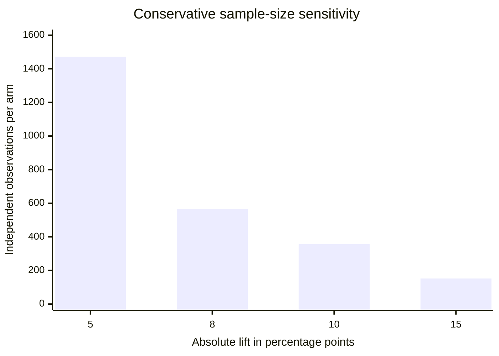
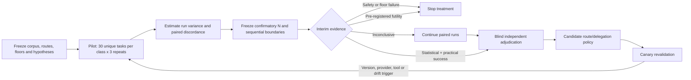

# DS-11 — Model Routing and Delegation Science

## Executive summary

**Research cutoff: October 1, 2026.** This report executes the DS-11 research directive as a report-only investigation. It preserves the brief's fixed authority model: `Head`, `ARM`, and `worker` are logical roles rather than model names; route choice may not widen authority, privacy, credential, spending, or tool grants; `Sol`, `Luna`, `Terra`, `Astra`, and `Muse` remain experimental treatment labels; verification floors remain risk-scaled; and absent telemetry remains `unknown`, not zero. fileciteturn0file0

The strongest public evidence supports **task- or skill-specific routing rather than a single universal capability ladder**. In an ICLR 2025 study covering roughly 46,000 instances across 12 benchmarks, aggregate accuracy across several leading models differed by only 0.4 percentage points while individual skill slices differed by as much as +18 and −19 points; routing held-out instances to the model strongest on relevant skills improved corpus-level accuracy by 3%. RouteLLM, Hybrid LLM, FrugalGPT, and more recent routing work independently show that learned or quality-aware routing can reduce expensive-model usage or cost while preserving much of the measured quality on their respective benchmarks. Those findings do **not** prove a particular Recursion route policy, but they directly undermine the premise that one total ordering of models is sufficient across heterogeneous work. citeturn13search2turn16view3turn13search11turn13search6

For delegation, public evidence supports a more qualified conclusion: **a strong orchestrator with selective bounded specialists is the best default hypothesis to test, but its superiority over multi-ARM collaboration or a peer swarm is not yet empirically established for Recursion.** Anthropic's production research system uses an orchestrator-worker architecture and reported a 90.2% improvement over its single-agent baseline on an internal research evaluation; it also reported approximately 15× the tokens of ordinary chat, duplication/gaps when delegation boundaries were vague, and weaker suitability for tasks with tightly coupled dependencies such as much coding work. Microsoft Magentic-One independently uses an orchestrator directing four specialized agents and reported competitive results on several agentic benchmarks. Conversely, multi-sample/voting research shows that additional agents can improve performance in some settings, while newer team-size work reports non-monotonic scaling under cost constraints. The defensible conclusion is therefore **conditional delegation, not “more agents is better.”** citeturn16view0turn15search2turn2academia12turn0academia13

The minimum decisive sample cannot honestly be fixed before measuring paired-task discordance and run variance. A sound DS-11 campaign should therefore begin with a **30-unique-task-per-class pilot, three repeated attempts per treatment**, then power the confirmatory stage from the observed paired outcomes. For orientation, an intentionally conservative independent-arm calculation at two-sided α = 0.05, 80% power, and a 60% baseline requires about **152 observations per arm to detect a 15-point improvement, 356 for 10 points, 564 for 8 points, and 1,471 for 5 points**. A paired approximation is substantially smaller when the same tasks are run under both treatments: under illustrative discordant-pair fractions, about **115 paired unique tasks for a 15-point effect** or **228 for a 10-point effect**. These are sensitivity calculations, not predetermined campaign sizes. McNemar's test is appropriate for paired binary outcomes, while repeated attempts should quantify stochastic reliability rather than be falsely counted as independent tasks. citeturn13search5turn15search0

The recommended primary endpoint is **first-review acceptance at a pre-registered quality floor per unique task**. Secondary measures should include repair cycles, owner-review minutes, false-green rate, verifier disagreement, quota/proxy-token use, wall-clock latency, duplicated-context ratio, synthesis loss, checkpoint-switch intent recall, and provider-reported usage. Outcome grading should favor deterministic end-state tests where possible and blinded rubric/human adjudication where the task is open-ended. Anthropic's 2026 agent-evaluation guidance explicitly emphasizes outcome-based grading, deterministic graders where possible, human calibration of model judges, and repeated trials because agent behavior is non-deterministic. citeturn15search0turn16view0

The first confirmatory campaigns should be narrow rather than a combinatorial full factorial:

| Priority | Primary comparison | Reason |
|---|---|---|
| **A** | Task-specific route suite vs universal ladder | Strongest external evidence; directly blocks routing policy. |
| **B** | One ARM + bounded specialists vs multi-ARM collaboration | Directly tests the product architecture claim without conflating model strength. |
| **C** | Same-route continuation vs checkpoint switch | Measures handoff cost and intent loss separately from provider/model quality. |
| **D** | Strong-planner vs cheap-planner with implementation and verification routes fixed | Isolates the value of planning intelligence. |
| **E** | Required verifier floor plus controlled independence treatments | Measures escaped defects without reopening the accepted V0–V3 policy. |

**Provisional recommendation, not an Owner decision:** adopt the following as the hypothesis entering local measurement: task-specific route suites; one strong ARM that delegates only when decomposition value exceeds coordination cost; same-route continuity unless a checkpointed reason to switch exists; stronger planning only for classes where it buys enough acceptance/repair reduction; and existing risk-scaled verifier independence. Each is falsifiable below. No universal model ranking can be justified from the public literature or from one run. fileciteturn0file0

## Scope and evidence base

DS-11 asks a narrower scientific question than “which model is best.” The object of measurement is an **eligible route and harness under a task class**, with acceptance floors applied before cost or responsiveness optimization. That distinction is essential because model identity, provider, capacity pool, credentials, execution mode, orchestration scaffold, tools, context policy, and verifier arrangement can each change observed results. Anthropic's agent-evaluation guidance similarly warns that an “agent” evaluation measures the model together with its harness and tools, not an abstract model in isolation. fileciteturn0file0 citeturn15search0

Public evidence from 2021–2026 falls into five useful families.

| Evidence family | Most relevant sources | What it can establish | What it cannot establish |
|---|---|---|---|
| **Model routing and heterogeneous strengths** | Microsoft skill-slice study; RouteLLM; Hybrid LLM; BEST-Route; FrugalGPT | Aggregate rankings conceal task/skill tradeoffs; routing can improve a measured quality-cost frontier. citeturn13search2turn16view3turn13search11turn13search6turn1academia49 | Which Recursion task classes need which routes; entitlement, privacy, or billing properties. |
| **Orchestration and multi-agent systems** | Anthropic multi-agent Research; Microsoft Magentic-One; Mixture-of-Agents; More Agents Is All You Need | Orchestrator-worker and ensemble designs can outperform simpler baselines on some workloads; coordination has costs. citeturn16view0turn15search2turn1search9turn2academia12 | A universal optimum ARM count or proof that a swarm loses on Recursion work. |
| **Evaluation and contamination** | Anthropic agent-eval guidance; LiveBench; SWE-rebench; BrowseComp contamination analysis | Repeats matter; fresh tasks and strong contamination controls matter; outcome-based grading is preferable to brittle path matching. citeturn15search0turn1academia52turn7academia15turn0search1 | Recursion's own run-to-run variance or minimum N before pilot data. |
| **Continuity, state, and long-horizon work** | Anthropic production patterns; METR time horizons; long-horizon harness research; Microsoft multi-turn study | State loss and multi-turn unreliability are real concerns; checkpoints, external state, and careful handoffs are plausible mitigations. citeturn16view0turn11view2turn6academia25turn13search7 | Whether same-route continuity beats a well-designed checkpoint switch in Recursion. |
| **Lifecycle, governance, telemetry** | Provider lifecycle/API docs; NIST AI RMF; EU AI Act | Route identity/version and usage metadata can often be observed; provider changes force revalidation; some deployments face traceability/transparency obligations. citeturn14search0turn14search1turn14search4turn16view1turn16view2 | That any provider field proves contractual entitlement, privacy treatment, cache status, or invoice cost. |

Two methodological cautions dominate the literature.

First, **benchmark contamination is now an active experimental variable, not a theoretical nuisance**. LiveBench was designed around frequently refreshed tasks and objective grading; SWE-rebench was created as a continuously refreshed, decontaminated software-engineering benchmark; Anthropic separately reported that unintended benchmark-solution discovery occurred more often in a multi-agent BrowseComp setting than in its single-agent setting because more searching created more opportunities to encounter leaked material. A DS-11 corpus that simply copies static public benchmark tasks would therefore confound route ability with memorization or retrieval exposure. citeturn1academia52turn7academia15turn0search1

Second, **scaffold effects can be large enough to invalidate model-level conclusions**. Anthropic reports that outcome scores can change materially after fixing task/grader defects or changing an agent harness; its multi-agent engineering report likewise attributes performance to model choice, token budget, tool calls, delegation prompts, and architecture. Consequently, every comparison needs a pinned harness version and should change one experimental axis at a time. citeturn15search0turn16view0

Recent developments over the last five years show a clear progression: early work on LLM cascades focused on trading model quality against cost; 2024–2025 work expanded into learned routers, ensemble/mixture-of-agents systems, specialized orchestrators, and fresh agent benchmarks; 2025–2026 work increasingly treats long-horizon state, repeated-trial reliability, contamination, model lifecycle, and evaluation infrastructure as first-class concerns. That progression supports DS-11's decision to evaluate **routes, delegation shapes, verifier configurations, and lifecycle behavior together**, rather than publishing a frozen model leaderboard. citeturn1academia49turn16view3turn15search2turn7academia15turn15search0

## Findings and source-pinned claim table

The table below distinguishes what the public evidence actually establishes from what remains a local DS-11 hypothesis. “Expiry” means the event at which the claim should be revalidated for routing-policy purposes, not the expiration of the underlying paper.

| Consequential claim | Classification | Confidence | Evidence | Expiry / revalidation trigger |
|---|---|---:|---|---|
| **A universal aggregate model ordering can conceal large task/skill-specific differences.** | Source-documented | High | Microsoft found only a 0.4-point aggregate spread among compared models while some skill slices differed by +18/−19 points; skill-aware routing improved held-out accuracy by 3% over 12 datasets. citeturn13search2 | New route/model snapshot; material corpus mix change; at least quarterly while policy is active. |
| **Task-aware routing can improve quality/cost tradeoffs on studied benchmarks.** | Source-documented | High for existence; medium for transfer | RouteLLM, Hybrid LLM, FrugalGPT, and BEST-Route each report gains from routing/cascading under their own datasets and objectives. citeturn16view3turn13search11turn1academia49turn13search6 | Any provider/model/harness change affecting measured routes. |
| **Task-specific route suites will beat a universal ladder on Recursion's corpus.** | Inferred; locally unverified | Medium-high hypothesis | Supported directionally by skill-slice and routing literature, but no Recursion measurements exist. citeturn13search2turn16view3 | Resolve only by DS-11 paired experiment. |
| **One orchestrator plus bounded specialists is a viable production architecture for parallelizable work.** | Source-documented | High | Anthropic uses an orchestrator-worker system; Microsoft Magentic-One uses an orchestrator plus four specialists. citeturn16view0turn15search2 | Revalidate when task decomposition or harness architecture changes. |
| **Multi-agent gains are not free: coordination and token costs can be substantial.** | Source-documented | High within cited system | Anthropic reports ~15× chat token use for multi-agent Research, coordination failures under vague delegation, and poor fit for highly dependent tasks. citeturn16view0 | Re-measure on every material orchestration or context-policy change. |
| **One strong ARM with bounded specialists beats multi-ARM collaboration or a peer swarm in Recursion.** | **Unverified** | Medium hypothesis only | Public systems show viability, while competing literature shows added agents/voting can help in some domains. citeturn16view0turn2academia12turn1search9 | Must be resolved locally; never promote from literature alone. |
| **More agents should not be assumed to monotonically improve value.** | Source-documented, mixed literature | Medium-high | Multi-agent voting can improve accuracy, but newer cost-constrained team experiments report non-monotonic returns; Anthropic explicitly scales agent count by task complexity. citeturn2academia12turn0academia13turn16view0 | New local ARM-count sweep or major harness/model change. |
| **Single runs are insufficient to characterize agent reliability.** | Source-documented | High | Agent outcomes are non-deterministic; Anthropic recommends repeated-trial metrics such as pass@k and pass^k. citeturn15search0 | Stable methodological claim; re-evaluate required repeat count from local variance. |
| **Static public benchmarks require contamination controls and freshness.** | Source-documented | High | LiveBench and SWE-rebench are designed around freshness/decontamination; BrowseComp analysis observed contamination-related unintended solutions. citeturn1academia52turn7academia15turn0search1 | Every corpus refresh; any evidence of task publication or leakage. |
| **Same-route continuity is better than checkpoint switching.** | **Unverified** | Low-medium hypothesis | Checkpoints and careful handoffs can preserve state, but multi-turn systems can lose reliability; this does not identify the better Recursion treatment. citeturn16view0turn13search7 | Resolve through C0/C1 experiment. |
| **Stronger planning improves accepted outcome per quota with executor/verifier fixed.** | **Unverified** | Medium hypothesis | Public orchestration work credits planning and delegation quality, but does not isolate planner strength under fixed downstream routes. citeturn16view0turn15search2 | Resolve through planner-only randomization. |
| **Same-model/family judging can introduce correlated preference bias.** | Source-documented | Medium-high | Large-scale judge studies report self-preference and family-related bias in some model judges. citeturn2academia13turn2academia14 | New verifier family/version; local disagreement audit. |
| **Different-family/provider verification reduces Recursion's escaped defects by a known amount.** | **Unverified** | Low until measured | Judge-bias evidence motivates independence, but there is no source-pinned Recursion defect-escape effect size. citeturn2academia13turn2academia14 | Resolve by risk-tier verifier experiment; do not weaken existing floors. |
| **Provider/version drift can invalidate route rankings without Recursion code changing.** | Source-documented | High | Provider lifecycle docs show deprecations, retirements, version fields, and replacement requirements; Anthropic explicitly advises testing replacements before retirement. citeturn14search0turn14search1 | Immediately upon version/endpoint/provider/tool change; periodic canary otherwise. |
| **Provider-reported token/model metadata is observable on some APIs; billing equivalence is a separate question.** | Source-documented | High | Google exposes `modelVersion`, `responseId`, and `usageMetadata`; OpenAI distinguishes granular Usage from Costs and notes the two may not reconcile exactly. citeturn14search1turn14search4 | API/schema or contract change. |
| **A successful dispatch or route listing proves entitlement/privacy/cache/billing treatment.** | **Unverified/false inference** | High confidence that evidence is insufficient | Public API metadata documents execution/usage fields, not the user's contract or private account treatment. citeturn14search1turn14search4 | Such claims remain `unknown` until authoritative account/contract evidence exists. |

**Delegation shape.** The most directly relevant production report is Anthropic's 2025 Research architecture. Its lead agent plans and spawns specialized parallel subagents; Anthropic reports a 90.2% improvement over its own single-agent baseline on an internal research evaluation, up to 90% lower research time after parallelization on complex queries, and approximately 15× ordinary-chat token usage for multi-agent operation. It also says poorly specified subtasks caused duplicated work and gaps, and that many coding problems are less naturally parallel than broad research. These results are useful evidence that orchestration can work and that effort must be task-scaled, but because the evaluation is internal, vendor-specific, and breadth-heavy, it would be unsound to convert “90.2%” into an expected Recursion uplift. citeturn16view0

**Task-specific routing.** The skill-slice result is particularly important because it explains *why* a universal ladder is suspect: two routes can have similar aggregate scores while reversing order sharply on individual skills. Learned-routing papers then show the operational corollary—that a router can exploit that heterogeneity. The DS-11 router should therefore predict **whether an eligible route clears a task-class quality floor and what scarce resources it consumes**, rather than assign every model a single scalar rank. citeturn13search2turn16view3turn13search11

**Continuity and switching.** Public evidence favors durable external state and explicit checkpoints more strongly than it favors either same-model or switched-model execution. Anthropic describes persisting plans, checkpointing, spawning clean-context subagents with careful handoffs, and writing specialized outputs to persistent artifacts to reduce information loss; Microsoft reports substantial performance degradation in a large simulated study of multi-turn conversations relative to fully specified single-turn tasks. This makes “switch only at an explicit checkpoint with a canonical handoff artifact” a plausible treatment, but it leaves the direction of the same-route-versus-switch effect genuinely open. citeturn16view0turn13search7

**Verifier independence.** The literature on model judges establishes enough self/family preference risk that independence should be measured rather than assumed away. It does **not** justify lowering or replacing DS-11's accepted V0–V3 floors. The experiment should instead measure marginal escaped-defect reduction, disagreement, false-green catch rate, quota, and owner-review cost at each already-authorized risk tier. citeturn2academia13turn2academia14

## Corpus, experimental design, and statistics

The experiment should treat the **unique task**, not the model response, as the main inferential unit. Each eligible treatment sees the same sealed task instance, environment snapshot, tools, quality floor, and evaluation rubric. Repeated attempts are nested within that task to estimate stochastic variance. This paired design uses substantially more information than unrelated prompt sets and avoids pretending that three stochastic retries are three independent tasks. McNemar's test directly addresses paired binary outcomes, while agent-evaluation literature explicitly recommends repeated trials because identical tasks need not yield identical outcomes. citeturn13search5turn15search0

The corpus should span the ten DS-11 classes while minimizing shared-answer contamination:

| Task class | Proposed corpus construction | Primary quality floor | Contamination control |
|---|---|---|---|
| Planning | New synthetic project briefs with hidden constraint keys and dependency graph | All hard constraints satisfied; plan executable; no authority expansion | Created and sealed after treatment snapshots; no public answer |
| Architecture | De novo system design briefs plus hidden failure scenarios | Required properties, interfaces, failure/recovery constraints pass blind rubric | Novel combinations; paraphrase and semantic-near-duplicate scan |
| Security | Sandbox-only defensive analysis/CTF-style tasks | Exact defensive objective; no forbidden effects; identified vulnerabilities validated | De novo mutations and held-out seeds; never production targets |
| Backend | Fresh software issues from post-training/freshness windows plus de novo fixtures | Visible + hidden tests; no regression/forbidden edits | Prefer continuously refreshed sources such as SWE-rebench; freeze issue before run. citeturn7academia15 |
| Frontend | Fresh visual/UI issues and de novo screenshot/state tasks | Functional checks plus visual/state acceptance | SWE-bench Multimodal-style tasks filtered for publication age, augmented with private synthetic fixtures. citeturn7academia13 |
| Mechanical | Deterministic file/CLI/config transformations | Exact end-state gate, schema, hash/property checks | Procedurally generated variants |
| Debugging | Fresh latent-fault fixtures with hidden root-cause key | Correct diagnosis + repair + regression suite | Fault injection after route snapshots |
| Integration | Synthetic multi-service environments with versioned contracts | End-to-end tests + rollback/recovery invariant | Generate dependency/version combinations not publicly solved |
| Documentation | New API/product state plus deliberate edge cases | Factuality, completeness, examples, constraint compliance | Source package created/frozen after treatment snapshot |
| Research | Questions whose answer depends on newly published public facts | Citation accuracy, primary-source quality, factual completeness | Generate after model cutoff/snapshot; freeze source key before agents run; screen leaked benchmark content. citeturn1academia52turn0search1 |

Every task should have a **reference solution or reference acceptance rationale**, even when multiple valid solutions exist. Deterministic graders should verify objective end states where feasible; subjective tasks should use a structured rubric with blind adjudicators and periodic expert-human calibration. Anthropic's agent-evaluation guidance recommends exactly this hierarchy—deterministic outcome checks when available, model rubrics for open-ended dimensions, and human calibration—while cautioning that broken tasks and graders can produce misleading benchmark results. citeturn15search0

**Treatment labels should describe architecture, not authority.** A clean minimum set is:

| Axis | Treatments |
|---|---|
| Delegation | **D0:** one ARM, no child delegation. **D1:** one ARM with bounded specialists. **D2:** two or more collaborating ARM treatment actors. **D3:** peer-coordination/swarm treatment with no central planner, but still under the same hard experiment resource/tool/authority envelope. |
| Routing | **R0:** universal capability ladder. **R1:** task-class/skill-specific route suite. |
| Continuity | **C0:** same eligible route through completion. **C1:** switch only at a prescribed checkpoint using a canonical state/handoff artifact. |
| Planning | **P0:** cheaper planning route. **P1:** stronger planning route, with implementation and verification routes held constant. |
| Verification | Required V0–V3 floor remains fixed; within allowable tiers, compare same-model, separate-session same-family, different-family, and different-provider arrangements without weakening the floor. |

D3 should not be literally unconstrained: “uncontrolled swarm” is a **coordination treatment**, not permission to remove authority, quota, privacy, time, or tool bounds. That interpretation is necessary to preserve the DS-11 constitution. fileciteturn0file0

**Primary endpoint:** `first_review_accept ∈ {0,1}` after applying all hard floors. A treatment that violates authorization, privacy, or another non-negotiable floor is a failure regardless of aggregate score. This preserves the accepted ordering in which correctness, authorization, and resource/recoverability floors precede responsiveness or efficiency. fileciteturn0file0

**Secondary endpoints** should be mechanically defined before launch: repair cycles to acceptance; owner-review active minutes; deterministic gate result; independent verifier result; false green (`gate_pass=1` and later independent rejection); verifier disagreement; provider-reported input/output/cache tokens where available; wall-clock duration; number of tool calls; child count; duplicated-context bytes/tokens; synthesis loss; checkpoint handoff recall; and provider usage/cost evidence. Agent-evaluation guidance already treats latency, token usage, tool calls, and final state as distinct metrics, while provider APIs expose some—but not all—route metadata. citeturn15search0turn14search1turn14search4

**The Sol/eight-Luna/two-Terra ceiling** should be tested as a resource envelope, not presumed optimal. Log per-child prompt/context volume; semantic or hash-based duplicate context; work-product overlap; facts/findings omitted or mutated at synthesis; verifier-family identity; quota remaining when synthesis starts; and whether a Terra adjudicator independently rediscovers defects or merely agrees with same-family reasoning. Because same-family adjudication is explicitly not equivalent to cross-family independence in DS-11, its result must never be labeled V3 independence. fileciteturn0file0

**Pilot and repeat count.** Run 30 unique tasks per task class, with three independent attempts per treatment, before setting final N. Thirty is not proposed as adequate to detect a 5–10-point production improvement; it is a variance/discordance pilot. Anthropic's multi-agent team reports that roughly 20 queries were sufficient to detect very large early-stage effects in its own development, while its broader eval guidance stresses that stochasticity requires multiple trials. The DS-11 pilot uses a somewhat larger 30-task stratum specifically to estimate paired disagreement and run variance, not to certify a route policy. citeturn16view0turn15search0

**Sample-size sensitivity.** The following conservative calculation assumes independent arms, 60% baseline acceptance, two-sided α = 0.05, and 80% power. It therefore intentionally overstates the likely requirement relative to a well-correlated paired design.

| Minimum detectable absolute lift | Illustrative independent observations per arm |
|---:|---:|
| 5 percentage points | 1,471 |
| 8 points | 564 |
| 10 points | 356 |
| 15 points | 152 |

In a paired binary design, sample requirements depend heavily on the fraction of tasks on which treatments disagree. Using an asymptotic paired-difference approximation at the same α and power gives, illustratively, about 115 unique paired tasks for a 15-point net difference when total discordance is 35%, 228 for 10 points at 30% discordance, 299 for 8 points at 25%, and 621 for 5 points at 20%. Because those discordance rates are assumptions, **the minimum sample asked for in research question 1 is empirically unresolved until the pilot produces them**. McNemar's paired structure is the relevant statistical basis. citeturn13search5

| Net paired effect | Assumed discordant fraction | Approximate paired unique tasks |
|---:|---:|---:|
| 15 pp | 35% | 115 |
| 10 pp | 30% | 228 |
| 8 pp | 25% | 299 |
| 5 pp | 20% | 621 |

A practical pre-registration can therefore state: **pilot 30 unique tasks/class × 3 repeats; then expand the primary class comparison to approximately 120 unique tasks if the target effect is 15 points and pilot discordance is near 35%, or approximately 230 if the target is 10 points and discordance is near 30%; otherwise recompute from the frozen formula using pilot-estimated discordance.** The formula, target effect, α, power, exclusion rules, and interim looks must be registered before confirmatory outcomes are unblinded.

**Run variance.** Report both first-attempt success and consistency. `pass@k` answers whether at least one of several attempts succeeds; `pass^k` captures all-attempt reliability and falls as consistency becomes harder to maintain. Neither should substitute for first-review acceptance: retry-based metrics can make a high-variance route look better simply because it receives more attempts. citeturn15search0

**Blinding.** Treatment labels should be replaced with randomized opaque IDs before artifact review. Reviewers should receive task requirements, final artifact/end state, permitted provenance needed for citation checking, and objective gate outputs, but not route/model/provider identity, ARM count, or experimental hypothesis. Where an adjudicator must inspect a transcript, a separate analysis should quantify whether transcript-visible style leaks treatment identity.

**Stopping.** Adaptive stopping is defensible only if the rule is prospectively specified and its operating characteristics are understood; FDA adaptive-design guidance is not legally applicable to this software experiment, but it is a useful mature experimental-design analogy because it emphasizes prospectively planned modifications, integrity, and pre-specified success/futility rules. citeturn13search12turn13search0

A reviewer-checkable stopping rule is:

1. Stop a treatment immediately for a confirmed authorization/privacy violation or repeated unrecoverable resource-floor violation; such stopping is a safety/floor action, not evidence of statistical inferiority.
2. Conduct confirmatory interim looks at 50% and 75% of planned unique-task N using a pre-registered alpha-spending or equivalently simulated sequential procedure.
3. Stop for **futility** when the upper confidence bound is already below the pre-registered practically meaningful advantage and no required quality floor is at risk.
4. Stop for **success** only when the treatment passes all floors, its primary paired superiority criterion is met, and the pre-registered practical-effect threshold is also met.
5. Do not restart a stopped alternative because a later anecdotal run looks favorable; revival requires a declared new route/version/harness or a documented experimental defect.

The campaign flow is therefore:

## Decision options, recommendations, and falsifiers

The recommendations below are **research-backed candidate policies**, not decisions. Each names its strongest competing option and a decisive falsifier, as required by DS-11. fileciteturn0file0

| Candidate recommendation | Competing option | Why it is currently preferred | Decisive falsifier | What it does **not** prove |
|---|---|---|---|---|
| **Use task-class/skill-specific route suites as the leading routing hypothesis.** | One universal capability ladder | Skill-slice research shows large reversals hidden by aggregate scores; multiple routing papers demonstrate exploitable quality/cost heterogeneity. citeturn13search2turn16view3turn13search11 | Universal ladder is non-inferior within the Owner-approved margin **in every material task class across two route snapshots**, passes identical floors, and consumes materially less quota/owner review. | That any named model is “best,” or that route eligibility/privacy/billing can be inferred from benchmark success. |
| **Prefer one strong ARM with bounded specialist delegation for decomposition-friendly tasks.** | Multi-ARM collaboration or peer swarm | Orchestrator-worker designs have strong public precedent; explicit task boundaries reduce duplication; large parallel research tasks can benefit substantially. citeturn16view0turn15search2 | D2/D3 delivers a pre-registered material increase in first-review acceptance or material reduction in repair/owner minutes **without** worse floor failures, false greens, or resource use beyond the approved margin. | That one ARM is best for all classes, or that eight workers is optimal. |
| **Do not delegate by default on narrow/mechanical or tightly sequential work.** | Always-on delegation | Multi-agent overhead can be high; Anthropic says high-dependency work is a poorer fit and reports ~15× chat token use for its multi-agent research system. citeturn16view0 | Always-delegate treatment is non-inferior on acceptance and consistently cheaper/faster after counting synthesis and owner review across mechanical, debugging, and integration strata. | That zero delegation is best for every coding task. |
| **Make same-route execution the continuity baseline and switch only at explicit checkpoints.** | Opportunistic/automatic route switching during work | Explicit checkpoints and external artifacts preserve state; multi-turn unreliability makes implicit handoff loss plausible. citeturn16view0turn13search7 | Checkpoint switching is non-inferior on first-review acceptance and intent recall while delivering the Owner-approved resource/latency improvement, with no increase in repairs or false greens. | That route switching itself causes all long-horizon failures. |
| **Use stronger planning selectively on high-ambiguity/high-dependency classes; keep executors/verifiers fixed when measuring it.** | Always-strong planner, or always-cheap planner | Orchestrator planning/decomposition quality matters publicly, but its marginal value has not been isolated under fixed downstream routes. citeturn16view0turn15search2 | Strong planner yields less than the pre-registered practical acceptance/repair benefit while exceeding its allowed quota/latency premium; conversely, cheap planning repeatedly misses a quality floor that stronger planning clears. | A general model hierarchy. |
| **Keep the existing risk-scaled verifier floors and measure extra independence rather than weakening them.** | Same-model verification everywhere | Model-judge self/family preference makes correlated error plausible; DS-11 already fixes risk-scaled floors. citeturn2academia13turn2academia14 | For *optional verification above the fixed floor*, added independence produces no meaningful escaped-defect reduction over a powered sample while materially increasing review/resource burden. This cannot falsify mandatory V2/V3 floors without a new Owner decision. | That different-provider verification is perfect or unbiased. |
| **Use event-triggered revalidation plus a small periodic canary.** | Calendar-only full reruns | Provider model retirements and versions can change independently of Recursion; replacement testing is explicitly recommended by providers. citeturn14search0turn14search1 | After a pre-specified observation window, event-triggered canaries show no meaningful rank/floor changes while imposing unacceptable overhead; even then, forced retirement/version changes still require validation. | That a monthly cadence is inherently optimal. |
| **Keep explainable rule-based admission after predictive routing.** | Let a model make final eligibility/admission decisions | DS-11 requires deterministic revalidation of grants/eligibility; skill-aware routing evidence concerns quality prediction, not authority. fileciteturn0file0 | No empirical result should falsify the authority boundary within DS-11; changing it would be a constitutional/Owner question, not a routing optimization. | That the quality predictor itself must be rule-based. |

The first recommendation has the clearest empirical backing. A **universal ladder loses conceptually whenever task-specific comparative advantages cross**: for example, route A exceeds route B on architecture while B exceeds A on mechanical repair. An aggregate scalar necessarily discards that interaction. The Microsoft skill-slice work demonstrates exactly this kind of hidden heterogeneity at benchmark level, and routing research demonstrates that exploiting it can improve outcomes. citeturn13search2turn16view3

The strongest argument *against* task-specific suites is operational simplicity. A ladder requires fewer measurements, fewer routing rules, and potentially less owner explanation. The appropriate experiment therefore should not merely compare accuracy: it should charge R1 for **policy complexity, revalidation burden, route coverage, and explanation cost**. A suite that gains two acceptance points but doubles maintenance may rationally lose, depending on the Owner's resource valuation. That valuation is a DS-11 parameter still requiring Lucas.

The delegation question is more balanced. Anthropic's evidence strongly favors fan-out on breadth-first research, but its own engineering write-up says many coding tasks are less parallelizable and shows substantial resource multiplication. More-agents/voting work supplies the serious competing hypothesis that multiple independent solvers can produce gains even without a single strong planner. The local study therefore must include D2/D3 rather than merely confirm D1 against D0. citeturn16view0turn2academia12

For the **eight-Luna/two-Terra ceiling**, the crucial question is not “does ten children fit?” but **what marginal accepted value does child \(n\) add after duplicated context, synthesis loss, quota consumption, and correlated verifier errors are charged?** An ARM-count sweep at 0, 1, 2, 4, and 8 bounded workers, with Terra verification held constant, can detect whether the curve saturates or reverses. Public literature is already sufficient to reject an assumption of monotonic value with more agents; the location of Recursion's optimum remains unknown. citeturn16view0turn0academia13

A useful owner-facing route explanation can remain deterministic and compact:

> **Chosen:** route R7 because it is eligible, clears the backend-debugging floor at the current validated snapshot, and is the least-scarce route among those within the required acceptance band.  
> **Rejected:** R3 because its backend floor is not validated; R5 because capacity is reserved; R8 because the expected quality gain is below its quota premium.  
> **Admission:** grants, credentials, privacy class, execution mode, and budget revalidated immediately before launch.

Nothing in that explanation requires an LLM to decide or explain authority. The model may contribute a quality prediction, but the serialized reason codes can come from deterministic policy state. This directly answers research question 13 at the architecture level: **yes, explainability is technically compatible with model-assisted quality prediction, provided admission and reason-code generation remain deterministic.** Whether the wording is satisfactory to Lucas still requires Owner review. fileciteturn0file0

## Governance, telemetry, drift, and legal considerations

**Telemetry should use a typed “known / unavailable / unknown” discipline.** Public provider APIs show that some route facts can be captured directly: Google's `GenerateContentResponse` can contain the concrete model version, response ID, timestamp, and usage metadata; OpenAI's Usage API supplies granular activity data while its separate Costs endpoint is the accounting-oriented source and may not perfectly reconcile with usage. These examples show why “provider usage,” “token counters,” and “invoice cost” must be separate fields rather than one synthetic number. citeturn14search1turn14search4

A minimum route-run schema should distinguish:

| Counter | Preferred source | Missing-value rule |
|---|---|---|
| Requested route ID | Recursion dispatch record | Required; run invalid if absent |
| Actual model/version | Provider response when exposed | `unknown` if provider omits it |
| Provider response/request ID | Provider response | `unknown`, never fabricated |
| Prompt/output/cache tokens | Provider response/admin usage where available | `unknown` by component if unavailable |
| Actual billed amount | Provider cost/invoice source | `unknown` until authoritative cost data exists |
| Tool calls | Harness trace | `unknown` if trace incomplete |
| Child count / role | Harness trace | Required for delegation experiments |
| Gate result | Deterministic evaluator | Required |
| Verifier result and identity class | Verifier record | Required for measured verification |
| Human correction | Review record | `unknown` if no review occurred or was not recorded; distinguish from “reviewed, no correction” |
| Owner-review active minutes | Review instrumentation | `unknown` if not captured |
| Entitlement | Contract/account authority source | `unknown` unless authoritatively attested |
| Privacy/data-retention terms | Contract/provider policy snapshot | `unknown` unless pinned |
| Cache treatment | Provider-specific authoritative telemetry/contract | `unknown` unless evidenced |

This prevents a common measurement error: `0 tokens`, `0 dollars`, and `no human correction` are observations; “the counter was not supplied” is not. That rule is part of DS-11's evidence discipline, and provider documentation reinforces the need to keep usage and financial accounting distinct. fileciteturn0file0 citeturn14search4

**Drift triggers should be event-based.** Anthropic's lifecycle documentation explicitly distinguishes active, legacy, deprecated, and retired states, says retired-model requests fail, provides at least 60 days' notice for publicly released model retirements, and recommends thoroughly testing replacements before retirement. Other provider APIs expose actual model-version fields. This is sufficient evidence that a route measurement has a finite practical shelf life even when Recursion itself has not changed. citeturn14search0turn14search1

A candidate revalidation policy is: run a small stratified canary monthly; rerun all affected task classes immediately when the **actual model/version, provider endpoint, system prompt, harness, toolset, context/compaction algorithm, safety policy, execution mode, or material rate/capacity constraint changes**; run a broader policy confirmation quarterly while the routing policy remains active. The cadence is an **inferred operational proposal**, not a source-documented optimum. Its falsifier is excessive revalidation burden without materially different route decisions over a pre-registered observation period.

**False-green rate deserves first-class status.** A deterministic gate that says “pass” while a properly independent verifier or human later finds a quality-floor defect is not merely an ordinary model failure; it means the gate failed as a safety/quality detector. Report `P(independent reject | gate pass)` by task class, delegation shape, and risk tier. Do not average it away with ordinary task success. Anthropic's evaluation guidance similarly recommends layered graders because no single automated mechanism captures every failure mode. citeturn15search0

**Legal and regulatory context.** The EU AI Act is now partly applicable: the European Commission states that transparency rules came into effect in August 2026, GPAI obligations became effective in August 2025, and enforcement responsibilities for the AI Office and Member State authorities began August 2, 2026; the Commission's current implementation timeline places many high-risk-system obligations from December 2, 2027. The Act includes transparency duties for certain human-AI interactions and, for high-risk systems, requirements including logging, documentation, human oversight, robustness, cybersecurity, and accuracy. Whether Recursion itself is a regulated provider, deployer, component, or outside a given obligation depends on its actual market role and use case and cannot be concluded from DS-11 alone. citeturn16view1

For governance design, NIST's AI Risk Management Framework remains a useful voluntary reference for structuring governance, mapping, measurement, and management of AI risks; it does not itself turn a Recursion routing choice into a legal compliance finding. citeturn16view2

The practical implication for DS-11 is conservative but straightforward: the telemetry needed for science—route/version identity, decision reason, quality floor, verifier result, human intervention, and change history—also improves auditability. That is a design co-benefit, not proof of AI Act compliance.

**Stakeholders and competitive/technical landscape.** The relevant stakeholders are Lucas as Owner and final policy authority; Hermes/Head as the executive control plane; goal-scoped ARMs; bounded workers/verifiers; provider platforms whose lifecycle/capacity behavior constrains eligible routes; reviewers whose time is a scarce resource; and, where deployed externally, end users and regulators. The “competitors” relevant to this research lane are architectural alternatives, not product vendors: universal ladder vs class-specific router; single actor vs orchestrator-worker vs multi-ARM vs peer swarm; continuity vs checkpoint switching; cheap vs strong planning; same-family vs independent verification. fileciteturn0file0

**Risk register:**

| Risk | Why it matters | Mitigation in the experiment |
|---|---|---|
| Contamination | Can make a route appear capable because answers leaked into training/search | Fresh tasks, sealed de novo variants, publication-date screening, contamination incident flag. citeturn1academia52turn7academia15turn0search1 |
| Harness confounding | Scaffold/tool changes can dominate model effects | Pin harness; change one axis at a time; log exact snapshot. citeturn15search0turn16view0 |
| Stochastic overclaiming | A lucky run becomes a “ranking” | ≥3 pilot repeats; paired confirmatory tasks; report variance/pass metrics. citeturn15search0 |
| Correlated verification | Same-model/family judge may repeat the generator's blind spot | Preserve existing V2/V3 independence; measure disagreement and escaped defects. citeturn2academia13turn2academia14 |
| Coordination explosion | More agents can duplicate work, burn quota, and increase synthesis burden | Explicit subtask boundaries, child ceilings, ARM-count sweep, duplicate-context metric. citeturn16view0 |
| Version drift | A previously validated route can silently cease to be representative | Actual-version logging and event-triggered revalidation. citeturn14search0turn14search1 |
| Benchmark overfitting | Repeated tuning to the corpus converts it into training data | Split capability, confirmatory, and regression banks; rotate fresh hidden tasks. citeturn15search0turn7academia15 |
| Review-cost blindness | High acceptance bought through huge human repair is not efficient | Active owner-review minutes and repair cycles are co-primary economic measures |
| Unknown-as-zero | Falsely makes missing billing, cache, review, or quota data look favorable | Typed missing values; denominator disclosures; no imputation to zero. fileciteturn0file0 |

**What is empirically resolved versus still requiring Lucas.**

Public evidence is sufficient to resolve five background questions: task/skill heterogeneity is large enough that aggregate rankings can hide important reversals; routing/cascading can improve quality-cost tradeoffs on studied tasks; orchestrator-worker systems are viable but their gains are workload-dependent; single-run agent measurements are not enough for reliability claims; and route/version drift requires revalidation. citeturn13search2turn16view3turn16view0turn15search0turn14search0

The consequential Recursion-specific questions are **not yet empirically resolved**: D1 vs D2/D3 first-review acceptance; exact task classes where the universal ladder loses; continuity vs checkpoint switching; strong vs cheap planning; class-specific run variance and repeat count; whether repair/review cost grows linearly or superlinearly with ARM count; quantitative verifier independence benefit; duplicated context and residual quota under the eight-Luna/two-Terra ceiling; exact provider counter coverage under the accounts/routes actually eligible; and owner-perceived adequacy of deterministic route explanations. No public source can substitute for those local measurements.

Lucas is still needed to fix the decision parameters that science cannot choose: the minimum practically important acceptance difference; non-inferiority margin; value placed on one owner-review minute versus quota/latency; maximum experiment resource envelope; whether the peer-swarm control is worth its expected cost; acceptable corpus difficulty mix; any deployment regions/use cases needed for legal classification; and the evidence threshold that would promote a measured result into policy. None of those should be silently chosen by a research session. fileciteturn0file0

## Prioritized bibliography and appendix

The bibliography below prioritizes primary, official, or original research sources. URLs are included because the requested deliverable explicitly asks for raw links.

| Priority | Source | Why it matters | URL |
|---:|---|---|---|
| **1** | **DS-11 — Model routing and delegation science** | Governing brief, authority boundaries, research questions, completion gate. fileciteturn0file0 | User-provided research brief |
| **2** | Anthropic, **“How we built our multi-agent research system”** (2025) | Closest production evidence on orchestrator-worker delegation, resource scaling, coordination failures, checkpoints, and evaluation. citeturn16view0 | `https://www.anthropic.com/engineering/multi-agent-research-system` |
| **3** | Moayeri et al., **“Unearthing Skill-Level Insights for Understanding Trade-Offs of Foundation Models”**, ICLR 2025 | Strong evidence against relying solely on aggregate model rankings; held-out skill-aware routing result. citeturn13search2 | `https://www.microsoft.com/en-us/research/publication/unearthing-skill-level-insights-for-understanding-trade-offs-of-foundation-models/` |
| **4** | Ong et al., **RouteLLM: Learning to Route LLMs with Preference Data** | Primary routing study; quality/cost routing and cross-pair transfer. citeturn16view3 | `https://arxiv.org/abs/2406.18665` |
| **5** | Ding et al., **Hybrid LLM: Cost-Efficient and Quality-Aware Query Routing**, ICLR 2024 | Quality-aware small/large-model routing; reports fewer expensive calls without measured quality drop in its experiments. citeturn13search11 | `https://www.microsoft.com/en-us/research/publication/hybrid-llm-cost-efficient-and-quality-aware-query-routing/` |
| **6** | Ding et al., **BEST-Route: Adaptive LLM Routing with Test-Time Optimal Compute** (2025) | Extends routing to model choice plus test-time sample count under quality thresholds. citeturn13search6 | `https://www.microsoft.com/en-us/research/publication/best-route-adaptive-llm-routing-with-test-time-optimal-compute/` |
| **7** | Chen et al., **FrugalGPT** (2023) | Seminal cascade/cost-efficiency work. citeturn1academia49 | `https://arxiv.org/abs/2305.05176` |
| **8** | Microsoft Research, **Magentic-One** (2024) | Independent orchestrator + specialist architecture and repeat/isolation evaluation tooling. citeturn15search2 | `https://www.microsoft.com/en-us/research/articles/magentic-one-a-generalist-multi-agent-system-for-solving-complex-tasks/` |
| **9** | Anthropic, **“Demystifying evals for AI agents”** (2026) | Repeated-trial reliability, deterministic/end-state grading, human calibration, capability vs regression suites. citeturn15search0 | `https://www.anthropic.com/engineering/demystifying-evals-for-ai-agents` |
| **10** | LiveBench | Dynamic/fresh benchmark methodology to reduce contamination. citeturn1academia52 | `https://arxiv.org/abs/2406.19314` |
| **11** | SWE-rebench | Continuously refreshed, decontamination-oriented software-engineering evaluation. citeturn7academia15 | `https://arxiv.org/abs/2505.20411` |
| **12** | SWE-bench Multimodal | Visual/frontend software-engineering task corpus useful for UI strata. citeturn7academia13 | `https://arxiv.org/abs/2410.03859` |
| **13** | NIST, **McNemar Test** | Primary statistical reference for paired binary comparisons. citeturn13search5 | `https://www.itl.nist.gov/div898/software/dataplot/refman1/auxillar/mcnemar.htm` |
| **14** | FDA, **Adaptive Design Clinical Trials for Drugs and Biologics** (2019) | Mature reference on prospectively planned adaptation/stopping; used here only as experimental-design analogy. citeturn13search12 | `https://www.fda.gov/regulatory-information/search-fda-guidance-documents/adaptive-design-clinical-trials-drugs-and-biologics-guidance-industry` |
| **15** | Anthropic, **Model deprecations** | Direct evidence for lifecycle-triggered route revalidation and advance replacement testing. citeturn14search0 | `https://platform.claude.com/docs/en/about-claude/model-deprecations` |
| **16** | Google Cloud, **GenerateContentResponse** | Example of provider-observable actual model/version and usage metadata. citeturn14search1 | `https://cloud.google.com/vertex-ai/generative-ai/docs/reference/rest/v1/GenerateContentResponse` |
| **17** | OpenAI, **Usage API** | Distinguishes granular API usage from Costs/invoice-aligned accounting. citeturn14search4 | `https://platform.openai.com/docs/api-reference/usage/` |
| **18** | European Commission, **AI Act** | Current official implementation timeline and transparency/high-risk requirements. citeturn16view1 | `https://digital-strategy.ec.europa.eu/en/policies/regulatory-framework-ai` |
| **19** | NIST, **AI Risk Management Framework** | Voluntary governance/risk framework useful for audit and measurement design. citeturn16view2 | `https://www.nist.gov/itl/ai-risk-management-framework` |
| **20** | Laban et al., **“LLMs Get Lost In Multi-Turn Conversation”**, ICLR 2026 | Large-scale evidence that multi-turn interaction can substantially increase unreliability, relevant to checkpoint handoffs. citeturn13search7 | `https://www.microsoft.com/en-us/research/publication/llms-get-lost-in-multi-turn-conversation/` |

**Raw experimental data dictionary proposed for DS-11:**

| Field | Type | Interpretation |
|---|---|---|
| `task_id` | categorical | Stable sealed unique-task identifier |
| `task_class` | categorical | planning / architecture / security / backend / frontend / mechanical / debugging / integration / documentation / research |
| `corpus_version` | categorical | Frozen corpus snapshot |
| `risk_tier` | categorical | Existing authorized verification tier |
| `treatment_delegation` | categorical | D0–D3 |
| `treatment_router` | categorical | universal ladder / class-specific suite |
| `treatment_continuity` | categorical | same-route / checkpoint switch |
| `treatment_planner` | categorical | cheap / strong experimental planning route |
| `attempt_index` | integer | Independent stochastic repeat |
| `route_requested` | categorical | Serialized requested route |
| `model_version_observed` | nullable categorical | Provider-observed actual version; `unknown` allowed |
| `first_review_accept` | Boolean | Primary endpoint after all floors |
| `gate_pass` | Boolean | Deterministic gate result |
| `verifier_accept` | nullable Boolean | Independent verifier result |
| `human_accept` | nullable Boolean | Blind human/adjudicator result |
| `false_green` | nullable Boolean | Gate pass followed by independent rejection |
| `repair_cycles` | integer | Number of post-review repair loops |
| `owner_review_minutes` | nullable continuous | Active review time |
| `wall_seconds` | continuous | End-to-end elapsed time |
| `input_tokens` | nullable integer | Provider/harness-observed |
| `output_tokens` | nullable integer | Provider/harness-observed |
| `cache_read_tokens` | nullable integer | Only when authoritatively exposed |
| `actual_cost` | nullable currency | Only from authoritative cost/billing source |
| `tool_calls` | nullable integer | Count of tool invocations |
| `child_count` | integer | Number of delegated child sessions |
| `duplicate_context_ratio` | nullable continuous | Duplicate child-context volume / total child-context volume |
| `synthesis_loss_rate` | nullable continuous | Valid worker facts/artifacts omitted or materially corrupted in synthesis |
| `handoff_recall` | nullable continuous | Pre-registered intent/state checklist retained after switch |
| `verifier_disagreement` | nullable Boolean | Generator/gate vs independent verifier disagreement |
| `authorization_violation` | Boolean | Hard floor |
| `privacy_violation` | Boolean | Hard floor |
| `provider_usage_recorded` | Boolean | Whether authoritative provider usage exists |
| `telemetry_completeness` | categorical | complete / partial / unknown fields |

**Pre-registration skeleton.** Before any confirmatory treatment identities are unblinded, freeze: corpus hash/version; task-class allocation; route/harness snapshots; eligibility constraints; one primary hypothesis per campaign; primary and secondary metrics; quality-floor rubric; minimum practically important difference; non-inferiority margin where used; α and power; paired-sample formula; number/timing of interim looks; exclusion criteria; contamination incident handling; multiple-comparison correction; reviewer blinding procedure; and the exact rule for converting an experimental result into “candidate policy evidence.” This follows the general principle that adaptive modifications should be designed in advance rather than improvised after seeing results. citeturn13search12turn13search0

**Completion-gate check.** Consequential factual claims in this report are either source-pinned or explicitly labeled inferred/unverified. Corpus controls, blinding, treatment labels, metrics, sample sizing, and stopping rules are reviewer-checkable. Every policy recommendation above includes a competing option and a decisive falsifier. No universal model ranking is published. `Sol`, `Luna`, and `Terra` remain experimental labels rather than authority levels. Accepted Owner decisions and V0–V3 floors are not reopened. Missing telemetry remains `unknown`. No repository, protected path, provider configuration, authentication, spending, deployment, publication, or merge operation is part of this report. The privacy design uses only public or synthetic research material, and no secret/account/infrastructure evidence has been introduced. Recursion-specific performance conclusions remain expressly unresolved until the local experiment runs; the remaining Owner parameters are identified rather than silently decided. fileciteturn0file0