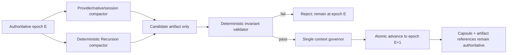

# DS-12 — Context Compaction and Cache Economics

**Research date:** October 1, 2026  
**Evidence cutoff:** October 1, 2026, America/Los_Angeles  
**Research mode:** public-source analysis only; no provider calls, paid experiments, repository access, configuration changes, or implementation actions were performed.

## Executive summary and scope

The uploaded DS-12 brief is sufficiently specific to resolve the otherwise “unspecified query.” It asks for an architecture decision about how Recursion should combine provider-side prompt/KV caching, provider session/state facilities, deterministic context compaction, and Recursion-owned semantic evidence reuse without conflating their economics, authority, privacy, or fidelity properties. The brief already fixes two architectural invariants: the **Execution Context Capsule is non-droppable**, and **exactly one deterministic context governor owns the authoritative compaction transition for each route epoch**. Provider-native or session-native compactors may produce candidates, but may not advance authoritative state. fileciteturn0file0

### Interpretation of the research target

| Possible interpretation | What it would answer | Fit to the supplied brief | Recommendation |
|---|---|---:|---|
| General survey of LLM caching and context management | “What caching techniques exist across the industry?” | Medium | Useful background, but too broad |
| **Recursion DS-12 architecture decision** | **“Which route-specific cache/session/context features may Recursion exploit while keeping its capsule and semantic cache authoritative?”** | **Exact** | **Primary interpretation** |
| Vendor/model procurement study | “Which provider is cheapest or fastest?” | Low | Explicitly not the main decision |
| Implementation/runbook | Concrete code, configuration, deployment and provider changes | Out of scope | Prohibited by the brief |
| Cache-performance experiment | Empirical cache hits, compaction-loss rates, priming economics | Highly relevant but not authorized against paid routes | Specify experimental protocol, do not fabricate results |

The recommended interpretation is therefore the DS-12 architecture question, with current public provider routes used as evidence rather than assumed to be the complete Recursion adapter inventory. **The actual Recursion-supported route inventory remains unknown in this research session**: the brief deliberately supplies no repository inputs and prohibits repository/GitHub investigation. Consequently, the route table below is a dated capability matrix for plausible public upstream routes, not a claim that every listed route is implemented by Recursion. fileciteturn0file0

### Bottom-line findings

**First, provider prompt caching, provider conversation/session state, Recursion semantic evidence reuse, and subscription/product debit are four distinct accounting domains.** OpenAI explicitly distinguishes Responses conversation chaining from prompt-cache reuse: `previous_response_id` can avoid resending the whole request body, yet prior input in the chain remains billable input; cache discounts are a separate mechanism. citeturn17search1turn17search2 Google likewise treats Interactions server-side state and context caching as separate capabilities. citeturn19search0turn14view0 Nothing found supports translating an API cache hit into a subscription-credit or product-plan debit assumption.

**Second, route identity matters at least as much as model identity.** Direct OpenAI GPT-5.6+ exposes implicit and explicit breakpoints, a 30-minute minimum cache lifetime, cache-write and read pricing, and cache usage fields. The nominally same OpenAI model class on Amazon Bedrock has its behavior and counters documented by AWS and, critically, is billed and quota-accounted by that route. citeturn17search2turn18search6 Anthropic similarly documents feature differences on Bedrock, where automatic top-level prompt caching is unavailable for specified older Claude route/model combinations even though prompt caching exists. citeturn18search15 Route capability must therefore be versioned and evidence-pinned; model-name matching is not enough.

**Third, a deterministic stable prefix is well supported as an optimization, but it must not become authoritative state.** OpenAI, Anthropic, and Google all document prefix-oriented caching behavior or recommend putting common material first. citeturn17search2turn15search1turn14view0 A 2026 multi-provider preprint evaluating more than 500 long-horizon agent sessions reported 45–80% API-cost reductions and 13–31% TTFT improvements with prompt caching, while also finding that cache layout mattered and naïve full-context caching could worsen latency. Those benchmark results are informative rather than proof for Recursion. citeturn14view3

**Fourth, provider-native compaction is inherently unsuitable as the sole record of control state.** OpenAI's server compaction emits an opaque compacted representation, and Anthropic compaction replaces older turns with a model-generated summary and itself consumes an additional sampling iteration. citeturn17search0turn19search2 Neither vendor contract guarantees preservation of Recursion-specific Owner directives, gates, blockers, exact evidence references, authority fences, or artifact identifiers. The supplied “candidate only → deterministic validator → authoritative governor” architecture is therefore the correct safety boundary. fileciteturn0file0

**Fifth, no public evidence found supports cross-route provider-cache portability.** The defensible design assumption is not “cross-route cache reuse is zero,” but **“provider KV reuse is unknown unless the exact route documents it; do not count it.”** Portability should come from Recursion-owned semantic artifacts and capsule reconstruction. Google describes Gemini implicit cache isolation at project level, while Google Cloud's Claude route explicitly says prompt-cache entries are project-specific. citeturn13search1turn19search1

**Sixth, periodic model keepalive is economically unsound in the required no-future-work edge case.** Any refresh/prewarm request with positive cost and no subsequent useful request produces no avoided miss and therefore negative net savings. This is an inference from the documented charging and TTL mechanisms, not a vendor claim. OpenAI charges cache writes on GPT-5.6+; Anthropic charges writes and reads/refreshes; Gemini explicit caches add time-dependent storage cost. citeturn17search2turn15search1turn14view0 Event-driven continuation is therefore the sound baseline already fixed by DS-12.

### Explicit assumptions

| Assumption | Treatment |
|---|---|
| Provider coverage | OpenAI API, Anthropic API, Gemini Developer API, AWS Bedrock variants, and Google Cloud Claude are representative public routes, **not** asserted Recursion inventory |
| Time window | Emphasis on 2021–2026, with current October 2026 provider documentation controlling; older foundational sources used only where needed |
| Geography | Global provider overview; region/project-specific behavior is called out where documented |
| Experiments | No paid or authenticated provider experiment was run; all empirical Recursion-specific outcomes remain unverified |
| Privacy | Only the supplied synthetic/public brief and public sources were used |
| Economics | “Cost” means complete-workflow provider charges, cache storage, priming, refresh, retry, compaction, latency where measurable, and semantic-reuse overhead kept in separate fields |
| Unknowns | Missing counters, undocumented cache behavior, subscription debit and cross-route reuse remain `unknown`, never coerced to zero |
| Acceptance | This report proposes testable architecture recommendations; it does not promote them into Owner decisions or change the existing constitutional constraints |

## Methodology and prioritized research questions

The investigation used a route-first rather than vendor-first methodology. That distinction is crucial because documentation shows that the same provider/model can expose different cache controls, billing counters, quota treatment and data-handling properties through direct APIs versus cloud brokers. citeturn18search6turn18search15turn19search1

### Research priorities

The fourteen questions in DS-12 reduce to five decision clusters.

| Priority | Research cluster | Core question | Decision blocked |
|---|---|---|---|
| Highest | Authority and fidelity | Can compaction/session state ever be authoritative, and how is loss detected? | Context governor and capsule |
| Highest | Route capability truth | What does each exact endpoint/model class document today? | RouteCapabilityDescriptor |
| High | Economics and accounting | Do stable prefixes, affinity or refresh actually save full-workflow cost? | Cache policy |
| High | Portability and invalidation | What survives route/source/configuration changes? | Semantic evidence cache |
| High | Privacy and isolation | What metadata/content/timing crosses tenants, projects or routes? | Cache-key and dedup design |

A consequential claim was classified using the DS-12 vocabulary: **source-documented**, **locally observed**, **inferred**, or **unverified**. fileciteturn0file0 “Locally observed” is intentionally scarce: because no Recursion experiment or repository inspection was authorized or performed, provider-independent conclusions about actual hit rates, cold-recovery quality and compaction-loss rates cannot honestly receive that label.

### Evidence hierarchy

| Evidence source | Used for | Strength | Principal limitation |
|---|---|---|---|
| Current provider/API documentation | Endpoint controls, lifetimes, retention, counters, billing semantics | Highest for product behavior | Can change without architectural notice |
| Provider pricing pages | Current token/cache/storage rates | Highest for present pricing | Volatile; not transferable to other routes |
| Peer-reviewed primary research | Long-context and compression quality | High for studied experiments | Does not test Recursion's invariant set |
| Recent primary preprints | Emerging cache/privacy/agent findings | Medium | Not necessarily peer-reviewed |
| Supplied DS-12 brief | Recursion constraints, authority and accepted direction | Authoritative for this lane | Does not reveal route inventory |
| Proposed synthetic experiments | Future validation | None yet | Not evidence until run |

Peer-reviewed work reinforces the need for fidelity testing rather than treating a large context window as a guarantee. “Lost in the Middle” found that retrieval performance can depend materially on where relevant information occurs within long contexts, while LongLLMLingua showed that substantial prompt compression can perform well on selected tasks—but neither establishes lossless preservation of control-plane directives. citeturn8academia12turn8search0

### Research boundaries

No provider cache was primed, refreshed, deleted or otherwise manipulated. No authentication, subscription, runtime configuration, model selection or deployment was changed. No repository or GitHub connector was used. These boundaries make some of the most important quantities—actual Recursion prefix stability, compaction-loss probability, cache invalidation accuracy and recovery quality—explicitly **unknown**, exactly as required by the brief. fileciteturn0file0

## Route exposure and evidence findings

### Dated route-exposure matrix

All entries below were rechecked against public documentation on **October 1, 2026**. An entry describes only the route named in its row.

| Route and model class | Provider-side cache controls | Session/state controls | Lifetime / retention | Usage and billing evidence | What must **not** be inferred |
|---|---|---|---|---|---|
| **OpenAI direct `/v1/responses`, GPT-5.6 and later** | Implicit caching default; explicit-only mode; developer breakpoints; max four cache writes/request; minimum 1,024 visible prefix tokens; `prompt_cache_key`; prewarm | `previous_response_id`, durable Conversation objects, HTTP or WebSocket continuation | Cache `ttl="30m"` is the only GPT-5.6+ documented value and establishes at least 30 minutes after write/reuse; ordinary Response objects stored 30 days by default unless disabled | Writes 1.25× ordinary input; most GPT-5.6+ reads 0.1×; cache fields are separately observable. Prior chained input is still billed input even when `previous_response_id` is used. citeturn17search2turn17search1 | A session is not a cache hit; `previous_response_id` is not free context; cache use does not imply subscription treatment |
| **OpenAI direct `/v1/responses`, earlier supported families** | Implicit only; model-dependent breakpoints/minimums; `prompt_cache_retention` rather than GPT-5.6 controls | Same Responses state mechanisms where supported | `in_memory` typically minutes to ≤1h; certain supported models offer extended `24h` retention | Cache-write charge differs from GPT-5.6+; model-specific cached-input pricing applies. citeturn17search2 | GPT-5.6 explicit controls and economics cannot be copied backward |
| **OpenAI Responses compaction** | Not a prompt cache; server compaction via `context_management.compact_threshold` and standalone compaction API | Works with chained or stateless Responses patterns | Trigger is token threshold, not cache TTL | Produces an opaque compacted item; compaction can change the cacheable prefix. citeturn17search0turn17search2 | The opaque compaction item is not proof that Owner directives or gates survived |
| **Anthropic direct Messages, active Claude models** | Automatic top-level `cache_control` and explicit breakpoints; up to four breakpoints; entire `tools → system → messages` prefix through a breakpoint participates | Plain Messages usage remains client-managed conversation context; provider features beyond Messages must be treated separately | Default minimum TTL 5 minutes, refreshed on reuse; optional 1h TTL | 5m write = 1.25× base input; 1h write = 2×; reads/refreshes are discounted at model-specific rates; explicit read/write token fields exposed. citeturn15search1 | One model's cache-read multiplier should not be copied to another; Messages caching is not a persistent semantic memory |
| **Anthropic Messages threshold compaction, compatible Claude models** | Separate from prompt caching; beta `compact-2026-01-12` | Summary block becomes continuation context | Trigger configurable; API may compact multiple times as needed | Compaction is another sampling iteration; total cost must be summed across `usage.iterations`; top-level usage alone omits compaction iteration tokens. citeturn19search2 | Top-level usage is not total workflow usage when compaction occurs |
| **Anthropic on-demand compaction** | Separate beta path, currently documented with `compact-2026-09-04`; provider recommends it for many controllable cases | Explicitly invoked summary/replacement workflow | Invocation-based rather than a cache TTL | Compaction call is billed/rate-limited; replaying an existing compaction block does not create another compaction charge. citeturn19search3turn19search4 | Provider recommendation does not supersede Recursion's one-governor invariant |
| **Gemini Developer API `generateContent`, Gemini 2.5+** | Implicit caching automatic; explicit `cachedContents` beta on most supported models; exact model minimums documented; explicit cache can be deleted or TTL updated | `generateContent` itself is the legacy content-generation primitive, now superseded for new agentic work by Interactions | Explicit TTL defaults to 1h if unspecified and may be set by the user; implicit cache retention/data behavior is separately documented | `usage_metadata` reports cached tokens; explicit cache incurs reduced cached-token charges plus TTL-dependent storage. Standard rate limits include cached tokens. citeturn14view0turn15search0 | Explicit-cache economics must not be assumed for Interactions unless its route docs establish them |
| **Gemini Developer API Interactions** | Server-side state is documented to improve cache-hit efficiency, but the fetched Interactions documentation does not establish that legacy `cachedContent` controls transfer wholesale | `previous_interaction_id`; `store=true` by default; `store=false` disables stored continuation | Paid interactions retained 55 days by default; configurable 7/14/28/55 days; free tier 1 day | Conversation-state storage and provider cache savings are conceptually separate. citeturn19search0 | A stored Interaction is not itself a cache hit or a guaranteed cost saving |
| **Gemini Developer API implicit cache privacy** | Automatic in-memory cache | Independent of Interaction object persistence | Google currently documents 24h TTL, RAM-only, project isolation | Used for latency/cost optimization; ZDR guidance treats this separately from explicit cached content. citeturn13search1 | Project-level isolation does not imply cross-route portability |
| **Amazon Bedrock, OpenAI GPT-5.6 via supported Responses-compatible route** | AWS documents both implicit and explicit GPT-5.6 prompt caching, 30m default TTL and route-specific fields | Bedrock APIs/session behavior are AWS-route concerns | GPT-5.6 prompt cache default 30m in current Bedrock documentation | `cached_tokens`/`cache_write_tokens`; writes 1.25×, reads 90% discounted; AWS explicitly says cached reads do not count against input TPM on this route. citeturn18search6 | Direct OpenAI quota/accounting behavior must not be copied to Bedrock or vice versa |
| **Amazon Bedrock, Anthropic Claude** | Explicit caching supported on compatible models; exact route/model support varies; Anthropic says top-level automatic prompt caching is unavailable for Opus 4.6 and earlier on this route | Route/provider-specific | AWS added 1h TTL to selected Claude 4.5 models in January 2026; model matrix evolves | Converse exposes `cacheReadInputTokens`, `cacheWriteInputTokens`, `cacheDetails`; total input requires summing cache reads, writes and uncached input. citeturn18search0turn18search6turn18search15 | “Claude supports automatic caching” is not sufficient route evidence |
| **Google Vertex AI, Anthropic Claude** | Explicit Anthropic-style prompt caching, project-scoped | Vertex route semantics | Default 5m; 1h on supported models | 5m writes +25%, 1h writes +100%, reads −90%; Google states cache fingerprints are treated as User Metadata/Service Data rather than Customer Data. citeturn19search1 | Direct Anthropic data-handling language cannot simply be transferred to Vertex |
| **OAuth/product/harness route** | **Unknown** unless its own public contract exposes API-equivalent caching | Product/session semantics may exist | **Unknown** | **Unknown**; product credits, plan limits, token rates and API charges are not interchangeable. OpenAI's own ChatGPT enterprise rate documentation illustrates that product/plan accounting has its own rules. citeturn16search2 | Never infer API cache hit, write charge, or subscription debit from model identity alone |
| **Recursion-owned evidence cache** | Not a provider KV cache; proposed stable content-addressed semantic artifact store | Goal-scoped persistent state | Recursion policy, not provider TTL | Application-owned storage/retrieval accounting | Never report a Recursion artifact hit as a provider cache hit or billing discount |

This matrix exposes the central DS-12 design fact: **“provider/model” is not an adequate cache capability key.** The correct lookup key needs at least provider substrate, endpoint/API family, model class/version, region or processing mode where relevant, account/project boundary, requested caching mode, and evidence retrieval date. AWS's own documentation demonstrates that an OpenAI model on Bedrock has AWS-defined counters and quota rules, while Anthropic documents feature differences between direct Claude and Bedrock. citeturn18search6turn18search15

### Session state is not cache state

This distinction is especially consequential for economics.

OpenAI lets a caller carry a thread forward using `previous_response_id`, but explicitly states that prior inputs in the chain are still billed as input tokens. A cache discount may separately apply when the prompt-cache rules are satisfied. citeturn17search1 Therefore:

\[
\text{bytes not resent} \neq \text{tokens not billed} \neq \text{provider cache hit}.
\]

Gemini Interactions similarly stores conversation objects for continuation when `store=true`; that state retention is governed by its own retention policy. citeturn19search0 This may help the provider optimize context caching, but the continuation identifier itself is not evidence of a cache hit.

The same separation must apply inside Recursion. A “session-affinity success,” a “semantic-artifact reuse,” a “provider cached-read token,” and a “subscription debit avoided” should never increment the same metric.

### Source-pinned consequential-claim register

| Claim | Classification | Confidence | Source / evidence | Expiry or revalidation trigger |
|---|---|---:|---|---|
| GPT-5.6+ direct OpenAI supports explicit breakpoints, implicit caching and 30m minimum cache TTL | Source-documented | High | OpenAI current prompt-caching guide. citeturn17search2 | Any OpenAI cache-guide or model-family revision |
| GPT-5.6+ write/read economics are route/model-specific | Source-documented | High | OpenAI guide and model docs. citeturn17search2turn16search0 | Pricing/model revision |
| `previous_response_id` does not make prior context unbilled | Source-documented | High | OpenAI conversation-state guide. citeturn17search1 | Responses billing-contract revision |
| Anthropic direct caching uses 5m/1h TTLs and separately reports reads/writes | Source-documented | High | Anthropic caching docs. citeturn15search1 | Claude cache-doc revision |
| Anthropic threshold compaction adds a separately billable sampling iteration | Source-documented | High | Anthropic compaction docs. citeturn19search2 | Beta/version change |
| Gemini explicit `cachedContents` default TTL is currently one hour when omitted | Source-documented | High | Google current caching page, updated Sept. 11, 2026. citeturn14view0 | Caching API version/doc update |
| Gemini Interactions objects currently default to stored state with 55-day paid retention | Source-documented | High | Google Interactions docs. citeturn19search0 | Retention-policy update |
| Bedrock cache counters/rate-limit rules differ enough that direct-provider assumptions are unsafe | Source-documented | High | AWS prompt-caching docs. citeturn18search6 | Bedrock API/model update |
| Vertex-hosted Claude cache fingerprints are classified by Google as Service Data/User Metadata | Source-documented | High | Google Cloud. citeturn19search1 | Google Cloud privacy/cache-contract update |
| Stable-prefix placement is likely to reduce repeated processing for same-route workloads | Inferred, supported by docs and benchmark evidence | Medium-high | All three providers recommend common-prefix layout; 2026 multi-provider preprint found substantial benchmark savings. citeturn17search2turn14view0turn14view3 | Recursion workload benchmark contradicts it |
| Cross-route continuation can reuse a provider KV cache | **Unverified / unknown** | Low | No public route contract found | Reclassify only on explicit exact-route documentation or controlled route evidence |
| OAuth/harness use receives the same cache discount as direct API | **Unverified / unknown** | Low | No route contract supplied | Exact harness billing/cache documentation |
| Provider cache hit implies reduced subscription debit | **Unverified / unknown** | Low | No general contractual mapping | Exact product-plan billing documentation |
| Session affinity is cheaper than cold capsule reconstruction after all refresh/recovery costs | **Unverified / unknown** | Low | No Recursion experiment | Controlled same-workload experiment |
| Recursion cold recovery preserves full task quality from capsule plus semantic artifacts | **Unverified / unknown** | Low | No local recovery experiment | Synthetic cold-recovery suite |
| Repeated provider compaction preserves every Owner directive/gate/blocker/evidence reference | **Unverified; must not be assumed** | Low | Vendor compaction promises continuity, not Recursion invariant preservation. citeturn17search0turn19search2 | Deterministic adversarial compaction evaluation |
| No protected path was edited and no provider spend/config action occurred in this research session | Locally observed | High | Session procedure | N/A |

## Economics, fidelity, invalidation and privacy

### The correct unit of account

DS-12 should use a **ledger of separate quantities**, not a single “cache savings” number.

A complete workflow cost can be represented as:

\[
C_\text{workflow} =
C_\text{uncached-input}
+ C_\text{cache-write}
+ C_\text{cache-read}
+ C_\text{cache-storage}
+ C_\text{output}
+ C_\text{compaction}
+ C_\text{prewarm}
+ C_\text{refresh}
+ C_\text{retry}
+ C_\text{tools}
\]

with any unavailable term recorded as `unknown`, not `0`.

Separately, Recursion should record application reuse:

\[
R_\text{semantic} =
\{\text{artifacts hit},\text{bytes rehydrated},
\text{candidate tokens avoided},
\text{validation outcomes}\}
\]

and, separately again, product/account debit:

\[
D_\text{subscription} =
\text{provider-defined credits/messages/time/quota actually observed}.
\]

No algebra should silently convert one ledger into another. OpenAI's API docs, for example, price cached input separately from ordinary input, while OpenAI's product-plan documentation contains distinct plan and included-usage concepts. citeturn16search0turn16search2

### Prompt-cache break-even behavior

For GPT-5.6+ direct OpenAI, normalize an uncached reusable prefix to cost \(1\). A first cache write costs \(1.25\) and a normal cached read on most of this family costs \(0.1\). For \(N\) uses of the exact same eligible prefix:

\[
C_\text{cached}(N)=1.25+0.1(N-1)
\]

versus

\[
C_\text{cold}(N)=N.
\]

Thus one successful reuse gives \(1.35\) normalized prefix cost instead of \(2.0\). By ten total uses, the documented example is equivalent to \(2.15\) normalized prefix-cost units rather than \(10\). citeturn17search2 This is attractive only if the workload actually preserves an eligible prefix and continues before the cache becomes unavailable.

Anthropic has a similar write-premium structure but model-specific read multipliers. A 5-minute write costs 1.25× base input; a 1-hour write costs 2×. citeturn15search1 For a generic cached-read multiplier \(r\):

\[
C_{5m}=1.25+r(N-1)
\]

and

\[
C_{1h}=2+r(N-1).
\]

The 1-hour form can **never** beat two cold uses after only one reuse, because \(2+r>2\) for positive \(r\). It requires enough subsequent reuse to repay the larger write premium. That is precisely why route policy should be evidence-driven rather than “longer TTL is better.”

Gemini explicit caching has another structure: discounted cached-input tokens **plus time-based storage pricing**. Gemini 2.5 Flash, for example, currently lists $0.30 per million ordinary text/image/video input tokens, $0.03 per million cached tokens, and $1.00 per million token-hours of cache storage. citeturn15search0 Therefore the correct break-even decision depends on cache size, TTL and future-use cadence; a cache that sits unused can be net-negative even though its eventual reads would be cheap.

Because the fetched Gemini Developer API documents do not unambiguously establish every charge associated with cache creation itself, DS-12 should **not** invent a cache-creation input fee for that route. The safe formula leaves any unresolved creation component as an explicit variable until billing documentation or usage telemetry establishes it.

### Priming and keepalive economics

Prewarming is not free work. OpenAI documents a GPT-5.6+ prewarm operation that prepares the cache without normal output, but the resulting write is still a cache write. citeturn17search2 Anthropic likewise supports prewarming and charges the corresponding cache-write work. citeturn15search1

Let a refresh cost \(F>0\), and let the avoided future miss have value \(M\) only if useful future work arrives before the refreshed entry expires. If \(p\) is the probability of such useful future work:

\[
E[\text{net refresh benefit}] = pM-F.
\]

In the required no-future-work edge case, \(p=0\), hence:

\[
E[\text{benefit}] = -F.
\]

That establishes a decisive fail-closed result: **a periodic model keepalive cannot honestly be described as savings when there is no subsequent useful work.** It may be rational for a narrowly measured service with a sufficiently predictable arrival distribution, but that would be a route/workload optimization to prove empirically, not a platform default. The existing DS-12 event-driven direction should remain intact. fileciteturn0file0

### Stable-prefix layout

A route-neutral capsule compiler should make the *semantic* order stable even though each adapter will render a provider-specific request shape. The general order should be:

1. stable policy/control material that is valid to expose to that route;
2. stable tool/interface definitions;
3. stable content-addressed evidence manifests or selected evidence;
4. append-only prior state eligible for reuse;
5. volatile tool results, timestamps, current user input, and other rapidly changing suffixes.

OpenAI explicitly recommends stable material first and volatile material after an appropriate cache breakpoint. citeturn17search2 Gemini similarly recommends large common content at the beginning. citeturn14view0 Anthropic caches the prompt prefix through its marked breakpoint. citeturn15search1

The layout rule should nonetheless be subordinate to **semantic correctness and privacy**. Recursion should never move sensitive, stale or revoked content into a stable prefix merely to increase provider cache hits.

### Compaction fidelity

The critical distinction is between **space saving** and **control-state preservation**.

OpenAI's compaction artifact is intentionally opaque to the client and carries forward provider-defined prior state. citeturn17search0 Anthropic's compaction produces a model-generated summary and discards earlier blocks on subsequent continuation; current documentation further requires accounting for the compaction sampling iteration itself. citeturn19search2 These mechanisms can be useful candidate compactors but cannot establish that a Recursion-specific gate or authority condition survived.

Academic evidence points in the same direction. Long-context models can lose effective access to information depending on its placement, and strong prompt-compression results on benchmark tasks do not imply literal preservation of security or orchestration directives. citeturn8academia12turn8search0

The authoritative validator should therefore test the candidate artifact **structurally**, not ask the compactor whether it “preserved everything.” At minimum it must verify:

| Non-droppable item | Required check before epoch advancement |
|---|---|
| Logical actor and lineage | Exact identity/lineage reference matches authoritative predecessor |
| GoalSpec | Exact version/digest preserved |
| Current task and gate | Exact task ID and acceptance gate represented |
| Authority/privacy/resource bounds | Exact active set; monotonic authority fence cannot regress |
| Source/candidate identifiers | Exact IDs or authenticated rehydration references |
| Active Owner directives | Exact normalized set or independently resolvable references |
| Blockers | Every active blocker present or rehydratable |
| Evidence references | Reachability and artifact-integrity verification |
| Checkpoint | Parent/current epoch relationship valid |
| Output contract | Exact contract version preserved |
| Artifact reachability | All referenced content-addressed objects exist and validate |

A free-form summary can accompany this kernel, but passing semantic similarity is not enough for these fields.

### One authoritative governor per route epoch

The control transition should look conceptually like this:

The important implementation property is not the exact mechanism shown, but exclusivity: **only the context governor may mutate the authoritative epoch pointer**. A provider-native compacted object, a persisted session, or an SDK compactor may be stored as evidence/candidate state, but none receives the authority to declare itself the new canonical context. This directly preserves the accepted DS-12 requirement. fileciteturn0file0

A practical design would guard the transition with a compare-and-swap or equivalent transaction over `(goal, route_epoch, compaction_sequence, parent_digest)`. That design is an architectural inference, not an observation of the current Recursion implementation.

### Invalidation rules for the semantic evidence cache

A repository commit identifier is an excellent dependency anchor, but it is not a complete cache key. Git's object model is content-addressed, and a commit points to a tree plus parent/history metadata. citeturn10search4turn10search6 Yet execution behavior may also depend on configuration, policy version, route capability version, tool version, external resource result and authority state.

The semantic cache should therefore invalidate on a dependency tuple conceptually equivalent to:

\[
K = H_k(
  \text{artifact type},
  \text{canonical content},
  \text{repository tree/commit},
  \text{configuration digest},
  \text{policy version},
  \text{tool/resource version},
  \text{RouteCapabilityDescriptor version},
  \text{authority fence},
  \text{schema version}
)
\]

where \(H_k\) is a project/goal-scoped keyed construction rather than a naked globally reusable digest for sensitive material. NIST's current key-derivation guidance provides standard keyed constructions based on primitives such as HMAC, CMAC and KMAC. citeturn9search4 The exact cryptographic scheme would need a separate security review; this report is recommending the isolation property, not selecting an implementation primitive.

Invalidation priority should be asymmetric. A false-positive invalidation wastes work; a false-negative invalidation can reuse revoked or stale authority. Therefore source changes, configuration changes, changed tool/resource results, privacy tightening, credential/identity changes, egress/resource revocation and authority-fence advancement must conservatively force revalidation or rehydration.

### Privacy and side channels

Provider documentation itself shows why cache metadata cannot be treated as harmless.

Google Cloud's Claude route says that it computes cache fingerprints and classifies those hashes as **User Metadata / Service Data**, not as Customer Data under the cited Cloud DPA treatment. It also says those prompt caches are unique to a Google Cloud project. citeturn19search1 Gemini's Developer API says its implicit cache is RAM-only and project-isolated, currently with a 24-hour TTL. citeturn13search1 These are useful isolation guarantees, but they also demonstrate that digest/fingerprint handling has its own contractual significance.

Recent systems-security research has also investigated timing leakage from shared KV caches. SafeKV reports that cache-sharing across principals can create timing side channels in evaluated multi-tenant settings; it proposes selective isolation as a mitigation. Because this is emerging research rather than a provider contract, it should be treated as a threat-model input, not proof that any named commercial route is vulnerable. citeturn8academia15

For Recursion, the conservative posture is consequently:

**No global cross-private-project deduplication by raw content digest.** Private caches should use goal/project namespaces and keyed identifiers. Public-route prompts should never be given private raw content hashes merely to seek cross-session reuse. Cache keys, object sizes, lookup timing and error distinctions should be included in privacy testing.

## Architecture options and recommendations

The architecture should treat provider capabilities as opportunistic accelerators around a provider-neutral recovery core.

### Comparative options

| Area | Recommended option | Competing option | Main tradeoff |
|---|---|---|---|
| Stable prefix | Deterministically render stable, valid control/evidence first; use explicit breakpoint where route documents it | Rely entirely on implicit cache placement | More adapter logic, but measurable/control-oriented |
| Session affinity | Opportunistic affinity only; always remain cold-reconstructable | Sticky/provider-session-authoritative execution | Slightly more hydration work, much better portability/recovery |
| Capsule hydration | Non-droppable kernel + tiered content-addressed artifacts | Reconstruct from free-form conversation summary | More deterministic metadata, less silent loss |
| Evidence cache | Goal/project-isolated content-addressed semantic artifacts with dependency-aware invalidation | Global cross-project deduplication | Some duplicated storage in exchange for isolation |
| Compaction | One deterministic governor; native compactors are candidates | Provider-native compactor advances state directly | More validation work, dramatically clearer authority |
| Refresh policy | Event-driven; no periodic model keepalive | Proactive periodic refresh | Avoids guaranteed waste in no-future-work case |
| Accounting | Separate provider cache, semantic reuse, session, and subscription ledgers | One “cache savings” metric | More metrics, far less misleading economics |
| Route policy | Versioned `RouteCapabilityDescriptor` pinned to evidence/date | Infer controls from model/provider name | Descriptor maintenance cost, avoids invalid assumptions |

### Stable-prefix recommendation

**Recommendation:** compile a deterministic stable prefix per exact route, and use a provider's explicit breakpoint mechanism where the route both documents it and exposes useful telemetry. Keep volatile inputs after the last intended reusable boundary.

**Competing option:** rely on provider implicit caching alone.

**Evidence:** OpenAI explicitly exposes developer-selected breakpoints on GPT-5.6+, while Anthropic exposes explicit breakpoints and Gemini documents prefix-oriented implicit reuse. citeturn17search2turn15search1turn14view0 The 2026 multi-provider evaluation also found that cache-aware content arrangement can materially outperform naïve whole-context caching on its agent benchmark. citeturn14view3

**Decisive falsifier:** on a representative Recursion synthetic workload, after charging initial writes/prewarm and all misses, the explicit stable-prefix strategy does not reduce total successful-workflow cost or latency relative to implicit/cold baselines, or it creates unacceptable cache-write churn after normal invalidations.

**What this does not prove:** that a stable prefix will hit a provider cache, that the cache exists on another route, or that the hit changes subscription debit.

### Session-affinity recommendation

**Recommendation:** treat session affinity as a performance hint. Continue on a surviving provider session when useful, but reconstructability from the capsule and semantic artifacts is mandatory at every accepted checkpoint.

**Competing option:** make sticky provider sessions the primary persistence mechanism.

**Evidence:** OpenAI's session chaining can reduce wire/context-management overhead but does not eliminate prior-input billing, while Gemini Interactions persists state for continuation under explicit retention rules. citeturn17search1turn19search0 Neither property constitutes provider-neutral recovery.

**Decisive falsifier:** a controlled benchmark shows fresh capsule reconstruction is persistently and materially worse in quality/cost/latency than affinity, **and** the deficiency cannot be corrected by enriching the capsule/artifact representation. Such a result would falsify the present capsule design's sufficiency, not automatically authorize session state as source of truth.

**What this does not prove:** that fresh reconstruction is currently quality-equivalent; that remains unverified.

### Capsule-hydration recommendation

**Recommendation:** keep the capsule kernel small, exact and non-droppable, with larger evidence tiers rehydrated by immutable identifiers. Provider sessions and summaries may accelerate hydration but cannot replace the kernel.

**Competing option:** persist a large transcript or model summary and derive control state from it during recovery.

**Decisive falsifier:** deterministic tests demonstrate that the proposed kernel lacks information necessary to reconstruct a valid continuation even when all referenced artifacts are present. The remedy would be to extend the kernel schema under Owner governance.

**What this does not prove:** how small the optimal kernel should be, or which context tier has the best quality/cost curve.

This recommendation is also constrained by an accepted DS-12 premise: dropping the capsule is not an available decision in this research lane. fileciteturn0file0

### Semantic-evidence-cache recommendation

**Recommendation:** make Recursion's semantic evidence cache the portable reuse layer. Artifacts should be immutable/content-addressed, scoped so private projects cannot deduplicate against one another by a public raw digest, and dependency-bound to repository/source state, configuration, policy, route descriptor and authority fence.

**Competing option:** maximize storage efficiency through global raw-hash deduplication and infer validity largely from repository commit.

**Decisive falsifier:** a formal privacy review plus adversarial measurements show cross-project deduplication leaks no unacceptable content membership, timing, size or metadata information, while isolated storage becomes a materially prohibitive operational cost. Until then, isolation dominates dedup savings.

**What this does not prove:** that keyed digests alone eliminate all side channels; they do not address every timing/size/access-pattern channel.

### Compaction recommendation

**Recommendation:** preserve exactly one authoritative context governor per route epoch. Provider-native, SDK and Recursion summarizers return candidate artifacts. The governor advances the epoch only after deterministic checks prove that all non-droppable fields survive exactly or are reliably rehydratable.

**Competing option:** let the provider/session compactor directly determine authoritative continuation state.

**Evidence:** current provider compaction is summarized or opaque rather than a proof-carrying transformation of Recursion's invariant schema. citeturn17search0turn19search2

**Decisive falsifier:** there is no in-lane falsifier because the one-governor property is an accepted Owner constraint in DS-12. The only legitimate change trigger would be an explicit Owner-level policy amendment outside this research authority. fileciteturn0file0

**What this does not prove:** which named compaction policy—`native`, `deterministic-only`, `hybrid`, `aggressive`, `manual`, or `off`—should become a default. DS-12 explicitly says no universal default has been selected.

### Keepalive recommendation

**Recommendation:** retain event-driven continuation and deterministic health checks; do not issue periodic model traffic merely to preserve provider prompt caches.

**Competing option:** refresh cached prefixes shortly before TTL expiration.

**Decisive falsifier:** for a specific route and well-characterized arrival distribution, route telemetry must show that refresh calls' complete cost is lower than the expected avoided miss/latency cost. This can justify a narrow route/workload policy; it still cannot make the no-future-work case profitable.

**What this does not prove:** that all prewarming is bad. A prewarm directly tied to imminent, known useful work may be rational; it simply belongs in the workflow cost.

### RouteCapabilityDescriptor recommendation

The descriptor should be the only mechanism by which an adapter asserts optimization capabilities. A useful minimum schema is:

| Descriptor field | Why it matters |
|---|---|
| Provider/substrate + endpoint/API family | Prevents direct API semantics being transferred to cloud broker/product route |
| Model class/version range | Cache minimums/pricing/features vary by model |
| Evidence URL/source ID + retrieved/verified date | Makes claims expirable |
| Context limit and accounting fidelity | Determines safe hydration and measurement |
| Prompt-cache mode | none / implicit / explicit / both |
| Prefix/breakpoint constraints | Controls deterministic compiler |
| Minimum cacheable prefix | Prevents false hit expectations |
| TTL/retention controls | Needed for economics and privacy |
| Read/write telemetry fields | Determines what can honestly be measured |
| Session semantics and retention | Keeps state separate from cache |
| Native compaction features/version | Candidate generator only |
| Tool-output behavior | Dynamic tools often invalidate prefixes |
| Region/project/account isolation | Privacy and routing |
| Rate-limit treatment | Cannot be inferred across routes |
| Subscription-debit observability | Usually `unknown` unless product contract exposes it |
| Expiry trigger | Forces revalidation on provider change |

The descriptor should fail closed: an absent field is `unknown`, not “provider default.” This is particularly important because current documentation already shows material differences across direct and brokered routes. citeturn18search6turn18search15turn19search1

## Validation program, metrics, gaps and Owner questions

The public evidence is sufficient to make architectural recommendations but not to close the empirical parts of DS-12. The next evidence stage should therefore be a **synthetic, route-by-route validation suite**, not additional architectural speculation.

### Recommended experiments and success metrics

| Experiment | Design | Primary metrics | Success criterion | Competing explanation / failure trigger |
|---|---|---|---|---|
| Stable-prefix same-route | Cold request vs ordinary continuation vs explicit stable breakpoint; same synthetic workload | uncached input, cache writes, cache reads, output, total cost, TTFT | Lower all-in cost without fidelity loss | Priming/write churn consumes savings |
| Cache invalidation | Mutate one dependency at a time: source, repo tree/commit, config, route descriptor, tool result, authority fence | invalidation recall/precision | **100% recall for authority/privacy/source correctness events** | Any stale authority/evidence reuse is blocking |
| Repeated compaction | Seed directives, gates, blockers and evidence refs at early/middle/late positions; compact repeatedly | exact-field preservation, artifact reachability, task outcome | **Zero loss of non-droppable fields** | One dropped active invariant rejects candidate policy |
| Session vs cold reconstruction | Same task with affinity and forced session loss at checkpoints | total cost, latency, exact state, output quality | Cold reconstruction reaches accepted gate with no control loss | Persistent quality regression indicates capsule/artifact insufficiency |
| Cross-route continuation | Stop on route A; rebuild from semantic artifacts on route B | provider cache fields, semantic hits, task quality | No assumed provider cache reuse; quality within predeclared noninferiority margin | Any claimed cross-route KV hit requires direct route evidence |
| Cold disaster recovery | Delete all provider-session assumptions; recover from capsule/artifacts only | reachability, exact state, successful gate completion | 100% non-droppable-state recovery | Missing artifact or ambiguous current gate |
| Privacy isolation | Identical synthetic content in two project namespaces | cross-project hits, identifier correlation, timing/size distinguishability | Zero unintended cross-project semantic hits | Membership/timing leakage |
| Keepalive counterfactual | Replay measured inter-arrival trace with event-driven vs refresh policy | refresh calls, miss avoidance, total cost | Refresh only eligible if expected total cost decreases | No-future-work and low-arrival tails expose waste |
| Counter audit | Induce compaction, retry, cache hit/miss, refresh and output calls | telemetry reconciliation | Every unavailable counter remains `unknown`; observed totals reconcile | Any inferred zero or hidden compaction sampling cost |

“100%” here is appropriate for **structural control invariants**, not as a claim that model task quality can be perfect. A model-quality noninferiority margin should be selected by the Owner before the recovery experiment; choosing one after seeing results would weaken the test.

### Counter schema

At minimum, one workflow record should keep separate:

| Category | Counters |
|---|---|
| Provider ordinary inference | uncached input tokens, output tokens, reasoning tokens where exposed |
| Provider cache | cache-write tokens/cost, cache-read tokens/cost, TTL/mode, observed hit/miss evidence |
| Provider state | continuation/session calls, state creation/deletion, retention mode |
| Compaction | candidate compactor invocations, compaction input/output usage, accepted/rejected candidates |
| Priming/refresh | prewarm calls, refresh calls, useful subsequent reads attributable to them |
| Reliability | retries, reconnects, session-loss recoveries |
| Recursion semantic reuse | artifact lookups/hits/misses, bytes or token-estimate rehydrated, invalidations |
| Subscription/product debit | exact observed unit when available; otherwise `unknown` |
| Outcome | gate passed/failed, validator result, quality score, latency |

Anthropic's current compaction API makes this separation particularly important: the top-level token fields omit compaction-iteration consumption, and total cost requires summing `usage.iterations`. citeturn19search2 Bedrock similarly requires summing ordinary input, cache reads and cache writes to reconstruct total input volume. citeturn18search6 A generic `input_tokens` field is therefore not a portable accounting definition.

### Key remaining gaps

**Actual Recursion route inventory is unknown.** This is the most immediate scope gap. Because DS-12 explicitly prohibited repository/provider-configuration investigation, the public matrix cannot say which of the reviewed routes Recursion currently supports. No architecture decision should silently relabel the table as an implementation inventory. fileciteturn0file0

**No Recursion cache economics have been measured.** Vendor price multipliers establish how a hit would be charged, but they do not establish Recursion's hit probability, stable-prefix size, write churn or session-loss frequency.

**No repeated-compaction loss experiment exists.** Provider documentation establishes how compaction operates, not whether Recursion's Owner directives survive repeated transformations. OpenAI's opaque form and Anthropic's summarized form make this a blocking empirical test. citeturn17search0turn19search2

**No cross-route recovery quality data exist.** The architecture should assume only semantic-artifact portability, but whether reconstruction is quality-noninferior is unmeasured.

**Subscription debit remains mostly unknown.** API token billing and product/subscription usage are not interchangeable accounting systems. Any route that uses a product OAuth/harness rather than documented API billing needs its own evidence before savings or debit claims are made.

**Gemini Interactions explicit-cache control requires exact-route confirmation.** Current public documentation strongly establishes Interactions server-side state and separately establishes explicit `cachedContents` on `generateContent`, but this investigation did not find sufficient primary evidence to copy every explicit-cache control into the Interactions descriptor. citeturn19search0turn14view0 This field should remain `unknown` rather than assumed.

**Private-cache timing leakage is not fully characterized.** Project isolation and keyed identifiers reduce risk, but they do not alone establish resistance to cache-membership or timing side channels. Emerging research warrants adversarial testing rather than a claim of safety. citeturn8academia15

### Open Owner questions

| Owner question | Why it cannot be resolved by this research | Decision impact |
|---|---|---|
| What is the authoritative list of Recursion v3 routes/endpoints/model classes? | Repository/configuration inspection was out of scope | Determines which RouteCapabilityDescriptors must exist |
| What task-quality noninferiority margin is acceptable for cold reconstruction? | This is a product/acceptance decision, not a vendor fact | Defines recovery acceptance gate |
| May any semantic artifact deduplicate across separate private goals/projects? | Privacy boundary is an Owner policy decision | Determines cache namespace/isolation |
| Which context tiers may be sent to public routes by edition/privacy class? | Product privacy policy required | Capsule compiler |
| Are paid explicit caches ever permissible route-by-route after evidence, or only implicit caches? | Brief forbids adopting paid cache treatment as a default but does not prohibit an eventual per-route decision | Route policy |
| What maximum stale-evidence window, if any, is acceptable for non-authority information? | Depends on product semantics | Invalidation strategy |
| Which named compaction policies are allowed by each edition/route? | DS-12 explicitly leaves universal default undecided | Policy selection |
| What evidence age should expire a RouteCapabilityDescriptor automatically? | Governance choice | Maintenance cadence |

None of these is promoted to a decision here.

### Recommended action sequence

| Priority | Recommended action | Competing option | Decisive falsifier |
|---|---|---|---|
| Highest | Establish versioned RouteCapabilityDescriptors for only the actually supported routes | Provider/model-name heuristics | If route behaviors prove identical and contractually guaranteed across substrates; current evidence already argues against this |
| Highest | Implement/verify exact non-droppable capsule validation before any authoritative compaction advance | Trust provider summary/session | Any demonstrated safe proof-carrying provider compaction could alter candidate strategy, but changing one-governor authority requires Owner action |
| Highest | Build synthetic repeated-compaction and cold-recovery conformance suite | Rely on conversational spot checks | If structural checks fail to correlate with task correctness, validator must be expanded |
| High | Add separate cost/usage ledgers before optimizing cache behavior | Start optimizing then infer economics afterward | If existing telemetry already captures all required distinctions; currently unverified |
| High | Test stable-prefix caching against complete cold baseline including writes/prewarm | Enable cache based on vendor discount alone | All-in cost or latency fails to improve |
| High | Test session affinity vs fresh capsule reconstruction | Sticky sessions by default | Affinity advantage disappears once recovery/refresh/priming is counted |
| High | Implement conservative dependency invalidation and project-scoped identifiers | Global dedup/minimal invalidation | Formal privacy and stale-reuse testing demonstrates equal safety with materially lower cost |
| Medium | Add optional route-specific cache optimization only after evidence | Choose a universal cache/TTL default | Route measurements show one policy dominates across all supported routes and workloads; current evidence does not |
| Rejected baseline | Periodic provider keepalive | Event-driven continuation | Would require route/workload evidence of positive expected net benefit; cannot overcome the no-future-work counterexample as a universal policy |

### Completion-gate assessment

| DS-12 completion gate | Status | Evidence |
|---|---|---|
| Every provider exposure in this report is pinned by endpoint/model class/source/retrieval date | **Pass for reported public exposures** | Route matrix above; retrieval Oct. 1, 2026 |
| Actual Recursion-supported-route inventory identified | **Unknown / intentionally not claimed** | Repository inspection prohibited by brief |
| Provider cache and Recursion semantic reuse remain separate | **Pass** | Separate route table, ledger and metrics |
| Every recommendation has competing option and falsifier | **Pass** | Recommendation/action tables |
| No cache hit/saving asserted without dated evidence | **Pass** | Empirical Recursion hit rates remain unverified; vendor economics explicitly sourced |
| Unsupported savings claims carry expiry/revalidation trigger | **Pass** | Consequential-claim register |
| Non-droppable capsule explicitly preserved | **Pass** | Architecture and validation design |
| One authoritative compaction governor per route epoch explicitly preserved | **Pass** | Governor flow and recommendation |
| Unavailable counters remain unknown | **Pass** | Accounting schema and explicit unknown rows |
| Priming, refresh, compaction and retry belong in workflow economics | **Pass** | Full cost equation and counter schema |
| No-future-work keepalive case fails closed | **Pass** | Counterfactual analysis |
| Privacy/secret discipline clean | **Pass, locally observed** | Only public sources and supplied synthetic/public brief were used; no repository/provider write action occurred |
| No protected path/config/provider state edited | **Pass, locally observed** | Research-only session |
| Open Owner questions listed | **Pass** | Owner-question table |
| No unresolved decision promoted as a universal default | **Pass** | Route-specific, test-gated recommendations only |

The resulting DS-12 architecture position is therefore narrow but strong: **Recursion should own the authoritative semantic state, evidence reuse, capsule and compaction transition; provider caches, provider sessions and provider compactors should remain route-specific, expirable, measurable optimizations.** Same-route stable-prefix caching is promising enough to test aggressively, but its value must be measured against a cold baseline that includes writes, priming, refresh, compaction and recovery. Cross-route continuity should assume **semantic-artifact reuse only** unless an exact provider route contract proves otherwise. A provider cache hit must never be relabeled as a Recursion evidence hit, and neither should be translated into subscription savings without direct billing evidence. The non-droppable capsule and one-governor-per-route-epoch requirements remain intact exactly as required by the governing DS-12 brief. fileciteturn0file0