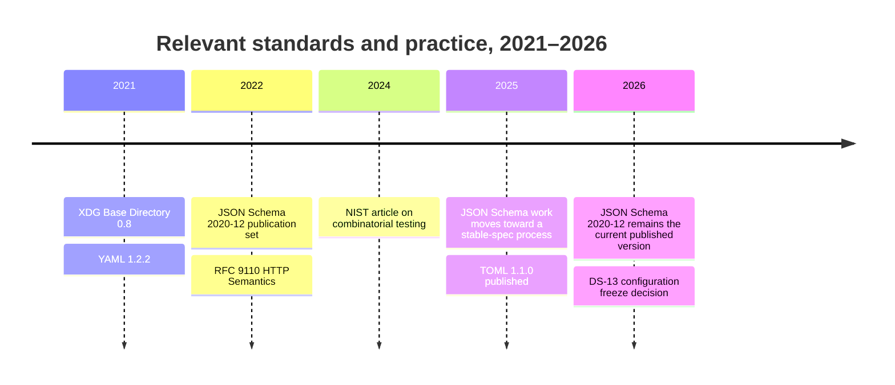
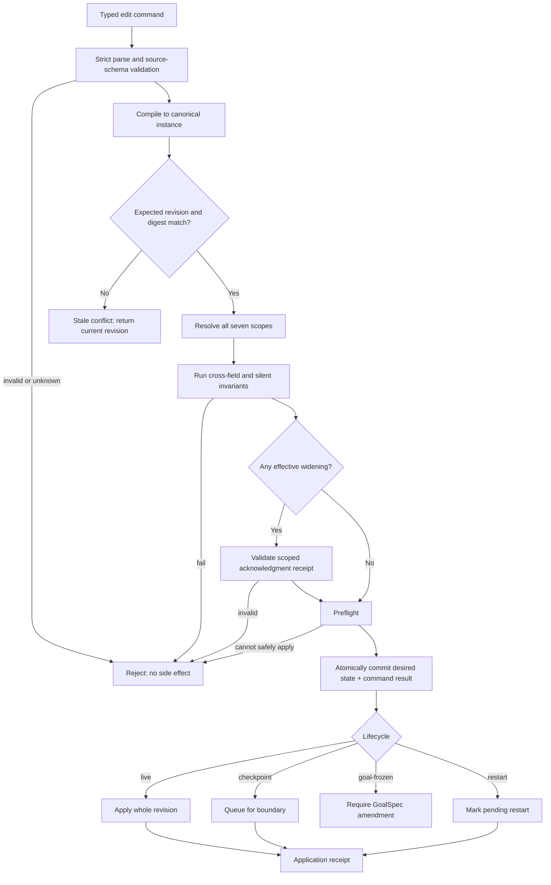

# DS-13 — Configuration architecture and operator control

## Assumptions and executive summary

**Scope assumption.** The otherwise unspecified research topic is taken from the supplied DS-13 research directive: determine whether Recursion v3 can use one versioned, typed configuration architecture to make files, interactive CLI, Telegram, editions, goals, tasks, plugins, routes, nodes, PAUSE, Full Access, and terminal layouts predictable, transactional, portable, explainable, and rollback-safe. The report treats the brief's accepted decisions as constraints rather than questions to reopen. It performs architecture research only; no repository, runtime, provider, model, authentication, credential, deployment, spending, publication, or configuration changes were made. fileciteturn0file0

**Evidence labels.** Consequential conclusions are marked **[Source-documented]** when they follow a cited primary source, **[Inferred]** when they are architectural conclusions derived from those sources and DS-13, and **[Unverified]** where implementation evidence would still be needed. There are no claims labeled “locally observed” because DS-13 explicitly provides no implementation inputs and this session did not inspect a repository.

**Executive conclusion — [Inferred].** **One schema can cover every named configuration surface at the product-contract level, provided “one schema” means one authoritative typed data model and metadata vocabulary—not one parser, one file syntax, or one validation mechanism.** The strongest candidate architecture is:

> **JSON Schema 2020-12 + a mandatory Recursion vocabulary → restricted I-JSON instance model → RFC 8785/JCS canonical bytes for digests and receipts → deterministic non-model resolver for cross-scope merging, authority comparisons, provenance, and invariants → multiple editors that emit the same typed edit command.**

JSON Schema 2020-12 remains the current published JSON Schema version in 2026 and explicitly supports vocabularies and meta-schemas, which makes it suitable for adding Recursion-specific semantics such as merge operator, lifecycle, authority edge, editor presentation, and secret-reference annotations. citeturn13view0turn14view0 RFC 8785 provides a deterministic JSON representation intended for hashing/signing, but it deliberately constrains inputs to I-JSON-compatible values, rejects duplicate object names, requires IEEE-754-compatible JSON numbers, and **does not normalize Unicode strings**. citeturn13view1

The human-editable syntax should remain **provisional rather than frozen**. TOML 1.1.0, published December 18, 2025, is the leading candidate because it is comparatively small and rejects duplicate table definitions, but unrestricted TOML includes values such as `inf`, `nan`, native dates, and times that do not map directly into the proposed JCS/I-JSON canonical model. It therefore requires a strict Recursion profile. citeturn15view0turn15view1turn15view2 YAML 1.2.2 has a richer graph/tag/alias model and treats mapping ordering as non-semantic; it can serve only behind an even tighter JSON-shaped subset if its parser conformance corpus proves deterministic behavior. citeturn15view3

The proposed schema has **18 setting domains and 55 first-order persisted leaves**, excluding repeated records such as individual routes/plugins and excluding transaction/provenance envelopes. It retains the seven DS-13 scopes. The field model deliberately does **not** contain `full_access: true`; Full Access is a command/editor macro expanding to an explicit capability vector. `sovereign` remains separately requested and acknowledged. PAUSE exposes policy modes, but the emergency stop is outside configuration and current immediate-halt constitutional behavior cannot be displaced merely by a config value. **[Inferred]**

The architecture should freeze these properties now:

| Decision surface | Candidate freeze | Confidence |
|---|---|---:|
| Authoritative structural schema | JSON Schema 2020-12 plus required Recursion vocabulary | High |
| Digest representation | Restricted I-JSON → RFC 8785/JCS | High |
| Default injection | Explicit built-in-default scope, never validator side effect | High |
| Preference merge | Keyed, nearest valid value | High |
| Hard ceilings | Intersection / lattice meet | High |
| Plugins | Stable-ID merge; identity/version conflict rejects | High |
| Credentials | Explicit opaque binding operation, never generic precedence | High |
| Concurrency | Revision/digest compare-and-swap; stale edit fails | High |
| Idempotency | Command ID bound to request digest and retained result | High |
| Runtime application | Atomic desired-state commit plus per-target whole-revision application receipts | High |
| Human file syntax | **Do not freeze yet**; TOML 1.1 restricted profile leads | Medium |
| Exact authority lattice facets | Requires Owner decisions for several domains | Medium |
| Adapter-specific restart boundaries | Must be proven by implementation | Low/medium |

**The central safety invariant is architectural, not configurable.** No schema value, edition, feature flag, task override, transport command, plugin, or Full Access expansion may disable the integrity, authority, privacy, or verification checks that determine whether a configuration can become effective. **[Inferred from DS-13].** This separation is essential because schema validation establishes that data is structurally admissible; it does not by itself establish that a cross-scope change is authorized or safe. JSON Schema explicitly distinguishes assertion/annotation mechanisms, and custom vocabularies are the extension mechanism rather than a substitute for application-level semantics. citeturn14view0

### Research answer at a glance

| DS-13 question | Finding |
|---|---|
| Deterministic encoding | JSON Schema 2020-12 for shape; restricted I-JSON as semantic instance; JCS for digest bytes; human syntax is a projection. |
| Smallest orthogonal setting set | Candidate: 18 domains, 55 first-order leaves. |
| Merge semantics | Preferences override by key; ceilings meet/intersect; plugins stable-ID merge with conflict rejection; credentials explicit binding. |
| Zero-token provenance | Deterministic resolver produces typed provenance records and reason codes; no model inference needed. |
| Narrowing vs widening | Compare before/after effective values in a domain-specific partial order; any widening facet requires authenticated acknowledgment. |
| Stale/concurrent edits | CAS on expected scope revision plus digest; one winner, no automatic last-write-wins. |
| Lifecycle | Four classes: goal-frozen, checkpoint-applied, live, restart-required; target receipts prove application. |
| Migration | Pure, deterministic, pre-side-effect conversion; lossless round-trip where reversible; rollback is a new authorized transaction. |
| Credentials | Opaque typed references; metadata-only availability check; values never enter config/provenance/log output. |
| Editions/features | Availability and request are separate; lean editions preserve blocked intent rather than deleting it. |
| Windows/Linux | Logical path references map to XDG roots or Windows Known Folders at application time. |
| Editor consistency | File, CLI, and Telegram compile into the same typed command and must yield the same canonical digest. |
| Untestable combinations | Reject or explicitly mark blocked; never silently approximate. |
| Silent invariants | Outside mutable configuration and rechecked after every resolution/migration. |

## Evidence and recent developments

The last five years strengthen rather than weaken the case for separating **schema**, **canonical representation**, **human syntax**, and **transaction protocol**.



**Schema and canonicalization — [Source-documented].** JSON Schema's official site still identifies 2020-12 as the current version. Its core design supports custom vocabularies and dialects: an application can require support for a vocabulary rather than allowing critical extension keywords to be silently ignored. citeturn13view0turn14view0 This matters for DS-13 because `merge`, `lifecycle`, `authorityEdge`, and similar metadata are not cosmetic annotations; an editor or validator that cannot understand mandatory Recursion semantics should be rejected as incompatible instead of pretending validation succeeded. **[Inferred].**

RFC 8785 JCS addresses a different problem: creating invariant JSON bytes suitable for hashing and signing. It requires duplicate-free objects, Unicode-valid strings, compatible numbers, recursive property sorting, and UTF-8 output. It also says parsed strings are to be preserved, not Unicode-normalized. citeturn13view1 Consequently, a digest scheme based on JCS has two notable design consequences. **First**, money, quotas, very large counters, or exact decimal quantities should not be represented as arbitrary JSON floating-point values; use bounded integers where their safe range is proven, or schema-tagged decimal strings. **Second**, identifiers for which Unicode visual equivalence would be dangerous should use a deliberately narrow identifier alphabet rather than silently normalizing arbitrary user strings. **[Inferred].**

A subtle but important parser rule follows: duplicate-key rejection must occur **before** ordinary object construction. JSON Schema's own data model assumes an object cannot contain duplicate properties and says behavior for an input attempting them is undefined at that level; JCS explicitly requires duplicate names not to occur. citeturn14view0turn13view1 Therefore a parser that first collapses duplicate JSON keys and only then invokes schema validation is inadequate for a security-sensitive Recursion configuration channel. **[Inferred].**

**Human syntax — [Source-documented].** TOML 1.1.0 is now newer than DS-13's original TOML 1.0 candidate. TOML 1.1 has explicit scalar types and rejects redefinition of tables, but it also permits positive/negative infinity and NaN. citeturn15view0turn15view1turn15view2 A deterministic Recursion profile should therefore accept only the portion that maps one-to-one to the canonical instance model: strings, booleans, arrays/tables, constrained integers, finite constrained numbers where truly needed, and no native TOML date/time interpretation unless converted by an explicitly defined schema rule. **[Inferred].**

YAML 1.2.2 formally requires mapping keys to be unique, but its semantic representation is richer than JSON: nodes are tagged, aliases can reference existing nodes, mappings are unordered, and presentation details such as comments and key order are not application data. citeturn15view3 That does not make YAML intrinsically unsafe, but it increases the size of the normalization and parser-conformance boundary. For DS-13's specific goal—portable, explainable digests—**restricted TOML or JSON is the lower-risk starting point**. **[Inferred].**

**Concurrency and versioning — [Source-documented].** HTTP's `If-Match` semantics provide a mature model for optimistic concurrency: state-changing requests can be made conditional on an entity tag so a mismatched state does not execute, preventing the classic lost-update problem. citeturn13view4 Recursion does not need to use HTTP internally to adopt the same invariant: an edit names the exact current revision/digest it was prepared against, and mismatch means “stale; recompute,” not “take the newest writer.” **[Inferred].**

Kubernetes supplies a useful precedent for configuration/API evolution: its deprecation policy requires objects in a release to be able to round-trip across supported API versions without information loss. citeturn15view4 This is particularly relevant to Recursion's edition and migration requirements: down-conversion must not silently throw away a capability request merely because the older/leaner representation cannot execute it. **[Inferred].**

**Testing — [Source-documented].** NIST's 2024 summary of combinatorial testing reports that systematic interaction testing can approach exhaustive fault detection with large reductions in suite size, and notes that many failures arise from relatively low-order parameter interactions. citeturn15view5 This supports using universal pairwise coverage and targeted three-way or higher combinations for DS-13, but it does **not** prove that pairwise coverage is sufficient for safety-critical authority paths. **[Inferred].**

**Cross-platform locations — [Source-documented].** The XDG Base Directory specification defines logical bases for Linux/Unix configuration, state, cache, data, and runtime files and requires XDG environment paths to be absolute. citeturn15view6 Windows exposes Known Folders through stable identifiers, and Microsoft notes that many such folders can be redirected, including to network locations. citeturn14view6turn15view7 Therefore portable configuration should identify a *logical root plus relative segments*, not serialize an already-expanded host pathname and assume it has stable meaning elsewhere. **[Inferred].**

**Secrets — [Source-documented].** Kubernetes security guidance emphasizes restricting secret access and avoiding exposure of actual secret data, while external secret-store integrations demonstrate a useful architectural split between a reference to a provider/object and the secret material itself. citeturn14view2turn14view3 Recursion should adopt the reference pattern, but stronger: configuration validation receives only typed opaque identity and metadata such as availability or version fingerprint, never the secret bytes. **[Inferred].**

**Alternative constraint system — [Source-documented].** CUE is a serious competing architecture because it combines data, schema, and constraints, and its conjunction/unification model is intentionally order-independent. citeturn14view4turn14view5 That is powerful for policy constraints but is not naturally identical to DS-13's intentionally ordered seven-scope preference resolution. CUE remains the strongest challenger if a JSON-Schema-plus-resolver design becomes duplicated or unmanageable; it should be evaluated through the same conformance corpus rather than dismissed on language preference. **[Inferred].**

## Candidate unified schema

### The schema contract

**[Inferred]** The schema should be versioned as a product contract, for example `recursion.config/v1`, with four conceptual layers:

| Layer | Responsibility | Must be deterministic? | Model tokens? |
|---|---|---:|---:|
| Parse/compile | Human syntax → restricted JSON data model | Yes | Zero |
| Structural schema | Types, required properties, discriminators, closed objects, basic local constraints | Yes | Zero |
| Resolution/invariant engine | Seven scopes, merges, authority lattice, cross-field constraints, provenance | Yes | Zero |
| Canonicalization | Effective/request documents → JCS bytes/digest | Yes | Zero |

JSON Schema 2020-12 is suitable for the structural layer and allows a required custom vocabulary for additional product semantics. citeturn13view0turn14view0 `unevaluatedProperties: false` or equivalent strict closure should be used throughout product-owned objects so an accidental or future-unknown field cannot be silently tolerated. **[Inferred].**

The custom vocabulary should minimally define metadata equivalent to:

```json
{
  "x-recursion-merge": "keyed-override | meet | stable-id | explicit-binding",
  "x-recursion-lifecycle": "goal-frozen | checkpoint-applied | live | restart-required",
  "x-recursion-authority-edge": "none | capability | egress | privacy | spending | publication | credential",
  "x-recursion-secret": "opaque-reference | none",
  "x-recursion-portability": "portable | node-local",
  "x-recursion-editor": {
    "group": "routing",
    "expertOnly": false
  }
}
```

**[Inferred].** These are schema semantics, not runtime values. A validator that cannot implement the required vocabulary must reject the schema/dialect rather than treating these as harmless unknown annotations. JSON Schema's vocabulary mechanism specifically exists to identify sets of keywords and whether processors must support them. citeturn14view0

Schema `default` annotations should be documentation/editor hints only. Effective defaults must enter through DS-13's explicit **built-in defaults scope**, so provenance can say exactly where a value came from. This avoids a hidden difference between a validator that materializes defaults and one that does not. JSON Schema documents `default` as an annotation rather than a generic mutation instruction. citeturn14view1

### Smallest orthogonal candidate field set

**[Inferred].** The following **18 domains / 55 first-order leaves** are sufficient to model every named DS-13 surface without making editions, goals, tasks, or Full Access duplicate configuration systems. Repeated records such as individual route definitions contain their own typed members but are counted here as one first-order field because the complexity metric is intended to measure the top-level operator surface.

| Domain | First-order settings | Count | Primary lifecycle |
|---|---|---:|---|
| `engines` | `preferred`, `fallback` | 2 | checkpoint |
| `tools` | `requested`, `profiles` | 2 | checkpoint |
| `context` | `max_input_tokens`, `max_output_tokens`, `compaction_policy`, `retention_scope` | 4 | checkpoint / frozen where privacy-sensitive |
| `memory` | `enabled`, `stores`, `retrieval_policy`, `write_policy` | 4 | checkpoint / frozen where privacy-sensitive |
| `routing` | `routes`, `default_route`, `retry_policy` | 3 | checkpoint |
| `delegation` | `max_depth`, `max_workers`, `worker_profiles`, `timeout` | 4 | checkpoint, bounded by frozen ceiling |
| `verification` | `required_reviews`, `verifier_independence`, `evidence_policy`, `fail_closed` | 4 | goal-frozen minimum |
| `scheduling` | `mode`, `windows`, `concurrency_limit`, `missed_run_policy` | 4 | checkpoint |
| `placement` | `strategy`, `allowed_nodes`, `locality` | 3 | checkpoint |
| `resources` | `wall_time`, `cpu`, `memory`, `token_budget` | 4 | checkpoint, bounded |
| `nodes` | `references`, `selectors`, `health_policy` | 3 | checkpoint / restart for drivers |
| `pause` | `mode`, `drain_timeout` | 2 | checkpoint, subject to constitution |
| `plugins` | `requested`, `config` | 2 | checkpoint/restart |
| `transports` | `requested`, `config` | 2 | checkpoint/restart |
| `terminal` | `layout`, `detach_behavior`, `notifications` | 3 | live |
| `authority` | `capabilities`, `egress`, `privacy_exposure`, `spending`, `publication`, `delegation_ceiling`, `resource_ceiling` | 7 | goal-frozen |
| `credentials` | `bindings` | 1 | frozen/restart depending provider |
| `features` | `requested` | 1 | derived against edition |
| **Total** |  | **55** |  |

The field count is deliberately smaller than the visible feature count. An **edition is a preset/source layer**, not another copy of settings. A **goal** and **task** are scopes carrying values defined by this same schema, not separate configuration types. A **CLI or Telegram editor** is a command producer, not a new settings namespace. A **terminal layout** is ordinary non-authority configuration. A **node** is referenced through typed node IDs/selectors. **[Inferred].**

Likewise, **Full Access is not a Boolean field**. It should be an editor-level macro that proposes a diff over explicit authority dimensions and shows which requests become effective, which remain ceiling-blocked, and which need acknowledgment. This is necessary to preserve DS-13's premise that Full Access is a capability vector and that `sovereign` is never ambient. **[Inferred from DS-13].**

PAUSE should be represented as a typed policy with `checkpoint`, `interrupt`, and `drain` as candidate operating modes, plus mode-specific parameters such as `drain_timeout`. **Emergency stop must not be a configurable enum member that can be disabled.** Until the operative constitution changes, a configuration requesting a different future default cannot override current immediate-halt behavior. **[Inferred from DS-13].**

### Canonical value profile

**[Inferred].** The canonical instance profile should be stricter than arbitrary JSON:

| Value class | Rule |
|---|---|
| Object | Unique string property names only |
| String | Valid Unicode; bytes preserved exactly; no implicit normalization |
| Identifier | Prefer constrained ASCII grammar for security-sensitive identities |
| Integer | Bounded range proven to serialize identically; larger exact values use typed strings |
| Money | Integer minor units with currency, or canonical decimal string; never binary floating money |
| Float | Finite only and only where approximation is semantically acceptable |
| Date/time | Canonical string with schema-defined format/semantics |
| Path | Structured `PathRef`, not host-expanded string |
| Secret | Opaque `CredentialRef`, never value material |
| Unknown | Explicit state, never coerced to `false`, `0`, empty collection, or absence |

These constraints follow from JCS's I-JSON/IEEE-754 requirements and no-normalization rule. citeturn13view1

A candidate portable path is:

```json
{
  "base": "project",
  "segments": ["artifacts", "reports"],
  "portability": "portable"
}
```

Allowed bases could include `project`, `config`, `state`, `cache`, `runtime`, and an explicitly marked `node-local`. Linux maps these through XDG-style roots; Windows maps logical purposes through Known Folder APIs where appropriate. Host expansion belongs to application receipts, not the canonical configuration digest, because Windows folders can be redirected and environment-derived paths are installation-specific. citeturn15view6turn15view7

### Cross-field constraint families

**[Inferred].** Structural validation alone is not enough. The deterministic resolver should implement at least these **16 named constraint families**, each with stable error/reason codes:

| Code | Constraint family |
|---|---|
| `ENGINE_AVAILABLE` | Preferred/fallback engine IDs must be defined and permitted at effective scope. |
| `TOOL_CAPABILITY` | Requested tools must fit effective capabilities. |
| `CONTEXT_RESOURCE` | Context/output limits must fit relevant execution/resource ceilings. |
| `MEMORY_PRIVACY` | Memory writes/retrieval cannot exceed privacy exposure limits. |
| `DEFAULT_ROUTE_EXISTS` | The default route must resolve to an existing route. |
| `ROUTE_TARGET_VALID` | Route targets must exist and meet engine/node/tool constraints. |
| `DELEGATION_CEILING` | Depth/workers/profiles remain beneath delegation authority. |
| `VERIFICATION_FEASIBLE` | Required independent review must be satisfiable; otherwise block execution, not weaken review. |
| `SCHEDULE_CAPACITY` | Scheduled concurrency cannot exceed effective resource/delegation ceilings. |
| `PLACEMENT_FEASIBLE` | A required executable task must have at least one eligible node. |
| `RESOURCE_CEILING` | Runtime and token/resource requests cannot exceed ceilings/budget. |
| `NODE_REFERENCE_VALID` | Node IDs/selectors must be known or explicitly unresolved/blocked. |
| `PAUSE_MODE_VALID` | Mode-specific settings are legal only for their mode. |
| `PLUGIN_IDENTITY_VALID` | Stable ID, artifact/version/schema, dependencies, and authority must be conflict-free. |
| `TRANSPORT_BINDING_VALID` | Transport configuration and credential references must have valid types and authority. |
| `FEATURE_AVAILABILITY` | Requested capability is compared with edition/installation availability without deleting intent. |

These 16 are not silent integrity invariants; they are explainable configuration relationships. Silent invariants—such as “a worker cannot self-grant authority” or “required independent verification cannot be configured away”—sit underneath and are rechecked after every resolution and migration. **[Inferred].**

### Explicitly named gaps

The candidate schema covers every named surface, but **coverage is not equivalent to complete semantics**. The following gaps remain and should block any claim that configuration is fully frozen:

| Gap | Status | Why it cannot yet be promoted |
|---|---|---|
| Provider/engine identifier and cost-class semantics | **[Unverified]** | Provider-neutral adapters have not supplied registries or compatibility fixtures. |
| Plugin-specific schemas and schema trust | **[Unverified]** | The base schema can key subschemas by plugin ID, but trust/version/signature rules remain to be specified. |
| Authority lattice for privacy/publication destinations | **[Unverified]** | Some values may be partially ordered or incomparable; Owner semantics are required. |
| Schedule expression grammar | **[Unverified]** | Cron/calendar syntax is explicitly outside this lane's final selection. |
| Symlink/junction/mount escape semantics | **[Unverified]** | Structured paths solve portability, not runtime filesystem containment. |
| Exact adapter restart boundaries | **[Unverified]** | Must be declared and tested per adapter/driver. |
| Terminal-layout extension grammar | **[Unverified]** | Core fields are modelable; arbitrary future layout plugins need a bounded extension strategy. |
| Remote-node health and capability attestation | **[Unverified]** | Schema can represent advertised capabilities but cannot prove them. |
| Authentication assurance equivalence across CLI/Telegram | **[Unverified]** | Transport identity and authorization receipts require an Owner-approved assurance model. |

## Resolution, authority, provenance, and transactions

### Resolution and merge algebra

**[Inferred from DS-13].** The seven configuration layers remain:

`built-in defaults < edition preset < installation/authority-domain < project < parent goal < task < ephemeral operator override`

The phrase “most specific wins” should apply **only where a field's declared merge operator is keyed override**. It must not be a universal merge algorithm.

Define `x ≤ y` to mean “x is no more permissive, no more exposing, or no more expensive than y” in a field's authority domain. Then the four required operator families are:

| Operator | Field class | Deterministic rule | Conflict behavior |
|---|---|---|---|
| `keyed-override` | Preferences | Nearest present value at most-specific scope wins per key. | Invalid value rejects; missing means inherit. |
| `meet` | Authority/egress/budget ceilings | Effective value is the greatest restriction satisfying all active ceilings: set intersection, numeric `min`, Boolean conjunction, or domain-specific lattice meet. | Incomparable or undefined meet rejects/blocks. |
| `stable-id` | Plugins and similar registries | Union distinct stable IDs; same ID merges only explicitly mergeable fields. | Artifact/version/schema/source identity disagreement is an error, not precedence. |
| `explicit-binding` | Credentials | Binding/substitution occurs only through an authorized typed operation. | Generic scope override is illegal. |

A key distinction is **requested configuration versus effective configuration**. A task may request a broader network destination than its parent goal permits; the request can be retained for explanation, but effective access remains the intersection. Child scope cannot manufacture an override that crosses the ancestor ceiling. **[Inferred].**

For preferences, deletion should be represented by an explicit typed “unset” mutation rather than treating JSON `null` as both “clear” and a legitimate data value. **[Inferred].**

For plugins, disabling a plugin is normally a narrowing operation. Enabling one can widen tool, network, credential, filesystem, or publication capability and must therefore be evaluated through the same authority-edge machinery as the capabilities it introduces. A plugin cannot evade authority checks merely because its identity came from a permitted plugin set. **[Inferred].**

For credentials, a logical binding should resemble:

```json
{
  "slot": "transport.telegram.sender",
  "ref": {
    "kind": "credential-ref",
    "provider": "local-authority-domain",
    "id": "opaque-id"
  }
}
```

The only permitted validation response from a credential provider should be metadata such as `available`, `missing`, `incompatible`, or `unknown`, optionally with a non-secret version fingerprint. Secret material must never enter the canonical config, provenance record, diff, receipt, editor preview, or validation error. This follows the general secret-reference separation used by external secret stores and the principle of minimizing secret exposure. citeturn14view2turn14view3

### Narrowing and widening

**[Inferred].** Widening must be classified by comparing **effective before and effective after**, not merely the textual edit. This catches cases where an apparently innocuous preset/edition change unblocks an already-stored request.

For every authority-bearing dimension:

- `new ≤ old` is narrowing.
- `old < new` is widening.
- Incomparable values are treated conservatively as containing a widening component unless a domain-specific comparator proves otherwise.
- A mixed transaction may narrow some dimensions and widen others; **any widening facet requires acknowledgment**.

Six primary acknowledgment edges are sufficient as a first version:

| Authority edge | Examples |
|---|---|
| Capability | Tool classes, delegation powers, `sovereign` capability |
| Egress/network | New destinations, protocols, remote reachability |
| Privacy exposure | Wider data audience or storage/retrieval domain |
| Spending/billing | Higher spend/token/resource ceiling or chargeable engine class |
| Publication | New external destination or publication right |
| Credential binding | Binding or substituting an opaque credential reference |

Resource or engine changes that merely increase probable cost should be classified under the spending edge rather than creating an overlapping seventh billing mechanism. **[Inferred].**

An acknowledgment receipt should bind at minimum: principal, authenticated operation/session identity, scope and scope ID, schema version, command ID, canonical before digest, canonical proposed-after digest, exact widened paths, old/effective-new values or safely redacted references, reason code, issuance/expiry or one-use semantics, and the authority decision. **It must also show what the operation does not grant**, because ancestor intersection may keep some requested expansion blocked. **[Inferred].**

### Provenance with zero model tokens

**[Inferred].** Provenance should be emitted directly by the resolver from a typed trace. Natural-language explanation can use static reason templates; neither field selection nor explanation needs an LLM.

A minimally complete record is:

```json
{
  "schemaVersion": "recursion.config/v1",
  "path": "/authority/egress/destinations",
  "requestedValue": ["service-a", "service-b"],
  "effectiveValue": ["service-a"],
  "sourceScope": "task",
  "sourcePreset": null,
  "contributors": [
    {"scope": "project", "operator": "meet"},
    {"scope": "parent-goal", "operator": "meet"},
    {"scope": "task", "operator": "meet"}
  ],
  "mergeOperator": "meet",
  "reason": "ANCESTOR_CEILING",
  "applicationBoundary": "goal-checkpoint",
  "blockedStatus": {
    "blocked": true,
    "code": "WIDENING_ACK_REQUIRED"
  },
  "effectiveRevision": "..."
}
```

`contributors` is important even though DS-13's minimum provenance list asks for a source scope, because an intersection can have **multiple causally relevant sources**. Choosing only the “winning” scope can make an explanation false: two independent ceilings may jointly determine the same effective set. **[Inferred].**

A useful deterministic reason-code vocabulary includes `MOST_SPECIFIC_VALUE`, `BUILTIN_DEFAULT`, `EDITION_PRESET`, `ANCESTOR_CEILING`, `AUTHORITY_INTERSECTION`, `EDITION_UNAVAILABLE`, `ACK_REQUIRED`, `CREDENTIAL_UNAVAILABLE`, `PLUGIN_CONFLICT`, `LIFECYCLE_PENDING`, `RESTART_PENDING`, `INVARIANT_BLOCK`, and `UNKNOWN_EXTERNAL_STATE`. **[Inferred].**

The resolver must preserve `unknown` distinctly from empty or zero. For example, “credential-provider availability could not be checked” is `unknown/blocked`, not “credential missing”; “node health unknown” is not “zero eligible nodes.” **[Inferred from DS-13].**

### Transaction protocol

The edit envelope proposed by DS-13 is correct in shape but should use the following sequencing. HTTP `If-Match` is a relevant precedent for compare-and-swap semantics that prevent lost updates, even if Recursion uses no HTTP internally. citeturn13view4



**Stale version — [Inferred].** Every scope owns a monotonic revision and canonical digest. An edit supplies both expected values. A mismatch returns a deterministic stale-version error with the current revision/digest and, if retained safely, a structured diff since the expected revision. It does **not** auto-merge an authority-bearing change.

**Concurrent clients — [Inferred].** Two commands prepared against the same revision race through compare-and-swap. At most one commits that scope revision. The loser rereads and deliberately replans. This is much safer than last-write-wins, where a terminal, Telegram command, or background operator could silently erase another client's change.

For an effective configuration that depends on all seven scopes, the application snapshot should identify a **vector of contributing scope revisions** or a derived effective-revision digest. A process must never claim it applied revision `R` while combining half of `R` with a later project or goal scope. **[Inferred].**

**Idempotent replay — [Inferred].** Maintain a deterministic ledger:

`(scope_id, command_id) → {request_digest, result, committed_revision}`

A repeated command ID with the **same request digest** returns the original result. The same command ID with a **different digest** is a hard conflict. This handles the classic “commit happened but response was lost” case without accidentally applying the action twice.

**Partial failure — [Inferred].** The design must not claim globally atomic runtime application across independent processes/nodes unless an implementation actually proves it. Instead:

1. Desired configuration, provenance, and command result commit atomically.
2. Each target applies a **complete effective revision**, never a subset of its fields.
3. A failing target stays on its prior complete revision and reports failure/pending state.
4. Successful targets report the exact revision they applied.
5. Retry is idempotent.
6. Rollback is a new transaction, not an invisible pointer rewind.

The distinction between a serializable desired-state revision and subsequent watchers/applications has precedent in distributed stores such as etcd, whose API documentation distinguishes strong KV operations from watch-delivery semantics. citeturn14view7 This source does not prove Recursion's implementation will have those guarantees; it demonstrates why the desired-state commit and propagation receipt should be separate concepts. **[Inferred].**

A per-target receipt should contain target/session identifier, effective revision/digest, lifecycle class, prior applied revision, boundary event/checkpoint ID where relevant, result (`applied`, `pending`, `blocked`, `failed`, `superseded`), and component/adaptor result codes. It must contain no credential value. **[Inferred].**

## Lifecycle, migration, portability, and testing

### Lifecycle and propagation

**[Inferred].** The four DS-13 lifecycle classes should be interpreted as *application contracts*, not arbitrary labels:

| Lifecycle | Candidate field groups | When effective | Proof required |
|---|---|---|---|
| `goal-frozen` | Authority ceilings, egress/privacy/spending/publication, verification minimums, critical credential-binding identities, delegation ceiling | Only through accepted GoalSpec amendment | Amendment receipt + new goal/effective digest |
| `checkpoint-applied` | Engines, tools, context/compaction, routing, worker profiles/count within ceiling, scheduling, placement, resources, safe plugin config, ordinary memory retrieval | Next declared checkpoint | Per-session boundary/application receipt |
| `live` | Terminal layout, notifications, non-authority editor/display preferences | Immediately after commit | Live application receipt |
| `restart-required` | Listener/transport driver bindings, plugin binaries requiring reload, node drivers, credential-provider backend, adapter-declared restart-only fields | After controlled component restart | Restart + applied-revision receipt |

A setting's class is part of the schema metadata and cannot itself be weakened by an ordinary configuration edit. An adapter may be stricter—for example, treating a nominally checkpoint-safe field as restart-required—but may not silently treat a restart-required field as live unless conformance testing and schema versioning explicitly change the contract. **[Inferred].**

The associated application states should be small and explicit:

`committed → pending | applied | blocked`

`pending → applied | failed | superseded`

`failed → pending(retry) | superseded`

“Committed” therefore means **accepted desired state**, not “every worker is already running it.” **[Inferred].**

This distinction is particularly important for PAUSE. DS-13's chosen future product direction is `checkpoint`, but current immediate-halt semantics remain authoritative until a constitutional amendment. A config transaction can prepare or store a future pause mode only within that constitutional boundary. **[Inferred from DS-13].**

### Migration and rollback

**[Inferred].** Configuration migration should obey six rules:

| Rule | Required behavior |
|---|---|
| Version explicitness | Every persisted configuration names its schema version and canonical digest. |
| Purity | Migration is deterministic and side-effect free: no provider calls, secret fetching, node changes, or runtime mutation. |
| Stage before commit | Migrate every affected layer in memory, validate it, resolve it, then commit as one desired-state transaction. |
| Lossless reversible window | For every migration declared reversible, `down(up(x))` must be canonically equal to `x`. |
| No silent downgrade loss | If an older schema cannot represent a value, downgrade blocks rather than deleting it. |
| Rollback is new intent | Restoring an older canonical snapshot is a new CAS edit and must be re-authorized if it widens current effective authority. |

Kubernetes' explicit rule that objects round-trip between API versions without information loss provides a strong precedent for the reversible part of this policy. citeturn15view4 A destructive schema change can still exist, but it must be labeled irreversible, retain the pre-migration snapshot for recovery, and never claim automatic semantic rollback. **[Inferred].**

Unknown fields must fail in the **source schema before migration** unless that source version explicitly defines them. Otherwise a migration could accidentally become an “ignore unknown configuration” escape hatch. Likewise, the target output must validate completely before any desired-state commit. **[Inferred].**

Edition transitions need special handling. `features.requested` should be preserved even when the current edition cannot execute them. Downgrading from `full` to a lean edition may make a request `blocked: EDITION_UNAVAILABLE`; it should not erase it. On a later upgrade, an authority-neutral capability may become active at its declared boundary, but a formerly blocked **authority-widening** capability must require fresh acknowledgment rather than silently springing into force. **[Inferred from DS-13].**

### File and editor round-trip

The proper round-trip invariant is **semantic canonical equality**, not preservation of comments, whitespace, or key ordering:

`compile(render(canonical(compile(source)))) == canonical(compile(source))`

YAML explicitly treats comments and key order as presentation/serialization details, which illustrates why source formatting should not be part of authority or digest semantics. citeturn15view3

For TOML, the candidate “Recursion TOML profile” should reject at least:

- duplicate/redefined keys or tables;
- `nan`, `inf`, and `-inf`;
- native date/time types until exact canonical semantics are specified;
- exact integers outside the guaranteed canonical numeric range unless the field schema encodes them as strings;
- any construct whose independent parsers disagree about typed output.

TOML itself makes redefinitions invalid and allows the special float values, so these profile restrictions are straightforward to test. citeturn15view1turn15view2

A future YAML profile, should it be justified, should be “JSON-shaped”: string keys only, scalar/object/array data only, no application-specific tags, no aliases/anchors, no merge-key behavior, no multi-document input, and duplicates rejected at token/composition time. YAML's richer graph/tag/alias representation makes those restrictions necessary to make the mapping to canonical JSON unambiguous. citeturn15view3

The novice CLI, expert file editor, and Telegram control surface must all compile to **the same edit envelope**. A UI is permitted to omit advanced settings from its visible menu, but it must not invent alternate defaults or semantics. **[Inferred].**

Three essential editor-equivalence fixtures are:

| Fixture | Expected result |
|---|---|
| File edit → CLI render/no-op | Identical canonical digest |
| CLI mutation → equivalent Telegram mutation on same base | Identical proposed-after digest and provenance |
| Telegram setting → expert-file render → recompile | Identical typed value and effective result |

### Conformance and interaction testing

NIST's recent combinatorial-testing work supports systematic low-order interaction coverage to reduce test counts substantially, while not making it a substitute for explicitly known high-risk combinations. citeturn15view5 Accordingly, **[Inferred]** the release gate should combine full boundary fixtures with pairwise and targeted higher-order coverage.

The parser/canonicalization corpus needs explicit cases for duplicate object keys; dotted TOML redefinitions; `-0`; exponent spelling; numeric precision boundaries; NaN/infinities; invalid Unicode/lone surrogates; composed versus decomposed Unicode strings; line-ending/BOM variants; TOML dates; YAML tags, aliases, merge behavior, duplicate keys, and multi-document streams. JCS specifically preserves string code points as supplied rather than normalizing them and rejects invalid Unicode/NaN/infinity, so those are mandatory cross-implementation fixtures. citeturn13view1

Every one of the 55 first-order fields should have at least valid-minimal, valid-boundary, invalid-type, invalid-boundary, and editor round-trip cases. Every scope-sensitive field should additionally be exercised across all seven scopes.

Universal pairwise coverage should then be supplemented by targeted three-way or greater tests for at least:

`authority ceiling × edition availability × child request`;  
`credential binding × plugin × transport`;  
`PAUSE mode × lifecycle boundary × concurrent edit`;  
`schema migration × rollback × newly introduced constraint`;  
`goal-frozen authority × task override × ephemeral override`; and  
`verification minimum × delegation × worker availability`.

For the authority, privacy, spending, credential, publication, and silent-integrity paths, known semantic interactions take precedence over any combinatorial algorithm's minimum coverage. **[Inferred].**

### Configuration-complexity vector

The following is a **candidate design metric, not an implementation measurement**:

| Metric | Candidate value |
|---|---:|
| First-order setting domains | **18** |
| First-order persisted setting leaves | **55** |
| Scope levels | **7** |
| Primary merge-operator families | **4** |
| Named cross-field constraint families | **16** |
| Lifecycle classes | **4** |
| Runtime application states | **6** (`committed`, `pending`, `applied`, `blocked`, `failed`, `superseded`) |
| Authority/acknowledgment edge classes | **6** |
| Invalid-combination classes | **12** |
| Canonical round-trip target | **100% of accepted configuration corpus** |
| Supported-editor semantic equivalence target | **100% of accepted mutations** |
| Reversible adjacent-version migration target | **100% canonical equality** |
| Automatic rollback target for explicitly destructive migration | **0%**; preserve snapshot and require deliberate recovery |

The 12 invalid-combination classes are: malformed/noncanonical input; unsupported schema/vocabulary; unknown product field; cross-field contradiction; ancestor-ceiling violation; unauthorized widening; invalid/missing credential binding; plugin identity/schema conflict; unsatisfied required route/node/placement; resource/budget contradiction; illegal lifecycle/migration transition; and attempted weakening of a silent invariant. **[Inferred].**

Edition unavailability is deliberately **not** counted as invalid: a syntactically and semantically valid request can be retained as **valid-but-blocked**. This distinction is what lets lean editions defer an accepted capability without silently erasing operator intent. **[Inferred].**

## Alternatives, risks, and recommendation

### Architecture options

| Option | Strengths | Main weakness | DS-13 fit |
|---|---|---|---|
| **A. JSON Schema + Recursion vocabulary + I-JSON/JCS + deterministic resolver** | Mature structural schema, portable JSON data model, explicit canonical bytes, clean editor separation | Cross-scope policy still requires resolver code | **Recommended candidate** |
| **B. CUE as authoritative config/schema/policy language** | Schema, data, constraints, and unification in one model; strong validation expressiveness | Adds evaluation language/runtime; order-independent model does not naturally express DS-13's ordered preference scopes | Strong challenger |
| **C. Direct canonical JSON as the only human file format** | Smallest parsing boundary; digest semantics transparent | Poorer expert ergonomics/comments; raw JSON remains easy to mistype | Safest fallback |
| **D. YAML as human source over same canonical model** | Familiar, expressive, comments | Rich graph/tags/aliases and parser behavior enlarge determinism boundary | Conditional only |
| **E. TOML 1.1 restricted profile over same canonical model** | Readable, relatively small surface, duplicate definitions invalid | Native TOML values exceed I-JSON model, so profile required | Leading human-format candidate |

CUE's own documentation emphasizes combining constraints/data and order-independent unification, making it the credible competing architecture rather than a strawman. citeturn14view4turn14view5

### Recommendations, competitors, falsifiers, and limits

Every recommendation below includes the competing choice demanded by DS-13 and a decisive reason to reverse the recommendation.

| Recommendation | Competing option | Decisive falsifier | What this recommendation does **not** prove |
|---|---|---|---|
| **Freeze JSON Schema 2020-12 + required Recursion vocabulary as the structural contract.** | Make CUE the authoritative configuration language. | Two independent target implementations cannot agree on schema acceptance, required vocabulary behavior, typed output, and reason codes across the conformance suite; or resolver/schema duplication becomes materially larger and less auditable than a CUE design. | Does not prove a particular JSON Schema library is correct or secure. |
| **Freeze restricted I-JSON + JCS as the canonical digest representation.** | Define a bespoke canonical binary/JSON format. | Cross-language implementations cannot produce byte-identical JCS output for the complete supported value corpus, or required exact values cannot be represented without pervasive unnatural string encoding. | Does not make JCS an IETF Standards-Track protocol; RFC 8785 is Informational. citeturn13view1 |
| **Do not yet freeze human syntax; lead with restricted TOML 1.1, retain JSON-only as fallback.** | Direct JSON only; alternatively restricted YAML. | Windows/Linux parsers cannot identically reject the restricted TOML fixture set or users cannot express normal nested settings without excessive ambiguity; then choose canonical JSON. | Does not select a parser implementation. |
| **Use explicit field merge operators, not a universal most-specific-wins rule.** | Kubernetes-style generalized field ownership or simple layer overwrite. | A formal model shows one alternative can reproduce every preference, ceiling, plugin, and credential case with fewer ambiguous states and identical provenance. | Does not prove the proposed domain-specific authority lattice is complete. |
| **Use optimistic CAS on revision+digest plus a command ledger.** | Last-write-wins or long-lived pessimistic locks. | Stress/property tests demonstrate CAS cannot meet target UX/recovery requirements without pathological conflicts *and* an alternative preserves no-lost-update and deterministic replay guarantees. | Does not prove distributed runtime propagation is atomic. |
| **Commit desired state atomically, then prove per-target whole-revision application with receipts.** | Global distributed transaction/2PC over every worker/node. | A bounded deployment architecture can demonstrate practical, failure-safe, cross-node atomic commit with a smaller failure surface and recovery complexity than revisioned propagation. | Does not guarantee all targets transition simultaneously. |
| **Keep credentials opaque and make binding a separately authorized operation.** | Inline secret values or generic last-layer reference override. | An essential supported provider cannot expose a safe opaque-reference API and there is a demonstrably safer alternative that still prevents values entering config/logs/diffs. | Does not prove the external secret store itself is trustworthy. |
| **Make migrations pure, staged, lossless where reversible, and make rollback a new transaction.** | Forward-only migrations that discard unsupported older representation. | Storage/size constraints make reversible representation impossible and a formally specified, independently reviewed recovery mechanism proves equivalent safety without preserved snapshots. | Does not guarantee arbitrary semantic changes can be reversed. |
| **Preserve blocked feature intent across editions.** | Delete or silently disable unsupported settings on downgrade. | User research plus formal migration analysis shows retention introduces unacceptable reactivation risk that cannot be eliminated through explicit acknowledgment. | Does not authorize blocked settings to activate automatically. |
| **Represent portable paths as logical roots plus segments.** | Persist absolute platform paths or file URIs as canonical identity. | Required application workloads depend on host-native path semantics that cannot be represented losslessly through a logical root plus explicit node-local escape hatch. | Does not solve filesystem symlink/junction containment. |

The source basis for the first three recommendations is particularly strong: JSON Schema currently exposes an explicit vocabulary mechanism; JCS explicitly defines canonical JSON bytes with known value constraints; TOML 1.1.0 gives a relatively small human syntax but includes value types requiring a restricted profile. citeturn13view0turn14view0turn13view1turn15view0turn15view2

### Principal risks and limitations

**Canonical-number risk — [Source-documented → Inferred].** JCS requires JSON numbers compatible with IEEE-754 double precision and recommends string representation for values needing greater precision or longer integers. citeturn13view1 Recursion should therefore never encode money as unconstrained floating point and should define numeric-domain rules field by field.

**Unicode-identity risk — [Source-documented → Inferred].** JCS does not Unicode-normalize strings. citeturn13view1 Visually similar identifiers can therefore be distinct canonical strings. Security-sensitive identifiers should use a deliberately constrained syntax; user prose should be preserved verbatim rather than silently rewritten.

**Schema/resolver split risk — [Inferred].** JSON Schema cannot naturally calculate a seven-scope authority meet or issue an authentication receipt. That logic necessarily exists in the deterministic resolver. The architecture remains acceptable only while the division is clean: schema handles type/local shape; resolver handles scope, authority, provenance, and dynamic cross-field relations. If the same constraints become duplicated in both places, the CUE alternative becomes materially stronger.

**Plugin-schema risk — [Inferred].** Allowing plugins to introduce arbitrary custom schema vocabularies can expand the trusted configuration evaluator without bound. The product should permit only product-approved vocabulary semantics; plugin-specific subschemas may specialize values but should not inject executable validation code into the kernel.

**Propagation risk — [Inferred].** A valid configuration transaction does not prove every running session has applied it. Per-session/node receipts and effective revision visibility are therefore part of correctness, not just observability.

**Credential-presence risk — [Inferred].** Even asking whether a secret exists can trigger provider access or leak metadata. A provider that cannot offer a guaranteed metadata-only check should return `unknown` and leave the operation blocked rather than fetching the secret during config validation.

**Edition-reactivation risk — [Inferred].** Persisting deferred intent is superior to silent erasure, but an edition upgrade could otherwise unexpectedly activate old privileged requests. Authority-bearing unblocks therefore require a fresh acknowledgment.

**Authentication-channel risk — [Unverified].** A Telegram identity and a local interactive terminal session are not automatically equivalent assurance classes. That equivalence must be explicitly defined before widening receipts are transport-portable.

**Testing-combinatorics risk — [Source-documented → Inferred].** Combinatorial techniques can dramatically reduce test suites, but low-order coverage does not establish absence of higher-order safety failures. citeturn15view5 Known authority interactions must be tested directly regardless of generated coverage strength.

## Completion gate, open Owner questions, and prioritized sources

### Completion-gate assessment

| Completion requirement | Result | Evidence/status |
|---|---|---|
| One versioned schema covers every named surface, or gaps named | **PASS at architecture level** | Candidate schema covers files/editors, CLI, Telegram, editions, goals/tasks, plugins, routes, nodes, PAUSE, Full Access, terminal; nine unresolved semantic/runtime gaps are named. |
| Every merge operator and lifecycle transition reviewer-checkable/testable | **PASS as candidate specification** | Four operator families and four lifecycle classes have explicit deterministic behavior and fixtures. |
| No combination ships that cannot be explained/tested | **PASS as design rule** | Unknown/unexplainable states reject or become explicit `blocked/unknown`; 12 invalid classes enumerated. |
| Every recommendation has competing option and falsifier | **PASS** | Recommendation table contains both for every promoted recommendation. |
| Stale-version, partial-failure, concurrent-client behavior specified | **PASS** | CAS, idempotent ledger, atomic desired-state commit, whole-revision per-target propagation specified. |
| Credential references opaque; secret scan clean; no protected path edited | **PASS for this research artifact / N/A for repository scan** | No credential values or secrets appear in the report, and no file/config/path was edited. A repository secret scan was neither possible nor authorized because the brief provides no repository input. |
| No configuration path can override a silent integrity invariant | **PASS as architecture rule** | Silent invariants sit outside mutable configuration and are rechecked after resolution/migration. |
| Open Owner questions listed; no decision promoted improperly | **PASS** | Questions below remain open; human file format and unresolved authority details are explicitly not frozen. |

The completion gate is therefore **satisfied for the research deliverable**, not for product implementation. **[Unverified].** No implementation was inspected, so this report cannot assert that current Recursion code already implements the proposed behavior.

### Open Owner questions

These questions must be answered before a final configuration freeze; none is promoted to an accepted decision here.

| Owner question | Why it matters |
|---|---|
| **What are the exact ordered lattices for `privacy_exposure` and `publication`?** | Some destinations/audiences may be incomparable rather than simply “more” or “less” permissive. |
| **Which of the six authority edges require step-up authentication versus ordinary authenticated acknowledgment?** | The schema can label edges, but assurance policy is constitutional/Owner policy. |
| **Does any blocked authority-bearing request ever auto-activate after an edition/install capability upgrade?** | Recommended answer is no; Owner confirmation is needed. |
| **Are credential binding identities goal-frozen in every case, or may some rotate checkpoint-wise while preserving authority?** | Secret rotation and changing *which credential* is used are different security operations. |
| **What is the minimum independent verification invariant that configuration may never reduce?** | Needed to distinguish a legitimate verification preference from a protected floor. |
| **Which identifier classes should be ASCII-constrained?** | JCS intentionally does not normalize Unicode. |
| **What counts as a billing widening when engine choice changes without changing an explicit numeric budget?** | Cost class may need to be part of the spending comparator. |
| **Should retained unsupported edition requests be visible by default to novices or only in an “inactive settings” view?** | Persistence is a safety property; presentation remains a UX decision. |
| **What authentication-assurance mapping is acceptable for Telegram versus local terminal operations?** | A transport command cannot create authority merely through identity continuity. |
| **What is the supported reversible-migration window?** | Full historical bidirectional conversion has maintenance cost; the minimum supported downgrade range must be explicit. |
| **May plugin configuration introduce only product-standard JSON Schema keywords, or a bounded plugin vocabulary?** | This determines the size of the trusted validation surface. |
| **Which adapter-defined properties may legitimately be `restart-required`?** | Exact restart semantics cannot be frozen in the base schema without adapter evidence. |
| **When the constitutional PAUSE amendment is eventually accepted, is `checkpoint` merely the default or a goal-frozen value?** | Determines whether lower scopes may choose `interrupt`/`drain` without amendment. |

### Prioritized source set

**Priority A — canonical data and structural schema.** JSON Schema's current specification page and 2020-12 core are the primary basis for the structural contract, custom vocabulary, and strict-schema recommendation. The official site confirms 2020-12 remains current; the core specification defines vocabularies, dialects, extension behavior, and the JSON instance model. citeturn13view0turn14view0 RFC 8785 is the primary canonicalization reference; it is exceptionally relevant to deterministic digests but must be read with the caveat that it is an Informational RFC rather than an Internet Standards Track specification. citeturn13view1

**Priority A — concurrency and migration.** RFC 9110's conditional-request semantics are the strongest general precedent used here for stale-write prevention. citeturn13view4 Kubernetes' official deprecation policy supplies a concrete production precedent for lossless API-version round-tripping. citeturn15view4 These sources support the invariants; they do not mandate Recursion's storage or transport implementation.

**Priority A — human syntax.** TOML 1.1.0 is the current primary reference for the leading candidate human syntax; its December 2025 publication, invalid table redefinition, and special floating values are directly relevant to the restricted-profile gate. citeturn15view0turn15view1turn15view2 YAML 1.2.2 is the primary comparator and documents the richer mapping/tag/alias representation that motivates a restricted subset if YAML is ever admitted. citeturn15view3

**Priority A — portability and secrets.** The XDG Base Directory specification and Microsoft Known Folders documentation are the authoritative platform references supporting logical-root path abstraction. citeturn15view6turn14view6turn15view7 Kubernetes Secrets guidance and the Secrets Store CSI Driver documentation are useful primary references for keeping secret material separate from configuration references and reducing value exposure. citeturn14view2turn14view3

**Priority B — testing and distributed-state precedents.** NIST's 2024 combinatorial-testing publication supports systematic interaction testing but should not be misread as proof that pairwise testing is sufficient for authority-sensitive behavior. citeturn13view6turn15view5 etcd's API-guarantee documentation is a useful precedent for separating strongly ordered desired-state operations from asynchronous observation/propagation; it is not evidence about Recursion's implementation. citeturn14view7

**Priority B — competing architecture.** CUE's official documentation is the principal challenger to the recommended JSON-Schema-plus-resolver design because CUE unifies constraints and data with order-independent semantics. It should remain in the conformance bake-off until the proposed schema/resolver split proves smaller and more auditable in implementation. citeturn14view4turn14view5

**Final research judgment — [Inferred].** DS-13 should **freeze the configuration architecture but not the final human file syntax**. One versioned typed schema can make the named surfaces coherent, provided the product treats canonical state, authority resolution, transactional mutation, and runtime application as distinct deterministic stages. The strongest present design is JSON Schema 2020-12 plus a required Recursion vocabulary, restricted I-JSON values, RFC 8785 canonicalization, four explicit merge operators, six authority edges, compare-and-swap transactions, opaque credential references, four lifecycle classes, and receipt-proven propagation. The decisive implementation gate is not whether this design is elegant on paper: it is whether independent Windows and Linux implementations can pass the same adversarial corpus with **identical accept/reject decisions, identical canonical digests, identical effective values, and identical provenance/reason codes**. Failure of that test is the decisive reason to reopen the architecture—most notably in favor of the CUE alternative.