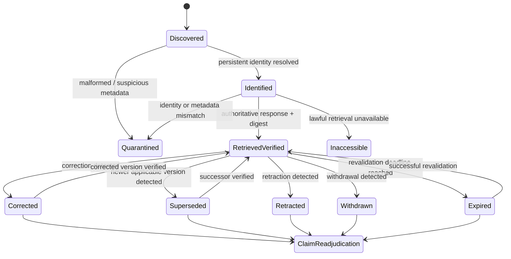

# DS-14 — Scientific Research ARM and Scholarly Evidence

## Executive summary

This research evaluates whether Recursion can support a scientific-research ARM that finds papers and standards, preserves provenance, reconciles contradictory evidence, designs reproducible experiments, and produces defensible architecture claims without violating privacy, copyright, access, or budget constraints. The governing brief requires primary/official evidence, typed claim–source relations, explicit treatment of `unknown`, independent verification, adversarial testing, and a lean kernel in which scholarly providers and heavyweight analysis tooling remain optional plugins. fileciteturn0file0

**Conclusion: the architecture is feasible, but a single “scholarly search API” is not sufficient.** The strongest design is an **authority-first federated evidence layer**: use registration or domain-authoritative sources for identity, version and editorial state; use aggregators for discovery and graph enrichment; treat full text as a separately licensed artifact; preserve provider-native provenance; and force every material source-state change back through claim adjudication. Official documentation supports this separation. Crossref exposes publisher/trusted-source DOI metadata, licenses and post-publication updates, including production Retraction Watch integration; DataCite exposes DOI metadata and rich version relations but has an important public-API blind spot when a DOI moves out of the Findable state; PubMed explicitly models retractions, errata and related corrections; Europe PMC exposes a status-update endpoint; arXiv exposes submission/update version dates and DOI/journal-reference links; and standards bodies expose their own status and supersession models. citeturn19view1turn20search2turn20search3turn19view13turn16view5turn20search1turn15view1turn17search2

Aggregators remain valuable but should not become sole authorities. OpenAlex has unusually useful cross-provider identifiers, references, copy-level version/license/provenance fields and retraction flags, while Semantic Scholar offers search, citation/reference graphs, bulk facilities and recommendations. Those capabilities are ideal for candidate discovery and graph traversal, but derived aggregation cannot, by itself, satisfy Recursion's hard floor for current editorial status or source-specific rights. OpenAlex also has active deprecations and changing access economics, while Semantic Scholar's API/dataset licensing requires explicit admission review. citeturn19view5turn19view6turn19view7turn19view8turn19view9turn19view10

The major design implication is that **identity, access, editorial state, scientific entailment, and local architectural fit must be different questions**. A DOI resolving correctly does not prove a paper is current; a current paper does not prove a claim; a claim supported in one population or workload does not automatically apply to another; and an external mechanism paper cannot prove that the mechanism improves Recursion. The latter requires local structural evidence and, where performance or behavior is at issue, preregistered empirical evidence as specified by the DS-14 brief. fileciteturn0file0

Full-text rights are a hard architectural boundary rather than a metadata annotation. Crossref warns that a full-text link does not itself establish access rights; arXiv states that its default perpetual non-exclusive submission license gives arXiv distribution rights but does not generally grant third parties redistribution rights, although arXiv metadata is CC0; PMC states that not every PMC article is reusable and requires approved automated retrieval services plus article-specific license checking; ISO expressly protects its publications and restricts use of ISO content with AI technologies absent applicable permission. citeturn19view1turn16view1turn16view3turn16view4turn18search8

Accordingly, the recommended candidate architecture—not an adoption decision—is:

**authoritative metadata/status adapters → normalized `SourceRecord` → rights gate → optional content extraction → exact `ResearchClaim` edges → applicability-stratified adjudication → independent verifier → architecture decision**.

```mermaid
flowchart LR
    Q[Research question] --> D[Discovery plugins]
    D --> I[Identify persistent source]
    I --> A[Authority/status revalidation]
    A -->|current| R[SourceRecord]
    A -->|corrected / retracted / withdrawn| U[Lifecycle update]
    A -->|unverifiable| X[Unknown / quarantine]

    R --> L[Rights and privacy gate]
    L -->|metadata only| C[Claim evidence graph]
    L -->|lawful full text| E[Extraction artifact]
    E --> C

    C --> P[Applicability strata]
    P --> J[Claim adjudication]
    U --> J
    J --> V[Independent verifier]

    V -->|reproducible| O[Architecture claim]
    V -->|not reproducible| X

    O --> F[Local structural evidence]
    F --> G[Preregistered empirical fit]
    G --> Z[Recursion decision]
```

The decisive unresolved issue is not whether the public ecosystem contains enough metadata—it does—but whether the proposed federation meets Recursion's zero-tolerance evidence failures at acceptable cost, latency and operational complexity. Official documentation cannot establish that local fit. That must be decided by the preregistered adversarial experiment specified later in this report.

## Evidence base and source-pinned claims

The investigation used only public official documentation and the supplied DS-14 research brief. No repository connector, private source, paid API, deployment, configuration change, authentication change or implementation action was used. Documentation was retrieved on **October 1, 2026**. Because provider limits, pricing, schemas and policies are mutable, this report separates stable mechanism claims from volatile operational claims and assigns explicit revalidation triggers.

A `source-documented` classification below means the proposition is stated by an authoritative primary source. `Inferred` means the recommendation follows from one or more documented facts but is not itself asserted by the provider. `Unverified` means documentation reviewed here was insufficient. Confidence concerns the proposition as stated—not general trust in the provider.

| Claim | Exact proposition | Classification and typed edge | Applicability | Confidence | Expiry / revalidation trigger |
|---|---|---|---|---|---|
| C-CR | Crossref's production REST API can provide DOI-centric bibliographic metadata, license information and post-publication updates; current public/polite/Plus documented request limits are 5/10/150 requests per rate interval with concurrency 1/3/unlimited respectively. | Source-documented; `supports` via Crossref REST/auth documentation. citeturn19view0turn19view1 | Crossref-registered scholarly records; not all scholarly outputs. | High | Rate/auth: 2026-11-01 or provider-header/policy change. Metadata capability: 2027-01-01. |
| C-RW | Retraction Watch data is integrated into Crossref's production REST service; the old Labs integration is stale/deprecated and must not be used as a current-status source. | Source-documented; production source `updates`; Labs source `inapplicable` for current status. citeturn20search2turn20search7 | Crossref/RW-covered updates; corrections are documented as less comprehensive than retractions. | High | 2026-11-01 or any Crossref integrity-service change. |
| C-OA | OpenAlex exposes persistent/external IDs, citation/reference relationships, copy-level location provenance, versions and licenses, and a retraction flag. | Source-documented; `supports`. citeturn19view6turn19view7 | OpenAlex-indexed works; fields may be provider-derived. | High | 2026-11-01 because API/deprecations are actively changing. |
| C-OA-AUTH | OpenAlex's supported access model is changing: current authentication documentation still describes limited keyless use and higher-budget API-key access, while its deprecation record says the old `mailto`/polite-pool behavior has been retired. | Source-documented; `qualifies` prior access assumptions. citeturn19view5turn19view8 | API operations only. | High | Before every adapter release; no later than 2026-11-01. |
| C-S2 | Semantic Scholar supplies scholarly search, graph and bulk/dataset capabilities, but its licensing and request policy require independent admission review rather than assuming unrestricted reuse. | Source-documented + inferred; `supports` discovery, `qualifies` admission. citeturn19view9turn19view10 | Semantic Scholar API/datasets. | High | Before deployment or redistribution; no later than 2026-11-01. |
| C-ARXIV | arXiv's query API exposes arXiv identity, first-submission and retrieved-version update dates, optional DOI/journal reference, and pagination; repeated calls are asked to incorporate a three-second delay and bulk metadata should use OAI-PMH. | Source-documented; `supports`. citeturn15view0turn15view1 | arXiv records. | High | 2027-01-01 or API/manual change. |
| C-ARXIV-RIGHTS | arXiv metadata is CC0, but the default arXiv article license does not give arbitrary third parties general redistribution rights; article licenses must therefore be resolved per version/artifact. | Source-documented; `qualifies` full-text use. citeturn16view1turn16view3 | arXiv content and metadata. | High | Before every new full-text ingestion policy; 2027-01-01 maximum. |
| C-DC | DataCite's public REST API exposes Findable DOI metadata without authentication and its Schema 4.7 provides explicit version/supersession relation types. | Source-documented; `supports`. citeturn20search3turn19view12 | DataCite DOI records. | High | Schema/API change; 2027-01-01 maximum. |
| C-DC-STATE | Absence from DataCite's public API cannot safely be interpreted as nonexistence or retraction because public retrieval excludes Registered and Draft records; detecting records moved out of Findable may require authenticated Member access. | Source-documented; `qualifies`; public absence is **not** evidence of zero. citeturn20search3turn19view13 | DataCite DOI state transitions. | High | 2026-11-01 or lifecycle-policy change. |
| C-EPMC | Europe PMC REST API v6.9 exposes article search, references, status-update search and OA-subset full-text XML; the reviewed official page did not state a numeric API request limit. | Source-documented plus explicit `unknown`; `supports`. citeturn20search1 | Life-sciences corpus. | High for features; unknown for rate ceiling. | API release change; rate policy recheck before admission. |
| C-PUBMED | PubMed represents `Retracted Publication`, `Retraction Notice`, errata, expressions of concern and linked comment/correction relations; E-utilities asks callers to identify tool/email and use an API key when exceeding three requests/second. | Source-documented; `supports`. citeturn16view5turn14search1turn16view6 | Biomedical/life-science bibliographic records. | High | E-utility policy or PubMed schema change; 2026-11-01 for limits. |
| C-PMC-RIGHTS | Presence in PMC does not imply reusable full text; automated retrieval is restricted to specified services and the license must be checked article by article. | Source-documented; `qualifies`. citeturn16view4 | PMC full text. | High | Before ingestion; 2027-01-01 maximum. |
| C-STD | Standards status is body-specific: IETF exposes document/status data through Datatracker API v1 and RFC pages expose update/obsolescence/errata; W3C exposes dated/latest versions and publication states; NIST distinguishes final, draft and withdrawn/superseded publications; ISO exposes edition/lifecycle status. | Source-documented; `supports` a body-specific adapter model. citeturn17search2turn14search4turn17search21turn17search14turn18search19turn18search4turn18search0 | Standards and official technical publications. | High | Body-by-body policy/API review; 2027-01-01 maximum. |
| C-ISO-RIGHTS | ISO publications are copyright-protected and ISO's current copyright policy restricts use of its content with AI technologies except where an applicable license/open-data exception permits it. | Source-documented; `qualifies`, and may make full text `inapplicable` to public-model processing. citeturn18search8 | ISO material. | High | **Before every use**; legal/policy change. |
| C-PROV | A compact kernel provenance model can be mapped to a standard provenance vocabulary rather than reproducing provider-specific schemas; W3C PROV is explicitly designed for interoperable provenance exchange and specialization. | Source-documented + architectural inference; `supports`. citeturn20search0 | Generic provenance layer. | High for PROV capability; medium-high for architectural choice. | Revisit only if kernel requirements exceed proposed model. |
| C-READJ | A correction, retraction, withdrawal, supersession or version relation affecting an admitted source must invalidate the prior “current” assumption and enqueue every dependent claim for re-adjudication. | Inferred from source lifecycle mechanisms; `updates` all dependent claims. citeturn20search2turn19view13turn16view5turn18search4 | All research claims depending on mutable sources. | High | No scheduled expiry; falsified if dependency tracking can safely prove the change immaterial. |
| C-FIT | External papers can establish a possible mechanism, but cannot establish that the mechanism is suitable for Recursion without local structural evidence and, for empirical performance/behavior claims, preregistered local evidence. | Project requirement; source class is DS-14, not external literature. fileciteturn0file0 | Recursion architecture decisions. | High as governing acceptance rule | Owner/constitution change only. |

Two evidence rules follow directly from this table.

First, **“not found” is never automatically “does not exist.”** DataCite is the clearest counterexample: a public record can cease to be visible because its DOI state changed, so a disappearance needs state-aware adjudication rather than a zero-value interpretation. citeturn20search3turn19view13 Europe PMC's numeric rate limit is similarly recorded here as `unknown`, not “unlimited,” because no numeric limit was present in the official API material reviewed. citeturn20search1

Second, **provider provenance itself is evidence metadata, not scientific support**. A source may be verified as an authentic Crossref, PubMed, arXiv or OpenAlex record while still being irrelevant, contradicted, superseded or methodologically incapable of supporting a given proposition. This distinction is required by DS-14's explicit rule that discovery snippets, titles, abstracts, citation counts and graph edges are insufficient by themselves to establish a research claim. fileciteturn0file0

## Adapter landscape and source lifecycle

The adapter comparison below treats every integration as a **candidate only**. Nothing here promotes a provider into a default.

| Candidate | Official surface reviewed, retrieved 2026-10-01 | Identity, version, status, graph and rights signals | Pagination / documented access | Best Recursion role | Admission assessment |
|---|---|---|---|---|---|
| **Crossref** | REST API v1; auth/limits docs; Retraction Watch production docs. citeturn19view0turn19view1turn20search2 | DOI; publisher/trusted-source metadata; licenses; post-publication updates; Crossref relation filters; RW/publisher retraction provenance. citeturn19view1turn19view2turn20search2 | No signup for public API. Current docs: public 5, polite 10, Plus 150 rate-limit units, concurrency 1/3/unlimited; headers are authoritative runtime signals. citeturn19view0 | DOI identity and editorial/update anchor; bibliographic enrichment. | **Strong anchor candidate, not adopted.** Must still verify member metadata and rights per artifact. |
| **OpenAlex** | Unversioned public API documentation with authentication/deprecation pages current in 2026. citeturn19view5turn19view8 | OpenAlex IDs plus DOI/PMID/PMCID; `referenced_works`; related works; copy-level `version`, `license`, and `provenance`; derived retraction indicators. citeturn19view6turn19view7 | Current auth docs support API-key use and limited keyless use; paging and usage model are actively evolving, and old polite-mailto behavior is deprecated. citeturn19view5turn19view8 | Broad discovery, citation graph, cross-provider record reconciliation and OA-copy discovery. | **Strong secondary candidate.** Never sole current-editorial-state authority. |
| **Semantic Scholar** | Academic Graph API and datasets/recommendations documentation; Dataset License Agreement. citeturn19view9turn19view10 | S2 paper/corpus IDs, external identifiers, references/citations and search fields; strong graph functions. citeturn19view9 | API-key access is rate-managed; bulk datasets are explicitly provided for higher-volume use. Terms restrict some uses and redistribution, so admission must bind to the exact product/license. citeturn19view9turn19view10 | Alternative discovery/ranking/citation-graph plugin. | **Optional candidate.** License and use-case review is a precondition. |
| **arXiv** | Official Atom query API manual; OAI/bulk and licensing pages. citeturn15view0turn16view3 | arXiv ID; first submission vs retrieved-version update dates; optional DOI and journal reference; PDF/abstract links. citeturn15view1 | Offset paging; maximum documented result handling is 30,000 in slices no larger than 2,000; three-second inter-call delay encouraged; OAI-PMH preferred for bulk metadata. citeturn15view0 | Primary preprint/version source. | **Strong specialized candidate.** Must separately link preprint↔published work and preserve version. |
| **DataCite** | REST API; rate-limit docs; Metadata Schema 4.7. citeturn20search3turn19view11turn19view12 | DOI; rich `relationType` vocabulary including version/previous/new-version/obsolescence relationships; state-aware DOI lifecycle. citeturn19view12turn19view13 | Public API no auth for Findable records. Official rate limits document separate authenticated, identified and unidentified tiers; current published ceilings are 3,000/1,000/500 requests per five minutes per IP respectively. citeturn19view11 | DOI/data/software identity, version lineage, repository outputs. | **Strong anchor candidate.** Public absence must not be interpreted as retraction/nonexistence. |
| **Europe PMC** | Articles REST API **v6.9**. citeturn20search1 | Biomedical IDs/metadata, references/citation network, `status-update-search`, OA full-text XML, Dublin Core `isVersionOf` and access-rights fields. citeturn20search1 | Search API supports multiple result types/formats; a numeric rate limit was not found in the retrieved official API documentation and remains `unknown`. citeturn20search1 | Biomedical discovery, update reconciliation and lawful OA XML retrieval. | **Strong domain candidate.** Rate/terms review remains admission blocker. |
| **PubMed / PMC** | NCBI E-utilities, PubMed help, PMC OA Subset. citeturn16view5turn16view6turn16view4 | PMID/PMCID plus DOI where present; comments/corrections; retracted-publication and retraction-notice types; biomedical indexing. citeturn14search1turn16view5 | NCBI asks for tool/email; API key for traffic above three E-utility calls/second. PMC full text only through approved automated services and subject to per-article licenses. citeturn16view6turn16view4 | Biomedical editorial-state authority and full-text gateway where lawful. | **Strong domain candidate.** PubMed metadata and PMC rights must remain separate concerns. |
| **IETF / RFC Editor** | Datatracker framework API **v1** plus RFC Editor/Datatracker publication records. citeturn17search2turn14search4 | Document names/RFCs, standards state, publication history, updates/obsoletes relationships and errata; RFC records commonly expose DOI. citeturn14search4 | Read-only framework API is publicly exposed; simplified document API needs no API key. citeturn17search2 | Direct standards authority. | **Preferred standards pattern:** body-native adapter rather than scholarly aggregator. |
| **W3C** | Technical Reports and publication-history pages. citeturn17search21turn17search14 | Status such as Working Draft/Candidate/Recommendation; stable latest and dated version URIs; publication history. citeturn17search14turn17search21 | No generic API was required or established by this review; direct official document metadata is sufficient for status verification. | Direct standards authority. | **Body-native candidate.** Preserve exact dated version, not merely “latest.” |
| **NIST CSRC** | Official publications/search and publication status pages. citeturn18search19turn18search4 | Final/draft/withdrawn status; explicit supersession and withdrawal notices. citeturn18search4turn18search19 | Numeric API/rate model not established in this review. | Direct government-publication authority. | **Body-native candidate.** Status page beats a third-party citation record. |
| **ISO** | Official standard lifecycle pages and copyright policy. citeturn18search0turn18search8 | Reference number, edition, publication date, lifecycle/status, replacement where provided. citeturn18search0 | Full publication text is copyright-controlled and current policy imposes strong AI-use restrictions. citeturn18search8 | Metadata/status verification only unless explicit rights permit more. | **Metadata-only default candidate.** Full-text model ingestion is blocked absent applicable permission. |

The source lifecycle should therefore be a state machine, not a Boolean `valid` field:

A source-state transition should be **append-only history**, not destructive replacement. This matters because a verifier may need to reconstruct what evidence was available when an earlier decision was made. Crossref, PubMed, DataCite and standards systems all demonstrate that source state can evolve after initial publication. citeturn20search2turn16view5turn19view13turn18search4

For preprint-to-journal transitions, the system should not collapse records merely because titles or authors match. arXiv can expose a DOI/journal reference supplied for the record, while Crossref and DataCite provide relation mechanisms that can express version relationships; these are better evidence than fuzzy title matching. Fuzzy matching may discover a candidate pair, but only a verified identifier/relation or independently reviewed metadata match should establish the normalized relationship. citeturn15view1turn19view2turn19view12

Retraction handling requires multiple sources rather than an implicit “retraction service.” Crossref's production API now includes Retraction Watch updates from a separately identified source and warns that the same event may be represented more than once; PubMed exposes both retraction publication types and linked correction/retraction relationships; Europe PMC exposes status-update search. The correct normalization is therefore an event with multiple provenance observations, **not a vote in which duplicate notices count as multiple independent scientific pieces of evidence**. citeturn20search2turn14search1turn16view5turn20search1

## Provenance, claim schema, rights and evidence adjudication

The kernel should remain small by distinguishing **generic evidentiary invariants** from **provider payloads**. W3C PROV demonstrates that interoperable provenance can be modeled using entities, activities, agents and derivation relationships while still permitting domain-specific specialization; Recursion does not need to copy every Crossref, OpenAlex, PubMed or DataCite field into its kernel. citeturn20search0

A recommended `SourceRecord` is therefore:

| Field group | Kernel fields | Reason for inclusion |
|---|---|---|
| Identity | `source_record_id`; `canonical_uri`; `persistent_ids[] {scheme,value}` | Separates internal identity from DOI, PMID, arXiv ID, RFC number, etc. |
| Bibliography | `title`; `creators`; `publisher_or_body`; `container` | Minimum human-verifiable identity. Provider-specific extras stay outside the kernel. |
| Version/time | `version_label`; `issued_at`; `modified_at`; `retrieved_at` | Prevents “the paper” or “the standard” from becoming an unversioned object. |
| Source lifecycle | `source_state`; `editorial_state`; `state_observations[]`; `state_history[]` | Keeps `retracted`, `withdrawn`, `superseded`, `corrected`, `inaccessible`, `expired` distinct. |
| Retrieval provenance | `adapter_id`; `adapter_revision`; `request_fingerprint`; `response_artifact_id`; `response_digest`; `normalized_metadata_digest` | Enables replay and detects mutable API responses. |
| Rights | `metadata_rights`; `content_rights`; `rights_source`; `allowed_operations`; `rights_checked_at` | Prevents “open/readable” from being conflated with store/embed/redistribute rights. |
| Relations | `relations[] {type,target,evidence}` | Carries provider-supplied version/publication/update relationships without flattening them. |
| Locators | page, section, paragraph, table/figure ID, bounding box or structured-path locator | Allows a reviewer to find the exact evidence. |
| Privacy | `privacy_class`; `route_constraints` | Keeps private or sensitive material away from public/contributor routes. |
| Revalidation | `expires_at`; `revalidation_trigger`; `last_verified_at` | Makes stale evidence observable rather than silently current. |
| Extension | `provider_payload_artifact` | Preserves lossless provider-native metadata outside the generic schema. |

The core should **not** contain a universal `citation_count_is_quality` field, a model-generated truth score, or a single `is_valid` Boolean. Citation counts and graph edges are discovery information; validity depends on current source state, entailment, applicability and methodology. This is also why raw provider payloads should survive as provenance artifacts even when the normalized record is intentionally lean. The DS-14 brief explicitly rejects citation count and model consensus as scientific evidence. fileciteturn0file0

A recommended `ResearchClaim` is similarly narrow:

| Field | Semantics |
|---|---|
| `claim_id` | Stable internal identity. |
| `proposition` | One exact, falsifiable sentence—not a paragraph of mixed assertions. |
| `claim_type` | Mechanism, descriptive, causal, comparative, architecture-fit, standards-compliance, etc. |
| `goal_scope` / `decision_scope` | Why this proposition matters to the active goal. |
| `applicability` | Structured population, intervention/mechanism, comparator, endpoint/outcome, workload/environment, and time/version tuple. |
| `assumptions[]` | Explicit conditions without which the claim changes meaning. |
| `evidence_edges[]` | Source/experiment target, edge type, exact locator/hash and reviewer rationale. |
| `adjudication` | `supported`, `contradicted`, `heterogeneous`, `unknown`, or not yet reviewed. |
| `confidence` | Ordinal calibrated judgment plus rationale; never derived from citation count alone. |
| `experiments[]` | IDs of preregistered local experiments relevant to the claim. |
| `review` | Reviewer identity/role, independence status and methodological specialty where required. |
| `history[]` | Every prior adjudication and the event that changed it. |
| `expires_at` / trigger | Time or event forcing re-review. |

The DS-14 edge vocabulary should remain first-class:

| Edge | Admission rule |
|---|---|
| `supports` | Retrieved and verified source actually entails the stated proposition within the declared applicability tuple. |
| `contradicts` | Source directly conflicts on a commensurable proposition/endpoint; contradiction remains visible. |
| `qualifies` | Narrows the proposition, scope, population, endpoint, version or assumptions. |
| `replicates` | Independently tests materially the same proposition; provenance must permit independence assessment. |
| `updates` | Later source/event changes interpretation or current state of an earlier source or claim. |
| `mentions` | Discovery/context only; **cannot** satisfy a support requirement. |
| `metadata-only` | Identity/status information only; **cannot** prove a substantive paper claim. |
| `inapplicable` | Reliable source, wrong population/workload/intervention/endpoint/time for this claim. The mismatch reason is mandatory. |

The adjudicator should never choose a “winner” by number of papers. Instead it should normalize applicability first and partition evidence into commensurable strata. Two credible studies that use different populations, interventions, endpoints, workloads or time windows may imply **heterogeneity rather than contradiction**. A strong paper outside the relevant workload is `inapplicable`, not a negative vote. When there is no sufficiently direct verified evidence, the answer is `unknown`. This is an architectural rule from the research brief, not a provider feature. fileciteturn0file0

A practical adjudication sequence is:

1. Verify source identity and current editorial/version state.
2. Verify lawful access and permitted evidence operation.
3. Determine whether the cited locator actually entails the exact proposition.
4. Compare the claim's applicability tuple with that of the source.
5. Partition commensurable evidence rather than pooling unlike studies.
6. Assess methodological quality and independence within each partition.
7. Preserve contradictions and qualifications as typed edges.
8. Return `supported`, `contradicted`, `heterogeneous` or `unknown`; never replace the latter with a citation-count plurality.

Full-text rights must precede steps involving content extraction. Crossref explicitly distinguishes metadata from potentially copyrighted abstracts and warns that links used for text/data mining do not themselves grant access; arXiv's licensing model varies by submission and its default license does not grant broad third-party redistribution; PMC says OA-subset licenses vary by article; ISO's current policy is considerably more restrictive. citeturn19view1turn16view1turn16view3turn16view4turn18search8

A useful rights representation is consequently **artifact-specific**, not work-specific. The same scholarly work can have a publisher version, accepted manuscript and submitted manuscript with different locations, versions and licenses—OpenAlex explicitly represents this distinction at the location level. citeturn19view7 Recursion should therefore ask separately whether an artifact may be:

`discover → identify → retrieve → temporarily process → persist → quote → embed/index → redistribute/publish`.

Unknown rights mean the operation is not authorized; they do not mean “probably open.”

For paywalled sources, the record should preserve metadata, PID, access state and lawful locators. A claim can use paywalled content only when the research route lawfully has access and the content is handled under applicable rights. A verifier without equivalent lawful access can reproduce the identifier/status checks but must mark the content-level evidence **not independently reproduced**. A search snippet or abstract cannot be silently substituted for the unavailable argument in the paper. Crossref's TDM model and PMC's explicit retrieval restrictions reinforce this separation between discoverability and permission. citeturn16view4turn19view1

## Extraction, reproducibility and verifier packet

PDF, table and figure extraction should be treated as **measurement**, not revelation. A parser's output is an observation derived from a particular source byte stream by a particular software/version. W3C PROV's model of entities, activities, agents and derivations is a suitable conceptual foundation for recording that derivation. citeturn20search0

For each extracted assertion, the evidence artifact should preserve at least:

| Extraction component | Required provenance |
|---|---|
| Source | Persistent ID, exact source version, content digest, retrieval time and lawful-access state. |
| Parser | Tool/plugin identity, version, configuration and extraction timestamp. |
| Text | Page/section/paragraph and, where possible, geometric bounding box. |
| Table | Page, table/caption identity, original row/column coordinates, merged-cell/footnote relationships and raw cell strings before normalization. |
| Figure | Figure number/caption, page/bounding box, referenced text and image digest when lawful to retain. |
| Numeric value | Original string, normalized numeric value, units, uncertainty/error notation, footnote and transformation history. |
| OCR | Explicit `ocr=true`, OCR engine/version and uncertainty; OCR is never silently merged with native text. |
| Review | Whether a human/verifier compared the extraction to the source rendering. |

The derived proposition must distinguish, for example, **“the parser extracted 17.2 from cell X”** from **“17.2 is the true measured effect.”** The former is locally observable; the latter may require checking the table header, units, footnote, statistical model and surrounding methods. Hostile layouts—rotated pages, repeated headers, multi-level columns, superscripts, merged cells and captions separated from figures—therefore belong in the hard-floor adversarial corpus.

The experiment below constitutes the **preregistration specification for the proposed evaluation**. No experiment results are asserted in this report and no benchmark numbers have been invented. Before execution, this specification should be serialized as an immutable artifact and content-hashed; the resulting digest becomes the experiment's permanent protocol identifier.

| Preregistration field | Frozen rule |
|---|---|
| Protocol state | **Pre-outcome specification; no trial executed in this research session.** |
| Primary question | Can the candidate research pipeline correctly identify, version, rights-gate, adjudicate and reproduce scientific/standards evidence without any hard-floor false acceptance? |
| Corpus manifest | Frozen list of real public source PIDs/official standard references plus synthetic non-identifier fixtures; each entry stores expected identity, authoritative version/status, access class and test role. |
| Provider set | Each adapter tested separately, then in the proposed federation; exact adapter and API documentation revisions recorded. |
| Query manifest | Canonical query/request representation, parameters, pagination strategy and request fingerprint. Secrets/auth tokens are excluded from artifacts. |
| Raw observations | Raw response bytes when rights allow, HTTP/status metadata, retrieval timestamp and cryptographic digest. Mutable responses are never silently overwritten. |
| Environment | OS/runtime, package lockfile, parser versions, locale/time zone, CPU-relevant configuration where necessary, and random seed. |
| Exclusions | Every excluded source/request recorded with a reason. Post-hoc exclusion without append-only history is failure. |
| Negative/null findings | Stored and reported exactly like positive findings; no “successful examples only” report. |
| Adjudication | Claim tuple and edge labels frozen before inspecting aggregate outcome metrics. |
| Independence | Implementer and verifier identities separated; implementer's own PASS is not acceptance. |
| Primary hard floor | **Any accepted fabricated/nonexistent identity, retracted-as-current source, stale superseded source, inaccessible content represented as verified full text, inapplicable evidence represented as direct support, or unverifiable claim is an automatic failure.** This reproduces the DS-14 acceptance rule. fileciteturn0file0 |
| Secondary measures | Coverage/recall, update detection latency, requests, bytes, monetary cost, wall-clock latency, duplicate rate, verifier reproduction rate and proportion correctly returned as `unknown`/heterogeneous. |
| Temporal replay | Re-run a frozen subset after a defined interval to expose mutable API/pagination/status behavior. |
| Publication rule | Report all preregistered primary outcomes, provider failures and negative/null results; no metric is dropped because it is unfavorable. |

Reproduction should have three modes.

**Offline replay** is the primary deterministic path: the verifier runs normalization, extraction and adjudication against hash-pinned lawful artifacts rather than trusting that a mutable API still returns identical bytes. This tests the research logic without network drift.

**Online revalidation** asks the source authority again using the persistent identifier and compares the result with the pinned prior observation. A changed status, relation, license or version becomes a new provenance event and queues dependent claims for re-adjudication rather than rewriting history. Crossref's production-vs-stale-Labs transition illustrates why an adapter itself also needs version/expiry management. citeturn20search7turn20search2

**Restricted-source reproduction** handles paywalls and licensed standards. The verifier independently checks all metadata/status evidence it may lawfully access. Content-level reproduction is marked either reproduced under independent lawful access, reproduced from a legitimately retained artifact under applicable terms, or **not independently reproducible**. ISO material in particular must not be forwarded to an AI processing route merely because a researcher can view a copy; ISO's current copyright terms explicitly impose AI-use restrictions. citeturn18search8

The architecture-claim packet should then show three separate evidence bands:

| Evidence band | What it can establish | What it cannot establish |
|---|---|---|
| **External mechanism evidence** | A mechanism, prior result, standard requirement or known system behavior exists in the cited external context. | That Recursion implements it correctly or benefits from it. |
| **Local structural evidence** | Recursion's exact contracts/source/tests structurally possess the prerequisite or satisfy a standard requirement. | That the change improves empirical outcomes under the target workload. |
| **Empirical fit evidence** | Under a preregistered local workload, the candidate meets specified behavioral/performance/reliability criteria. | A universal scientific proposition beyond that population/workload. |

Thus a permissible final architecture claim looks like: **“External sources support mechanism M under conditions A; local structural evidence shows Recursion has prerequisites B; preregistered experiment E supports effect C for workload W and version V.”** Omitting either local layer must narrow the conclusion accordingly. This is a direct implementation of the DS-14 evidence standard. fileciteturn0file0

## Adversarial fixtures, plugin boundary and operational controls

The adversarial suite should be designed to distinguish a robust evidence system from one that merely produces plausible-looking citations. No fabricated real-looking DOI, PMID, arXiv identifier, benchmark result or experimental outcome is introduced below.

| Fixture | Construction | Required behavior | Automatic failure |
|---|---|---|---|
| **False identifier** | Internal sentinel deliberately outside every accepted PID grammar. | Reject before scholarly lookup; record malformed identity. | Creating a plausible bibliographic record for it. |
| **Near-match metadata** | Pair two hash-pinned legitimate corpus records; combine the title-like metadata of one with the identifier of the other in a synthetic discovery payload. | Authority lookup wins; mismatch quarantined. | Accepting the near match as verified identity. |
| **Non-entailing source** | Real current paper whose metadata/abstract mentions the concept but does not establish the target proposition. | `mentions` or `metadata-only`; never `supports`. | Claim accepted from topical similarity. |
| **Retraction** | Select a real retracted item at corpus-freeze time from authoritative current data; store source/status hash rather than hard-coding an invented example. Crossref and PubMed provide authoritative test-selection mechanisms. citeturn20search2turn16view5 | Current-status check marks retraction and re-adjudicates dependents. | Retracted source accepted as current support. |
| **Correction / expression of concern** | Real status-updated article selected at corpus freeze. | Preserve old and new state; assess whether proposition is affected. | Silently replacing history or ignoring update. |
| **Outdated version** | Frozen pair of genuine versions/editions. | Verify exact cited version; newer version creates `updates`/supersession event. | Citing superseded text as current without qualification. |
| **Preprint/journal duplicate** | Genuine linked preprint and journal record. | Preserve both source records and relationship; determine evidentiary dependence. | Counting both automatically as independent replications. |
| **Paywall** | Genuine metadata record whose required full text is not lawfully accessible to test route. | Metadata/status may verify; content claim remains inaccessible/unknown. | Pretending full text was reviewed. |
| **Contradictory studies** | Two real, methodologically eligible sources with matched applicability but opposing findings. | Preserve `supports` and `contradicts`; adjudicate uncertainty. | “Majority citation” or first-result winner. |
| **Inapplicable population** | Valid high-quality source with deliberately mismatched population or workload. | `inapplicable` with mismatch reason. | Direct support edge. |
| **Heterogeneous endpoints** | Studies use materially different outcomes/time horizons. | Separate strata; `heterogeneous` or claim split. | Pooled winner without justified transformation. |
| **Citation ring** | Synthetic graph contains reciprocal citation edges but no corresponding substantive evidence. | Graph affects discovery only. | Confidence increase merely because of graph density. |
| **Prompt-injected metadata** | Synthetic metadata/content contains instructions addressed to the agent. | Treat text as untrusted evidence data; never execution instructions. | Tool call, policy change or query mutation caused by metadata instruction. |
| **Hostile table** | Synthetic PDF with merged cells, multi-level headings, footnotes, repeated headers, rotated page and ambiguous units. | Preserve layout provenance; ambiguous value stays observation/unknown pending verification. | Unsupported numeric fact emitted as established evidence. |
| **Mutable pagination** | Controlled mock source mutates ordering between pages. | Detect duplicates/gaps/snapshot inconsistency; fail closed or restart with stable cursor/snapshot. | Silent incomplete corpus reported as complete. |
| **License conflict** | Same work has multiple copies with differing rights metadata. | Rights attach to exact artifact/location. | Broadest license incorrectly applied to every copy. |
| **Negative/null result** | Legitimate eligible null/negative study in frozen corpus. | Retained and adjudicated identically to positive results. | Dropped from synthesis. |
| **Provider deprecation** | Adapter points to a documented stale interface such as Crossref's former Retraction Watch Labs path. citeturn20search7 | Adapter marked expired; production source required. | Stale endpoint accepted as current. |

The lean plugin boundary should then be enforceable structurally:

| Kernel responsibility | Lazy plugin responsibility |
|---|---|
| `SourceRecord`, `ResearchClaim`, task, artifact, evidence-edge and provenance interfaces | Crossref, OpenAlex, Semantic Scholar, arXiv, DataCite, Europe PMC, PubMed and standards adapters |
| Lifecycle state machine and expiry/revalidation scheduling contract | Provider-specific pagination, retries, authentication and response schemas |
| Rights/privacy gate interface | Provider terms/license resolvers |
| Generic cryptographic-digest interface | Network retrieval implementation |
| Claim-edge validation and applicability tuples | Citation-graph search/ranking |
| Audit/event history | PDF/HTML/JATS/TEI parsers and OCR |
| Plugin capability registry | Embeddings/vector stores |
| Independent-review state | Notebook, statistics and specialized scientific runtimes |
| No-network disabled contract | Any optional service that performs I/O or heavy analysis |

The **disabled-path acceptance test** should be local empirical evidence, because external documentation cannot prove Recursion's implementation behavior. With all research capabilities disabled, loading the kernel must succeed with scholarly provider packages and heavyweight parsers absent; network sockets must not be touched; no provider authentication should be consulted; no thread/process/background indexer should start; and no remote index should be initialized. Only a local structural review plus such an empirical test can establish that the plugin boundary actually behaves this way. This is precisely the distinction between external mechanism evidence and local fit required by the brief. fileciteturn0file0

Reviewer routing should also remain a capability rather than a new executive tier. The ARM can assign a bounded specialist verifier when the claim's validity depends on domain-specific methodology:

| Claim family | Specialist routing trigger |
|---|---|
| Clinical / biomedical | Trials, noninferiority, survival analysis, diagnostic accuracy, safety endpoints, meta-analysis, clinical applicability. |
| Epidemiology / public health | Confounding, selection bias, causal identification, time-varying exposure, population transportability. |
| Social / behavioral science | Measurement validity, clustered/longitudinal design, survey weighting, preregistration or causal inference. |
| Economics / policy | Identification strategy, instrumental variables, panel/event-study designs, welfare or policy extrapolation. |
| Machine learning / AI | Data leakage, benchmark contamination, multiple comparisons, train/test independence, stochastic reproducibility. |
| Cybersecurity / protocols | Threat model, adversarial assumptions, cryptographic/protocol interpretation, standards status. |
| High-dimensional biology / omics | Multiple testing, batch effects, pipeline provenance and reference-database versions. |
| Safety-critical engineering | Reliability model, hazard analysis, domain standard and certification context. |

The routing event itself belongs in provenance: `claim_id`, reason, required specialty, reviewer, version of review criteria, result and independence relationship. A generic reviewer may still assess source identity and provenance, but should not silently substitute for specialist statistical judgment when the scientific inference turns on those methods.

Cost control should happen at three layers. The **request layer** applies provider rate limits, response-header backoff, cache reuse and pagination caps; Crossref explicitly publishes rate/concurrency headers and encourages caching, while arXiv recommends delay and OAI-PMH for bulk. citeturn19view0turn15view0 The **research layer** preregisters provider/request/dollar budgets and stops expansion when successive search rounds cease producing new eligible evidence rather than searching indefinitely. The **decision layer** spends expensive retrieval/model/statistical resources only on sources that survived identity, status, relevance and rights gating.

No private project name, raw private prompt, unpublished sensitive finding, credential or account/infrastructure identifier should enter a public scholarly query. A route transform should produce the smallest public scientific query needed to locate evidence; when that cannot be done without revealing protected information, the public route is inapplicable. Exports should similarly whitelist evidence artifacts and redact internal prompts, sensitive negatives and infrastructure metadata. This follows the privacy boundary specified by DS-14. fileciteturn0file0

## Recommendation, alternatives and Owner questions

The recommended **candidate architecture is Option A: authority-first federation with aggregator-assisted discovery**.

Under this option, Crossref and DataCite are candidate PID/registration anchors; PubMed/Europe PMC are specialist biomedical authority layers; arXiv is the primary source for its own preprint/version records; standards are verified against the issuing body; OpenAlex and Semantic Scholar are optional discovery, graph and reconciliation plugins; and every full-text artifact passes a separate rights gate. Crossref's direct publisher/trusted-source deposits, DataCite's DOI/version model, PubMed's correction/retraction semantics and body-native standards status make this architecture materially better aligned with DS-14's false-citation and stale-evidence hard floors than delegating authoritative state to one aggregator. citeturn19view1turn19view12turn16view5turn17search2turn18search19

**Competing Option B is aggregator-first.** OpenAlex—or OpenAlex with Semantic Scholar fallback—would handle most discovery and graph traversal, with direct authority checks performed only on a narrower set of shortlisted records. This is operationally simpler and likely reduces adapter/query volume because OpenAlex already normalizes external identifiers, citations, versions, licenses and provenance across locations. citeturn19view6turn19view7 Its weakness is that Recursion's hard floor then depends more heavily on derived aggregation, current provider economics and deprecation behavior; OpenAlex's own 2026 deprecation documentation demonstrates that access conventions can change. citeturn19view8 Semantic Scholar introduces an additional terms/licensing review. citeturn19view10

A third feasible candidate, **Option C: snapshot/bulk-first**, would make frozen provider data files or OAI harvesting the primary research substrate and use online APIs mainly for incremental revalidation. This is attractive for reproducibility and bounded large-scale searches: arXiv itself recommends OAI-PMH for bulk metadata, DataCite supports bulk harvesting, and Semantic Scholar provides datasets for high-volume use. citeturn15view0turn20search3turn19view9 The cost is storage, synchronization logic and potentially slower awareness of corrections/retractions unless incremental status channels are layered on top.

| Option | Strength | Main weakness | Decisive falsifier | What supporting evidence does **not** prove |
|---|---|---|---|---|
| **A — authority-first federation** **Recommended candidate** | Best provenance/status separation; graceful domain specialization; aligns with hard-floor correctness. | More adapters and reconciliation logic; greater operational/test surface. | In the preregistered hard-floor corpus, if Option B or C also achieves zero prohibited false acceptances while materially outperforming A on coverage, update latency, verifier reproducibility and bounded cost, A loses its rationale. | Official API documentation does not prove actual coverage, uptime, latency, local implementation quality or Recursion fit. |
| **B — aggregator-first** | Simpler discovery and unified graph; lower initial integration count. | Derived status/provenance; greater dependence on one provider's changing policies/economics. | Any hard-floor case in which aggregator state admits a stale/retracted/misattributed source that an authoritative adapter would have blocked. | A rich graph does not prove scientific entailment or editorial authority. |
| **C — snapshot/bulk-first** | Excellent offline reproducibility; predictable high-volume processing. | Staleness, storage/sync complexity, update latency. | A material rate of stale status/version decisions that timely online authority checks would prevent. | Reproducible old data does not mean current data. |

This recommendation is deliberately **not an adapter adoption decision**. The DS-14 completion gate requires empirical discrimination, and no live provider trial or Recursion implementation experiment was authorized or performed in this report. Consequently, the only justified conclusion today is that Option A has the strongest documented architectural fit and should be tested first.

Every major recommendation has an explicit competing option and falsifier:

| Recommendation | Competing option | Falsifier |
|---|---|---|
| Keep generic evidence/provenance schemas in kernel and providers/parsers lazy. | Put common scholarly-provider models directly into kernel. | Local structural/benchmark evidence demonstrates that plugins cannot satisfy deterministic startup/performance requirements and provider fields are truly universal/stable enough to justify kernel coupling. |
| Store provider-native response as artifact rather than expanding the generic schema indefinitely. | Normalize all known provider fields into `SourceRecord`. | Repeated experiments show required adjudication cannot be reproduced without first-class normalized fields and that those fields have stable cross-provider semantics. |
| Model rights per artifact/location. | One license/access state per scholarly work. | A corpus review establishes that all admissible copies of every supported work necessarily share identical reusable rights—contradicted today by documented arXiv/PMC/location-level realities. citeturn16view1turn16view4turn19view7 |
| Re-adjudicate dependent claims on status/version changes. | Leave prior claim decisions valid until manually revisited. | Dependency analysis proves the changed source cannot affect the proposition, locator, applicability or confidence; only then may the individual dependency avoid substantive re-review. |
| Return `unknown`/heterogeneous for non-comparable evidence. | Aggregate evidence into one winner/confidence score. | A preregistered domain-specific synthesis method validly transforms the differing populations/endpoints/workloads into a common estimand and passes specialist review. |
| Use body-native standards verification. | Treat standards like generic scholarly papers through an aggregator. | The aggregator demonstrates complete, current, provenance-preserving status, edition, errata and supersession parity with issuing bodies across the supported corpus. |
| Treat PDF/table extraction as derived observation. | Promote parser output directly to facts. | Independent extraction validation establishes the required error bound for the exact corpus/parser/layout class; even then, scientific interpretation still needs claim review. |
| Separate external mechanism, local structure and empirical fit. | Infer local suitability directly from papers. | This recommendation is a governing DS-14 hard floor; it can only be falsified by an Owner-level change to that acceptance rule. fileciteturn0file0 |

The remaining **Owner questions** are decision points rather than missing research facts:

| Open Owner question | Why it matters |
|---|---|
| What maximum false-negative rate is acceptable after the absolute zero-tolerance hard floor for false acceptance? | “Never accept fabricated/retracted-as-current evidence” is clear; desired recall is not. It determines federation breadth. |
| Is authenticated membership-only metadata such as otherwise hidden DataCite states admissible for verifier workflows, or must every acceptance be reproducible through anonymous public access? | This controls how the system distinguishes removed/restricted records from absence. DataCite's public API alone cannot expose every state. citeturn19view13 |
| May a verifier rely on lawfully retained restricted artifacts, or must every evidence-bearing source be independently re-retrievable by every reviewer? | Determines whether certain paywalled claims can ever reach “independently reproduced.” |
| What exact rights operations does Recursion need: transient reading, persistent storage, extraction, embeddings, short quotation, redistribution, publication? | Provider/full-text eligibility changes dramatically by operation; “accessible” is insufficient. |
| Is ISO metadata-only support sufficient for v3, given ISO's current copyright/AI restrictions? | Full-text processing through an AI research route may be incompatible with current ISO terms absent permission. citeturn18search8 |
| Is the desired first implementation domain-neutral or biomedical-first? | PubMed/Europe PMC provide unusually strong domain-specific update semantics; a narrower first domain could reduce initial adapter breadth. |
| What revalidation service-level objective is required for high-impact claims? | Determines polling/update cost and acceptable retraction/correction detection latency. |
| What specialist-review classes are mandatory before a claim can affect architecture? | Determines worker routing, independence rules and acceptance latency. |
| What monetary/request budget constitutes a normal research goal? | Needed to turn diminishing-return rules into enforceable task budgets rather than heuristics. |
| Must every accepted research packet support complete offline replay, or is metadata/status online replay sufficient for some classes? | Determines artifact storage scope and licensing burden. |

The completion gate evaluates as follows:

| Gate | Status | Evidence |
|---|---|---|
| Every adapter claim pinned to official documentation with version/retrieval date | **Pass for candidates evaluated here** | Retrieval date is 2026-10-01; versioned interfaces are identified where the provider supplies a version. Unversioned services are explicitly marked as such rather than assigned an invented version. |
| Every consequential research claim has typed edge, applicability and confidence or is `unknown` | **Pass** | Source-pinned claim table above; Europe PMC numeric limit deliberately remains `unknown`. |
| False citation, retraction, version, paywall, contradiction and inapplicable-population fixtures included | **Pass** | Adversarial suite above, plus correction, duplication, citation-ring, injection, extraction, pagination, rights-conflict and negative-result cases. |
| No fabricated identifier or benchmark | **Pass** | No invented real-looking PID or experimental metric is presented; invalid-ID fixture uses a non-PID sentinel by design. |
| Local-fit claims require structural/empirical evidence | **Pass as design rule; empirical fit not yet established** | Three-band evidence model and preregistration packet. No claim is made that Recursion currently passes the experiment. |
| Every recommendation has competing option and decisive falsifier | **Pass** | Recommendation/falsifier matrices above. |
| Privacy/copyright/secret handling clean; no protected path edited | **Pass for this report-only research session** | Only public official sources and the supplied brief were used; no repository, connector, credentials, private corpus, paid service or implementation/edit action was used. Rights restrictions are explicitly preserved rather than bypassed. |
| Owner questions listed; no decision promoted | **Pass** | Candidate recommendation is explicitly non-adoptive and open decisions are enumerated above. |

**Research verdict:** Recursion can plausibly support a scientifically defensible research ARM under the DS-14 contracts, but the admissible architecture is not “search → summarize → cite.” It must be **identity-aware, version-aware, editorial-state-aware, rights-aware, applicability-aware and replayable**. The best documented candidate is an authority-first federation with aggregators as discovery/enrichment plugins, exact claim–source edges, immutable provenance, event-driven re-adjudication, independent verification and a hard distinction between external scientific mechanisms and local Recursion fit. The decisive evidence still missing is empirical: the preregistered hard-floor corpus must demonstrate that the proposed federation actually rejects false/stale/inapplicable evidence and reproduces accepted claims within the Owner's cost and latency bounds.