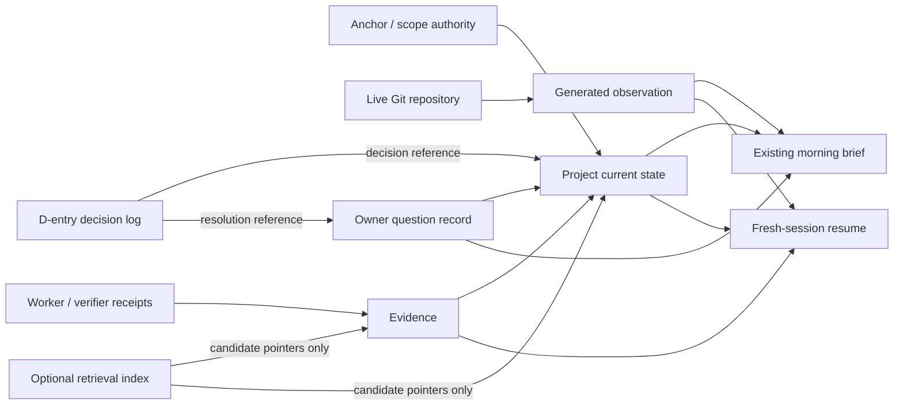

# DS-30 — Durable Multi-Project Supervision State and Memory

## Executive summary

The generic `[$deep-research]` placeholder is resolved by the self-contained DS-30 handoff supplied with this conversation. That handoff fixes the problem to investigate: Recursion v3 already uses Git as transport and a durable `state/` tree under D-017, must preserve the D-entry decision log and morning-brief discipline, must support one operator supervising at least four concurrent projects, and must make `blocked`, `stale`, and `waiting-for-decision` explicit rather than inferred. It also prohibits selecting a language, database, framework, scheduler, numeric threshold, or budget, and prohibits implementation or repository changes. fileciteturn0file0

**Conclusion:** the strongest reconciliation is a **canonical per-project semantic snapshot inside the existing `state/` tree, paired with machine-generated observations, stable Owner-question records, and evidence receipts**. Git history should remain the transition history rather than creating a second append-only status log. Provider-specific files such as `CLAUDE.md` or `AGENTS.md` may serve as thin bootstrap pointers where an adapter supports them, but should not contain live project status. The D-entry log remains authoritative for accepted decisions; the morning brief remains the supervisory overview; Git remains authoritative for HEAD, branch, working-tree state, and fetch observations. Search/vector/graph indexes, if ever added, should be derived caches rather than durable truth.

The evidence for **file survival** is good but provider-specific. Anthropic documents that its designated `CLAUDE.md` memory files are automatically loaded at Claude Code startup and explicitly advises regular review so their content stays current. OpenAI documents that Codex builds its initial input by aggregating `AGENTS.md`/`AGENTS.override.md` instructions from configured locations and from project root to the working directory, subject to a default size limit; Codex also compacts growing conversations by replacing their input with a smaller representation. Neither reviewed source provides a field-by-field guarantee that arbitrary project-status content survives compaction unchanged. citeturn16search2turn21view0turn22view0

The evidence does **not** establish that schema-checked state causes fewer resume errors than good prose. JSON Schema can mechanically assert structural constraints, while YAML defines a structured data representation, but no controlled primary study located in this review compared structured repository supervision state against freeform status prose on restart accuracy. That causal effect therefore remains **unknown**, not assumed. citeturn19search7turn19search3

The strongest argument for structure comes instead from failure containment. Git exposes machine-readable working-tree and branch information and writes fetched references to `FETCH_HEAD`; these fields can be observed rather than manually transcribed. Long-horizon memory evaluations show recurring failures on temporal reasoning, knowledge updates, abstention, obsolete memories, and context-mismatched retrieval. Recent systems improve memory by narrowing retrieval, preserving temporal evolution, and resolving conflicting or superseded information at query time. citeturn15search0turn15search3turn17academia40turn18academia41turn17search0turn18search1

The operational implication is that **current state must be small, explicit, and authoritative; history must be evidentiary; retrieval must be treated as a candidate-finding mechanism rather than truth**. A fresh supervisor should be able to reconstruct the current WorkPacket, gate, authority, next action, unresolved evidence, exact pending Owner question, and freshness confidence without replaying a transcript or reading every historical file.

| Decision area | Research conclusion | Evidence status |
|---|---|---|
| Canonical status location | Reuse the existing `state/`; do not create a parallel status convention | Fixed by DS-30 / D-017 fileciteturn0file0 |
| Current state representation | Small structured semantic snapshot per project | **Proposal**; structural validation is documented, resume-error advantage is **unknown** citeturn19search7 |
| Git fields | Observe mechanically; never hand-copy into semantic state | Strong primary documentation citeturn15search0turn15search3 |
| Provider memory files | Bootstrap/instructions only, not live status | Fresh-load behavior documented; compaction persistence incomplete/unknown citeturn16search2turn22view0 |
| Blocked vs waiting | Separate work-state classes | **Proposal**, required by DS-30 |
| Stale | Orthogonal freshness/health classification, not another blocker kind | **Proposal**, supported by SRE freshness concepts citeturn16search3 |
| Long-term retrieval | Hard project scoping → current state → referenced evidence → optional history | **Inference/proposal** supported by memory benchmarks citeturn18search1turn17search2turn17search0 |
| Silent degradation | Heartbeat is insufficient; require verified-progress evidence | **Proposal**, supported by SRE monitoring and verification research citeturn16search3turn18academia40 |
| Runtime scheduler | Do not select one here; keep state contract scheduler-independent | Required boundary; important semantics remain **unknown** until runtime is chosen |

## Evidence on file state, context loss, and diffability

A useful distinction is between **persistence on disk** and **survival in model context**. Any repository file can remain durably present under Git, but that does not imply a fresh agent receives it automatically. Anthropic gives `CLAUDE.md` special startup semantics: its documented memory files are loaded into context when Claude Code starts; nested files below the working directory are loaded when work enters those subtrees. Anthropic also advises periodically reviewing those files so the agent receives current information. citeturn16search2

Codex has a different but analogous bootstrap mechanism. OpenAI's January 23, 2026 description of the Codex agent loop states that initial user instructions aggregate `AGENTS.override.md` and `AGENTS.md`, including files encountered from the Git/project root through the working directory, with a default aggregate limit of 32 KiB. OpenAI also explains that a growing conversation is eventually compacted by replacing its prior `input` with a smaller representation returned by a compaction mechanism. The documentation establishes initial inclusion and compaction, but it does **not** establish that each original `AGENTS.md` instruction remains textually or semantically intact after compaction; exact post-compaction survival is therefore **unknown**. citeturn21view0turn22view0

OpenAI's 2026 guidance for long-horizon Codex work separately describes a file-oriented workflow using a specification file plus a plan containing milestones, validation criteria, decision notes, and stop-and-fix behavior. That is useful operational evidence that durable files can anchor long-running agent work, but it is **not a controlled test of restart correctness and does not prove that prose plans outperform or underperform structured state**. citeturn15search10

This makes provider instruction files a poor place for fast-changing multi-project status. Their strongest documented role is bootstrap/instruction delivery; putting task status there would mix slow-changing policy with fast-changing operating state and expose the status to provider-specific loading and compaction behavior. The portable alternative is for Recursion's deterministic harness to read the relevant `state/` record at each fresh-session or restoration boundary, independent of whether any model preserved the prior conversational context. That last step is a design inference, not a documented feature of the vendors above.

The reviewed primary material also does not justify choosing JSON over YAML or either over another serialization. YAML 1.2.2 defines mappings, sequences, and scalars; JSON Schema Draft 2020-12 defines structural assertions over JSON instances. Those standards establish representation and validation capabilities, not superiority for Recursion. citeturn19search3turn19search7

**File-convention versus structured-state matrix**

| Approach | Fresh-session visibility | Survival after model compaction | Machine structural validation | Mechanically meaningful state diff | Direct evidence of lower resume error | Maintenance/staleness evidence |
|---|---|---|---|---|---|---|
| `CLAUDE.md` | **Documented** at Claude Code startup for designated memory files citeturn16search2 | **unknown** from reviewed primary docs | **unknown** as a native semantic-state facility | Text diff: yes under Git; semantic status diff: **unknown** | **unknown** | Anthropic explicitly advises regular review; measured incident rate **unknown** citeturn16search2 |
| `AGENTS.md` | **Documented** as part of Codex initial instruction aggregation citeturn21view0 | Codex compacts context, but exact instruction retention is **unknown** citeturn22view0 | **unknown** as a native semantic-state facility | Text diff: yes under Git; semantic status diff: **unknown** | **unknown** | Measured stale-file rate **unknown** |
| Freeform per-project `STATUS.md` | **unknown** unless the runtime explicitly reads it | **unknown** | No schema behavior established by Markdown itself | Text diff: yes; reliable machine interpretation of status changes: **unknown** | **unknown** | **unknown** |
| Structured snapshot | **unknown** unless runtime explicitly reads it | **unknown** unless re-read after compaction | Supported if a validation vocabulary/tool is chosen citeturn19search7 | Field-level comparison is mechanically feasible; measured operational benefit **unknown** | **unknown** | Structural maintenance cost **unknown** |
| Proposed hybrid: thin bootstrap + canonical structured state | Deterministic runtime loading is a **proposal**; vendor bootstrap can point to it | Re-reading after restoration makes model-side retention unnecessary by design | Available if schema checking is adopted | Designed for explicit field-level transition detection | **unknown until tested** | Staleness is made observable, but resulting incident rate remains **unknown** |

There is an important negative result here: **no primary controlled study was located showing that schema-checked repository state reduces fresh-session resume error relative to well-maintained prose.** The advantage claimed in this report is narrower: structured state permits deterministic validation and explicit state-transition comparison. Whether that translates into fewer operational errors in Recursion remains an empirical question.

Evidence for actual silent staleness in agent repositories is thinner still. Anthropic's instruction to review memory files regularly confirms that outdated instructions are a recognized maintenance concern, but does not quantify failures. A public operator-authored agent-loop postmortem surfaced during research reported a long run with apparently healthy ticks despite failure to advance its primary outcome, including accumulated stale operating instructions; because that account is not independently verified, it should be treated as hypothesis-generating operator evidence rather than proof of prevalence. citeturn16search2turn10search5

The practical discriminator between **quiet but healthy** and **stale** therefore needs to be observable rather than inferred from prose. Google SRE material emphasizes monitoring freshness because delayed observations can cause operators to act on incorrect state. Recursion can adapt that principle without copying Google's numerical thresholds: freshness must be evaluated against an explicit project policy and supporting evidence, while `unknown` remains distinct from either fresh or stale. citeturn16search3

## Long-horizon memory, retrieval, and staleness

The memory literature strongly argues against treating “it was retrieved” as equivalent to “it is current and true.” LongMemEval evaluates information extraction, multi-session reasoning, temporal reasoning, knowledge updates, and abstention; its authors reported a roughly 30% accuracy drop for evaluated commercial assistants and long-context models across sustained interactions. LoCoMo similarly found that models struggled with long-range temporal and causal dependencies even when long context or retrieval augmentation helped. citeturn17academia40turn17search4

The update problem is especially relevant to project supervision. Memora's 2026 evaluation of four LLMs and six memory agents reports frequent reuse of invalid memories and failures to reconcile information that changes over time. This transfers directly as a risk model for repository supervision: a retrieved “project is blocked on X” record is dangerous if X was resolved later and retrieval failed to notice the update. The transfer is an inference—the benchmark concerns personalized conversational memory, not Git repositories—but the failure class is structurally similar. citeturn18academia41

Recent architectures also demonstrate why indiscriminate vector retrieval is insufficient. HiGMem reports that similarity-only retrieval can yield bloated evidence sets with lower precision and greater context cost; its hierarchy uses summaries to identify a smaller set of turns to inspect. STITCH indexes contextual intent and reports lower retrieval interference as histories grow. APEX-MEM preserves temporal evolution in append-only form and resolves conflicting or evolving information at retrieval time before producing a compact summary. These are architectural research results, not grounds for selecting a vector store or graph database for Recursion. citeturn17search2turn18search1turn17search0

For DS-30, the conservative transfer is:

**First, namespace before similarity.** Retrieval begins with the exact `project_id`; cross-project search is an explicit different operation. STITCH's results support the general proposition that context-compatible filtering reduces interference, although its benchmark does not measure Recursion-specific project leakage. citeturn18search1

**Second, retrieve current authority before historical memory.** The project's canonical current state and unresolved Owner-question objects are read before any vector, graph, or summary search. Historical material can explain *why* the current state exists, but cannot silently override it.

**Third, summaries and indexes are candidate locators, not sources of truth.** A retrieved summary should carry a source reference and lead back to a durable source/evidence object before it is trusted. HiGMem supports using high-level summaries to narrow what must be read, while APEX-MEM demonstrates the value of retaining temporal provenance beneath compact retrieval output. citeturn17search2turn17search0

**Fourth, every retrieved historical claim needs validity checks.** At minimum: correct project namespace, resolvable source reference, non-superseded/current applicability, and no unresolved contradiction. Failure of one of those checks should produce `unknown` or escalation rather than an inferred answer. LongMemEval's explicit abstention and knowledge-update dimensions, and Memora's obsolete-memory failures, support making this a first-class concern. citeturn17academia40turn18academia41

The major memory families therefore have different useful roles and different unresolved risks:

| Memory form | Documented strength | Documented/measured failure pressure | Role consistent with DS-30 |
|---|---|---|---|
| File-based, Git-versioned state | Direct provenance and normal Git diff/history are available; Git's machine interfaces expose current repository state citeturn15search0turn15search3 | Search quality across large histories is **unknown** for Recursion | Canonical durable semantic state |
| Similarity/RAG index | Can recover relevant historical items; RAG improved LoCoMo baselines citeturn17search4 | Similarity retrieval can introduce irrelevant/bloated evidence citeturn17search2 | Optional derived search index only |
| Hierarchical summaries | Can reduce how much raw history is retrieved; HiGMem retrieved far fewer turns in its experiments citeturn17search2 | Exact information/provenance loss rate for Recursion is **unknown** | Navigation layer with source pointers |
| Temporal/graph memory | APEX-MEM reports strong benchmark results while retaining temporal evolution and resolving conflicts at query time citeturn17search0 | Complexity, maintenance burden, and Recursion-specific benefit are **unknown** | Optional derived representation; not canonical truth |
| Intent-scoped retrieval | STITCH reports substantially less context-mismatched retrieval on its evaluations citeturn18search1 | Cross-project leakage rate in Recursion is **unknown** | Supports project/goal-first filtering |

**Staleness should be an orthogonal health property, not another synonym for “blocked.”** A project can be legitimately blocked yet its state can still be freshly verified; conversely, a supposedly active project can be stale because its observations have not been refreshed. That decomposition is a proposal derived from the problem's required semantics and SRE freshness principles, not an established external standard. citeturn16search3

The four DS-30 staleness signals have different false-positive modes:

| Signal | What it can establish | Important false positive / ambiguity |
|---|---|---|
| Age since last **verified progress** | No recently recorded evidence-backed progress under the configured policy | A legitimately long-running step, an intentionally paused project, or work whose progress has no intermediate observable |
| Last-fetch observation / fetched ref | Whether upstream was successfully observed at a point in time; Git exposes fetched refs and machine-readable fetch output citeturn15search3 | Upstream may legitimately be unchanged; local work may proceed without upstream movement; network failure says observation failed, not that project content is stale |
| Heartbeat age | Whether a worker/supervisor has recently emitted its liveness signal | A deliberately sleeping worker, a long non-instrumented operation, or failure of the heartbeat path rather than the worker |
| Expected artifact checksum/receipt | Whether the expected artifact can be identified and verified | Artifact may not yet be due, may have been intentionally renamed/replaced, or checksum production itself may have failed |

No time interval in that table is proposed as a requirement. The threshold for each project must remain configurable Owner/runtime policy, and an unavailable or inconclusive signal should classify as `unknown`, not zero and not fresh.

## Proposed additive `state/` convention

The proposed convention deliberately adds **semantic state and evidence semantics**, not a parallel project-management system. Directory names below are illustrative; if equivalent locations already exist under the accepted `state/` layout they should be reused. No serialization format, extension, database, or framework is selected.

```text
state/
└── projects/
    └── <project-id>/
        ├── current.<structured>
        ├── observed.<generated-structured>
        ├── questions/
        │   └── <decision-request-id>.<structured>
        └── evidence/
            └── <evidence-id>.<receipt-or-pointer>
```

There is intentionally **no new append-only `events/` status log** in this proposal. Git already provides version history for state-file transitions, so duplicating every state transition in another hand-maintained log would create exactly the second-source-of-truth failure DS-30 is intended to avoid. Git also has stable machine-readable status formats and records fetched refs, so HEAD/branch/dirty/fetch fields do not belong as manually maintained semantic values. citeturn15search0turn15search3

The four roles are distinct:

**`current.<structured>` is the canonical semantic snapshot.** It says what the project means *now*: current bounded work, gate, authority, next action, unresolved evidence, and work-state classification. Its historical versions are Git commits.

**`observed.<generated-structured>` is a disposable machine-generated observation.** It may record a timestamped classification and references to live observations, including Git-derived observations, but is never hand-edited and is never allowed to override semantic intent. If deleted, it should be reconstructible by re-observation. This distinction allows Git-derived facts to be recorded historically without creating an editable competing truth.

**`questions/<id>` provides durable correlation for Owner decisions.** It represents the exact unresolved question, a stable correlation key, the action contingent on the answer, and eventually a pointer to the authoritative D-entry or answer evidence. It does not become another decision log.

**`evidence/<id>` is a verification receipt or provenance pointer.** It records enough to answer “what observable justified this gate/state/progress claim?” without requiring the transcript.

A syntax-neutral example of the semantic fields is:

```text
project_id
goal_ref
current_work_ref
authority_ref

gate:
  gate_ref
  gate_state
  evidence_refs[]

work_state:
  kind
  condition_ref

next_action:
  actor
  action

unresolved_evidence[]
last_verified_progress_ref
open_decision_request_refs[]
```

Those fields address the minimum reconstruction problem directly. `goal_ref` and `authority_ref` point to existing authority/scope rather than copying the constitution. `current_work_ref` identifies the bounded WorkPacket or equivalent current task. `gate` says which acceptance boundary is pending and what evidence exists. `next_action` prevents a fresh session from deducing intent from history. `unresolved_evidence` preserves known uncertainty. `last_verified_progress_ref` makes a progress claim traceable.

The **semantic state must not contain editable copies of** branch name, HEAD object ID, dirty-tree status, fetched remote refs, or fetch success. Git can expose current branch/commit and working-tree state using stable machine-oriented interfaces, and `git fetch` can expose fetched references and write them to `FETCH_HEAD`; copying these into hand-maintained state only creates an opportunity for disagreement. citeturn15search0turn15search3

The distinct operational conditions can then be represented without ambiguity.

**Blocked** means an action cannot proceed because a prerequisite is unmet and an Owner policy choice is not necessarily required:

```text
work_state.kind: blocked
condition_ref:
  blocker_id
  blocked_on
  unblock_condition
  responsible_actor
  next_probe_or_action
```

**Waiting for decision** is a separate work-state because the required input is specifically an Owner-authority decision:

```text
work_state.kind: waiting_for_decision
condition_ref:
  decision_request_id
```

with the referenced request carrying:

```text
decision_request_id
correlation_key
owner_question
opened_at
status
next_action_if_resolved
answer_evidence_ref
d_entry_ref
```

The `correlation_key` is conceptually stable; this report does not prescribe how it is computed. A supervisor seeing an existing open request with the same correlation should update/reference that object instead of appending the same escalation again. Once answered, the request transitions to resolved and points to the authoritative D-entry where appropriate; it does **not** duplicate the decision text as a new source of authority.

**Stale** lives on the observation/freshness axis rather than the work-state axis:

```text
freshness:
  classification: fresh | stale | unknown
  policy_ref
  evaluated_at
  signal_refs[]
```

Thus a project can be `blocked + fresh`, `waiting_for_decision + fresh`, or `active + stale`. This avoids conflating “we know current work cannot proceed” with “we no longer trust that our view is current.”

A generated observation can use evidence such as:

```text
signals:
  - kind: verified_progress_age
    evidence_ref: ...
  - kind: repository_fetch_observation
    evidence_ref: ...
  - kind: heartbeat
    evidence_ref: ...
  - kind: expected_artifact
    evidence_ref: ...
```

No numeric freshness policy belongs in this schema example. `policy_ref` externalizes that choice.

A **fresh-session resume** becomes deterministic in concept:

1. Select the exact project namespace.
2. Read its canonical `current` snapshot.
3. Resolve any open `questions/` objects and the evidence references relevant to the current gate.
4. Recompute or read a sufficiently current generated observation and classify freshness.
5. Retrieve historical memory only when the snapshot or unresolved evidence points to it.

The transcript is not part of that correctness path. Provider instruction files can contain a thin instruction equivalent to “load the canonical project state before acting,” but not the state itself. Anthropic's startup loading and Codex's initial instruction aggregation make such bootstrap files useful where their adapters exist, while the canonical data remains provider-neutral. citeturn16search2turn21view0

The same separation preserves the existing disciplines required by DS-30:

- **D-entry decision log:** authoritative decisions and their falsifiers remain there; project state stores references.
- **Morning brief:** remains the human supervisory overview. It should consume project state and observations rather than become a second editable status database.
- **Git:** remains transport and transition history; generated Git observations remain derived.
- **Anchor/scope:** remains authoritative for kill criteria, review throughput, and scope; `state/` references rather than restates it.

A compact view of the information flow is:



The important invariant is directional: a derived morning brief or retrieval index may *read* canonical state, but it does not become a write-back authority.

## Supervision, scheduling, and unattended-loop guardrails

Several SRE concepts transfer cleanly to a one-person operation, but not every organizational assumption does. Google's SRE material treats monitoring as the mechanism that makes system behavior visible, stresses data freshness, and uses errors, latency, traffic, and saturation as general service signals. Its postmortem practice records impact, root cause, mitigation, and follow-up. These concepts transfer, but a solo operator does not have a conventional rotating on-call team, so ownership/escalation structures must be adapted rather than copied literally. citeturn16search3turn3search0

| SRE pattern | DS-30 transfer | Limitation |
|---|---|---|
| Heartbeat / liveness | Strong fit as one deterministic observation | Liveness does not establish progress |
| Freshness alert | Strong fit for aging state/observations | Threshold must be project policy; no universal value proposed |
| Runbook | Strong fit for deterministic recovery/escalation sequences | Effectiveness is **unknown** until exercised |
| Error budget | Conceptually useful for bounded retries/failures | A numeric Recursion budget is **not established** by this research |
| Blameless postmortem | Useful for meaningful unattended failures and failed guardrails | Team-review mechanics need adaptation to single-owner + independent review |
| Golden signals | Partially transferable; errors/resource pressure are useful | Traffic/latency may not be the right primary signals for every project; verified progress is more directly relevant here |

### Silent degradation

A heartbeat-only supervisor can miss the most important failure: **the loop is running, but nothing verified is getting closer to the gate**. Google SRE distinguishes monitoring system state from assuming healthy behavior, while recent tool-reliability research demonstrates the value of validating postconditions rather than trusting the immediate response to an action. citeturn16search3turn18academia40

The proposed deterministic progress rule is:

> A cycle earns **verified progress** only when it produces evidence for an intended postcondition, advances an accepted gate/state transition, or resolves a previously explicit unknown/blocker.

“Agent says completed,” a heartbeat, a new reasoning summary, or a changed token count would not qualify by themselves.

Each bounded cycle can therefore reference:

```text
work_ref
input_state_ref
intended_postcondition
side_effect_intent_ref
result_class
verification_evidence_ref
resulting_state_ref
```

If the process remains live but the configured progress policy sees no new verified-progress evidence, the project becomes `degraded/no-verified-progress` for supervisory purposes. This does not require continuous model inference.

Its **known false-negative** is important: an agent can continuously produce *changing but wrong or useless artifacts* that satisfy a shallow “changed output” detector. Verified progress therefore cannot replace the independent gate/review rule already baked into Recursion. A second limitation runs in the opposite direction: legitimate long-running work with no intermediate observable can look like no progress unless its WorkPacket defines an appropriate progress receipt.

### Scheduling comparison

Classic cron is particularly instructive because Google's SRE account explicitly says ordinary `crond` persists its schedule configuration but treats launches as fire-and-forget and does not track them. Google's distributed design adds durable launch tracking and stresses unique launch identity, idempotency or external-operation lookup after ambiguous failures, and state snapshots to bound log growth. citeturn16search0

Event-driven architecture cannot be given equivalent guarantees merely by saying “events.” The CloudEvents project explicitly scopes itself to event-format interoperability and does not define the producer/consumer processing model; persistence, acknowledgement, delivery, replay, and crash semantics therefore depend on the selected transport/runtime and are **unknown** here. citeturn19search0turn19search2

A persistent daemon can retain warm in-process information while alive, but whether it survives a crash, avoids double execution, or recovers unfinished work depends on an external durable-state/supervision design that this research is forbidden to select. Those cells are therefore intentionally marked **unknown**, rather than filled with assumptions.

| Criterion | Cron / batch | Event-driven | Persistent daemon |
|---|---|---|---|
| Durable project state | Must live outside ordinary cron; classic cron only persists schedule configuration citeturn16search0 | Transport/runtime behavior **unknown** citeturn19search0 | External durability design **unknown** |
| Handoff between executions | Explicit durable state required | **unknown** until delivery/consumer contract chosen | **unknown** unless state is externalized |
| Mid-action crash recovery | Classic cron does not track ordinary launches; stronger systems must add launch state citeturn16search0 | **unknown** | **unknown** |
| Duplicate-effect protection | Needs idempotency or operation lookup for ambiguous launches citeturn16search0 | **unknown** until delivery and consumer semantics are known | **unknown** without action protocol |
| Missed-work behavior | Depends on scheduler; ordinary cron and anacron differ citeturn16search0 | **unknown** | **unknown** |
| Idle/overnight monetary cost | **unknown** without hosting/runtime choice | **unknown** | **unknown** |
| State-contract compatibility | Compatible if each cycle reads/writes durable state | Compatible if each consumer does the same | Compatible if daemon treats durable state—not RAM—as recovery authority |
| Suitable DS-30 conclusion | Do not embed scheduler assumptions in state convention | Same | Same |

The right DS-30 result is therefore **scheduler independence**, not a scheduler choice.

### Guardrails with competitors and decisive falsifiers

Google's analysis of cascading failures documents how retries can amplify overload and recommends bounded retries, randomized exponential backoff, avoiding retries at multiple layers, and distinguishing retriable from permanent failures. Google's cron design likewise treats duplicate non-idempotent work as a first-class reliability problem. A 2026 controlled simulation of non-atomic agent tool failures reports that postcondition verification, verify-before-retry, and idempotency keys significantly reduced duplicate actions under injected failures, though that study is a preprint and its environment is simulated. citeturn15search5turn16search0turn18academia40

| Guardrail proposal | Competing option | Decisive falsifier | What it does **not** prove |
|---|---|---|---|
| **Runaway loops:** every WorkPacket/cycle has deterministic terminal, escalation, quota/deadline, and no-progress conditions | Let the agent decide indefinitely whether to continue | A loop proceeds beyond its configured terminal/escalation condition, or repeats an unchanged logical cycle without being contained | Does not establish the correct numeric bound |
| **Retry storms:** one retry-owning layer, retriable/permanent classification, bounded backoff/budget | Retry immediately at each layer on any failure | One logical failure causes unbounded or multiplicatively amplified attempts | Does not select a retry count or time interval citeturn15search5 |
| **Context bloat:** project scope first, current snapshot first, summaries/indexes as pointers, evidence on demand | Load full multi-project histories or top-k similarity results without scope validation | Resuming one project routinely requires loading unrelated projects/full history, or context-mismatched evidence is admitted as authoritative | Does not prove a particular vector/graph system is unnecessary citeturn17search2turn18search1 |
| **Duplicate side effects:** durable intent/correlation identity plus verify-before-retry and idempotency where available | Treat timeout/no-response as failure and blindly retry | The same logical operation produces two externally visible effects following an ambiguous failure | Does not guarantee target tools support idempotency; simulated agent evidence may not generalize completely citeturn18academia40turn16search0 |
| **Supervisor degradation:** supervisor health/progress is observed by a deterministic mechanism outside the supervisor's own model memory | Supervisor reports its own health and is trusted | Supervisor ceases useful processing while the outer observation path continues to report the system healthy | Does not prove the external observer itself cannot fail |
| **Wrong-memory retrieval:** hard project namespace + provenance/supersession checks before trust | Use semantic similarity score alone | A historical or cross-project item is accepted as current authority despite a namespace, provenance, or supersession conflict | Does not prove retrieval recall is optimal citeturn18search1turn18academia41 |

The supervisor-degraded case is worth making explicit. If the supervisory model is itself stuck, confused, or repeatedly compacting away a blocker, asking that same component to notice its own degradation is circular. The outer check therefore needs only deterministic observables: last supervisor heartbeat, last verified progress receipt, open decision requests, WorkPacket deadline/quota state, and evidence of worker completion. The model can interpret an actionable incident later; recognition of “no trustworthy supervisory progress” need not depend on it.

## Source-pinned claims and evidence limits

All web sources below were checked for this research on October 1, 2026. Older SRE sources are retained where they are primary/canonical descriptions of the relevant reliability mechanisms; recent memory literature is prioritized for the rapidly changing agent-memory questions.

| Consequential claim | Primary source / version or date | Classification | Confidence | Expiry / falsifier trigger |
|---|---|---|---|---|
| Claude Code designated memory files are loaded at startup; Anthropic advises regular review | Anthropic Claude Code memory docs, retrieved 2026-10-01 citeturn16search2 | Fact, source-documented | High for cited doc behavior | Recheck if Claude Code memory semantics/docs change |
| Codex aggregates `AGENTS.md`-family instructions into initial input from configured/project locations | OpenAI, *Unrolling the Codex agent loop*, Jan. 23, 2026 citeturn21view0 | Fact, source-documented | High | Codex harness changes instruction discovery |
| Codex automatically compacts overlong conversations by replacing prior input with a smaller representation | OpenAI, Jan. 23, 2026 citeturn22view0 | Fact, source-documented | High | Compaction implementation changes |
| Exact `AGENTS.md` field-by-field survival through compaction is guaranteed | No reviewed primary source establishes this | **Unverified / unknown** | High confidence in evidence gap, not in impossibility | A primary spec/doc explicitly guarantees retention |
| Git working-tree/branch state is machine-readable; porcelain formats exist for scripts | Git current documentation, retrieved 2026-10-01 citeturn15search0 | Fact, source-documented | High | Git documentation changes |
| `git fetch` can expose machine-readable ref updates and writes fetched refs to `FETCH_HEAD` by default | Git current `git-fetch` documentation, retrieved 2026-10-01 citeturn15search3 | Fact, source-documented | High | Git behavior/docs change |
| JSON Schema can assert structural constraints on instance data | JSON Schema Validation Draft 2020-12 publication, June 16, 2022 citeturn19search7 | Fact, source-documented | High | Different validation standard selected |
| Schema-checked project state reduces resume errors compared with prose | No controlled primary comparison located | **Hypothesis / unknown** | Low as a causal claim | Head-to-head restart study provides evidence |
| LongMemEval explicitly tests temporal reasoning, knowledge updates, and abstention and found major degradation over sustained histories | Wu et al., LongMemEval, 2024/2025 citeturn17academia40 | Fact, research result | High for benchmark; transfer indirect | Replication/refutation or materially different workload |
| Memory agents can reuse invalidated information and fail to reconcile updates | Uddin et al., Memora preprint, Apr. 21, 2026 citeturn18academia41 | Fact about reported experiment | Medium-high; preprint | Peer review/replication materially changes result |
| Similarity-heavy retrieval can inflate evidence/context; hierarchical filtering can reduce evidence volume | Cao et al., HiGMem, Findings ACL 2026 citeturn17search2 | Fact about reported experiment | High for benchmark conditions | Different data/model results or replication failure |
| Intent-aware retrieval reduced context-mismatched memory retrieval in reported experiments | Yang et al., STITCH, Findings ACL 2026 citeturn18search1 | Fact about reported experiment | High for benchmark conditions | Replication/refutation |
| Temporal append-only memory plus conflict resolution achieved strong LoCoMo/LongMemEval results | Banerjee et al., APEX-MEM, ACL 2026 citeturn17search0 | Fact about reported experiment | High for benchmark conditions | Replication/refutation |
| Ordinary cron persists schedule configuration but does not track fire-and-forget launches | Google SRE, *Distributed Periodic Scheduling with Cron* citeturn16search0 | Fact, source-documented for described cron model | High | Different scheduler implementation selected |
| Retrying at multiple layers can amplify failures; bounded/backed-off retries reduce this failure mechanism | Google SRE, *Addressing Cascading Failures* citeturn15search5 | Fact, source-documented operational guidance | High | Workload demonstrates materially different failure dynamics |
| CloudEvents does not specify the producer/consumer processing model | CloudEvents Primer, current project docs retrieved 2026-10-01 citeturn19search0 | Fact, source-documented | High | CloudEvents scope/spec changes |
| Verify-before-retry, postcondition verification, and idempotency keys reduced duplicate agent actions in controlled injected-failure experiments | Mansoor et al., arXiv, July 31, 2026 citeturn18academia40 | Fact about reported simulation | Medium; recent preprint/simulated environment | Replication or production data contradicts |
| A structured canonical snapshot plus generated observations is preferable for DS-30 | This synthesis | **Proposal / inference** | Medium-high | Falsified by the operational criteria below |

Several evidence gaps should remain visible rather than being filled with architectural confidence.

**Structured versus prose:** measured resume-error delta is **unknown**.

**Real-world instruction-file staleness:** vendor documentation acknowledges maintenance needs, but prevalence and time-to-detection are **unknown**. The operator postmortem located during research is anecdotal/unverified rather than population evidence. citeturn16search2turn10search5

**Cross-project leakage:** recent memory research establishes context-mismatch as a real retrieval problem, but no Recursion-specific leakage rate has been measured. citeturn18search1

**Scheduling economics:** overnight monetary cost across cron, event-driven, and daemon models is **unknown** without provider/runtime assumptions.

**Freshness thresholds:** **unknown and intentionally not invented**; they are operating policy.

**Benchmark outcome:** no Recursion benchmark, runtime experiment, provider/model call, or private repository inspection was performed in this research, as required by the handoff.

## Recommendation, falsification, completion gate, and Owner questions

**Integrated recommendation:** adopt, as an additive convention under the already-authoritative `state/` tree, a small **per-project canonical semantic snapshot**, a **machine-generated observation snapshot**, **stable correlated Owner-question records**, and **evidence receipts**. Let Git history carry state transitions; let Git itself supply HEAD/branch/dirty/fetch observations; keep the D-entry log authoritative for decisions; keep the morning brief as the existing supervisory view; and make any future vector/graph/summary index a disposable derived cache rather than a source of truth.

The named competing option is a **freeform per-project status document as the primary operating record**, with blockers, decisions, progress, and repository observations maintained in prose.

The structured convention is **decisively falsified** if any of the following occurs under normal use across the intended multi-project supervision workload:

- a stale blocker is presented as current even though the durable evidence makes the contradiction detectable;
- an answered Owner decision is re-asked because the original request could not be correlated with its resolution;
- two committed state revisions cannot be mechanically distinguished well enough to identify the changed work-state/gate/next action;
- a fresh agent cannot reconstruct current task, gate, authority, next action, and unresolved evidence from the state tree without a transcript;
- a hand-maintained state field disagrees with a Git-derived field that should never have been copied;
- derived retrieval silently imports another project's evidence or a superseded historical fact as current authority.

Conversely, merely avoiding those failures would **not prove** that the proposed syntax is optimal, that structured files intrinsically outperform prose, that a particular database/index is warranted, or that one scheduler architecture is superior.

**Open Owner questions**

| Owner question | Why research does not decide it |
|---|---|
| Which concrete serialization should represent `current`, `observed`, questions, and receipts? | JSON/YAML/etc. are implementation choices; DS-30 forbids selecting a language/store/framework, and no comparative evidence here establishes an operational winner. |
| Which staleness signals are mandatory for every project versus optional by WorkPacket? | False-positive profiles differ by workload; no universal subset was empirically established. |
| What policy windows/thresholds classify a freshness signal as stale? | Numeric thresholds would be invented requirements without workload evidence. |
| Should generated `observed` files be committed, or regenerated on demand with only selected receipts committed? | Both preserve the semantic/derived separation; storage/audit/recovery requirements determine the trade-off. |
| What is the exact project-identity and archival lifecycle convention? | Needed for namespace safety, but existing repository naming/lifecycle rules were intentionally not inspected. |
| Which questions require Owner authority versus ordinary ARM-level resolution? | This belongs to existing authority/scope policy, not DS-30 research. |
| Should the morning brief be rebuilt entirely from `current + observed`, or contain additional human annotations? | Existing morning-brief semantics are fixed context but its detailed format was not supplied. |
| What evidence-retention/compaction policy applies to old receipts? | Infinite growth is undesirable, but the safe retention horizon depends on audit/recovery needs; Google cron's snapshotting illustrates the issue without providing a Recursion threshold. citeturn16search0 |
| Which unattended execution architecture—batch, event-driven, daemon, or combination—is ultimately chosen? | Explicit non-goal of DS-30; event and daemon reliability/cost cells remain infrastructure-dependent. |
| What constitutes an independently sufficient “verified progress” receipt for each WorkPacket type? | A generic contract can be defined, but correctness requires task-specific postconditions and independent gate semantics. |

**Completion gate**

| Gate item | Result |
|---|---|
| Every factual claim is primary-source pinned or marked unverified | **Satisfied.** Vendor/standards/Git/SRE/primary-paper claims are cited; comparative gaps are marked **unknown/unverified**. |
| Convention is additive to `state/` and says what it does not duplicate | **Satisfied.** It reuses `state/`; it does not duplicate Git-derived state, D-entry decisions, the morning brief, or anchor authority. |
| Blocked, stale, and waiting-for-decision are distinct and diffable | **Satisfied.** `blocked` and `waiting_for_decision` are separate work states; `stale` is an orthogonal freshness classification with evidence refs. |
| Runaway-loop guardrail plus falsifier | **Satisfied.** Bounded terminal/escalation conditions; falsified if execution continues beyond them. |
| Retry-storm guardrail plus falsifier | **Satisfied.** Single retry ownership, backoff/budget/error classification; falsified by unbounded or multiplicative retries. |
| Context-bloat guardrail plus falsifier | **Satisfied.** Project/current-state-first retrieval with history on demand; falsified by routine full-history/cross-project loading. |
| Duplicate-side-effect guardrail plus falsifier | **Satisfied.** Durable intent identity and verify-before-retry/idempotency; falsified by duplicate externally visible effects after ambiguous failure. |
| Silent degradation detection proposed with known false-negative | **Satisfied.** Verified-progress monitoring is proposed; continuously changing but wrong/useless artifacts are the stated principal false-negative. |
| Supervisor degradation is structurally detectable | **Satisfied as proposal.** Outer deterministic observation is separate from supervisor model memory; falsified if a dead/stuck supervisor is still reported healthy. |
| Every unmeasured comparison cell is `unknown` rather than assumed | **Satisfied.** In particular scheduler cost, event processing semantics, causal resume-error effect, and several recovery properties remain explicitly **unknown**. |
| Recommendations name competing options and decisive falsifiers | **Satisfied.** The integrated state recommendation and each unattended-loop guardrail name both. |
| Open Owner questions are separated; no research proposal promoted to Owner decision | **Satisfied.** Questions appear above; all new state semantics remain proposals pending Owner acceptance. |
| No protected path edited; no runtime/provider/auth/config/cron/PAUSE/spending/deployment/publication/merge effect | **Satisfied.** This session performed research and synthesis only; no such operational effect was performed. |

The resulting design principle is deliberately narrow: **persist semantic intent once, derive machine facts, reference authoritative decisions, preserve evidence, and treat everything else—briefs, summaries, retrieval indexes, and model context—as a reconstructible view.** That makes context loss a recovery event rather than an invitation to infer project state from stale narrative, while preserving D-017, the decision log, the morning brief, and Recursion's independent-review discipline.